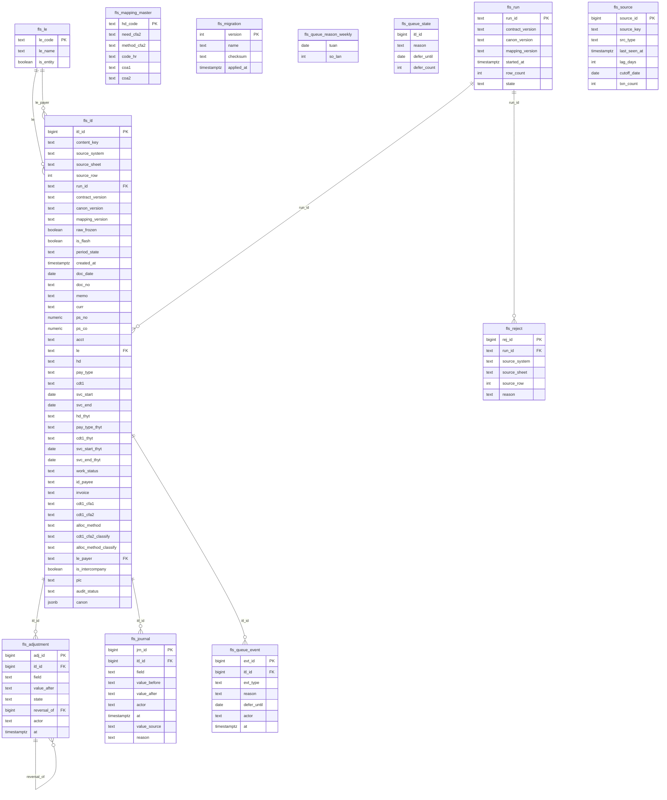

# 05 — DATA DICTIONARY & ERD *(bản đồng bộ trong repo `FLS`)*

**Version:** v0.7 · **Đồng bộ:** 2026-08-26 · **Chủ sở hữu:** COO-CFO

> ⛔ **ERD dưới đây là HIỆN VẬT SINH RA từ `fls/db/schema.py`, không phải hình vẽ tay.**
> Sửa bằng tay sẽ bị cổng **G-ERD-1** bắt (`tests/db/test_erd_gates.py`).
> Muốn đổi ERD thì đổi schema rồi chạy:
> ```
> python -m fls.db.erd_export --write
> python tools/sync_erd_doc.py docs/05_DATA_DICTIONARY_ERD.md
> ```
>
> Bản gốc của bộ tài liệu BA nằm ở `FIN-ERP_Project/ITL/02_BA/05_DATA_DICTIONARY_ERD.md`.
> File này là **bản đồng bộ để cổng G-ERD-2 đọc được trong CI** — cùng khối `erDiagram`.

---

## 1. Mô hình vật lý — chốt lại hai chỗ trước đây nói trái nhau

| Câu cũ | Chốt |
|---|---|
| *"`ITL_LEDGE` là **view kết hợp** RAW + bút toán đã duyệt, không phải bảng"* — `05_DATA_DICTIONARY_ERD:427` | ⛔ **BỎ.** `fls_itl` là **một bảng ba lớp**; `raw_frozen = true` là ranh giới bất biến (`INV-I03`, có trigger + test trên PG thật). Bút toán nằm ở `fls_adjustment`, **append-only** (`INV-I08`) |
| *"sinh `itl_id` atomic bằng bảng `fls_id_counter`"* — `04_DB_IMPLEMENTATION:166` | ⛔ **BỎ `fls_id_counter`.** FPS **fix** bug trùng id bằng cách **bỏ bảng counter**: *"UPDATE+SELECT 2 round-trip, 36% độ trễ, streaming-buffer trùng ID → THAY bằng SEQUENCE + DEFAULT"* (`P100-R/fps-backend/fps/db/pg_schema.py:9`). FLS dùng `CREATE SEQUENCE seq_itl_id` + `DEFAULT nextval(...)`. Xem `GAP-PLAN-02` |

**Trạng thái không còn là bảng riêng** — trước đây ERD vẽ chúng thành entity, thực tế là **cột**:

| ERD cũ | Thực tế |
|---|---|
| `STAGED_ROW` | trạng thái `staged` của `fls_itl` |
| `ITL_RAW` / `ITL_LEDGE` | cùng một bảng `fls_itl`, phân biệt bằng `raw_frozen` |
| `ALLOCATION` | 3 cột `cdt1_cfa1` · `cdt1_cfa2` · `alloc_method` |
| `AUDIT_RESULT` | cột `audit_status` |
| `PERIOD` | cột `period_state` (`INV-I13`) |
| `SOURCE_FILE` | bảng `fls_source` — **đổi tên** |

## 2. Bảng không nối FK về `fls_itl` — khai tường minh (`G-ERD-3`)

| Bảng | Lý do |
|---|---|
| `fls_mapping_master` | tra theo **giá trị** `hd`; `hd` có thể `UNMAPPED` nên không FK được |
| `fls_source` | manifest pipeline, không gắn với dòng nào (`DD-I07`) |
| `fls_run` | `fls_itl.run_id` trỏ tới nhưng **không** FK — ⚠ việc mở, xem §4 |
| `fls_reject` | dòng bị loại **TRƯỚC** khi vào sổ nên không thể FK tới `fls_itl` (`ACC-4`) |

## 3. ERD — sinh ra từ `fls/db/schema.py`



## 4. Việc mở

| ID | Việc |
|---|---|
| `GAP-ERD-P0-01` | `fls_itl.run_id` là `NOT NULL` và trỏ tới `fls_run.run_id` nhưng **không có FK** ⇒ gõ sai `run_id` thì dòng sổ mất lineage trong im lặng, trái tinh thần `INV-I05`. Thêm FK sẽ bỏ được 2 island. **Cần Tech Lead quyết** |
| `GAP-PLAN-02` | `04_DB_IMPLEMENTATION` phải bỏ `fls_id_counter` khỏi §5/§6 |
| `GAP-PLAN-03` | bản gốc BA phải nhận khối `erDiagram` sinh ra này |

## Changelog

- **v0.7 (2026-08-26)**: ERD từ nay **sinh ra từ code**, sửa tay là build đỏ (`G-ERD-1`). Chốt `fls_itl` là **bảng** không phải view; bỏ `fls_id_counter`; khai 4 island kèm lý do; đổi 6 entity ảo thành cột.
