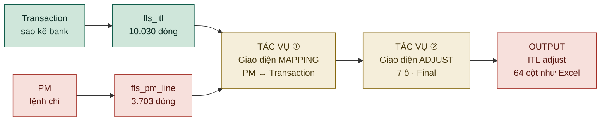
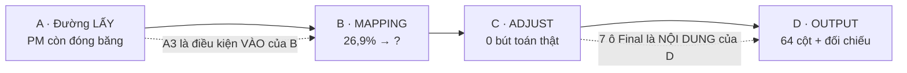
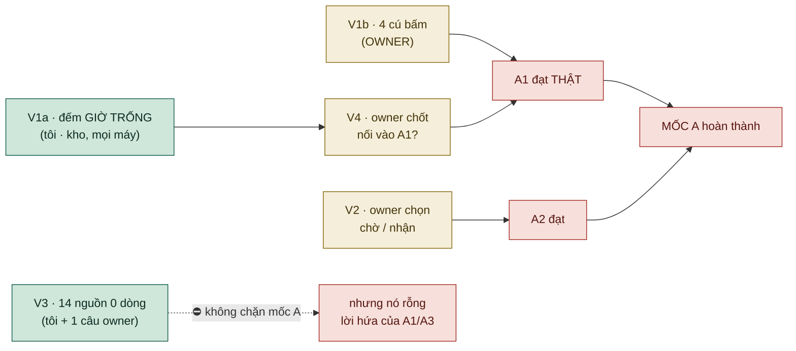

# 09 — MILESTONES: FLS quy về **HAI tác vụ**

**Version:** v1.16 · **Ngày:** 2026-10-07 · **Chủ sở hữu:** COO-CFO
**Căn cứ:** owner chốt 09/09 — *"viết lại milestones theo 2 tác vụ chính của FLS: ⓵ giao diện mapping được PM và Transaction · ⓶ giao diện adjust thông tin ITL. Output cuối cùng là ITL adjust như trong Excel → tránh lan man, tập trung công việc tạo ra các luồng lấy, lưu trữ và alter dữ liệu, giao diện khớp với nghiệp vụ."*

> ⭐⭐⭐ **Trục cũ là *"chín khối · bảy chặng · tám pha"* — trục kỹ thuật. Trục này là **hai tác vụ nghiệp vụ**, và mọi việc phải trả lời được: *nó phục vụ tác vụ nào*.** Việc ⛔ không trả lời được thì nó là **lan man**, và tệp này nói thẳng ra ở `§5`.
>
> ⛔ **Mỗi mốc có một cổng ra ĐO ĐƯỢC.** ⛔ Không mốc nào đóng bằng câu *"đã xây xong"* — đóng bằng một con số chạy được trên kho THẬT.

> ⭐⭐⭐ **HIỆN TRẠNG `07/10` *(v1.16, `fls-ba` — đo lại trong lượt: git `6b4aa2d` · kho thật chỉ `SELECT` · `kiem_so_song` 07/10)*.** Đọc bảng này trước; các khối phán quyết bên dưới *(`§1` 14/09 · `§2` 01/10)* là **biên bản** và vẫn đúng ở phần **cổng** — chỉ phần *"hôm nay"* đã trôi.
>
> | Mốc | Hiện trạng `07/10` | Cổng còn thiếu |
> |---|---|---|
> | **`A`** Đường lấy | ⛔ đổi so với `§1`/`§7`: máy đếm **`4` đạt · `1` một nửa · `1` chưa**. Nhịp chụp vẫn chạy **khi máy bật** — `fls_chup` **182** ảnh, mới nhất **07/10 11:02** *(giờ VN)* | `A2` một nửa · cổng còn lại như `§1` |
> | **`B`** Tác vụ ① mapping | ⭐ **Màn đã chắc:** đợt `01→07/10` đóng **11** `WO`, trong đó **2** đường ghi sai vào sổ được **chứng minh** trên kho TEST *(mã cũ, cửa ghi trả `200`)* rồi **chặn** ở mã mới — `KQ-050` *(đổi lệnh khi ứng viên đang tải — `WO-045`)* · `KQ-061` *(chọn hàng khi lượt tìm đang bay — `WO-023 (i)`)* ⇒ cặp sai **trong dung sai** lọt cửa ghi; **màn là chốt chặn duy nhất**. `WO-051` *(trang `VND` ~104 s → ~0,1 s)* đã bàn giao, **chờ kiểm**. ⛔ Nhưng người thật **`0`** ⇒ máy đếm vẫn **`1` đạt · `1` một nửa · `3` chưa** *(thước đã sửa ở `WO-001`/`WO-011`)*; `fls_pm_link` **2.263** = 2.262 dựng 10/09 + 1 UAT 01/10, **0** mối nối mới từ 02/10 | `B2` · `B3` · `B5` *(cần một kế toán thật bấm)* · `B4` một nửa |
> | **`C`** Tác vụ ② adjust | ⛔ **chờ [`WO-062`](handoff/WO-062-luoi-f02-in-final-va-lo-luu-het-gio.md)** *(CAO)*: lưới `F02` in cột **thô** ⇒ ô người vừa sửa hiện `chưa gán` khi tải lại; cột nguồn rỗng **8.387 / 8.387** ⇒ buổi `C1` đầu tiên sẽ gặp ở **100%** ô. Bút toán người thật **`0`** *(`fls_journal` **4.428** = 4.424 máy gợi ý + 4 UAT)*. Hẹn buổi `C1` **sau** `WO-062` là câu **owner** | `C1`–`C5` — ⛔ cổng nào đã xảy ra |
> | **`D`** Output | ⛔ **chưa bắt đầu** — **0** bộ xuất; đứng sau `C` | `D1`–`D5` |
>
> ⇒ Thứ tự việc: dashboard §6 `6.-20` · báo cáo owner: [`Bao-cao-tien-do-2026-10-07.md`](Bao-cao-tien-do-2026-10-07.md).

---

## §0 · Ba dòng dữ liệu, và cả hai tác vụ đứng trên chúng



⭐ **Đọc một câu *(đo lại 11/09)*:** nửa **Transaction** đã chảy; nửa **PM** đã **tan băng** *(`16` lượt nạp, ⛔ không còn `1`)*; hai giao diện **có mặt** nhưng ⛔ **chưa ai dùng thật** — `fls_journal` vẫn **`0`**, và **`2.262`** mối nối trong kho đều sinh **cùng một ngày `10/09`** bằng phép ghép **tự động**, ⛔ không một cú bấm nào của người; và **output cuối ⛔ chưa tồn tại**.

⛔⛔ **Và `fls_queue_event` ⛔ KHÔNG còn là `0` — nhưng điều đó ⛔ không nghĩa là ai đó đã dùng.** Nó đang có **`108.128`** dòng, và **cả `108.128`** đều do **MÁY** ghi: `evt_type = 'reason'`, một `actor` duy nhất *(`dung-lai-so@apero.vn` — công cụ dựng lại sổ `10/09`)*. Đếm riêng phần **của người** *(`evt_type <> 'reason'`)*: **`0`**.

⇒ ⭐ **Bộ tài liệu này đã tự khai NGÀY HẾT HẠN của phép đếm ấy** *(xem `§3` cuối)*, và ngày ấy **đã đến**: một phép đếm `count(*)` sẽ lật cả ba cổng `B2`·`B3`·`B5` sang xanh mà ⛔ **không một cú bấm nào của người**. Cổng đã được sửa để đếm **`evt_type`**, ⛔ không đếm **số lượng** — và bài thử `test_MAY_ghi_93k_su_kien_ma_KHONG_dong_duoc_cong_nao` ghim đúng chiều ấy.

---

## §1 · MỐC `A` — Đường LẤY dữ liệu: hai nửa **đều đã chảy**, và một lỗ ở VẬN HÀNH

| Nửa | Đo được 09/09 | Trạng thái |
|---|---|:--:|
| **Transaction** *(sao kê bank)* | ⭐ **64** nguồn `Bank` *(sau `4` bản khai mới — `QĐ-ITL-125`)* · **5** ảnh chụp `Bank` · nhịp đọc **8.377** dòng trong **3,3–5,1 giây**, lặp lại **`3` lượt ra cùng một con số** · **9 cửa**. ⚠ **14** nguồn ra `0` dòng — cửa **khai ra** | ✅ **chảy** |
| ⭐ **PM** *(lệnh chi)* | ⭐ **ĐÃ TAN BĂNG** — **5** lượt nạp *(⛔ không còn `1`)*, **4** ảnh chụp `lan='PM'`, ảnh hiệu lực đọc **3.772** dòng · **0** dòng bỏ qua · **0** mã mới so với ảnh trước. ⇒ Cổng `A3` **đạt**. ⛔ Vẫn ⛔ **không màn hình** cho lằn nạp PM — nó chạy bằng **nhịp**, ⛔ không bằng một người | ✅ **chảy** |
| Quỹ *(`Cash`)* | **8** nguồn có trong `fls_source` · **0** ảnh chụp | ⛔ chưa mở |

⛔⛔ **ĐÂY LÀ MỐC ĐẦU TIÊN, VÀ NÓ LÀ MỐC BỊ BỎ QUÊN.** Tác vụ ① là *"mapping PM **và** Transaction"* — nó cần **HAI** nguồn. Ta đã dựng trọn lằn nạp cho **một** nguồn *(9 cửa, 5 trạng thái màn `F04`)*, và nửa còn lại thì ⛔ **chưa có một cửa nào**. ⇒ Mọi con số về độ phủ mapping ở `§2` đều đang đo trên **một tập PM già 13 ngày**, và ⛔ không phép đo nào nói ra điều đó.

### Cổng ra của mốc `A`

| # | Cổng | Đo bằng |
|--:|---|---|
| `A1` | Ảnh chụp sao kê sinh **tự động**, kế toán ⛔ không cần Dev | `fls_chup` có ≥2 ảnh cách nhau ~1 giờ, actor ⛔ **không phải** `tools/…` · ảnh cũ ⛔ không đổi một ô |
| `A2` | Phép **dọn** ảnh chạy được | ảnh **đã nạp** còn nguyên · ảnh **quá 30 ngày chưa nạp** bị xoá · `fls_run.chup_id` **⛔ không đứt** |
| `A3` | ⭐⭐ **PM có đường vào như Transaction** | `fls_chup` có `lan='PM'` · `fls_pm_line` có ≥2 `run_id` khác nhau · dòng PM mới xuất hiện **⛔ không qua dòng lệnh** |
| `A4` | Nạp PM **⛔ không nhân đôi** dòng cũ | nạp lại **cùng** một tệp PM ⇒ ⛔ **0** dòng trùng — đo trên **cả hai** bề mặt: `(run_id, source_row)` trong một ảnh, và `(itl_id, pm_line_id)` trong bảng mối nối |

⚠ `A1`+`A2` = `QĐ-ITL-114`+`115` *(owner đã chốt, ⛔ không tách rời)*. **`A3`+`A4` là việc MỚI mà trục cũ ⛔ không có**.

### ⭐⭐⭐ MỐC `A` ĐÃ ĐẠT CHƯA — đo 14/09 trên kho THẬT: **4 đạt · 1 một nửa · 1 chưa**

> ⛔⛔⛔ **TỤT MỘT CỔNG NGÀY 14/09, và cổng ấy TỰ nó nói ra — ⛔ không ai báo.**
>
> Cổng `A5b` *(«ảnh `Bank` mới nhất đã nạp cách đây ≤ `48` giờ»)* đo được **`88` giờ**. Truy ra: **nhịp chụp đã DỪNG từ `11/09 09:17`** — ba ngày ⛔ không một ảnh nào, cả `Bank` lẫn `PM`.
>
> ⭐⭐ **Đây ⛔ KHÔNG phải một cổng vừa hỏng — đây là lần ĐẦU TIÊN nó bắt được hậu quả của một chuyện đã biết.** Bộ hẹn giờ ⛔ **chưa bao giờ** được đăng ký thành tác vụ Windows; nó sống nhờ một tiến trình chạy kèm phiên làm việc. Suốt `09/09`→`11/09` tôi làm mỗi ngày nên con số **luôn dưới `48`** và cổng **luôn xanh** — nó xanh vì **có người ngồi đó**, ⛔ không vì hệ tự chạy.
>
> ⇒ Bài học, và nó rộng hơn cái cổng này: ***một cổng chỉ đỏ khi ⛔ không ai ngồi cạnh nó thì nó ⛔ chưa từng được kiểm.*** Ba ngày ⛔ không ai làm việc là **phép thử thật đầu tiên** của lằn tự động, và nó **trượt**.
>
> ⚠ Câu cũ ở chỗ này ghi *"nhịp **đã đăng ký** vào bộ hẹn giờ"* — **sai từ lúc viết**, và cổng ⛔ không thấy vì cổng canh **SỐ**, ⛔ không canh **CÂU** *(`GAP-DOC-08`)*. Hai cú bấm `09/09` *(`QĐ-ITL-125`)* có thật: **`4`** nguồn mới đã khai ⇒ lằn `Bank` **chạy được** *(`64` nguồn · `8.377` dòng · `3,4` giây; trước đó nó **đổ**)*. ⛔ Nhưng việc **đăng ký tác vụ** thì ⛔ **chưa xảy ra** — nó vẫn nằm trong ba việc chỉ **chủ máy** làm được *(`WakeToRun` · Docker tự khởi động)*.
>
> ⛔⛔ **Cổng `A2` còn một nửa, và nó ⛔ không chờ ai — nó chờ THỜI GIAN:** vế *"xoá ảnh quá `30` ngày chưa nạp"* đang xanh trên một **tập RỖNG** *(ảnh già nhất `0` ngày)*, và *"xanh trên tập rỗng là ⛔ CHƯA ĐO"*. Nó sẽ tự đóng khi kho đủ `30` ngày tuổi.
>
> ⛔⛔⛔ **Và một chỗ ⛔ chưa sạch, nói thẳng:** số ảnh mang `actor` của nhịp hiện **gồm cả** các lượt tôi **gõ tay** *(sổ chỉ-thêm ⇒ tôi ⛔ **không** sửa chúng)*. ⇒ **⛔ Đừng đọc con số trong kho là bằng chứng rằng hệ tự chạy.** Bằng chứng là bản ghi của **chính bộ hẹn giờ**: `python tools/soi_nhip.py`.

| # | Đo được 09/09 | Kết |
|--:|---|:--:|
| `A1` | **9** ảnh trong kho, **7** do nhịp sinh, rơi vào **4** giờ đồng hồ khác nhau *(cổng đòi ≥2 ảnh, ≥2 giờ)*; bộ hẹn giờ **đã đăng ký** và chạy lần cuối `09/09 20:00` với mã **0** | ✅ **ĐẠT** *(xem ô ⛔ dưới bảng — nó **đạt trên KHO**, ⛔ chưa đạt trong VẬN HÀNH)* |
| `A2` | **0** lần nạp trỏ vào một ảnh ⛔ không còn ⇒ vế *"vết ⛔ không đứt"* **đạt**. ⛔ Nhưng ảnh già nhất mới **1 ngày** ⇒ vế *"xoá ảnh quá 30 ngày chưa nạp"* vẫn xanh trên một **tập RỖNG**, và *"xanh trên tập rỗng là ⛔ CHƯA ĐO"*. ⭐ Cú dọn `10/09` nói **giữ `3` vì ĐÃ NẠP · giữ `4` vì CÒN MỚI · xoá `0`** ⇒ nhánh xoá **có chạy**, chỉ ⛔ chưa có gì để xoá | ◐ **một nửa** |
| `A3` | **4** ảnh `lan='PM'` · **5** `run_id` khác nhau · **3.772** dòng lệnh trong ảnh hiệu lực ⇒ đường ống **chạy thật**, và nay **nhịp** chạy nó chứ ⛔ không phải một dòng lệnh gõ tay. Nửa sau của cổng vẫn **nằm cùng chỗ với `A1`**, nên nó thừa hưởng cả **lỗ** của `A1` | ✅ **ĐẠT** |
| `A4` | **0** dòng lệnh trùng trong một ảnh · **0** mối nối trùng | ✅ **ĐẠT** |

⛔⛔ **Ba con số `3 · 1 · 0` do MÁY đếm, ⛔ không ai gõ** — luật đếm khai trong `tools/kiem_so_song.py::_cong_moc_a` và đọc lại được. ⭐ Lần đầu tôi **gõ tay `2/4`** vào bản vẽ kiến trúc, và nó **sai theo đúng cái bảng nằm ngay dưới nó** *(bảng ghi `A4` là cổng duy nhất `✅`)*. Một con số tổng gõ tay cạnh một bảng chi tiết là chỗ **dễ mâu thuẫn nhất**, và nó ⛔ không bao giờ tự báo.

⛔⛔ **Và nó vừa mâu thuẫn LẦN THỨ HAI, theo chiều NGƯỢC LẠI — bản `v1.7` của tệp này ghi tiêu đề `3 · 1 · 0` *(máy đếm)* trong khi **bảng ngay dưới** vẫn ghi `A1` ⛔ **CHƯA** và `A3` ◐, tức `1 · 2 · 1`.** Cổng ⛔ không bắt được vì nó ghim **con số ở tiêu đề**, còn bốn ô phán quyết trong bảng là **chữ**, ⛔ không phải số. ⇒ Ghim một con số **⛔ không** bảo vệ được câu nằm cạnh nó *(`GAP-DOC-08`)*.

> ⛔⛔⛔ **`A1` ĐẠT TRÊN KHO, VÀ ⛔ CHƯA ĐẠT TRONG VẬN HÀNH — đo `10/09`, `python tools/soi_nhip.py` trả mã `4`.**
>
> Cổng `A1` đo *"có ≥2 ảnh, ≥2 giờ, `actor` đúng"* — **cả ba đều thật**. Nhưng **câu hỏi** của `A1` là *"ảnh chụp sinh **tự động**, kế toán ⛔ **không cần Dev**"*, và sáng `10/09` câu trả lời là **CẦN**:
>
> | Đo được `10/09` | |
> |---|---|
> | Bộ hẹn giờ bỏ **`3`** lượt *(`08:00` · `09:00` · `10:00`)* | máy **ngủ**, và `WakeToRun = False` |
> | Kho `PostgreSQL` **⛔ không chạy** — `Docker Desktop` tắt | tôi phải **bật bằng tay** trước khi đo được một con số nào |
> | `DisallowStartIfOnBatteries = True` | **rút điện** ⇒ nhịp ⛔ **không chạy** |
> | `StopIfGoingOnBatteries = True` | đang chụp mà rút điện ⇒ lượt ấy **bị giết giữa đường** |
>
> ⛔⛔ **Ba cài đặt ấy tôi ⛔ KHÔNG HỀ KHAI khi đăng ký việc** — chúng đang ở **mặc định của PowerShell**. ⇒ *"nhịp mỗi giờ"* thực chất là ***"mỗi giờ, NẾU máy thức VÀ đang cắm điện"***, và đó là một câu **khác**.
>
> ⭐ **Công cụ đã bị chữa, vì nó tự đi qua lỗi của chính nó:** `soi_nhip.py` **đã in** `so_luot_hut 3` rồi in ngay bên dưới `✅ Bộ hẹn giờ CÓ CHẠY` và trả mã `0` — **một con số nằm cạnh một kết luận ⛔ không đọc nó**. Nay nó trả **mã `4`** *(≠ `3` = *"chưa bao giờ chạy"*)* và **đọc ra cả bốn lý do**.
>
> ⛔ **Tôi ⛔ KHÔNG tự đổi ba cài đặt kia** *(`R-A4`)*: đánh thức máy theo giờ và cho nó chạy trên pin là **cách máy của chủ máy xử sự**, ⛔ không phải một tham số của FLS. ⇒ **Câu hỏi cho owner** ở `§7`.

✅ **Thứ hỏng thật từng chặn nửa `Bank` — ĐÃ XONG 09/09** *(`QĐ-ITL-125`)*: sheet sống có **`4`** sheet ACB chưa ai khai — ⛔ **không phải `2` như tôi báo**: ngoài `2` sheet **Coretap** còn `2` sheet **Nextwist** tôi ⛔ chưa thấy ⇒ lằn sao kê **đổ mỗi giờ**. Một lệnh, một lần: `python tools/nap_nguon_va_khai.py --that` ⇒ nay **72/72** dòng chảy có bản khai. ⭐ Nhịp cố ý cho **hai lằn chạy độc lập**, nên một sheet ⛔ chưa khai **⛔ không** kéo lằn `PM` xuống theo — và đó là lý do lằn `PM` vẫn chụp được suốt lúc lằn `Bank` đang đổ.

---

## §2 · MỐC `B` — TÁC VỤ ① · Giao diện MAPPING PM ↔ Transaction

### ⓵ Đã có gì

| Thành phần | Cửa | Trạng thái |
|---|---|:--:|
| Lưới hàng chờ theo **tiền** | `GET /queue` · `GET /queue/summary` | ✅ |
| Ứng viên PM **4 bậc CÓ TÊN** | `GET /queue/{itl_id}/pm-candidates` | ✅ |
| Ghép · Bỏ ghép | `POST …/match` *(thân `pm_line_ids[]`)* · `POST …/unmatch` | ✅ |
| Xong · Mở lại · Lý do · Hoãn | `POST …/done` · `…/reopen` · `…/reason` · `…/defer` | ✅ |
| Độ phủ hàng chờ | `GET /queue/coverage` | ✅ |

### ⓶ ⛔⛔ Và đây là con số của tác vụ ①

| | |
|---|--:|
| Dòng tiền trong sổ | **8.387** |
| ⭐ trong đó vế **`PS Có`** *(vế của lệnh chi — đo được, ⛔ không giả định)* | **8.246** |
| ⭐ **ghép được về lệnh chi** | **2.222** · **26,5%** |
| ⛔ **CHƯA ghép** | ⛔ **6.165** · **73,5%** |
| Mối nối đang hiệu lực | 2.745 |
| Dòng lệnh PM có trong kho | 3.703 *(già 13 ngày — `§1`)* |

⛔⛔⛔ **Và một khuyết tật HÌNH DẠNG, ⛔ không phải khuyết tật mã:** cửa ghép nhận **`pm_line_ids[]` cho MỘT `itl_id`** ⇒ **nhiều lệnh cho một dòng tiền**, nhưng **một dòng tiền một lượt**. Với **7.329** dòng chưa ghép, đó là **7.329 lượt bấm**.

⭐⭐ **Ta đã học đúng bài này hôm 09/09 ở chỗ khác:** khối *"cách đọc ngày"* bắt kế toán bấm **27** cú để trả lời một câu mà **dữ liệu đã tự trả lời** ⇒ `QĐ-ITL-117` mở cửa lô, nhưng **chỉ nhận nguồn TỰ CHỨNG** và cửa **⛔ không nhận** giá trị do màn chọn. **Mapping là cùng một hình bệnh** — **7.329** cú bấm thay vì **27**.

> ⛔⛔⛔ **NHƯNG CỬA GHÉP LÔ CHỈ DỌN ĐƯỢC `68` DÒNG — `0,9%`.** Bản `v1.1` của tệp này ghi **584 (8,0%)**; cửa đã **dựng và chạy thật** 09/09, và con số thật là **68**. ⛔ `584` đo bằng luật của **danh sách ứng viên** *(`ung_vien_pm` — cửa **ĐỌC** để **người CHỌN**)*, ⛔ không bằng luật của **cửa GHI**: `ghep_lenh` còn bốn cổng, và trên đúng tập **652** dòng có mã thì **301** lệch tiền · **202** khác tiền tệ · **51** chùm Σ vẫn lệch · **30** chưa duyệt. ⇒ Cửa ghép lô **vẫn đáng làm** *(68 cú → 1, và nó ⛔ không chờ gì)*, nhưng câu *"lớn hơn 271 lần"* ở bản `v1.0` **đúng về số cú bấm và SAI về hàm ý**: nó ⛔ **không phải** đòn chính. Đòn chính là **mốc `A3`** — **6.577 dòng (89,7%)** có mã chuẩn hoá được mà ⛔ **KHÔNG một dòng PM nào mang mã ấy**. Chi tiết + lộ trình: [`03_Dev/13_LO_TRINH_HAI_TAC_VU.md`](../03_Dev/13_LO_TRINH_HAI_TAC_VU.md). ⇒ Cửa ghép lô phải theo **đúng khuôn ấy**: máy **đo lại** phía máy chủ, ghép **chỉ** những dòng **tự chứng** *(ứng viên bậc cao nhất, duy nhất, khớp cả `mã`+`tiền`)*, và **⛔ NỔ CẢ LÔ** khi có một dòng ⛔ không tự chứng.

### Cổng ra của mốc `B`

| # | Cổng | Đo bằng |
|--:|---|---|
| `B1` | ⭐⭐ **Mẫu số được định nghĩa bằng SỰ KIỆN, ⛔ không bằng xét đoán** *(viết lại 09/09 — `QĐ-ITL-121`)* | ⛔⛔ **Cổng cũ đòi *"nhóm 'vốn ⛔ không cần lệnh chi' có luật đặt tên được"* — và đó là một cổng ⛔ KHÔNG ĐƯỢC PHÉP ĐẠT:** `QĐ-ITL-56` nói **⛔ không có quy định nào**, `QĐ-ITL-58` **bỏ hẳn** trạng thái giữa, `INV-I16` cấm máy dán nhãn mặc định. ⇒ Hai phép đo thay nó, **cả hai đã chạy thật và đã vào cổng**: ⓵ ⭐⭐ **độ phủ TRÊN TRẦN `65,6%`** *(`2.562/3.907`)* — con số nói đúng phần việc đã làm, thay `31,1%`; ⓶ ⭐⭐ **việc người xem `799` dòng** *(`10,4%` hàng chờ)* phủ **90% tiền trong TỪNG tiền tệ** *(VND `310` · USD `444` · SGD `13` · HKD `32`)*. ⛔ Phép xếp ấy **⛔ không nói** dòng nào *"không cần lệnh chi"* — nó nói **xem cái này trước**, nên nó ⛔ không cần một quy định không tồn tại. Đo lại: `python tools/do_mau_so.py` *(mục `ⓕ` + `ⓖ`)* |
| `B2` | ⭐⭐ Cửa ghép **CẢ LÔ**, **chỉ dòng TỰ CHỨNG** | thân **chỉ** `itl_ids[]`, ⛔ **KHÔNG** `pm_line_ids` *(máy đo lại)* · dòng ⛔ không tự chứng ⇒ **422 CẢ LÔ, ⛔ 0 mối nối mới** · `Σ mối nối = tiền bank` từng dòng |
| `B3` | Ghép lô có **HẬU QUẢ đo được** | ⭐ Mẫu số nay là **8.246** *(vế `PS Có`, độ phủ **31,1%**)* — ⛔ không còn `26,9%` trên `10.030`. Độ phủ tăng lên một con số **đo trên kho thật**, và biên bản nói **đúng** số dòng vừa nối |
| `B4` | Đường **LÙI** còn nguyên | bỏ ghép một lô ⇒ mối nối về đúng trạng thái trước, **⛔ không xoá dòng nào** *(`INV-I08`)* |
| `B5` | Kế toán đi hết **một vòng thật** | ≥1 `fls_queue_event` do **người thật** *(⛔ không phải `test`/`tools`)*; hôm nay đo được **0** |

### ⭐⭐⭐ MỐC `B` ĐÃ ĐẠT CHƯA — máy đếm trên kho THẬT: **`1` đạt · `1` một nửa · `3` chưa**

> ⚠ **01/10 *(`WO-001`, `fls-dev`)*: THƯỚC SỬA, ⛔ VIỆC LÙI.** Từ `18/09` đến `01/10` dòng trên in `4 · 1 · 0` *(rồi máy đo `5 · 0 · 0`)* vì phép đếm coi **`2.219`** sự kiện `match` của máy `may@fls` *(`QĐ-ITL-143`)* và **`2`** dòng UAT của owner là *"người bấm"* *(`KQ-002 F-2`)*. Nay phép đếm loại cả hai *(`QĐ-ITL-150 ⓐ`)* ⇒ `1 · 1 · 3` — ⛔ không một cổng nào lùi, chỉ là trước đây nó **chưa từng tiến**.

> ⛔⛔⛔ **Và phép đếm này vừa chặn một phản xạ của tôi.** `10/09` tôi viết **ba bài** chứng minh đường **LÙI của một LÔ** chạy được, và điều đầu tiên tôi muốn ghi là *"`B4` ĐẠT"*. **Sai.** Bài thử chạy trên kho **TEST**; cổng `B4` hỏi *"đường lùi còn nguyên"* trên **sổ THẬT**, và trên sổ thật `fls_pm_unlink` = **`0`** — ⛔ **chưa một cú bỏ ghép nào từng xảy ra**.
>
> ⇒ **Luật: *"bộ test xanh"* ⛔ KHÔNG đóng được một cổng của mốc.** Nó chứng minh **mã chạy đúng**; cổng hỏi **việc đã xảy ra**. Gộp hai câu ấy lại là cách để một lần `422 FLS-SOAT-CHAN` nổ vào mặt ngay lần đầu có một lô thật. ⇒ Luật đếm khai trong `tools/kiem_so_song.py::_cong_moc_b`, và nó ⛔ **không nhận một tham số nào** về *"bộ test"* — ⛔ không có đường nào để một bộ test xanh đổi được con số này.

| # | Đo được trên kho THẬT | Kết |
|--:|---|:--:|
| `B1` | Mẫu số phía PM **đo được** *(`QĐ-ITL-121`/`122`)* — dòng lệnh trong ảnh hiệu lực và số chưa có tiền *(số sống: §7 dòng `B` · bản vẽ 13 bảng *"Việc còn lại"* — có phép so; ⚠ câu cũ ghi `3.772`/`1.345` = số 09/09, `KQ-010 F-4 ⓓ`)*, và phép đo ấy **đã vào cổng** | ✅ **ĐẠT** |
| `B2` | Cửa ghép **LÔ** có từ `09/09`, thân **chỉ** `itl_ids[]`, **`9`** bài thử qua HTTP. ⛔ Nhưng sự kiện **người thật** trên `fls_queue_event` = **`0`** *(sau khi loại máy + UAT — `WO-001`)* ⇒ ⛔ **chưa ai bấm** | ⛔ **CHƯA** |
| `B3` | Hậu quả đo được — cần **một lô thật** làm độ phủ đổi. Cùng điều kiện với `B2` | ⛔ **CHƯA** |
| `B4` | ⭐ Mã đường **LÙI của một LÔ** nay **có bài thử** *(`10/09`, **`3`** bài, đã chứng minh ĐỎ)*. ⛔ Nhưng `fls_pm_unlink` trên sổ thật = **`1`** — chính cú bỏ ghép **UAT 01/10** của owner *(`itl_id 27728`)*, ⛔ tính *(`QĐ-ITL-150 ⓐ`)* ⇒ việc thật = **`0`** | ◐ **một nửa** |
| `B5` | ≥1 `fls_queue_event` do **người thật** | ⛔ **CHƯA** |

⛔⛔ **Đọc bảng này một câu:** cả **`2.262`** mối nối trong kho đều là **`lan 1`** và sinh cùng ngày `10/09` bằng phép ghép **tự động** ⇒ **⛔ không một cửa GHI nào của hàng chờ từng được dùng trên sổ thật** *(ngoài cú UAT 01/10 — ghép rồi bỏ ghép `itl_id 27728`, ròng `0`, ⛔ tính người)*. `B2`·`B3`·`B5` ⛔ không phải *"một nửa"* — ⛔ **không một vế nào** của chúng đã xảy ra.

⛔⛔⛔ **NGÀY HẾT HẠN ẤY ĐÃ ĐẾN — `10/09`, và nó đã cắn thật.** Luật cũ đếm `count(*) fls_queue_event` với tiền đề *"chỉ cửa hàng chờ ghi vào đây"*. Nhưng `lo_nap` gọi `ghi_ly_do()` cho **mỗi dòng bị cờ** ⇒ **MÁY cũng ghi vào bảng ấy**. Cú dựng lại sổ `10/09` ghi **`93.666`** sự kiện `reason` *(nay là `108.128`)*, và `B2`·`B3`·`B5` **lật sang XANH** trong khi ⛔ **`0`** cú bấm của người.

⇒ **Phép đếm nay hỏi `evt_type`, ⛔ không hỏi số lượng:** `evt_type <> 'reason'` = việc **người** làm. Bài `test_MAY_ghi_93k_su_kien_ma_KHONG_dong_duoc_cong_nao` ghim đúng chiều ấy — **`108.128` sự kiện máy phải đóng được `0` cổng**. ⛔⛔ **Tiền đề ấy vỡ LẦN NỮA `18/09`** *(`QĐ-ITL-143`: máy tự ghép ghi `2.219` sự kiện `match` actor `may@fls`)* ⇒ từ `01/10` *(`WO-001`)* phép đếm loại thêm actor `may@fls` *(hằng `fls/repo/may_ghep.py::MAY`)* và dòng có `reason` bắt đầu `UAT `.

⚠ **Và luật mới VẪN thô, khai ngay trong mã:** giây phút `su_kien_cho_nguoi` lên `1`, `B2`·`B3`·`B5` **cùng nhảy** — một con số ⛔ không phân biệt được *một vòng đầy đủ* với *một cú bấm lẻ*. Có bài ghim hành vi ấy **để nó lộ ra**, kèm câu *"nếu con số này ⛔ không còn là `4` thì luật đã được siết"*.

⭐⭐ **v1.13 *(01/10 khuya, `fls-ba` — `KQ-010 F-2`)*: luật *"người thật"* đổi từ DANH SÁCH ĐEN sang BẢN TRẮNG — spec cho [`WO-011`](handoff/WO-011-thuoc-nguoi-ban-trang-va-anh-hieu-luc.md).** Đo 01/10 khuya *(grep `fls/` + `tools/`, ⛔ `tests/`)*: trong mã có **8** hằng actor ⛔ phải người *(`may@fls` · `nhip@fls` · `nhip@fls(tay)` · `dung-lai-so@apero.vn` · `thu@apero.vn` · `cong-ghi@apero.vn` · `cong@apero.vn` · `ke-toan@apero.vn`)*, mà phép đếm chỉ biết **1**. Ba lần vỡ trước đều cùng một kiểu: **trừ đi cái đã biết là máy**. Luật mới **đếm cái đã khai là người**:

| | Luật | Vì sao |
|---|---|---|
| ⓐ Sổ actor | mọi actor ⛔ phải người khai **một chỗ** trong `fls/` *(`ACTOR_MAY` — tiến trình máy **và** tệp lệnh kiểm)*; bài quét mã: hằng chuỗi `…@fls…` / `…@apero.vn` trong `fls/` + `tools/` ⊆ sổ. ⭐ **v1.15 *(02/10, `KQ-014 F-4`)*:** bài quét bắt actor theo **chỗ dùng** *(chuỗi đi vào tham số / cột `actor`)*, ⛔ theo **hình dạng** `@` — hai actor máy đang chạy ⛔ mang `@` *(`tools/chup_sao_ke.py:85` `"tools/chup_sao_ke.py"` · `tools/nap_nguon_va_khai.py:67` `"máy · trích dòng 1 (QĐ-ITL-105)"`)* nên lọt bài quét v1.14; actor **lịch sử** *(⛔ còn mã nào ghi)* cũng vào `ACTOR_MAY`, kèm ngày + số dòng | tiền đề vỡ lần thứ tư phải đỏ ở **bài thử**, ⛔ ở sổ thật |
| ⓑ Người thật | ~~một sự kiện tính là người ⇔ `actor` ∈ **danh mục người** *(khai cùng chỗ — `WO-011 Q1` chờ owner)* **và** ⛔ UAT~~ ⏸ **v1.14 *(02/10)*: ⇔ `actor` ⛔ thuộc `ACTOR_MAY` **và** ⛔ UAT** — danh mục người **hoãn** *(owner: *"defer phần tài khoản, làm xong công cụ đã"*)* | ~~đếm cái đã khai, ⛔ trừ cái đã biết~~ ⇒ quay về **trừ cái đã biết là máy**, nhưng sổ máy nay **đủ 8** *(trước: 1)* và có ⓒ canh chỗ hở |
| ⓒ Actor lạ | ~~actor trên kho thật ⛔ thuộc sổ máy lẫn danh mục người ⇒ cổng mốc `B` **⛔ KHÔNG ĐO ĐƯỢC**~~ ⏸ **v1.14:** actor trên kho thật ⛔ thuộc `ACTOR_MAY` lẫn `ACTOR_DA_THAY` *(sổ **ghi nhận** actor ⛔ phải máy đã từng xuất hiện — khởi đầu `khanhcq@apero.vn`; ⛔ phải danh mục *ai là kế toán*)* ⇒ **vẫn tính là người** *(ⓑ)* **và** cổng mốc `B` in **`⚠ ACTOR MỚI: <tên> · <n> dòng`** + trạng thái **NO** cho tới khi ai đó khai nó vào **một** trong hai sổ. ⭐ **v1.15:** phép soi actor lạ đọc **mọi** bảng / khung xem có cột `actor` *(đọc từ `information_schema` lúc chạy, ⛔ danh sách gõ tay — đo 02/10: **7** = `fls_queue_event` · `fls_adjustment` · `fls_journal` · `fls_da_xong` · `fls_sua_tay` · ⭐ `fls_chup` · ⭐ `fls_khai_cot`)*; `fls_pm_unlink` vẫn qua `evt_id` | luật `Đ5`; báo **hiếm** — mỗi actor mới đúng **một** lần. ⭐ Hở của danh sách đen *(một máy mới quên khai ⇒ tính là người)* ⛔ còn **im lặng** |
| ⓓ UAT | **một** hàm + **một** mẩu SQL: `reason` bỏ khoảng trắng đầu, ⛔ phân biệt hoa thường, bắt đầu `UAT` và ký tự kế ⛔ phải chữ cái; `NULL` ⇒ ⛔ UAT. ⭐ **v1.15 *(02/10, `KQ-014 F-1`)* — "chữ cái" = **chữ Latin ASCII `A`–`Z` / `a`–`z`**, khai **tường minh** ở cả hai mặt *(⛔ `str.isalpha()`, ⛔ `[[:alpha:]]`, ⛔ cờ không-phân-biệt-hoa-thường áp lên lớp chữ cái — cờ ấy gập `K` Kelvin `U+212A` về `k`)*; "khoảng trắng đầu" = **tập khai tay** ở sổ actor *(9 ký tự, 02/10)* — ký tự ngoài tập *(vd. `U+2003`)* ⇒ ⛔ bị bỏ ⇒ dòng tính là **người** ở **cả hai** mặt *(chiều **ồn**, chấp nhận)*. Lý do: đo `KQ-014` trên **1.112.063** điểm mã — `[[:alpha:]]` *(`en_US.utf8`)* và `isalpha()` lệch ở **7.405** điểm *(dấu kết hợp mang thuộc tính Alphabetic)* ⇒ câu *"một luật, hai mặt"* ⛔ đúng trên toàn Unicode; ASCII thì hai mặt đọc **cùng một** bảng 52 ký tự. Cái giá: `'UATé…'` · `'UATđ…'` đổi từ **người** sang **UAT** — ⛔ lý do tiếng Việt nào bắt đầu như vậy *(`uất` ⛔ khớp `uat` ở ký tự thứ hai)* | `'uat …'` · `' UAT …'` · `'UAT02/10'` hôm nay **tính là người** *(`KQ-010`)* |
| ⓔ Phạm vi | **mọi** cổng *"người đã làm"*: `B2` · `B3` · `B4` *(nay loại cả máy — đối xứng)* · `B5` · `khop_owner C8` · `BA-14 G-d`. ⭐ **v1.15:** ⓐ `C8` nối mỗi dòng `fls_sua_tay` với **đúng một** dòng nhật ký — dòng ghi **cùng bút toán** đang hiệu lực *(`KQ-014 F-2`: nối theo `(itl_id, field, actor, at)` thì hai bút toán cùng giao dịch mang cùng `now()` ⇒ khớp **2** dòng ⇒ một cú sửa thật bị nuốt — chiều **im**)*; phép nối ra ≠ 1 dòng ⇒ **⛔ không đo được** *(NO)*, ⛔ im. ⚠ Đo 02/10 *(`Đ1`)*: ⛔ dùng được khoá `adj_id → evt_id` — đường người sửa ô `ghi_tay.ghi_but_toan` *(`fls/repo/ghi_tay.py:403`)* ghi `fls_adjustment.evt_id` = **NULL**, lý do chỉ nằm ở `fls_journal.reason`; `fls_journal` ⛔ có cột `adj_id` *(thêm cột = migration — ⛔ trong phạm vi)*. ⓑ thêm *"bản khai cột **đã xác nhận**"* trên `fls_khai_cot` — `tools/nap_nguon_va_khai.py:62`–`66` khai *"đã xác nhận" = "có một bản khai mang tên người thật"*; hôm nay ⛔ mã nào đọc nghĩa ấy, nhưng **464** dòng khai của máy mang chuỗi ⛔ có trong sổ thì một phép đếm ngày mai sẽ gọi chúng là *"người đã xác nhận"* | `QĐ-ITL-150 ⓐ`: *"bất kỳ cổng"* |

Hôm nay *(đo 01/10 khuya, chỉ `SELECT`)*: **3** actor trên `fls_queue_event` — `dung-lai-so@apero.vn` **108.128** *(`reason`)* · `may@fls` **2.219** *(`match`)* · `khanhcq@apero.vn` **2** *(cả hai UAT)* ⇒ người thật **0**, actor lạ **0** ⇒ con số mốc `B` ⛔ đổi khi `WO-011` vào.

---

### ⭐⭐⭐ MẪU SỐ THẬT — owner chốt chiều đo 09/09 *(`QĐ-ITL-122`)*

> Nguyên văn: *"`Trans` map vào `PM` (số lượng Trans vốn nhiều hơn PM; ⛔ ko cần question các Trans không được map)"*.

⛔⛔⛔ **Mọi con số độ phủ trong `⓶` ở trên — và mọi con số độ phủ từ 27/08 đến 09/09 — đo SAI PHÍA.** Chúng chia cho `PS Có` = **8.246** dòng **TIỀN** và cho **31,1%**, một con số đọc ra là *thất bại*. Nhưng **10.030** dòng tiền so với **3.772** dòng lệnh *(số 09/09)* là **đúng như thiết kế**: một lệnh chi ⛔ không tương ứng một giao dịch bank, và các dòng tiền ⛔ không map thì **⛔ KHÔNG PHẢI một câu hỏi**.

| Đo trên đúng phía *(`do_phu_pm`, 09/09)* | |
|---|--:|
| Dòng lệnh chi trong ảnh hiệu lực | **3.772** |
| ⭐ **đã tìm được tiền của nó** | **2.427** · **64,3%** |
| ⛔ **CHƯA tìm được tiền** ⇒ **VIỆC THẬT** | ⛔ **1.345** · **35,7%** |
| Phiếu *(`pm_slip_id`)* | **1.500** → **990** có ≥1 dòng đã nối · ⛔ **698** còn dòng chưa nối |
| ⭐⭐ trong `698` đó: phiếu **ĐÃ NỐI MỘT PHẦN** *(dễ bỏ sót nhất)* | ⛔ **188** *(còn `510` phiếu ⛔ chưa nối gì cả)* |
| trong `1.345`: **ghép được ngay** *(có dòng tiền ⛔ chưa nối mang đúng mã)* | **475** |
| trong `1.345`: `status` ⛔ **chưa duyệt** *(việc của người khác)* | **275** |
| tiền của `1.345` dòng ấy | **62,0 tỷ VND** · **133,5 triệu USD** · 1,59 triệu SGD |

⇒ **Danh sách việc là `1.345` dòng lệnh */* `698` phiếu, ⛔ không phải `5.684` dòng tiền.** Hai cách đếm chênh **4,2 lần** về số cú bấm.

⭐ **Và nó làm TAN khái niệm *"trần cứng 47,4%"*** *(`QĐ-ITL-119`)*: trần ấy ⛔ **không phải** giới hạn của thành công — nó chỉ là **tỷ lệ kích thước hai tập**. Giữ lại vì nó vẫn trả lời một câu THẬT *(⛔ đừng hứa độ phủ `PS Có` lên `100%`)*, nhưng nó **thôi là con số ra quyết định**.

⛔⛔ **Hệ quả NẶNG, và nó là khuyết tật GIAO DIỆN — `GAP-SCR-14`, ✅ ĐÃ ĐÓNG cùng ngày *(`QĐ-ITL-124`)*:** đo trên bảng tuyến: **10** tuyến khoá theo `itl_id`, ⛔ **0** tuyến khoá theo **dòng lệnh** ⇒ ⛔ **không có đường nào hỏi *"lệnh chi nào chưa tìm được tiền"*** — tức **đúng câu hỏi của việc**. Màn `F01` đang hiển thị **7.682** dòng Trans, tức đang hỏi **đúng cái câu owner vừa nói là ⛔ không cần hỏi.**

⭐⭐⭐ **ĐÃ SỬA cùng ngày** *(`QĐ-ITL-124`)*: màn `F01` nay có **hai lằn**, và lằn **theo LỆNH CHI** là lằn **MẶC ĐỊNH** — nó hỏi **1.345** dòng thay vì **7.682**, và chỉ **69** dòng trong đó phủ **90% tiền**. **3** cửa mới, **cả ba đều `GET`**: cú ghép vẫn đi qua `POST …/{itl_id}/match`, ⛔ **không một đường ghi nào mới**. ⛔ Lằn cũ **⛔ không bị xoá** — nó là đường duy nhất để ghi lý do · hoãn · bỏ ghép · bấm xong.

---

## §3 · MỐC `C` — TÁC VỤ ② · Giao diện ADJUST thông tin ITL

### ⓵ Đã có gì

| Thành phần | Cửa | Trạng thái |
|---|---|:--:|
| Lưới sổ ITL · **23 cột** | `GET /ledger` | ✅ |
| Drawer bối cảnh *(giao dịch gốc · chuỗi lệnh · đối soát)* | `GET /ledger/{itl_id}` | ✅ |
| ⭐ **7 ô sửa** | `GET …/fields/{field}` → `POST …/adjust` | ✅ |
| Hoàn tác *(đảo = **thêm** một dòng)* | `POST /adjustments/{adj_id}/reverse` | ✅ |
| Nhật ký sửa | `GET /journal` | ✅ |

⭐ Bảy ô sửa **khớp đúng bảy cột `· Final`** của sheet ITL Ledge: `Budget Code` · `Loại giao dịch` · `Chủ dự toán` · `Bắt đầu DV` · `Kết thúc DV` · `Mã đối tác` · `Hoá đơn`. ⇒ Giao diện **đã khớp nghiệp vụ** ở mức cột.

### ⓶ ⛔⛔ Nhưng con số của tác vụ ② là một số KHÔNG

| | |
|---|--:|
| Bút toán sửa trên kho THẬT *(`fls_journal`)* | ⛔ **4.428** *(`4.424` máy gợi ý · `4` UAT 01/10 — **người thật `0`**)* |
| Sự kiện hàng chờ trên kho THẬT *(`fls_queue_event`)* | ⛔ **110.349** *(`108.128` `reason` + `2.219` `match` của máy + `2` UAT — **người thật `0`**)* |

⛔⛔⛔ **Lằn adjust có cửa, có màn, có bộ test — và ⛔ CHƯA MỘT LẦN được dùng trên sổ thật.** Nó ⛔ **không** phải *"gần xong"*: nó là **một lằn chưa ai đi qua**, và cả bộ tài liệu này đã ghi một luật cho đúng tình huống ấy — ***một nhánh ⛔ chưa ai đi qua là một nhánh CHƯA BIẾT CÓ CHẠY***. Tiền lệ thật: đường `422 FLS-SOAT-CHAN` **NỔ** ngay lần đầu có một lô thật bị chặn, vì khoá `error.bien_ban` ⛔ chưa bao giờ được khai — nó sống sót chỉ vì mọi bài test đều dùng dữ liệu sạch.

### Cổng ra của mốc `C`

| # | Cổng | Đo bằng |
|--:|---|---|
| `C1` | ⭐⭐ **Một phiên sửa THẬT** | ≥20 bút toán `fls_journal` với `actor` là **người thật**, trải **cả 7 ô**, trên **kho THẬT** |
| `C2` | Hoàn tác chạy thật | ≥1 cặp `adjust` → `reverse`, giá trị **lùi về đúng** bút toán trước, ⛔ **0 dòng bị xoá** |
| `C3` | Va chạm hai người | hai lượt sửa **cùng một ô** ⇒ `409` kèm giá trị đang có; `force` ghi được; nhật ký có **cả hai** |
| `C4` | Kỳ đã chốt | sửa vào kỳ `locked` ⇒ `409` **kể cả `force`** *(`INV-I13`)* |
| `C5` | Giao diện khớp nghiệp vụ **ở mức thao tác** | kế toán sửa xong **⛔ không cần** mở Excel để tra một ô nào — đo bằng danh sách *"đã phải mở Excel vì …"*, và danh sách ấy phải **rỗng** |

---

## §4 · MỐC `D` — OUTPUT: **ITL adjust như trong Excel**

### ⓵ Đo trước: khoảng cách đến output

| | |
|---|--:|
| Cột của sheet `ITL Ledge` *(`oracle/ledge_spec`)* | **64** |
| FLS **LƯU** | **18** *(gồm **cả 7 cột `· Final`**)* |
| FLS ⛔ **không lưu** | **46** |
| ⭐ trong đó là **giàn giáo TO-BE đã khai tử**: `Classifying` **8** + `Manual input` **7** + `MID` **7** | **22** |
| còn lại: giá trị **THÔ** *(còn nguyên trong `canon` jsonb)* + cột công thức + cột `AUDIT` | **24** |
| ⛔ **Bộ xuất ra khuôn ấy** | ⛔ **0 — ⛔ KHÔNG TỒN TẠI** |

⭐⭐ **Tin tốt, và nó là tin đo được:** **cả 7 cột `· Final`** — tức **đúng cái output owner gọi tên** — FLS **đã lưu đủ**, kèm `version` + `actor`. Khoảng cách đến output ⛔ **không phải dữ liệu**, nó là **một bộ xuất chưa viết**.

⛔ **Và 22 cột giàn giáo thì output KHÔNG được điền:** `QĐ-owner-0820` bỏ tầng `MID`, `Final` = kế toán nhập trực tiếp. Điền lại chúng là **dựng lại đúng cái AS-IS đã khai tử** — và là cách chắc nhất để **6.843 ô `Input here`** quay về.

### ⓶ ⭐⭐ Cơ chế GHI: `QĐ-ITL-116` phải được **CHỈA LẠI**, ⛔ không bỏ

`QĐ-ITL-116` chốt dựng **cơ chế ghi an toàn vào Google Sheets** + **biên bản chạy khô**, đích là `A-CCR`. Nay owner đặt output ở **ITL adjust**. ⇒ **Phần đắt của `116` là phần DÙNG ĐƯỢC CHO CẢ HAI**: ⛔ không range tuyệt đối *(owner co-edit dịch địa chỉ ⇒ cú ghi `A1` cứng **rơi nhầm chỗ** — đã cắn thật)* · chống ghi đè · chống chạy hai lần · biên bản *"sẽ ghi N dòng vào ô X…Y"*.

⭐⭐⭐ **OWNER ĐÃ TRẢ LỜI — 09/09, `QĐ-ITL-120`:** *"BQ sẽ là nơi lưu trữ **toàn bộ** dữ liệu sau này"*, và ⛔ **không động vào trang tính kế toán đang dùng**. ⇒ **Cả hai cách đọc ở dưới đều sai**: đích ⛔ không phải `A-CCR`, cũng ⛔ không phải ITL adjust trên Google Sheets — nó là **kho BigQuery**.

⭐ **Phần đắt của `116` sống nguyên** *(ô đích giải ra từ bản sống · chống ghi đè · chống chạy hai lần · biên bản chạy khô)* — ba luật ấy đúng cho **mọi** đích; chỉ **lằn chở** đổi.

⛔⛔ **Nhưng ba điều ⛔ CHƯA có câu trả lời, và chúng thuộc owner:** ⓐ *"sau này"* là **khi nào** — hôm nay kho vận hành là **PostgreSQL**, và tôi đọc câu owner là **đích lưu trữ dài hạn**, ⛔ không phải *"chuyển ngay"*; ⓑ luật **sổ chỉ-thêm** *(`INV-I08`)* và **bút toán + vết đi cùng một nhịp** là hai bất biến PostgreSQL **cưỡng chế** — BigQuery ⛔ không có cùng ngữ nghĩa và có **đệm chèn-luồng** ⇒ chuyển kho vận hành sang đó là **mở lại hai bất biến đã đóng**, ⛔ không phải một phép sao chép; ⓒ FLS hôm nay có **⛔ 0 dòng mã BigQuery** ⇒ đây là **việc mới**, ⛔ không phải đổi một tham số.

<details><summary>Hai cách đọc trước khi owner trả lời — giữ làm biên bản</summary>

- ⓐ `116` **giữ đích `A-CCR`**, còn ghi ITL adjust là một đích **thứ hai** dùng lại cơ chế ấy;
- ⓑ `116` **chỉa sang ITL adjust** trước, `A-CCR` đi sau.

</details>

### Cổng ra của mốc `D`

| # | Cổng | Đo bằng |
|--:|---|---|
| `D1` | Bộ xuất ra **đúng khuôn 64 cột** | 18 cột có giá trị · **22** cột giàn giáo **RỖNG có chủ ý** *(và có bài test ghim điều đó)* · 24 cột còn lại **hoặc** lấy từ `canon` **hoặc** khai rõ là ⛔ không xuất |
| `D2` | ⭐⭐⭐ **Đối chiếu với sheet THẬT** | xuất từ FLS ↔ `ITL Ledge` thật: **chênh liệt kê TỪNG DÒNG**, ⛔ **không phần trăm**. Cổng ĐẠT khi **mọi chênh đều có tên lý do** |
| `D3` | Cơ chế ghi **an toàn** | ⛔ không range tuyệt đối · ghi hai lần ⇒ **⛔ không nhân đôi** · biên bản chạy khô nêu **ô đích thật** |
| `D4` | ⛔ **CHẠY KHÔ trước, và cổng ra là cú DUYỆT của owner** | một bài chứng minh cú ghi **⛔ không chạy** khi cờ duyệt tắt |
| `D5` | Vòng **khép kín** | sửa một ô ở `F02` → xuất → ô ấy đổi đúng trong bản xuất, và `fls_journal` truy được **ai sửa, lúc nào** |

---

## §5 · ⛔ Cái gì là LAN MAN — nói thẳng, để owner cắt

> Owner dặn *"tránh lan man"*. ⇒ Dưới đây là mọi việc đang mở mà **⛔ không phục vụ hai tác vụ trên**. Tôi ⛔ **không tự cắt** — tôi **đặt tên** chúng và nói chúng đắt bao nhiêu.

| Việc | Phục vụ tác vụ nào | Đề xuất |
|---|---|---|
| `F06` Danh mục · Nguồn *(`B6`, chặn bởi `GAP-SPEC-01`)* | ⛔ **không** | ⛔ **GÁC**. Nó chặn `B7` UAT, nhưng UAT là của **hai màn kia** |
| Bốn bộ nạp nguồn `C·D·E·F` *(`adapters` 55%, gánh **22%** khối lượng)* | ⛔ **không** — chúng nuôi **lằn pipeline**, ⛔ không nuôi mapping/adjust | ⛔ **GÁC**. ⚠ Nó là **nợ lớn nhất theo khối lượng**, nên gác nó sẽ làm bảng tiến độ **đứng yên** — ⭐ và **đó là sự thật**, ⛔ không phải lỗi của bảng |
| Lằn **quỹ** *(`F05` · `GAP-CANON-02` · `GAP-PII-02`)* | ⛔ **không** | ⛔ **GÁC** — cả ba đang chặn ở owner, ⛔ đừng mở |
| `GET /catalog` · `GET /mapping-master` | ⚠ **một phần** — `mapping-master` nuôi vùng **PHÂN BỔ** của drawer `F02` | ⚠ **CHỜ**: chỉ làm nếu `C5` đo ra rằng kế toán **phải mở Excel** vì thiếu nó |
| Vùng **PHÂN BỔ** *(`CFA1`/`CFA2`/`Method`)* | ⚠ **một phần** — nó ⛔ không thuộc 7 ô `· Final` | ⚠ **CHỜ** cùng `mapping-master` |
| Engine báo cáo · một trang tuần · máy quét xu hướng | ⛔ **không** | ⛔ **GÁC** |

⭐⭐ **Và một hệ quả phải nói trước, ⛔ không để owner phát hiện sau:** cắt theo bảng này thì **con số *"tiến độ theo khối lượng việc"* (hôm nay **86%**) sẽ ⛔ KHÔNG còn là con số đáng dùng** — nó cân theo **chín khối kỹ thuật**, và ba việc bị gác lại gánh phần lớn số còn thiếu. ⇒ Từ mốc này, con số để ra quyết định là **bốn cổng của `§1`–`§4`**, ⛔ không phải một phần trăm.

---

## §6 · Thứ tự — và vì sao đúng thứ tự này



| Thứ tự | Vì sao **⛔ không đảo được** |
|:--:|---|
| `A` trước `B` | Mapping đo trên một tập PM **già 13 ngày** thì mọi con số độ phủ đều là **con số của quá khứ**. `A3` là **điều kiện vào**, ⛔ không phải một việc song song |
| `B` trước `C` | Bảy ô `· Final` được sửa **trong bối cảnh của lệnh chi**. `73,1%` dòng chưa có lệnh chi ⇒ sửa chúng là **sửa mà ⛔ không có bối cảnh** — đúng cái sinh ra `6.843` ô `Input here` của AS-IS |
| `C` trước `D` | Output là **nội dung của bảy ô ấy**. Xuất trước khi có bút toán sửa thật thì `D2` đối chiếu một bản xuất **⛔ chưa ai chạm** — nó sẽ **XANH mà ⛔ chưa đo gì** |

⛔ **Ngoại lệ duy nhất:** cơ chế **ghi an toàn** của `D3` **có thể làm sớm, song song** — nó ⛔ không phụ thuộc nội dung. Đó cũng chính là phần đắt của `QĐ-ITL-116`.

---

## §7 · Bảng một dòng cho owner

| Mốc | Tác vụ | Hôm nay | Cổng đóng mốc |
|---|---|---|---|
| **`A`** Đường lấy | cả hai | ⭐ **PM đã chảy** *(`4` ảnh · `5` lượt nạp)* · `Bank` **64** nguồn · nhịp **đã đăng ký** và chạy thật · quỹ chưa mở. ⛔ **Nhưng `10/09` nhịp bỏ `3` lượt và kho phải bật bằng tay** ⇒ `A1` đạt trên **kho**, ⛔ chưa đạt trong **vận hành** | **`4` đạt · `1` một nửa · `1` chưa** *(máy đếm)* |
| **`B`** Mapping | ① | ⭐ **58,1%** dòng lệnh đã có tiền *(đo PHÍA PM — ảnh hiệu lực 01/10 18:20, `do_phu_pm`; câu cũ ghi `64,3%` · `1.345`/`698` = số 09/09)* · việc thật ⛔ **1.601** dòng */* **826** phiếu · ✅ **3** cửa khoá theo dòng lệnh *(`GAP-SCR-14` đóng)*. ⛔ sự kiện **người thật** trên `fls_queue_event` = **`0`** *(loại máy + UAT — `WO-001`)* ⇒ ⛔ không một cửa GHI nào của hàng chờ từng được **người** dùng | **`1` đạt · `1` một nửa · `3` chưa** *(máy đếm)* |
| **`C`** Adjust | ② | 5 cửa + màn ✅ · ⛔ **0** bút toán thật | `C1`–`C5` |
| **`D`** Output | ② | 7/7 cột `· Final` **đã lưu** · ⛔ **0** bộ xuất | `D1`–`D5` |

### ⛔⛔⛔ §7.1 · **UAT MỐC `A` ĐƯỢC CHƯA — đo `10/09`: ⛔ CHƯA, và cái chặn ⛔ không phải mã**

> ⭐ **`UAT` là *"người dùng thật nghiệm thu"*.** Nên câu hỏi ⛔ không phải *"mã có chạy"* — nó là ***"kế toán có ngồi xuống được chưa"***. Bốn thứ chặn, và **⛔ không thứ nào là một dòng mã còn thiếu**:

| # | Chặn | Đo được `10/09` |
|--:|---|---|
| ⓐ | **⛔ Không có chỗ để kế toán mở** | FLS chạy bằng `tools/chay_cua.py` trên `127.0.0.1` của **máy tôi**, và `dung_may()` **TỪ CHỐI CHẠY** nếu vừa bật màn hình vừa nghe ngoài loopback *(`QĐ-ITL-76`)*. ⇒ ⛔ **0** máy khác mở được |
| ⓑ | **⛔ Không có đường đăng nhập** | `actor` đến từ **cờ dòng lệnh** `--actor` *(mặc định `thu@apero.vn`)*, ⛔ không từ một cú đăng nhập ⇒ *"ai sửa ô này"* hiện là *"ai khởi động máy chủ"*. Đã khai: **`GAP-WEB-01`** |
| ⓒ | **Kho phải bật bằng tay** | `10/09` `Docker Desktop` tắt ⇒ `PostgreSQL` **⛔ không chạy**; nhịp bỏ **`3`** lượt. Một buổi `UAT` sáng nay sẽ **⛔ không mở được màn nào** |
| ⓓ | **⛔ Chưa ai đi thử một vòng** | `fls_journal` = **0** · `fls_queue_event` = **0** · **2.745** mối nối đều sinh `27/08` bằng phép ghép **tự động** ⇒ ⛔ **0** cú bấm của người, kể cả của **tôi** |

⛔⛔ **Và nói thẳng một hệ quả:** ⓐ+ⓑ+ⓒ nghĩa là *"nghiệm thu"* hôm nay chỉ có thể là **owner ngồi cạnh tôi trên máy này**. Đó **⛔ không phải** `UAT` — `UAT` cần kế toán ngồi ở **máy của họ**, và cái đó là **một việc chưa mở**: một chỗ chạy + một đường đăng nhập *(`GAP-WEB-01`)*.

⭐ **Nhưng có một thứ `UAT` được NGAY, và nó đáng làm trước:** cổng `C1` *(**một phiên sửa thật** — ≥20 bút toán trải cả `7` ô)* và `B5` *(≥1 sự kiện hàng chờ của người thật)* **⛔ không cần** chỗ chạy hay đăng nhập. Chúng cần **một buổi ngồi cùng nhau trên máy này**, và chúng là **cách duy nhất** đóng vế *"UIUX đúng ý tưởng"*. ⛔ Thêm phép thử **⛔ không** đóng được chúng: tiền lệ `422 FLS-SOAT-CHAN` **nổ** ngay lần đầu có lô thật, sau khi sống sót qua **mọi** bài test dữ liệu sạch.

### ⛔ §7.2 · Ba thứ chặn ở owner *(⛔ đừng để tôi tự quyết)*

| Việc | Vì sao nó là của owner |
|---|---|
| ⭐ **Ba cài đặt điện của bộ hẹn giờ** — `WakeToRun` · `DisallowStartIfOnBatteries` · `StopIfGoingOnBatteries` | Đánh thức máy theo giờ và cho nó chạy trên **pin** là **cách máy của chủ máy xử sự**, ⛔ không phải một tham số của FLS. Không đổi thì *"nhịp mỗi giờ"* mãi là *"mỗi giờ, nếu máy thức và đang cắm điện"* |
| **Kho có tự lên cùng máy không** | `Docker Desktop` hiện ⛔ không tự chạy ⇒ mỗi lần khởi động lại máy là nhịp đổ trong im lặng cho tới khi ai đó bật. Đây là **một cú bấm** trong `Docker`, ⛔ nhưng nó đổi cái gì tự chạy trên máy owner |
| ⭐⭐ **Một buổi `C1`+`B5`** — kế toán *(hoặc owner)* ngồi sửa thật, tôi ⛔ **không** bấm hộ | Nếu tôi bấm thì `actor` là **tôi**, và cổng `C1` đòi **người thật**. Một phiên do tôi tạo ra sẽ làm cổng **XANH mà ⛔ chưa đo gì** |

---

---

## §8 · ⭐⭐⭐ PLAN HOÀN THÀNH MỐC `A` — bốn việc, và **hai** trong bốn ⛔ không phải của tôi

> ⭐ **Đọc dòng này trước bảng.** Máy đếm **`4` đạt · `1` một nửa · `1` chưa**. Nhưng *"hoàn thành"* ⛔ **không** bằng *"cổng xanh"*: `A1` xanh trên **kho** trong khi **câu hỏi** của nó — *"kế toán ⛔ không cần Dev"* — sáng `10/09` trả lời **CẦN** *(`QĐ-ITL-127`)*. ⇒ Plan này đóng **câu hỏi**, ⛔ không đóng con số.
>
> ⛔⛔ **Và nói trước một điều để owner ⛔ không bị bất ngờ:** nếu làm `V1a` rồi **nối nó vào phép đếm của `A1`** thì mốc `A` sẽ **tụt về `2` đạt · `2` một nửa** ngay hôm nay — vì phép đo mới **thấy** được `3` lượt hụt mà phép đo cũ ⛔ không thấy. ⭐ Đó là **một con số tốt hơn**, ⛔ không phải một bước lùi; nhưng nó **là** một con số khác, nên **owner chốt** *(`V4`)*.

### §8.1 · Bảng bốn việc

| # | Việc | Của ai | Cổng nó đóng | Đo xong bằng |
|:--:|---|:--:|:--:|---|
| **`V1a`** | ✅ **XONG** — **đếm GIỜ TRỐNG trong khung chụp**. Đo: `Bank` ⛔ **`3`** · `PM` ⛔ **`5`** | ~~tôi~~ ✅ | `A1` *(vế thật)* | `soi_nhip.py` in ra, **+`12`** bài |
| **`V1b`** | ⛔ **CHẶN Ở LỚP QUYỀN** — `Set-ScheduledTask` bị từ chối. Lệnh ở `§8.3` | ⛔ **owner** | `A1` *(vế thật)* | `soi_nhip.py` trả mã **`0`**, ⛔ không `4` |
| **`V2`** | `A2` — chọn **chờ thời gian** hay **nhận bằng chứng kho test** | ⛔ **owner** | `A2` | `moc_a_nua` = `0` |
| **`V3`** | ✅ **XONG** — và nó bắt được **nhịp đang đổ**. Nguồn ra `0` dòng **`14` → `13`**; `2` sheet còn lệch thật ⇒ **câu hỏi kế toán** | ~~tôi~~ ✅ *(+1 câu của owner)* | ⛔ **không cổng nào** — xem `§8.5` | báo cáo **gọi tên**, **+`5`** bài |
| **`V4`** | Nối `V1a` vào phép đếm `A1` — hay ⛔ **không** | ⛔ **owner** | quyết `A1` | `_cong_moc_a` |

### §8.2 · `V1a` — vì sao đây là việc ĐÁNG GIÁ NHẤT của cả plan

⛔⛔⛔ **Sáng `10/09` nhịp bỏ `3` lượt và ⛔ KHÔNG MỘT CỔNG NÀO kêu.** `soi_nhip.py` nay trả mã `4`, nhưng nó **Windows-only** nên ⛔ **không** nằm trong `kiem_so_song` *(một cổng đổ vì thiếu `schtasks` là một cổng **sẽ bị tắt**)*. ⇒ Hôm nay *"nhịp có sống không"* chỉ biết được khi **có người gõ một lệnh**, và đó đúng là thứ `A1` sinh ra để bỏ đi.

⭐⭐ **Nhưng câu hỏi ấy đo được HOÀN TOÀN TỪ KHO, ⛔ không cần một API nào của hệ điều hành:** khung chụp là `8h`–`19h` *(`QĐ-ITL-114`)*, mỗi giờ đúng một ảnh mỗi lằn. ⇒ *"đếm số giờ trong khung mà ⛔ không có ảnh"* là một câu `SQL`, và nó **chạy trên mọi máy**.

### ✅ `V1a` ĐÃ XONG *(cùng ngày — `fls/repo/nhip_chup.py::do_gio_trong`)*

⛔⛔ **Bản `v1.9` của mục này có một bảng tôi GÕ TAY, và máy đã bác nó.** Tôi viết *"`5` giờ trống"*. Máy đo:

| Lằn | Từ ảnh nhịp đầu | Giờ phải có | Có ảnh | ⛔ **TRỐNG** |
|---|---|--:|--:|--:|
| `Bank` | `09/09 17:00` | `6` | `3` | ⛔ **`3`** *(`10/09` `08`·`09`·`10`)* |
| `PM` | `09/09 14:00` | `9` | `4` | ⛔ **`5`** *(thêm `09/09` `15:00`·`16:00`)* |

⭐ **`3` giờ của `Bank` đúng bằng `3` lượt hụt sáng nay** — hai vế độc lập gặp nhau ở cùng một con số, và đó là thứ làm phép đo **đáng tin**. ⚠ Hai giờ thêm của `PM` là **dư âm của lượt gõ tay `14:26`** *(`QĐ-ITL-127`)*: mốc bắt đầu là *"ảnh nhịp đầu tiên"*, và ảnh ấy **là** một lượt gõ tay. Vết bẩn đã khai, và nó **tự sạch** theo thời gian.

⇒ Con số ấy **⛔ không thể xanh trên tập rỗng**: kho luôn có giờ để đếm.

⛔⛔⛔ **Và bản ĐẦU TIÊN của chính hàm ấy ĐÃ KÊU OAN — nói ra vì nó là bài học, ⛔ không phải một chi tiết:** tôi đếm từ **ảnh đầu tiên của LẰN**, mà lằn `Bank` có ảnh từ `08/09 15:00` do `chup_sao_ke.py` **gõ tay**, trong khi nhịp chỉ được đăng ký chiều `09/09`. Máy báo **`17`** giờ trống — `14` trong số đó là những giờ **⛔ chưa ai hứa** sẽ có ảnh. **Một cổng kêu oan `14`/`17` là một cổng sẽ bị TẮT trong một ngày.** ⇒ Hai mốc phải khai tường minh: bắt đầu từ **ảnh đầu tiên do NHỊP sinh**, và kết thúc **loại giờ đang diễn ra** *(nhịp có thể chưa tới lượt ⇒ tính nó là trống là kêu oan **mỗi giờ một lần**)*.

⭐ **Đã nối vào `soi_nhip.py`**, và vế đo-từ-kho đặt **TRƯỚC** ba cài đặt điện — nó là **hậu quả**, chúng là **nguyên nhân**; *"kho thiếu `3` giờ ảnh"* là câu owner quan tâm, ⛔ không phải tên một cờ trong PowerShell. **+`12` bài**.

⛔ **Và tôi ⛔ KHÔNG nối nó vào `_cong_moc_a`** — đó là `V4`, và nó **đổi con số của mốc `A`**.

### §8.3 · `V1b` — bốn cú bấm, và cả bốn là của owner

| Cài đặt | Đang là | Hệ quả đo được |
|---|:--:|---|
| `WakeToRun` | `False` | máy **ngủ** ⇒ nhịp ⛔ không chạy — **đúng `3` lượt hụt sáng nay** |
| `DisallowStartIfOnBatteries` | `True` | **rút điện** ⇒ nhịp ⛔ không chạy |
| `StopIfGoingOnBatteries` | `True` | đang chụp mà rút điện ⇒ lượt ấy **bị giết giữa đường** |
| `Docker Desktop` tự chạy | ⛔ **không** | khởi động lại máy ⇒ kho ⛔ không lên ⇒ nhịp **đổ trong im lặng** |

⛔ **Tôi ⛔ không tự đổi chúng** *(`R-A4`)*: đánh thức máy theo giờ và cho nó chạy trên **pin** là **cách máy của chủ máy xử sự**, ⛔ không phải một tham số của FLS. ⚠ Và ba cái đầu tôi đã **⛔ không hề khai** khi đăng ký việc — chúng ở **mặc định của PowerShell**, nên *"nhịp mỗi giờ"* thực chất là ***"mỗi giờ, NẾU máy thức VÀ đang cắm điện"***.

⭐ **Nếu owner ⛔ không muốn đổi** *(một lý do hợp lý: đây là máy làm việc, ⛔ không phải máy chủ)* thì `A1` ⛔ **không đóng được trên máy này**, và câu trả lời thật là **một chỗ chạy riêng** — cùng thứ mà `§7.1` ⓐ nói là điều kiện của `UAT`. ⇒ Hai việc ấy **là một việc**, và nó là **việc lớn nhất còn lại của cả dự án**.

⛔⛔ **`V1b` đã thử và BỊ CHẶN Ở LỚP QUYỀN** *(`Set-ScheduledTask` bị từ chối)* — và đó **đúng** là chỗ plan đánh dấu là của owner. Lệnh, chạy trong PowerShell **quyền admin**:

```powershell
$s = New-ScheduledTaskSettingsSet -WakeToRun -AllowStartIfOnBatteries `
       -DontStopIfGoingOnBatteries -StartWhenAvailable `
       -MultipleInstances IgnoreNew -ExecutionTimeLimit (New-TimeSpan -Minutes 30)
Set-ScheduledTask -TaskName 'FLS nhip chup' -Settings $s
```

Rồi `Docker Desktop` → **Settings** → **General** → *"Start Docker Desktop when you sign in"*.

⇒ Đo lại bằng `python tools/soi_nhip.py`: nó phải trả **mã `0`**, ⛔ không `4`.

### §8.4 · `V2` — `A2` có ĐÚNG HAI đường, và tôi khuyên đường ⓐ

| | Đường | Đóng khi nào | Giá |
|:--:|---|---|---|
| ⭐ **ⓐ** | **Chờ thời gian** — `4` ảnh *"còn mới, ⛔ chưa nạp"* sẽ quá `30` ngày | khoảng **`10/10/2026`** | **`0` việc** |
| **ⓑ** | Owner **nhận** bài `test_xoa_CA_BA_bang__khong_de_lai_dong_mo_coi` trên **kho TEST** *(nó tạo một ảnh **tuổi giả** quá hạn và chứng minh xoá sạch cả ba bảng)* là đủ | **ngay** | một câu khai trong sổ quyết định |

⭐ **Tôi khuyên ⓐ** — nó **miễn phí** và danh sách việc đang đầy; giữ `A2` ở **một nửa** trong một tháng là một câu **đúng**, ⛔ không phải một khuyết tật.

⚠ **Một chi tiết của đường ⓐ mà ⛔ đừng bỏ qua:** ảnh **đã nạp** thì **giữ mãi**, nên đồng hồ `30` ngày **chỉ chạy trên ảnh ⛔ chưa nạp**. Nhịp vẫn sinh ảnh mới mỗi giờ nên luôn có ảnh chưa nạp để già đi ⇒ đường ⓐ **tự đến đích**. ⛔ Nhưng nếu ai đó đi **nạp hết** các ảnh cũ thì đồng hồ **bắt đầu lại**.

### §8.5 · `V3` — `14`/`64` nguồn ra `0` dòng, và nó ⛔ KHÔNG phải một cổng của `A`

⛔⛔ **Nói thẳng một chỗ tôi báo quá sớm hôm `09/09`:** tôi viết *"khai `4` sheet ACB ⇒ lằn `Bank` **chạy được**"*. Nó **đúng** ở chỗ lằn **thôi đổ** — ⛔ **nhưng cả `4` sheet ấy ra `0` dòng**, và tôi ⛔ **không kiểm**. Đo trên ảnh `Bank` mới nhất: **`14`/`64`** nguồn ra `0` dòng, `4` sheet ACB **nằm trong đó**.

⭐ **Hai bản khai, và chúng ⛔ không nói cùng một điều** *(`GAP-KHAI-01`)*:

| Bản khai | Ở đâu | **Ai** đọc | `14` nguồn ấy |
|---|---|---|---|
| ⓐ **dòng 1** mỗi sheet `R \|` | `fls_khai_cot` | ⭐ **FLS** đọc để chụp | **cả `14`** đều có đủ **`6`** dòng khai |
| ⓑ `Range_Condition/Debit/Credit` ở danh mục | `fls_nguon_dai` | **script `Run` của trang tính** | ⛔ **`5`** nguồn ⛔ **không có dòng nào** — gồm **cả `4`** sheet ACB |

⇒ **`5`** nguồn ấy: **danh mục của trang tính ⛔ chưa biết chúng**. **`9`** nguồn còn lại có dải giải được *(`!G3:G` · `!J3:J` · `!M3:M`…)* mà FLS vẫn đọc ra `0` ô.

⭐ **Việc cụ thể, đúng thứ công cụ ấy sinh ra để làm:** chạy `python tools/nap_nguon_dai.py --that` rồi **đối chiếu hai bản khai** trên `14` nguồn ấy. Hai bản khai **lệch một chữ cái cột** là lỗi **im lặng nhất** của cả hệ *(FLS và trang tính đọc **hai cột khác nhau**, và **cả hai vẫn chạy bình thường**)*.

- Hai bản khai **lệch** ⇒ **lỗi thật**, và nó là của **tôi**.
- Hai bản khai **khớp** ⇒ `9` tài khoản kia **rỗng thật** *(tài khoản mới, chưa có giao dịch)* ⇒ cần **một câu xác nhận của owner**, ⛔ **không** cần một dòng mã.

⛔⛔ **Và một việc của tôi ⛔ không chờ ai:** báo cáo nhịp in `nguon_ra_0_dong: 14` — **một con số ⛔ không hành động được**. Nó phải **gọi tên** `14` nguồn ấy. Một con số đếm nói *"có chuyện"*; một danh sách nói *"đi xem cái này"*.

⚠ **Vì sao `V3` ⛔ không phải một cổng của mốc `A`:** ⛔ không cổng nào trong `A1`–`A4` hỏi *"mỗi nguồn có ra dòng không"*. ⇒ Mốc `A` **đóng được** mà `14` nguồn ấy vẫn ra `0`. ⛔ **Đó chính là lý do phải viết nó ra đây** — nếu ⛔ không, ta sẽ đóng mốc `A` và câu *"đường lấy dữ liệu đã xong"* sẽ **im lặng bỏ qua `22%` số nguồn**.

### ✅ `V3` ĐÃ CHẠY — và nó bắt được một chỗ **đang hỏng ngay lúc ấy**

| Đo được `10/09` | |
|---|---|
| ⛔ **Nhịp đang ĐỔ ở lằn `Bank`** | sheet `572956_ACB VND_Nextwist` vừa bị **đổi tên** *(mất một dấu cách)*, và bản khai khoá theo **TÊN SHEET** |
| ⭐ Bộ hẹn giờ chạy `11:13` *(chạy **bù** khi máy thức)* | lằn `PM` chụp xong *(`3.772` dòng)* · lằn `Bank` đổ, trả **mã `3`** — **đúng cách nó phải hỏng** |
| Sau khi khai lại | lằn `Bank` **chạy lại**: **`8.406`** dòng *(từ `8.377`)*, nguồn ra `0` dòng **`14` → `13`** |
| ⛔ Còn lại | **`2`** sheet ACB USD: **dòng 1** nói `Date=7·8·9`, **danh mục** nói `9·10·11` ⇒ `S10` **ĐỎ**, và đó là **đúng** |

⚠ **Một hình dạng, ⛔ không phải một lỗi lần này:** bản khai khoá theo **tên sheet**, nên **mọi lần đổi tên đều làm đổ lằn** — nguồn cũ thành **mồ côi**, nguồn mới cần một bản khai `v1`. Nó sẽ tái diễn.

⛔⛔ **Chỗ lệch của `2` sheet kia là câu hỏi của KẾ TOÁN, ⛔ không phải của tôi:** *"dòng 1 đúng hay danh mục đúng"*. FLS đọc dòng 1; script `Run` của trang tính đọc danh mục ⇒ **hai bên đang đọc hai cột khác nhau, và cả hai đều chạy bình thường**.

> ⛔⛔⛔ **VÀ TÔI ĐÃ LÀM ĐÚNG THỨ TỆ NHẤT: BẺ MỘT VẾ CỦA PHÉP SO ĐỂ CỔNG XANH.**
>
> Tôi ghi bản khai `v2`/`v3` đổi `fls_khai_cot` cho **khớp danh mục** ⇒ `S10` **XANH**. Nhưng `fls_khai_cot` phải là **gương của dòng 1**, và `nap_nguon_va_khai.py` đọc dòng 1 thật rồi ghi `v4` = **đúng bản `v1` ban đầu của tôi**. ⇒ Bản khai gốc **ĐÚNG**, cổng đỏ **ĐÚNG**, và tôi đã xoá cái đỏ ấy bằng cách **sửa vật liệu mà cổng đem so**.
>
> ⛔ Tệ hơn `R-A5` một bậc: `R-A5` cấm sửa **cổng**; đây là sửa **vật liệu**, và nó ⛔ **không để lại dấu** ở phía cổng. Sổ chỉ-thêm nên `v2`/`v3` **ở lại làm biên bản**, và `S10` đã **ĐỎ lại**.
>
> ⚠ Kèm một lỗi thứ hai trong cùng cú ấy: `v2` tôi **tự thêm** `thu_tu='dmy'` — một lời khai ⛔ **không ai yêu cầu**, trên đúng cái trường quyết định **cách đọc NGÀY** *(`QĐ-ITL-113`)*, trong khi **mọi** sheet ACB khác khai `None`. Đúng cái `INV-I16` cấm.
>
> ★ **Bài học, và nó là bài học về THÓI QUEN ⛔ không phải về mã:** có một công cụ **đọc sự thật từ nguồn**, và tôi **gõ tay một bản khai** thay vì chạy nó — vì tôi đã có một **giả thuyết** *(sheet chị em dùng `9/10/11`)*. Giả thuyết ấy hợp lý, đối chiếu được, và **sai**.

### §8.6 · Thứ tự, và cái gì chặn cái gì



| Thứ tự | Vì sao |
|:--:|---|
| `V1a` **trước** `V1b` | Đổi cài đặt **trước khi có phép đo** thì ⛔ không ai biết nó có tác dụng. `V1a` là **cái thước**; `V1b` là **cú sửa**. Sửa trước khi có thước là quay lại đúng chỗ sáng nay: nhịp hụt `3` lượt và ⛔ không gì kêu |
| `V3` **song song** | Nó ⛔ không chặn cổng nào, và nó là việc **rẻ nhất** *(một lệnh + một phép đối chiếu)* |
| `V2` **⛔ không chặn gì** | Đường ⓐ **tự đến đích**; owner chỉ cần trả lời nếu muốn **nhanh hơn** |

### §8.7 · Đo xong mốc `A` bằng **một** lệnh

```
python tools/kiem_so_song.py     # `moc_a_dat` = 4 · `moc_a_nua` = 0
python tools/soi_nhip.py          # mã 0, ⛔ không phải 4
```

⛔ **Và một câu ⛔ không được quên:** mốc `A` đóng **⛔ không** có nghĩa là kế toán dùng được — `§7.1` nói thẳng `UAT` còn **bốn** thứ chặn, và ⛔ không thứ nào là mã. Mốc `A` là *"dữ liệu tự chảy vào"*, ⛔ không phải *"có người dùng nó"*.

## Changelog
- **v1.16** *(2026-10-07, `fls-ba` — owner: *"cập nhật tài liệu dự án về tiến độ và hiện trạng"*)*: thêm khối **HIỆN TRẠNG `07/10`** ngay dưới đầu tệp — `A` như cũ *(`4·1·1`)*; `B` màn đã chắc, **2** đường ghi sai chứng minh rồi chặn *(`KQ-050` · `KQ-061`)*, người thật **0** ⇒ vẫn `1·1·3`; `C` chờ `WO-062`; `D` chưa bắt đầu. ⛔ đổi cổng nào, ⛔ đổi con số máy sinh nào *(§7 vẫn chờ `dong_bo_so_song --ghi` của `fls-dev` — `kiem_so_song` 07/10 báo §7 dòng `B` trôi `58,1 → 57,7` · `1.601 → 1.626` · `826 → 833`)*.
- **v1.15** *(2026-10-02 chiều, `fls-ba` — nghiệm thu PO `WO-011` + `KQ-014` `F-1`/`F-2`/`F-4`)*: §2 luật *"người thật"* — ⓐ bài quét actor theo **chỗ dùng**, ⛔ theo dấu `@`; actor lịch sử vào `ACTOR_MAY` *(`F-4`)* · ⓒ soi actor lạ trên **mọi** bảng/khung xem có cột `actor` — **7**, đọc `information_schema` *(`F-4`)* · ⓓ chữ cái = **ASCII** khai tường minh hai mặt *(`F-1`: lệch **7.405 / 1.112.063** điểm mã)*; khoảng trắng ngoài tập khai tay ⇒ người *(chiều ồn, chấp nhận)* · ⓔ `C8` nối mỗi dòng `fls_sua_tay` với **đúng một** dòng nhật ký, ≠ 1 ⇒ **⛔ không đo được** *(`F-2`, chiều im; ⚠ khoá `adj_id → evt_id` ⛔ dùng được — đường `ghi_but_toan` để `evt_id` NULL)*; thêm *"bản khai đã xác nhận"* vào phạm vi. ⛔ Đổi **mốc** nào, ⛔ đổi con số nào hôm nay *(kho thật: actor lạ trên 7 bảng sau khi khai = **0**)*. Mã ⇒ [`WO-015`](handoff/WO-015-so-actor-phu-moi-bang-va-luat-uat-ascii.md) *(ưu tiên **THẤP**, sau `WO-008`)*.
- **v1.14** *(2026-10-02, `fls-ba` — owner: *"defer phần tài khoản, làm xong công cụ đã"*)*: ⏸ luật *"người thật"* §2 ⓑ + ⓒ **tách khỏi danh mục người** để `WO-011` làm được ngay: ⓑ người = `actor` ⛔ thuộc `ACTOR_MAY` ∧ ⛔ UAT; ⓒ actor ⛔ thuộc `ACTOR_MAY ∪ ACTOR_DA_THAY` ⇒ **vẫn đếm** + cổng in tên, NO tới khi khai *(một lần mỗi actor)*. ⓐ ⓓ ⓔ ⛔ đổi. Bản trắng v1.13 **giữ gạch** làm biên bản — mở lại khi owner mở lại danh mục *(owner 02/10 đã cho 4 tên: ThomHT · AnhMC · Lan · Thương, chưa có email)*. Kho 02/10: 3 actor trên `fls_queue_event` *(`dung-lai-so@apero.vn` · `may@fls` · `khanhcq@apero.vn`)* ⇒ actor mới **0** ⇒ mốc `B` ⛔ đổi.
- **v1.13** *(2026-10-01 khuya, `fls-ba` — nghiệm thu `WO-001` + `KQ-010` `F-2`/`F-4`)*: ⭐⭐ §2 thêm **luật bản TRẮNG** cho *"người thật"* *(ⓐ sổ actor một chỗ · ⓑ người = đã khai ∧ ⛔ UAT · ⓒ actor lạ ⇒ ⛔ KHÔNG ĐO ĐƯỢC · ⓓ UAT một luật, bỏ khoảng trắng + ⛔ phân biệt hoa thường · ⓔ áp cả `B4`, `C8`, `G-d`)* — spec của `WO-011`; đo: **8** hằng actor ⛔ phải người trong mã, phép đếm biết **1**. ⛔ Câu già *(`F-4`)*: `B1` thôi chép `3.772`/`1.345` *(số 09/09)* ⇒ **trỏ** về chỗ có phép so; §7 dòng `B` đổi `64,3%` · `1.345`/`698` ⇒ **`58,1%`** · **`1.601`**/**`826`** *(đo 01/10 18:20 qua `do_phu_pm` — hàm thật, chỉ đọc; phép so ⇒ `WO-011 T7`)*; khối `QĐ-ITL-122` gắn nhãn *"số 09/09"*. Mốc `B` ⛔ đổi: **`1 · 1 · 3`**.
- **v1.12** *(2026-09-10, owner: *"làm tiếp đi"*)*: ⭐⭐⭐ **Thêm khối phán quyết MỐC `B`, và nó có GHIM** — máy đếm: **`1` đạt · `1` một nửa · `3` chưa** *(`tools/kiem_so_song.py::_cong_moc_b`)*. ⛔⛔⛔ **Phép đếm ấy vừa chặn một phản xạ của tôi:** tôi viết **`3`** bài chứng minh đường **LÙI của một LÔ** chạy được *(`test_cua_ghep_lo_pg.py` — nhánh này ⛔ **chưa ai đi qua**; bài vòng cũ đi cửa `/match` **lẻ**)*, và điều đầu tiên tôi muốn ghi là *"`B4` ĐẠT"*. **Sai** — bài thử chạy kho **TEST**, còn cổng hỏi sổ **THẬT**, và `fls_pm_unlink` = **`0`**. ⇒ **Luật: *"bộ test xanh"* ⛔ KHÔNG đóng được một cổng của mốc** — nó chứng minh **mã chạy đúng**, cổng hỏi **việc đã xảy ra**. `_cong_moc_b` ⛔ **không nhận tham số nào** về bộ test. ⛔⛔ Đọc một câu: cả **`2.745`** mối nối đều là **`lan 1`**, sinh cùng ngày `27/08` bằng phép ghép **tự động** ⇒ ⛔ **không một cửa GHI nào của hàng chờ từng được dùng trên sổ thật**; `B2`·`B3`·`B5` là **CHƯA**, ⛔ không phải *một nửa*. ⚠ Luật đếm **khai ngày hết hạn của chính nó**: hôm nay một câu hỏi trả lời cho cả ba cổng, và giây phút `fls_queue_event` lên `1` thì nó **quá thô** — có bài ghim hành vi ấy để nó **lộ ra**. ⛔ Kèm một lỗi tôi tự sa vào và đã vá: `k.get("dong_lenh", 0)` trên một khoá **⛔ không tồn tại** ⇒ `.get` trả `0` **im lặng** và `B1` báo CHƯA trong khi nó đã đạt — **một `.get` có giá trị mặc định là một chỗ xanh/đỏ sai mà ⛔ không ai thấy**. **+`9`** bài *(3 lùi-lô · 6 luật đếm)*.
- **v1.11** *(2026-09-10, owner: *"làm đi, thực hiện plan"*)*: ⭐⭐⭐ **`V3` XONG và nó bắt được một chỗ ĐANG HỎNG NGAY LÚC ẤY:** sheet `572956_ACB VND_Nextwist` vừa **đổi tên** *(mất một dấu cách)* và bản khai khoá theo **tên sheet** ⇒ nhịp **đang đổ ở lằn `Bank`**. Bộ hẹn giờ chạy `11:13` *(chạy bù khi máy thức)*, `PM` chụp xong, `Bank` đổ và trả **mã `3`** — **đúng cách nó phải hỏng**. Khai lại ⇒ `Bank` chạy lại: **`8.406`** dòng, nguồn ra `0` dòng **`14` → `13`**. ⚠ Bản khai khoá theo **tên sheet** là một **hình dạng**: mọi lần đổi tên đều làm đổ lằn. ⛔⛔ Còn **`2`** sheet ACB USD lệch **thật** *(dòng 1 nói `7·8·9`, danh mục nói `9·10·11`)* ⇒ `S10` **ĐỎ**, và đó là **đúng**; chỗ lệch ấy là câu hỏi **kế toán**. ⛔⛔⛔ **Và tôi đã bẻ MỘT VẾ của phép so để cổng xanh:** ghi `fls_khai_cot` `v2`/`v3` theo danh mục ⇒ `S10` xanh; nhưng `nap_nguon_va_khai.py` đọc dòng 1 thật và ghi `v4` = **đúng bản `v1` ban đầu**. Bản khai gốc **đúng**, cổng đỏ **đúng**, và tôi xoá cái đỏ bằng cách **sửa vật liệu** — tệ hơn `R-A5` một bậc, vì nó ⛔ **không để lại dấu** ở phía cổng. `v2`/`v3` ở lại làm **biên bản**; `S10` đã đỏ lại. ⚠ `v2` còn **tự thêm** `thu_tu='dmy'` trên trường quyết định **cách đọc ngày**, trong khi mọi sheet ACB khác khai `None` — đúng cái `INV-I16` cấm. ★ Bài học về **thói quen**: có công cụ đọc sự thật từ nguồn, và tôi **gõ tay** một bản khai vì đã có một giả thuyết. ⭐ `khai_rong()` — báo cáo **gọi tên** nguồn ra `0` dòng *(+`5` bài)*. ⭐⭐⭐ `V1a` **+`cua_so`**, và ⛔ **không có nó thì con số ấy ⛔ không dùng được làm CỔNG**: không cửa sổ, một giờ trống của hôm nay **ở lại mãi mãi** ⇒ cổng đỏ một lần rồi ⛔ không bao giờ xanh lại — **một cổng ⛔ không hồi phục được là một cổng sẽ bị tắt**; cửa sổ đếm theo **giờ KHUNG** ⛔ không theo giờ đồng hồ *(+`4` bài)*. ⛔ **`V1b` CHẶN Ở LỚP QUYỀN** — lệnh đã đặt vào `§8.3`. `V4` ⛔ **chưa nối**: nó đổi con số mốc `A` và phụ thuộc `V1b`.
- **v1.10** *(2026-09-10, `V1a` xong cùng ngày)*: ⭐⭐⭐ **`V1a` ĐÃ XONG** — `fls/repo/nhip_chup.py::do_gio_trong` đếm **GIỜ TRỐNG** trong khung `8h`–`19h`, **đo hoàn toàn từ KHO** nên nó **chạy trên mọi máy** *(khác `soi_nhip.py` Windows-only)*. Đo: `Bank` ⛔ **`3`** · `PM` ⛔ **`5`**; ⭐ `3` giờ của `Bank` **đúng bằng** `3` lượt hụt sáng nay — hai vế độc lập gặp nhau ở một con số. ⛔⛔ **Bản `v1.9` của `§8.2` có một bảng tôi GÕ TAY *(`5` giờ trống)* và máy đã bác nó.** ⛔⛔⛔ **Và bản ĐẦU của chính hàm ấy KÊU OAN:** đếm từ *"ảnh đầu tiên của LẰN"* ra **`17`** giờ trống, vì lằn `Bank` có ảnh gõ tay từ `08/09` trong khi nhịp chỉ đăng ký chiều `09/09` ⇒ `14`/`17` là những giờ **⛔ chưa ai hứa**. Một cổng kêu oan như thế **bị tắt trong một ngày**. Chữa: mốc bắt đầu = **ảnh đầu tiên do NHỊP sinh**; mốc kết thúc **loại giờ đang diễn ra**. ⭐ Nối vào `soi_nhip.py`, vế đo-từ-kho đặt **trước** ba cài đặt điện *(hậu quả trước nguyên nhân)*. **+`12`** bài — cách li bằng lằn `Cash` + dọn **hai đầu**; ⚠ ban đầu tôi định dùng một `lan` ngẫu nhiên và **cửa kho CHẶN đúng** *(`ch.LAN` chỉ nhận `Bank`/`Cash`/`PM`)*, và một cái chặn đúng thì ⛔ **không đi đường vòng** bằng `INSERT` tay. ⛔ **⛔ KHÔNG nối vào `_cong_moc_a`** — đó là `V4`, và nó **đổi con số của mốc `A`** *(`3` đạt → `2` đạt)* ⇒ **owner chốt** *(`R-A4`)*.
- **v1.9** *(2026-09-10, owner: *"cho tôi 1 plan hoàn thành milestone 1"*)*: ⭐⭐⭐ **Thêm `§8` — plan hoàn thành mốc `A`: bốn việc, và `2`/`4` ⛔ không phải của tôi.** ⭐ `V1a` *(của tôi, và **đáng giá nhất**)*: **đếm GIỜ TRỐNG trong khung `8h`–`19h`** — sáng `10/09` nhịp bỏ `3` lượt và ⛔ **không một cổng nào kêu**, vì `soi_nhip.py` là **Windows-only** nên ⛔ không vào được `kiem_so_song`. ⭐⭐ Nhưng câu ấy **đo được HOÀN TOÀN TỪ KHO**: đo tay ra **`5`** giờ trống *(`09/09` `15:00`·`16:00` + `10/09` `08:00`–`10:00`)*, và con số ấy **⛔ không thể xanh trên tập rỗng**. ⛔ `V1b` *(**owner**, `4` cú bấm)*: ba cài đặt điện + `Docker` tự lên. ⛔ `V2` *(**owner**)*: `A2` có **đúng hai** đường — ⭐ **chờ tới ~`10/10/2026`** *(`0` việc, tôi khuyên)* hay **nhận bằng chứng kho test**; kèm một chi tiết ⛔ đừng bỏ qua: ảnh **đã nạp giữ mãi** nên đồng hồ `30` ngày **chỉ chạy trên ảnh chưa nạp**. ⛔ `V4` *(**owner**)*: nối `V1a` vào `A1` hay ⛔ không — **nói trước để owner ⛔ không bị bất ngờ: nối thì mốc `A` TỤT về `2` đạt · `2` một nửa ngay hôm nay**, và đó là **một con số tốt hơn**, ⛔ không phải một bước lùi. ⛔⛔ `V3`: **`14`/`64` nguồn ra `0` dòng**, và **`4` sheet ACB tôi khai `09/09` nằm trong đó** — tôi viết *"lằn `Bank` chạy được"* mà ⛔ **không kiểm**; nó đúng ở chỗ lằn **thôi đổ**. Đo hai bản khai *(`GAP-KHAI-01`)*: cả `14` đều đủ `6` dòng ở `fls_khai_cot` *(**FLS** đọc)*, nhưng **`5`** nguồn ⛔ **không có dòng nào** ở `fls_nguon_dai` *(**script `Run` của trang tính** đọc)* — gồm cả `4` sheet ACB. ⇒ Chạy `tools/nap_nguon_dai.py --that` rồi **đối chiếu**: lệch một chữ cái cột là lỗi **im lặng nhất** của hệ. ⚠ **`V3` ⛔ KHÔNG phải cổng của mốc `A`** — ⛔ không cổng nào hỏi *"mỗi nguồn có ra dòng không"*, nên mốc `A` **đóng được** mà `22%` số nguồn vẫn ra `0`; đó chính là lý do phải viết nó ra.
- **v1.8** *(2026-09-10, owner hỏi *"đang làm đến đâu, đã UAT milestone 1 được chưa"*)*: ⛔⛔⛔ **Bản `v1.7` TỰ MÂU THUẪN:** tiêu đề `§1` ghi **`4` đạt · `1` một nửa · `1` chưa** *(máy đếm)* trong khi **bảng ngay dưới nó** vẫn ghi `A1` ⛔ **CHƯA** và `A3` ◐ — tức **`1 · 2 · 1`**. Cổng ⛔ không bắt được vì nó ghim **con số ở tiêu đề**, còn bốn ô phán quyết là **chữ** ⇒ **ghim một con số ⛔ KHÔNG bảo vệ câu nằm cạnh nó** *(`GAP-DOC-08`)*. Sửa cả bốn ô + `§0` + hai dòng `§1` + `§7`. ⛔⛔ **Và một lỗ VẬN HÀNH của `A1` mà cổng ⛔ không thấy:** `10/09` bộ hẹn giờ bỏ **`3`** lượt *(máy ngủ · `WakeToRun=False`)* và kho `PostgreSQL` **⛔ không chạy** *(`Docker` tắt)* ⇒ `A1` **đạt trên KHO** nhưng **câu hỏi** của nó — *"kế toán ⛔ không cần Dev"* — trả lời **CẦN**. Ba cài đặt điện đang ở **mặc định PowerShell** và tôi ⛔ **không hề khai** chúng khi đăng ký việc ⇒ chuyển thành **câu hỏi cho owner** *(`§7.2`)*, ⛔ không tự đổi *(`R-A4`)*. ⭐ `tools/soi_nhip.py` **đã in** `so_luot_hut 3` rồi kết luận `✅` ngay bên dưới — **một con số cạnh một kết luận ⛔ không đọc nó**; nay trả **mã `4`** và đọc ra cả bốn lý do *(+`7` bài)*. ⭐⭐ **Thêm `§7.1` trả lời thẳng *"UAT được chưa"*: ⛔ CHƯA** — bốn thứ chặn, ⛔ **không** thứ nào là mã: ⛔ không chỗ cho kế toán mở *(`QĐ-ITL-76` từ chối chạy ngoài loopback)* · ⛔ không đường đăng nhập *(`GAP-WEB-01`)* · kho bật bằng tay · **`2.745`** mối nối đều sinh `27/08` bằng phép ghép **tự động** ⇒ ⛔ **0** cú bấm của người. ⭐ Nhưng `C1`+`B5` **UAT được NGAY** trên máy này và chúng là **cách duy nhất** đóng vế *"UIUX đúng ý tưởng"*.
- **v1.7** *(2026-09-09, owner: *"đồng ý làm đi"*)*: ⭐⭐⭐ **Hai cú bấm đã bấm** *(`QĐ-ITL-125`)* ⇒ mốc `A`: **`1` đạt · `2` một nửa · `1` chưa** → **`4` đạt · `1` một nửa · `1` chưa**. Nhịp **đã đăng ký** *(mỗi giờ, cửa sổ `12` giờ từ `08:00`, gọi tệp bọc `tools/nhip_chup.cmd`, log `.nhip/`)*, đã **chạy thật qua bộ hẹn giờ** với `LastTaskResult = 0`. **`4`** nguồn mới khai — ⛔ **không phải `2`** như tôi báo *(còn `2` sheet **ACB Nextwist** tôi chưa thấy)* ⇒ lằn `Bank` chạy được: `8.377` dòng, `3,4` giây. ⛔⛔⛔ **Và tôi TỰ ĐI QUA một lỗ của chính cổng `A1`:** cờ `--tu-bo-hen-gio` là một **lời khai**, nên lượt thử tệp bọc của tôi ghi `actor = nhip@fls` **dù gõ tay** ⇒ cổng `A1` đọc từ kho **có thể tự bấm được**. Chữa: hai `actor` + siết phép đếm thành `= 'nhip@fls'` đúng bằng + **`tools/soi_nhip.py`** đọc bản ghi của **chính bộ hẹn giờ** và **NỔ** khi kho có ảnh nhịp mà bộ hẹn giờ chưa bao giờ chạy. ⚠ `A2` còn một nửa vì nó **chờ THỜI GIAN**, ⛔ không chờ ai.
- **v1.6** *(2026-09-09, sau khi owner nói *"làm đi"*)*: ⭐⭐⭐ **`GAP-SCR-14` ĐÓNG** *(`QĐ-ITL-124`)* — màn `F01` có **hai lằn**, lằn **theo lệnh chi** là **mặc định**: hỏi **1.345** dòng thay vì **7.682**, và **69** dòng phủ **90% tiền**. `32 → 35` tuyến, `+41` phép thử. ⛔⛔ **⛔ Không một đường GHI nào mới** — cả `3` cửa đều `GET`, cú ghép vẫn một chuyến. ⛔ Và lượt này bắt **`510` phiếu là con số SAI** cho *"việc còn lại"*: đúng là **698** *(chênh **188** phiếu **đã nối một phần** — loại dễ bỏ sót nhất)*, và con số sai ấy **đã vào bốn tệp** trước khi bị bắt.
- **v1.5** *(2026-09-09, owner chốt chiều đo)*: ⭐⭐⭐ **`QĐ-ITL-122` — mẫu số THẬT là số DÒNG LỆNH CHI, ⛔ không phải số dòng tiền.** Owner: *"`Trans` map vào `PM`; ⛔ ko cần question các Trans không được map"* ⇒ **`GAP-KT-05` đóng: KHÔNG** *(⛔ kể cả người cũng ⛔ không gán nhãn ấy — câu hỏi đó ⛔ không cần tồn tại)*. ⛔⛔ **Mọi con số độ phủ từ 27/08 đến 09/09 đo SAI PHÍA.** Đo lại: **`2.427/3.772` = `64,3%`** · phiếu **`990/1.500` = `66,0%`** · **việc thật `1.345` dòng lệnh */* `698` phiếu** *(⛔ không phải `5.684` — chênh `4,2` lần)*; trong đó **`475`** ghép được ngay và **`275`** ⛔ chưa duyệt. ⭐ Và nó làm **tan** khái niệm *"trần cứng `47,4%`"*: trần ⛔ không phải giới hạn của thành công, chỉ là tỷ lệ kích thước hai tập. ⛔⛔ **Mở `GAP-SCR-14`:** **10** tuyến khoá `itl_id`, ⛔ **0** tuyến khoá dòng lệnh ⇒ ⛔ không có đường nào hỏi *"lệnh chi nào chưa tìm được tiền"*, và màn `F01` đang hiển thị **7.682** dòng Trans — đúng cái câu owner vừa nói là ⛔ không cần hỏi. ⭐⭐ **`QĐ-ITL-123` — hoãn BigQuery**, việc trước mắt là **chứng minh** mã đúng logic + giao diện đúng ý tưởng. Phép đo cho hai vế **rất khác nhau**: logic có **`1.508`** phép thử · **`32`** tuyến · **`69.510/69.510`** ô đối chiếu; còn giao diện thì `fls_journal` = **`0`** và `fls_queue_event` = **`0`** ⇒ **⛔ CHƯA một người nào điều khiển một màn hình nào trên sổ thật**, và bộ thử màn chạy trên **DOM giả** nên nó ⛔ không chứng minh *đúng ý tưởng*. ⇒ Vế ấy chỉ đóng được bằng mốc **`C1`**.
- **v1.4** *(2026-09-09, sau khi owner chốt đích lưu trữ)*: ⭐⭐⭐ **`QĐ-ITL-120` — đích lưu trữ là BigQuery**, ⛔ không `A-CCR`, ⛔ không Google Sheets ⇒ `§4 ⓶` **thôi là một câu hỏi mở**; hai cách đọc cũ giữ làm biên bản, và ba điều ⛔ chưa trả lời được nêu thẳng *(khi nào chuyển · hai bất biến `INV-I08` + một-nhịp phải mở lại · FLS có **0** dòng mã BQ)*. ⛔⛔⛔ **Và cổng `B1` bị viết lại vì nó ĐỤNG MỘT QUYẾT ĐỊNH OWNER ĐÃ ĐÓNG** *(`QĐ-ITL-121`)*: cổng cũ đòi *"nhóm 'vốn ⛔ không cần lệnh chi' có **luật đặt tên được**"* — đúng là `US-KT-036` mà `QĐ-ITL-56`+`58` **khai tử 27/08**, vì máy dán nhãn đó là **máy tự đặt ra quy định** *(`INV-I16`)*. ⇒ Thay bằng **hai phép đo, ⛔ không xét đoán**: ⓵ **độ phủ TRÊN TRẦN `65,6%`** *(`2.562/3.907`)* — con số nói đúng phần việc đã làm, thay `31,1%` *(vốn chia cho một mẫu số chứa cả những dòng **⛔ không có nguyên liệu**)*; ⓶ **việc người xem `799` dòng** *(`10,4%` hàng chờ)* phủ **90% tiền trong TỪNG tiền tệ**. Cả hai **đã chạy thật, đã vào cổng**, và `799` **tái lập đúng** con số ghi từ 27/08. ⛔ Còn **một** câu chỉ owner trả lời: có cho **người** gán nhãn *"vốn không cần"* ⛔ không ⇒ **`GAP-KT-05`**.
- **v1.3** *(2026-09-09, sau khi CHẠY THẬT chặng ②)*: ⭐⭐⭐ **`§1` nay trả lời được câu *"mốc 1 đạt chưa"* bằng một phép đo, ⛔ không bằng một câu:** **1 đạt · 2 một nửa · 1 chưa**, và ba con số ấy **máy đếm** *(`_cong_moc_a`)*. `A4` đạt trọn; `A2`/`A3` mỗi cổng đạt **một nửa** vì cùng **một** lý do — bộ hẹn giờ ⛔ chưa được đăng ký. ⭐ Nửa *"xoá ảnh quá 30 ngày"* của `A2` được khai thẳng là **⛔ CHƯA ĐO** vì tập cần xoá đang **RỖNG**, thay vì đội lốt xanh. ⛔⛔ **Và mốc `A` lật một tiền đề của phép ghép:** cửa ghép lọc lệnh chi theo **lượt nạp của DÒNG TIỀN** ⇒ dữ liệu lệnh chi mới **⛔ không bao giờ** giúp được dòng tiền cũ — đúng **6.577** dòng đang chờ. Đã sửa: ghép theo **ảnh lệnh chi hiệu lực**, và vết truy **rõ hơn trước** *(`fls_pm_link.run_id` nay ghi ảnh nào đã dùng)*. Nạp mới rồi chỉ dịch được **50** dòng. ⭐⭐⭐ **Phát hiện quan trọng nhất: độ phủ mapping có một TRẦN CỨNG `47,4%`** — ảnh lệnh chi có **3.772** dòng, **2.427** đã dùng, còn **1.345** rảnh ⇒ vế `PS Có` tối đa tới **3.907/8.246**. ⇒ **`B1` lên chặng ③ ngay**, và lý lẽ dời nó xuống sau *(*"phân loại trên tập PM già sẽ dán nhãn sai"*)* **đã bị chính phép đo này bác** — tập PM mới cũng chỉ đủ cho ~47%.
- **v1.2** *(2026-09-09, sau khi CHẠY THẬT chặng ①)*: ⛔⛔ **Sửa lần thứ hai trong một ngày, và lần này là sửa `v1.1`.** `v1.1` ghi *"cửa ghép lô dọn được **584/7.329 = 8,0%**"*; cửa đã dựng và chạy thật *(`QĐ-ITL-118`)*, và con số là **68 (0,9%)** — nhỏ hơn **8,6 lần**. ⛔ `584` đo bằng luật của **danh sách ứng viên**, ⛔ không bằng luật của **cửa GHI** *(`ghep_lenh` còn bốn cổng — và `301/491` dòng lệch tiền **hàng chục lần**, ⛔ không phải dung sai quá chặt ⇒ cửa ghi **từ chối đúng**)*. ⇒ Bài học **lần thứ hai trong hai ngày**: *"đo QUAN HỆ thì gọi hàm thật"* ⛔ **không đủ** — phải gọi **đúng hàm của CÂU HỎI**. ⭐ Và mẫu số nay đã có **cửa riêng** *(`GET /queue/mau-so`)* + bảng trên màn `F03`: **8.246** dòng vế `PS Có`, độ phủ **31,1%**. ⭐ *"Lệch 353"* được trả lời: nó ⛔ **không phải mâu thuẫn**, nó là **HIỆU** che đi **1.203** dòng ngược chiều *(778 đã nối mà nhãn còn `UNMAPPED` − 425 đủ phân loại mà chưa nối)*.
- **v1.1** *(2026-09-09, sau khi đo để lập lộ trình)*: ⛔⛔ **Sửa một tiền đề của chính bản `v1.0`, viết ra cùng ngày.** `§2` hàm ý cửa ghép lô là đòn chính *("lớn hơn 271 lần")*; đo lại bằng **hàm thật** thì nó dọn được **584/7.329 = 8,0%**, còn **70,1%** ⛔ không tự chứng. Đòn chính là **`A3`** *(6.577 dòng thiếu PM)*. Thêm vế **`PS Có` = 8.246** — mẫu số thật của tác vụ ①. Lộ trình: `03_Dev/13_LO_TRINH_HAI_TAC_VU.md`.
- **v1.0** *(2026-09-09)*: viết mới theo owner — quy dự án về **hai tác vụ** thay cho trục *chín khối · bảy chặng · tám pha*. ⭐⭐⭐ Bốn phép đo dẫn cả tệp: ⓐ **3.703** dòng PM **tất cả** từ **một** lượt ngày **27/08** ⇒ nửa PM của tác vụ ① **đóng băng 13 ngày** và ⛔ không cửa nào nạp nó; ⓑ **2.701/10.030 = 26,9%** dòng tiền ghép được, ⛔ **7.329** chờ, mà cửa ghép nhận **một `itl_id`/lượt** ⇒ **7.329 lượt bấm** *(cùng hình bệnh với **27** cú bấm mà `QĐ-ITL-117` vừa chữa, lớn hơn **271 lần**)*; ⓒ `fls_journal` = **0** và `fls_queue_event` = **0** ⇒ lằn adjust **chưa một lần** chạy trên kho thật — *một nhánh ⛔ chưa ai đi qua là một nhánh CHƯA BIẾT CÓ CHẠY*; ⓓ sheet `ITL Ledge` có **64** cột, FLS lưu **18** *(gồm **đủ 7** cột `· Final` — đúng cái output owner gọi tên)*, ⛔ không lưu **46** *(trong đó **22** là giàn giáo `Classifying`/`Manual input`/`MID` mà TO-BE **đã khai tử**, ⛔ **không được** điền lại)*, và **bộ xuất ⛔ KHÔNG TỒN TẠI**. `§5` đặt tên **sáu** việc **lan man** kèm hệ quả: cắt chúng thì con số *"86% khối lượng việc"* **thôi đáng dùng**, và cái thay nó là **bốn cổng** `A`–`D`. `§4 ⓶` nêu một quyết định **chờ owner**: `QĐ-ITL-116` giữ đích `A-CCR` hay **chỉa sang** ITL adjust.
