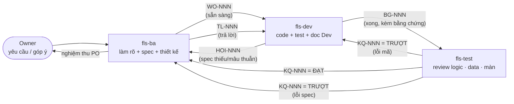

# 10 — HỢP ĐỒNG GIỮA BA AGENT: BA·PO · Dev · Test

**Version:** v1.1 · **Ngày:** 2026-10-01 · **Chủ sở hữu:** owner *(COO-CFO)* · **Người soạn:** phiên AI theo yêu cầu owner 01/10

> Tệp này là **luật chung** của ba agent `fls-ba`, `fls-dev`, `fls-test` *(định nghĩa ở `.claude/agents/`)*. Ba agent **chỉ nói với nhau qua PHIẾU** đặt trong `01_Orchestrator/handoff/`, ⛔ không qua lời kể trong hội thoại. Phiếu thiếu trường bắt buộc ⇒ bên nhận **trả lại**, ⛔ không tự đoán phần thiếu.
>
> Kế thừa và **thay thế §3 + §5** của `05_ROLES_HANDOFF.md` cho phần phiên AI. Phần vai **con người** ở `05` §1–§2 giữ nguyên.

---

## 1. Ba vai — mỗi vai sở hữu gì, cấm gì

| Vai | Agent | Sở hữu (được GHI) | Được ĐỌC | ⛔ Cấm |
|---|---|---|---|---|
| **BA · UIUX · PO** | `fls-ba` | `docs/ITL/02_BA/**` · `docs/ap-src/**` · `docs/*.html` (AP) · `ERD-*.mmd`/`ERD-CONTRACT.json` *(chỉ phần **khai**, hiện vật sinh máy vẫn do Dev sinh lại)* · §6 *"Việc tiếp theo"* của `06_ORCHESTRATOR_DASHBOARD.md` · phiếu `WO-*`, `TL-*` | mọi thứ | sửa `fls/**`, `tools/**`, `tests/**` · tự điền ô `???` của người · tự **chốt** thay owner một quyết định nghiệp vụ |
| **Dev** | `fls-dev` | `fls/**` · `tools/**` · `tests/**` **trừ** `tests/nghiem_thu/**` · `docs/ITL/03_Dev/**` · migration · hiện vật sinh máy *(`erd_export`, `sync_erd_doc`, `sinh_ban_do_tang`, golden)* · phiếu `BG-*`, `HOI-*` | mọi thứ | sửa `docs/ITL/02_BA/**` · sửa/xoá bài trong `tests/nghiem_thu/**` · làm **quá một WO** một lượt · chế spec khi spec thiếu *(⇒ mở `HOI`)* · `docker compose down` |
| **Test** | `fls-test` | `docs/ITL/04_Test/**` · `tests/nghiem_thu/**` · phiếu `KQ-*`, `HOI-*` | mọi thứ, **kể cả kho THẬT ở chế độ chỉ đọc** | sửa `fls/**`, `tools/**`, `tests/**` ngoài `nghiem_thu/` · **sửa bài thử cho xanh** · đóng `GAP` *(chỉ owner/BA đóng)* · ghi vào kho THẬT *(trừ khi WO cho phép tường minh — §6)* |

⭐ **Chủ các tệp trước v1.1 ⛔ ai được giao** *(`QĐ-ITL-150 ⓒ`, owner 01/10: *"còn lại như đề xuất"* — `WO-001 Q4`; căn cứ đo `Ra-soat-tai-lieu-2026-10-01` `R-20`: **47/47** nhóm lệch cổng số sống 01/10 nằm trong chính các tệp này)*:

| Tệp / thư mục | Chủ | Ghi chú |
|---|---|---|
| `06_ORCHESTRATOR_DASHBOARD.md` §1–§4 | `fls-ba` | **câu văn** + bảng GAP. **Số máy sinh** trong đó do `dong_bo_so_song --ghi` *(Dev chạy — §6)* |
| `09_MILESTONES_HAI_TAC_VU.md` | `fls-ba` | như trên |
| `00_MASTER_INDEX.md` §8 · §10 | `fls-ba` | như trên; sổ `QĐ`/`CR` vẫn theo dòng dưới |
| `docs/ITL/_AUDIT_ALIGNMENT_ROADMAP.md` · `docs/ITL/_DOC_REWRITE_ROADMAP.md` | `fls-ba` | khối `SINH-KHOP` trong lộ trình audit do `khop_owner.py` *(Dev)* sinh lại |
| `tools/**` · `docs/ITL/_tools/**` | `fls-dev` | kể cả `kiem_tai_lieu.py`, `khop_owner.py` — đổi `mong` của một cổng giấy phải có `WO` |

**Phần dùng chung** *(ai cũng GHI, nhưng chỉ đúng chỗ của mình)*:
- `06_ORCHESTRATOR_DASHBOARD.md` **§5 Nhật ký handoff** — mỗi agent **thêm một dòng** khi phát hoặc đóng phiếu *(khuôn §5 dưới)*. ⛔ Không sửa dòng của agent khác.
- `00_MASTER_INDEX.md` sổ `QĐ-ITL-*` / `CR#*` — **chỉ `fls-ba`** ghi, sau khi owner chốt.

---

## 2. Vòng đời một việc



| Bước | Ai phát | Phiếu | Điều kiện để phát *(cổng ra)* | Bên nhận làm gì đầu tiên *(cổng vào)* |
|---|---|---|---|---|
| ① | `fls-ba` | `WO-NNN` | §3.1 đủ **mọi** trường bắt buộc · mỗi tiêu chí nghiệm thu **đo được** · owner đã chốt mọi câu nghiệp vụ trong phạm vi *(hoặc WO ghi rõ câu nào còn treo và vì sao vẫn làm được)* | Dev kiểm 3 việc của `05` §5 *(git thật · version hợp đồng · run id)* rồi kiểm WO đủ trường. Thiếu ⇒ `HOI`, ⛔ không bắt đầu code |
| ② | `fls-dev` | `HOI-NNN` | Gặp chỗ spec **thiếu / mâu thuẫn / mâu thuẫn với dữ liệu đo được** | BA trả `TL-NNN`. Nếu câu hỏi là quyết định của owner ⇒ BA **hỏi owner**, ⛔ tự chốt |
| ③ | `fls-dev` | `BG-NNN` | §3.3: mọi cổng ở `CLAUDE.md` đã chạy, **dán kết quả thật** · mỗi tiêu chí của WO có bằng chứng · đã commit | Test chạy lại cổng **tự mình** — ⛔ tin con số trong `BG` |
| ④ | `fls-test` | `KQ-NNN` | §3.4: từng tiêu chí có phán quyết `ĐẠT/TRƯỢT/⛔ KHÔNG ĐO ĐƯỢC` kèm bằng chứng | `TRƯỢT` mã ⇒ Dev mở lại **cùng** WO · `TRƯỢT` spec ⇒ BA sửa spec, bump version, phát lại WO |
| ⑤ | `fls-ba` | *(đóng WO)* | `KQ` = `ĐẠT` trọn | BA nghiệm thu PO, ghi §5 dashboard, cập nhật §6, báo owner |

**Luật thứ tự:** spec trước, mã sau *(`07_CHANGE_CONTROL` §2 bước 4)*. Dev ⛔ bắt đầu một việc chưa có `WO`. Owner nói thẳng với Dev một việc nhỏ ⇒ Dev **vẫn** mở WO tối thiểu *(BA bổ sung sau)*, để vết không đứt.

---

## 3. Khuôn bốn loại phiếu

Mẫu trống nằm ở `handoff/_mau/`. Tên tệp: `handoff/<LOAI>-<NNN>-<slug>.md`, `NNN` đánh số **chung cho cả bốn loại** *(đọc số lớn nhất trong thư mục rồi `+1`)*. Một phiếu **⛔ không bao giờ bị xoá**; đóng bằng cách đổi `Trạng thái`.

### 3.1 · `WO` — Gói giao việc *(BA → Dev)*

| Trường | Bắt buộc | Nội dung |
|---|:-:|---|
| `Mã` · `Trạng thái` | ✅ | `WO-NNN` · `MO` → `DANG_LAM` → `CHO_TEST` → `DONG` / `TRA_LAI` |
| `Vì sao` | ✅ | Việc này phục vụ **tác vụ nào** *(mốc ở `09_MILESTONES_HAI_TAC_VU`)* và xoá **mắt xích người nào** (`05` §2) |
| `Căn cứ` | ✅ | `QĐ-ITL-*` / `CR#*` / `GAP-*` / góp ý owner *(trích nguyên văn + ngày)* |
| `Spec` | ✅ | Danh sách **tệp + mục + version** Dev phải đọc *(vd. `BA-07 v3.3 §4h`)*. Version sai ⇒ Dev trả lại |
| `Phạm vi` | ✅ | Bảng **TRONG** / **NGOÀI** phạm vi. Mục nào ⛔ ghi thì là NGOÀI |
| `Tiêu chí nghiệm thu` | ✅ | Bảng `AC-n` · **mong** *(giá trị/hành vi mong đợi, đo được)* · **cách đo** *(lệnh, SQL, thao tác màn)* · **chiều ĐỎ** *(phá gì thì phải đỏ — luật `Đ5`)* |
| `Màn hình` | khi chạm UI | Tệp thiết kế *(wireframe/HTML ở `Artifacts/`)* + bảng **trạng thái**: tải · rỗng · lỗi · mất kết nối · có dữ liệu |
| `Dữ liệu` | khi chạm kho | Bảng/cột chạm · có **ghi kho thật** không · số dòng dự kiến chạm *(đếm trước — luật báo động hiếm)* |
| `Câu còn treo` | ✅ *(có thể "không có")* | Câu chờ owner + vì sao WO vẫn làm được không có nó |
| `Rủi ro` | ✅ | Tối đa 3 dòng |

### 3.2 · `HOI` / `TL` — Câu hỏi và trả lời *(Dev/Test → BA → lại)*

| Trường | Bắt buộc | Nội dung |
|---|:-:|---|
| `Mã` · `Thuộc` | ✅ | `HOI-NNN` · `WO-NNN` hoặc `KQ-NNN` gốc |
| `Loại` | ✅ | `THIEU` *(spec không nói)* · `MAU_THUAN` *(hai chỗ spec nói khác nhau)* · `LECH_DU_LIEU` *(spec nói X, đo được Y)* |
| `Bằng chứng` | ✅ | Trích **cả hai** chỗ *(tệp:dòng)* hoặc lệnh đo + kết quả **có nhãn** (`Đ4`) |
| `Phương án` | ✅ | ≥2 phương án, mỗi cái kèm **cái giá** · đánh dấu cái đề xuất |
| `Chặn` | ✅ | `CHAN` *(dừng WO)* · `KHONG_CHAN` *(làm phần khác trong lúc chờ)* |

`TL-NNN` trả lời: `Quyết` *(chọn gì)* · `Ai quyết` *(BA trong thẩm quyền spec / owner — kèm trích lời)* · `Spec đã sửa` *(tệp + version mới)*.

### 3.3 · `BG` — Phiếu bàn giao *(Dev → Test)*

| Trường | Bắt buộc | Nội dung |
|---|:-:|---|
| `Mã` · `Thuộc` | ✅ | `BG-NNN` · `WO-NNN` |
| `Commit` | ✅ | Nhánh + hash **đã đẩy** |
| `Đã đổi` | ✅ | Bảng tệp → một dòng vì sao |
| `Cổng` | ✅ | Từng lệnh cổng ở `CLAUDE.md` + **kết quả nguyên văn** *(số bài, số lệch)*. Cổng nào ⛔ chạy ⇒ ghi `⛔ CHƯA CHẠY` + lý do — ⛔ bỏ trống |
| `Bằng chứng AC` | ✅ | Bảng `AC-n` → bằng chứng của Dev *(bài thử nào, phép đo nào)* |
| `Kho thật` | ✅ | `KHONG_CHAM` hoặc: ghi gì · bao nhiêu dòng · đường lùi |
| `Cách chạy để xem` | khi chạm UI | Lệnh dựng máy, cổng, chế độ *(chỉ đọc / ghi)* |
| `Dev tự thấy còn yếu` | ✅ | Chỗ Dev **nghi** mà chưa chứng minh được — Test soi chỗ này trước |

### 3.4 · `KQ` — Biên bản kiểm *(Test → Dev/BA)*

| Trường | Bắt buộc | Nội dung |
|---|:-:|---|
| `Mã` · `Thuộc` | ✅ | `KQ-NNN` · `BG-NNN` + `WO-NNN` |
| `Phán quyết` | ✅ | `ĐẠT` *(mọi AC ĐẠT)* · `TRƯỢT` · `⛔ KHÔNG ĐO ĐƯỢC` *(tính như TRƯỢT — luật `Đ5`)* |
| `Cổng chạy lại` | ✅ | Test **tự chạy lại** cổng; so với số trong `BG` |
| `Bảng AC` | ✅ | `AC-n` · mong · **đo được** *(có nhãn, có mẫu số — `Đ3`)* · phán quyết |
| `Ba lăng kính` | ✅ | **Logic** *(đúng spec + bất biến `BA-11`)* · **Dữ liệu** *(kho thật chỉ đọc: đếm, đối chiếu)* · **Màn hình** *(đủ trạng thái, đúng thiết kế, phím, NFR)* — mỗi lăng kính một kết luận |
| `Phát hiện` | khi có | `F-n` · mức `CHAN`/`NANG`/`NHE` · nơi *(tệp:dòng hoặc màn + thao tác)* · tái hiện · **gửi ai** (`DEV` lỗi mã / `BA` lỗi spec) |
| `Bài thử mới` | khi có | Bài thêm vào `tests/nghiem_thu/` + đã **chứng minh ĐỎ** trước khi xanh |

---

## 4. Luật chung cả ba agent *(⛔ không thương lượng)*

1. **Năm luật đo `Đ1`–`Đ5`** của `CLAUDE.md` áp cho **mọi phiếu**: câu phủ định phải grep cả `docs/` lẫn `fls/`+`tools/`; con số phải có nhãn; phép ra `0` phải chứng mẫu số ≠ 0; cổng phải khai `mong` và chứng minh ĐỎ.
2. **Không tin phiếu, tin máy:** bên nhận kiểm lại git/version/run id (`05` §5) trước khi làm.
3. **Không viết lại lịch sử:** phiếu, biên bản, changelog chỉ **thêm**. Sai thì ghi dòng đính chính.
4. **Kho thật:** `fls_itl` chỉ-thêm (`INV-I08`). Mọi lượt ghi kho thật phải có trong `WO` *(trường `Dữ liệu`)* và được owner cho phép tường minh trong hội thoại.
5. **Riêng tư:** `Email Address` cấm vào kho; `sao_luu/`, `hien_vat/` không lên git; ⛔ dán tên người + số tiền thật vào phiếu quá mức cần cho bằng chứng *(dùng `itl_id`/`pm_line_id`)*.
6. **Câu của owner thuộc về owner:** khi một lựa chọn là *"con số trên màn đến từ đâu"* hay *"nghiệp vụ làm thế nào"*, agent nêu phương án + cái giá rồi **dừng hỏi**.
7. **Tiếng Việt có dấu**, chú thích dày, mỗi khẳng định kèm số đo — đúng giọng repo.

---

## 5. Khuôn một dòng nhật ký *(dashboard §5)*

⛔ **Sửa v1.1 *(`R-19`)*:** dashboard §5 là **bảng 5 cột** *(`Ngày · Phiên · Task · Output · GAP mở thêm`)* — khuôn v1.0 là **một dòng gạch đầu**, chèn nguyên văn vào giữa bảng là **vỡ bảng**. Khuôn đúng là **một HÀNG bảng**, thêm ngay dưới dòng tiêu đề *(mới nhất trên cùng)*:

```
| **YYYY-MM-DD** | `<fls-ba|fls-dev|fls-test>` — <ngữ cảnh ngắn> | `<PHIẾU>` <phát|nhận|đóng|trả lại> | input <tệp vX.Y> · output <đường dẫn> | <mã GAP mở | không> |
```

⚠ Một ô ⛔ được chứa dấu `|` trần *(`CLAUDE.md` — vỡ bảng mà mắt ⛔ thấy)*; cần thì viết `\|`.

---

## 6. Ngoại lệ có chủ đích

| Tình huống | Luật |
|---|---|
| Test cần **ghi kho thật** để kiểm một đường ghi *(như cú UAT 01/10: ghép rồi bỏ ghép `itl_id 27728`)* | Chỉ khi `WO` có dòng `Dữ liệu: ghi kho thật — <đường lùi>` **và** owner đồng ý trong hội thoại. Mọi dòng ghi mang `reason` bắt đầu bằng `UAT <ngày>`. ⭐ **v1.1 *(`QĐ-ITL-150 ⓐ`)*: dòng UAT ⛔ BAO GIỜ tính là "người thật"** cho mốc `B` *(`B4`/`B5`)* hay **bất kỳ** cổng *"người đã làm"* nào *(`C2`, `G-d`…)* — bộ đếm phải loại `reason LIKE 'UAT %'` *(`WO-001 T1b`)* |
| ⭐ **`tools/dong_bo_so_song.py --ghi`** *(v1.1, `QĐ-ITL-150 ⓑⓒ`)* | **`fls-dev` là người chạy** — **kể cả khi nó ghi số vào tệp của `fls-ba`** *(`02_BA/Artifacts/Ban-ve-Kien-truc-TOBE.html`, dashboard, `09`, master)*: ngoại lệ **có chủ đích** với §1. Điều kiện: ⓐ chỉ chạy **SAU** khi bộ đếm mốc `B` đã loại sự kiện máy *(`may@fls`)* và dòng UAT *(`WO-001 T1a`+`T1b`)*; ⓑ công cụ chỉ sửa **số** ⇒ **người chạy sửa luôn câu cạnh số** *(owner `Q2`)* — **chỉ** những câu mà con số vừa đổi làm sai nghĩa, ⛔ viết lại đoạn nào khác; `BG` liệt kê từng câu *(tệp:dòng · cũ → mới)* và `fls-ba` rà lại khi nghiệm thu; ⓒ ⛔ chạy để làm xanh cổng của một `BG` khác |
| Lỗi chặn vận hành thật *(hotfix)* | Dev được sửa trước, nhưng phải mở `WO` + `BG` **trong cùng ngày** và Test vẫn kiểm |
| Owner giao việc trực tiếp cho một agent | Agent nhận việc, mở phiếu tương ứng, ghi `Căn cứ: owner trực tiếp <ngày>` |

## Changelog
- v1.1 (2026-10-01, `fls-ba`, `QĐ-ITL-150` — owner: *"còn lại như đề xuất"*): §1 thêm bảng **chủ các tệp chưa có chủ** *(câu văn dashboard §1–§4 · `09` · master §8/§10 · hai lộ trình ⇒ `fls-ba`; `tools/**` + `docs/ITL/_tools/**` ⇒ `fls-dev` — `R-20`)*; §5 khuôn nhật ký thành **hàng bảng 5 cột** khớp dashboard *(`R-19`)*; §6 thêm ngoại lệ **`dong_bo_so_song --ghi`** *(Dev chạy, kể cả ghi vào tệp BA, và sửa câu cạnh số đã đổi nghĩa; chỉ sau `WO-001 T1a`+`T1b` — `R-21`)* và luật **UAT ⛔ tính người thật**.
- v1.0 (2026-10-01): Khởi tạo — ba vai, vòng đời 5 bước, bốn khuôn phiếu `WO`/`HOI`·`TL`/`BG`/`KQ`, luật chung, ngoại lệ. Thay §3 + §5 của `05_ROLES_HANDOFF` cho phần phiên AI.
