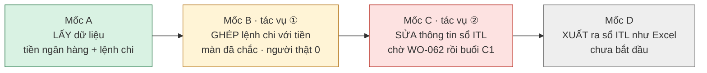

# Báo cáo tiến độ FLS — đợt 01/10 → 07/10/2026

**Version:** v1.0 · **Ngày:** 2026-10-07 · **Người đọc:** owner *(COO-CFO)* · **Người soạn:** `fls-ba` theo yêu cầu owner 07/10: *"cập nhật tài liệu dự án về tiến độ và hiện trạng"*
**Đo lúc soạn:** git `6b4aa2d` *(commit 06/10 11:25)* · kho thật chỉ đọc *(`SELECT`, 07/10)* · cổng giấy chạy 07/10. Chi tiết kỹ thuật ở cuối tệp.

---

## 1. Kết luận

1. **Một tuần, 11 việc xong và đều đã được kiểm độc lập.** Màn ghép lệnh chi với tiền ngân hàng nay **chắc**: bấm nhanh, đổi lệnh giữa chừng, mạng chậm — màn không còn lẫn dữ liệu, không còn ghi nhầm dòng.
2. **Hai lỗ ghi sai vào sổ đã được bắt tận tay và đã bịt.** Cả hai đều có thể đưa một cặp sai vào sổ mà máy chủ vẫn nhận. Bài học: **màn hình là chốt chặn duy nhất** cho cặp sai mà tiền lệch trong dung sai.
3. **Sổ thật không bị đụng một dòng nào trong cả tuần.** Mọi thử nghiệm chạy trên kho thử.
4. **Kế toán thật vẫn chưa dùng lần nào** *(đếm được: 0 thao tác)*. Đó là việc của bước sau: trước khi mời kế toán ngồi sửa thật *(buổi `C1`)*, phải xong **một** việc nữa — lưới sổ hiện đúng **số đã sửa** *(`WO-062`)*.
5. **Có 7 câu đang chờ anh/chị quyết** *(mục 6)*. Không câu nào chặn việc đang làm hôm nay, nhưng hai câu chặn buổi `C1`.

## 2. Đang ở đâu trên đường đi

| Mốc | Hôm nay *(07/10)* | Nghĩa là |
|---|---|---|
| **A** — lấy dữ liệu | Máy tự chụp sao kê ngân hàng và lệnh chi khi máy bật *(ảnh mới nhất 07/10 11:02; **182** ảnh trong kho)* | Dữ liệu vào đều; vẫn chỉ chạy khi máy bật |
| **B** — ghép | Màn chắc · 2 lỗ ghi sai đã bịt · **0** thao tác của kế toán thật | Máy sẵn sàng; chưa ai dùng thật |
| **C** — sửa sổ | Có màn, có cửa ghi; **0** lần sửa thật · chờ `WO-062` | Chưa mời kế toán được — lưới chưa hiện số vừa sửa |
| **D** — xuất ra Excel | Chưa bắt đầu | Đứng sau mốc C |

## 3. Đã xong trong đợt — theo nhóm

Mỗi việc dưới đây đi đủ vòng: BA viết yêu cầu → Dev làm → Test kiểm độc lập *(tự chạy lại, tự bấm chuột trên trình duyệt thật)* → BA nghiệm thu đối chiếu với ý anh/chị.

| Nhóm | Việc | Kế toán sẽ thấy gì |
|---|---|---|
| **Ghép nhẹ tay hơn** | `WO-003` · `WO-008` | Bấm Ghép là xong, **không bị đòi gõ lý do**. Hai ô `Budget Code` / `Chủ dự toán` máy tự đoán hiện là **"máy gợi ý"**, không tự thành số chốt. Bỏ ghép thì màn nói rõ **ô nào** vừa bị rút gợi ý |
| **Đếm đúng "người đã làm"** | `WO-001` · `WO-011` | Con số *"kế toán đã thao tác"* không còn đếm việc của máy hay cú thử của anh/chị ngày 01/10 ⇒ hôm nay đúng **0** — trước đó từng in như đã xong |
| **Nhật ký sửa nói thật** | `WO-018` | Nhật ký của một ô ghi đúng **ai** đã nói giá trị ấy: người sửa tay, hay máy gợi ý |
| **Tiền đúng theo tiền tệ** | `WO-022` · `WO-032` · `WO-037` | USD in đủ 2 số lẻ, VND không lẻ, cộng trừ không lệch xu. Màn **không còn so tiền USD với tiền VND** như thể cùng loại; máy **không còn đề xuất** cặp khác tiền tệ *(**84** lệnh từng bị đề xuất sai kiểu này)* |
| **Màn không lẫn khi bấm nhanh** | `WO-042` · `WO-045` · `WO-023` | Đổi bộ lọc hay đổi lệnh **trong lúc đang tải** không còn trộn hai danh sách *(từng in **2.955** dòng thay vì **2.219**)*. Cú Gán chỉ mang dòng tiền **người đã chọn**. Hộp thoại đang mở không để phím lọt ra sau. Khi máy chưa biết kết quả thì màn nói **"chưa rõ"**, không nói bừa |

⭐ **Hai lỗ ghi sai đã bắt tận tay** *(trên kho thử, mã cũ — máy chủ trả "đã nhận")*:

| Lỗ | Chuyện gì xảy ra với mã cũ | Bịt ở việc |
|---|---|---|
| Đổi sang lệnh khác khi danh sách gợi ý đang tải | Cú Gán gửi dòng tiền của **lệnh trước** kèm lệnh đang mở | `WO-045` |
| Chọn một dòng khi ô tìm kiếm đang chờ kết quả | Cú Gán ghi một dòng tiền mà **người không chọn** | `WO-023` |

⇒ Cả hai cặp sai đều có tiền lệch **trong dung sai**, nên máy chủ **không có cách nào** nhận ra. Chốt chặn duy nhất là màn hình — và nay màn đã chặn.

## 4. Đang dở

| Việc | Tình trạng | Kế toán sẽ thấy gì khi xong |
|---|---|---|
| `WO-051` — hàng chờ tiền VND tải chậm | Dev đã làm xong 06/10: trang 2 của VND từ **~104 giây** xuống **~0,1 giây** *(đo trên máy Dev)*; máy xem thử đang chạy đo được **0,3 giây**. **Chờ Test kiểm** | Mở hàng chờ VND, bấm "Xem thêm" ra ngay; trong lúc chờ có chữ *"Đang tải thêm…"*, lỗi thì giữ nguyên danh sách và có nút *Thử lại* |
| `HOI-063` — câu hỏi của Dev | Chữ *"lý do"* trên một dòng hàng chờ **có thể đổi** giữa hai lần mở màn dù không ai bấm gì *(**8.256 / 8.387** dòng có ≥ 2 lý do cùng thời điểm, từ lần dựng sổ 10/09)*. Chờ BA trả lời | Mỗi dòng luôn hiện **cùng một** lý do |

## 5. Hàng chờ — theo thứ tự

| Thứ tự | Việc | Vì sao đứng chỗ này |
|:-:|---|---|
| 1 | Test kiểm `WO-051` | Việc đã làm xong phải kiểm trước khi chồng việc mới |
| 2 | BA trả `HOI-063` | Không chặn, nhưng là nợ của chính việc vừa làm |
| 3 | ⭐ `WO-062` — lưới sổ hiện **số đã sửa** | Hôm nay người sửa một ô, tải lại thì ô ấy vẫn hiện *"chưa gán"* ⇒ buổi kế toán sửa thật đầu tiên sẽ gặp ở **mọi** ô. **Phải xong trước buổi `C1`** |
| 4 | `WO-060` | Chế độ chỉ đọc khoá hẳn các nút ghi; câu báo lỗi chỉ đúng chỗ |
| 5 | `WO-047` | Dọn nốt cách so tiền tệ còn sót *(sổ thật hôm nay **0** ca)* |
| 6 | `WO-015` | Vá bốn lỗ nhỏ của thước "người thật" *(sổ thật hôm nay không con số nào đổi)* |
| ⏸ | Danh mục tài khoản ngân hàng + người dùng | Anh/chị hoãn ngày 02/10 |

## 6. Câu cần anh/chị quyết

| # | Câu | Các lựa chọn | Chặn gì |
|:-:|---|---|---|
| 1 | **Hẹn buổi `C1`** — kế toán ngồi sửa sổ thật một phiên | Hẹn ngay sau khi `WO-062` xong | Mốc C không đóng được nếu chưa có buổi này |
| 2 | Người **xoá** một ô ở lưới sổ thì ô ấy hiện **trống**, hay quay về **giá trị sổ gốc**? | ⓐ trống · ⓑ giá trị sổ gốc *(máy đang làm thế; sổ gốc hôm nay rỗng nên chưa ô nào gặp)* | Buổi `C1` |
| 3 | `Q-FX-1` — **84** lệnh chi khớp mã với một dòng tiền **khác tiền tệ** *(phần lớn trông như quy đổi)* | ⓐ cho ghép kèm tỷ giá *(việc mới, đổi cửa ghi)* · ⓑ ghép không so tiền · ⓒ để ngoài, kế toán xử ở Sheets | Không chặn — hôm nay máy để chúng cho người xem |
| 4 | `Q-TIEN-1` — tiền VND có phần lẻ thì **in đủ** hay **làm tròn**? | ⓐ in đủ *(máy đang làm)* · ⓑ làm tròn khi in | Không chặn |
| 5 | **52** dòng chứa số tài khoản ngân hàng **đầy đủ** đang nằm trong lịch sử git *(≥ 10 tệp; có cả 3 tài khoản cá nhân)* | ⓐ che từ nay, giữ lịch sử · ⓑ viết lại lịch sử git. Kèm câu: repo **riêng tư** hay sẽ công khai? | Không chặn việc; là rủi ro riêng tư |
| 6 | `GAP-SCR-33` — màn ghép có hiện gợi ý `Budget Code` / `Chủ dự toán` kèm nút **gật đầu** không? | Mở lằn này bây giờ · hay để sau buổi `C1` | Không chặn |
| 7 | `GAP-SCR-26` — chip *"Tất cả"* trên hàng chờ | Giữ · bỏ | Không chặn |

## 7. Rủi ro còn lại

| Rủi ro | Mức | Đang làm gì |
|---|---|---|
| **Chưa kế toán thật nào dùng** — mọi điều trên mới được chứng minh trên máy | Cao | Xong `WO-062` rồi hẹn buổi `C1` *(câu 1)* |
| Máy chủ nhận cặp sai nếu tiền lệch trong dung sai ⇒ màn là chốt chặn duy nhất; đã bịt **2** đường, có thể còn đường khác chưa ai bấm tới | Trung bình | Mọi việc có màn nay bắt buộc kiểm bằng **dữ liệu thật từ máy chủ** và **chuột thật trên Chrome** *(xem mục 8)* |
| Kho dữ liệu vẫn nằm trên ổ Docker **không tên** — một lệnh sai là mất kho | Trung bình | Có sao lưu bằng tay; việc đổi sang ổ có tên vẫn chờ anh/chị |
| **79** con số trong tài liệu đã trôi so với máy *(số bài thử, số dòng, dấu giờ ảnh…)* | Thấp | Dev chạy công cụ đồng bộ số; BA rà lại câu cạnh số |
| Số tài khoản đầy đủ trong git | Thấp — nếu repo vẫn riêng tư | Câu 5 |

## 8. Cách làm việc đã thay đổi trong đợt

- **Ba lần** một lỗi màn lọt qua bài thử vì bài thử **tự đưa sẵn dữ liệu** cho màn, che mất chỗ màn **không tự đi lấy** đúng dữ liệu. Nay mọi việc có màn bắt buộc một tiêu chí: *dữ liệu lấy từ máy chủ thật + bấm bằng chuột thật trên Chrome*.
- **Hai** lượt làm việc của agent bị treo khi soạn một khối văn bản quá dài một lần ⇒ nay soạn **từng phần nhỏ**.

---

## Phụ lục kỹ thuật *(cho người kiểm)*

| Đại lượng | Giá trị | Đo thế nào |
|---|---|---|
| Commit trong đợt | **99** *(01/10: 15 · 02/10: 42 · 05/10: 35 · 06/10: 7)* | `git log --since=2026-10-01` @ `6b4aa2d` |
| Phiếu giữa ba agent | **64** *(WO 16 · BG 23 · KQ 15 · HOI 10)*; WO đóng trong đợt **11** | `ls handoff/` |
| Bài thử | **2.428 passed, 2 xfailed** *(lượt `BG-064`, `fls-dev` 06/10)*; máy thu **2.430** bài *(`kiem_so_song` 07/10)* | `pytest` |
| Sổ thật | `fls_itl` **8.387** · `fls_pm_link` **2.263** *(2.262 từ 10/09 + 1 cú UAT 01/10)* · `fls_pm_unlink` **1** · `fls_adjustment` **4.428** · `fls_queue_event` **110.349** | `SELECT` 07/10; thời điểm ghi mới nhất **mọi** bảng ghi = **01/10 16:06** *(giờ VN — cú UAT)* ⇒ **0** dòng ghi từ 02/10 |
| Mốc B *(máy đếm)* | **1 đạt · 1 một nửa · 3 chưa**; người thật **0** | `kiem_so_song::_cong_moc_b` |
| Cổng giấy | `kiem_tai_lieu` ĐẠT · `khop_owner --kiem` **17/20** khớp ĐẠT · `kiem_so_song` **79** lệch *(số trôi — việc `fls-dev`)* | chạy 07/10 |
| Máy xem thử | `8088` chạy **chỉ đọc** trên `6b4aa2d` *(HTTP 200, 07/10)* | |

Tài liệu trạng thái đã cập nhật cùng lượt: `06_ORCHESTRATOR_DASHBOARD.md` §1/§4/§5/§6 *(khối `6.-20`)* · `09_MILESTONES_HAI_TAC_VU.md` **v1.16** · `11_BOI_CANH_TU_MEMORY.md` **v1.2** · `00_MASTER_INDEX.md` §8/§10 · `handoff/README.md`.

## Changelog
- v1.0 (2026-10-07, `fls-ba`): Khởi tạo — báo cáo đợt 01→07/10 cho owner theo yêu cầu *"cập nhật tài liệu dự án về tiến độ và hiện trạng"*.
