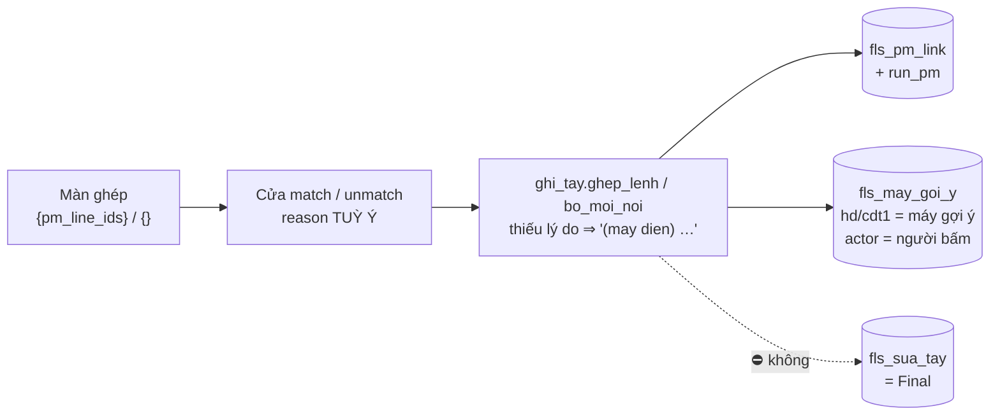

# BG-004 — bàn giao `WO-003` *(cú Ghép đi được trên màn thật)*

| | |
|---|---|
| **Thuộc** | `WO-003` *(vòng 1)* |
| **Phát bởi** | `fls-dev` · 2026-10-01 |
| **Nhận** | `fls-test` |
| **Commit** | `feat/p2-oracle-parity` @ `48fb68f` *(đã đẩy — mã + bài thử + changelog)*; phiếu này nằm ở commit kế tiếp |

> **Một câu cho owner:** nút `Gán` / `Bỏ gán` trên màn ghép nay **⛔ còn bị `400`**; ghép xong, hai ô `hd`/`cdt1` chỉ là **gợi ý của máy** — ⚠ **Final ⛔ đổi**, kế toán vẫn phải gõ qua ô sửa *(chưa có màn hiện gợi ý — `GAP-SCR-33`, chờ owner)*.

## Đã đổi
| Tệp | Vì sao |
|---|---|
| `fls/api/xu_ly.py` | `ghep` + `bo_ghep`: `_chu(…, "reason", bat_buoc=False)` *(vẫn kiểm kiểu)*. `ghep_lo`: **giữ** bắt buộc, chú thích vì sao chặn phải ở tầng cửa |
| `fls/repo/ghi_tay.py` | ⓐ hai hằng `LY_DO_MAC_DINH_GHEP` / `LY_DO_MAC_DINH_BO_GHEP` *(nguyên văn `§4h ⓼`)*; `ghep_lenh`/`bo_moi_noi` điền hằng thay `raise ThieuLyDo`. ⓓ `INSERT fls_pm_link` thêm `run_pm`. ⓑ `ghep_lenh` ghi gợi ý qua `loc_goi_y` + `ghi_goi_y` *(nguon `may_goi_y`, actor người, `evt_id` sự kiện `match`)*, trả thêm `nguoi_da_chot`; `bo_moi_noi` tập *"còn hiệu lực"* = `fls_sua_tay` ∪ `fls_may_goi_y`, bản đảo mang `nguon` bằng dòng bị đảo, giá trị người gõ sau ghép được khai trong `bo_qua` |
| `fls/repo/may_ghep.py` | `ghi_goi_y_may` tách thành `loc_goi_y` *(luật "người đã chốt ⇒ im · trùng ⇒ ⛔ thêm")* + `ghi_goi_y` *(nhận `actor` + `evt_id`)* — hai hàm **sống ở `ghi_tay`**, `may_ghep` xuất lại. ⚠ Lý do dời: `import` trong thân hàm thì `soi_bang_tuyen` *(đọc tĩnh, chỉ bám hàm mức module)* ⛔ thấy bảng chạm — đo được: nó báo 3 vi phạm |
| `fls/web/tep/man_f01_ghep.js` | `_sap_tai()` đặt `thieu_cua`/`loi`/`dang_tai` **trước** lượt `ve()` đầu ở `mo_man()` và `doi_chip()` |
| `fls/api/bang_tuyen.py` | `match` · `match-lo` · `unmatch` khai thêm `fls_may_goi_y`; `BANG_CHO_PHEP` thêm `fls_may_goi_y` *(view FLS, migration `0025`)* — thiếu nó `kiem_bang_tuyen` làm máy **⛔ khởi động được** *(224 lỗi bài cửa)* |
| `tests/repo/test_wo003_ghep_tay_la_goi_y_pg.py` | **mới**, 16 bài — AC-2, 4, 5, 6, 7ⓐⓑ, 8 + nhánh `DT-I14` 2/4 + ghim `goi_y_lai` *(Rủi ro 2)* |
| `tests/api/test_cua_ghep_lo_pg.py` | +3 bài AC-3 *(thiếu / rỗng / khoảng trắng ⇒ `400`, đếm `fls_pm_link` ⛔ đổi)* |
| 7 bài ghim luật cũ — **viết lại, giữ lo gốc**, docstring ghi tên cũ + lý do | `test_ghep_lenh_pg::test_TU_CHOI_khi_THIEU_LY_DO` → `test_THIEU_LY_DO_thi_vet_mang_ly_do_MAC_DINH…` · `test_bo_moi_noi_pg::test_KHONG_ly_do_thi_KHONG_bo` → `test_KHONG_ly_do_van_BO_duoc…` · `::test_dao_but_toan_do_CHINH_phep_ghep_suy_ra` *(đọc `fls_may_goi_y`)* · `::test_KHONG_dao_o_ma_NGUOI_da_go_tay__va_KHAI_RA` *(đảo cả 2 gợi ý; người ⛔ chạm + `bo_qua`)* · `test_may_goi_y_pg` 3 bài *(người chốt = `ghi_but_toan`)* · `tests/api/test_cua_ghep_pg::test_thieu_ly_do_thi_400` → `…van_GHEP_duoc…` · `tests/web/test_vong_f01_pg::test_moi_thao_tac_ghi_TRU_xong_deu_DOI_ly_do` → `test_thao_tac_nao_DOI_ly_do__va_GHEP_BO_GHEP_thi_KHONG` |
| `docs/ITL/03_Dev/08_CHANGELOG_RELEASE.md` | dòng 2026-10-01 |

⛔ **Không** đổi schema · ⛔ **không** chạm `tests/nghiem_thu/**` · ⛔ **không** chạy `dong_bo_so_song --ghi`.

## Cổng *(kết quả nguyên văn, `PYTHONUTF8=1`, `PG_DSN=…5433/fls`, tại cây làm việc = `48fb68f`)*
| Lệnh | Kết quả |
|---|---|
| `python -m pytest` | `5 failed, 1928 passed, 1 xfailed in 259.01s` — **đúng 5** bài đỏ, cả 5 là `XPASS(strict)` liệt kê dưới *(đỏ có chủ ý)*; `1 xfailed` = bài `F-2` của `WO-001` |
| `python tools/kiem_so_song.py` | `⛔ CONG SO SONG KHONG DAT — 80 lech/khong-do-duoc`. Đỏ **nền** đo lại trên chính `c1fb250` *(stash, cùng giờ)*: **61**. ⇒ **+19** nhóm do phiếu này, **toàn bộ loại (c)** *(số phép thử `1911→1934`, `1713→1736`; số dòng mã `24.772→24.961`, repo `504→522` tệp/`6.846→6.982` dòng, api `312→317`/`3.860→3.892`, web `8.526→8.547`)*. ⛔ Không chạy `dong_bo --ghi` *(`WO-001 T5`)* |
| `python docs/ITL/_tools/kiem_tai_lieu.py` | `✅ cong tai lieu DAT — … (92 file, 1149 bang, 626 o ngay, 104 ma QD)` |
| `python docs/ITL/_tools/khop_owner.py --kiem` | `15/19 khop · 4 lech (da do 19/19 phep)` · `✅ C8` · `⛔ CONG NO: · ⛔ khoi trong lo trinh LECH voi ban sinh lai` — **y nền** *(`11` §7: lệch có chủ ý `A2·B5·B6·C5` + khối `SINH-KHOP`)* |
| `python tools/soi_bang_tuyen.py` | `✅ ban khai KHOP SQL that o ca 40 tuyen` |
| `python tools/kiem_thuyet_minh.py` | `✅ CONG THUYET MINH DAT — 31/31 nut co mat trong CA 2 ban` |
| `.venv/Scripts/lint-imports.exe` | `Contracts: 9 kept, 0 broken.` |
| `python -m fls.db.pg_migrate` | ⛔ **CHƯA CHẠY bản ghi** — phiếu ⛔ chạm schema *(`git diff c1fb250 -- fls/db` rỗng)*, và lệnh ấy áp lên kho thật. Thay: `--status` ⇒ mới nhất `0026_dien_giai_sao_ke` đã áp · `pg_verify` ⇒ `khop: 25 bang/view dung nhu khai bao` |

### ⭐ 5 bài `XPASS(strict)` — `fls-test` gỡ dấu `xfail`
1. `tests/nghiem_thu/test_kq002_than_man_ghep_qua_cua_that.py::test_than_GAN_cua_man_ghep_QUA_duoc_kiem_than_cua_match`
2. `tests/nghiem_thu/test_kq002_than_man_ghep_qua_cua_that.py::test_than_BO_GAN_cua_man_ghep_QUA_duoc_kiem_than_cua_unmatch`
3. `tests/nghiem_thu/test_kq002_ghep_tay_ghi_run_pm.py::test_ghep_TAY_ghi_anh_lenh_chi_vao_run_pm`
4. `tests/nghiem_thu/test_kq002_man_ghep_dang_tai_khong_noi_da_sach.py::test_MO_MAN_khi_cua_chua_tra_loi_KHONG_noi_hang_cho_da_sach`
5. `tests/nghiem_thu/test_kq002_man_ghep_dang_tai_khong_noi_da_sach.py::test_DOI_CHIP_khi_cua_chua_tra_loi_KHONG_noi_khong_co_dong_nao`

`pytest tests/nghiem_thu --runxfail` ⇒ `1 failed, 7 passed` — bài đỏ duy nhất là `test_kq002_moc_b_khong_dem_may_la_nguoi` *(`F-2`, thuộc `WO-001 T1a`, ⛔ phiếu này)*.

## Bằng chứng từng AC
⭐ Chiều ĐỎ chứng bằng kịch bản phá-nguồn → chạy → trả nguyên *(`scratchpad/chung_minh_do.py`, mỗi ca khớp mẫu đúng 1 lần)* — kết quả nguyên văn ở cột cuối.

| AC | Bằng chứng của Dev | Chiều ĐỎ đã chứng |
|---|---|---|
| AC-1 | `--runxfail` hai bài `F-1` + đối chứng ⇒ passed | trả cả hai `_chu` về bắt buộc ⇒ `2 failed, 1 passed` |
| AC-2 | `test_wo003…::test_ghep_va_bo_ghep_THIEU_ly_do__vet_mang_ly_do_MAC_DINH_va_actor_NGUOI` *(mẫu số = 2 sự kiện, kiểm `startswith "(may dien) "`, `actor` = người, `0` dòng rỗng)* + `::test_ly_do_RONG_moi_kieu…[None/""/"   "]` | bỏ phép điền ⇒ `1 failed`; điền mà `actor='may@fls'` ⇒ `1 failed` |
| AC-3 | `test_cua_ghep_lo_pg::test_cua_LO_thieu_ly_do_VAN_400…` ×3 *(đếm `fls_pm_link` trước/sau)* | nới `_chu` ở `ghep_lo` ⇒ `3 failed` |
| AC-4 | nghiệm thu `F-4` `--runxfail` passed + `test_wo003…::test_ghep_TAY_ghi_run_pm_bang_anh_PM_da_dung` *(`run_pm` = `run_id` = ảnh PM)* | `run_pm`=None trong `INSERT` ⇒ `1 failed` |
| AC-5 | `test_wo003…::test_ghep_TAY_hd_cdt1_vao_fls_may_goi_y__Final_KHONG_doi` — `fls_may_goi_y` +2 · `fls_sua_tay` +0 · `nguon`/`value_source` = `may_goi_y` ×2 · `actor` người · `evt_id` = sự kiện ghép · `value_before` NULL · Final ⛔ đổi | gợi ý ghi `sua_tay` ⇒ `2 failed` *(cùng AC-8)* |
| AC-6 | `::test_NGUOI_da_chot_hd_roi_moi_ghep__may_IM_o_hd_van_goi_y_cdt1` ⇒ `nguoi_da_chot == ["hd"]`, chỉ `cdt1` được gợi ý | bỏ phép kiểm người đã chốt ⇒ `1 failed` |
| AC-7 | ⓐ `::test_bo_ghep_dong_ghep_TAY__dao_goi_y__fls_may_goi_y_ve_0` · ⓑ `::test_bo_ghep_dong_MAY_ghep__dao_ca_goi_y_cua_may_fls` · người: `::test_bo_ghep_KHONG_dao_gia_tri_NGUOI__va_KHAI_trong_bo_qua` | giữ phép lọc cũ *(chỉ `fls_sua_tay`)* ⇒ `2 failed` |
| AC-8 | `::test_cong_C8_KHONG_lat_khi_chi_co_cu_ghep` *(đếm `fls_sua_tay` cả bảng)*; `khop_owner` vẫn `✅ C8` | như AC-5 |
| AC-9 | hai bài `F-3` `--runxfail` passed | gỡ `_sap_tai()` ⇒ `2 failed` |
| AC-10 | ⛔ Dev ⛔ đo *(đo ở `KQ` — máy 8088 vẫn chạy **mã CŨ**, chỉ đọc)* | — |
| AC-11 | xem bảng Cổng: đúng 5 đỏ = 5 `XPASS(strict)` · lint `9 kept 0 broken` · `soi_bang_tuyen` 40/40 · thuyết minh 31/31 | — |
| AC-12 | xem dòng `kiem_so_song`: 61 nền → 80, +19 toàn loại (c) | — |

## Kho thật
- `KHONG_CHAM`. Mọi bài chạy trên kho TEST `fls_test` *(`dsn_test()`, `run_id` `NAP-2000-…`)*. ⛔ Không khởi động máy nào trên 8088; ⛔ không bật `--cho-ghi`.

## Cách chạy để xem *(phần (c))*
- Máy 8088 đang chạy **mã cũ** ⇒ muốn thấy bản vá phải dựng máy khác cổng, **chỉ đọc**: `python tools/chay_cua.py --cho-web --cong 8099` → mở `http://127.0.0.1:8099/` tab `man-ghep`, và `?gia_lap=tai` *(phải hiện `Đang hỏi sổ…` mãi)*. Tắt sau khi xem. ⚠ Dev **⛔ tự mở** trình duyệt lượt này — chỉ đo bằng khung node.

## Dev tự thấy còn yếu
1. **Gợi ý cũ có thể "sống lại" sau khi đảo.** `fls_may_goi_y` = gợi ý **mới nhất chưa đảo** của ô. `DT-I14` nhánh 7 bảo ⛔ đảo gợi ý *"đã bị gợi ý mới hơn đè"* — tôi theo đúng. Nhưng khi bỏ ghép đảo gợi ý mới nhất, một gợi ý **cũ hơn** chưa đảo *(nếu có, gắn một sự kiện `match` khác)* sẽ **nổi lên lại** trong khung xem. Đường mới ⛔ sinh ra ca này *(bỏ ghép nay đảo hết)*; nó chỉ có thể đến từ dữ liệu trước `WO-003`: gợi ý máy của dòng đã bị bỏ ghép bằng luật cũ. ⛔ Chưa đo trên kho thật *(KQ-002 đo: `fls_pm_unlink` = 1, là UAT — dòng `hinh='T'`, ⛔ có gợi ý máy)* ⇒ nghi là **0** ca, chưa chứng.
2. **`bo_qua` có thêm một loại mục** *(giá trị NGƯỜI gõ sau ghép, `nguon='sua_tay'`, `adj_id` là bút toán người)*. Trước đây `bo_qua` chỉ chứa bút toán **của phép ghép**. Grep `bo_qua` trong `fls/web/`: **2** dòng, cả hai ở `fls/web/tep/man_f01.js:421`–`:425` *(`_bao_bo_ghep`)* — nó in *"⛔ KHÔNG đảo N ô — **người** đã gõ tay lên đó"*: khớp đúng loại mục mới. `man_f01_ghep.js` **0** dòng. ⚠ Nhưng `bo_qua` vẫn chứa cả loại mục **cũ** *(bút toán ghép đã bị đảo / bị gợi ý mới hơn đè)* và màn in chúng dưới **cùng** câu *"người đã gõ tay"* — sai nghĩa cho loại ấy; có từ trước phiếu này, ⛔ sửa *(ngoài phạm vi)*.
3. **Bảng chạm của `match`/`match-lo`/`unmatch` ĐÃ đổi** *(+`fls_may_goi_y`)*, trái dự đoán trong ngoặc của `WO-003 AC-11` *("cửa match/unmatch ⛔ đổi bảng chạm")*. AC đo được *(`soi_bang_tuyen` khớp)* vẫn đạt; tôi ⛔ mở `HOI` vì mong của AC ⛔ bị ảnh hưởng — BA xem lại có cần sửa câu ấy hay bản đồ tầng/tài liệu `02_BA` nào liệt kê bảng chạm của ba tuyến này.
4. **Cột `run_id` ở đường tay vẫn = ảnh PM** *(giữ nghĩa đang có, như WO bảo)* ⇒ `fls_pm_link.run_id` **vẫn hai nghĩa** giữa đường nạp *(lần NẠP)* và đường tay *(ảnh PM)* — đúng cái `0024` than phiền. Nay đã có `run_pm` để hỏi đúng, nhưng ai đọc `run_id` vẫn có thể nhầm.
5. **`ghep_lenh` thôi so cột nguồn `fls_itl.<field>`** trước khi gợi ý *(luật cũ: `truoc = sua_tay ∪ nguồn`; trùng thì ⛔ ghi)*. Theo `DT-I14` + luật đường máy thì đúng; hệ quả: dòng có cột nguồn = giá trị suy vẫn được ghi một gợi ý *(thừa nhưng vô hại — Final lấy cột nguồn)*. Kho thật hôm nay `fls_itl.hd` = 0/8.387 nên ⛔ chạm ai.
6. Bài ghim `goi_y_lai` *(Rủi ro 2)* **xanh ngay trên mã cũ** — nó canh một hành vi đã đúng, ⛔ chứng được đỏ bằng phá `fls/` *(phải phá chính SQL của công cụ)*. Nó dựng lại câu SQL bằng một phép `replace` thêm `WHERE` — đã `assert` khớp đúng 1 lần, nhưng vẫn là sửa câu của công cụ.
7. Màn: `_sap_tai()` cũng **xoá `ST.loi`** của lượt trước khi đổi chip — đúng ý *(lỗi cũ ⛔ che "đang tải")* nhưng là thay đổi hành vi ngoài đúng câu `F-3`; chưa có bài riêng cho nó.
