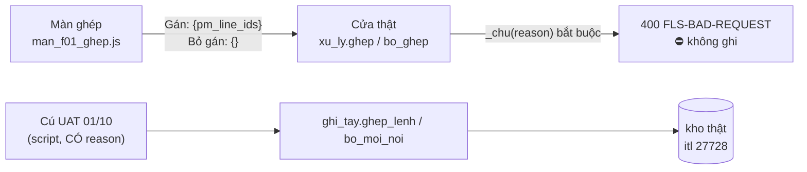

# KQ-002 — biên bản đối chiếu HIỆN TRẠNG 01/10 *(không có `BG`)*

| | |
|---|---|
| **Thuộc** | owner trực tiếp 01/10 — không có BG *(`10_HOP_DONG_AGENT` §6, owner: "test đối chiếu kết quả")* |
| **Kiểm bởi** | `fls-test` · 2026-10-01 · nhánh `feat/p2-oracle-parity` @ `e6d88a9` *(+ thay đổi chưa commit của BA: `WO-001`, `Ra-soat-tai-lieu-2026-10-01.md`, `11_BOI_CANH…`)* |
| **Phán quyết** | ⛔ **TRƯỢT** — phần lớn **con số** phiên chính khẳng định là **đúng**, nhưng **`1` CHAN · `3` NANG**: hai nút ghi của màn ghép ⛔ ghi được trên máy thật (`F-1`), màn nói *"hàng chờ đã sạch"* trong lúc tải (`F-3`), cổng mốc `B` đếm máy là người (`F-2`), `run_pm` ⛔ bao giờ được ghi (`F-4`) |
| **Trạng thái** | ✅ **`DONG`** *(01/10 tối, `fls-test` — [`KQ-010`](KQ-010-kiem-bg-009.md): `F-2` vá ở `6e98796`, bài `test_kq002_moc_b…` gỡ dấu `xfail`; F-1·F-3·F-4 gỡ dấu ở `KQ-005`; F-5…F-8 `BA` đã trả)* · ~~`MO` — chờ `DEV` *(F-1·F-2·F-3·F-4)* và `BA` *(F-1 vế `match`, F-5…F-8)*~~ |

> **Tóm một câu cho owner:** sổ và kho **khớp** điều phiên chính nói *(8.387 · 2.263 · cú UAT đã hoàn trả sạch)*; nhưng câu *"màn ghép lệnh chi nay CHẠY ĐƯỢC cho việc thật"* (`06` §6.-2, `:518`) **⛔ đúng** — bấm `Gán` hay `Bỏ gán` trên màn đều bị cửa trả `400`, vì màn ⛔ gửi `reason` mà cửa đòi. Cú UAT 01/10 **⛔ đi qua màn** *(sổ vết mang reason "UAT 01/10 - thu duong ghi man ghep…" — màn ⛔ gửi reason)*, nên nó ⛔ chứng minh được điều đó.

---

## Cổng chạy lại *(Test tự chạy 01/10 — so với phiên chính)*

| Lệnh | Phiên chính nói | Test đo *(01/10, `PYTHONUTF8=1`, `PG_DSN=…5433/fls`)* | Khớp |
|---|---|---|:-:|
| `python -m pytest` | 1.903 passed | **`1903 passed in 257.43s`** *(trước khi thêm bài nghiệm thu)* · sau khi thêm 4 tệp `tests/nghiem_thu/test_kq002_*`: **`1905 passed, 6 xfailed in 251.76s`** *(+2 bài đối chứng xanh, +6 bài-đỏ `xfail strict`)* | ✅ |
| `tools/kiem_so_song.py` | ĐỎ 47 lệch | ⛔ **`CONG SO SONG KHONG DAT — 47 lech/khong-do-duoc`** *(47 dòng nhóm lệch; 20 mục ⛔)* | ✅ *(đúng là đỏ, đúng 47)* — ⚠ **sau** khi `fls-test` thêm 4 tệp nghiệm thu + `KQ-002`: **55** *(+7 nhóm số phép thử `1903 → 1911`, +1 nhóm `§8` hiện vật `44 → 45`; tệp tài liệu `88 → 91` gồm cả tệp BA song song)* — ⛔ `fls-test` ⛔ chạy `dong_bo_so_song --ghi` *(`WO-001` Q2)* |
| `docs/ITL/_tools/kiem_tai_lieu.py` | ĐẠT 87 tệp | ✅ ĐẠT — **`88 file`**, 1.118 bảng, 615 ô ngày, 102 mã QĐ | ⚠ **88 ≠ 87** *(+1 tệp BA thêm song song; `kiem_so_song` cũng đo `81 → 88`)* |
| `docs/ITL/_tools/khop_owner.py --kiem` | 15/19 · A2,B5,B6,C5 lệch | **`15/19 khop · 4 lech`** — lệch đúng `A2`·`B6`·`B5`·`C5` *(+ dòng "khối trong lộ trình LỆCH với bản sinh lại")* | ✅ |
| `tools/soi_bang_tuyen.py` | 40/40 | ✅ **`KHOP SQL that o ca 40 tuyen`** | ✅ |
| `tools/kiem_thuyet_minh.py` | 31/31 | ✅ **`31/31 nut`** | ✅ |
| `.venv/Scripts/lint-imports.exe` | xanh | ✅ **`9 kept, 0 broken`** | ✅ |
| `python -m fls.db.pg_migrate` | — | ⚠ **⛔ chạy bản ghi** *(nó ÁP di trú lên kho thật — cấm ghi)*. Thay bằng `--status`: **0** di trú còn thiếu *(`0026_dien_giai_sao_ke` mới nhất)* + `python -m fls.db.pg_verify`: **`khop: 25 bang/view`** | ✅ *(đo bằng đường chỉ đọc)* |

## Bảng "Khẳng định → đo được → phán quyết"

> Mọi số đo bằng `SELECT` trên `fls-pg-1` *(chỉ đọc)*, 01/10 ~16:30 giờ VN.

| # | Phiên chính khẳng định | Đo được *(nhãn · mẫu số)* | Phán quyết |
|---|---|---|---|
| K1 | `fls_itl` 8.387 | `count(*) fls_itl` = **8.387** | ✅ ĐÚNG |
| K2 | `fls_pm_link` 2.263 = 2.262 (10/09) + 1 UAT (01/10) | **2.263** = **2.262** `created_at` 10/09 *(2 `run_id`)* + **1** 01/10 *(`hinh='T'`, `link_id 163562`)* | ✅ ĐÚNG |
| K3 | `fls_pm_unlink` 1 | **1** dòng *(`unlink_id 163568` → `link_id 163562`, `evt_id 163567`)* | ✅ ĐÚNG |
| K4 | `fls_queue_event` có 2 sự kiện của `khanhcq@apero.vn` (match 163561, unmatch 163567) | đúng **2**: `163561 match` 16:06:19 · `163567 unmatch` 16:06:40 *(giờ VN)*; tổng bảng **110.349** = 108.128 `reason` (`dung-lai-so`) + **2.219** `match` (`may@fls`, 18/09) + 2 UAT | ✅ ĐÚNG — ⚠ nhưng xem `F-2`: **2.219** sự kiện `match` của máy là thứ làm cổng mốc B sai |
| K5 | `fls_adjustment` / `fls_journal` mỗi bảng +4 dòng 01/10 (2 posted + 2 reversed, itl 27728) | `fls_adjustment` 01/10: **2** `posted` *(163563 `cdt1`, 163565 `hd`)* + **2** `reversed` *(163569→163563, 163571→163565, `value_after` NULL)*; `fls_journal` 01/10: **4** *(163564/66 trước rỗng→giá trị; 163570/72 giá trị→NULL)*. Tổng **4.428 / 4.428** | ✅ ĐÚNG |
| K6 | Sau bỏ ghép: 27728 có `cdt1`/`hd` = null và 0 mối nối hiệu lực | `fls_moi_noi` itl 27728 = **0** · `fls_sua_tay` 27728 = **0** *(cả bảng: **0**)* · `fls_may_goi_y` 27728 = **0** · `fls_itl.hd/cdt1` = NULL *(chưa bao giờ đổi — `INV-I08`)* | ✅ ĐÚNG |
| K7 | UAT ⛔ để lại trạng thái treo | mối nối `hinh='T'` chưa bỏ = **0/1** · bút toán UAT `posted` chưa đảo = **0/2** · `fls_queue_state` 27728 vẫn `S7 · dong trung HOAN TOAN` *(như trước UAT — máy ghi, 5.279/8.387 dòng mang lý do ấy)* | ✅ không treo |
| K8 | Ngoài UAT, 0 thao tác của người thật | actor khác máy trên 4 bảng ghi = **chỉ** `khanhcq@apero.vn` *(6 dòng: 2 event + 4 adj, journal 4)*; actor còn lại: `dung-lai-so@apero.vn`, `may@fls`, `nhip@fls`, `nhip@fls(tay)`, `tools/chup_sao_ke.py` | ✅ ĐÚNG |
| K9 | Kho thật ⛔ có `run_id` test | `run_id !~ '^NAP-\d{4}-\d{2}-\d{2}-[A-Za-z0-9]+$'` = **0** trên `fls_run` (67) · `fls_itl` (8.387) · `fls_pm_line` (245.468) · `fls_pm_link` (2.263) · `fls_reject` (1.774); `NAP-2000-%` = **0** ở cả 5; ngày trong `run_id` ∈ [09/09, 01/10]; `started_at::date ≠ ngày trong run_id` = **0/67** | ✅ sạch |
| K10 | Nhịp chụp chỉ chạy 23, 25, 28/09 và 01/10 | `fls_chup` actor `nhip@fls` có ngày **15, 18, 19**, 23, 25, 28/09, 01/10 | ⚠ **ĐÚNG MỘT PHẦN** — chỉ đúng **từ 20/09** *(F-8)* |
| K11 | Ảnh cuối 01/10 15:20 — Bank 8.923 / 64 nguồn (12 nguồn 0 dòng), PM 3.820 | ảnh **15:20** *(chup 163559 Bank / 163560 PM)*: **8.923** dòng · **64** nguồn khai · **52** nguồn có dòng ⇒ **12** rỗng · PM **3.820** — ✅. ⚠ Có ảnh **mới hơn**: **16:20** Bank `163573` / **16:21** PM `163574`, cùng số | ✅ số đúng · ⚠ "ảnh cuối" đã trôi *(nhịp vẫn chạy)* |
| K12 | Màn đang chạy CHỈ ĐỌC trên 8088, POST trả 405 | `phien.js` `"cho_ghi": false`; `POST /queue/99999999/match` → **405**; mọi tệp tĩnh phục vụ **trùng byte** tệp trên đĩa *(13/13 + 3 tệp sinh)* | ✅ ĐÚNG |
| K13 | Σ mối nối = tiền bank | dòng có mối nối hiệu lực **2.222**, Σ lệch **0/2.222**; mối nối trỏ `pm_line_id` ⛔ có trong ảnh nào **0/2.262**; cổng `/gates SIGMA_MOI_NOI` = `DAT` | ✅ |
| K14 | `06` §6.-2 *(:518)* "Màn ghép lệnh chi nay CHẠY ĐƯỢC cho việc thật" | nút `Gán` và `Bỏ gán` ⇒ cửa thật trả **400** *(F-1)*; lúc tải màn nói "đã sạch" *(F-3)* | ⛔ **SAI** |
| K15 | `06` §1 *(:121)* / `09:147` / bản vẽ 13: mốc B "`4` đạt · `1` một nửa · `0` chưa" kèm câu "`B2`·`B3`·`B5` CHƯA … `evt_type <> 'reason'` = `0`" | máy đếm hôm nay **`5·0·0`**; `evt_type <> 'reason'` = **2.221** *(2.219 máy)* | ⛔ **số đã trôi + câu sai** *(F-2)* |
| K16 | `11` §7 "`kiem_tai_lieu` ĐẠT *(87 tệp)*" | **88** | ⚠ trôi *(F-8)* |

## Ba lăng kính

| Lăng kính | Kết luận | Căn cứ |
|---|---|---|
| **Logic** *(spec + bất biến)* | ⛔ **TRƯỢT** ở đường **màn → cửa** *(F-1)* và cột `run_pm` *(F-4)*. ✅ Đường **repo** của cú UAT đúng spec | ✅ `BA-07:70` *(v3.3)* — ghép = THÊM trong **một** giao dịch: event `163561` + link `163562` + adj `163563`/`163565` cùng `at` 16:06:19.124362 ✅ · `Σ mối nối` **34.000,00 USD** = `ps_no` **34.000,00 USD** của 27728 = `amount` dòng lệnh `PM00338-1` *(ảnh `NAP-2026-10-01-PM0BE98A9F`)* ✅ · `hd`/`cdt1` suy = đúng `hd`/`cdt1` của dòng lệnh *(`NB \| Lưu chuyển nội bộ` / `CAH \| Astronex`)* ✅ — ⚠ N = **1** nên luật *"cả N dòng đồng ý"* chỉ được thử ở **ca tầm thường**; ca N ≥ 2 lệch nhau ⛔ **chưa chạy trên kho thật** *(chỉ có bài `test_ghep_lenh_pg::test_N_dong_lenh_noi_N_thu…`)* · `fls_itl` ⛔ đổi một ô ✅ *(`INV-I08`, `BA-11:26`)* · bỏ ghép = **thêm** `fls_pm_unlink` + 2 bút toán `reversed` *(`reversal_of` trỏ đúng)*, 2 bút toán gốc **còn nguyên** `posted` ✅ *(`BA-07:810` v1.7 — "bỏ một mối nối là THÊM một dòng")*. ⛔ `INV-I08` hôm nay giữ **bằng mã**, ⛔ bằng kho: trigger chỉ có **3/3 trên `fls_itl`**, **0** trên `fls_adjustment`/`fls_journal`/`fls_pm_link`/`fls_pm_unlink` *(F-5)*. ⛔ `BA-09` v0.4 ⛔ khai chuyển trạng thái nào cho ghép/bỏ ghép *(grep `ghép\|match` = **1** chỗ, `:40`, một câu ghi chú)* ⇒ phần *"mọi chuyển trạng thái cấm F-\* bị chặn"* là ⛔ **KHÔNG ĐO ĐƯỢC** *(F-7)* |
| **Dữ liệu** *(kho thật, chỉ đọc)* | ✅ **ĐẠT** — mọi con số K1–K9, K11, K13 khớp; UAT hoàn trả sạch; ⛔ dấu test trong kho | các `SELECT` ở bảng trên; ⚠ hai điều ⛔ phải lỗi dữ liệu mà là **thước sai**: `run_pm` **0/2.263** *(F-4)* và cổng mốc B *(F-2)* |
| **Màn hình** *(máy 8088 chỉ đọc, Chrome headless qua CDP, 1440×900)* | ⛔ **TRƯỢT** — `F-3` *(trạng thái **tải** = trạng thái **đã sạch**)*; khuôn cửa ✅ khớp | **Khuôn** *(bài học `GAP-API-09/10`)*: gọi thật 8 cửa đọc màn dùng → **200** cả 8. Thẻ lệnh: JS đọc **19** khoá; `lenh-cho` (3 rổ) trả đủ trừ `gd_ds` *(JS có nhánh dự phòng `gd`, `:1162`)*; `lenh-da-gan` trả đủ *(`itl_da_gan` là **danh sách** `[28338, 28339]` ✅)*; `itl_id_da_gan` chỉ còn trong **chú thích**. Ứng viên: JS đọc **12** khoá, `/queue/lenh/PM01698-1/so` trả đủ **12/12** *(`nguon` là object)*; `/itl-candidates` trả `ung_vien=[]` cho lệnh ấy ⇒ màn bật *Toàn sổ* đúng thiết kế. Phân trang: `next_cursor` nằm ở `data` *(⛔ `meta`)* — JS đọc cả hai ✅. `chum`: `{itl_id, dong_lenh[], so_dong, can_hoi}`, phần tử `{pm_line_id, amount, curr, nguoi_nhan}` ✅ khớp `:591`. **5 trạng thái** *(mở tab `man-ghep`, đợi 3 s, chụp)*: `?gia_lap=` `tai`/`rong`/`loi`/`mat_ket_noi` trả **200** và có thanh đỏ "CHẾ ĐỘ GIẢ LẬP"; `loi` → "⛔ Cửa lỗi: Máy gặp lỗi bên trong." ✅; `mat_ket_noi` → "⛔ Cửa lỗi: Không nối được tới máy chủ FLS." ✅; `rong` → "0 dòng · Hàng chờ đã sạch." *(chấp nhận được: cửa trả rỗng thật)*; ⛔ `tai` → **"0 dòng (⛔ đã chạm trần 3000) · Hàng chờ đã sạch."** — y hệt `rong`; **có dữ liệu** → lấy mẫu chữ màn thật: 300/800/1.500/2.500 ms **"0 dòng (⛔ đã chạm trần 3000)" + "đã sạch"**, 4.000 ms trở đi **"736 dòng"**. Cỡ chữ `body` **13,5px**; bề rộng trang 1.409 ≤ cửa sổ 1.424 *(⛔ cuộn ngang)*; **0** lỗi console ở cả 5 trạng thái |

## Phát hiện

| F | Mức | Nơi | Tái hiện | Gửi |
|---|---|---|---|---|
| **F-1** | `CHAN` | `fls/web/tep/man_f01_ghep.js:556` gửi `{pm_line_ids:[ma]}` · `:599` gửi `{}` ⟷ `fls/api/xu_ly.py:310` + `:458` `_chu(yc.than, "reason")` **bắt buộc** ⟷ `fls/repo/ghi_tay.py:549` + `:776` `ThieuLyDo` | Gọi **hàm xử lý thật** với đúng thân màn gửi *(conn=None, ⛔ chạm kho)*: cả hai ⇒ `LoiCua FLS-BAD-REQUEST` *(HTTP 400)*. Thân có `reason` ⇒ qua. ⛔ Không bài nào thấy: bài màn thay `FLS.ghi` bằng cửa giả chỉ **đếm**; bài cửa *(`tests/web/test_vong_f01_pg.py:164`, `:190`, `:287`)* tự gửi `{"reason": "x"}`. ⚠ Vế **`unmatch`**: spec đã khai **`reason` TUỲ CHỌN** *(`BA-07` v3.3 `:736`, `QĐ-ITL-148`)* mà mã cả **hai tầng** vẫn bắt ⇒ lỗi mã. Vế **`match`**: spec `BA-07:70` khai thân `{pm_line_ids, reason}` và `ghi_tay:549` bám `INV-I16`, trong khi `QĐ-ITL-137` hoãn ô lý do ⇒ màn ⛔ có gì để gửi ⇒ **mâu thuẫn spec**, cần BA chốt *(màn tự sinh một reason cố định? hay nới?)* | `DEV` *(unmatch)* · `BA` *(match)* |
| **F-2** | `NANG` | `tools/kiem_so_song.py:408` `su_kien_cho_nguoi = count(*) … evt_type <> 'reason'` | Kho thật: 2.221 sự kiện ngoài `reason`, **2.219** là `may@fls` *(18/09, `QĐ-ITL-143`)* ⇒ `B2`·`B3`·`B5` ĐẠT từ 18/09 với **0** kế toán bấm; UAT thêm `B4` ⇒ **`5·0·0`**. `06:121`, `09:147` in "`4` đạt" ngay cạnh câu "`B2`·`B3`·`B5` CHƯA". ⭐ **Trùng `WO-001` T1a** *(BA phát hiện song song)* — bài nghiệm thu bên dưới là **AC đo được** cho T1a. ⚠ Vế UAT *(có tính là người không)* = `WO-001 Q1`; nó chạm thêm thước **`G-d`** *(`BA-14:279`, đếm `fls_pm_link.hinh='T'`: nay **1**, chính là mối nối UAT **đã bỏ**)* | `DEV` *(+ `BA` Q1)* |
| **F-3** | `NANG` | `fls/web/tep/man_f01_ghep.js:685` `mo_man()` và `:675` `doi_chip()` gọi `ve()` **trước** khi `tai_danh_sach()` *(`:637`)* đặt `ST.dang_tai = true` | Máy thật: mở tab ghép ⇒ ~2,5–4 s đầu hiện **"0 dòng (⛔ đã chạm trần 3000)" + "Hàng chờ đã sạch. Không còn lệnh chi nào đợi gán."** trước **736** lệnh đang chờ; `?gia_lap=tai` hiện thế **mãi mãi**. Nhánh `Đang hỏi sổ…` *(`:1127`)* ⛔ lượt vẽ nào tới được. Đúng câu sai mà chú thích `:620` nói đã vá ở `B3` | `DEV` |
| **F-4** | `NANG` | `fls/repo/ghi_tay.py:676` `INSERT … (…, run_id, lan)` mang giá trị **ảnh PM** | Kho thật: `run_pm` **0/2.263**; link UAT `163562` *(sinh 01/10)*: `run_id='NAP-2026-10-01-PM0BE98A9F'` *(ảnh PM)*, `run_pm=NULL` — trái chú thích cột *(migration `0024`: "NULL = mối nối sinh trước 2026-09-18")* và `BA-05:891`. `grep "INSERT INTO fls_pm_link" fls tools` = **2** *(`chay_nap.py:277`, `ghi_tay.py:676`)*, ⛔ chỗ nào ghi `run_pm`. Bài `tests/db/test_moi_noi_neo_anh_pm.py` đo *"dòng nào đã khai `run_pm`…"* trên tập **rỗng** ⇒ xanh vô nghĩa (`Đ3`) | `DEV` |
| **F-5** | `NHE` | `docs/ITL/02_BA/08_NFR.md:20` *(`NFR-I01`)* | Khai cưỡng chế *"DB — trigger"* cho `fls_adjustment`·`fls_journal`·`fls_pm_unlink`; đo `pg_trigger`: **3** trigger, cả 3 trên `fls_itl`, **0** trên bốn bảng kia, **0** rule. `GAP-DB-06` *(`BA-05:1756`)* còn mở nhưng ⛔ có trong `06` §4. Từ 01/10 bốn bảng ấy giữ **dòng NGƯỜI đầu tiên** ⇒ lỗ này nay bảo vệ dữ liệu thật | `BA` |
| **F-6** | `NHE` | `docs/ITL/02_BA/07_API_CONTRACT.md:70` | Khai *"mã dòng lệnh không có trong ảnh chụp **của chính lần nạp đó** `400`"*; mã *(`ghi_tay.py:587`, `QĐ-ITL-119`)* dùng **ảnh PM hiệu lực** — UAT ghép dòng tiền `run_id` `NAP-2026-09-10-RTANG24037` với ảnh `NAP-2026-10-01-PM0BE98A9F`. Spec già hơn quyết định | `BA` |
| **F-7** | `NHE` | `docs/ITL/02_BA/09_STATE_MACHINE_SPEC.md` v0.4 | ⛔ khai chuyển trạng thái nào cho ghép / bỏ ghép / `S7` *(grep = 1 câu ghi chú `:40`)* ⇒ Test ⛔ có danh sách `F-*` để thử phá cho đường ghi đã chạy thật | `BA` |
| **F-8** | `NHE` | `docs/ITL/01_Orchestrator/11_BOI_CANH_TU_MEMORY.md` §7 | Ba câu đã trôi/thiếu nhãn: nhịp chụp *"chỉ 23, 25, 28/09 và 01/10"* ⇒ đúng **từ 20/09** *(có 15, 18, 19/09)*; *"lần cuối 15:20"* ⇒ **16:20/16:21**; `kiem_tai_lieu` *"87 tệp"* ⇒ **88** | `BA` |

⚠ **Không nâng thành `F`** *(đã có chủ)*: giá trị `hd`/`cdt1` suy từ ghép **tay** được ghi `nguon='sua_tay'` *(nhân danh người bấm)* = `WO-001 Q3`; chip `Tất cả` ⛔ có cửa = `GAP-SCR-26`.

## ⛔ KHÔNG ĐO ĐƯỢC

| Phần | Vì sao |
|---|---|
| Đường ghi **qua màn** trên máy thật | Máy 8088 **chỉ đọc** *(405)* và cấm ghi kho thật ⇒ `F-1` đo bằng **hàm xử lý thật** + `conn=None`, ⛔ bằng một cú bấm thật |
| Luật *"cả N dòng đồng ý"* với N ≥ 2 trên kho thật | UAT chỉ có N = 1 |
| Chuyển trạng thái cấm `F-*` của ghép/bỏ ghép | `BA-09` ⛔ khai *(F-7)* |
| Phím tắt, tương phản, đối chiếu thiết kế `02_BA/Artifacts/` | ⛔ thuộc phạm vi đối chiếu hiện trạng; `GAP-NFR-01` *(tương phản)* còn mở. Đã đo: cỡ chữ `body` 13,5px, ⛔ cuộn ngang ở 1440 |
| Bề rộng điện thoại / màn hẹp | ⛔ đo |

## Bài thử mới *(`tests/nghiem_thu/`)*

> ⭐ Cả 4 bài-đỏ mang `xfail(strict=True)`: bộ thử **vẫn xanh** hôm nay, và **ngày DEV/BA vá** bài sẽ **XPASS ⇒ ĐỎ** — lúc đó `fls-test` gỡ dấu `xfail` *(Dev ⛔ được sửa thư mục này — `10` §1)*. Mỗi tệp có một bài **đối chứng** chạy thường để chứng minh khung đo ⛔ hỏng.

| Bài | Đã chứng minh ĐỎ bằng cách | Xanh sau |
|---|---|---|
| `test_kq002_than_man_ghep_qua_cua_that.py::test_than_GAN_…_match` · `::test_than_BO_GAN_…_unmatch` | Chạy với `--runxfail` trên mã hiện tại ⇒ **2 failed**: *"cửa THẬT từ chối đúng thân màn gửi {'pm_line_ids': ['PM9-1']}: LoiCua FLS-BAD-REQUEST"* và *"… {}: …"*. Bài **lấy thân từ chính `man_f01_ghep.js`** *(chạy thật trong khung node)* ⇒ ⛔ chọn bên vá. Đối chứng `::test_DOI_CHUNG_…` *(thân có `reason` ⇒ qua)* **xanh** | ⏳ chờ F-1 |
| `test_kq002_man_ghep_dang_tai_khong_noi_da_sach.py` *(2 bài)* | `--runxfail` ⇒ **2 failed**: *"màn ĐANG TẢI mà nói «đã sạch»"* / *«Không có dòng nào»* — tái hiện y hệt máy thật. Chiều xanh: giả lập bản vá trong bộ nhớ *(đặt `dang_tai` trước lượt vẽ đầu)* ⇒ `_kiem` **qua** cả hai | ⏳ chờ F-3 |
| `test_kq002_moc_b_khong_dem_may_la_nguoi.py::test_su_kien_cua_MAY_…` | Đọc **chính câu SQL** của cổng bằng `ast` *(khớp ≠ 1 chỗ ⇒ đỏ)*, chạy trên `fls_queue_event` **giả bằng CTE** ⇒ `--runxfail`: *"cổng mốc B đếm 2 sự kiện của MÁY"*. Chiều xanh: thay câu bằng bản có `actor not like 'may@%'` *(mang cả dấu `%`)* ⇒ qua. Đối chứng *(1 cú bấm người ⇒ đếm 1)* **xanh** | ⏳ chờ F-2 / `WO-001` T1a |
| `test_kq002_ghep_tay_ghi_run_pm.py::test_ghep_TAY_ghi_anh_lenh_chi_vao_run_pm` | `--runxfail` trên kho TEST ⇒ *"mối nối TAY ⛔ ghi `run_pm` (= None, mong 'NAP-2000-01-01-…')"*. Chiều xanh: trên kho TEST đặt `run_pm` sau phép ghép ⇒ phép so qua | ⏳ chờ F-4 |

## Changelog
- 2026-10-01 · `fls-test` · phát `KQ-002` *(owner trực tiếp, không `BG`)*.
- 2026-10-01 tối · `fls-test` · **đóng** — `F-2` ✅ *(`WO-001`, `KQ-010` ĐẠT; mốc B máy đếm `1·1·3`)*; mọi `F` đã có trả lời.
