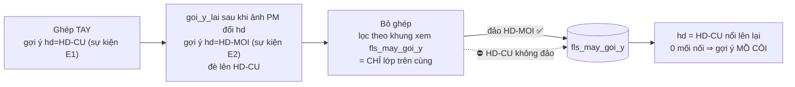

# KQ-005 — biên bản kiểm `BG-004` *(cú Ghép đi được trên màn thật)*

| | |
|---|---|
| **Thuộc** | `BG-004` · `WO-003` *(vòng 1)* |
| **Kiểm bởi** | `fls-test` · 2026-10-01 · nhánh `feat/p2-oracle-parity` @ `4b2b2e8` *(mã `48fb68f`)* |
| **Phán quyết** | ⛔ **TRƯỢT** — **11/12** AC đạt; ⛔ `AC-7` trượt: bỏ ghép chỉ đảo **lớp trên cùng** của gợi ý ⇒ khi một ô có **gợi ý chồng** *(ví dụ `tools/goi_y_lai.py` chạy sau khi ảnh PM đổi `hd`)*, lớp dưới **nổi lên lại** thành gợi ý **mồ côi** (`F-1` `NANG`). Thêm `F-2` `NANG`: màn `F01` nói *"người đã gõ tay"* khi ⛔ ai gõ |
| **Trạng thái** | `DONG` *(01/10 tối — F-1, F-2 vá ở `5fbc29c`, kiểm lại ở [`KQ-007`](KQ-007-kiem-bg-006.md) ĐẠT; F-3, F-4 `BA` đã sửa spec)* · ~~`MO` — chờ `DEV` *(F-1, F-2)* + `BA` *(F-1 vế `DT-I14` nhánh 7; F-3, F-4)*~~ |

> **Một câu cho owner:** nút `Gán` / `Bỏ gán` trên màn ghép **nay ghi được thật** — tôi đã bấm cả hai trên một máy thứ hai trỏ **kho thử**, cửa trả `200`, vết đúng *(lý do `(may dien) …`, người bấm là người, `hd`/`cdt1` chỉ là gợi ý, Final ⛔ đổi)*; màn ⛔ còn nói *"hàng chờ đã sạch"* lúc đang tải. Nhưng **một ca bỏ ghép còn để lại gợi ý cũ** sau khi dòng đã hết mối nối — hôm nay **0** dòng thật dính, sẽ dính lần đầu chạy `goi_y_lai` sau khi một lệnh chi đổi `hd`/`cdt1` ⇒ trả Dev vá nốt trước khi đóng phiếu.

---

## Cổng vào

| Kiểm | Đo | Khớp |
|---|---|:-:|
| Hash `BG` đã đẩy | `git fetch` ⇒ `origin/feat/p2-oracle-parity` = `4b2b2e8` *(BG)* · `48fb68f` *(mã)* — cây làm việc = `4b2b2e8`, sạch trong `fls/` | ✅ |
| Version spec = `WO-003` | `BA-07` **v3.4** · `BA-05` **v0.32** · `BA-10` **v0.6** · `BA-09` **v0.5** · `BA-11` **v0.14** · `BA-08` **v1.2** · `BA-06` **v4.7** *(đọc dòng `Version` từng tệp)* | ✅ 7/7 |
| Máy 8088 chạy mã mới | `man_f01_ghep.js` + `man_f01.js` phục vụ **trùng byte** tệp đĩa @ `4b2b2e8` *(`cmp`)*; `_sap_tai` có **3** lần trong tệp phục vụ | ✅ |

## Cổng chạy lại *(Test tự chạy 01/10 tối — so với `BG`)*

| Lệnh | `BG` nói | Test đo | Khớp |
|---|---|---|:-:|
| `python -m pytest` *(trước khi gỡ dấu)* | `5 failed, 1928 passed, 1 xfailed` — 5 đỏ = 5 `XPASS(strict)` | **`5 failed, 1928 passed, 1 xfailed in 261.33s`** — 5 `FAILED` đúng **5** tên `BG` liệt kê, cả 5 dòng `[XPASS(strict)]` | ✅ |
| `python -m pytest` *(sau khi gỡ dấu + 2 tệp `kq005`)* | — | **`1935 passed, 4 xfailed in 264.10s`** — 0 đỏ; 4 `xfail` = `F-2` `WO-001` + 3 bài-đỏ `KQ-005` *(⚠ một lượt trước đó ra `1 error` — `fls_source` ⛔ tồn tại ở `test_cua_nap_pg` — vì tôi chạy kịch bản phá **song song** trên cùng kho thử; chạy lại một mình ⇒ sạch)* | — |
| `tools/kiem_so_song.py` | `⛔ … 80 lech` *(nền 61, +19 loại c)* | ⛔ **`83 lech/khong-do-duoc`** — các số **do phiếu sinh** khớp `BG` nguyên văn *(phép thử `1934`, `1736`; dòng mã `24.961`; repo `522`/`6.982`; api `317`/`3.892`; web `8.547`)*. **+3** so với `BG`: ⚠ chưa tách từng nhóm — các nhóm trôi theo giờ có mặt *(dấu thời điểm `01/10 18:20`, ảnh nhịp `131/143`, ảnh lệnh chi `249.288`, `master §8` số tệp `93` — tệp `BG-004` thêm sau khi Dev đo)* | ⚠ *(đỏ nền, ⛔ chạy `--ghi` — `WO-001 T5`)* |
| `docs/ITL/_tools/kiem_tai_lieu.py` | ✅ `92 file` | ✅ **`93 file, 1153 bang, 626 o ngay, 104 ma QD`** *(+1 = chính `BG-004`)* | ✅ |
| `docs/ITL/_tools/khop_owner.py --kiem` | `15/19 · ✅ C8 · CONG NO (khối SINH-KHOP)` | **`15/19 khop · 4 lech`** · **`✅ C8`** · `⛔ CONG NO: khoi trong lo trinh LECH` — y nền | ✅ |
| `tools/soi_bang_tuyen.py` | `40 tuyen` | ✅ **`KHOP SQL that o ca 40 tuyen`** | ✅ |
| `tools/kiem_thuyet_minh.py` | `31/31` | ✅ **`31/31 nut`** | ✅ |
| `.venv/Scripts/lint-imports.exe` | `9 kept, 0 broken` | ✅ **`9 kept, 0 broken`** | ✅ |
| `python -m fls.db.pg_migrate` | ⛔ chưa chạy bản ghi; `--status` + `pg_verify` | ⛔ **⛔ chạy bản ghi** *(áp lên kho thật — cấm ghi)*. `--status`: mới nhất `0026_dien_giai_sao_ke` đã áp · `pg_verify`: **`khop: 25 bang/view`** | ✅ |

## Bảng AC

| AC | Mong | Đo được *(có nhãn · mẫu số)* | Phán quyết |
|---|---|---|---|
| AC-1 | Hai bài `F-1` qua khi tắt `xfail` | **Đỏ trên mã cũ** *(worktree `c1fb250`, `--runxfail`)*: 2 failed — *"cửa THẬT từ chối đúng thân màn gửi {'pm_line_ids': ['PM9-1']}: LoiCua FLS-BAD-REQUEST"* / *"… {}"*. **Xanh trên `4b2b2e8`** sau khi gỡ dấu. ⭐ **Và đo thật qua HTTP** *(máy 8099 → kho TEST, Chrome bấm **nút thật**)*: `REQ /queue/2903/match {"pm_line_ids":["PM5AFA9-1"]}` ⇒ **`RES 200`** · `REQ /queue/2903/unmatch {}` ⇒ **`RES 200`** | ✅ ĐẠT |
| AC-2 | Thiếu `reason` ⇒ vết bắt đầu `"(may dien) "`, `actor` = người, 0 rỗng | Máy 8099, 2 sự kiện của 2 cú bấm thật: `match` *"(may dien) ghep tren man - nguoi bam khong ghi ly do · ghep tay 1 dong lenh (PM5AFA9-1)"* · `unmatch` *"(may dien) bo ghep tren man - … · bo 1 moi noi (PM5AFA9-1)"*; `actor` **`fls-test@apero.vn`** cả **2/2** *(⛔ `may@fls`)*. Bài Dev xanh. Kịch bản phá `S1`/`S2` gọi `reason=""` và bỏ trống ⇒ qua | ✅ ĐẠT |
| AC-3 | `match-lo` thiếu `reason` ⇒ `400` | đọc mã: `xu_ly.ghep_lo` vẫn `_chu(yc.than, "reason")` **bắt buộc**; 3 bài `test_cua_LO_thieu_ly_do_VAN_400…` xanh trong lượt pytest của Test. ⚠ Chiều đỏ ⛔ tự chứng lại *(⛔ sửa `fls/`)* | ✅ ĐẠT |
| AC-4 | Mối nối tay có `run_pm` = ảnh PM | **Đỏ trên `c1fb250`**: *"`run_pm` (= None, mong 'NAP-2000-01-01-…')"*; **xanh** trên `4b2b2e8`. Máy 8099: `link 2905` `run_id` = `run_pm` = **`NAP-2000-01-01-M5DFA94`** = `anh_pm` mà cửa `/so` trả | ✅ ĐẠT |
| AC-5 | `fls_may_goi_y` +2 · `fls_sua_tay` +0 · `nguon`/`value_source` = `may_goi_y` · `actor` người · Final ⛔ đổi | Máy 8099 sau cú `Gán` thật *(itl `2903`, N = 1)*: `fls_adjustment` **2** dòng `cdt1`/`hd`, `nguon='may_goi_y'` **2/2**, `actor` = `fls-test@apero.vn` **2/2**, `evt_id` = sự kiện `match` `2904` **2/2** · `fls_may_goi_y` = `{cdt1: CDT-UAT, hd: HD-UAT}` *(2)* · `fls_sua_tay` **0**. `value_source` của nhật ký: đo qua bài `test_ghep_TAY_hd_cdt1_vao_fls_may_goi_y__Final_KHONG_doi` *(xanh)* — ⚠ vết 8099 bị bộ test dọn kho thử trước khi tôi kịp chụp `fls_journal` | ✅ ĐẠT |
| AC-6 | Người đã chốt ⇒ ⛔ gợi ý ô ấy, `nguoi_da_chot` | Kịch bản `S4`: người gõ `cdt1` sau ghép → bỏ ghép → **ghép lại** ⇒ `nguoi_da_chot == ["cdt1"]`, `fls_may_goi_y = {hd}` *(chỉ `hd`)*; bài Dev xanh | ✅ ĐẠT |
| AC-7 | Bỏ ghép ⇒ **mọi** gợi ý gắn sự kiện `match` của dòng bị đảo; `fls_may_goi_y` của dòng về **0**; người ⛔ bị đảo | Ca **một lớp** ✅ *(8099: 2 bản đảo `2912→2906`, `2914→2908`, `nguon='may_goi_y'`, `fls_may_goi_y` **0**, `fls_moi_noi` **0**; `S2`, `S4` ✅)*. ⛔ Ca **gợi ý chồng** *(`S3`: ghép tay `HD-CU` → `ghi_goi_y_may` `HD-MOI` như `goi_y_lai` làm → bỏ ghép; `S3b`: dòng máy ghép, 2 lớp)* ⇒ `fls_may_goi_y` = **`{hd: HD-CU}`** với **0** mối nối hiệu lực — gợi ý mồ côi, **2/2** ca. Bài `tests/nghiem_thu/test_kq005_bo_ghep_dao_ca_goi_y_chong.py` | ⛔ **TRƯỢT** *(F-1)* |
| AC-8 | Cổng `C8` ⛔ lật khi chỉ có cú ghép | `khop_owner --kiem` ⇒ **`✅ C8`** · kho thật `fls_sua_tay` **0** · máy 8099 sau ghép `fls_sua_tay` **0** | ✅ ĐẠT |
| AC-9 | Hai bài `F-3` qua khi tắt `xfail` | **Đỏ trên `c1fb250`**: *"màn ĐANG TẢI mà nói «đã sạch» — '…0 dòng (⛔ đã chạm trần 3000)…'"* + *«Không có dòng nào»*; **xanh** trên `4b2b2e8` | ✅ ĐẠT |
| AC-10 | 8088 chỉ đọc: lúc chờ cửa ⛔ *"Hàng chờ đã sạch"*/*"0 dòng"*; `?gia_lap=tai` hiện `Đang hỏi sổ…` mãi | Chrome headless CDP, 1440×900, mở tab `man-ghep`. **Màn thật**: 300 · 800 · 1.500 · 2.500 · 4.000 · 6.000 ms ⇒ `"Đang hỏi sổ"=true`, `"đã sạch"=false`, `"0 dòng"=false` **6/6** mẫu; 10.000 ms ⇒ **`736 dòng`**. **`?gia_lap=tai`**: 300 · 800 · 1.500 · 4.000 ms + lượt chụp cuối *(≈7 s)* ⇒ `Đang hỏi sổ…` **5/5**, ⛔ "đã sạch" | ✅ ĐẠT |
| AC-11 | pytest **chỉ** đỏ đúng 5 `XPASS(strict)` · lint 9/0 · `soi_bang_tuyen` · `kiem_thuyet_minh` | xem bảng cổng — **5/5** tên khớp, ⛔ bài nào khác đỏ | ✅ ĐẠT |
| AC-12 | `BG` tách đỏ mới *(loại c)* khỏi nền; ⛔ `dong_bo --ghi` | `BG` ghi 61 → 80, +19 loại (c) — các số loại (c) Test đo **khớp nguyên văn**; Test ⛔ chạy `--ghi` | ✅ ĐẠT |

## Ba lăng kính

| Lăng kính | Kết luận | Căn cứ |
|---|---|---|
| **Logic** *(spec + bất biến)* | ⛔ **TRƯỢT** *(F-1 `NANG`)* — còn lại đúng spec | ✅ `reason` tuỳ ý ở `match`/`unmatch`, điền ở **repo** *(`ghi_tay.py` `LY_DO_MAC_DINH_*` = nguyên văn `BA-07 §4h ⓼`)*; `match-lo` giữ bắt buộc ✅ · `hd`/`cdt1` qua **một** luật `loc_goi_y`/`ghi_goi_y` dùng chung đường máy ✅ *(⛔ bản thứ hai)* · bản đảo mang `nguon` của dòng bị đảo ✅. **`SM-I06` 9 chuyển cấm** *(kịch bản phá trên kho TEST + đọc bài)*: `F-1` ghép dòng đã ghép ⇒ `DaGhep` ✅ · `F-2` bỏ lẻ ⇒ cửa `bo_ghep` với `{pm_line_ids}` ⇒ `LoiCua FLS-BAD-REQUEST` ✅ *(gọi hàm thật, `conn=None`)* · `F-3` kỳ `locked` + `force` ⇒ `KyDaChot` ✅ · `F-4` bỏ dòng chưa ghép ⇒ `KhongCoMoiNoi` ✅ · `F-5` Σ lệch ⇒ `LechTong`, khác tiền tệ ⇒ `KhacTienTe` ✅ *(4 ca bị chặn: `fls_pm_link` **0** dòng ghi)* · `F-6` ⚠ chỉ giữ bằng mã *(như spec khai; grep `UPDATE/DELETE` lên 5 bảng trong `fls/`: **0**; trong `tools/`: **2** tệp cũ `don_ly_do_sai.py`, `verify_sua_duoc_gi.py` — ngoài phạm vi, `GAP-DB-06`)* · `F-7` ✅ *(AC-5)* · `F-8` ✅ *(`S4`: giá trị người còn nguyên sau bỏ ghép)* · `F-9` ✅ *(AC-2)*. ⛔ **Nhưng** *"unmatch: đảo **mọi** gợi ý còn hiệu lực gắn sự kiện `match`"* ⛔ đúng khi gợi ý chồng lớp *(F-1)*. **N ≥ 2**: `S1` lệch `hd`, đồng ý `cdt1` ⇒ `khong_suy_duoc=["hd"]`, chỉ gợi ý `cdt1` ✅; `S1b` một dòng **rỗng** `hd` + một dòng `HD-B` ⇒ máy gợi ý `HD-B` *(luật `suy_hd_cdt1` bỏ ô rỗng — `DT-I14` ⛔ khai ca trộn rỗng/có; ghi nhận, ⛔ nâng `F`)*. **Ghép lại sau bỏ** `S2` ✅ gợi ý ghi lại và về 0 — ⛔ nhưng `bo_qua` lượt 2 có **2** mục bịa *(F-2)* |
| **Dữ liệu** *(kho thật, chỉ `SELECT`)* | ✅ **ĐẠT** — lượt Dev **⛔ chạm** kho thật | So `KQ-002`: `fls_pm_link` **2.263** = 2.263 · `fls_may_goi_y` **4.424** *(= `WO-003` đo)* · `fls_sua_tay` **0** · `fls_adjustment` **4.428** = 4.428 · `fls_journal` **4.428** = 4.428 · `fls_queue_event` **110.349** = 110.349. Dòng sinh sau UAT: sự kiện `evt_id > 163574` **0** · bút toán `> 163572` **0** · mối nối `> 163562` **0**; `max(evt_id)=163567`. Thứ duy nhất tăng: `fls_chup` `163575…163577` *(**3** ảnh, actor `nhip@fls`, 10:20–11:20 UTC)* = nhịp chụp máy. `reason LIKE '(may dien)%'` **0** *(chưa ai bấm thật — đúng)*. ⭐ Tầm với của F-1 hôm nay: ô có **≥ 2** lớp gợi ý chưa đảo = **0** / `4.424` gợi ý; gợi ý mồ côi *(⛔ có mối nối hiệu lực)* = **0** / `4.424` ⇒ **0** dòng thật đang dính |
| **Màn hình** | ✅ **ĐẠT** cho màn ghép `SCR-F01`; ⛔ `F-2` ở hộp *"Đã bỏ ghép"* của màn `F01` *(mã cũ, nay tới được trên đường thường)* | **5 trạng thái** *(8088 chỉ đọc)*: **tải** `Đang hỏi sổ…` *(AC-10)* ✅ · **rỗng** *"0 dòng · Hàng chờ đã sạch. Không còn lệnh chi nào đợi gán."* — chỉ khi cửa trả rỗng ✅ · **lỗi** *"⛔ Cửa lỗi: Máy gặp lỗi bên trong."* ✅ · **mất kết nối** *"⛔ Cửa lỗi: Không nối được tới máy chủ FLS."* ✅ · **có dữ liệu** `736 dòng` sau ~10 s ✅. Bốn trạng thái giả lập có thanh đỏ *"CHẾ ĐỘ GIẢ LẬP"*. Cỡ chữ `body` **13,5px**; bề rộng trang ≤ cửa sổ *(1.409/1.424 thật, 1.424/1.424 giả lập — ⛔ cuộn ngang)*; lỗi console **0** ở cả 5. **Đường GHI qua màn** *(máy thứ hai `--cho-ghi --cong 8099`, `PG_DSN` → **`fls_test`**, đã tắt sau đo)*: bấm **nút thật** `Gán` rồi `Bỏ gán` *(Chrome CDP; vào lệnh qua `F01G.mo_lenh` + chọn ứng viên `ST.ung_vien_chon`, rồi `click()` nút DOM)* ⇒ thân `{"pm_line_ids":["PM5AFA9-1"]}` / `{}` ⇒ **`200` / `200`**, ⛔ còn `400`. ⚠ Danh sách *"Chưa gán"* trên kho thử **rỗng** *(lệnh dựng tay ⛔ vào rổ)* nên ⛔ đi được bằng phím ↑↓/Enter từ danh sách |

## Phát hiện

| F | Mức | Nơi | Tái hiện | Gửi |
|---|---|---|---|---|
| **F-1** | `NANG` | `fls/repo/ghi_tay.py::bo_moi_noi` — tập *"còn hiệu lực"* = `fls_sua_tay ∪ fls_may_goi_y` *(hai khung xem chỉ trả **lớp trên cùng** mỗi ô — migration `0025`)* ⟷ `BA-10` v0.6 `DT-I14` nhánh 7 *("bị gợi ý mới hơn đè ⇒ ⛔ làm gì")* | Kho TEST: ghép tay `HD-CU` → `ghi_goi_y_may(hd=HD-MOI)` *(đúng lời gọi `tools/goi_y_lai.py:82` khi ảnh PM mới đổi `hd`; `goi_y_lai` đọc **mọi** mối nối hiệu lực, kể cả `hinh='T'`)* → `bo_moi_noi` ⇒ đảo `HD-MOI` + `cdt1`; **`HD-CU` ⛔ đảo** ⇒ `fls_may_goi_y = {hd: HD-CU}`, `fls_moi_noi` **0** — mồ côi, đúng thứ `AC-7`/`SM-I06` cấm. Đường máy thuần *(2 lần `ghi_goi_y_may` trên dòng `hinh='A'`)* ra y hệt. `bo_qua` còn khai `HD-CU` là *"⛔ không còn hiệu lực"* — **sai**: nó vừa thành hiệu lực. ⚠ `BG-004` mục 1 nghi đúng chỗ nhưng kết *"đường mới ⛔ sinh ra ca này"* — ⛔ đúng. Chiều xanh *(giả lập vá trên kho TEST: đảo **mọi** bút toán gợi ý gắn sự kiện `match` còn chưa đảo)* ⇒ `fls_may_goi_y` **{}**. Kho thật hôm nay **0** ca | `DEV` *(vá: đảo mọi bút toán `nguon='may_goi_y'` gắn sự kiện `match` của dòng chưa bị đảo, ⛔ chỉ lớp trên cùng)* · `BA` *(sửa `DT-I14` nhánh 7: "bị đè" ⛔ phải "⛔ làm gì" khi lớp trên bị đảo — hoặc chốt luật khác)* |
| **F-2** | `NANG` | `fls/repo/ghi_tay.py::bo_moi_noi` *(dựng `bo_qua` từ **mọi** bút toán `match` ⛔ trong tập còn hiệu lực, kể cả đã đảo ở lượt trước)* ⟷ `BA-06` v4.7 `:1174` *(`bo_qua` = "người đã gõ tay")* ⟷ `fls/web/tep/man_f01.js` `_bao_bo_ghep` *(in "⛔ KHÔNG đảo N ô — **người** đã gõ tay lên đó")* | Kho TEST, đường `QĐ-ITL-69` khuyên: ghép → bỏ → **ghép lại** → bỏ, **⛔ ai gõ ô nào** *(`fls_sua_tay` **0**)* ⇒ `bo_qua` = **2** mục `[(cdt1, may_goi_y), (hd, may_goi_y)]` ⇒ hộp *"Đã bỏ ghép"* trên `F01` sẽ nói người đã gõ tay 2 ô — **bịa** về việc người làm. Có từ trước `WO-003` *(`BG-004` mục 2 tự khai)*, nhưng `WO-003` làm đường ghép-lại thành thường ngày | `DEV` *(⛔ đưa bút toán đã đảo vào `bo_qua`, hoặc màn ⛔ in chung một câu — `BA` chốt nếu muốn khai cả loại máy)* |
| **F-3** | `NHE` | `BA-10` v0.6 `DT-I14` nhánh 4/5 | ⛔ khai ca **trộn** *(một dòng lệnh rỗng ô, dòng kia có giá trị)*. Mã *(`may_ghep.suy_hd_cdt1`)* bỏ ô rỗng ⇒ gợi ý giá trị của dòng có *(kịch bản `S1b`)*. Có thể đúng ý, nhưng spec ⛔ nói ⇒ Test ⛔ có chuẩn để phán | `BA` |
| **F-4** | `NHE` | `WO-003 AC-11` *("cửa match/unmatch ⛔ đổi bảng chạm")* | `bang_tuyen.py` thêm `fls_may_goi_y` vào bảng **đọc** của `match`·`match-lo`·`unmatch` *(đúng — `BG-004` mục 3)*; `soi_bang_tuyen` 40/40 ✅. Chỉ câu ngoặc của AC lệch mã — ⛔ chặn | `BA` |

⚠ **Đã soi 7 mục "Dev tự thấy còn yếu" *(`BG-004`)*:**

| # | Kết luận Test |
|---|---|
| 1 · gợi ý cũ sống lại | ⛔ **CÓ THẬT, sinh được bằng đường MỚI** *(ghép tay + `goi_y_lai`)* ⇒ `F-1`. Kho thật hôm nay **0** ca *(đo)* |
| 2 · `bo_qua` thêm loại mục | Loại mục mới *(giá trị người)* đúng nghĩa câu màn. ⛔ Loại mục **cũ** *(bút toán đã đảo)* in sai câu ⇒ `F-2`, tới được trên đường ghép-lại |
| 3 · bảng chạm đổi | đúng mã, chỉ câu ngoặc `AC-11` lệch ⇒ `F-4` `NHE` |
| 4 · `run_id` vẫn hai nghĩa | đúng như `WO-003` bảo *(giữ)*; `run_pm` nay ghi ⇒ hỏi đúng được. ⛔ nâng `F` |
| 5 · thôi so cột nguồn | đúng `DT-I14`; kho thật `fls_itl.hd` = **0/8.387** khác rỗng ⇒ ⛔ chạm ai. ⛔ nâng `F` |
| 6 · bài ghim `goi_y_lai` xanh trên mã cũ | đúng nhận xét; nhưng chính `goi_y_lai` là đường đẻ ra `F-1` — bài ấy canh **dòng đã bỏ ghép**, ⛔ canh **dòng còn mối nối bị gợi ý chồng** |
| 7 · `_sap_tai` xoá `ST.loi` | đo màn: trạng thái `loi` vẫn hiện đúng câu lỗi *(5/5 trạng thái, 0 lỗi console)*; ⛔ thấy hồi quy. ⛔ có bài riêng ⇒ ⛔ nâng `F` |

## ⛔ KHÔNG ĐO ĐƯỢC

| Phần | Vì sao |
|---|---|
| Đi tới lệnh bằng **phím ↑↓/Enter từ danh sách** trên máy 8099 | danh sách *"Chưa gán"* của kho thử **rỗng** cho lệnh dựng tay ⇒ vào lệnh bằng `F01G.mo_lenh` *(hàm thật của màn)*; cú bấm `Gán`/`Bỏ gán` là **nút DOM thật** |
| `fls_journal.value_source` của cú bấm 8099 | lượt `pytest` chạy song song đã dọn kho thử trước khi chụp; đo thay bằng bài AC-5 *(xanh)* |
| Chiều ĐỎ của AC-3 | Test ⛔ được sửa `fls/` để phá; dựa đọc mã + bài xanh |
| Tách **+3** nhóm `kiem_so_song` *(83 vs 80)* | các số loại (c) khớp `BG`; phần trôi theo giờ chưa tách từng nhóm |
| Phím tắt, tương phản, màn hẹp | ⛔ thuộc phạm vi `WO-003` *(`GAP-NFR-01` còn mở)* |

## Bài thử mới *(`tests/nghiem_thu/`)*

| Bài | Đã chứng minh ĐỎ bằng cách | Xanh sau |
|---|---|---|
| ✅ **gỡ dấu `xfail`** 5 bài `KQ-002`: `test_kq002_than_man_ghep_qua_cua_that.py` ×2 · `test_kq002_ghep_tay_ghi_run_pm.py` ×1 · `test_kq002_man_ghep_dang_tai_khong_noi_da_sach.py` ×2 | chạy lại trên **worktree `c1fb250`** *(mã trước `WO-003`)* `--runxfail` ⇒ **5 failed** đúng thông điệp `KQ-002` *(LoiCua 400 · `run_pm=None` · "đã sạch")*; xanh trên `4b2b2e8` **và** khớp đo thật *(8099: 200/200, `run_pm`; 8088: `Đang hỏi sổ…`)* ⇒ xanh **vì đúng lý do** | ✅ |
| ⏳ giữ `xfail` `test_kq002_moc_b_khong_dem_may_la_nguoi.py::test_su_kien_cua_MAY_…` | `F-2` của `KQ-002` thuộc `WO-001 T1a` — vẫn đỏ `--runxfail` | ⏳ `WO-001` |
| `test_kq005_bo_ghep_dao_ca_goi_y_chong.py::test_ghep_TAY_roi_goi_y_lai_CHONG__…` · `::test_dong_MAY_ghep_goi_y_CHONG_hai_lop__…` *(`xfail strict`)* | `--runxfail` trên `4b2b2e8` ⇒ **2 failed**: *"`fls_may_goi_y` vẫn còn {'hd': 'HD-CU'} — gợi ý lớp dưới NỔI LÊN LẠI"*. Chiều xanh: giả lập vá trên kho TEST *(đảo mọi gợi ý `match` chưa đảo)* ⇒ `{}`. Đối chứng `::test_DOI_CHUNG_goi_y_MOT_lop…` **xanh** | ⏳ chờ F-1 |
| `test_kq005_bo_qua_chi_la_gia_tri_nguoi.py::test_ghep_BO_ghep_lai_BO__…` *(`xfail strict`)* | `--runxfail` ⇒ **1 failed**: *"⛔ ai gõ tay mà `bo_qua` có 2 mục [('cdt1','may_goi_y'), ('hd','may_goi_y')]"*. Đối chứng `::test_DOI_CHUNG_nguoi_go_THAT…` *(người gõ thật ⇒ `bo_qua` có `hd`)* **xanh** | ⏳ chờ F-2 |

## Changelog
- 2026-10-01 tối · `fls-test` · `DONG` — `KQ-007` *(kiểm `BG-006`)* ĐẠT; 3 bài-đỏ `kq005` gỡ `xfail`.
- 2026-10-01 · `fls-test` · phát `KQ-005` *(kiểm `BG-004`)* — ⛔ TRƯỢT `AC-7`; gỡ `xfail` 5 bài `KQ-002`; +2 tệp nghiệm thu `kq005` *(3 bài-đỏ `xfail strict` + 2 đối chứng)*.
