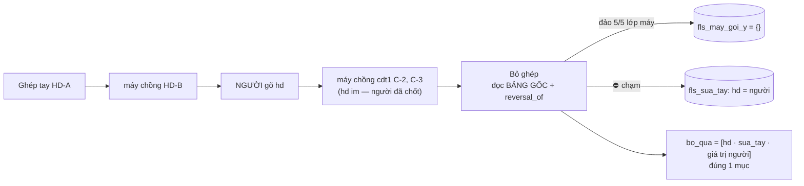

# KQ-007 — biên bản kiểm `BG-006` *(`WO-003` vòng 2: bỏ ghép đảo mọi lớp gợi ý · `bo_qua` chỉ giá trị người)*

| | |
|---|---|
| **Thuộc** | `BG-006` · `WO-003` *(vòng 2 — mở lại theo [`KQ-005`](KQ-005-kiem-bg-004.md))* |
| **Kiểm bởi** | `fls-test` · 2026-10-01 tối · nhánh `feat/p2-oracle-parity` @ `c785411` *(mã `5fbc29c`)* |
| **Phán quyết** | ✅ **ĐẠT** — **6/6** AC vòng 2 *(`AC-13`…`AC-18`)* đạt; `AC-1`…`AC-12` ⛔ hồi quy *(pytest toàn bộ xanh, bấm thật `Gán`/`Bỏ gán` 200/200 trên máy thứ hai, màn 8088 đủ 5 trạng thái)*; ba lăng kính ⛔ còn `CHAN`/`NANG`. Bốn phát hiện **`NHE`**, cả bốn gửi **`BA`** *(chữ trên giấy/màn, ⛔ lỗi mã)* |
| **Trạng thái** | ✅ **`DONG`** *(01/10 tối, `fls-test` khi phát [`KQ-010`](KQ-010-kiem-bg-009.md): `BA` đã trả cả 4 `F` — `F-4` ⇒ `BA-10` v0.8 `:82` `AC-16` + `BA-09` v0.7 `F-10`/`F-11` ✅ *(grep xác nhận)*; `F-1`…`F-3` ⇒ `BA-06` v4.8 + `BA-10` v0.8, mã ⇒ `WO-008`)* · ~~`MO` — chờ `BA` *(F-1…F-4, ⛔ chặn đóng `WO-003`)*~~ |

> **Một câu cho owner:** bỏ ghép nay rút **hết** gợi ý của máy trên dòng — tôi đã thử 16 kịch bản phá trên kho thử *(tới 5 lớp gợi ý chồng nhau, người gõ tay xen giữa, ba vòng ghép-bỏ liền nhau, dòng máy tự ghép)* và bấm thật nút `Bỏ gán` trên một máy thứ hai: **0** gợi ý mồ côi, **0** bút toán bị đảo hai lần, giá trị người **còn nguyên**, và hộp *"Đã bỏ ghép"* chỉ nói *"người đã gõ tay"* khi người thật sự gõ. Sổ thật **⛔ bị chạm**. Còn bốn chỗ **chữ** cần `BA` xem — ⛔ chặn đóng phiếu.

---

## Cổng vào

| Kiểm | Đo | Khớp |
|---|---|:-:|
| Hash `BG` đã đẩy | `git fetch` ⇒ `origin/feat/p2-oracle-parity` = **`c785411`** *(phiếu)*; mã ở **`5fbc29c`** *(`git show --stat`: `ghi_tay.py`, `bang_tuyen.py`, 1 tệp bài mới, changelog — đúng bảng *Đã đổi*)* | ✅ |
| Version spec = `WO-003` vòng 2 | `BA-10` **v0.7** · `BA-11` **v0.15** · `BA-09` **v0.6** · `BA-05` **v0.33** *(dòng `Version` từng tệp)* | ✅ 4/4 |
| Máy 8088 chạy mã mới, chỉ đọc | `man_f01.js` + `man_f01_ghep.js` phục vụ **trùng byte** tệp đĩa *(`cmp`)*; `POST /queue/27728/unmatch` có thẻ ⇒ **`FLS-METHOD`** *"cửa này đang chạy ở chế độ CHỈ ĐỌC"*; `GET /queue/summary` ⇒ `200` | ✅ |

## Cổng chạy lại *(Test tự chạy, tuần tự — ⛔ song song với kịch bản phá; so với `BG`)*

| Lệnh | `BG` nói | Test đo | Khớp |
|---|---|---|:-:|
| `python -m pytest` *(trước khi gỡ dấu)* | `3 failed, 1941 passed, 1 xfailed` — 3 = `XPASS(strict)` | **`3 failed, 1941 passed, 1 xfailed in 264.56s`** — 3 `FAILED` đúng **3** tên `BG` liệt kê, cả 3 dòng `[XPASS(strict)]`; `XFAIL` = bài `WO-001` | ✅ |
| `python -m pytest` *(sau khi gỡ 3 dấu + 4 bài `kq007`)* | — | **`1948 passed, 1 xfailed in 265.72s`** — **0** đỏ *(1941 + 3 gỡ dấu + 4 mới)*; `xfail` duy nhất = `test_kq002_moc_b_khong_dem_may_la_nguoi.py::test_su_kien_cua_MAY_…` *(`WO-001`, giữ)* | — |
| `tools/kiem_so_song.py` | `83 lech` *(nền 83, +0 nhóm)* | ⛔ **`83 lech/khong-do-duoc`** — diff nguyên văn với bản in của Dev: chỉ dời **giá trị máy** loại (c) *(phép thử `1945→1949` = +4 bài `kq007` · nhóm 4 `203→207` · hash `48fb68f→5fbc29c` · master §8 số tệp `94→95` = chính `BG-006`)*; **+0 nhóm** | ✅ *(đỏ nền; ⛔ `--ghi` — `WO-001 T5`)* |
| `docs/ITL/_tools/kiem_tai_lieu.py` | ✅ `94 file` *(trước `BG-006`)* | ✅ **`95 file, 1170 bang, 631 o ngay, 104 ma QD`** *(+1 = `BG-006`)* — đo **trước** khi thêm phiếu này; đo lại sau ở mục *Changelog* | ✅ |
| `docs/ITL/_tools/khop_owner.py --kiem` | `15/19 · ✅ C8 · CONG NO` | **`15/19 khop · 4 lech (da do 19/19 phep)`** · **`✅ C8`** · `⛔ CONG NO` — y nền `KQ-005` | ✅ |
| `tools/soi_bang_tuyen.py` | `40 tuyen` | ✅ **`KHOP SQL that o ca 40 tuyen`** | ✅ |
| `tools/kiem_thuyet_minh.py` | `31/31` | ✅ **`31/31 nut co mat trong CA 2 ban`** | ✅ |
| `.venv/Scripts/lint-imports.exe` | `9 kept, 0 broken` | ✅ **`9 kept, 0 broken`** | ✅ |
| `python -m fls.db.pg_migrate` | ⛔ chưa chạy bản ghi; `--status` + `pg_verify` | ⛔ **⛔ chạy bản ghi** *(áp lên kho thật — cấm ghi)*. `--status`: mới nhất **`0026_dien_giai_sao_ke`** đã áp · `pg_verify`: **`khop: 25 bang/view`** | ✅ |

## Bảng AC

| AC | Mong | Đo được *(có nhãn · mẫu số)* | Phán quyết |
|---|---|---|---|
| AC-13 *(e)* | 2 bài `F-1` qua khi tắt `xfail`; đối chứng xanh; chạy thường = 2 `XPASS(strict)` | Chạy thường: **2** `XPASS(strict)` đúng tên *(lượt pytest toàn bộ)*. ⭐ **Chiều ĐỎ tự chứng** *(đột biến trên **worktree** `c785411` — ⛔ sửa `fls/` của repo, mẫu khớp **đúng 1** lần, trả nguyên + kiểm byte)*: `M1` trả phép chọn về khung xem `fls_sua_tay ∪ fls_may_goi_y` ⇒ `test_kq005_bo_ghep_dao_ca_goi_y_chong.py --runxfail` **`2 failed, 1 passed`** — đúng 2 bài-đỏ, đối chứng xanh. Gỡ dấu xong ⇒ xanh | ✅ ĐẠT |
| AC-14 *(e)* | 3 lớp: ⓐ trước = 4 *(mẫu số ≠ 0)* · ⓑ sau = 0, `fls_may_goi_y` `{}` · ⓒ mỗi gợi ý 1 bản đảo · ⓓ ghép→bỏ→ghép lại→bỏ ⛔ đảo 2 lần | Bài Dev `test_wo003_vong2…` 6/6 xanh. **Đột biến**: `M1` ⇒ bài 3-lớp + bài nhánh 8 **đỏ** *(2 failed)* · `M2` bỏ `NOT EXISTS` ⇒ `::test_ghep_BO_ghep_lai_BO__KHONG_bao_gio_dao_HAI_lan` **đỏ** *(1 failed)*. **Kịch bản phá thêm** *(kho TEST)*: `P1` **5** lớp *(tay `HD-A`/`C-1` → máy `HD-B` → **người gõ `hd`** → máy `C-2` → máy `C-3`; `hd` lớp 3–4 ⛔ ghi vì người đã chốt)* ⇒ trước **5** chưa đảo *(khung xem chỉ trả 2)*, sau **0**, đảo **5**, `fls_may_goi_y` `{}`, `fls_sua_tay` `{hd: người}`, Final `hd` = người · `P2` **3 vòng** ghép/bỏ, vòng 2 có lớp `goi_y_lai` chồng ⇒ **8** bút toán gắn `match`, **mỗi cái đúng 1** bản đảo *(đảo theo vòng `[2, 4, 2]`)* · `P3` dòng **máy ghép `hinh='A'`** 3 lớp + người gõ `cdt1` ⇒ trước **5**, sau **0**, người nguyên · `P6` người **tự đảo** một gợi ý trước *(`/reverse`)* ⇒ bỏ ghép chỉ đảo ô còn lại, **0** bút toán ≥ 2 bản đảo | ✅ ĐẠT |
| AC-15 *(f)* | bài `F-2` qua khi tắt `xfail`; đối chứng xanh | Chạy thường **1** `XPASS(strict)` đúng tên. **Đột biến** `M3` *(dựng `bo_qua` từ mọi bút toán `match` ngoài tập đảo — như `48fb68f`)* ⇒ `--runxfail` **`1 failed, 1 passed`** — đúng bài-đỏ; bài Dev `::test_bo_qua_moi_O_nhieu_nhat_MOT_muc…` cũng đỏ. **16/16** kịch bản phá: mọi mục `bo_qua` là `nguon='sua_tay'`, bút toán ⛔ gắn `match`, chưa đảo, ⛔ nằm trong `but_toan_dao`, ≤ 1 mục/ô *(hàm kiểm `_bo_qua_chi_nguoi` ⇒ **0** vi phạm)*; ca ⛔ ai gõ ⇒ `bo_qua == []` **8/8** | ✅ ĐẠT |
| AC-16 *(g)* | ca trộn `""` + `HD-Y` ⇒ gợi ý `HD-Y`, `hd ∉ khong_suy_duoc` | Bài Dev xanh. **Đột biến** `M4` bỏ `gt.discard("")` ⇒ **`2 failed`** *(ca trộn + bài "ô chưa từng gợi ý")*. **Phá thêm**: `P7a` N = 3 `("", HD-Y, HD-Y)` ⇒ `{hd: HD-Y, cdt1: C-1}` ✅ · `P7b` `("", HD-Y, HD-Z)` ⇒ `khong_suy_duoc=["hd"]`, chỉ gợi ý `cdt1` *(nhánh 4 giữ)* ✅ · `P7c` ô **khoảng trắng** `"  "` + `HD-Y` ⇒ tính là rỗng *(`strip`)* ⇒ `HD-Y` ✅ · `P7d` mọi dòng rỗng ⇒ ⛔ gợi ý *(nhánh 5)* ✅; cả 4 bỏ ghép ⇒ `{}` | ✅ ĐẠT |
| AC-17 | pytest chỉ đỏ đúng 3 `XPASS(strict)`; bài `WO-001` vẫn `xfail`; lint 9/0; `soi_bang_tuyen` khớp; thuyết minh 31/31 | xem bảng cổng — **3/3** tên khớp, ⛔ bài nào khác đỏ; `unmatch` bỏ `fls_may_goi_y` khỏi bảng đọc ⇒ đọc mã: `bo_moi_noi` ⛔ còn câu SQL nào chạm `fls_may_goi_y` *(grep `fls_may_goi_y` trong thân hàm `:881`–`:1030`: **2** dòng, cả hai là **chú thích** `:916`, `:921`; câu SQL **0**)*, `soi_bang_tuyen` 40/40 | ✅ ĐẠT |
| AC-18 | `BG` tách `kiem_so_song`: nền 83 ⟷ đỏ mới loại (c); ⛔ `--ghi` | `BG` 83 = nền 83; Test đo **83** — các giá trị Dev liệt kê khớp; phần dời thêm là của **chính lượt Test** *(+4 bài, +1 tệp phiếu)*. Test ⛔ chạy `--ghi` | ✅ ĐẠT |
| ↩ AC-1…12 *(hồi quy)* | ⛔ đổi | pytest toàn bộ **1948 passed** *(gồm mọi bài `AC-1`…`AC-12` của `BG-004` + 5 bài `KQ-002` đã gỡ dấu)*. **Máy 8099** *(kho TEST, `--cho-ghi`, đã tắt)*: dòng A **bấm thật** `Gán` ⇒ `REQ /queue/3109/match {"pm_line_ids":["PM53E66-1"]}` **`RES 200`** → `Bỏ gán` ⇒ `/unmatch {}` **`RES 200`**; vết `match`/`unmatch` mang `(may dien) …`, `actor` **`fls-test@apero.vn`** 2/2; sau bỏ `fls_moi_noi` **0**, `fls_may_goi_y` **0** *(AC-1/2/5/7)*. Màn 8088: AC-10 *(tải ≠ rỗng)* giữ — mục *Màn hình* | ✅ ⛔ hồi quy |

## Ba lăng kính

| Lăng kính | Kết luận | Căn cứ |
|---|---|---|
| **Logic** *(spec + bất biến)* | ✅ **ĐẠT** — đúng `DT-I14` v0.7 *Luật một câu* + định nghĩa `bo_qua`; `INV-I22 ⓐ` giữ; `SM-I06 F-10`, `F-11` bị chặn | **Diff `5fbc29c`**: tập đảo = `fls_adjustment` ⋈ `fls_queue_event` `evt_type='match'` · `reversal_of IS NULL` · **`NOT EXISTS` bản đảo** — khớp nhánh 6 + 8 *(mọi `nguon`, mọi lớp)* và nhánh 7 *(đã có bản đảo ⇒ ⛔ làm gì)*. Bản đảo mang `nguon` + `value_before` của **chính** dòng bị đảo *(Rủi ro 2 — bài Dev đọc nhật ký `["C-1","HD-A","HD-B","HD-C"]`)*. `bo_qua` dựng **trong** giao dịch, **sau** khi đảo, từ khung xem `fls_sua_tay` *(khung xem loại cả bản đảo lẫn dòng bị đảo — migration `0025:60`–`70`)*, lọc ô **từng** có bút toán `match`. **Đột biến 6 hướng** *(worktree, ⛔ repo)*: `M1` khung xem · `M2` bỏ `NOT EXISTS` · `M3` `bo_qua` từ bút toán máy · `M4` bỏ `discard` · `M5` bỏ lọc ô từng ghép · `M6` dựng `bo_qua` **trước** khi đảo ⇒ **6/6 bị bắt** *(mỗi đột biến làm ≥ 1 bài đỏ)*. Bài `kq007` **4/4 đỏ trên `38a6b08`** *(mã vòng 1)* đúng lý do, xanh trên `5fbc29c`. ⚠ Ghi nhận ⛔ nâng `F`: câu `SELECT` chọn `se_dao` chạy **ngoài** `conn.transaction()` *(như vòng 1)* — hai người bỏ ghép cùng lúc chưa ai đo; ngoài phạm vi vòng 2 |
| **Dữ liệu** *(kho thật, chỉ `SELECT`)* | ✅ **ĐẠT** — lượt Dev **⛔ chạm** kho thật; `INV-I22` đo được trên sổ thật | So `KQ-005` *(đo đầu lượt và **lại** cuối lượt — y nhau)*: `fls_pm_link` **2.263** · `fls_pm_unlink` **1** · `fls_may_goi_y` **4.424** · `fls_sua_tay` **0** · `fls_adjustment` **4.428** · `fls_journal` **4.428** · `fls_queue_event` **110.349** · `fls_itl` **8.387** — **8/8 khớp**. `max(evt_id)` **163567** · `max(adj_id)` **163571** · `max(link_id)` **163562** *(⛔ dòng mới)*; `reason LIKE '(may dien)%'` **0**. ⭐ **`INV-I22`** *(SQL đọc bảng gốc như `DT-I14` khai)*: bút toán gợi ý gắn `match` chưa đảo, mọi lớp = **4.424** *(mẫu số ≠ 0, trên **2.219** dòng)* · ⓑ trong đó nằm trên dòng **0** mối nối hiệu lực = **0** · ô ≥ 2 lớp chưa đảo = **0** · `sua_tay` gắn `match` chưa đảo *(nhánh 8)* = **0** · bút toán bị đảo ≥ 2 lần = **0** / **2** bản đảo *(UAT)* ⇒ luật mới hôm nay **⛔ chạm dòng thật nào**; lần đầu chạm là cú bỏ ghép đầu tiên của người thật *(sẽ đảo 2 gợi ý/dòng)* |
| **Màn hình** | ✅ **ĐẠT** *(⛔ hồi quy)*; `F-2`, `F-3` `NHE` là chữ màn gửi `BA` | **5 trạng thái** *(8088 chỉ đọc, Chrome headless CDP 1440×900)*: **tải** — màn thật 300·800·1.500·2.500·4.000·6.000·10.000 ms ⇒ `"Đang hỏi sổ"=true`, `"đã sạch"=false`, `"0 dòng"=false` **7/7**; `?gia_lap=tai` **4/4** ✅ · **rỗng** *"0 dòng · Hàng chờ đã sạch. Không còn lệnh chi nào đợi gán."* ✅ · **lỗi** *"⛔ Cửa lỗi: Máy gặp lỗi bên trong."* ✅ · **mất kết nối** *"⛔ Cửa lỗi: Không nối được tới máy chủ FLS."* ✅ · **có dữ liệu** chụp cuối **`736 dòng`**, 6 cửa `/api` đều `200` ✅. Thanh *"CHẾ ĐỘ GIẢ LẬP"* ở cả 4 giả lập; `body` **13,5px**; bề rộng trang ≤ cửa sổ *(1.409/1.424 · 1.424/1.424)*; lỗi console **0/5**. **Đường GHI** *(máy thứ hai `--cho-web --cho-ghi --cong 8099`, `PG_DSN` → **`fls_test`**, đã tắt — `Get-NetTCPConnection 8099` = **0**)*: dòng A `Gán`/`Bỏ gán` 200/200 *(bảng AC)*; ⭐ dòng **B** *(ghép tay + 2 lớp `ghi_goi_y_may` + người gõ `hd` xen giữa — 4 gợi ý chưa đảo)* bấm **nút thật** `Bỏ gán` trên màn ghép ⇒ `RES 200`; thân trả: `da_bo` **1**, `but_toan_dao` `[cdt1, hd, hd, cdt1]`, `bo_qua` **`[[hd, sua_tay, HD-K7B]]`**; kho TEST sau bỏ: `fls_may_goi_y` **0** · `fls_moi_noi` **0** · gợi ý chưa đảo **0** · `fls_sua_tay` `{hd: HD-K7B}`. Hộp *"Đã bỏ ghép"* của `F01` dựng từ **đúng thân ấy** *(`F01._bao_bo_ghep(data)` — màn ghép ⛔ hiện hộp này, xem `F-3`)*: *"↩ Đã đảo 4 bút toán mà chính phép ghép suy ra: cdt1, hd, hd, cdt1 · ⚠ ⛔ KHÔNG đảo 1 ô — người đã gõ tay lên đó sau khi ghép: hd"* ⇒ câu *"người đã gõ tay"* **đúng** *(người đã gõ)* — `F-2` của `KQ-005` đã hết |

## Phát hiện

| F | Mức | Nơi | Tái hiện | Gửi |
|---|---|---|---|---|
| **F-1** | `NHE` | Nhật ký ô *(`fls_journal`, màn `F02` mục ⑦ `man_f02.js:1764`–`1777` in *"từ · thành · ai · nguồn · vì sao"*)* ⟷ `BA-05` v0.33 `DD-I15 ⓓd` *(chỉ khai `value_before` cho dòng **ghi** gợi ý — `:841`)* · `WO-003` vòng 2 Rủi ro 2 | ⭐ = `BG-006` yếu **mục 2**, **có thật và rộng hơn Dev nói**. Bản đảo một lớp **dưới** — lớp mà Final ⛔ đang dùng — vẫn ghi một dòng nhật ký *"X → (trống)"*. Đo kho TEST: ⓐ `P5` *(nhánh 8 — `sua_tay` cũ dưới người)*: ô `hd` có 3 dòng `None→HD-CU` · `HD-CU→HD-NGUOI` *(kt2)* · **`HD-CU → None`, nguồn `sua_tay`, actor người bấm** — trong khi Final = `HD-NGUOI`. Người đọc từ trên xuống thấy dòng cuối *"ô hd thành trống, do người, nguồn sửa tay"* ⇒ **tưởng ô bị xoá**; ⓑ `P1` *(nhánh 6 — lớp máy dưới người)*: dòng cuối `HD-A → None`, `HD-B → None` *(nguồn `may_goi_y`)* sau dòng `→ HD-NGUOI` — nhẹ hơn vì cột nguồn nói *máy*, nhưng cột *"thành"* vẫn in trống. Bảng `fls_journal` ⛔ có cột `adj_id`/`reversal_of` nên màn ⛔ tự phân biệt được — chỉ còn câu `reason` *("…dao but toan suy tu phep ghep da bo…")*. **Đúng spec** *(Rủi ro 2 đòi `value_before` của chính lớp)*; spec ⛔ nói dòng nhật ký của một lớp **⛔ hiệu lực** phải đọc thế nào. Kho thật hôm nay: nhánh 8 **0** dòng, ô ≥ 2 lớp **0** ⇒ ⛔ chạm ai; ⓑ chạm lần đầu khi người gõ đè một gợi ý rồi bỏ ghép *(có từ vòng 1 với một lớp)* | `BA` *(khai: dòng nhật ký bản đảo một lớp ⛔ hiệu lực phải mang dấu "Final ⛔ đổi" — ví dụ hậu tố `reason`, hay `value_source` riêng; hoặc chốt "chấp nhận, người đọc theo cột nguồn")* |
| **F-2** | `NHE` | Hộp *"Đã bỏ ghép"* `man_f01.js:423`–`440` *(`_bao_bo_ghep`: `dao.map(x => x.field).join(', ')`)* ⟷ `BA-06` v4.7 `:1174` | Vòng 2 làm `but_toan_dao` mang **nhiều lớp cùng ô** ⇒ hộp in *"Đã đảo **4** bút toán…: **cdt1, hd, hd, cdt1**"* *(đo bằng thân trả thật của máy 8099, dòng B)* — người đọc đếm được **4 ô** trong khi dòng chỉ có **2**. Câu ⛔ sai *(đúng là 4 bút toán)*, nhưng tên ô lặp ⛔ nói vì sao. `WO-003` vòng 2 ⛔ cho đổi màn ⇒ ⛔ lỗi Dev | `BA` *(khai câu cho ca nhiều lớp — ví dụ "2 ô · 4 lớp gợi ý")* |
| **F-3** | `NHE` | Màn ghép `man_f01_ghep.js:567`–`600` *(`bo_gan`: `await FLS.ghi(…/unmatch, {})` rồi **bỏ** thân trả)* ⟷ `BA-06` v4.7 `:1174` *(`bo_qua` "**phải hiện**" — khai cho "F01/F02 · nút Bỏ ghép")* · `:873` *(màn ghép: `Bỏ gán` ⛔ hộp **hỏi**)* | Bấm thật `Bỏ gán` trên 8099, dòng B có giá trị người ⇒ cửa trả `bo_qua=[hd]` nhưng màn ghép **⛔ hiện gì** *(hộp/dialog đọc được: **0**)*. Spec chỉ cấm **hỏi trước**, ⛔ nói **báo sau**; câu *"phải hiện"* chỉ khai cho `F01`/`F02`. Vòng 2 làm `bo_qua` lần đầu **đúng nghĩa** ⇒ đây là chỗ duy nhất nó vẫn bị nuốt. Kho thật `fls_sua_tay` **0** ⇒ hôm nay ⛔ chạm ai | `BA` *(chốt: màn ghép có báo `bo_qua` sau `Bỏ gán` hay ⛔ — và vì sao)* |
| **F-4** | `NHE` | `BA-10` v0.7 `:82` *("ghim bằng bài `WO-003` vòng 2 **`AC-15`**")* ⟷ `WO-003` *(ca trộn = **`AC-16`**)* · `BA-09` v0.6 `:158`–`159` *(`F-10`, `F-11` cột trạng thái "⛔ **mã đang vi phạm**")* | ⓐ = `BG-006` yếu **mục 5** — xác nhận *(grep)*. ⓑ sau `5fbc29c` hai dòng `F-10`/`F-11` ⛔ còn đúng — nay bị chặn bởi mã + bài *(`test_kq005_*` gỡ dấu, `test_wo003_vong2…`, `test_kq007…`)*. Biên bản ⛔ xoá — chỉ thêm dòng trạng thái mới *(`Đ2`)* | `BA` |

⚠ **Đã soi 6 mục "Dev tự thấy còn yếu" *(`BG-006`)*:**

| # | Kết luận Test |
|---|---|
| 1 · `bo_qua` đọc **sau** khi đảo | ✅ **đúng** — và nay **có bài riêng** cho ca *"bút toán ghép `sua_tay` cũ ở TRÊN người"*: `test_kq007…::test_but_toan_ghep_CU_sua_tay_o_TREN_gia_tri_nguoi__bo_qua_HIEN_nguoi` *(đỏ trên `38a6b08`: `bo_qua == []`; đỏ với đột biến `M6` "đọc trước khi đảo"; xanh trên `5fbc29c`)*. Khung xem loại bản đảo *(`0025:66`)* nên đọc sau ⛔ bao giờ nhặt nhầm bản đảo `value_after NULL` làm "giá trị người" — `P4`/`P5` đo |
| 2 · nhật ký `value_after NULL` cho lớp dưới | ⛔ **có thật** — người đọc nhật ký theo ô **dễ tưởng ô bị xoá** *(đo `P5`: dòng cuối `HD-CU → trống`, nguồn `sua_tay`, Final = người)*; và ⛔ chỉ nhánh 8: nhánh 6 lớp dưới người cũng vậy *(`P1`)*. Đúng spec, spec ⛔ khai cách đọc ⇒ **`F-1` gửi `BA`** |
| 3 · chữ `vi_sao` cũ | ✅ ⛔ ai còn đọc chữ cũ. Grep `khong con hieu luc` · `goi y moi hon` · `gợi ý mới hơn` · `bi goi y`: `fls/` + `tools/` + `tests/` **0** · `docs/ITL/02_BA/` **1** tệp *(`BA-10:88`/`:89`/`:331` — câu v0.6 **gạch ngang** + changelog = **biên bản**, đúng phải giữ — `Đ2`)* · `BA-07` ⛔ có thân mẫu `bo_qua` *(grep `bo_qua` trong `07_API_CONTRACT.md`: **0** dòng thân, 1 dòng changelog v1.7)* · màn chỉ đọc `field` + độ dài *(`man_f01.js:421`–`425`, **2** dòng)* |
| 4 · 3 bài ghim xanh trên mã cũ | ✅ đã chứng đỏ bằng đột biến mã **mới**: `AC-14 ⓓ` ⇐ `M2` · `AC-16` ⇐ `M4` · ⭐ *"ô chưa từng gợi ý"* *(Dev ⛔ chứng)* ⇐ `M5` bỏ lọc `o_ghep` ⇒ `::test_bo_qua_KHONG_khai_o_ma_dong_CHUA_tung_co_goi_y` **đỏ** *(1 failed)* — nay cả ba có chiều đỏ |
| 5 · `BA-10:82` `AC-15` ≠ `AC-16` | ✅ xác nhận ⇒ `F-4 ⓐ` `NHE` gửi `BA` |
| 6 · `INV-I22 ⓑ` ⛔ cổng sổ định kỳ | đúng như spec tự khai *("chỉ bài thử")*. Test đo tay trên sổ thật lượt này: **0** / **4.424** *(mẫu số ≠ 0)*. ⛔ nâng `F` *(spec đã khai gap)*; ghi vào truy vết là **⚠ chỉ bài + đo tay** |

## ⛔ KHÔNG ĐO ĐƯỢC

| Phần | Vì sao |
|---|---|
| Đi tới lệnh bằng **phím ↑↓/Enter** trên 8099 | như `KQ-005`: vào lệnh bằng `F01G.doi_chip('da_gan')` + `F01G.mo_lenh` *(hàm thật của màn)*; cú bấm `Gán`/`Bỏ gán` là **nút DOM thật** |
| Nút **`Bỏ ghép` của màn `F01`** *(hàng chờ)* trên 8099 | dòng dựng tay trên kho TEST ⛔ hiện trong lưới `F01` *(`0` hàng chứa `8.888.888`)* ⇒ hộp *"Đã bỏ ghép"* dựng bằng `F01._bao_bo_ghep(<thân trả thật>)` — ⛔ đường bấm thật của `F01` |
| Hai người bỏ ghép **cùng lúc** | `se_dao` chọn **ngoài** giao dịch *(có từ vòng 1)*; ⛔ dựng được hai kết nối chen nhau trong phạm vi lượt này — ghi nhận ở lăng kính Logic, ⛔ nâng `F` |
| Phím tắt, tương phản, màn hẹp | ⛔ thuộc phạm vi `WO-003` *(`GAP-NFR-01` còn mở)* |

## Bài thử mới *(`tests/nghiem_thu/`)*

| Bài | Đã chứng minh ĐỎ bằng cách | Xanh sau |
|---|---|---|
| ✅ **gỡ dấu `xfail`** 3 bài `KQ-005`: `test_kq005_bo_ghep_dao_ca_goi_y_chong.py::test_ghep_TAY_roi_goi_y_lai_CHONG__bo_ghep_KHONG_de_goi_y_mo_coi` · `::test_dong_MAY_ghep_goi_y_CHONG_hai_lop__bo_ghep_ve_0` · `test_kq005_bo_qua_chi_la_gia_tri_nguoi.py::test_ghep_BO_ghep_lai_BO__khong_ai_go_tay__bo_qua_RONG` | Đỏ trên `48fb68f` *(`KQ-005`)* + `38a6b08` *(`BG-006`)*; ⭐ **đỏ lại** trên mã **mới** khi đột biến đúng chỗ đã vá: `M1` ⇒ 2 bài `F-1` đỏ *"gợi ý lớp dưới NỔI LÊN LẠI"*; `M3` ⇒ bài `F-2` đỏ *"bo_qua có 2 mục"* ⇒ xanh **vì đúng lý do**, ⛔ vì khung đo hỏng *(đối chứng 2 bài vẫn xanh)* | ✅ |
| ⏳ giữ `xfail` `test_kq002_moc_b_khong_dem_may_la_nguoi.py::test_su_kien_cua_MAY_…` | `WO-001 T1a` chưa làm — vẫn `XFAIL` trong lượt toàn bộ | ⏳ `WO-001` |
| ⭐ `test_kq007_bo_ghep_moi_lop_pha_them.py::test_TAY_ba_lop_goi_y_NGUOI_go_giua_chung__bo_ghep_dao_HET_lop_may_nguoi_NGUYEN` | worktree `38a6b08` ⇒ **đỏ** *"còn lớp gợi ý chưa đảo (INV-I22 ⓐ)"*; đột biến `M1` ⇒ đỏ | ✅ |
| ⭐ `::test_MAY_ghep_hinh_A_ba_lop_NGUOI_go_cdt1__bo_ghep_ve_0` | `38a6b08` ⇒ **đỏ** *"dòng máy ghép còn gợi ý sau bỏ ghép: {cdt1: C-1, hd: HD-B}"*; `M1` ⇒ đỏ | ✅ |
| ⭐ `::test_BA_vong_ghep_bo_co_lop_chong__moi_but_toan_DUNG_mot_ban_dao` | `38a6b08` ⇒ **đỏ** *"vòng 2: gợi ý MỒ CÔI sau bỏ ghép: {cdt1: C-1, hd: HD-A}"*; `M1`, `M2` *(đảo hai lần)*, `M3` ⇒ đỏ | ✅ |
| ⭐ `::test_but_toan_ghep_CU_sua_tay_o_TREN_gia_tri_nguoi__bo_qua_HIEN_nguoi` *(`BG-006` yếu #1)* | `38a6b08` ⇒ **đỏ** *"giá trị NGƯỜI lộ ra sau khi đảo mà ⛔ vào bo_qua: []"*; `M6` *(dựng `bo_qua` trước khi đảo)* ⇒ đỏ | ✅ |

Kịch bản: `scratchpad/pha_wo003_v2.py` *(16 phép — `P1` in `LOI` vì **bản khai mong của tôi sai** `4` thay `5`: lớp `cdt1` thứ ba có thật; đo đúng spec, sửa mong trong bài)* · đột biến `scratchpad/dot_bien_kq007.py` *(worktree `c785411`, đã gỡ)* · màn `soi_man5.mjs`, `bam_8099.mjs`, `bo_8099.mjs`, `k7_bo_B2.mjs`.

## Câu còn treo
- ⛔ **Không câu nào chặn phiếu này.** `F-1`…`F-4` là chữ trên giấy/màn, cả bốn **`NHE`**, sổ thật hôm nay ⛔ chạm ⇒ `BA` trả lời song song với việc đóng `WO-003`.
- *(ngoài phạm vi, chờ owner)* `GAP-SCR-33` — mở lằn **GIÁ TRỊ** *(màn hiện gợi ý `hd`/`cdt1` + nút gật)*. Khi mở, `F-2`/`F-3` nên đi cùng.

## Changelog
- 2026-10-01 tối · `fls-test` · phát `KQ-007` *(kiểm `BG-006`)* — ✅ **ĐẠT** `AC-13`…`AC-18`, ⛔ hồi quy `AC-1`…`AC-12`; gỡ `xfail` 3 bài `KQ-005`; +1 tệp nghiệm thu `kq007` *(4 bài, đỏ trên `38a6b08`)*; 4 `F` `NHE` gửi `BA`. Đo lại **sau** khi thêm phiếu + sửa truy vết/README/dashboard: `kiem_tai_lieu` ✅ **`96 file, 1180 bang, 632 o ngay, 104 ma QD`** · `kiem_so_song` **83** *(+0 nhóm)* · `khop_owner --kiem` **15/19**, `✅ C8` · `pytest tests/nghiem_thu` **`16 passed, 1 xfailed`**.
- 2026-10-01 tối · `fls-test` · **đóng** — `BA` trả `F-1`…`F-4` *(`ee390cb`)*; tôi đo lại số `BA-06` v4.8 ghi *(`fls_journal` `may_goi_y` 4.424 · `sua_tay` 2 + 2 rỗng · `sua_tay` gắn `match` chưa đảo 0)* — khớp.
