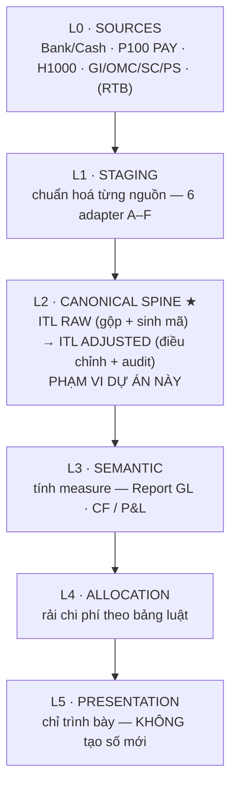
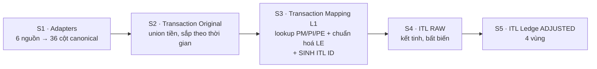
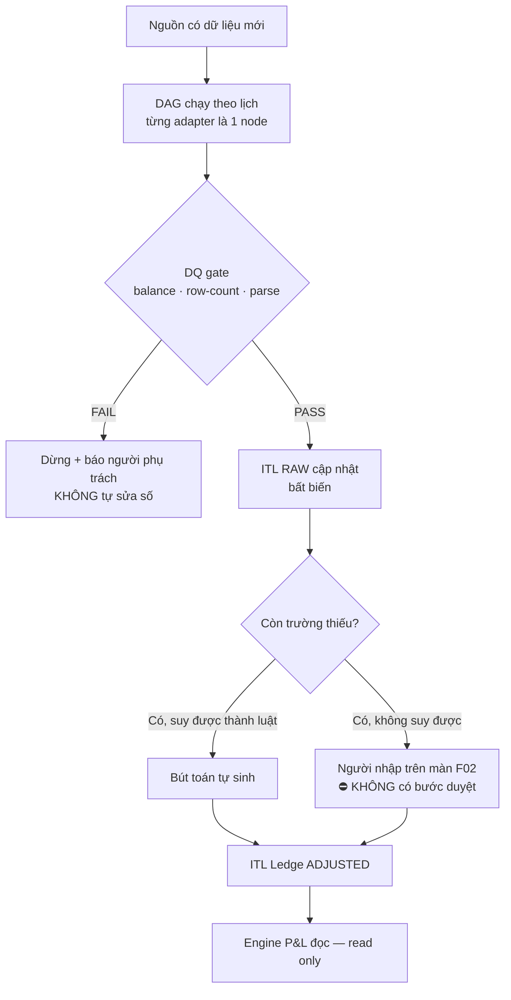

# 02 — PROCESS FLOW: luồng AS-IS → TO-BE

**Version:** v0.2 | **Chủ sở hữu:** COO-CFO | **Nguồn:** `NGUỒN-ASIS` §01–03, `NGUỒN-BUILD` §6–§7, `NGUỒN-FILES`

---

## 1. Hệ thống thực chất làm gì (một câu)

> **Thu mọi giao dịch tài chính thực tế** (tiền ra/vào ngân hàng & quỹ, đề nghị–hoá đơn–thanh toán, lương, doanh thu/chi phí nền tảng) → **chuẩn hoá về một sổ giao dịch duy nhất (`ITL`)** → từ sổ đó tính ra hai báo cáo quản trị theo số thực: `CFA` (dòng tiền) và `PLA` (P&L), đã phân bổ về từng Venture / Pháp nhân.

**Hai làn trên cùng một sổ.** `CFA` nhìn dòng tiền theo *ngày phát sinh tiền*; `PLA` nhìn chi phí/doanh thu theo *kỳ ghi nhận*. Cùng một giao dịch chảy vào cả hai làn ở **thời điểm khác nhau** — đây chính là lý do phải có tầng ledger chung ở giữa thay vì tính thẳng từ nguồn. Hậu tố số (`CFA1/2/3`, `PLA1–4`) là **bậc độ mịn**, không phải hệ thống khác nhau.

## 2. Năm nguồn đầu vào

| Domain | Hệ thống nguồn (file thật) | Đóng góp |
|---|---|---|
| **Treasury / Dòng tiền** | `P100 _ Bank Transactions` (66 sheet, 60+ sheet `R \| …` theo tài khoản) · `P100 _ Cash Ledger` (25 sheet) · `A-CCR_V2_Working` (29 sheet) | Dòng tiền thực (cơ sở `CFA`), đối soát số dư |
| **Procure-to-Pay** | `AperoGroup_Payment` (136 sheet) — PE → PI → PM → PC | Cam kết chi, công nợ, khớp thanh toán |
| **Payroll / Nhân sự** | `H1000 Ledger` (108 sheet) | Chi phí lao động — **đã phân bổ sẵn** theo HD/KRF tại nguồn |
| **Revenue / Nền tảng** | `GI` (18 sheet) · `OMC` (18) · `SC` (9) · `PS` (9) — export Looker | Doanh thu & chi phí nền tảng (cơ sở `PLA`) |
| **Budget** *(chưa dựng)* | `RTB` Real-Time Budget | Đối chiếu kế hoạch vs thực |

## 3. AS-IS — 6 pha, ranh giới lẫn nhau

| Pha AS-IS | Bước | Vấn đề ranh giới |
|---|---|---|
| `INPUT · Collect` | 100–115 | Gộp cả "nguồn" lẫn "sổ đã chuẩn hoá" vào một pha |
| `INPUT · Aggregate` | 200–224 | ✅ Sạch — staging đúng nghĩa |
| `MAPPING → ITL` | 301–319 | 🔴 **Nặng** — cột pha bị `#REF!`, pha lõi mất cả danh tính |
| `CALCULATE` | 400–419 | 🟠 Lẫn — ghi vào cùng file `Report GL` như REPORT |
| `ALLOCATE` | 500–513 | 🟠 Lẫn — HR phân bổ ở nguồn, NON-HR ở tầng phân bổ, driver ở tầng tính: **cùng tên "Allocate" nhưng 3 chỗ khác nhau** |
| `REPORT` | 600–617 | 🟠 Lẫn — nhiều template "equal nhau chỉ khác format" |

**Chẩn đoán:** ba pha cuối cùng đổ vào `Report I General Ledger` nên **không có đường biên** giữa *tính*, *phân bổ* và *trình bày*. Người xem không biết một con số sinh ra ở bước nào.

## 4. TO-BE — 5 tầng, chảy một chiều

**Ba luật ranh giới** (thay cho 6 pha chồng lấn):
- **L3 tính measure** · **L4 rải chi phí** · **L5 chỉ trình bày**.
- **`L5` không được tạo số mới** — chỉ đọc từ L3/L4. Chấm dứt việc Calculate/Allocate/Report cùng ghi một file.
- **Phạm vi dự án ITL = L1 + L2.** L3–L5 đã có dạng code engine (FPA-T4), không chạm.

> Cách đếm tầng: dùng **5 tầng L0–L5** theo `NGUỒN-ASIS`. Một số nguồn khác đếm 6 tầng (tách Bronze/Silver) — cùng một thứ, khác cách gộp. Chốt dùng cách đếm này nhất quán toàn bộ kit (`ORC-08` §4).

## 5. Dây chuyền lắp ráp S1–S5 (chi tiết L1→L2)

| Bước | Việc | Điều kiện "xong" |
|---|---|---|
| **S1** | Mỗi adapter xuất đúng `ITL-CANON` 36 cột + `source_id` + provenance | Test row-count vs sheet nguồn; **0 dòng rơi im lặng** |
| **S2** | Gom cash+bank (7 cột BASE) về một bảng, sắp theo thời gian | Tổng khớp statement **net theo tài khoản**; A-CCR balance PASS |
| **S3** | Từ BASE lookup PM/PI/PE (nhóm LINK) + fill CLASS/SVC/PARTY; chuẩn hoá LE qua `MAPPING-MASTER`; **sinh ITL ID** + STT | Match-rate LINK đo được; mỗi dòng có ITL ID + lineage; theo dõi `#N/A` |
| **S4** | Kết tinh L1 thành bảng RAW **bất biến** | RAW = union mọi nguồn, có khoá & lineage |
| **S5** | BASE+IMPORT từ RAW · ADJUSTMENT = bút toán append-only · ALLOCATE = áp bảng luật · AUDIT = DQ test | `ITL Ledge` xuất đúng `ITL-CONTRACT`; ITL Aggregate chạy trọn khối |

## 6. Chu trình vận hành TO-BE

1. Nguồn có dữ liệu mới, DAG tự chạy theo lịch — không ai "nhấn nút".
2. Cổng chất lượng kiểm tra trước: số dư có khớp không, có rơi dòng không, ngày có đọc được không.
3. Nếu sai → **dừng và báo người chịu trách nhiệm**. Máy không tự sửa số (`P-06`).
4. Nếu đúng → ghi vào sổ gốc, và sổ gốc **không bao giờ bị sửa đè**.
5. Trường còn thiếu: cái nào suy được thành luật thì máy tự điền; cái nào cần phán đoán người thì người nhập trên màn `F02`.
   ⛔⛔ **⛔ KHÔNG có bước duyệt, ⛔ không có maker-checker** — sửa 2026-09-04. Câu cũ *("có bước duyệt")* bị **`QĐ-ITL-27` (22/08) khai tử** vì một lý do vận hành: luồng này thật sự chỉ có **2–3 kế toán**, kế toán trưởng và CFO-COO **hầu như không tham gia** ⇒ một bước duyệt sẽ **leo vào chỗ trống**. Kiểm soát đến từ **MÁY**: cửa ghi từ chối giá trị sai *(`BA-10 · DT-I09`)*, sổ là **chỉ-thêm** *(`INV-I08`)*, và mọi phép ghi **bắt buộc có lý do** *(`INV-I16`)*.
   ⚠ Lỗ này mang **cùng lớp lỗi** với `GAP-DOC-01` *(khai cho `BA-04`)* nhưng ⛔ **không ai khai cho tệp này** — tìm ra khi đọc để sửa tệp kia. ⇒ Bài học: một gap khai theo **tên tệp** sẽ bỏ sót mọi tệp khác mang cùng câu sai.
6. Engine P&L đọc kết quả — chỉ đọc, không ghi.

## 7. Điểm bàn giao giữa người — nợ phải xoá

Trong luồng AS-IS, ranh giới giữa các hệ **là người bàn giao cho người**, không phải interface. Bảng chi tiết + milestone xoá từng mắt xích: `ORC-05` §2.

Riêng ở tầng L2, dấu vết còn nằm ngay trong tên cột của file thật: `PIC: LAN + THƯƠNG`, `PIC: THƯƠNG`, `PIC` (cột BJ vùng AUDIT), `Luận's File` trong tên workbook. **Tên người không được xuất hiện trong tên đối tượng dữ liệu TO-BE** — chuyển thành thuộc tính `assignee` của bút toán/hàng chờ duyệt.

## Changelog
- **v0.2** (2026-09-04): ⛔⛔ **Bỏ "maker-checker" và "bước duyệt"** khỏi §6 — hai chỗ này mô tả một hệ **⛔ không tồn tại** kể từ `QĐ-ITL-27` (22/08). Xem ghi chú tại §6 bước 5.
- v0.1 (2026-08-18): Khởi tạo — AS-IS 6 pha + chẩn đoán ranh giới, TO-BE 5 tầng + 3 luật, dây chuyền S1–S5 với điều kiện xong, chu trình vận hành, nợ bàn giao-giữa-người.
