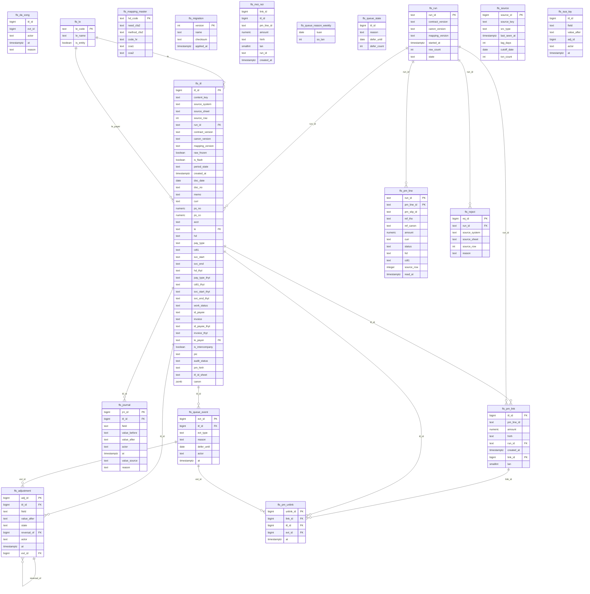

# 05 — DATA DICTIONARY & ERD

**Version:** v0.18 | **Chủ sở hữu:** COO-CFO
**Nguồn:** đọc trực tiếp 12 workbook thật tại `AS-IS system/Accounting_Files/RAW`, ngày 2026-08-18

> **R-A2 tuyệt đối.** Mọi tên trường dưới đây **chép nguyên văn từ file thật**, kể cả lỗi chính tả của nguồn (`ENITY`, `filetring`) và các tên trùng nhau. Không sửa, không "chuẩn hoá cho đẹp" trong tài liệu này — việc đổi tên (nếu có) là quyết định của `ITL-CONTRACT` và phải đi qua CR loại 3.
>
> **Cảnh báo đọc:** cấu trúc (tên cột, vị trí) đọc từ `.xlsx` là **đáng tin**; **giá trị ngày thì không** (bản export chỉ giữ 2,7% ô ngày nguyên kiểu). Mọi kiểm chứng giá trị phải đọc Google Sheets live.

---

## §0 · Hai tài liệu phải đọc kèm bản này ★

| Tài liệu | Vai | Điều bản này PHẢI tuân |
|---|---|---|
| [`Artifacts/FLS-ERD-Full-Detail.md`](Artifacts/FLS-ERD-Full-Detail.md) | ERD đầy đủ của **FLS** *(chính module này — "mỗi đồng đã đi rồi nghĩa là gì")*, kèm `POS-13`, `INV-I07`, nhóm entity thuần mới | Bản `05` là **bản rút gọn theo vai BA**; chi tiết trường và quan hệ lấy ở đó. Lệch nhau ⇒ **FLS-ERD thắng** |
| [`Artifacts/FLS-vs-FPS-Compare-Audit.md`](Artifacts/FLS-vs-FPS-Compare-Audit.md) | Đối chiếu ERD với **code FPS thật** *(39 bảng `fps_*`)* | ⛔ **Nguyên tắc số 1** — xem dưới |

### ⛔ Nguyên tắc số 1 kế thừa từ `FLS-vs-FPS-Compare-Audit`

> **SSOT schema phía FPS = `fps/db/schema.py` + `fps/db/schema_pg.py`, KHÔNG phải spec.**
> Mọi nhãn `[E]` *(theo spec)* phải **re-verify với code** trước khi thi hành; ô đã verify mang nhãn `[C]`.
> Đây là bài học FPS **đã trả giá**: spec drift 5 nguồn, đã có bug thật từ việc tin spec.

**Ba hệ quả trực tiếp cho bản `05` này:**

| # | Hệ quả |
|--:|---|
| **1** | ⚠ **`reference_number` nằm ở mức SLIP** (`fps_pm_slip`), **không phải LINE** — trái giả định của `QĐ-ITL-09` và luật `OP-03` *"1 PMLine ↔ 1 ref"*. ⇒ ghép sao kê → line phải **chia tiền theo tỷ lệ**, hoặc CR thêm cột ở line. **`CR #1` ưu tiên `P1`, phải chốt TRƯỚC khi thiết kế mapping** |
| **2** | ⚠ **`service_start/end_date` ở SLIP** *(PE/PI/PM slip)*, không ở PE Line ⇒ trường #11/#12 của hợp đồng 13 *(`svc_start`/`svc_end`)* phải xét ở **tầng slip**. Sai tầng = **sai kỳ ghi nhận** |
| **3** | ⛔ **FLS KHÔNG được ghi vào bảng `fps_*`** — chỉ đọc. Chiều ghi duy nhất là FPS tự ghi |

★ **Know-how mượn được ngay:** `fps_id_counter` — cơ chế **sinh ID atomic** đã fix một bug trùng ID thật ở FPS. Áp thẳng cho `itl_id` *(`INV-I04a`)*.

---

## DD-I01 · `ITL-CANON` — khuôn giao dịch chuẩn 36 cột

Nguồn: `ITL I Input Transaction Ledger File 1_2 (RAW).xlsx` ▸ sheet `Transaction Mapping L1`, **header ở dòng 3**, khối nguồn khai báo ở dòng 1–2.

| Cột | Tên trường (nguyên văn) | Nhóm | Lấy từ |
|:--:|---|---|---|
| A | `Ngày chứng từ` | BASE | `Transaction Original` |
| B | `Số chứng từ` | BASE | `Transaction Original` |
| C | `Diễn giải` | BASE | `Transaction Original` |
| D | `Đơn vị tiền tệ` | BASE | `Transaction Original` |
| E | `PS Nợ` | BASE | `Transaction Original` |
| F | `PS Có` | BASE | `Transaction Original` |
| G | `Tài khoản` | BASE | `Transaction Original` |
| H | `Loại giao dịch (Payment Type)` | LINK | `[Importrange]PM_Unpivot` |
| I | `ID PELine - Nội dung PE (Advance)` | LINK | `[Importrange]PM_Unpivot` |
| J | `ID PELine - Nội dung PE (Urgent)` | LINK | `[Importrange]PM_Unpivot` |
| K | `ID PILine - Nội dung PI` | LINK | `[Importrange]PM_Unpivot` |
| L | `Pháp nhân thanh toán` | CLASS | `[Importrange]PM_Unpivot` |
| M | `ID PMSlip` | LINK | `[Importrange]PM_Unpivot` |
| N | `ID PMLine` | LINK | `[Importrange]PM_Unpivot` |
| O | `ID PESlip` | LINK | `[Importrange]PM_Unpivot` |
| P | `ID PELine` | LINK | `[Importrange]PM_Unpivot` |
| Q | `ID PISlip` | LINK | `[Importrange]PM_Unpivot` |
| R | `ID PILine` | LINK | `[Importrange]PM_Unpivot` |
| S | `Budget Code (HDCode)` | CLASS | `[Importrange]PM_Unpivot` |
| T | `Chủ dự toán (CDT1)` | CLASS | `[Importrange]PM_Unpivot` |
| U | `Chủ dự toán *` | CLASS | `[Importrange]PM_Unpivot` |
| V | `Status_Final` | CLASS | `[Importrange]PM_Unpivot` |
| W | `Thời điểm bắt đầu sử dụng dịch vụ` | SVC | `[Importrange]PE_Unpivot` (khoá `ID PELine`) |
| X | `Thời điểm kết thúc sử dụng dịch vụ` | SVC | `[Importrange]PE_Unpivot` |
| Y | `Mã đối tác (ID Payee)` | PARTY | `[Importrange]PE_Unpivot` |
| Z | *(trống)* | — | — |
| AA | *(trống)* | — | — |
| AB | `Thời điểm bắt đầu sử dụng dịch vụ` | SVC | `[Importrange]PI_Unpivot` (khoá `ID PILine`) |
| AC | `Thời điểm kết thúc sử dụng dịch vụ` | SVC | `[Importrange]PI_Unpivot` |
| AD | `File đính kèm: Hóa đơn` | PARTY | `[Importrange]PI_Unpivot` |
| AE | `File đính kèm: Khác` | PARTY | `[Importrange]PI_Unpivot` |
| AF | `Ghi chú (nếu có)` | PARTY | `[Importrange]PI_Unpivot` |
| AG | `LE` | PARTY | `Master Mapping` |
| AH | `MID I DoubleCheck LE` | PARTY | `Master Mapping` |
| AI | `MID I DoubleCheck LE` | PARTY | `Master Mapping` |
| AJ | `MID I DoubleCheck LE` | PARTY | `Master Mapping` |
| AK | `MID I DoubleCheck LE` | PARTY | `Master Mapping` |
| AL | `No` | PARTY | `Master Mapping` |

**Đếm:** 7 BASE + 15 (H–V) + 3 (W–Y) + 5 (AB–AF) + 6 (AG–AL) = **36 cột** ✅ khớp con số trong `NGUỒN-BUILD` §3.

> ✅ **ĐÃ CÓ CODE 2026-08-26** — `fls/canon/spec.py` chép **nguyên văn** bảng trên: **38 vị trí** `A…AL`, **36 trường**, hai ô `Z`/`AA` trống. Ba khuyết tật đặt tên mỗi cái **một test khoá**:
> `test_bon_cot_AH_AK_trung_ten_van_phan_biet_duoc_theo_vi_tri` · `test_W_X_va_AB_AC_trung_ten_nhung_khac_nguon` · `test_38_vi_tri_va_36_truong`.
> `CanonRow` **cố ý không có** `as_dict()`/`by_name()` — lưu theo key là **mất cột**, chặn ngay ở API.
>
> ⚠ **Hai hệ toạ độ cùng dùng chữ cái `A…AL`** — đã ghim vào docstring của `spec.py` vì trộn nhầm là **lỗi lặng, không nổ**:
>
> | Chữ | Trong `ITL-CANON` *(đầu vào)* | Trong `ITL Ledge` *(đầu ra, 64 cột)* |
> |:--:|---|---|
> | `S` | `Budget Code (HDCode)` | `Classifying` khối 1 |
> | `V` | `Status_Final` | **`Final` khối 1** = `hd` |
> | `AH` | `MID I DoubleCheck LE` *(1 trong 4 cột trùng tên)* | **`Final` khối 4** = `svc_start` |
> | `AL` | `No` | **`Final` khối 5** = `svc_end` |

**Ba khuyết tật đặt tên của khuôn này** (chép nguyên văn, nhưng phải xử ở `ITL-CONTRACT`):

| # | Khuyết tật | Hệ quả |
|---|---|---|
| 1 | **Bốn cột AH–AK trùng tên hệt nhau** `MID I DoubleCheck LE` | Không thể tham chiếu theo tên; code buộc phải tham chiếu theo **vị trí cột** — cực kỳ dễ vỡ |
| 2 | **W/X và AB/AC trùng tên** `Thời điểm bắt đầu/kết thúc sử dụng dịch vụ` | Cùng tên, **khác nguồn** (PE vs PI). Trộn nhầm = sai kỳ ghi nhận P&L |
| 3 | Hai cột trống Z, AA nằm giữa khuôn | Nhìn thì 38 vị trí nhưng chỉ 36 trường — đếm sai là lệch mapping |

## DD-I02 · `Transaction Original` (7 cột BASE)

Sheet `Transaction Original`, **header dòng 2**: `Ngày chứng từ` · `Số chứng từ` · `Diễn giải` · `Đơn vị tiền tệ` · `PS Nợ` · `PS Có` · `Tài khoản`.

## DD-I03 · `MAPPING-MASTER`

Sheet `Mapping Master`, **header dòng 3**, ba khối khai báo ở dòng 1.

| Khối (dòng 1) | Cột | Trường |
|---|:--:|---|
| `Mapping LE I Legal Entity` | A | `Bank Sheet` |
| | B | `LE` |
| `Mapping HD via COA` | D | `HD` |
| | I | `COA1` |
| | J | `COA2` |
| | K | `Need to Allocate to CFA2` |
| | L | `Method to Allocate to CFA2` |
| | M | `Code HR Allocate` |
| `Mapping No via LE` | O | `LE` |
| | P | `No` |

Ba cột `K`, `L`, `M` là **mầm của bảng luật phân bổ L4** (`DT-I03`).

## DD-I04 · `ITL Ledge` — ứng viên `ITL-CONTRACT`

Nguồn: `ITL I Input Transaction Ledger File 2_2 (ADJUSTED).xlsx` ▸ sheet `ITL Ledge`. **Không phải bảng phẳng** — 9 dòng đầu là siêu dữ liệu, **dữ liệu bắt đầu dòng 10**.

### Cấu trúc dòng đầu

| Dòng | Nội dung |
|:--:|---|
| 1 | Banner vùng: `ADJUSTMENT ZONE` (R) · `ALLOCATE ZONE` (AU) · `AUDIT ZONE` (AX) + nhãn `PIC:` từng khối |
| 2 | Nguồn: `Transaction Mapping L1` (B) · `Report I General Ledger` (AX) |
| 3 | Đếm ô nhập tay: `# Input here = …` cho 7 khối |
| 4 | Tham chiếu dải audit sang `Report I General Ledger`: `!R10:R` · `!S10:S` · `!W10:W` · `!AE10:AE` · `!AI10:AI` · `!AM10:AM` |
| 5 | **Hàng ánh xạ cột nguồn** — cột nào của `ITL Ledge` lấy cột nào của `Transaction Mapping L1` |
| 6 | Hàng kiểm `True` / `#N/A` |
| 7 | **Tên cột thật** |
| 8 | Tên cột con của các khối 4 cột |
| 10+ | Dữ liệu |

### Vùng BASE+IMPORT (A–Q) — ~~tập cột engine đọc~~ ⚠ **SAI, xem `DD-I04b`**

| Cột ITL Ledge | Tên trường | ← Cột `Transaction Mapping L1` |
|:--:|---|:--:|
| A | `Ngày chứng từ` | A |
| B | `Số chứng từ` | B |
| C | `Diễn giải` | C |
| D | `Đơn vị tiền tệ` | D |
| E | `PS Nợ` | E |
| F | `PS Có` | F |
| G | `Tài khoản` | G |
| H | `Loại giao dịch (Payment Type)` | H |
| I | `Budget Code (HDCode)` | **S** |
| J | `Chủ dự toán (CDT1)` | **T** |
| K | `Thời điểm bắt đầu sử dụng dịch vụ` | **AB** |
| L | `Thời điểm kết thúc sử dụng dịch vụ` | **AC** |
| M | `Mã đối tác (ID Payee)` | **Y** |
| N | `File đính kèm: Hóa đơn` | **AD** |
| O | `File đính kèm: Khác` | **AE** |
| P | `LE` | **AG** |
| Q | `No` | **AL** |
| R | `ITL ID` | *(sinh ra, dòng 8 ghi `Formual`)* |

> **Chi tiết dễ bỏ sót:** cửa sổ dịch vụ (K, L) lấy từ **AB/AC = nhánh PI**, còn mã đối tác (M) lấy từ **Y = nhánh PE**. Hai nhánh khác nguồn. Adapter phải giữ đúng nhánh này, nếu không kỳ ghi nhận P&L sẽ lệch.
>
> ⚠ **Nhưng vùng này KHÔNG phải hợp đồng engine.** Engine chỉ đọc A–F của vùng này rồi nhảy sang vùng ADJUSTMENT. Xem `DD-I04b`.

### Vùng ADJUSTMENT (R→AT) — 7 khối × 4 cột

Khuôn lặp: `Classifying` → `Manual input` → `MID` → `Final`.

| Khối | Cột | Trường được bổ sung | Ô nhập tay | PIC |
|:--:|---|---|--:|---|
| 1 | S–V | `Budget Code (HDCode)` | 297 | LAN + THƯƠNG |
| 2 | W–Z | `Loại giao dịch (Payment Type)` | 179 | THƯƠNG |
| 3 | AA–AD | `Chủ dự toán (CDT1)` | 1.210 | THƯƠNG |
| 4 | AE–AH | `Thời điểm bắt đầu sử dụng dịch vụ` | 22 | THƯƠNG |
| 5 | AI–AL | `Thời điểm kết thúc sử dụng dịch vụ` | 22 | THƯƠNG |
| 6 | AM–AP | `Mã đối tác (ID Payee)` | 1.624 | THƯƠNG |
| 7 | AQ–AT | `File đính kèm: Hóa đơn` | 3.489 | THƯƠNG |
| | | **Tổng** | **6.843** | |

Giá trị quan sát được ở cột `Classifying`: `"Need to manual input"`. Máy trạng thái TO-BE: `SM-I02`.

### Vùng ALLOCATE (AU–AW)

| Cột | Trường |
|:--:|---|
| AU | `Chủ dự toán (CDT1) CFA1` |
| AV | `Chủ dự toán (CDT1) CFA2` *(dòng 8: `Classifying`)* |
| AW | `Method` — giá trị quan sát: `No need` |

### Vùng AUDIT (AX–BL) — đối chiếu ngược `Report I General Ledger`

| Cột | Trường | Cột cặp | Số dòng `FALSE` |
|:--:|---|:--:|--:|
| AX | `ITL ID` | AY | **1.356** |
| AZ | `HD CODE` | BA | **552** |
| BB | `Loại Giao dịch` | BC | **146** |
| BD | `PL Time (TOA) start` | BE | **2.310** |
| BF | `PL Time (TOA) end` | BG | **2.308** |
| BH | `ID Vendor` | BI | **39** |
| BJ | `PIC` | — | — |
| BK | `Trạng thái` | — | — |
| BL | `ENITY` *(nguyên văn — nguồn viết sai chính tả)* | — | — |

**Tổng 6.711 dòng lệch.** Đây là phát hiện của phiên đọc dữ liệu thật, chưa từng ghi trong tài liệu nguồn nào ⇒ `GAP-ITL-11`.


## DD-I04b · `ITL-CONTRACT` — ĐỌC TỪ REDER ĐANG CHẠY THẬT ★

**Nguồn:** `FPA-T4/apps/api/src/api/services/actual/raw_to_apr_v2/pnl/itl_ledge_reader.py`, hằng `_COLS` (branch `feat/report-scope-sub-entity`). **Đối chiếu với giá trị thật dòng 10 của `ITL Ledge`: khớp 13/13.**

> Đây là kết quả đóng `GAP-ITL-16` — thực thi đúng `P-ITL-01` (reverse-engineer từ reader đang chạy, không thiết kế mới). **Bản này thắng mọi suy luận từ cấu trúc sheet.**


> ## ⛔ SỬA 2026-08-24 (chiều) — HỢP ĐỒNG LÀ **14 TRƯỜNG**, KHÔNG PHẢI 13
>
> Đọc **reader thật** trên nhánh `feat/report-scope-sub-entity` *(`FPA-T4/apps/api/src/api/services/actual/raw_to_apr_v2/pnl/itl_ledge_reader.py`)*:
>
> ```python
> _COLS = {"doc_date":0, "doc_no":1, "memo":2, "curr":3, "ps_no":4, "ps_co":5,
>          "itl_id":17, "hd":21, "pay_type":25, "cdt1":29,
>          "svc_start":33, "svc_end":37, "le":15, "acct":6}
> ```
>
> **Ba điều bản v0.3 nói sai, nay sửa:**
>
> | | v0.3 nói | Reader thật |
> |---|---|---|
> | Số trường | 13 | **14** |
> | `le` | cột **`BL`** (63), vùng AUDIT | ⭐ cột **`P`** (15), tiêu đề `LE` — **người nhập tay** |
> | `acct` | *"engine KHÔNG đọc `G`"* | ⭐ **CÓ đọc** — `acct` = `G` (6) |
>
> **Vì sao đổi — có số đo, không phải sở thích** *(`test_itl_le_column_ssot.py`, snapshot `itl_84f092a6637f`, 10.572 dòng)*:
>
> | Cột | Độ phủ | Diễn biến |
> |---|---|---|
> | **`P`** *(`LE`, người nhập)* | **9.872/9.872 = 100%** | ổn định |
> | **`BL`** *(suy bằng `VLOOKUP`)* | **trống 6.379/10.572** | 100% có ghi cuối 2024 → **31%** cuối 2025 → **0% tháng 8/2026** |
>
> Chỗ **cả hai** tra được *(2.654 dòng)* thì **612 dòng lệch nhau** ⇒ đây **không phải** hai cột chép lại nhau, và chọn cột nào là **quyết định nghiệp vụ**. ⇒ **Owner chốt cột `P` là SSOT ngày 2026-08-20.**
>
> ⇒ ✅ **`GAP-ITL-19` ĐÓNG** *(câu hỏi "vì sao dùng `BL` mà không dùng `P`?")* · ✅ **`INV-I15` ĐÓNG** — không phải *"chưa đo được"*: `BL` **mục ruỗng ba tháng**, đã bị thay. `BL` vẫn được kéo về snapshot **chỉ để đối chiếu về sau** (`NEEDED_COLS` giữ 63).
>
> ⚠ **Bài học lặp lại lần thứ ba trong ngày:** tôi lấy con số từ **tài liệu** *(`DD-I04b` v0.2, 18/08)* thay vì từ **code**. Đúng cái mà `FLS-vs-FPS-Compare-Audit` §Nguyên tắc số 1 đã cảnh báo: **SSOT là code, không phải spec.**


### Hợp đồng thật: **13 cột** ⛔ *(SAI — xem khối sửa ngay trên)*, đọc theo **VỊ TRÍ** không theo tên

| # | Field engine | Chỉ số (0-based) | Cột Excel | Nghĩa trong `ITL Ledge` | Giá trị thật dòng 10 |
|--:|---|--:|:--:|---|---|
| 1 | `doc_date` | 0 | **A** | `Ngày chứng từ` | `2024-10-21` |
| 2 | `doc_no` | 1 | **B** | `Số chứng từ` | `FT24295070629325` |
| 3 | `memo` | 2 | **C** | `Diễn giải` | `Dieu chuyen Ngan hang Vpbank` |
| 4 | `curr` | 3 | **D** | `Đơn vị tiền tệ` | `VND` |
| 5 | `ps_no` | 4 | **E** | `PS Nợ` | *(trống — dòng này ghi Có)* |
| 6 | `ps_co` | 5 | **F** | `PS Có` | `1500000000` |
| 7 | `itl_id` | 17 | **R** | `ITL ID` | `ITL#1` |
| 8 | `hd` | 21 | **V** | **`Final` của khối ADJUSTMENT 1** — Budget Code (HDCode) | `NB \| Lưu chuyển nội bộ` |
| 9 | `pay_type` | 25 | **Z** | **`Final` của khối 2** — Loại giao dịch | `Thanh toán (Regular)` |
| 10 | `cdt1` | 29 | **AD** | **`Final` của khối 3** — Chủ dự toán (CDT1) | `SHQ2 \| Headquarters2` |
| 11 | `svc_start` | 33 | **AH** | **`Final` của khối 4** — **KỲ** bắt đầu DV · khuôn **`YYYYMM`** *(⛔ không phải NGÀY — xem khối ⚠ ngay dưới)* | `202410` |
| 12 | `svc_end` | 37 | **AL** | **`Final` của khối 5** — **KỲ** kết thúc DV · khuôn **`YYYYMM`** | `202410` |

⚠⚠ **`svc_start`/`svc_end` là KỲ, ⛔ KHÔNG phải NGÀY — và cái TÊN đánh lừa.** *(`QĐ-ITL-86`, 2026-09-04)*

Tên cột trên sổ đọc là *"Thời điểm bắt đầu sử dụng dịch vụ"* — đọc y hệt một **timestamp**. Đo thật trên `fls_itl` *(10.030 dòng · 2.368 dòng có giá trị)*:

| Khuôn | Số dòng | |
|---|--:|---|
| `YYYYMM` | **2.363** | ⭐ **99,8%** — đây là khuôn thật |
| `45962` | 2 | ⛔ **số serial ngày của Excel** lọt vào |
| `tháng 5` · `tháng 4` · `2025` · `2025.07` · `2027` | 9 | ⛔ chữ · thiếu tháng · sai dấu |

⇒ **11 dòng bẩn** đã lọt qua vì ⛔ **không ai kiểm**. Từ 04/09 cửa ghi ép khuôn `^\d{4}(0[1-9]|1[0-2])$` ⇒ `400 FLS-BAD-FORMAT` *(`DT-I09` #6)*, và màn dùng **ô chọn THÁNG** *(⛔ không phải ô chọn ngày)*.

⛔⛔ **Bài học cho chính bản khai này:** phiên bản trước có ví dụ `202410` và khai kiểu `text` — **⛔ không sai**, nhưng nó ⛔ **không nói ra LUẬT**. Người đọc sau *(là tôi, 04/09)* đã đoán từ **cái tên** và đề xuất một **ô chọn ngày** — thứ sẽ ghi `2024-12-01` vào chỗ sổ chờ `202412`. ⇒ Một bản khai chỉ cho **ví dụ** mà ⛔ không cho **luật** là một bản khai **mời người ta đoán**.
| ~~13~~ | ~~`le`~~ | ~~63~~ | ~~**BL**~~ | ⛔ **BỎ 2026-08-20** — `BL` trống 60%, tháng 8/2026 trống 100% | ~~`VVOT`~~ |
| **13** | `le` | **15** | **P** | ⭐ **`LE` — người nhập tay, điền 100%. SSOT theo quyết định owner 2026-08-20** | `VGOH` |
| **14** | `acct` | **6** | **G** | ⭐ **`Tài khoản`** — định danh cho dòng mà `LE` ghi `CN` / `Cash Treasury` *(tài khoản cá nhân, owner 2026-08-20)*. Xem `le_canon` | `No 1` |

**Luật đọc:** `min_row=10` · bỏ dòng nếu `len(row) <= 63` hoặc `itl_id` rỗng · mỗi dòng mang thêm `excel_row`.

**Cột `pm_settled_through`** (kỳ chốt) đọc riêng: sheet `RAW ITLData Management`, **cột G** (`Cut-off Date`, 0-based 6), lấy **max**; vắng ⇒ fallback hằng `PM_SETTLED_THROUGH = "M2605"`.

### Bốn hệ quả phải nhớ

| # | Hệ quả |
|---|---|
| **1** | ⛔ **SỬA:** engine **CÓ đọc `G` (`Tài khoản`)** — trường `acct`(6), thêm 2026-08-20 để định danh dòng mà `LE` ghi `CN`/`Cash Treasury`. Đúng là engine **không đọc `H`–`O`, `Q`** |
| **2** | **Engine đọc `Final` của vùng ADJUSTMENT, không đọc vùng IMPORT.** Nghĩa là **giá trị người điều chỉnh mới là giá trị thật** của HD / loại giao dịch / CDT1 / cửa sổ dịch vụ |
| **3** | ⛔ **SỬA — đảo ngược hoàn toàn:** chiều pháp nhân đến từ **cột `P` (`LE`)**, người nhập tay, **điền 100%**. Cột `BL` *(`VLOOKUP` vào `Daily RP test`)* **đã bị thay** vì mục ruỗng dần tới **0% tháng 8/2026**. Owner chốt 2026-08-20. ⇒ nhận định cũ *"báo cáo pháp nhân phụ thuộc một cột trong vùng đối soát"* **đúng ở thời điểm viết**, và đó chính là lý do nó đã được sửa |
| **4** | **Khối 6 (`Mã đối tác`, AP) và khối 7 (`File đính kèm`, AT) KHÔNG được engine đọc** — mà đó là **1.624 + 3.489 = 5.113 ô nhập tay, tức 75% khối lượng của `ITL Ledge`**. Chúng phục vụ truy vết chứng từ, **không** phục vụ độ chính xác P&L |

### ⚠ Rủi ro số 1 của cutover — giờ đã cụ thể

Reader dùng **vị trí cột cứng**, không dùng tên. ⇒ **Chèn/xoá bất kỳ cột nào ở vị trí ≤ BL (64) sẽ làm engine đọc lệch toàn bộ, âm thầm, không báo lỗi.**

Cụ thể: chèn 1 cột trước `V` ⇒ engine lấy `MID` thay vì `Final` cho HD; chèn trước `BL` ⇒ pháp nhân đọc sang cột khác ⇒ mọi báo cáo theo venture sai mà không có dấu hiệu.

**Yêu cầu bắt buộc cho `ITL-CONTRACT` v1.0:**
1. Hợp đồng TO-BE phải khai báo **theo tên**, và tầng tương thích phải map tên → vị trí, có test khoá vị trí.
2. Test tương thích engine (`ORC-07` §3 `C1`) phải kiểm **cả 13 vị trí**, không chỉ sự tồn tại của cột.
3. `INV-I07` (tương thích ngược) diễn giải cụ thể: **không được đổi vị trí 13 cột này** cho tới khi engine chuyển sang đọc theo tên.

### ✅ `ITL-CONTRACT` v1.0 — ĐÓNG BĂNG 2026-08-24 (`QĐ-ITL-42`)

| Điều | Chốt |
|---|---|
| **Phạm vi** | ⭐ **14 trường** *(đã sửa chiều 24/08 — xem khối ⛔ ở trên)*: 6 BASE `A–F` + `acct` `G` + `le` `P` + `itl_id` `R` + 5 `Final` khối 1–5. Không thêm, không bớt |
| **Cách khai báo** | ⭐ **theo TÊN**. Bảng `tên → vị trí` ở trên giữ lại làm **tầng tương thích**, không phải hợp đồng |
| **`POS-13`** | Còn hiệu lực **chỉ khi nguồn là Sheet**. Khi nguồn thành **bảng** *(PG/BQ — `QĐ-ITL-38`)* thì `POS-13` **hết hiệu lực** — đúng điều kiện mà chính mục 3 ở trên đã đặt ra |
| **Khối 6–7** | ⛔ **NGOÀI hợp đồng**: `AP` *(Mã đối tác)* · `AT` *(File đính kèm: Hoá đơn)*. Chuyển sang gói **adapter F** (`QĐ-ITL-03` — không chặn cutover) ⇒ việc code hoá ô gõ tay **7 khối → 5 khối** |
| **Điều kiện đóng băng** | ✅ **ĐÃ ĐẠT 2026-08-24** — `test_itl_contract_v1_lock.py` *(10 test, PASS)* khoá **cả 14 vị trí** + `NEEDED_COLS` + `VERIFY_COL == itl_id` + phép chứng minh *"dịch một cột là dòng rơi im lặng"*. Cộng `test_itl_le_column_ssot.py` *(4 test)* khoá riêng cột `le`. ⇒ hợp đồng **đóng băng CÓ CƯỠNG CHẾ**, không còn trên giấy |
| **Đổi reader sang đọc theo tên** | **`CR` loại 3** — bắt buộc kèm test tương thích |

> ★ Xem `Artifacts/FLS-ERD-Full-Detail.md` §`POS-13`/`INV-I07` cho bản đầy đủ, và `Artifacts/FLS-vs-FPS-Compare-Audit.md` §7 mục 6 cho lý do vì sao test khoá vị trí phải chạy **mọi milestone**.

## DD-I05 · `ITL ID` — khoá giao dịch

**AS-IS:** giá trị quan sát được là `ITL#1`, `ITL#2`, `ITL#3`… — **số thứ tự chạy theo vị trí dòng**.

**Vấn đề:** khoá này không ổn định. Chèn/xoá một dòng thượng nguồn làm mọi ID phía sau dịch — nhiều khả năng là gốc của lớp lỗi remap đã đo ở hệ hiện hành.

**TO-BE bắt buộc:** ⚠ **SỬA v0.4** — v0.3 viết *"khoá composite ổn định, suy từ nội dung giao dịch"*. Câu đó **đúng một nửa**.

★ **`QĐ-ITL-30` (22/08) + `QĐ-ITL-43` (24/08) chốt HAI khoá, hai việc khác nhau** — vì khoá nội dung **đổi mỗi lần một trường nội dung được sửa**, và khi đó **mọi ô người gõ cùng mọi dòng nhật ký rời khỏi dòng của nó**:

| Khoá | Là gì | Dùng để | Bất biến |
|---|---|---|---|
| **danh tính** | `itl_id` = **số thứ tự cấp một lần khi dòng vào sổ, rồi ĐÓNG BĂNG** *(khác hẳn "số thứ tự theo vị trí dòng" của AS-IS)* | neo mọi thứ gắn vào dòng: ô người gõ, nhật ký, bút toán | **`INV-I04a`** |
| **đối sánh** | khoá nội dung, có `UNIQUE` | khử trùng + đối sánh với **302.259 dòng log cũ** | **`INV-I04b`** |

**Đo kèm, giải thích vì sao khoá nội dung một mình KHÔNG đủ làm danh tính:** **281 dòng trùng** · **103 dòng không có số chứng từ** · **31 dòng mã rác `4.36619E+15`**.

★ **Cú lật THỨ TỰ cấp danh tính** *(rà 2026-08-25, `FLS-Process-PM-den-ITL` §3 chặng 7–8):*

| | AS-IS *(Gsheet)* | TO-BE *(FLS)* |
|---|---|---|
| **`itl_id` cấp khi nào** | **SAU mapping** — `"ITL#" & No`, `No = ROW()` trên bảng `SORT` theo ngày | **TRƯỚC mapping** — cấp lúc nạp *(trạng thái `staged`, `09` SM-I01)*, rồi đóng băng |
| **Hệ quả** | nhập lùi ngày ⇒ đánh số lại *(1.356 `FALSE` AUDIT)*; `No` rỗng ⇒ `ITL#` mất khoá | danh tính bất động; dòng `unmapped` vẫn có khoá |

⇒ Mapping PM **không** sinh `itl_id` nữa; nó chỉ **làm giàu** dòng đã có khoá.

⛔ **Lineage phải sống sót** *(`INV-I05` ghi chú, `QĐ-ITL-20`/`CR#1`)*: AS-IS vứt `N ID PMLine`/`M ID PMSlip`/`L Pháp nhân` ở chặng 8 ⇒ `ITL-CANON` TO-BE mang **`pm_line_id`** *(= `fps_pm_line.line_id`)* + **`le_payer`** *(← `fps_pm_slip.payer_id`)* làm cột lineage **ngoài** 14 trường hợp đồng.

> ⭐⭐ **Cập nhật 2026-08-27 — yêu cầu lineage KHÔNG đổi, CHỖ ĐẶT nó thì đổi.** `pm_line_id` **không còn là cột của `fls_itl`**; nó là cột của bảng nối **`fls_pm_link(itl_id, pm_line_id, amount, hinh, run_id)`** *(migration `0007`)*.
>
> **Lý do đo được, không phải sở thích:** phép ghép có **sáu hình dạng**, và hình `B` là **một dòng bank trả N dòng lệnh** — một cột giữ được **một** mối nối, nên 27 dòng `B` trước đó phải vào hàng chờ dù Σ tiền khớp. Đo trên hiện vật ghim: **27 dòng sổ mang 69 mối nối**, có dòng chia cho **10** dòng lệnh.
>
> ⛔ **Và chỉ giữ MỘT chỗ:** cột cũ **đã bỏ**. Giữ cả cột lẫn bảng là **hai bản sự thật** cho cùng một việc — đúng cái mà nguyên tắc *"khai một lần"* của bộ này cấm. Đổi lại phải có **cổng Σ**: với mỗi dòng sổ, **Σ tiền các mối nối = tiền dòng bank**, kiểm **trước khi ghi**.
>
> ⚠ **`le_payer` KHÔNG đổi** — nó là thuộc tính của **dòng sổ** *(ai thực trả)*, không phải của một mối nối, nên vẫn ở `fls_itl`.

⇒ Công thức dưới đây vẫn dùng, nhưng cho **`INV-I04b` (đối sánh)**, không phải cho danh tính:

★ **Khoá composite ĐÃ TỒN TẠI và đang chạy thật** — phát hiện ở G6 (`_GUIDE_09` §1). Hai sheet `Log` (`P100 Bank` 171.358 + `P100 Cash` 130.901 = **302.259 dòng**) có cột `Composite Key` với khuôn:

```
<YYYYMMDD> | <Debit> | <Credit> | <Reference number>
```
Giá trị thật: `20250211||66923.25|FT25042584880113` · `20250211|67000||FT25042112560025` · `20250708||1000000|PC00003VGOH`

**Đề xuất TO-BE = mở rộng khoá đang chạy, không phát minh mới:**
```
itl_id = hash( source_system, source_sheet,       # THÊM: khử trùng liên tài khoản
               Ngày chứng từ, PS Nợ, PS Có, Số chứng từ/Reference,   # 4 thành phần GỐC
               seq_trong_nhóm_trùng )
```
Giữ nguyên 4 thành phần gốc để **đối sánh được với 302.259 dòng log cũ**; thêm nguồn vì khoá AS-IS chưa mang nguồn ⇒ hai tài khoản cùng ngày/số tiền/ref sẽ trùng khoá.

**Điều kiện nghiệm thu khoá:** chạy pipeline 2 lần → ID không đổi; chèn một dòng vào giữa nguồn → ID các dòng cũ không đổi. Chưa qua test này thì không được dùng (`INV-I04`).

Nhãn `No` (cột Q) giữ lại cho người đọc, **không phải khoá**.

## DD-I06 · Schema các nguồn (đầu vào adapter)

> ⛔⛔ **ĐỌC TRƯỚC BẢNG — mục này tả ĐÍCH, ⛔ không tả thứ mã đang chạy** *(`GAP-DOC-07`, phát hiện 2026-09-07 khi rà AS-IS)*.
> Mục này khai Adapter B đọc `P100 _ Bank Transactions ▸ Bank Transactions`. Mã thật mở đầu bằng: *“Adapter B — Cash/Bank: `Transaction Mapping L1` → ITL-CANON 38 vị trí”* *(`fls/adapters/bank.py`, nguồn khai ở `fls/oracle/nguon.py::BAN_SAO_RAW`)*.
> ⇒ **Hai chỗ cách nhau BA lần biến đổi** — `R |` → `Bank Transactions` → `1.1`/`1.2 Ledger` → `Transaction Mapping L1`.
> ⚠ Lệch này **có sẵn từ trước `CR#10`** và ⛔ **chưa cổng nào canh** — cổng chỉ canh *phiên bản · số · cột · ngày*, ⛔ không canh **tài liệu có tả đúng chỗ mã đang đọc hay không**.
> ⭐ Sau `QĐ-ITL-90` thì bản khai này **thành đúng cho `F04`** — nhưng nó vẫn ⛔ **không** mô tả adapter đang chạy hôm nay. Giữ cả hai, ⛔ không xoá.

### Adapter B · `P100 _ Bank Transactions` ▸ `Bank Transactions` (header dòng **2**, dữ liệu từ dòng **4**, **7.715** dòng × **10** cột)

⚠ **Có sheet TRÙNG TÊN:** `A-CCR_V2_Working ▸ Bank Transactions` **7.484 dòng** — ⛔ **không phải** sheet này. Bản `A-CCR` là bản đã hút về; bản `P100` là bản `OP-09` sinh ra từ 60 sheet `R |`.
`Transaction date` · `Description` · `Currency` · `Debit` · `Credit` · `Reference number` · `Source` · `Num` · `Check trùng` · `,`

Ánh xạ sang `ITL-CANON`: `Transaction date`→A · `Description`→C · `Currency`→D · **`Debit`→`PS Nợ`(E)** · **`Credit`→`PS Có`(F)** · `Source` mang mã sheet tài khoản (dạng `R | 24138888_TCB VND_TERASOFTS`) → khoá tra `MAPPING-MASTER.Bank Sheet`.

> 60+ sheet `R | …`, mỗi ngân hàng/ví một định dạng. `Check trùng` và `,` là cột phụ trợ của Sheets, **không** đưa vào canonical.

### Adapter B · `P100 _ Cash Ledger` ▸ `Cash Ledger Transactions` (header dòng 2)
Giống trên, thêm `Check trùng_Reference number` và `Month`.

### Adapter C · `A-CCR_V2_Working` ▸ `1.2 Ledger 112` (header dòng 2)
`Ngày chứng từ` · `Số chứng từ` · `Diễn giải` · `Đơn vị tiền tệ` · `PS Nợ` · `PS Có` · **`Source`** · **`Tài khoản`**

> ⚠ **Lệch thứ tự cột:** ở đây `G = Source`, `H = Tài khoản`; còn ở `Transaction Original` thì `G = Tài khoản`. Adapter **phải map theo tên, không theo vị trí**.

### Adapter C · `A-CCR_V2_Working` ▸ `2. CCR` — ma trận, không phải bảng phẳng
Dòng 3 là chiều tài khoản: `Entity` · `Bank` · `Currency` · `Accounts` · `Account type` · `Link` · `ID` · `Pass` · `Sổ phụ`. Từ cột L trở đi là **một cột một ngày** (dòng 5 = ngày, dòng 6 = tỷ giá `USD/VND` theo ngày). Adapter phải **unpivot** về (tài khoản × ngày × số dư × tỷ giá).

### Adapter D · `H1000 Ledger` ▸ `1.3 Ledger NISINTCOM 2025` (header dòng 3)
Dùng **cùng khuôn** với `Transaction Mapping L1` nhưng **khác ở đuôi**:

| Cột | `Transaction Mapping L1` | `1.3 Ledger NISINTCOM 2025` |
|:--:|---|---|
| Y | `Mã đối tác (ID Payee)` | **`File đính kèm: Hóa đơn`** |
| Z | *(trống)* | **`File đính kèm: Khác`** |
| AA | *(trống)* | **`Ghi chú (nếu có)`** |
| AL | `No` | **(không có)** |

> ⚠ **Đây là lệch schema thật giữa hai file cùng dùng "một" khuôn.** Adapter D không được giả định khuôn giống hệt. Ghi vào `ITL-CANON` như một biến thể có khai báo, không im lặng map theo vị trí.

### Adapter D · `H1000 Ledger` ▸ `HR Allocate_L500_v2` (header dòng 2)
`Sheet Name` · `ID PELine` · `Budget Code` · `Tháng thanh toán (yyyymm)` · `Tháng bắt đầu sử dụng dịch vụ (yyyymm)` · `Tháng kết thúc sử dụng dịch vụ (yyyymm` *(nguyên văn — thiếu dấu đóng ngoặc)* · `HD` · `CDT` · `Driver` · `Amount (VND)` · `No Emp` · `CDT_Final`

### Adapter D · `H1000 Ledger` ▸ `Allocation Driver` (header dòng 2)
`Sheet Name` · `Sheet Range` · `Month PL` · `CDT` · `Number of Employee` · `Section_Convert` · `Dịch vụ` · `Number of Employee (excl Dịch vụ)`

### Adapter E · Platform (`GI` / `OMC` / `SC` / `PS`) ▸ `CFA1 | … Platform Data Ledger`, `CFA2 | MID n | … Allocated Ledger`
Dùng **cùng khuôn 4 vùng** như `ITL Ledge` (header dòng 7, dữ liệu dòng 10), khác 3 điểm:

| | `ITL Ledge` | Platform |
|---|---|---|
| Cột E | `PS Nợ` | `PS Nợ (PE Amount)` |
| Cột Q | `No` | `No Transactions Per Vendor` |
| Khối 1–2 vùng ADJUSTMENT | `Classifying/Manual input` | `PM Amount / PE Amount`, `PM Date / PE Date` |
| Khối 3 ở CFA2 | `Classifying` | `CDT1-CFA1` / `CDT1-CFA2` |

Dòng 6 có hàng chú thích `Formula` / `Nhập fix` cho từng cột — **bản đồ sẵn có** chỉ ra cột nào máy tính, cột nào người gõ.

**Ô nhập tay ngoài `ITL Ledge`** (đếm được ở dòng 3): `GI CFA1` = 173 + 173 · `GI CFA2 MID1` = 4.689 + 0. ⇒ **tổng khối lượng nhập tay của cả hệ lớn hơn con số 6.843 nhiều** — 6.843 chỉ là phần trong `ITL Ledge`.

## DD-I07 · `RAW ITLData Management` — sổ đăng ký nguồn (run manifest AS-IS)

Sheet có mặt ở **cả hai** file ITL. Header dòng 3:

`Type` · `File` · `Sheet` · `Cell` · `Note` · `Start Date` · **`Cut-off Date`** · `Data Lag relative to Today` · `#Transactions` · `P100 Data (Data filetring)` *(nguyên văn, sai chính tả)* · `Data Reporting`

Dòng 4 là các cờ con: `ID PC` · `ID PM` · `ID PE` · `ID PI` · `HD/KRF Code` · `ID Vendor`, với giá trị `Yes` / `No` / `Need to manual input`.

> **Đây chính là bản thô của run manifest** mà `ORC-02` §5 mô tả: khai báo mỗi nguồn nạp từ file/sheet/ô nào, cắt kỳ ngày nào, độ trễ bao nhiêu, bao nhiêu giao dịch.
>
> ⚠ Trong file thật, **phần lớn ô ở đây là `#REF!`** (dòng 6 trở đi) — đúng như `NGUỒN-ASIS` mô tả về chuỗi Importrange gãy. Nghĩa là **sổ đăng ký nguồn của hệ hiện tại đang hỏng**: không ai biết chắc nguồn nào đã nạp tới đâu. TO-BE phải dựng lại bảng này thành metadata thật của pipeline.

## DD-I08 · `fls_pm_line` — ẢNH CHỤP dòng lệnh chi *(mới 2026-08-27, `QĐ-ITL-61`)*

⛔⛔ **Đây là bảng dễ bị đọc sai nhất trong kho, nên đọc kỹ một câu trước:** nó **⛔ KHÔNG phải danh mục lệnh chi**. Nó là **ảnh chụp của MỘT lần nạp** — `run_id` nằm **trong khoá chính**.

**Vì sao phải có.** Bộ nạp ghép PM đọc dòng lệnh từ Google Sheets **lúc chạy rồi ⛔ không lưu lại gì**. Sau khi nạp, kho biết *"dòng sổ này nối với dòng lệnh `PM00030-2`"* nhưng ⛔ **không biết dòng lệnh đó là gì** ⇒ thao tác **ghép tay** ở màn `F01` *(`QĐ-ITL-48`, việc chính của màn đó)* ⛔ không thể có danh sách ứng viên. Đó là `GAP-API-04`, và owner chốt **đường (a)**: lưu ảnh chụp.

**Ba luật chống *"hai bản sự thật"*** — cưỡng chế ở `fls/db/schema.py` + migration `0011`:

| # | Luật | Cưỡng chế bằng |
|:--:|---|---|
| ⓐ | Ảnh chụp **⛔ không bao giờ sửa tại chỗ**. Nạp lại là **thêm một ảnh mới**, ảnh cũ còn nguyên để truy | `pk(run_id, pm_line_id)` + `ON CONFLICT DO NOTHING` *(⛔ không `DO UPDATE`)*; bài `test_ANH_CHUP_MOI_khong_de_len_anh_CU` |
| ⓑ | Cửa đọc **phải trả TUỔI của ảnh chụp** cùng mỗi danh sách ứng viên | cột `read_at`; `/pm-candidates` trả `anh_chup{run_id, so_dong, doc_luc_muon_nhat}` |
| ⓒ | `amount` trong ảnh chụp **⛔ KHÔNG phải căn cứ ghi sổ** | lúc ghép, `Σ` cộng lại và so với tiền dòng bank **THẬT** trong `fls_itl`; lệch ⇒ `422` |

> ★ Câu trả lời cho *"bản lưu già đi thì sao"* ⛔ **không phải** *"nó không già"* — mà là **nói ra nó già bao nhiêu**, để người gõ tự quyết. Luật ⓑ là chỗ đó.

**Cột** *(12)*: `run_id` *(FK `fls_run`)* · `pm_line_id` · `pm_slip_id` · `ref_tho` · `ref_canon` · `amount` · `curr` · `status` · `hd` · `cdt1` · `source_row` · `read_at`.

⚠ **Giữ CẢ HAI dạng mã tham chiếu** — `ref_tho` *(nguyên văn)* và `ref_canon` *(đã chuẩn hoá)*. Chỉ giữ bản chuẩn hoá thì **bẻ `canon_ref` đi mà cổng vẫn XANH** *(đúng cái bẫy đã mắc một lần với hiện vật `Classifying`)*; có bài đòi ít nhất một dòng hai bản **khác nhau**.

⛔ **KHÔNG mang PII** *(Timestamp · Email · Tên tài khoản · Số tài khoản · Ghi chú · Diễn giải)*. **Hệ quả phải nói thẳng:** xếp ứng viên chỉ còn **hai** trục — **mã tham chiếu** và **tiền** — ⛔ **không có `ngày` và `payee`** như `BA-07` §2 mong *(`GAP-JOIN-04`)*.

**Số đo trên sổ thật** *(run `NAP-2026-08-27-RAW`, đọc 27/08 12:07 UTC)*: **3.703 dòng · 1.468 phiếu · 3.173 dòng có mã** *(530 rỗng)* · `status`: `Approve` **3.347** · **NULL 251** · `Reject` **105**.

> ⛔ `status` **rỗng lưu là `NULL`**, ⛔ không phải chuỗi rỗng — và nó nghĩa là **không biết**, ⛔ không phải *"đã duyệt"* *(`INV-I16`)*. Cửa ghép **từ chối** cả `Reject` lẫn `NULL`, trừ khi có `force` kèm lý do — và `force` **để lại vết**.

---

## ERD (rút gọn)



> ⛔ **Khối `erDiagram` trên là HIỆN VẬT SINH RA từ `fls/db/schema.py`, không phải hình vẽ tay.**
> Sửa bằng tay sẽ bị cổng **G-ERD-1** bắt. Muốn đổi thì đổi schema rồi chạy `python -m fls.db.erd_export --write && python tools/sync_erd_doc.py <file này>`.

**Mô hình vật lý — chốt lại chỗ trước đây nói trái nhau:**

- `fls_itl` là **MỘT bảng ba lớp**, ⛔ **không phải view**. `raw_frozen = true` là ranh giới bất biến (`INV-I03`), có **trigger + test trên PG thật**. Bút toán ở `fls_adjustment`, **append-only** (`INV-I08`).
  *(Câu cũ — "`ITL_LEDGE` là **view kết hợp** RAW + bút toán đã duyệt, không phải bảng gõ tay" — **ĐÃ BỎ** 2026-08-26: nó nói trái `04_DB_IMPLEMENTATION:40` "ba lớp một bảng, không tách", và người viết adapter đọc doc nào thì code ra hệ đó.)*
- ⛔ **`fls_id_counter` bị khai tử.** FPS **fix** bug trùng id bằng cách **bỏ bảng counter** → `SEQUENCE + DEFAULT` (`P100-R/fps-backend/fps/db/pg_schema.py:9`). FLS dùng `seq_itl_id`. Xem `GAP-PLAN-02`.
- **Sáu entity của ERD cũ không còn là bảng** — chúng là **cột**: `STAGED_ROW`→trạng thái `staged` · `ITL_RAW`/`ITL_LEDGE`→cùng `fls_itl` phân biệt bằng `raw_frozen` · `ALLOCATION`→3 cột `cdt1_cfa1`/`cdt1_cfa2`/`alloc_method` · `AUDIT_RESULT`→cột `audit_status` · `PERIOD`→cột `period_state`. `SOURCE_FILE` đổi tên thành `fls_source`.
- **Bốn bảng không nối FK về `fls_itl`**, khai tường minh trong `fls/db/erd_policy.py::ERD_ISLANDS` kèm lý do bằng chữ (cổng `G-ERD-3`): `fls_mapping_master` *(tra theo giá trị `hd`, `hd` có thể `UNMAPPED`)* · `fls_source` *(manifest pipeline)* · `fls_run` · `fls_reject` *(dòng bị loại TRƯỚC khi vào sổ)*.
- ⚠ **`GAP-ERD-P0-01` (mở)**: `fls_itl.run_id` là `NOT NULL` và trỏ tới `fls_run.run_id` nhưng **không có FK** ⇒ gõ sai `run_id` thì dòng sổ mất lineage trong im lặng, trái tinh thần `INV-I05`. Thêm FK sẽ bỏ được 2 island. **Cần Tech Lead quyết.**

## GAP của file này

| ID | Câu hỏi | Ai đóng |
|---|---|---|
| `GAP-ITL-14` | Tập trường tạo `itl_id` composite — **đã có bằng chứng** (khoá AS-IS 4 thành phần, 302.259 dòng log). Còn chờ owner phê việc **thêm `source_system`/`source_sheet`** vào khoá | Tech Lead + Kế toán trưởng |
| `GAP-ITL-15` | 4 cột `MID I DoubleCheck LE` trùng tên hệt nhau: mỗi cột thực sự chứa gì? Có cần cả 4 không? | Mapping steward (SHQ1/SHQ2) |
| ~~`GAP-ITL-16`~~ | ~~`ITL-CONTRACT` có đúng bằng A–R?~~ | **CLOSED** 2026-08-18 — *(kết luận khi đó: 13 cột `A–F, R, V, Z, AD, AH, AL, BL` theo vị trí)*. ⚠ **Kết luận này ĐÃ BỊ THAY 24/08** bởi `QĐ-ITL-42` + `QĐ-owner-0820`: hợp đồng v1.0 = **14 trường đọc theo TÊN**, `le` = cột **`P`** *(không phải `BL`)*, thêm `acct`=`G`. Giữ làm lịch sử, ⛔ **đừng dùng làm căn cứ** — xem `v0.5` trong Changelog |
| `GAP-ITL-19` ⚠ | Cột `BL` (`ENITY`) ở vùng AUDIT là nguồn pháp nhân duy nhất của engine — vì sao không dùng cột `P` (`LE`)? Hai cột có luôn khớp nhau? | Mapping steward + Tech Lead |
| `GAP-ITL-11` | 6.711 dòng lệch vùng AUDIT: lỗi dữ liệu hay lỗi công thức audit? | Kế toán trưởng + PIC ADJUSTMENT |

## DD-I06 · Chứng cứ đo 2026-08-24 — cơ chế `Input here` và bốn khối `Final`

**Đọc trên FILE GỐC `ITL … 2/2 (ADJUSTED)`** *(quyền vẫn có — ghi chép "404/mất quyền" là sai, xem `AUD-11`)*.

### Cấu trúc thật của một khối 4 cột — đọc từ công thức

```
S  Classifying  = ArrayFormula(iferror(I:I, "Need to manual input"))    ← máy tra
T  Manual input = NGƯỜI GÕ  (khởi đầu là cờ "Input here")
U  MID          = if(T="" và S<>"Need to manual input", S,
                     if(T="Input here", <MẶC ĐỊNH CỨNG CỦA KHỐI>, T))   ← ⛔ MỖI KHỐI MỘT HẰNG
V  Final        = if(or(S="Need to manual input", len(S)=0), U, S)
```

★★★ **`Final = f(Classifying, MID)` — ⛔ KHÔNG phải `f(Classifying, Manual input)`.** `Manual input` vào `Final` **chỉ gián tiếp qua `MID`**. Hai bước, ⛔ không được gộp:

```
bước 1   MID   = f(Classifying, Manual input, MẶC ĐỊNH CỨNG CỦA KHỐI)
bước 2   Final = f(Classifying, MID)
```

⚠ **Bản v0.8 của mục này gộp hai bước thành một** — và đó là một lỗi thật, do **dữ liệu thật bắt được** ngày 26/08: chạy luật gộp lên **584 dòng tháng 3/2026** thì 6/7 khối khớp nhưng **khối 7 lệch 521/584** *(sổ trả `Nợ hoá đơn`, code trả `OGA | GAC - Other`)*. Tách đúng hai bước ⇒ **4.088/4.088 ô khớp 100%** cả bảy khối.

Công thức trên đọc **nguyên văn** từ ô, xác nhận ở **ba dòng khác nhau** *(10, 11, 5000)* và **giống hệt nhau ở cả bảy khối**.

★★ **`Final` chỉ có thể khác `Classifying` khi `Classifying` rỗng hoặc thất bại** — đây là **hằng đúng của công thức**, không phải phát hiện thực nghiệm. Ai đo tỷ lệ `Classifying ≠ Final` rồi coi đó là bằng chứng thì **đang đo một điều tất yếu**.

> ✅ **ĐÃ CÓ CODE 2026-08-26** — `fls/ledger/final_rule.py`, **hai hàm thuần**: `tinh_mid(classifying, manual, mac_dinh)` *(bước 1)* và `tinh_final(classifying, mid)` *(bước 2)*. Hằng đúng ở trên có **test khoá**: `test_final_khong_bao_gio_khac_classifying_khi_classifying_co_gia_tri`. Cổng parity trên dữ liệu thật: `tests/ledger/test_parity_2026_03.py` — **4.088/4.088 ô**.
>
> ⭐ **Chỗ nói thật.** Khi giá trị đến từ mặc định cứng `OGA | GAC - Other`:
> `parity` **vẫn mang** nó *(khớp sổ 100% từng ô — `QĐ-ITL-35`)* · `*_thyt = NULL` · `work_status='UNMAPPED'`.
> Vừa khớp sổ, vừa không nói dối. ⚠ `AUD-12` có test khoá: `*_thyt` **chỉ** biến giá trị **máy tự bịa** thành `NULL`, ⛔ **không bao giờ** chạm giá trị người gõ.
>
> ⚠ **Ngoài phạm vi P1**: nguồn của `Manual input` *(ô người gõ, sống trong `ITL Ledge`)* — P1 làm **luật**, dây nối vào ô thật thuộc **P2** *(oracle đọc sổ gốc)* và **P5** *(app thu ô gõ)*.

### ⛔ Mặc định cứng là MỘT HẰNG RIÊNG CHO TỪNG KHỐI

Bản v0.8 đọc công thức của **khối 1** rồi suy rộng ra cả bảy khối, lấy `OGA | GAC - Other` làm hằng dùng chung. **Sai.** Đo trực tiếp trên **9.219 dòng** *(với mỗi khối, thu tập giá trị `Final` ở những dòng còn cờ `Input here`)*:

| # | Khối | Mặc định cứng | Số dòng |
|--:|---|---|--:|
| 1 | Budget Code `S→V` | `OGA \| GAC - Other` | 297/297 |
| 2 | Loại giao dịch `W→Z` | `Thanh toán (Regular)` | 179/179 |
| 3 | Chủ dự toán `AA→AD` | `SHQ2 \| Headquarters2` | 1.222/1.222 |
| 4 | Bắt đầu DV `AE→AH` | ⚠ **KHÔNG phải hằng** — `202512`×8 · `202508`×4 · `202509`×3 … | 22 |
| 5 | Kết thúc DV `AI→AL` | ⚠ **KHÔNG phải hằng** — y như khối 4 | 22 |
| 6 | Mã đối tác `AM→AP` | `VD0` | 1.642/1.642 |
| 7 | Hoá đơn `AQ→AT` | `Nợ hoá đơn` | 6.573/6.582 |

⚠ **Khối 4–5 để `None`, ⛔ không bịa một hằng** *(`INV-I16`)* ⇒ mở `GAP-ORA-06`.

★ **Đo 26/08 trên bản sao RAW sống — và một kết luận tôi đã RÚT.** Hai cột thượng nguồn `W`/`X` *(`Thời điểm bắt đầu/kết thúc sử dụng dịch vụ`)* **`#N/A` 9.992/9.992 = 100%**. Tôi báo là "dây đứt". **Sai.** Owner chốt: tra `PI_Unpivot` là **chủ ý thiết kế** *(`QĐ-ITL-51`)* — `W`/`X` là thời gian dịch vụ **theo đường lệnh chi**, `AB`/`AC` *(23,7%)* là **theo đường hoá đơn**; `#N/A` nghĩa là *"dòng này chưa có hoá đơn xác nhận"*, một **câu trả lời có nghĩa**. ⇒ ⛔ `#N/A` ở đây **không** vào `fls_reject` và ⛔ **không** được lấy `AB`/`AC` lấp vào *(`R-ORA-07a`/`b`, `DEV-11` v1.2 §7)*. ⚠ Vậy khối 4–5 **vẫn chưa có lời giải** — `GAP-ORA-06` còn mở.

⚠ **Cột `MID` chưa xác nhận được bằng công thức**: bản `.xlsx` chỉ còn giá trị, không còn công thức ở cột `MID`. Luật bước 1 ở trên lấy từ lần đọc live 24/08 ⇒ **phải đọc lại LIVE với `valueRenderOption=FORMULA`** trước khi tin *(`GAP-ORA-05`)*.

### Bốn khối đo được *(3 khối `Payment Type` · `Bắt đầu DV` · `Mã đối tác` timeout 3/3)*

| Trường | Máy trả lời thay | Khớp | `Final` trống | **Cả hai có, KHÁC** |
|---|--:|--:|--:|--:|
| Budget Code (HDCode) `S→V` | 6.558 · 66% | 3.328 | 34 | **13** |
| Chủ dự toán (CDT1) `AA→AD` | 6.589 · 66% | 3.337 | 7 | **0** |
| Thời điểm kết thúc DV `AI→AL` | 7.562 · 76% | 2.364 | 7 | **0** |
| File đính kèm: Hoá đơn `AQ→AT` | 8.428 · 85% | 1.424 | 41 | **0** |
| **Tổng 4 khối** | **29.137 · 73,4%** | 10.453 | 89 | **13 = 0,033%** |

### `6.843` nghĩa là gì — sửa một nhãn sai của `01_BRD`

`_GUIDE_00_Inventory` đọc **ô đếm trong chính sheet**: `T3: # Input here = 297 · X3: 179 · AB3: 1210 · AF3: 22 · AJ3: 22 · AN3: 1624 · AR3: 3489` **= 6.843**.

⇒ **`6.843` là số ô CÒN NGUYÊN cờ `Input here`** — tức **ô CHƯA ai điền**, và đúng là những ô **bị gán mặc định im lặng**. ⛔ **KHÔNG phải "6.843 ô nhập tay"** như `01_BRD` §2 ghi.

**Đo lại 24/08 trên 2 khối** *(2 khối còn lại timeout)*: `AB` = **278** *(giảm từ 1.210 — người đã điền bớt)* · `AR` = **7.198** *(tăng từ 3.489 — hoá đơn mới về chưa xử)* ⇒ **7.476 ô**, đã vượt con số 6.843 của cả 7 trường.

✓ **Đối chứng độc lập:** đếm `Final = "Nợ hoá đơn"` ra **7.189 dòng**; đếm cờ `Input here` ở `AR` ra **7.198**. **Lệch 9** — hai đường đo gặp nhau.

### ⛔ Bản copy **ADJUSTED** KHÔNG dùng được làm oracle giá trị — nguy hơn `#REF!`

| Cột | So với gốc | Khớp | **Lệch** | Ví dụ gốc → copy |
|---|--:|--:|--:|---|
| `V` Final · HDCode | 9.894 | 7.798 | **2.096** | `BRC \| Branding Cost` → **`OGA \| GAC - Other`** |
| `AD` Final · CDT1 | 9.894 | 8.507 | **1.387** | `SHQ1 \| Headquarters1` → **`SHQ2 \| Headquarters2`** |
| `AT` Final · Hoá đơn | 9.894 | 8.470 | **1.424** | *(link Drive)* → **`Nợ hoá đơn`** |

★★ Trên bản copy `Classifying` **sụp** ⇒ cờ `Input here` **bật** ⇒ `MID` thay bằng **mặc định cứng**. Và **số ô lỗi = 0** ⇒ ai kiểm theo `AUD-5` *("bản copy trả `#REF!`")* sẽ kết luận *"copy sạch, dùng được"* rồi **sai chắc trên ~5.000 dòng**.

> ⭐ **Kết luận này bám đúng file `ADJUSTED`, ⛔ không suy rộng ra mọi bản sao.** Cơ chế gây sai là **chuỗi `iferror` + mặc định cứng của riêng sổ `ITL Ledge`**: `Classifying` sụp ⇒ cờ `Input here` bật ⇒ `MID` nhận hằng. Sổ `Transaction Mapping L1` bên `RAW` **không có cơ chế đó** — nó **giữ nguyên `#N/A`**. Đo trên bản sao RAW sống ngày 26/08: **6.648 ô `#N/A` được bảo toàn**, tỷ lệ ghép **33,5%** *(3.344/9.992)* trùng khít con số đã ghi **33,8%**. ⇒ Bản sao RAW **không tự sản xuất mặc định**, và owner chốt dùng được *(`QĐ-ITL-50`)*.

⇒ **`AUD-5` viết chưa đủ.** Bệnh thật: **chuỗi `iferror` + mặc định cứng của chính sổ biến một phụ thuộc đứt thành một câu trả lời tự tin.** Cùng đúng một bệnh với `Input here` — *quyển sổ này được thiết kế để không bao giờ nói "tôi không biết"*.

### Trường thứ 13 — `le` đến từ đâu, đo bằng công thức

```
BL10 = =VLOOKUP(G10, 'Daily RP test'!$R$6:$S, 2, 0)
```

⇒ Trường quyết định **pháp nhân trong P&L** là một `VLOOKUP` cột `Tài khoản` vào **bảng 2 cột trong sheet tên `Daily RP test`** — không chủ, không ai soát (`KILL-1`). ⛔ `INV-I15` *(`P` = `BL`?)* **chưa đo được**: đọc `BL` trượt 3/3 kể cả lát 1.500 dòng. ★ Nhưng **không cần đọc `BL`** — dựng lại từ `G` + bảng tra.

---

## Changelog
- **v0.18** *(2026-09-07, `GAP-DOC-07`)*: ⛔⛔ **`DD-I06` tả ĐÍCH, ⛔ không tả thứ mã đang chạy** — mục này khai Adapter B đọc `P100 ▸ Bank Transactions`, còn `fls/adapters/bank.py` đọc `Transaction Mapping L1`; **hai chỗ cách nhau BA lần biến đổi**. Lệch **có sẵn từ trước `CR#10`** và ⛔ **chưa cổng nào canh** — cổng canh *phiên bản · số · cột · ngày*, ⛔ không canh **tài liệu có tả đúng chỗ mã đang đọc hay không**. ⇒ Thêm khối cảnh báo đầu `DD-I06`, ⛔ không xoá bản khai cũ *(sau `QĐ-ITL-90` nó thành đúng cho `F04`)*. ⭐ Kèm số đo thật: `P100 ▸ Bank Transactions` = **7.715 dòng × 10 cột**, hdr dòng **2**, dữ liệu từ dòng **4**; và ghi rõ có **sheet TRÙNG TÊN** bên `A-CCR` **7.484 dòng**.
- **v0.17** *(2026-09-04, `QĐ-ITL-83·86·87`)*: ⭐⭐ **Khai RÕ khuôn của `svc_start`/`svc_end`: `YYYYMM` — một KỲ, ⛔ KHÔNG phải NGÀY.** Đo thật: **99,8%** dòng dùng khuôn ấy, và **11 dòng bẩn** đã lọt qua vì ⛔ không ai kiểm *(gồm **2 dòng mang số serial ngày của Excel**: `45962`)*. ⛔⛔ Bản khai cũ **⛔ không sai** — nó có ví dụ `202410` và kiểu `text` — nhưng nó ⛔ **không nói ra LUẬT**, và cái **tên** thì đánh lừa *("Thời điểm…" đọc y hệt một timestamp)*. Người đọc sau đã **đoán từ cái tên** và đề xuất một **ô chọn ngày** — thứ sẽ ghi `2024-12-01` vào chỗ sổ chờ `202412`. ⇒ Một bản khai chỉ cho **ví dụ** mà ⛔ không cho **luật** là một bản khai **mời người ta đoán**.
- **v0.16 (2026-08-28, `QĐ-ITL-71`):** ERD sinh lại bằng lệnh sau migration **`0014`** — thêm khung xem **`fls_da_xong`** *(dòng đã được NGƯỜI bấm xong; hàng chờ trừ khung xem này)*. ⛔ Không cột mới, ⛔ không bảng mới: *"xong chưa"* là **phép tính** trên sự kiện `done`/`reopen` mới nhất. ⚠ Khối `erDiagram` do `tools/sync_erd_doc.py` bơm, ⛔ không sửa tay.
- **v0.15 (2026-08-28, `QĐ-ITL-69`/`QĐ-ITL-70`):** ERD sinh lại bằng lệnh sau migration **`0013`** — thêm **`fls_pm_unlink`** *(sổ ghi các lần BỎ mối nối)* + khung xem **`fls_moi_noi`** *(mối nối đang có hiệu lực)*; `fls_pm_link` thêm `link_id`/`lan` và **đổi khoá chính**; `fls_adjustment` thêm `evt_id` *(bút toán sinh ra bởi thao tác nào)*. ⭐ Và `fls_mapping_master` **lần đầu có dữ liệu**: **73 mã `hd`** *(`QĐ-ITL-70`)* ⇒ vùng `ALLOCATE` suy được thật. ⚠ Khối `erDiagram` trong file này do `tools/sync_erd_doc.py` bơm, ⛔ không sửa tay.
- **v0.14 (2026-08-27): ⭐⭐ THÊM `DD-I08` — bảng `fls_pm_line`, ẢNH CHỤP dòng lệnh chi** *(`QĐ-ITL-61`, migration `0011`)*. Nó mở được thao tác **ghép lệnh** ở `F01` — trước đó `/match` + `/pm-candidates` **bị chặn** vì bộ nạp đọc dòng lệnh *lúc chạy rồi không lưu*. ⛔ Ghi rõ **ba luật chống "hai bản sự thật"** *(khoá mang `run_id` ⇒ không sửa tại chỗ · cửa đọc phải trả TUỔI ảnh chụp · `amount` không phải căn cứ ghi sổ)* và **hệ quả của luật không-PII**: xếp ứng viên ⛔ không có trục `ngày`/`payee` *(`GAP-JOIN-04`)*. Số đo thật: **3.703 dòng · 1.468 phiếu · 3.173 có mã** · `status` `Approve` 3.347 / **NULL 251** / `Reject` 105. ERD sinh lại từ code *(15 bảng/view)*.
- **v0.13 (2026-08-27): ⭐ THÊM khung xem `fls_sua_tay`** *(`CR#5`, migration `0010`)* — *"giá trị người gõ đang có hiệu lực"* = bút toán mới nhất của mỗi `(dòng, trường)`, **trừ** các bút toán đã bị đảo. ⛔⛔ Nó thay cho câu **SAI** của `BA-07` §3 *("trường hợp-đồng cập nhật `*_thyt`")*: ghi giá trị **người gõ** vào `*_thyt` là sai `INV-I08` *(sổ append-only)* **và** `QĐ-ITL-35` *(`*_thyt` là **cột đo parity** — bỏ bàn tay vào cái thước thì từ đó không ai phân biệt được "máy suy đúng" với "người đã sửa")*. ⇒ Sau **mọi** phép ghi, ⛔ **không một ô nào của `fls_itl` đổi**, và màn hình nói được **cả hai**: *"nguồn nói X, người gõ Y"*. ERD nay **11 bảng + 3 khung xem**, `pg_verify` khớp **14**.
- **v0.12 (2026-08-27): ⛔ BỎ khung xem `fls_queue_xep_tien` khỏi ERD** *(`CR#4`, migration `0009`)* — nó sống **1 giờ 48 phút** *(dựng `13:56`, bỏ `15:44` cùng buổi chiều — con số này vừa được sửa: bản trước ghi *"một ngày"* vì cả đợt bị dán sai ngày về tương lai)*. Lý do ⛔ không phải đổi ý: **khung xem SQL không nhận tham số**, nên nó ⛔ không mang được **phạm vi đọc**, mà phép xếp hàng chờ **bắt buộc** phải có phạm vi. Hai đường duy nhất của nó đều sai: **không lọc** ⇒ `hang`/`luy_ke_pct` tính **trước** khi ai kịp lọc *(và **lọc ở đầu ra ⛔ không sửa được một thứ tự đã xếp sai** — 194 dòng dấu test mang 1,285 tỷ tiền bịa sẽ đẩy % luỹ kế của mọi dòng thật lệch đi mà bản thân chúng không còn trong danh sách)* · **nhét bản trắng `run_id` vào khung xem** ⇒ kho TEST trả rỗng, phép xếp ⛔ không còn bài nào đo được. ⇒ Phép xếp chuyển sang `fls/repo/doc_bao_cao.doc_hang_cho()` — câu **có tham số**, phạm vi nằm **TRONG câu con**; luật `PARTITION BY curr` của `QĐ-ITL-58` giữ **nguyên từng chữ**. ERD nay **11 bảng + 2 khung xem**, `pg_verify` khớp **13**.
- **v0.11 (2026-08-27):** ⭐⭐ **`pm_line_id` RA KHỎI `fls_itl`** — nó là cột của bảng nối **`fls_pm_link(itl_id, pm_line_id, amount, hinh, run_id)`** *(migration `0007`)*. **Yêu cầu lineage KHÔNG đổi, chỗ đặt thì đổi**, và lý do là **đo được**: hình `B` là một dòng bank trả **N** dòng lệnh — một cột giữ được **một** mối nối, nên 27 dòng `B` từng phải vào hàng chờ dù Σ tiền khớp *(**27 dòng sổ mang 69 mối nối**, có dòng chia cho **10**)*. ⛔ Cột cũ **bỏ** để chỉ còn **MỘT** bản sự thật, đổi lại bắt buộc có **cổng Σ** *(Σ mối nối = tiền dòng bank, kiểm **trước khi ghi**)*. ⚠ `le_payer` **không đổi** — nó là thuộc tính của **dòng sổ**, không phải của một mối nối. ERD đã bơm lại từ code *(13 bảng/view)*.
- **v0.10 (2026-08-26): ⛔ RÚT kết luận "`W`/`X` dây đứt".** Owner chốt là **chủ ý thiết kế** *(`QĐ-ITL-51`)*: `W`/`X` = thời gian dịch vụ **theo đường lệnh chi**, `AB`/`AC` = **theo đường hoá đơn**, ⇒ `#N/A` 100% là **câu trả lời** *("chưa có hoá đơn xác nhận")* chứ không phải lỗi. Kèm 4 luật cưỡng chế `R-ORA-07a…d`. ⚠ Hệ quả: mục này **mất luôn lời giải cho khối 4–5** — `GAP-ORA-06` còn mở, ⛔ không được coi là đã hiểu.
- **v0.9 (2026-08-26): ⭐ SỬA LUẬT `Final` — `f(Classifying, MID)`, ⛔ không phải `f(Classifying, Manual)`.** Bản v0.8 gộp hai bước; dữ liệu thật *(584 dòng tháng 3/2026)* bắt lỗi: **khối 7 lệch 521/584**. Tách đúng hai bước ⇒ **4.088/4.088 ô = 100%**. Và **mặc định cứng là một hằng RIÊNG cho từng khối**, ⛔ không phải hằng dùng chung — bảng đo trên **9.219 dòng**; **khối 4–5 không có hằng** ⇒ `GAP-ORA-06`. Thu hẹp phạm vi mục "bản copy không dùng được" về **đúng file `ADJUSTED`** *(cơ chế `iferror`+hằng của `ITL Ledge`)*; bản sao **RAW** giữ nguyên `#N/A`, tỷ lệ ghép **33,5%** khớp **33,8%** đã ghi ⇒ owner chốt dùng được *(`QĐ-ITL-50`)*. Mở `GAP-ORA-05` *(công thức `MID` chưa xác nhận offline)*. Thêm chứng cứ **`W`/`X` `#N/A` 100%** — dây `PE_Unpivot` đứt, giải thích khối 4–5.

- **v0.8 (2026-08-26): `DD-I01` và `DD-I06` từ đặc tả → CÓ CODE.** `ITL-CANON` 38 vị trí / 36 trường ở `fls/canon/spec.py`, ba khuyết tật đặt tên mỗi cái một **test khoá**; `CanonRow` cố ý **không** cho truy cập theo tên. Luật `Final` 5 khối ở `fls/ledger/final_rule.py` với ⭐ **chỗ nói thật** *(parity khớp sổ · `*_thyt=NULL` · `UNMAPPED`)* và test khoá `AUD-12`. Thêm bảng đối chiếu **hai hệ toạ độ `A…AL`** *(canon vs Ledge)* — trộn nhầm là lỗi lặng không nổ. Ghi rõ nguồn `Manual input` **ngoài phạm vi P1**.
- **v0.7 (2026-08-26): ⭐ ERD từ nay là HIỆN VẬT SINH RA TỪ CODE.** Khối `erDiagram` được `fls/db/erd_export.py` sinh từ `fls/db/schema.py` rồi bơm vào file này bằng `tools/sync_erd_doc.py`; sửa tay là **build đỏ** (cổng `G-ERD-1`). Đóng drift phát hiện 26/08: ERD cũ có 10 entity, code có 10 bảng + 2 view, **chỉ 3 chỗ khớp**, và **`fls_journal` vắng mặt** — mà `QĐ-ITL-27` gọi nhật ký là *chỗ kiểm soát duy nhất còn lại*. ⛔ **BỎ câu "`ITL_LEDGE` là view"** *(nói trái `04_DB_IMPLEMENTATION:40`)*; ⛔ **bỏ `fls_id_counter`** *(`GAP-PLAN-02`)*; đổi **6 entity ảo thành cột**; khai **4 island** kèm lý do *(`G-ERD-3`)*. Mở `GAP-ERD-P0-01` *(`run_id` không có FK)*.
- **v0.6 (2026-08-25):** `DD-I05` — thêm **cú lật THỨ TỰ cấp danh tính** *(AS-IS sinh `itl_id` SAU mapping, bám vị trí dòng SORT theo ngày → TO-BE cấp TRƯỚC mapping lúc `staged`)* + bảng hệ quả *(1.356 `FALSE`, `No` rỗng ⇒ `ITL#` mất khoá)*; thêm yêu cầu **lineage `pm_line_id` + `le_payer`** sống sót vào `ITL-CANON` *(khoá PM bị vứt ở chặng 8 — `QĐ-ITL-20`/`CR#1`)*. Đồng bộ với `09_STATE_MACHINE` v0.4 + `11_INVARIANTS` v0.5.
- **v0.5 (2026-08-24, chiều): ⛔ SỬA LỖI CỦA v0.4 — hợp đồng là **14 trường**, không phải 13.** Đọc **reader thật** thay vì tài liệu: `le` = cột **`P`**(15) **không phải `BL`**(63) *(owner chốt 2026-08-20 — `BL` trống 60%, tháng 8/2026 trống 100%, và 612/2.654 dòng lệch nhau)*; thêm trường **`acct`** = `G`(6). ⇒ **đóng `GAP-ITL-19`** và **đóng `INV-I15`**. ✅ **Điều kiện đóng băng ĐÃ ĐẠT** — `test_itl_contract_v1_lock.py` 10 test PASS khoá cả 14 vị trí. ⚠ Nguyên nhân lỗi: lấy số từ **tài liệu** thay vì từ **code** — đúng điều `FLS-vs-FPS-Compare-Audit` §Nguyên tắc số 1 cảnh báo.
- **v0.4 (2026-08-24): ⭐ `ITL-CONTRACT` v1.0 ĐÓNG BĂNG, khai báo theo TÊN** (`QĐ-ITL-42`); `POS-13` chỉ áp khi nguồn còn là Sheet; **khối 6–7 ra khỏi hợp đồng** ⇒ 7 khối → 5 khối. **Thêm §0 trỏ hai tài liệu `FLS-ERD-Full-Detail` + `FLS-vs-FPS-Compare-Audit`**, kế thừa **Nguyên tắc số 1** *(SSOT schema = code, không phải spec; `[E]` → `[C]`)* và 3 hệ quả *(`reference_number` ở SLIP · service dates ở SLIP · FLS không ghi vào `fps_*`)*. **`DD-I05` hoà giải với `QĐ-ITL-30`/`QĐ-ITL-43`** — hai khoá `INV-I04a` danh tính / `INV-I04b` đối sánh; sửa suy luận sai của v0.3. **Thêm `DD-I06`** — chứng cứ đo trên file GỐC: công thức 4 cột của khối ADJUSTMENT, `6.843` là **ô còn cờ `Input here`** *(không phải "ô nhập tay")*, **bản copy tự sản xuất giá trị mặc định** *(0 ô lỗi ⇒ nguy hơn `#REF!`)*, và `le` = `VLOOKUP` vào `Daily RP test`.
- v0.3 (2026-08-18): `DD-I05` — thay đề xuất khoá bằng **khoá composite AS-IS đang chạy thật** (`ngày|Nợ|Có|Reference`, 302.259 dòng log), chỉ đề xuất thêm nguồn.
- v0.2 (2026-08-18): **Thêm `DD-I04b` — `ITL-CONTRACT` thật, đọc từ reader đang chạy** (`itl_ledge_reader.py::_COLS`), đối chiếu khớp 13/13 với dữ liệu thật. **Sửa nhận định sai của v0.1**: hợp đồng KHÔNG phải A–Q mà là 13 cột `A–F,R,V,Z,AD,AH,AL,BL` đọc theo vị trí. Đóng `GAP-ITL-16`, mở `GAP-ITL-19`.
- v0.1 (2026-08-18): Khởi tạo từ **đọc trực tiếp 12 workbook thật**. 36 cột canonical đầy đủ vị trí + nguồn; layout 4 vùng `ITL Ledge` với ánh xạ cột A–R; 7 khối nhập tay khớp 6.843; vùng AUDIT 6.711 dòng lệch; schema 8 nguồn adapter; phát hiện 3 khuyết tật đặt tên + 2 lệch schema thật + sổ đăng ký nguồn đang `#REF!`.
