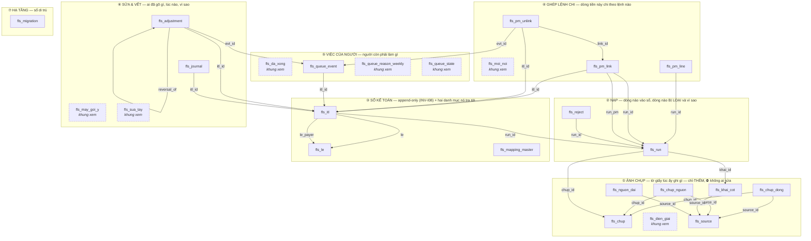
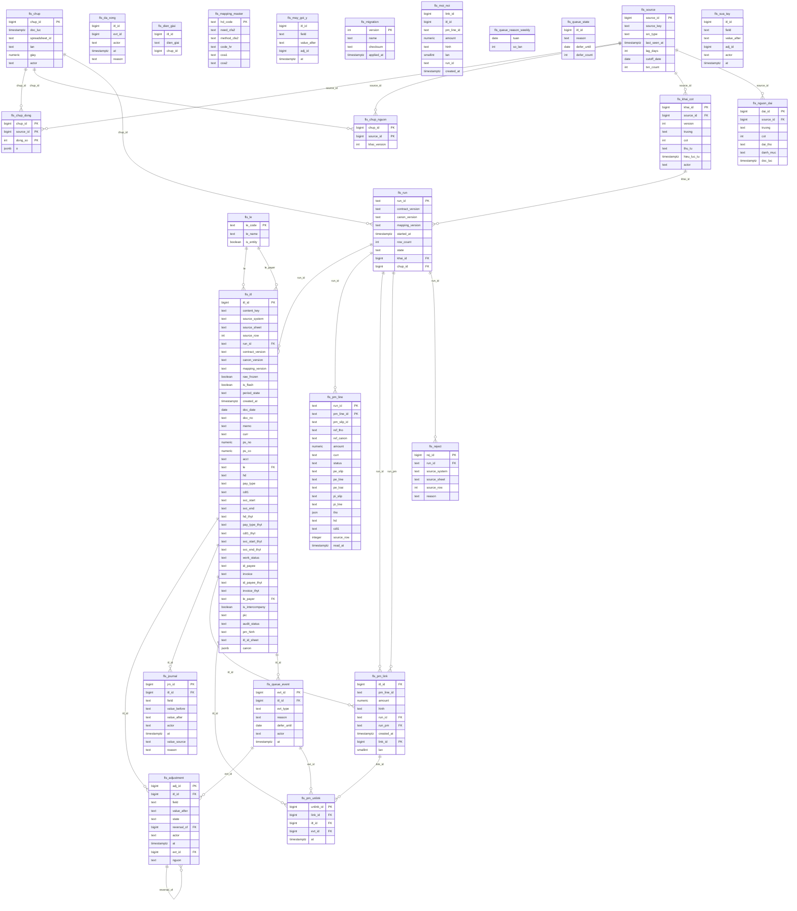

# 05 — DATA DICTIONARY & ERD

**Version:** v0.35 | **Chủ sở hữu:** COO-CFO
**Nguồn:** đọc trực tiếp 12 workbook thật tại `AS-IS system/Accounting_Files/RAW`, ngày 2026-08-18

> **R-A2 tuyệt đối.** Mọi tên trường dưới đây **chép nguyên văn từ file thật**, kể cả lỗi chính tả của nguồn (`ENITY`, `filetring`) và các tên trùng nhau. Không sửa, không "chuẩn hoá cho đẹp" trong tài liệu này — việc đổi tên (nếu có) là quyết định của `ITL-CONTRACT` và phải đi qua CR loại 3.
>
> **Cảnh báo đọc:** cấu trúc (tên cột, vị trí) đọc từ `.xlsx` là **đáng tin**; **giá trị ngày thì không** (bản export chỉ giữ 2,7% ô ngày nguyên kiểu). Mọi kiểm chứng giá trị phải đọc Google Sheets live.

---

## §0 · Hai tài liệu phải đọc kèm bản này ★

| Tài liệu | Vai | Điều bản này PHẢI tuân |
|---|---|---|
| [`Artifacts/FLS-ERD-Full-Detail.md`](Artifacts/FLS-ERD-Full-Detail.md) | ERD đầy đủ của **FLS** *(chính module này — "mỗi đồng đã đi rồi nghĩa là gì")*, kèm `POS-13`, `INV-I07`, nhóm entity thuần mới | Bản `05` là **bản rút gọn theo vai BA**; chi tiết trường và quan hệ lấy ở đó. Lệch nhau ⇒ **FLS-ERD thắng** |
| [`Artifacts/FLS-vs-FPS-Compare-Audit.md`](Artifacts/FLS-vs-FPS-Compare-Audit.md) | Đối chiếu ERD với **code FPS thật** *(39 bảng `fps_*`)* | ⛔ **Nguyên tắc số 1** — xem dưới |

### ⛔ Nguyên tắc số 1 kế thừa từ `FLS-vs-FPS-Compare-Audit`

> **SSOT schema phía FPS = `fps/db/schema.py` + `fps/db/schema_pg.py`, KHÔNG phải spec.**
> Mọi nhãn `[E]` *(theo spec)* phải **re-verify với code** trước khi thi hành; ô đã verify mang nhãn `[C]`.
> Đây là bài học FPS **đã trả giá**: spec drift 5 nguồn, đã có bug thật từ việc tin spec.

**Ba hệ quả trực tiếp cho bản `05` này:**

| # | Hệ quả |
|--:|---|
| **1** | ⚠ **`reference_number` nằm ở mức SLIP** (`fps_pm_slip`), **không phải LINE** — trái giả định của `QĐ-ITL-09` và luật `OP-03` *"1 PMLine ↔ 1 ref"*. ⇒ ghép sao kê → line phải **chia tiền theo tỷ lệ**, hoặc CR thêm cột ở line. **`CR #1` ưu tiên `P1`, phải chốt TRƯỚC khi thiết kế mapping** |
| **2** | ⚠ **`service_start/end_date` ở SLIP** *(PE/PI/PM slip)*, không ở PE Line ⇒ trường #11/#12 của hợp đồng 13 *(`svc_start`/`svc_end`)* phải xét ở **tầng slip**. Sai tầng = **sai kỳ ghi nhận** |
| **3** | ⛔ **FLS KHÔNG được ghi vào bảng `fps_*`** — chỉ đọc. Chiều ghi duy nhất là FPS tự ghi |

★ **Know-how mượn được ngay:** `fps_id_counter` — cơ chế **sinh ID atomic** đã fix một bug trùng ID thật ở FPS. Áp thẳng cho `itl_id` *(`INV-I04a`)*.

---

## DD-I01 · `ITL-CANON` — khuôn giao dịch chuẩn 36 cột

Nguồn: `ITL I Input Transaction Ledger File 1_2 (RAW).xlsx` ▸ sheet `Transaction Mapping L1`, **header ở dòng 3**, khối nguồn khai báo ở dòng 1–2.

| Cột | Tên trường (nguyên văn) | Nhóm | Lấy từ |
|:--:|---|---|---|
| A | `Ngày chứng từ` | BASE | `Transaction Original` |
| B | `Số chứng từ` | BASE | `Transaction Original` |
| C | `Diễn giải` | BASE | `Transaction Original` |
| D | `Đơn vị tiền tệ` | BASE | `Transaction Original` |
| E | `PS Nợ` | BASE | `Transaction Original` |
| F | `PS Có` | BASE | `Transaction Original` |
| G | `Tài khoản` | BASE | `Transaction Original` |
| H | `Loại giao dịch (Payment Type)` | LINK | `[Importrange]PM_Unpivot` |
| I | `ID PELine - Nội dung PE (Advance)` | LINK | `[Importrange]PM_Unpivot` |
| J | `ID PELine - Nội dung PE (Urgent)` | LINK | `[Importrange]PM_Unpivot` |
| K | `ID PILine - Nội dung PI` | LINK | `[Importrange]PM_Unpivot` |
| L | `Pháp nhân thanh toán` | CLASS | `[Importrange]PM_Unpivot` |
| M | `ID PMSlip` | LINK | `[Importrange]PM_Unpivot` |
| N | `ID PMLine` | LINK | `[Importrange]PM_Unpivot` |
| O | `ID PESlip` | LINK | `[Importrange]PM_Unpivot` |
| P | `ID PELine` | LINK | `[Importrange]PM_Unpivot` |
| Q | `ID PISlip` | LINK | `[Importrange]PM_Unpivot` |
| R | `ID PILine` | LINK | `[Importrange]PM_Unpivot` |
| S | `Budget Code (HDCode)` | CLASS | `[Importrange]PM_Unpivot` |
| T | `Chủ dự toán (CDT1)` | CLASS | `[Importrange]PM_Unpivot` |
| U | `Chủ dự toán *` | CLASS | `[Importrange]PM_Unpivot` |
| V | `Status_Final` | CLASS | `[Importrange]PM_Unpivot` |
| W | `Thời điểm bắt đầu sử dụng dịch vụ` | SVC | `[Importrange]PE_Unpivot` (khoá `ID PELine`) |
| X | `Thời điểm kết thúc sử dụng dịch vụ` | SVC | `[Importrange]PE_Unpivot` |
| Y | `Mã đối tác (ID Payee)` | PARTY | `[Importrange]PE_Unpivot` |
| Z | *(trống)* | — | — |
| AA | *(trống)* | — | — |
| AB | `Thời điểm bắt đầu sử dụng dịch vụ` | SVC | `[Importrange]PI_Unpivot` (khoá `ID PILine`) |
| AC | `Thời điểm kết thúc sử dụng dịch vụ` | SVC | `[Importrange]PI_Unpivot` |
| AD | `File đính kèm: Hóa đơn` | PARTY | `[Importrange]PI_Unpivot` |
| AE | `File đính kèm: Khác` | PARTY | `[Importrange]PI_Unpivot` |
| AF | `Ghi chú (nếu có)` | PARTY | `[Importrange]PI_Unpivot` |
| AG | `LE` | PARTY | `Master Mapping` |
| AH | `MID I DoubleCheck LE` | PARTY | `Master Mapping` |
| AI | `MID I DoubleCheck LE` | PARTY | `Master Mapping` |
| AJ | `MID I DoubleCheck LE` | PARTY | `Master Mapping` |
| AK | `MID I DoubleCheck LE` | PARTY | `Master Mapping` |
| AL | `No` | PARTY | `Master Mapping` |

**Đếm:** 7 BASE + 15 (H–V) + 3 (W–Y) + 5 (AB–AF) + 6 (AG–AL) = **36 cột** ✅ khớp con số trong `NGUỒN-BUILD` §3.

> ✅ **ĐÃ CÓ CODE 2026-08-26** — `fls/canon/spec.py` chép **nguyên văn** bảng trên: **38 vị trí** `A…AL`, **36 trường**, hai ô `Z`/`AA` trống. Ba khuyết tật đặt tên mỗi cái **một test khoá**:
> `test_bon_cot_AH_AK_trung_ten_van_phan_biet_duoc_theo_vi_tri` · `test_W_X_va_AB_AC_trung_ten_nhung_khac_nguon` · `test_38_vi_tri_va_36_truong`.
> `CanonRow` **cố ý không có** `as_dict()`/`by_name()` — lưu theo key là **mất cột**, chặn ngay ở API.
>
> ⚠ **Hai hệ toạ độ cùng dùng chữ cái `A…AL`** — đã ghim vào docstring của `spec.py` vì trộn nhầm là **lỗi lặng, không nổ**:
>
> | Chữ | Trong `ITL-CANON` *(đầu vào)* | Trong `ITL Ledge` *(đầu ra, 64 cột)* |
> |:--:|---|---|
> | `S` | `Budget Code (HDCode)` | `Classifying` khối 1 |
> | `V` | `Status_Final` | **`Final` khối 1** = `hd` |
> | `AH` | `MID I DoubleCheck LE` *(1 trong 4 cột trùng tên)* | **`Final` khối 4** = `svc_start` |
> | `AL` | `No` | **`Final` khối 5** = `svc_end` |

**Ba khuyết tật đặt tên của khuôn này** (chép nguyên văn, nhưng phải xử ở `ITL-CONTRACT`):

| # | Khuyết tật | Hệ quả |
|---|---|---|
| 1 | **Bốn cột AH–AK trùng tên hệt nhau** `MID I DoubleCheck LE` | Không thể tham chiếu theo tên; code buộc phải tham chiếu theo **vị trí cột** — cực kỳ dễ vỡ |
| 2 | **W/X và AB/AC trùng tên** `Thời điểm bắt đầu/kết thúc sử dụng dịch vụ` | Cùng tên, **khác nguồn** (PE vs PI). Trộn nhầm = sai kỳ ghi nhận P&L |
| 3 | Hai cột trống Z, AA nằm giữa khuôn | Nhìn thì 38 vị trí nhưng chỉ 36 trường — đếm sai là lệch mapping |

## DD-I02 · `Transaction Original` (7 cột BASE)

Sheet `Transaction Original`, **header dòng 2**: `Ngày chứng từ` · `Số chứng từ` · `Diễn giải` · `Đơn vị tiền tệ` · `PS Nợ` · `PS Có` · `Tài khoản`.

## DD-I03 · `MAPPING-MASTER`

Sheet `Mapping Master`, **header dòng 3**, ba khối khai báo ở dòng 1.

| Khối (dòng 1) | Cột | Trường |
|---|:--:|---|
| `Mapping LE I Legal Entity` | A | `Bank Sheet` |
| | B | `LE` |
| `Mapping HD via COA` | D | `HD` |
| | I | `COA1` |
| | J | `COA2` |
| | K | `Need to Allocate to CFA2` |
| | L | `Method to Allocate to CFA2` |
| | M | `Code HR Allocate` |
| `Mapping No via LE` | O | `LE` |
| | P | `No` |

Ba cột `K`, `L`, `M` là **mầm của bảng luật phân bổ L4** (`DT-I03`).

## DD-I04 · `ITL Ledge` — ứng viên `ITL-CONTRACT`

Nguồn: `ITL I Input Transaction Ledger File 2_2 (ADJUSTED).xlsx` ▸ sheet `ITL Ledge`. **Không phải bảng phẳng** — 9 dòng đầu là siêu dữ liệu, **dữ liệu bắt đầu dòng 10**.

### Cấu trúc dòng đầu

| Dòng | Nội dung |
|:--:|---|
| 1 | Banner vùng: `ADJUSTMENT ZONE` (R) · `ALLOCATE ZONE` (AU) · `AUDIT ZONE` (AX) + nhãn `PIC:` từng khối |
| 2 | Nguồn: `Transaction Mapping L1` (B) · `Report I General Ledger` (AX) |
| 3 | Đếm ô nhập tay: `# Input here = …` cho 7 khối |
| 4 | Tham chiếu dải audit sang `Report I General Ledger`: `!R10:R` · `!S10:S` · `!W10:W` · `!AE10:AE` · `!AI10:AI` · `!AM10:AM` |
| 5 | **Hàng ánh xạ cột nguồn** — cột nào của `ITL Ledge` lấy cột nào của `Transaction Mapping L1` |
| 6 | Hàng kiểm `True` / `#N/A` |
| 7 | **Tên cột thật** |
| 8 | Tên cột con của các khối 4 cột |
| 10+ | Dữ liệu |

### Vùng BASE+IMPORT (A–Q) — ~~tập cột engine đọc~~ ⚠ **SAI, xem `DD-I04b`**

| Cột ITL Ledge | Tên trường | ← Cột `Transaction Mapping L1` |
|:--:|---|:--:|
| A | `Ngày chứng từ` | A |
| B | `Số chứng từ` | B |
| C | `Diễn giải` | C |
| D | `Đơn vị tiền tệ` | D |
| E | `PS Nợ` | E |
| F | `PS Có` | F |
| G | `Tài khoản` | G |
| H | `Loại giao dịch (Payment Type)` | H |
| I | `Budget Code (HDCode)` | **S** |
| J | `Chủ dự toán (CDT1)` | **T** |
| K | `Thời điểm bắt đầu sử dụng dịch vụ` | **AB** |
| L | `Thời điểm kết thúc sử dụng dịch vụ` | **AC** |
| M | `Mã đối tác (ID Payee)` | **Y** |
| N | `File đính kèm: Hóa đơn` | **AD** |
| O | `File đính kèm: Khác` | **AE** |
| P | `LE` | **AG** |
| Q | `No` | **AL** |
| R | `ITL ID` | *(sinh ra, dòng 8 ghi `Formual`)* |

> **Chi tiết dễ bỏ sót:** cửa sổ dịch vụ (K, L) lấy từ **AB/AC = nhánh PI**, còn mã đối tác (M) lấy từ **Y = nhánh PE**. Hai nhánh khác nguồn. Adapter phải giữ đúng nhánh này, nếu không kỳ ghi nhận P&L sẽ lệch.
>
> ⚠ **Nhưng vùng này KHÔNG phải hợp đồng engine.** Engine chỉ đọc A–F của vùng này rồi nhảy sang vùng ADJUSTMENT. Xem `DD-I04b`.

### Vùng ADJUSTMENT (R→AT) — 7 khối × 4 cột

Khuôn lặp: `Classifying` → `Manual input` → `MID` → `Final`.

| Khối | Cột | Trường được bổ sung | Ô nhập tay | PIC |
|:--:|---|---|--:|---|
| 1 | S–V | `Budget Code (HDCode)` | 297 | LAN + THƯƠNG |
| 2 | W–Z | `Loại giao dịch (Payment Type)` | 179 | THƯƠNG |
| 3 | AA–AD | `Chủ dự toán (CDT1)` | 1.210 | THƯƠNG |
| 4 | AE–AH | `Thời điểm bắt đầu sử dụng dịch vụ` | 22 | THƯƠNG |
| 5 | AI–AL | `Thời điểm kết thúc sử dụng dịch vụ` | 22 | THƯƠNG |
| 6 | AM–AP | `Mã đối tác (ID Payee)` | 1.624 | THƯƠNG |
| 7 | AQ–AT | `File đính kèm: Hóa đơn` | 3.489 | THƯƠNG |
| | | **Tổng** | **6.843** | |

Giá trị quan sát được ở cột `Classifying`: `"Need to manual input"`. Máy trạng thái TO-BE: `SM-I02`.

### Vùng ALLOCATE (AU–AW)

| Cột | Trường |
|:--:|---|
| AU | `Chủ dự toán (CDT1) CFA1` |
| AV | `Chủ dự toán (CDT1) CFA2` *(dòng 8: `Classifying`)* |
| AW | `Method` — giá trị quan sát: `No need` |

### Vùng AUDIT (AX–BL) — đối chiếu ngược `Report I General Ledger`

| Cột | Trường | Cột cặp | Số dòng `FALSE` |
|:--:|---|:--:|--:|
| AX | `ITL ID` | AY | **1.356** |
| AZ | `HD CODE` | BA | **552** |
| BB | `Loại Giao dịch` | BC | **146** |
| BD | `PL Time (TOA) start` | BE | **2.310** |
| BF | `PL Time (TOA) end` | BG | **2.308** |
| BH | `ID Vendor` | BI | **39** |
| BJ | `PIC` | — | — |
| BK | `Trạng thái` | — | — |
| BL | `ENITY` *(nguyên văn — nguồn viết sai chính tả)* | — | — |

**Tổng 6.711 dòng lệch.** Đây là phát hiện của phiên đọc dữ liệu thật, chưa từng ghi trong tài liệu nguồn nào ⇒ `GAP-ITL-11`.


## DD-I04b · `ITL-CONTRACT` — ĐỌC TỪ REDER ĐANG CHẠY THẬT ★

**Nguồn:** `FPA-T4/apps/api/src/api/services/actual/raw_to_apr_v2/pnl/itl_ledge_reader.py`, hằng `_COLS` (branch `feat/report-scope-sub-entity`). **Đối chiếu với giá trị thật dòng 10 của `ITL Ledge`: khớp 13/13.**

> Đây là kết quả đóng `GAP-ITL-16` — thực thi đúng `P-ITL-01` (reverse-engineer từ reader đang chạy, không thiết kế mới). **Bản này thắng mọi suy luận từ cấu trúc sheet.**


> ## ⛔ SỬA 2026-08-24 (chiều) — HỢP ĐỒNG LÀ **14 TRƯỜNG**, KHÔNG PHẢI 13
>
> Đọc **reader thật** trên nhánh `feat/report-scope-sub-entity` *(`FPA-T4/apps/api/src/api/services/actual/raw_to_apr_v2/pnl/itl_ledge_reader.py`)*:
>
> ```python
> _COLS = {"doc_date":0, "doc_no":1, "memo":2, "curr":3, "ps_no":4, "ps_co":5,
>          "itl_id":17, "hd":21, "pay_type":25, "cdt1":29,
>          "svc_start":33, "svc_end":37, "le":15, "acct":6}
> ```
>
> **Ba điều bản v0.3 nói sai, nay sửa:**
>
> | | v0.3 nói | Reader thật |
> |---|---|---|
> | Số trường | 13 | **14** |
> | `le` | cột **`BL`** (63), vùng AUDIT | ⭐ cột **`P`** (15), tiêu đề `LE` — **người nhập tay** |
> | `acct` | *"engine KHÔNG đọc `G`"* | ⭐ **CÓ đọc** — `acct` = `G` (6) |
>
> **Vì sao đổi — có số đo, không phải sở thích** *(`test_itl_le_column_ssot.py`, snapshot `itl_84f092a6637f`, 10.572 dòng)*:
>
> | Cột | Độ phủ | Diễn biến |
> |---|---|---|
> | **`P`** *(`LE`, người nhập)* | **9.872/9.872 = 100%** | ổn định |
> | **`BL`** *(suy bằng `VLOOKUP`)* | **trống 6.379/10.572** | 100% có ghi cuối 2024 → **31%** cuối 2025 → **0% tháng 8/2026** |
>
> Chỗ **cả hai** tra được *(2.654 dòng)* thì **612 dòng lệch nhau** ⇒ đây **không phải** hai cột chép lại nhau, và chọn cột nào là **quyết định nghiệp vụ**. ⇒ **Owner chốt cột `P` là SSOT ngày 2026-08-20.**
>
> ⇒ ✅ **`GAP-ITL-19` ĐÓNG** *(câu hỏi "vì sao dùng `BL` mà không dùng `P`?")* · ✅ **`INV-I15` ĐÓNG** — không phải *"chưa đo được"*: `BL` **mục ruỗng ba tháng**, đã bị thay. `BL` vẫn được kéo về snapshot **chỉ để đối chiếu về sau** (`NEEDED_COLS` giữ 63).
>
> ⚠ **Bài học lặp lại lần thứ ba trong ngày:** tôi lấy con số từ **tài liệu** *(`DD-I04b` v0.2, 18/08)* thay vì từ **code**. Đúng cái mà `FLS-vs-FPS-Compare-Audit` §Nguyên tắc số 1 đã cảnh báo: **SSOT là code, không phải spec.**


### Hợp đồng thật: **13 cột** ⛔ *(SAI — xem khối sửa ngay trên)*, đọc theo **VỊ TRÍ** không theo tên

| # | Field engine | Chỉ số (0-based) | Cột Excel | Nghĩa trong `ITL Ledge` | Giá trị thật dòng 10 |
|--:|---|--:|:--:|---|---|
| 1 | `doc_date` | 0 | **A** | `Ngày chứng từ` | `2024-10-21` |
| 2 | `doc_no` | 1 | **B** | `Số chứng từ` | `FT24295070629325` |
| 3 | `memo` | 2 | **C** | `Diễn giải` | `Dieu chuyen Ngan hang Vpbank` |
| 4 | `curr` | 3 | **D** | `Đơn vị tiền tệ` | `VND` |
| 5 | `ps_no` | 4 | **E** | `PS Nợ` | *(trống — dòng này ghi Có)* |
| 6 | `ps_co` | 5 | **F** | `PS Có` | `1500000000` |
| 7 | `itl_id` | 17 | **R** | `ITL ID` | `ITL#1` |
| 8 | `hd` | 21 | **V** | **`Final` của khối ADJUSTMENT 1** — Budget Code (HDCode) | `NB \| Lưu chuyển nội bộ` |
| 9 | `pay_type` | 25 | **Z** | **`Final` của khối 2** — Loại giao dịch | `Thanh toán (Regular)` |
| 10 | `cdt1` | 29 | **AD** | **`Final` của khối 3** — Chủ dự toán (CDT1) | `SHQ2 \| Headquarters2` |
| 11 | `svc_start` | 33 | **AH** | **`Final` của khối 4** — **KỲ** bắt đầu DV · khuôn **`YYYYMM`** *(⛔ không phải NGÀY — xem khối ⚠ ngay dưới)* | `202410` |
| 12 | `svc_end` | 37 | **AL** | **`Final` của khối 5** — **KỲ** kết thúc DV · khuôn **`YYYYMM`** | `202410` |

⚠⚠ **`svc_start`/`svc_end` là KỲ, ⛔ KHÔNG phải NGÀY — và cái TÊN đánh lừa.** *(`QĐ-ITL-86`, 2026-09-04)*

Tên cột trên sổ đọc là *"Thời điểm bắt đầu sử dụng dịch vụ"* — đọc y hệt một **timestamp**. Đo thật trên `fls_itl` *(10.030 dòng · 2.368 dòng có giá trị)*:

| Khuôn | Số dòng | |
|---|--:|---|
| `YYYYMM` | **2.363** | ⭐ **99,8%** — đây là khuôn thật |
| `45962` | 2 | ⛔ **số serial ngày của Excel** lọt vào |
| `tháng 5` · `tháng 4` · `2025` · `2025.07` · `2027` | 9 | ⛔ chữ · thiếu tháng · sai dấu |

⇒ **11 dòng bẩn** đã lọt qua vì ⛔ **không ai kiểm**. Từ 04/09 cửa ghi ép khuôn `^\d{4}(0[1-9]|1[0-2])$` ⇒ `400 FLS-BAD-FORMAT` *(`DT-I09` #6)*, và màn dùng **ô chọn THÁNG** *(⛔ không phải ô chọn ngày)*.

⛔⛔ **Bài học cho chính bản khai này:** phiên bản trước có ví dụ `202410` và khai kiểu `text` — **⛔ không sai**, nhưng nó ⛔ **không nói ra LUẬT**. Người đọc sau *(là tôi, 04/09)* đã đoán từ **cái tên** và đề xuất một **ô chọn ngày** — thứ sẽ ghi `2024-12-01` vào chỗ sổ chờ `202412`. ⇒ Một bản khai chỉ cho **ví dụ** mà ⛔ không cho **luật** là một bản khai **mời người ta đoán**.
| ~~13~~ | ~~`le`~~ | ~~63~~ | ~~**BL**~~ | ⛔ **BỎ 2026-08-20** — `BL` trống 60%, tháng 8/2026 trống 100% | ~~`VVOT`~~ |
| **13** | `le` | **15** | **P** | ⭐ **`LE` — người nhập tay, điền 100%. SSOT theo quyết định owner 2026-08-20** | `VGOH` |
| **14** | `acct` | **6** | **G** | ⭐ **`Tài khoản`** — định danh cho dòng mà `LE` ghi `CN` / `Cash Treasury` *(tài khoản cá nhân, owner 2026-08-20)*. Xem `le_canon` | `No 1` |

**Luật đọc:** `min_row=10` · bỏ dòng nếu `len(row) <= 63` hoặc `itl_id` rỗng · mỗi dòng mang thêm `excel_row`.

**Cột `pm_settled_through`** (kỳ chốt) đọc riêng: sheet `RAW ITLData Management`, **cột G** (`Cut-off Date`, 0-based 6), lấy **max**; vắng ⇒ fallback hằng `PM_SETTLED_THROUGH = "M2605"`.

### Bốn hệ quả phải nhớ

| # | Hệ quả |
|---|---|
| **1** | ⛔ **SỬA:** engine **CÓ đọc `G` (`Tài khoản`)** — trường `acct`(6), thêm 2026-08-20 để định danh dòng mà `LE` ghi `CN`/`Cash Treasury`. Đúng là engine **không đọc `H`–`O`, `Q`** |
| **2** | **Engine đọc `Final` của vùng ADJUSTMENT, không đọc vùng IMPORT.** Nghĩa là **giá trị người điều chỉnh mới là giá trị thật** của HD / loại giao dịch / CDT1 / cửa sổ dịch vụ |
| **3** | ⛔ **SỬA — đảo ngược hoàn toàn:** chiều pháp nhân đến từ **cột `P` (`LE`)**, người nhập tay, **điền 100%**. Cột `BL` *(`VLOOKUP` vào `Daily RP test`)* **đã bị thay** vì mục ruỗng dần tới **0% tháng 8/2026**. Owner chốt 2026-08-20. ⇒ nhận định cũ *"báo cáo pháp nhân phụ thuộc một cột trong vùng đối soát"* **đúng ở thời điểm viết**, và đó chính là lý do nó đã được sửa |
| **4** | **Khối 6 (`Mã đối tác`, AP) và khối 7 (`File đính kèm`, AT) KHÔNG được engine đọc** — mà đó là **1.624 + 3.489 = 5.113 ô nhập tay, tức 75% khối lượng của `ITL Ledge`**. Chúng phục vụ truy vết chứng từ, **không** phục vụ độ chính xác P&L |

### ⚠ Rủi ro số 1 của cutover — giờ đã cụ thể

Reader dùng **vị trí cột cứng**, không dùng tên. ⇒ **Chèn/xoá bất kỳ cột nào ở vị trí ≤ BL (64) sẽ làm engine đọc lệch toàn bộ, âm thầm, không báo lỗi.**

Cụ thể: chèn 1 cột trước `V` ⇒ engine lấy `MID` thay vì `Final` cho HD; chèn trước `BL` ⇒ pháp nhân đọc sang cột khác ⇒ mọi báo cáo theo venture sai mà không có dấu hiệu.

**Yêu cầu bắt buộc cho `ITL-CONTRACT` v1.0:**
1. Hợp đồng TO-BE phải khai báo **theo tên**, và tầng tương thích phải map tên → vị trí, có test khoá vị trí.
2. Test tương thích engine (`ORC-07` §3 `C1`) phải kiểm **cả 13 vị trí**, không chỉ sự tồn tại của cột.
3. `INV-I07` (tương thích ngược) diễn giải cụ thể: **không được đổi vị trí 13 cột này** cho tới khi engine chuyển sang đọc theo tên.

### ✅ `ITL-CONTRACT` v1.0 — ĐÓNG BĂNG 2026-08-24 (`QĐ-ITL-42`)

| Điều | Chốt |
|---|---|
| **Phạm vi** | ⭐ **14 trường** *(đã sửa chiều 24/08 — xem khối ⛔ ở trên)*: 6 BASE `A–F` + `acct` `G` + `le` `P` + `itl_id` `R` + 5 `Final` khối 1–5. Không thêm, không bớt |
| **Cách khai báo** | ⭐ **theo TÊN**. Bảng `tên → vị trí` ở trên giữ lại làm **tầng tương thích**, không phải hợp đồng |
| **`POS-13`** | Còn hiệu lực **chỉ khi nguồn là Sheet**. Khi nguồn thành **bảng** *(PG/BQ — `QĐ-ITL-38`)* thì `POS-13` **hết hiệu lực** — đúng điều kiện mà chính mục 3 ở trên đã đặt ra |
| **Khối 6–7** | ⛔ **NGOÀI hợp đồng**: `AP` *(Mã đối tác)* · `AT` *(File đính kèm: Hoá đơn)*. Chuyển sang gói **adapter F** (`QĐ-ITL-03` — không chặn cutover) ⇒ việc code hoá ô gõ tay **7 khối → 5 khối** |
| **Điều kiện đóng băng** | ✅ **ĐÃ ĐẠT 2026-08-24** — `test_itl_contract_v1_lock.py` *(10 test, PASS)* khoá **cả 14 vị trí** + `NEEDED_COLS` + `VERIFY_COL == itl_id` + phép chứng minh *"dịch một cột là dòng rơi im lặng"*. Cộng `test_itl_le_column_ssot.py` *(4 test)* khoá riêng cột `le`. ⇒ hợp đồng **đóng băng CÓ CƯỠNG CHẾ**, không còn trên giấy |
| **Đổi reader sang đọc theo tên** | **`CR` loại 3** — bắt buộc kèm test tương thích |

> ★ Xem `Artifacts/FLS-ERD-Full-Detail.md` §`POS-13`/`INV-I07` cho bản đầy đủ, và `Artifacts/FLS-vs-FPS-Compare-Audit.md` §7 mục 6 cho lý do vì sao test khoá vị trí phải chạy **mọi milestone**.

## DD-I05 · `ITL ID` — khoá giao dịch

**AS-IS:** giá trị quan sát được là `ITL#1`, `ITL#2`, `ITL#3`… — **số thứ tự chạy theo vị trí dòng**.

**Vấn đề:** khoá này không ổn định. Chèn/xoá một dòng thượng nguồn làm mọi ID phía sau dịch — nhiều khả năng là gốc của lớp lỗi remap đã đo ở hệ hiện hành.

**TO-BE bắt buộc:** ⚠ **SỬA v0.4** — v0.3 viết *"khoá composite ổn định, suy từ nội dung giao dịch"*. Câu đó **đúng một nửa**.

★ **`QĐ-ITL-30` (22/08) + `QĐ-ITL-43` (24/08) chốt HAI khoá, hai việc khác nhau** — vì khoá nội dung **đổi mỗi lần một trường nội dung được sửa**, và khi đó **mọi ô người gõ cùng mọi dòng nhật ký rời khỏi dòng của nó**:

| Khoá | Là gì | Dùng để | Bất biến |
|---|---|---|---|
| **danh tính** | `itl_id` = **số thứ tự cấp một lần khi dòng vào sổ, rồi ĐÓNG BĂNG** *(khác hẳn "số thứ tự theo vị trí dòng" của AS-IS)* | neo mọi thứ gắn vào dòng: ô người gõ, nhật ký, bút toán | **`INV-I04a`** |
| **đối sánh** | khoá nội dung, có `UNIQUE` | khử trùng + đối sánh với ~~302.259~~ ⛔ **4.399** dòng log cũ *(đã hẹp lại — `QĐ-ITL-97`)* | **`INV-I04b`** |

**Đo kèm, giải thích vì sao khoá nội dung một mình KHÔNG đủ làm danh tính:** **281 dòng trùng** · **103 dòng không có số chứng từ** · **31 dòng mã rác `4.36619E+15`**.

★ **Cú lật THỨ TỰ cấp danh tính** *(rà 2026-08-25, `FLS-Process-PM-den-ITL` §3 chặng 7–8):*

| | AS-IS *(Gsheet)* | TO-BE *(FLS)* |
|---|---|---|
| **`itl_id` cấp khi nào** | **SAU mapping** — `"ITL#" & No`, `No = ROW()` trên bảng `SORT` theo ngày | **TRƯỚC mapping** — cấp lúc nạp *(trạng thái `staged`, `09` SM-I01)*, rồi đóng băng |
| **Hệ quả** | nhập lùi ngày ⇒ đánh số lại *(1.356 `FALSE` AUDIT)*; `No` rỗng ⇒ `ITL#` mất khoá | danh tính bất động; dòng `unmapped` vẫn có khoá |

⇒ Mapping PM **không** sinh `itl_id` nữa; nó chỉ **làm giàu** dòng đã có khoá.

⛔ **Lineage phải sống sót** *(`INV-I05` ghi chú, `QĐ-ITL-20`/`CR#1`)*: AS-IS vứt `N ID PMLine`/`M ID PMSlip`/`L Pháp nhân` ở chặng 8 ⇒ `ITL-CANON` TO-BE mang **`pm_line_id`** *(= `fps_pm_line.line_id`)* + **`le_payer`** *(← `fps_pm_slip.payer_id`)* làm cột lineage **ngoài** 14 trường hợp đồng.

> ⭐⭐ **Cập nhật 2026-08-27 — yêu cầu lineage KHÔNG đổi, CHỖ ĐẶT nó thì đổi.** `pm_line_id` **không còn là cột của `fls_itl`**; nó là cột của bảng nối **`fls_pm_link(itl_id, pm_line_id, amount, hinh, run_id)`** *(migration `0007`)*.
>
> **Lý do đo được, không phải sở thích:** phép ghép có **sáu hình dạng**, và hình `B` là **một dòng bank trả N dòng lệnh** — một cột giữ được **một** mối nối, nên 27 dòng `B` trước đó phải vào hàng chờ dù Σ tiền khớp. Đo trên hiện vật ghim: **27 dòng sổ mang 69 mối nối**, có dòng chia cho **10** dòng lệnh.
>
> ⛔ **Và chỉ giữ MỘT chỗ:** cột cũ **đã bỏ**. Giữ cả cột lẫn bảng là **hai bản sự thật** cho cùng một việc — đúng cái mà nguyên tắc *"khai một lần"* của bộ này cấm. Đổi lại phải có **cổng Σ**: với mỗi dòng sổ, **Σ tiền các mối nối = tiền dòng bank**, kiểm **trước khi ghi**.
>
> ⚠ **`le_payer` KHÔNG đổi** — nó là thuộc tính của **dòng sổ** *(ai thực trả)*, không phải của một mối nối, nên vẫn ở `fls_itl`.

⇒ Công thức dưới đây vẫn dùng, nhưng cho **`INV-I04b` (đối sánh)**, không phải cho danh tính:

★ **Khoá composite ĐÃ TỒN TẠI và đang chạy thật** — phát hiện ở G6 (`_GUIDE_09` §1). Hai sheet `Log` (`P100 Bank` 171.358 + `P100 Cash` 130.901 = **302.259 dòng**) có cột `Composite Key` với khuôn:

```
<YYYYMMDD> | <Debit> | <Credit> | <Reference number>
```
Giá trị thật: `20250211||66923.25|FT25042584880113` · `20250211|67000||FT25042112560025` · `20250708||1000000|PC00003VGOH`

**Đề xuất TO-BE = mở rộng khoá đang chạy, không phát minh mới:**
```
itl_id = hash( source_system, source_sheet,       # THÊM: khử trùng liên tài khoản
               Ngày chứng từ, PS Nợ, PS Có, Số chứng từ/Reference,   # 4 thành phần GỐC
               seq_trong_nhóm_trùng )
```
Giữ nguyên 4 thành phần gốc để **đối sánh được với** ~~302.259~~ ⛔ **4.399** dòng log cũ *(đo sống 2026-09-07, `QĐ-ITL-97` — xem `DD-I09`; con số cũ là **ô LƯỚI**, và **51.178** dòng còn lại mang khoá **hỏng** `NaNNaNNaN\|\|\|`)*; thêm nguồn vì khoá AS-IS chưa mang nguồn ⇒ hai tài khoản cùng ngày/số tiền/ref sẽ trùng khoá.

**Điều kiện nghiệm thu khoá:** chạy pipeline 2 lần → ID không đổi; chèn một dòng vào giữa nguồn → ID các dòng cũ không đổi. Chưa qua test này thì không được dùng (`INV-I04`).

Nhãn `No` (cột Q) giữ lại cho người đọc, **không phải khoá**.

## DD-I06 · Schema các nguồn (đầu vào adapter)

> ⛔⛔ **ĐỌC TRƯỚC BẢNG — mục này tả ĐÍCH, ⛔ không tả thứ mã đang chạy** *(`GAP-DOC-07`, phát hiện 2026-09-07 khi rà AS-IS)*.
> Mục này khai Adapter B đọc `P100 _ Bank Transactions ▸ Bank Transactions`. Mã thật mở đầu bằng: *“Adapter B — Cash/Bank: `Transaction Mapping L1` → ITL-CANON 38 vị trí”* *(`fls/adapters/bank.py`, nguồn khai ở `fls/oracle/nguon.py::BAN_SAO_RAW`)*.
> ⇒ **Hai chỗ cách nhau BA lần biến đổi** — `R |` → `Bank Transactions` → `1.1`/`1.2 Ledger` → `Transaction Mapping L1`.
> ⚠ Lệch này **có sẵn từ trước `CR#10`** và ⛔ **chưa cổng nào canh** — cổng chỉ canh *phiên bản · số · cột · ngày*, ⛔ không canh **tài liệu có tả đúng chỗ mã đang đọc hay không**.
> ⭐ Sau `QĐ-ITL-90` thì bản khai này **thành đúng cho `F04`** — nhưng nó vẫn ⛔ **không** mô tả adapter đang chạy hôm nay. Giữ cả hai, ⛔ không xoá.

### Adapter B · `P100 _ Bank Transactions` ▸ `Bank Transactions` (header dòng **2**, dữ liệu từ dòng **3**, ~~7.715~~ ⭐ **8.338** dòng × **10** cột)

> ⚠ **Sửa 2026-09-07 (`Đ3`, đọc sống):** dữ liệu bắt đầu từ dòng **3**, ⛔ không phải dòng 4 *(dòng 3 là một dòng **cụt** — có `Source` + `Num`, ⛔ không ngày ⛔ không mã)*. Số dòng thật **8.338** *(lưới khai 8.341)*. ⭐ Và **dòng 1 là một BỘ ĐẾM SỐNG** — `8331` mã · `8339` xuất xứ — cái sổ **tự đếm chính nó**.

⚠ **Có sheet TRÙNG TÊN:** `A-CCR_V2_Working ▸ Bank Transactions` ~~7.484~~ **7.961 dòng**, và ⛔⛔ **nó dừng ở `19/08/2026`** *(bản `P100` chạy tới `06/09`)* — xem `QĐ-ITL-96` — ⛔ **không phải** sheet này. Bản `A-CCR` là bản đã hút về; bản `P100` là bản `OP-09` sinh ra từ 60 sheet `R |`.
`Transaction date` · `Description` · `Currency` · `Debit` · `Credit` · `Reference number` · `Source` · `Num` · `Check trùng` · `,`

Ánh xạ sang `ITL-CANON`: `Transaction date`→A · `Description`→C · `Currency`→D · **`Debit`→`PS Nợ`(E)** · **`Credit`→`PS Có`(F)** · `Source` mang mã sheet tài khoản (dạng `R | 24138888_TCB VND_TERASOFTS`) → khoá tra `MAPPING-MASTER.Bank Sheet`.

> 60+ sheet `R | …`, mỗi ngân hàng/ví một định dạng. ⚠ **Sửa 2026-09-07 (`Đ2`+`Đ5-b`):** *"mỗi ngân hàng một định dạng"* đúng ở **vùng THÔ**; vùng **CHUẨN** chỉ có **một** khuôn, và ⭐ **dòng 1 của mỗi sheet là BẢN KHAI ÁNH XẠ** *(`1`=Date … `6`=Reference)* — **68/68 sheet khai đủ 6 trường**. `F04` phải **ĐỌC LẤY** bản khai, ⛔ không đoán theo vị trí cột.
>
> ⛔ `Check trùng` **⛔ không đáng tin** *(khớp 92,1%, và luôn **đếm thiếu**)* ⇒ giữ nguyên kết luận *không đưa vào canonical*. ⭐⭐ **Nhưng `Num` thì ngược lại:** nó là **thứ tự lần xuất hiện của mã**, khớp **8.331/8.331 = 100,0%** ⇒ phép chống trùng của AS-IS **đã chạy đúng tuyệt đối**; `F04` ⛔ không phải phát minh lại, chỉ phải **giữ**.

### Adapter B · `P100 _ Cash Ledger` ▸ `Cash Ledger Transactions` (header dòng 2)
Giống trên, thêm `Check trùng_Reference number` và `Month`.

### Adapter C · `A-CCR_V2_Working` ▸ `1.2 Ledger 112` (header dòng 2)
`Ngày chứng từ` · `Số chứng từ` · `Diễn giải` · `Đơn vị tiền tệ` · `PS Nợ` · `PS Có` · **`Source`** · **`Tài khoản`**

> ⚠ **Lệch thứ tự cột:** ở đây `G = Source`, `H = Tài khoản`; còn ở `Transaction Original` thì `G = Tài khoản`. Adapter **phải map theo tên, không theo vị trí**.

### Adapter C · `A-CCR_V2_Working` ▸ `2. CCR` — ma trận, không phải bảng phẳng
Dòng 3 là chiều tài khoản: `Entity` · `Bank` · `Currency` · `Accounts` · `Account type` · `Link` · `ID` · `Pass` · `Sổ phụ`. Từ cột L trở đi là **một cột một ngày** (dòng 5 = ngày, dòng 6 = tỷ giá `USD/VND` theo ngày). Adapter phải **unpivot** về (tài khoản × ngày × số dư × tỷ giá).

### Adapter D · `H1000 Ledger` ▸ `1.3 Ledger NISINTCOM 2025` (header dòng 3)
Dùng **cùng khuôn** với `Transaction Mapping L1` nhưng **khác ở đuôi**:

| Cột | `Transaction Mapping L1` | `1.3 Ledger NISINTCOM 2025` |
|:--:|---|---|
| Y | `Mã đối tác (ID Payee)` | **`File đính kèm: Hóa đơn`** |
| Z | *(trống)* | **`File đính kèm: Khác`** |
| AA | *(trống)* | **`Ghi chú (nếu có)`** |
| AL | `No` | **(không có)** |

> ⚠ **Đây là lệch schema thật giữa hai file cùng dùng "một" khuôn.** Adapter D không được giả định khuôn giống hệt. Ghi vào `ITL-CANON` như một biến thể có khai báo, không im lặng map theo vị trí.

### Adapter D · `H1000 Ledger` ▸ `HR Allocate_L500_v2` (header dòng 2)
`Sheet Name` · `ID PELine` · `Budget Code` · `Tháng thanh toán (yyyymm)` · `Tháng bắt đầu sử dụng dịch vụ (yyyymm)` · `Tháng kết thúc sử dụng dịch vụ (yyyymm` *(nguyên văn — thiếu dấu đóng ngoặc)* · `HD` · `CDT` · `Driver` · `Amount (VND)` · `No Emp` · `CDT_Final`

### Adapter D · `H1000 Ledger` ▸ `Allocation Driver` (header dòng 2)
`Sheet Name` · `Sheet Range` · `Month PL` · `CDT` · `Number of Employee` · `Section_Convert` · `Dịch vụ` · `Number of Employee (excl Dịch vụ)`

### Adapter E · Platform (`GI` / `OMC` / `SC` / `PS`) ▸ `CFA1 | … Platform Data Ledger`, `CFA2 | MID n | … Allocated Ledger`
Dùng **cùng khuôn 4 vùng** như `ITL Ledge` (header dòng 7, dữ liệu dòng 10), khác 3 điểm:

| | `ITL Ledge` | Platform |
|---|---|---|
| Cột E | `PS Nợ` | `PS Nợ (PE Amount)` |
| Cột Q | `No` | `No Transactions Per Vendor` |
| Khối 1–2 vùng ADJUSTMENT | `Classifying/Manual input` | `PM Amount / PE Amount`, `PM Date / PE Date` |
| Khối 3 ở CFA2 | `Classifying` | `CDT1-CFA1` / `CDT1-CFA2` |

Dòng 6 có hàng chú thích `Formula` / `Nhập fix` cho từng cột — **bản đồ sẵn có** chỉ ra cột nào máy tính, cột nào người gõ.

**Ô nhập tay ngoài `ITL Ledge`** (đếm được ở dòng 3): `GI CFA1` = 173 + 173 · `GI CFA2 MID1` = 4.689 + 0. ⇒ **tổng khối lượng nhập tay của cả hệ lớn hơn con số 6.843 nhiều** — 6.843 chỉ là phần trong `ITL Ledge`.

## DD-I09 · ⭐⭐ ĐỐI CHIẾU ERD ↔ **ĐO SỐNG** *(2026-09-07, `Đ2`→`Đ5-b`)*

> Bản ERD này viết **2026-08-18**, đọc từ **12 workbook `.xlsx` offline**. Năm
> phép đo `Đ2`–`Đ5-b` đọc **sống** qua Sheets API. Mục này ghi **chênh**, ⛔ không
> viết lại lịch sử *(`R-A5`)* — chỗ nào sai thì **đánh dấu đã hẹp lại**.

### ⛔⛔ ① Chỗ sai NẶNG nhất: `302.259 dòng log`

| | Ghi trong ERD | Đo sống |
|---|--:|--:|
| `P100 Bank ▸ Log` | 171.358 | **10.994** dòng có dữ liệu |
| `P100 Cash ▸ Log` | 130.901 | **44.583** |
| **Tổng** | **302.259** | **55.577** |
| ⛔ trong đó khoá **HỎNG** `NaNNaNNaN\|\|\|` | — | ⛔⛔ **51.178** |
| ⭐ **dòng DÙNG ĐƯỢC** | — | ⛔ **4.399** *(bank 4.200 · quỹ **199**)* |

⛔ **Hai lỗi chồng nhau.** ⓵ `302.259` là **ô LƯỚI**, ⛔ không phải dòng — cùng
cái bẫy đã dập ở `Đ3`. ⓶ Và **92% phần còn lại là RÁC**: kịch bản dựng khoá làm
phép **ngày** trên thứ ⛔ không phải ngày, ra `NaN`, rồi ba trường sau **rỗng**.
Sổ quỹ nặng nhất: **44.384 / 44.583 = 99,6%** hỏng, chỉ còn **69 khoá khác nhau**.

⇒ ⛔ **Hệ quả cho `INV-I04b`:** điều kiện nghiệm thu *"đối sánh được với 302.259
dòng log cũ"* **⛔ không còn là một phép kiểm mạnh**. Đo phủ: log chạm
**4.183 / 8.338 = 50,2%** sổ bank, và ~**10%** sổ quỹ. **Khuôn khoá 4 thành phần
vẫn ĐÚNG** *(`<YYYYMMDD>|<Nợ>|<Có>|<Ref>`, 100% dòng dùng được có đủ 4 mảnh)* —
cái sai là **quy mô bằng chứng**, ⛔ không phải thiết kế.

### ⛔ ② Ba con số của `DD-I05` phải hẹp lại

| ERD ghi | Đo sống | |
|---|---|---|
| **281 dòng trùng** | **280 mã trùng / 706 dòng** | ⚠ ERD đếm **mã**, không đếm **dòng** |
| **103 dòng không có số chứng từ** | ⭐ **7** | trôi mạnh — sổ đã được vá |
| **31 dòng mã rác `4.36619E+15`** | ⛔ **⛔ KHÔNG phải rác** | `Đ4-a`: giá trị **thô nguyên vẹn**; `4.36619E+15` chỉ là **cách hiển thị** mã kiểu SỐ. `31` dòng ấy là mã đổi kiểu `int`→`float`, ⛔ không mất gì |

### ⛔ ③ Ba mắt xích ERD **⛔ không hề nhắc**

| Thiếu | Là gì | Vì sao phải có trong ERD |
|---|---|---|
| ⭐⭐⭐ **Dòng 1 của mọi sheet `R \|`** | **BẢN KHAI ÁNH XẠ** do kế toán tự duy trì: `1`=Date · `2`=Description · `3`=Currency · `4`=Debit · `5`=Credit · `6`=Reference, kèm chốt `KHÔNG XOÁ NHÉ`. **68/68** sheet khai đủ | Đây là **hợp đồng đọc được bằng máy** giữa tầng nhập và `F04`. ⛔ Không khai nó trong ERD thì `F04` sẽ **đoán theo vị trí cột** — và có **19 bố cục cột** khác nhau *(đo trên kho 08/09; **16** nếu chỉ đếm **5 trường FLS thực đọc**. ⚠ Bản trước ghi **9** — con số ấy **đúng** nhưng chỉ nhìn **3/6 trường**)* |
| ⭐⭐ **`Bank Transactions_Filter`** | ⛔ **KHÔNG phải bộ lọc.** Cột `A..G` y hệt `Bank Transactions`; cột `H..L` là **khối thứ hai** `DD/MM/YYYY · Diễn giải · PS Nợ · PS Có · Tài Khoản` = **đúng 5 cột sổ kế toán** `1.1/1.2 Ledger`. Số dòng **8.338 = ĐÚNG BẰNG** bản gốc | Nó là **CÁI CẦU** khuôn bank → khuôn sổ kế toán — một **mắt xích của ERD**, đang bị bỏ trắng. *(Và `§5` gọi nó *"bản lọc to hơn thứ nó lọc, +98 dòng"* — **sai**, do đếm ô lưới)* |
| ⭐ **`[CA]Nhật ký xử lý Giao dịch`** *(`P100 Cash`)* | **Kho XOÁ CÓ VẾT**: **50 dòng** bị xoá được **giữ nguyên cả dòng**, kèm **lý do** + **ngày** *(3 lý do: `Đã xóa ngày 13/10//2025` ×23 · `Giao dịch trùng với GD đã xoá` ×23 · `-` ×4)*, và **48 mã giao dịch giữ lại** | Kế toán **đã có** thói quen xoá-có-vết. Đó **chính là hình** của `INV-I03` *(sổ chỉ-thêm)* — `F04` nên **kế thừa**, ⛔ không áp một cơ chế lạ |

### ⛔ ④ `2. CCR` — ERD tả đúng ma trận nhưng **bỏ mất trọng tài**

`DD-I06` tả `2. CCR` là *"ma trận tài khoản × ngày"* — ⭐ **đúng, xác nhận sống**.
Nhưng nó ⛔ **không nhắc dòng `226`**, thứ quan trọng nhất của cả bảng:

```
dòng  30 = EBTS  Ending Cash Balance TREASURY   (chi tiết 32..123)
dòng 125 = EBA   Ending Cash Balance ACCOUNTING (tổng ở 127)
dòng 226 = DIF   = Σ(32..123 quy VND) − 127      ← TRỌNG TÀI
```

⇒ Adapter C phải unpivot **cả dòng `226`**, ⛔ không chỉ khối số dư. Kết quả đo:
**595/596 ngày đạt** *(`QĐ-ITL-96`)*.

### ✅ ⑤ Chỗ ERD **ĐÚNG**, nay đã có bằng chứng sống

| ERD ghi | Xác nhận |
|---|---|
| `2. CCR`: *"từ cột `L` trở đi là một cột một ngày, dòng 5 = ngày, dòng 6 = tỷ giá `USD/VND`"* | ⭐ **đúng từng chữ** |
| Khuôn khoá composite `<YYYYMMDD>\|<Debit>\|<Credit>\|<Reference>` | ⭐ **đúng** — 100% dòng dùng được có đủ 4 mảnh |
| `GAP-DOC-07`: ERD tả Adapter B đọc `Bank Transactions`, **mã thật** đọc `Transaction Mapping L1` | ⭐ `Đ4-a` đo **đúng chỗ mã đang đọc**: `Transaction Mapping L1` cột `1` → `PM_Unpivot` cột `25` |
| `Adapter C ▸ 1.2 Ledger 112` lệch thứ tự cột ⇒ *"map theo TÊN, không theo vị trí"* | ⭐ Cùng một luật mà bản khai dòng 1 của `R \|` áp cho tầng nhập |

---

## DD-I10 · ⭐⭐⭐ `fls_khai_cot` — **BẢN KHAI ÁNH XẠ CỘT** *(mới 2026-09-07, `CR#11`)*

> ✅ **CÓ CODE từ 07/09** — migration **`0016`**, đã áp **kho thật** *(`pg_verify` **khớp 19 bảng/view**, **10.030 dòng nguyên vẹn**, lô `NAP-2026-08-27-RAW` ra đúng `khai_id = NULL`)*. Bản khai ở `fls/db/schema.py`. ⚠ **Một chỗ mục này tả mà code CỐ Ý ⛔ không làm:** ràng buộc *`cot ≥ 0`* và *`truong` ∈ 6 tên* ⛔ **không** thành `CHECK` — cả repo ⛔ không có lấy một `CHECK` nào *(`work_status` · `period_state` · `src_type` · `evt_type` đều là lời văn + chặn ở tầng ghi)*, và thêm một cái ở đây là **chỗ khai thứ hai** cho `sao_ke.SAU_TRUONG`. Chỗ chặn là `fls/repo/khai_cot.py` *(task `2`)*, và nó phải chặn lúc **GHI** — chặn lúc **đọc** thì bản khai hỏng đã nằm trong kho rồi.

> **Một câu:** bảng này ⛔ **không lưu dữ liệu — nó lưu CÁCH ĐỌC dữ liệu.**

### ⓵ Vì sao thực thể này phải tồn tại

Kế toán **đã tự giải** bài toán *"60+ định dạng sao kê"* — và giải rất tốt: **dòng 1 của mỗi sheet `R |` là một BẢN KHAI ÁNH XẠ**, ghi `1`=Date · `2`=Description · `3`=Currency · `4`=Debit · `5`=Credit · `6`=Reference number. Họ **tự duy trì bằng tay**, và đo được **68/68 sheet khai đủ 6 trường** trên **19 bố cục cột** khác nhau *(đo trên kho 08/09; **16** nếu chỉ đếm **5 trường FLS thực đọc**. ⚠ Bản trước ghi **9** — con số ấy **đúng** nhưng chỉ nhìn **3/6 trường**)*.

⛔⛔ **Đó là thứ tốt nhất trong cả hệ AS-IS, và nó ⛔ KHÔNG có bản sao ở đâu khác.** `QĐ-ITL-105` bỏ Google Sheets khỏi đường nạp ⇒ nếu ⛔ không dựng chỗ ở mới, **bản khai ấy bị vứt theo** — và FLS sẽ phải **đoán vị trí cột**, thứ mà `fls/adapters/sao_ke.py` cấm thẳng: *"⛔ không đoán theo vị trí cột: đo trên kho 08/09 — **68 dòng chảy · 19 bố cục cột**, nên đoán ⛔ không phải là kém chính xác — nó là **sai tiền**."*

### ⓶ Khuôn

| Cột | Kiểu | Ràng buộc | Nghĩa |
|---|---|---|---|
| `khai_id` | `bigint` | PK, `nextval('seq_itl_id')` | danh tính |
| `source_id` | `bigint` | `NOT NULL`, FK → `fls_source.source_id` | khai này của **nguồn nào** |
| `version` | `int` | `NOT NULL` | ngân hàng đổi mẫu sao kê ⇒ **khai mới**, ⛔ **không sửa khai cũ** |
| `truong` | `text` | `NOT NULL`, ∈ 6 tên của `SAU_TRUONG` | tên trường *(đọc theo TÊN, ⛔ không theo số)* |
| `cot` | `int` | `NOT NULL`, ≥ 0 | chỉ số cột **0-based** trong tệp nguồn |
| `thu_tu` ⭐ **mới 08/09** | `text` | `NULL` được · `CHECK` **neo vào HAI cột**: `thu_tu IS NULL OR (truong = 'Date' AND thu_tu IN ('dmy','mdy'))` | ⭐⭐ **cách đọc NGÀY của nguồn** *(`QĐ-ITL-113`)*. `cot` nói *đọc **cột nào***, cột này nói *đọc **thế nào*** — cùng bản chất ⇒ cùng một dòng, và được `version` + `actor` **miễn phí**. ⛔⛔ `NULL` = *"nguồn ⛔ **CHƯA** khai"*, ⛔ **không** = *"coi như `dmy`"*: đo được **29/29** nguồn mơ hồ là **`mdy`**, ⛔ **0** nguồn `dmy` ⇒ một mặc định *"vì đây là Việt Nam"* sẽ **hoán ngày↔tháng trên 1.894 dòng** *(lớp `QĐ-ITL-17`)* |
| `hieu_luc_tu` | `timestamptz` | `NOT NULL`, `now()` | mốc bản khai bắt đầu có hiệu lực |
| `actor` | `text` | `NOT NULL` | ai khai — bản khai là **hành vi của người**, phải có tên |

**Khoá duy nhất:** `(source_id, version, truong)`.

⚠⚠ **`thu_tu` là `CHECK` ĐẦU TIÊN của cả kho, và nó đi lệch một quy ước đã ghi — nói ra chứ ⛔ không lách.** Quy ước *(ghi ở changelog `v0.21` của chính mục này)*: miền giá trị thì **lời văn + chặn ở tầng GHI**, ⛔ **không** `CHECK`; đo 08/09 xác nhận quy ước ấy **được giữ thật** — kho THẬT có **0** ràng buộc `CHECK`. ⭐ `thu_tu` khác ở một chỗ **đo được**: ràng buộc của nó **neo vào GIÁ TRỊ CỦA MỘT CỘT KHÁC** *(`truong = 'Date'`)* — thứ lời văn ⛔ không nói được với kho, và một **script sửa tay** *(luôn xảy ra với kho kế toán)* thì ⛔ không đi qua tầng ghi. ⇒ Quy ước ⛔ **không bị bỏ**, nó được **THU HẸP**: `CHECK` dành cho ràng buộc **liên cột**; miền giá trị thuần *(`work_status` · `period_state` · `src_type` · `evt_type`)* thì **vẫn** là lời văn + tầng ghi.

⭐ Và `pg_verify` được **mở rộng cùng lượt** để canh `CHECK` — trước đó nó so `FK` · khoá chính · `UNIQUE` và ⛔ **không** so `CHECK`, nên một `CHECK` khai mà ⛔ chưa ai `ALTER TABLE` sẽ đi qua **im lặng**. ⛔ Một trường khai mà cổng ⛔ không đọc là **một dòng khai vô hình**.


### ⓷ ⛔ Ba luật, và mỗi luật chống một hỏng CỤ THỂ đã gặp

| Luật | Chống cái gì |
|---|---|
| ⛔ **CHỈ-THÊM** — sửa khai = **thêm `version` mới** | Một dòng nạp tháng trước phải **giải thích được bằng bản khai HIỆU LỰC LÚC ẤY**. Sửa đè là **viết lại lịch sử**, ⛔ trái `INV-I08` |
| ⛔ **Đủ 6 trường mới cho nạp** — thiếu một trường là **NỔ TO**, ⛔ không nạp một phần | `sao_ke.BanKhaiHong`. Nạp một phần = **mất cột trong im lặng**, và cột mất có thể là cột tiền |
| ⛔ **`cot` là SỐ, `truong` là TÊN** | `ITL-CANON` có **4 cột trùng tên** ⇒ ⛔ không tham chiếu theo tên được; còn tệp nguồn thì **đổi thứ tự cột** ⇒ ⛔ không neo theo số được. Hai đầu **phải ngược nhau** |

### ⓸ ⭐⭐⭐ MỘT NGUỒN ⛔ KHÔNG phải một TÀI KHOẢN *(đo 2026-09-08, `QĐ-ITL-106`)*

> **Một câu:** một *nguồn* là một **DÒNG CHẢY sao kê có MỘT bố cục cột** — ⛔ không phải một tài khoản, ⛔ không phải một sheet.

| Đo được trên nguồn sống | Ngân hàng | Quỹ |
|---|--:|--:|
| Dòng chảy *(sheet `R \|` có thật)* | **60** | **8** |
| Khai đủ 6 trường ở dòng 1 | ⭐ **60/60** | ⭐ **8/8** |
| Sheet bị **nhiều** dòng danh mục cùng trỏ tới | **0** | ⛔ **2** *(`R \| CNC` ← 4 dòng · `R \| Pingpong` ← 3)* |

⛔⛔ **Vì thế khoá của bản khai là `source_id` của DÒNG CHẢY.** Nếu neo vào **tài khoản**, bên quỹ sẽ có **7 bản khai cho 2 bố cục** — bảy bản sao của một sự thật, và ngày nào đó chúng lệch nhau. Bản khai ánh xạ cột là thuộc tính của **chỗ dữ liệu chảy vào**, ⛔ không phải của **chủ tài khoản**.

⭐⭐ **Và hiểu như thế thì ba khuyết tật của danh mục kế toán ⛔ KHÔNG chặn việc gì** *(`GAP-KT-01..04`: 2 lỗi gõ thừa một ký tự · `R \| PO BGO1` ⛔ không tồn tại — lệch **42,16 triệu** · **5** dòng `Active` ⛔ không có tên tài khoản)*: ta nạp từ **sheet CÓ THẬT**, nên ba lỗi ấy ⛔ **không bị bê sang hệ mới**. ⚠ Bảng *tài khoản ↔ dòng chảy* là một **thực thể KHÁC**, dựng **sau khi** kế toán sửa — ⛔ không nhét vào `fls_source`.

---

### ⓹ Nối vào khuôn đã có

```
fls_source ──1──< fls_khai_cot        (nguồn nào, khai ra sao)
     │                   │
     │                   └── fls_run.khai_id   ⭐ lô nạp DÙNG bản khai nào
     └──< fls_itl.source_sheet / source_row    (dòng đến từ đâu)
```

⭐⭐ **Và cột ấy làm một việc nữa, ngoài lề: nó nối liền `fls_source` với sổ.** Trước `0016`, `fls_source` là một **ĐẢO** *(`ERD_ISLANDS`)* — một manifest mà ⛔ không dòng sổ nào trỏ tới được; nay đi bộ được cả chuỗi trên, đọc ra: *“dòng sổ này đến từ NGUỒN này, đọc bằng BẢN KHAI này”* ⇒ `ERD_ISLANDS` **3 → 2 tên**.

⭐ **`fls_run` chỉ thêm MỘT cột `khai_id` (nullable, FK).** Nullable vì lần nạp `NAP-2026-08-27-RAW` *(10.030 dòng đang nằm trong kho)* **có trước** bảng này — ⛔ không bịa một `khai_id` cho quá khứ *(`R-A1`)*.

### ⓺ ⛔ Cái thực thể này CỐ Ý ⛔ không làm

| ⛔ Không | Vì sao |
|---|---|
| ⛔ Không suy bản khai từ **tên tiêu đề** tệp | Đó chính là *"đoán"*. Tiêu đề tiếng Việt/Anh/viết tắt lẫn lộn; đoán đúng 59/60 vẫn là **sai tiền ở tài khoản thứ 60** |
| ⛔ Không có bản khai **mặc định** | Một mặc định im lặng là cơ chế sinh ra `6.843` ô *"Input here"* của AS-IS *(`GAC-Other`/`Headquarters2`)* — sai mà ⛔ không ai thấy |
| ⛔ Không lưu `Description` ở bất kỳ đâu trong bảng này | `QĐ-ITL-92`. Bảng này chỉ nói **cột nào**, ⛔ không giữ **nội dung ô** |

---

## ⭐⭐⭐ DD-I12 · `PE`/`PI` LÊN **CỘT CÓ KIỂU** trong `fls_pm_line` *(mới 2026-09-17, migration `0023`)*

> **Owner chốt 17/09:** *"`PE`/`PI` **cột có kiểu** trong `fls_pm_line`, chưa cần làm bảng riêng"*, và trước đó: *"đi nhờ `PM_Unpivot`, ⛔ nhưng `PE` · `PI` · `PM` là các entity **khác nhau**"*.

⛔⛔ **ĐƯỜNG VÀO ≠ THỰC THỂ** — đây là hai thứ bộ tài liệu đang trộn. Cả ba đi nhờ **một** đường nạp *(`PM_Unpivot`)*; ⛔ nhưng chúng là **ba thực thể**. Trước hôm nay bảy khoá nối chúng lại chỉ sống trong `tho` *(JSON)*: kho **CÓ dữ liệu mà ⛔ KHÔNG có kiểu** ⇒ ⛔ không tra được, ⛔ không nói được, ⛔ không canh được.

| Cột | Nguồn `PM_Unpivot` | Đo 17/09 |
|---|---|--:|
| `pe_slip` | `ID PESlip` *(vị trí 17)* | **3.500** |
| `pe_line` | `ID PELine` *(18)* | **3.500** |
| `pe_loai` | ⭐ **máy sinh** từ `(Advance)` *(3)* / `(Urgent)` *(4)* | `Advance` **3.381** · `Urgent` **119** |
| `pi_slip` | `ID PISlip` *(19)* | **22.904** |
| `pi_line` | `ID PILine` *(20)* | **22.904** |

⇒ Hợp đồng cột lằn `PM` mở **`8` → `14`** vị trí, `PM_KHAI_VERSION` **`1` → `2`**, và **cả 14 đã đo lại** trên `A _ PAY100 _ PM11 Entry Data` ▸ `PM_Unpivot` hàng 2: **lệch `0`**.

### ⭐⭐ Ba bất biến đo được — và **chỉ một** thành `CHECK`

| Bất biến | Đo trên `26.404` dòng có `tho` |
|---|--:|
| `pe_slip`/`pe_line` đi **cặp** | lệch **`0`** |
| `pi_slip`/`pi_line` đi **cặp** | lệch **`0`** |
| ⭐ một dòng có **ĐÚNG MỘT** cha | `PI` 22.904 · `PE` 3.500 · cả hai **`0`** · không cha **`0`** |

⛔⛔⛔ **Ba bất biến ấy CỐ Ý ⛔ KHÔNG thành `CHECK` — trừ `pe_loai`.** `chay_nap.chen_dong_pm` chèn **cả lần nạp trong MỘT giao dịch**, và chính hàm ấy đã ghi: *"ném lỗi là huỷ cả lần nạp chỉ vì một dòng lệnh thiếu mã"*. ⇒ Một `CHECK` ở đây biến **một dòng lạ** thành **đổ cả lượt nạp**: tin tức thành sự cố, và kế toán mất cả ảnh chụp. Chúng được **ĐẾM và NÊU TÊN** lúc nạp *(`INV-I16`)*.

★ Riêng **`pe_loai`** thì an toàn làm `CHECK`: giá trị ấy do **mã của ta** sinh từ việc cột nào có chữ, ⛔ không phải một ô nguồn chép thẳng ⇒ nguồn ⛔ **không thể** làm nó vỡ. Đây là `CHECK` thứ **hai** của cả kho.

⚠ **`52.808`/79.212 dòng sẽ mang `NULL`** — chúng nạp **trước 11/09** nên ⛔ không có `tho` để nạp bù. Đó là **sự thật**, ⛔ không phải thiếu sót: chúng được đọc bằng một bản khai cột chỉ có **8** vị trí.

⛔ Quyết định *"⛔ không đặt `CHECK`"* được **ghim bằng bài thử** `test_CO_Y_khong_dat_CHECK_tren_khoa_PE_PI` — vì con số *"0 ngoại lệ/26.404"* **mời** người sau thêm `CHECK` cho chắc.

---

## DD-I07 · `RAW ITLData Management` — sổ đăng ký nguồn (run manifest AS-IS)

Sheet có mặt ở **cả hai** file ITL. Header dòng 3:

`Type` · `File` · `Sheet` · `Cell` · `Note` · `Start Date` · **`Cut-off Date`** · `Data Lag relative to Today` · `#Transactions` · `P100 Data (Data filetring)` *(nguyên văn, sai chính tả)* · `Data Reporting`

Dòng 4 là các cờ con: `ID PC` · `ID PM` · `ID PE` · `ID PI` · `HD/KRF Code` · `ID Vendor`, với giá trị `Yes` / `No` / `Need to manual input`.

> **Đây chính là bản thô của run manifest** mà `ORC-02` §5 mô tả: khai báo mỗi nguồn nạp từ file/sheet/ô nào, cắt kỳ ngày nào, độ trễ bao nhiêu, bao nhiêu giao dịch.
>
> ⚠ Trong file thật, **phần lớn ô ở đây là `#REF!`** (dòng 6 trở đi) — đúng như `NGUỒN-ASIS` mô tả về chuỗi Importrange gãy. Nghĩa là **sổ đăng ký nguồn của hệ hiện tại đang hỏng**: không ai biết chắc nguồn nào đã nạp tới đâu. TO-BE phải dựng lại bảng này thành metadata thật của pipeline.

## DD-I08 · `fls_pm_line` — ẢNH CHỤP dòng lệnh chi *(mới 2026-08-27, `QĐ-ITL-61`)*

⛔⛔ **Đây là bảng dễ bị đọc sai nhất trong kho, nên đọc kỹ một câu trước:** nó **⛔ KHÔNG phải danh mục lệnh chi**. Nó là **ảnh chụp của MỘT lần nạp** — `run_id` nằm **trong khoá chính**.

**Vì sao phải có.** Bộ nạp ghép PM đọc dòng lệnh từ Google Sheets **lúc chạy rồi ⛔ không lưu lại gì**. Sau khi nạp, kho biết *"dòng sổ này nối với dòng lệnh `PM00030-2`"* nhưng ⛔ **không biết dòng lệnh đó là gì** ⇒ thao tác **ghép tay** ở màn `F01` *(`QĐ-ITL-48`, việc chính của màn đó)* ⛔ không thể có danh sách ứng viên. Đó là `GAP-API-04`, và owner chốt **đường (a)**: lưu ảnh chụp.

**Ba luật chống *"hai bản sự thật"*** — cưỡng chế ở `fls/db/schema.py` + migration `0011`:

| # | Luật | Cưỡng chế bằng |
|:--:|---|---|
| ⓐ | Ảnh chụp **⛔ không bao giờ sửa tại chỗ**. Nạp lại là **thêm một ảnh mới**, ảnh cũ còn nguyên để truy | `pk(run_id, pm_line_id)` + `ON CONFLICT DO NOTHING` *(⛔ không `DO UPDATE`)*; bài `test_ANH_CHUP_MOI_khong_de_len_anh_CU` |
| ⓑ | Cửa đọc **phải trả TUỔI của ảnh chụp** cùng mỗi danh sách ứng viên | cột `read_at`; `/pm-candidates` trả `anh_chup{run_id, so_dong, doc_luc_muon_nhat}` |
| ⓒ | `amount` trong ảnh chụp **⛔ KHÔNG phải căn cứ ghi sổ** | lúc ghép, `Σ` cộng lại và so với tiền dòng bank **THẬT** trong `fls_itl`; lệch ⇒ `422` |

> ★ Câu trả lời cho *"bản lưu già đi thì sao"* ⛔ **không phải** *"nó không già"* — mà là **nói ra nó già bao nhiêu**, để người gõ tự quyết. Luật ⓑ là chỗ đó.

**Cột** *(12)*: `run_id` *(FK `fls_run`)* · `pm_line_id` · `pm_slip_id` · `ref_tho` · `ref_canon` · `amount` · `curr` · `status` · `hd` · `cdt1` · `source_row` · `read_at`.

⚠ **Giữ CẢ HAI dạng mã tham chiếu** — `ref_tho` *(nguyên văn)* và `ref_canon` *(đã chuẩn hoá)*. Chỉ giữ bản chuẩn hoá thì **bẻ `canon_ref` đi mà cổng vẫn XANH** *(đúng cái bẫy đã mắc một lần với hiện vật `Classifying`)*; có bài đòi ít nhất một dòng hai bản **khác nhau**.

⛔ **KHÔNG mang PII** *(Timestamp · Email · Tên tài khoản · Số tài khoản · Ghi chú · Diễn giải)*. **Hệ quả phải nói thẳng:** xếp ứng viên chỉ còn **hai** trục — **mã tham chiếu** và **tiền** — ⛔ **không có `ngày` và `payee`** như `BA-07` §2 mong *(`GAP-JOIN-04`)*.

**Số đo trên sổ thật** *(run `NAP-2026-08-27-RAW`, đọc 27/08 12:07 UTC)*: **3.703 dòng · 1.468 phiếu · 3.173 dòng có mã** *(530 rỗng)* · `status`: `Approve` **3.347** · **NULL 251** · `Reject` **105**.

> ⛔ `status` **rỗng lưu là `NULL`**, ⛔ không phải chuỗi rỗng — và nó nghĩa là **không biết**, ⛔ không phải *"đã duyệt"* *(`INV-I16`)*. Cửa ghép **từ chối** cả `Reject` lẫn `NULL`, trừ khi có `force` kèm lý do — và `force` **để lại vết**.

---

## ⭐⭐⭐ DD-I13 · ERD **MODULE MAPPING** — và một khoá ⛔ KHÔNG tồn tại *(mới 2026-09-18, `CR#12`)*

**Đo thẳng từ kho `fls` ngày `18/09`** *(`information_schema` + `pg_get_viewdef`)*, ⛔ không chép từ đặc tả.

### ⓐ Bộ vật: **5 bảng · 1 khung xem**

| Vật | Loại | Khoá chính | Dòng `18/09` | Giữ gì |
|---|---|---|--:|---|
| `fls_itl` | bảng | `itl_id` | **8.387** | **dòng TIỀN** — chỉ-thêm *(`INV-I08`)* |
| `fls_pm_line` | bảng | ⚠ **`(run_id, pm_line_id)`** | **82.984** | **ẢNH CHỤP** dòng lệnh chi |
| `fls_pm_link` | bảng | `link_id` · UQ `(itl_id, pm_line_id, lan)` | **2.262** | **MỐI NỐI** tiền ↔ lệnh |
| `fls_pm_unlink` | bảng | `unlink_id` | **0** | **GỠ** nối *(⛔ không xoá — thêm một dòng)* |
| `fls_queue_event` | bảng | `evt_id` | **108.128** | **sổ vết** thao tác trên một dòng tiền |
| `fls_moi_noi` | ⭐ **khung xem** | — | **2.262** | `fls_pm_link` **TRỪ** những mối đã gỡ |

### ⓑ Khoá ngoại **CÓ THẬT** *(đo, ⛔ không khai)*

```
fls_pm_link.itl_id      → fls_itl.itl_id          ✅
fls_pm_link.run_id      → fls_run.run_id          ✅   ⚠ run GHÉP, ⛔ không phải ảnh PM
fls_pm_unlink.link_id   → fls_pm_link.link_id     ✅
fls_pm_unlink.itl_id    → fls_itl.itl_id          ✅
fls_pm_unlink.evt_id    → fls_queue_event.evt_id  ✅
fls_queue_event.itl_id  → fls_itl.itl_id          ✅
fls_pm_line.run_id      → fls_run.run_id          ✅
fls_itl.run_id          → fls_run.run_id          ✅
fls_itl.le / le_payer   → fls_le.le_code          ✅
```

### ⓒ ⛔⛔⛔ Khoá **KHÔNG tồn tại** — và nó là khuyết tật lớn nhất của module này

```
fls_pm_link.pm_line_id  →  fls_pm_line.???        ⛔ KHÔNG CÓ FK
```

⛔ **Vì sao ⛔ không thể có, theo đúng khuôn hiện tại:** `fls_pm_line` có khoá chính **ghép đôi** `(run_id, pm_line_id)` — mỗi **ảnh chụp** giữ một bản của cùng một dòng lệnh. `fls_pm_link` **cũng có** cột `run_id`, nhưng nó trỏ vào **run GHÉP** *(`NAP-2026-09-10-RTANG24037`)*, ⛔ **không** vào **ảnh PM**. ⇒ Cặp `(run_id, pm_line_id)` của mối nối ⛔ **không khớp** khoá chính của `fls_pm_line`; hai chữ `run_id` ấy **⛔ không cùng nghĩa**.

⭐⭐⭐ **VÌ SAO nó thành ra thế — đọc `schema.py` mới rõ, và nó là lớp lỗi QUEN THUỘC.** Bản khai ghi thẳng: `pm_line_id` … *"`fps_pm_line.line_id` — ⛔ **KHÔNG FK** *(`QĐ-ITL-45`)*"*. `QĐ-ITL-45` *(`24/08`)* chốt **FLS phát triển độc lập, chỉ ĐỌC từ `fps_*`** ⇒ ⛔ **không FK sang một hệ KHÁC** — lúc ấy **hoàn toàn đúng**. ⛔⛔ **Nhưng `fls_pm_line` ra đời `27/08`** *(`QĐ-ITL-61`, migration `0011`)*, **ba ngày sau**: từ hôm ấy tham chiếu ⛔ không còn xuyên hệ nữa, nó **nằm trong chính kho này**. ⇒ **Lý do không-FK HẾT HIỆU LỰC, câu chú thích Ở LẠI** — đúng lớp lỗi *«tiền đề đổi ở chỗ khác, phát biểu cũ ở lại»* đã cắn ở `GAP-ERD-P0-01`, `Q2`, migration `0020`. ⭐ Nên đây ⛔ **không phải** một quyết định cần lật; nó là một quyết định **đã tự hết hạn** mà ⛔ không ai tuyên bố.

⇒ ⭐⭐ **`fls_pm_link.pm_line_id` là một tham chiếu TREO**: một chuỗi, ⛔ không khoá, và muốn giải nó ra một dòng lệnh **cụ thể** thì phải biết **ảnh PM nào đang hiệu lực lúc ghép** — thứ mối nối ⛔ **không ghi lại**.

**Cái giá, đo được:**

⚠ **Ba ô đầu LỚN LÊN mỗi cú chụp** *(nhịp giờ, 8h–19h)* — con số dưới đây là **mốc đo `18/09 10:44`**, ⛔ không phải hằng số. Thứ **⛔ không đổi** là **tỷ lệ**, và tỷ lệ mới là điều cần nhớ.

| Đo *(mốc `18/09 10:44`)* | Số |
|---|--:|
| Ảnh PM trong kho | **22** ↗ |
| Dòng lệnh **thật** *(`pm_line_id` khác nhau)* | **3.772** *(đứng yên)* |
| Dòng trong `fls_pm_line` | **82.984** ↗ |
| ⇒ ⭐ **Bản sao mỗi dòng lệnh** | ⛔ **= số ảnh PM** *(hôm ấy `22,0`)* |
| Mối nối **thật** | **2.262** |
| Mối nối khi nối bằng `pm_line_id` đơn | ⛔ **49.764** *(phồng đúng **số ảnh** lần)* |

⭐⭐ **Luật rút ra, ⛔ không phụ thuộc ngày đo:** nối `fls_pm_link → fls_pm_line` bằng khoá đơn thì **mọi phép đếm phồng đúng bằng SỐ ẢNH PM**, và số ấy **tăng mỗi giờ**. ⇒ Một câu SQL sai hôm nay sai `22` lần, tuần sau sai nhiều hơn — và ⛔ **không** lần nào nó báo lỗi.

⚠⚠ **Cái bẫy này đã cắn HAI lần trong một ngày `18/09`, cả hai đều là tôi:** ⓐ đếm dòng có ô số chứng từ là chữ `Reject` ra **`3.486`** thay vì **`166`**; ⓑ đếm mối nối mang `hd`/`cdt1` ra **`49.764`** thay vì **`2.262`**. Cả hai lần câu SQL **chạy trót lọt** và trả về một con số **trông hợp lý**. ⇒ `GAP-ERD-P0-02`.

### ⓓ ⭐⭐ Và sổ ⛔ KHÔNG GIỮ kết quả của phép ghép

| Cột trên `fls_itl` | Điền `18/09` |
|---|--:|
| `hd` *(mã hợp đồng)* | **0 / 8.387** |
| `cdt1` *(chủ dự toán)* | **0 / 8.387** |
| `le` *(pháp nhân)* | **0 / 8.387** |

⛔⛔ **Ba cột ấy TỒN TẠI trên `fls_itl` và RỖNG hoàn toàn — kể cả trên `2.222` dòng ĐÃ ghép.** Chủ dự toán chỉ với tới được bằng cách đi vòng `fls_itl → fls_moi_noi → fls_pm_line` *(và cú đi vòng ấy chính là chỗ bẫy `ⓒ` nằm)*. ⇒ **phép ghép đang chạy, nhưng kết quả của nó ⛔ chưa bao giờ được ghi lên sổ** — mà *gán chi phí vào đúng chủ dự toán* mới là **lý do nghiệp vụ** của cả module. ⇒ `GAP-ERD-P0-03`.

### ⓔ Sơ đồ

⛔⛔ **⛔ KHÔNG vẽ sơ đồ ở đây bằng khối `mermaid erDiagram`.** Tệp này có **đúng MỘT** ô cho khối ấy, và ô đó thuộc về **bản sinh bằng máy** *(`ERD-CONTRACT.mmd`)*; bài `tests/db/test_erd_gates.py` đọc **khối `erDiagram` đầu tiên** rồi so từng ký tự. ⇒ Một sơ đồ vẽ tay đặt **trước** nó sẽ bị đọc nhầm thành bản chuẩn, và cổng **ĐỎ**.

⚠ Đây ⛔ không phải suy luận — tôi **đã** chèn một `erDiagram` vẽ tay vào đây ngày `18/09` và **cổng bắt ngay**. Ghi lại để phiên sau ⛔ không lặp.

```text
                         fls_run
              ┌─────────────┼──────────────┐
         run_id        run_id ⚠ run GHÉP   run_id
              ▼             ▼              ▼
          fls_itl  ──▶ fls_pm_link  ╌╌╌▶ fls_pm_line
         (8.387)   itl_id (2.262)   ⛔     (82.984 = 3.772 × 22)
              │             │     KHÔNG CÓ KHOÁ
        itl_id│       link_id│
              ▼             ▼
     fls_queue_event ──▶ fls_pm_unlink        fls_moi_noi
        (108.128)  evt_id    (0)          = link − unlink (khung xem)
```

⚠ Đường **`╌╌╌`** là chỗ ⛔ **không có khoá**. Nó là đường mà **mọi câu hỏi nghiệp vụ** của module phải đi qua.

★ Bản vẽ đầy đủ: hiện vật `Artifacts/ERD-Module-Mapping` *(SVG, ⛔ không dùng `mermaid`)*.

---

## ⭐⭐⭐ DD-I14 · `fls_phan_bo` — **PHÂN BỔ CFA** *(mới 2026-09-18, `CR#13` · `QĐ-ITL-138`)*

### ⓐ Cái vùng ALLOCATE thật sự chứa

Đo `10.468` dòng của `Transaction Mapping L1` *(bản xuất `10/09`, đọc **công thức** ⛔ không đọc giá trị)*:

| Cột | Ô có giá trị | Công thức | Giá trị khác nhau | Đứng đầu |
|---|--:|--:|--:|---|
| `46` `Chủ dự toán (CDT1) CFA1` | **10.400** | **0** | **19** | `SHQ2` **54%** · `SHQ1` **30%** |
| `47` `Chủ dự toán (CDT1) CFA2` | 10.465 | **0** | 15 | ⛔ `"Need to Allocate to CFA2"` **79%** |

⭐ **`CFA1` — 84% dồn về hai *Headquarters***. Đó ⛔ không phải lỗi dữ liệu: nó khớp luật **HQ gánh** của lằn P&L.

### ⓑ ⛔⛔⛔ `CFA2` ⛔ CHƯA BAO GIỜ khác `CFA1` — đo được, `0` lần

| Đo trên `10.468` dòng | Số |
|---|--:|
| `CFA2` = `"Need to Allocate to CFA2"` *(chờ)* | **8.359** |
| `CFA2` **chép y nguyên** `CFA1` | **1.892** |
| ⭐ `CFA1` **≠** `CFA2` | ⛔ **0** |

⇒ **Hôm nay `CFA2` mang `0` bit thông tin ngoài `CFA1`.** Thiết kế nói nó là **bậc thứ hai**; dữ liệu nói nó ⛔ **chưa bao giờ được dùng như một bậc thứ hai**.

⛔ **Vì sao ⛔ KHÔNG dựng cột `cfa2` bây giờ:** đó đúng là *"dựng cột rỗng để sau này có thì điền"* — thứ `P-ITL-05` cấm, và là lý do `CR#2` đã **loại** phương án `(b)`. Dựng nó bây giờ là **hứa** một phép phân bổ hai bậc mà ⛔ không ai định nghĩa được bậc hai **khác** bậc một ở chỗ nào.

### ⓒ ⚰ KHUÔN `bac` — **BỎ cùng ngày** *(`QĐ-ITL-140`)*

> ⚰ Bản trước đề xuất một cột **`bac`** *(1·2·…n)* để `CFA2` thêm sau mà ⛔ không tốn migration. **Owner trả lời và nó làm khuôn ấy SAI HÌNH DẠNG:** *"`CFA2` phân biệt **giao dịch có dòng tiền** và **giao dịch nội bộ Apero**"*. ⇒ `CFA2` là một **CỜ**, ⛔ không phải một **BẬC**. Một cái cờ ⛔ không có bậc 3.
>
> ⭐⭐ **Và FLS ĐÃ CÓ SẴN đúng cái cờ ấy** — xem `DD-I15 ⓑ`. ⇒ Khuôn phân bổ **chỉ còn `CFA1`**, và nó ⛔ không cần `bac`.

### ⓓ ⚰⚰ `fls_phan_bo` — **RÚT LẠI HOÀN TOÀN** *(`QĐ-ITL-141`)*

> ⛔⛔⛔ **Tôi đề xuất một bảng THỪA cho một bài ĐÃ GIẢI, vì tôi đọc bảng tính mà ⛔ không đọc mã.**
>
> `fls/ledger/allocate.py` *(**139 dòng**, `28/08`)* đã chép **nguyên văn ba công thức owner đưa** và rút ra ba điều — cả ba **phủ định** khuôn tôi vẽ:
>
> | # | `allocate.py` nói | Hệ quả cho `fls_phan_bo` |
> |:-:|---|---|
> | ⓐ | `AU` *(CFA1)* `= ArrayFormula(AD7:AD)` ⇒ **`CFA1` là BẢN SAO của `cdt1`** | ⛔ Lưu riêng = **hai bản sự thật** cho một giá trị *(`UI-F9`)* |
> | ⓑ | Quyết định phân bổ ở **`Mapping Master`** cột `K`/`L`, tra theo `hd` — ⛔ **không** ở dòng sổ | ⭐ FLS **đã có** `fls_mapping_master(need_cfa2, method_cfa2)` — **73** dòng ⇒ suy lại **100%** |
> | ⓒ | `"Need to Allocate to CFA2"` là **CỜ trộn vào cột GIÁ TRỊ** | ⭐ Đã tách sẵn thành `can_phan_bo` |
>
> ⇒ **⛔ Không bảng mới. ⛔ Không cột mới.** Vùng ALLOCATE **suy lại được** từ thứ đã có.

### ⓓb ⭐⭐⭐ ĐÍNH CHÍNH — `GAP-ERD-P0-03` ⛔ KHÔNG PHẢI MỘT KHUYẾT TẬT

⛔⛔ **Một kết luận tôi đã nói với owner là SAI.** `So-Doi-Chieu §16 ⓑ` viết *"bảng tính làm được, kho thì chưa"* và gọi `fls_itl.cdt1 = 0/8.387` là **bước lùi**.

⭐ Đo lại **trong mã**:

```python
NGUON_MAY = "may_goi_y"     # chi co goi y `*_thyt`
NGUON_TAY = "sua_tay"       # da co nguoi go truoc do
```

⇒ Mã khai rõ: **máy CHỈ được gợi ý vào `*_thyt`**, ⛔ **không** được ghi vào trường hợp đồng *(`QĐ-ITL-35`)*. Sổ hiện chủ dự toán **chỉ khi một NGƯỜI đã duyệt** — **thiết kế cố ý**, ⛔ không phải khuyết tật. `2.222` mối nối máy là **đề xuất**, ⛔ không phải quyết định.

⛔ ⇒ **Phép so của tôi với bảng tính ⛔ KHÔNG CÔNG BẰNG**: `VLOOKUP` cho ra một giá trị mà ⛔ **không có ai trong vòng lặp** — đúng thứ FLS dựng ra để chặn *(`INV-I16`)*. ⇒ **`GAP-ERD-P0-03` ĐÓNG — ⛔ không phải lỗi.**

### ⓓc Vậy chặng `1` còn lại **ĐÚNG MỘT VIỆC**

| Việc | Hôm nay | Vì sao đáng làm |
|---|--:|---|
| Đường ghép **TỰ ĐỘNG** ghi `hd_thyt` · `cdt1_thyt` | **0**/8.387 | Hai cột **đã có** và **rỗng**. Chúng là **thước parity** của `QĐ-ITL-35` — ⛔ không có chúng thì ⛔ **không đo được máy đoán đúng bao nhiêu**, và màn `Tự động` ⛔ không có gì để hiện |

⭐ Đường ghép **THỦ CÔNG** *(`ghi_tay`)* **đã làm đúng rồi** — nó suy `hd`/`cdt1` từ dòng lệnh và ghi qua **tầng bút toán** *(`fls_adjustment` → `fls_sua_tay`)*. Nó chỉ ⛔ chưa bao giờ chạy vì ⛔ chưa ai ghép tay *(`hinh='T'` = **0**)*.

> ⛔⛔ **ĐÍNH CHÍNH 2026-10-01 *(v0.32, `QĐ-ITL-149`)*:** câu trên **SAI một vế**. Ghi qua tầng bút toán là đúng; nhưng ghi với `nguon='sua_tay'` ⇒ vào **`fls_sua_tay`** = khung xem *"NGƯỜI đã chốt gì"* ⇒ thành **Final**, trong khi người bấm `Gán` ⛔ gõ ô nào. UAT 01/10 *(itl `27728`)* là lần **đầu** đường này chạy trên kho thật: **4** dòng `sua_tay` đều là giá trị **suy**. Owner chốt *"Máy gợi ý"* ⇒ luật mới ở **`ⓓd`**. Câu cũ giữ làm biên bản.

### ⓓd ⭐⭐⭐ Ghép TAY ⇒ `hd`/`cdt1` là **MÁY GỢI Ý**, ⛔ người chốt *(mới v0.32, `QĐ-ITL-149`, owner 01/10)*

Câu owner được hỏi *(`WO-001 Q3`)*: *"Khi bấm Ghép, máy tự điền cdt1/hd. Hai ô này nên được ghi là người chốt hay máy gợi ý?"* — owner: **"Máy gợi ý"**.

⭐ Đường ghép **TAY** về **cùng lằn** với đường ghép **MÁY** *(`QĐ-ITL-143`, `may_ghep.ghi_goi_y_may`)*, và **dùng chung luật**:

| Câu hỏi | Trả lời *(TO-BE, áp cho mọi đường đi qua `ghi_tay.ghep_lenh` — cửa `match` lẫn cửa lô `match-lo`)* | Đo / căn cứ |
|---|---|---|
| **Ghi vào đâu** | `fls_adjustment` + `fls_journal` *(một giao dịch với mối nối, như cũ)* — nhưng `fls_adjustment.nguon = 'may_goi_y'` và `fls_journal.value_source = 'may_goi_y'` ⇒ hiện ở **`fls_may_goi_y`**, ⛔ ở `fls_sua_tay`. `evt_id` = sự kiện `match` của **chính cú ghép** | migration `0025` · `fls_may_goi_y` 01/10 = **4.424** dòng *(cả 4.424 của máy)* |
| **`actor` là ai** | **Người bấm** *(từ THẺ)* — `actor` trả lời *"ai gây ra dòng này"* *(`AUD-1`)*; `nguon` trả lời *"ai nói con số"*. ⛔ Đổi `actor` thành `may@fls` là **giấu** người đã bấm | `INV-I21` v0.14 |
| **`value_before` trong nhật ký** | gợi ý máy **đang hiệu lực** của ô *(`fls_may_goi_y`)*, hay `NULL` — ⛔ lấy giá trị người *(lằn khác)* | cùng luật `may_ghep.py:114`–`119` |
| **Giá trị Final của ô có đổi không** | ⛔⛔ **KHÔNG.** Final = `fls_sua_tay` ∪ cột nguồn `fls_itl.<field>` *(`doc_bao_cao.py:648`–`653`)*; `fls_itl` ⛔ đổi *(`INV-I08`)*. Ô `hd`/`cdt1` của dòng vừa ghép **vẫn tính là thiếu** cho tới khi **người** gõ | `GAP-SCR-33`: hôm nay ⛔ màn nào hiện gợi ý / ⛔ nút gật *(`QĐ-ITL-148 ⓵` hoãn lằn GIÁ TRỊ)* |
| **Người ĐÃ chốt ô ấy** *(`fls_sua_tay` có dòng)* | máy **im** — ⛔ ghi gợi ý cho ô ấy, ⛔ cảnh báo; kết quả khai `nguoi_da_chot: [field]` | cùng luật `may_ghep.py:90`–`97` |
| **Gợi ý đang có TRÙNG giá trị** | ⛔ thêm dòng | cùng luật `may_ghep.py:97`–`101` |
| **N dòng lệnh nói khác nhau** | ⛔ suy, khai `khong_suy_duoc` *(như cũ)* | `suy_hd_cdt1` dùng chung |
| ⭐ **Ca TRỘN** *(v0.33)*: dòng rỗng ô + dòng có `v` | rỗng = **⛔ lên tiếng** ⇒ suy `v` *(`BA-10` v0.7 `DT-I14` nhánh `5a`)* | `may_ghep.py:68`–`69` `gt.discard("")` — mã đã vậy; đo 01/10: **0/25** dòng ≥ 2 mối nối ở ca này |
| **Cổng `C8` *"người đã chốt ô nào"*** | ⛔ **đếm** chúng — `C8` đếm `fls_sua_tay`; cú ghép thật đầu tiên ⛔ được lật `C8` | `khop_owner.py:391`–`403` |
| **Bỏ ghép thì gợi ý đi đâu** | ⭐⭐ *(v0.33 — `KQ-005 F-1`)* **ĐẢO mọi bút toán gắn sự kiện `match` của dòng mà CHƯA CÓ BẢN ĐẢO** *(⛔ dòng nào có `reversal_of` trỏ về)* — **mọi lớp**, mọi vòng ghép trước; ⛔ chọn theo khung xem `fls_may_goi_y` *(khung xem trả **lớp trên cùng** ⇒ lớp bị `goi_y_lai` đè **nổi lên lại** thành mồ côi — 2/2 kịch bản kho TEST)*. Cả gợi ý của cú ghép tay **lẫn** gợi ý máy ghép tự động *(cả chùm mối nối bị bỏ ⇒ căn cứ của mọi gợi ý từ chùm ấy mất — `INV-I22`)*. Đảo = **THÊM** dòng `reversal_of`, `state='reversed'`, `value_after NULL`, `nguon` **bằng** dòng bị đảo. ⛔ **⛔ đảo** giá trị **người** *(bút toán gắn `adjust`, ⛔ `match`)*; khai trong `bo_qua` — ⭐ **`bo_qua` chỉ chứa giá trị NGƯỜI** *(`DT-I14` định nghĩa; `KQ-005 F-2`)*, ⛔ bao giờ bút toán máy đã đảo. Bút toán ghép **cũ** mang `sua_tay` *(trước `WO-003`)* chưa đảo ⇒ vẫn đảo, cũng **mọi lớp** | Đo 01/10 tối *(sổ thật)*: bút toán gợi ý chưa đảo **4.424** · trên dòng 0 mối nối **0** · ô ≥ 2 lớp **0** · `sua_tay` gắn `match` chưa đảo **0** *(2 dòng UAT đã đảo)* ⇒ luật mới hôm nay ⛔ chạm dòng thật nào. ~~v0.32: *"còn hiệu lực trong `fls_may_goi_y`"*~~ — chọn theo **khung xem** là hỏi sai câu *("ô đang là gì" ≠ "bút toán nào còn căn cứ")* |
| **Ghép lại sau khi bỏ** | ghi gợi ý **mới** theo luật trên | — |
| **4 dòng UAT 01/10** *(`163563`, `163565`, đảo `163569`, `163571`)* | ⛔ **GIỮ NGUYÊN** nhãn `sua_tay` — là **biên bản** của luật cũ *(`INV-I08`)*; `fls_sua_tay` đã = **0** vì đảo | `QĐ-ITL-150 ⓐ`: UAT ⛔ tính người thật |

### ⓓe ⭐⭐ `fls_journal.value_source` nghĩa là gì — **lớp của CHÍNH dòng**, ⛔ nguồn trước khi gõ *(mới v0.34, `TL-016`)*

Câu hỏi *(`HOI-016` ⓑ, `fls-dev` 02/10)*: một cột đang mang **hai nghĩa**. Dòng máy *(`ghi_goi_y`, `ghi_tay.py:571`)* và bản đảo *(`bo_moi_noi`, `:973`)* ghi `value_source` = **lớp của chính dòng**; cú `/adjust` của người *(`ghi_but_toan`, `:446`)* ghi `value_source` = **nguồn của giá trị TRƯỚC khi gõ** *(`truoc_khi_go` `:263`–`:286`: `sua_tay` · `nguon` · `may_goi_y` · `UNMAPPED`)*. Màn `F02` ⑦ *(`BA-06` v4.8)* đọc nó như nghĩa thứ nhất ⇒ với dòng người gõ, màn gọi sai người↔máy.

| Câu hỏi | Trả lời *(TO-BE — áp cho **mọi** đường đi qua `ghi_tay._them`, cửa ghi duy nhất của `fls_journal`)* | Đo / căn cứ |
|---|---|---|
| **`value_source` trả lời câu gì** | ⭐ **Ai nói `value_after` của chính dòng này** — `sua_tay` *(người)* · `may_goi_y` *(máy)*. Bản đảo ⇒ lớp của **dòng bị đảo** *(rút một gợi ý máy là `may_goi_y`, đảo một giá trị người là `sua_tay`)* | `AUD-1` *(`BA-04` bảng kiểm soát, `QĐ-ITL-16` owner)*: *"nguồn giá trị (máy suy/người nhập/sửa lại)"* — nguồn của giá trị **được ghi**; `INV-I21` *(`BA-11` v0.14)*: *"ai nói con số"* |
| **Bất biến** | `fls_journal.value_source` **=** `fls_adjustment.nguon` của bút toán ghi **cùng giao dịch** trong `_them` — mọi cặp, ⛔ ngoại lệ | Đo sổ thật 02/10 *(chỉ `SELECT`; nối `(itl_id, field, at, actor)`, khoá ấy **0** trùng trên `fls_adjustment`)*: **4.428 / 4.428** cặp nối được, **4.428 / 4.428** bằng nhau *(4.426 bút toán + 2 bản đảo)* ⇒ bất biến **đã đúng** trên sổ thật; chỉ cú `/adjust` *(và `dao_but_toan` đảo một dòng `may_goi_y` — ghi cứng `sua_tay`, `:480`–`:482`)* phá được nó |
| **Dòng `/adjust` cũ mang nghĩa cũ bao nhiêu** | Sổ thật: **0** — `fls_journal` **4.428** dòng = **4.424** `may_goi_y` *(actor `may@fls`)* + **4** `sua_tay` *(UAT `27728`, đường ghép tay cũ)*; ⛔ dòng nào từ `/adjust` ⇒ đổi luật ghi **⛔ đẻ** cột hai nghĩa theo thời gian trên sổ thật. Kho TEST có — kho ấy dựng lại mỗi lượt thử | `SELECT value_source, count(*) FROM fls_journal GROUP BY 1` · `max(at)` = 01/10 09:06 UTC |
| **"Nguồn trước khi gõ" đi đâu** | ⓐ Thân trả của cửa `/adjust` *(`KetQuaGhi.value_source`, `xu_ly.py:239`)* và cửa `before-edit` **giữ** nghĩa *"nguồn đang có"* — cửa ⛔ đổi *(`US-025`: modal 409 *"nguồn đang có X"*)*; ⓑ nhật ký giữ `value_before` *(giá trị bị thay)*; lớp của nó đọc lại được từ **dòng nhật ký trước** của cùng ô, hay — nếu ⛔ có — từ sổ gốc `fls_itl.<field>` / `<field>_thyt` | ⚠ Cái giá: nhật ký ⛔ còn tự nói *"giá trị bị thay là của máy hay của sổ"* trong **một** dòng — phải đọc dòng trước. Chấp nhận: `AUD-1` đòi nguồn của giá trị **được ghi**, ⛔ của giá trị bị thay |
| **Màn đọc gì** | `F02` ⑦ đọc `value_source` *(`BA-06` v4.9)* — ⛔ đổi màn, ⛔ đổi cửa `GET /journal`, ⛔ thêm cột `adj_id` | `actor ∉ ACTOR_MAY` ⛔ dùng được làm tín hiệu *"người"*: dòng máy của cú ghép TAY mang `actor` = **người bấm** *(`ⓓd`, `INV-I21` v0.14)* |
| **Ai sửa** | Cửa ghi ⇒ [`WO-018`](../01_Orchestrator/handoff/WO-018-nhat-ky-value-source-la-lop-cua-dong.md) | — |

### ⓓf ⭐⭐ Final của MỘT ô — **một luật, mọi nơi đọc** *(mới v0.35, `KQ-061 F-2`)*

Câu hỏi *(`KQ-061 F-2`, `fls-test` 06/10)*: lưới `F02` in giá trị **thô** của `fls_itl` cho năm ô người gõ được, trong khi drawer và cửa ghi in **Final** ⇒ người vừa gõ, tải lại, thấy `chưa gán`. Luật Final **đã có** *(dòng *"Giá trị Final của ô có đổi không"* ở bảng `ⓓd` trên — v0.32)*; cái thiếu là **danh sách nơi đọc** và **câu chữ đủ chặt để hai nơi ⛔ lệch**.

| Câu hỏi | Trả lời | Đo / căn cứ |
|---|---|---|
| **Final của ô `(itl_id, field)` là gì** | ⓐ có dòng `fls_sua_tay` cho ô ấy **và** `value_after IS NOT NULL` ⇒ giá trị ấy *(lớp `sua_tay`)*; ⓑ ⛔ thì cột nguồn `fls_itl.<field>` **IS NOT NULL** ⇒ giá trị ấy *(lớp `nguon`)*; ⓒ ⛔ nữa ⇒ **`NULL`** *(`UNMAPPED`)*. **Gợi ý máy** *(`fls_may_goi_y` · `*_thyt`)* **⛔ bao giờ** là Final *(`QĐ-ITL-149` · `QĐ-ITL-35`)* | Chép **đúng** thứ tự `ghi_tay.truoc_khi_go` `:306-313` *(cửa ghi — luật cửa GHI thắng)* **bỏ** vế thứ ba *(`may` — đó là *"giá trị đang có"* cho hộp `US-025`, ⛔ Final)*; khớp `dem_xong_du_thieu` *(`COALESCE(s.value_after, i.<f>)` — `doc_bao_cao.py:654-662`)* |
| **Nơi đọc Final hôm nay** *(đo @ `7b4237f`)* | ① cửa ghi `truoc_khi_go` *(`value_source`)* · ② `dem_xong_du_thieu` *(cổng thiếu trường)* · ③ drawer `F02` `_dem_viec` *(`man_f02.js:1251-1265` — tự xếp lớp ở **màn** từ `sua_tay` + cột thô)* · ④ ⛔ **lưới `F02`** *(`doc_so` — đọc thô; `grep fls_sua_tay doc_bao_cao.py` **2** chỗ: `:461` · `:662`)* | `KQ-061 F-2` |
| **TO-BE** | `GET /ledger` *(`doc_so`)* trả `<f>_final` + `<f>_nguon` cho năm trường lưới *(`BA-07` **v3.14**)*; ⭐ phép xếp lớp người-trên-nguồn sống ở **một** chỗ ở tầng kho, ⛔ bản thứ hai *(Dev chọn: một hàm SQL/Python dùng chung cho ① ② và `doc_so`)*. ③ drawer **giữ** *(nó đọc `sua_tay` + cột thô từ `GET /ledger/{itl_id}` — cùng luật, khác tầng; ⛔ đổi trong `WO-062`)* | bài so **mọi** ô của một trang `doc_so` với `truoc_khi_go` *(lọc lớp `sua_tay`/`nguon`)* — **gọi hàm thật**, ⛔ dựng lại SQL tay |
| **Ca người xoá ô** *(`/adjust value=null`)* | `fls_sua_tay` có dòng mà `value_after IS NULL` ⇒ rơi về ⓑ *(như cửa ghi + `dem_xong_du_thieu` hôm nay)* — ⚠ cú xoá ⛔ thắng được cột nguồn. **Câu treo cho owner, ⛔ chặn**: đổi là đổi luật **cửa ghi** | Sổ thật 06/10: cột nguồn năm trường có giá trị **0 / 8.387** mỗi trường · `fls_sua_tay` giá trị rỗng **0** ⇒ ⛔ ô nào gặp |
| **Sổ thật hôm nay** | Final = chỉ lớp người; lớp người **0** ô ⇒ mọi ô năm trường `UNMAPPED` *(đúng như lưới đang in)* — lệch chỉ hiện **sau** cú sửa thật đầu tiên | 06/10 chỉ `SELECT`: `fls_sua_tay` **0** · `fls_adjustment` **4.428** *(`sua_tay` **4** = 2 UAT + 2 bản đảo)* · `fls_may_goi_y` **4.424** · `*_thyt` có giá trị **0 / 8.387** |
| **Ai sửa** | `WO-062` | — |

### ⓔ ⭐⭐ Di trú `7.060` ô — **tái dẫn xuất**, ⛔ không sao chép *(`QĐ-ITL-139`)*

⛔⛔ **⛔ KHÔNG CÓ CẦU KHOÁ giữa hai hệ:**

```
AS-IS  `ITL ID`  =  ITL#1 · ITL#2 · ITL#3 …        (chuỗi, BA-11)
FLS    `itl_id`  =  25039 … 148810                  (bigint, chuỗi số)
fls_itl           ⛔ KHÔNG có cột nào giữ khoá AS-IS
```

⇒ ⛔ Di trú **không thể** là chép từng dòng. ⭐ Và may là ⛔ **không cần**: cả `7.060` ô là **CÙNG MỘT chuỗi** `"Need to manual input"` — chúng là một **dấu hiệu *chưa làm***, ⛔ không phải một quyết định của ai, nên chúng mang **`0` thông tin để chép**.

⭐⭐ **Di trú đúng nghĩa ở đây = TÁI DẪN XUẤT + ĐỐI SOÁT.** FLS **đã** tự xếp rổ từ dữ liệu; việc còn lại là **chứng minh ⛔ không dòng nào rơi**:

| | AS-IS `10/09` | FLS `18/09` |
|---|--:|--:|
| Dòng sổ | 10.468 | 8.387 |
| ⛔ Chưa có chủ dự toán | **7.060** *(67,4%)* | **6.165** *(73,5%)* |

⚠ **⛔ Hai mẫu số KHÁC NHAU** *(`1.919` dòng của 8 sheet owner bỏ `10/09`)* ⇒ ⛔ **không so thẳng được**. Phép đối soát phải đi **theo NỘI DUNG** *(ngày + tiền + số chứng từ)*, ⛔ không theo khoá ⇒ **`GAP-DITRU-01`**, ⛔ chưa dựng.

---

## ⭐⭐⭐ DD-I15 · **ERD TO-BE** module Mapping *(mới 2026-09-18, `CR#13` · `QĐ-ITL-140`)*

⭐ **Ba việc, ⛔ không phải một bảng mới.** TO-BE = ⓐ **thêm 3 vật** · ⓑ **vá 2 khoá đã có mà treo** · ⓒ **đổ đầy 4 cột đã có mà rỗng**. ⛔ Phần lớn khuôn **đã đúng từ đầu** — thiếu là **nguồn đổ vào**.

### ⓐ ~~Ba~~ **HAI** vật THÊM *(sửa `QĐ-ITL-141`)*

| Vật | Vì sao | Đo được |
|---|---|---|
| ⭐ `fls_pe_line` | ảnh chụp `PE_Unpivot` — **nguồn duy nhất** của *ai nhận tiền* | `2.694` dòng × **23** cột; `Mã đối tác (ID Payee)` **95%** |
| ⭐ `fls_pi_line` | ảnh chụp `PI_Unpivot` | `973` dòng × **24** cột |
| ⚰ ~~`fls_phan_bo`~~ | ⚰ **RÚT LẠI `QĐ-ITL-141`** — `fls/ledger/allocate.py` đã giải; `CFA1` = bản sao `cdt1`, quyết định ở `fls_mapping_master` *(73 dòng)* ⇒ suy lại 100% | ⛔ **0 bảng mới** |

⛔⛔ **`GAP-PEPI-01` — FLS ⛔ CHƯA CHẠM `PE`/`PI`.** `fls_pm_line` có cột `pe_line` *(**500**/3.772 = 13%)* và `pi_line` *(**3.272** = 87%)*, nhưng chúng chỉ giữ **MÃ** và trỏ vào **⛔ không có gì** — ⭐ **đúng lớp lỗi `pm_line_id` của `DD-I13 ⓒ`, và đây là lần thứ BA**.

### ⓑ ⭐⭐⭐ `CFA2` — FLS đã có sẵn, ⛔ KHÔNG dựng gì

```sql
fls_itl.is_intercompany  boolean  GENERATED ALWAYS AS (
    le IS NOT NULL AND le_payer IS NOT NULL AND le <> le_payer ) STORED
```

⭐ **Khuôn ấy ĐÚNG ngay từ đầu** cho câu owner vừa nói *(«có dòng tiền thật» vs «nội bộ Apero»)*: nội bộ ⇔ **người nhận CŨNG là pháp nhân Apero** ⇒ `le` có giá trị **và** khác `le_payer`; với vendor ngoài thì `le` **`NULL`** ⇒ cờ `false`. ⛔ **⛔ Không cần cột mới, ⛔ không cần `bac`.**

⛔⛔ **Thiếu là NGUỒN ĐỔ:**

| Vế | Nguồn | Độ đầy | Trạng thái |
|---|---|--:|---|
| `le_payer` *(ai trả)* | `PM_Unpivot.Pháp nhân thanh toán` | **100%** | ⭐ **có sẵn**, chỉ chưa ghi |
| `le` *(ai nhận)* | `PE_Unpivot.Mã đối tác (ID Payee)` | 95% | ⛔ **FLS chưa chụp PE** |
| — phân biệt vendor ↔ pháp nhân | danh mục `fls_le` *(**27** mã)* | — | ⭐ có sẵn |

⚠ `PE_Unpivot.ID Payer` chỉ **4%** ⇒ ⛔ **đừng** lấy vế *ai trả* từ đó; lấy từ `PM` *(100%)*.

⚠⚠ **Luật phân biệt nằm ở FPS, ⛔ không ở FLS** *(owner: *"được quy định ở FPS trong các form PE PI PM"*)*. Mã `ID Payee` là **không gian vendor** *(`VD0`·`VD100`·`VD529`… **322** mã)*, còn `fls_le` là **không gian pháp nhân** *(`VGOH`·`CNC`…)*. ⇒ ⛔ **Phép bắc cầu giữa hai không gian ấy ⛔ CHƯA CÓ**, và ⛔ tôi ⛔ không tự đặt ra *(`INV-I16`)*.

### ⓒ Hai khoá TREO phải vá

| Khoá | Hôm nay | TO-BE |
|---|---|---|
| `fls_pm_link.pm_line_id` | ⛔ **⛔ không FK** — `run_id` trỏ **run GHÉP**, ⛔ không trỏ ảnh PM ⇒ phồng **×22** | ⭐ thêm cột **`run_pm`** ⇒ FK ghép đôi `(run_pm, pm_line_id)` → `fls_pm_line` |
| `fls_pm_line.pe_line` · `pi_line` | ⛔ **⛔ không FK** — trỏ vào bảng ⛔ **chưa tồn tại** | ⭐ FK → `fls_pe_line` · `fls_pi_line` |

### ⓓ Bốn cột ĐÃ CÓ mà RỖNG — phải được GHI lúc ghép

| Cột | Hôm nay | Nguồn TO-BE |
|---|--:|---|
| `fls_itl.hd` | **0**/8.387 | `fls_pm_line.hd` qua mối nối |
| `fls_itl.cdt1` | **0**/8.387 | `fls_pm_line.cdt1` qua mối nối |
| `fls_itl.le_payer` | **0**/8.387 | `fls_pm_line.tho→Pháp nhân thanh toán` |
| `fls_itl.le` | **0**/8.387 | ⛔ **chặn `GAP-PEPI-01`** |

⇒ `is_intercompany` **tự đúng** ngay khi hai cột `le` đầy — ⛔ không phải viết một dòng logic nào.

### ⓔ Sơ đồ TO-BE

⛔ ⛔ **Khối `mermaid erDiagram` ⛔ KHÔNG đặt ở đây** — xem lý do `DD-I13 ⓔ` *(cổng `test_erd_gates` đọc khối đầu tiên)*.

```text
   fls_chup ──▶ fls_chup_nguon ──▶ fls_chup_dong        (ảnh sao kê)
       │
       ├──▶ fls_pe_line  ⭐MỚI ──┐
       ├──▶ fls_pi_line  ⭐MỚI ──┤  pe_line / pi_line  ⭐FK MỚI
       └──▶ fls_pm_line  ◀───────┘
                  ▲
                  │ (run_pm, pm_line_id)   ⭐FK MỚI — vá chỗ phồng ×22
                  │
   fls_itl ──▶ fls_pm_link ──▶ fls_pm_unlink
      │   itl_id      link_id        ▲
      │                              │ evt_id
      ├──▶ fls_queue_event ──────────┘
      │
      ├──▶ fls_phan_bo   ⭐MỚI   (CFA1 · chủ dự toán gánh)
      │
      └──▶ fls_le        le · le_payer  ⇒  is_intercompany  (CFA2)
                                            ▲ cột SINH — đã có, chỉ chờ nguồn
```

### ⓕ Thứ tự làm — và chặng `2` bị **CHẶN**

| # | Chặng | Chặn ⛔không |
|:-:|---|---|
| **1** | Ghi `hd`·`cdt1`·`le_payer` lên `fls_itl` lúc ghép + `fls_phan_bo` | ⭐ **⛔ không** — đủ nguồn hôm nay |
| **2** | Chụp `PE`/`PI` ⇒ đổ `le` ⇒ `is_intercompany` sống | ⛔ **CHẶN** — `GAP-PEPI-01` + luật vendor↔pháp nhân ở **FPS** |
| **3** | Vá hai khoá treo *(`run_pm` · `pe_line`/`pi_line`)* | ⭐ **⛔ không** |

⭐⭐ **Chặng `1` và `3` đi được ngay và chúng đóng `GAP-ERD-P0-02` + `P0-03`** — tức **bước lùi so với bảng tính** *(`So-Doi-Chieu §16 ⓑ`)* được gỡ mà ⛔ **không** cần chờ câu trả lời nào từ FPS.

---

## ⭐⭐⭐ BẢN ĐỒ KIẾN TRÚC — **bảy tầng**

⛔⛔ **`ERD` phía dưới là một bản vẽ PHẲNG.** `23` bảng nằm cạnh nhau, và nó ⛔ **không nói được cái nào đứng trước cái nào**. Bản đồ này thêm **đúng MỘT chiều đọc** — `tầng` — và chiều ấy là **một trường của bản khai** *(`fls/db/model.Table.tang`)*, ⛔ không phải một bản vẽ tay thứ hai.

★ **Bảy tầng, và mỗi tầng trả lời MỘT câu:**

| Tầng | Câu nó trả lời | Luật của tầng |
|---|---|---|
| **① ẢNH CHỤP** | *"tờ giấy **lúc ấy** ghi gì"* | **Chỉ-THÊM.** ⛔ Không ai sửa một tấm ảnh — `7.454.400` dòng thô của lằn `Bank` |
| **② NẠP** | *"dòng nào **vào sổ**, dòng nào **BỊ LOẠI** và **vì sao**"* | ⭐ Phần bị loại **phải lưu lại**: một dòng biến mất ⛔ không dấu vết là một dòng ⛔ không ai tìm lại được |
| **③ SỔ KẾ TOÁN** | *"sổ"* | **`append-only` (`INV-I08`)** — ⛔ **không một `DELETE` nào** trong cả hệ |
| **④ GHÉP LỆNH CHI** | *"dòng tiền này **chi theo lệnh nào**"* | Bỏ ghép là **THÊM** một dòng, ⛔ không xoá ⇒ lịch sử mọi lần ghép đọc lại được |
| **⑤ VIỆC CỦA NGƯỜI** | *"**người** còn phải làm gì"* | ⭐ Tầng duy nhất mô tả **người**, ⛔ không mô tả tiền. ⚠ Nó **chỉ treo vào `itl_id`** — xem `Ban-ve-TOBE-Man-Ghep-PM.html §2` |
| **⑥ SỬA & VẾT** | *"**ai** đã gõ **gì**, **lúc nào**, **vì sao**"* | Nhật ký `7` trường, **chỉ-THÊM** |
| **⑦ HẠ TẦNG** | sổ di trú | — |

⚠ **`tầng` ⛔ KHÔNG đổi một dòng `DDL` nào.** Hai bảng cùng tầng ⛔ không có gì chung ở PostgreSQL; chúng chung **câu hỏi mà chúng trả lời**.

⛔ Bản vẽ dưới đây **sinh ra** bởi `tools/sinh_ban_do_tang.py`, và cổng `--kiem` **NO** khi nó lệch bản khai. ⇒ Thêm một bảng mà quên khai tầng thì nó **vô hình** trên bản đồ — và cổng bắt đúng điều đó.



*(khối trên do máy sinh — ⛔ đừng sửa tay)*

---

<!-- SINH-KHAU:BAT-DAU -->
## ⭐⭐⭐ BẢN ĐỒ NGHIỆP VỤ — **ba khâu theo dòng chảy**

> **Câu bản đồ này trả lời:** *«mỗi thực thể phục vụ VIỆC nào, và ba việc ấy nối nhau theo thứ tự nào»* — owner hỏi `17/09`.

⛔⛔ **`khâu` ⛔ KHÔNG phải `tầng` đổi tên.** Hai trục trả lời hai câu khác nhau, và chúng **giao nhau chứ ⛔ không lồng nhau**:

| Trục | Câu nó trả lời | Bản vẽ |
|---|---|---|
| `tầng` | *«nó nằm ở đâu trên đường đi của **DỮ LIỆU**»* | bản đồ **bảy tầng** ở trên |
| `khâu` | *«nó phục vụ **VIỆC** nào của người»* | bản đồ này |

⭐ **Luật gán khâu: theo VIỆC NÓ PHỤC VỤ, ⛔ không theo ai ghi nó.** Thiếu luật ấy thì phép gán thành cảm tính — `fls_queue_event` sẽ rơi vào khâu Ⓐ *(máy ghi `108.128` sự kiện **lúc nạp**)* trong khi nó là **bảng việc của NGƯỜI**.

⛔ Tên ba khâu **lấy lại từ bộ tài liệu**, ⛔ không đặt tên mới: mốc `A` *(đường LẤY dữ liệu)* · tác vụ ① *(mapping `PM ↔ Transaction`)* · tác vụ ② *(adjust thông tin ITL)* — [`ORC-09`](../01_Orchestrator/09_MILESTONES_HAI_TAC_VU.md). Đặt tên thứ tư cho một thứ đã có tên là cách đẻ ra `QĐ-ITL-02` lần nữa.

⛔⛔ **Mũi tên trên bản vẽ này là DÒNG CHẢY NGHIỆP VỤ, ⛔ KHÔNG phải khoá ngoại.** Khoá ngoại sống ở `ERD-CONTRACT.mmd` và ở bản đồ tầng. ⭐ Và đó cũng là lý do bản vẽ này **đọc đúng thứ tự** còn bản đồ tầng thì ⛔ không: `FK` trỏ từ **con** lên **cha** — **ngược chiều dòng chảy** — nên bộ xếp hàng đẩy `⑦` lên góc trên và `①` xuống đáy. Ở đây mọi cạnh **cùng một chiều** ⇒ thứ tự `Ⓐ→Ⓑ→Ⓒ` là **chắc chắn**.

```mermaid
flowchart LR
  subgraph A_nap["Ⓐ NẠP DATA — sao kê · lệnh chi vào kho — mốc `A`, đường LẤY dữ liệu"]
    direction TB
    fls_chup["fls_chup"]
    fls_chup_dong["fls_chup_dong"]
    fls_chup_nguon["fls_chup_nguon"]
    fls_dien_giai["fls_dien_giai<br><i>khung xem</i>"]:::view
    fls_khai_cot["fls_khai_cot"]
    fls_nguon_dai["fls_nguon_dai"]
    fls_reject["fls_reject"]
    fls_run["fls_run"]
    fls_source["fls_source"]
  end
  subgraph B_ghep["Ⓑ GHÉP LỆNH CHI — dòng tiền này chi theo lệnh nào — tác vụ ①"]
    direction TB
    fls_moi_noi["fls_moi_noi<br><i>khung xem</i>"]:::view
    fls_pm_line["fls_pm_line"]
    fls_pm_link["fls_pm_link"]
    fls_pm_unlink["fls_pm_unlink"]
  end
  subgraph C_sua["Ⓒ SỬA ITL — kế toán gõ 7 trường, máy giữ vết — tác vụ ②"]
    direction TB
    fls_adjustment["fls_adjustment"]
    fls_journal["fls_journal"]
    fls_may_goi_y["fls_may_goi_y<br><i>khung xem</i>"]:::view
    fls_sua_tay["fls_sua_tay<br><i>khung xem</i>"]:::view
  end
  subgraph S_so["SỔ & DANH MỤC — trục chung — cả ba khâu đều chạm"]
    direction TB
    fls_itl["fls_itl"]
    fls_le["fls_le"]
    fls_mapping_master["fls_mapping_master"]
  end
  subgraph V_viec["VIỆC CỦA NGƯỜI — cắt ngang Ⓑ và Ⓒ — người còn phải làm gì"]
    direction TB
    fls_da_xong["fls_da_xong<br><i>khung xem</i>"]:::view
    fls_queue_event["fls_queue_event"]
    fls_queue_reason_weekly["fls_queue_reason_weekly<br><i>khung xem</i>"]:::view
    fls_queue_state["fls_queue_state<br><i>khung xem</i>"]:::view
  end
  subgraph H_ha_tang["HẠ TẦNG — sổ di trú"]
    direction TB
    fls_migration["fls_migration"]
  end

  A_nap ==> B_ghep
  B_ghep ==> C_sua
  A_nap -.-> S_so
  B_ghep -.-> S_so
  C_sua -.-> S_so
  B_ghep -.-> V_viec
  C_sua -.-> V_viec

  classDef view stroke-dasharray: 5 3;
```



*(khối trên do máy sinh — ⛔ đừng sửa tay)*

### ⭐⭐⭐ TỪ ĐIỂN TÊN — một khâu, **ba bộ tên**

> ⭐ **Tên CHUẨN là tên TÁC VỤ** *(owner chốt `17/09`)*; hai bộ kia là **bí danh**. ⇒ ⛔ **Không đổi tên tệp** `09_MILESTONES_HAI_TAC_VU.md` — nó đang đúng.

⛔⛔ Cái thiếu suốt ⛔ **không phải** *«tài liệu chưa đọc tên tệp»* *(nó có đọc — `BA-05:39`+`:130`)*. Cái thiếu là **CÂU NỐI**: ⛔ không một dòng nào nói `File 1_2` **là** cái mà `09_MILESTONES` gọi là *«mốc `A`»*. Thiếu câu nối thì mỗi người tự nối lấy — và đó là chỗ drift sinh ra.

| Tên đang lưu hành | Xuất xứ | Khâu | |
|---|---|---|---|
| mốc `A` | tài liệu ⭐ CHUẨN | Ⓐ NẠP DATA | `09_MILESTONES` §1 |
| tác vụ ① | tài liệu ⭐ CHUẨN | Ⓑ GHÉP LỆNH CHI | mapping PM ↔ Transaction |
| tác vụ ② | tài liệu ⭐ CHUẨN | Ⓒ SỬA ITL | adjust thông tin ITL |
| nạp data | owner 17/09 | Ⓐ NẠP DATA |  |
| ghép lệnh chi | owner 17/09 | Ⓑ GHÉP LỆNH CHI | PM & Transaction Reference |
| ITL adjust (2/2) | owner 17/09 | Ⓒ SỬA ITL |  |
| ITL (1/2) | owner 17/09 | Ⓐ NẠP DATA + Ⓑ GHÉP LỆNH CHI | ⚠ là một **TỆP**, ⛔ không phải một bước — nó chứa cả hai khâu |
| `P100 _ Bank Transactions` · `P100 _ Cash Ledger` | AS-IS tệp | Ⓐ NẠP DATA | `60` tab `R \|` + `8` nguồn quỹ |
| `A _ PAY100 _ PM11 Entry Data` | AS-IS tệp | Ⓐ NẠP DATA | `PE_Unpivot` · `PI_Unpivot` · `PM_Unpivot` |
| `ITL … File 1_2 (RAW)` | AS-IS tệp | Ⓐ NẠP DATA + Ⓑ GHÉP LỆNH CHI | tab `Transaction Original` ⇒ Ⓐ · `Transaction Mapping L1` ⇒ Ⓑ |
| `ITL … File 2_2 (ADJUSTED)` | AS-IS tệp | Ⓒ SỬA ITL | tab `ITL Ledge` |
| `A-nap` · `B-ghep` · `C-sua` | mã nguồn | Ⓐ NẠP DATA + Ⓑ GHÉP LỆNH CHI + Ⓒ SỬA ITL | `fls/db/schema.py` — trường `khau` |

⚠ **Một tên có thể trỏ tới NHIỀU khâu, và đó là sự thật ⛔ không được làm tròn.** «ITL (1/2)» là một **TỆP**, ⛔ không phải một bước: trong nó có cả `Transaction Original` *(Ⓐ)* lẫn `Transaction Mapping L1` *(Ⓑ)*. Chính vì thế owner trả lời `Q1` là *«nó là một BƯỚC»*, ⛔ không phải module thứ tư.

### ⭐⭐⭐ TỪ ĐIỂN THỰC THỂ — một bảng, **ba cách gọi**

> **Câu bảng này trả lời:** *«`fls_itl` có đúng là cái mà kế toán gọi là **giao dịch**, và nó ứng với tab nào của ggsheet»* — owner hỏi `17/09`.

⛔⛔ **`ITL` = *Input Transaction Ledger* = tên của một cái SỔ**, còn bảng thì giữ **DÒNG** — chính `schema.py` khai `erd_entity="ITL_ROW"`. ⇒ Tên vật lý **lệch một bậc** so với thực thể, và nó **được GIỮ**: owner ⛔ không đặt tên mới, owner *đọc tên hệ đang chạy*. Cái phải chữa ⛔ không phải cái tên — mà là **câu nối**, và nó ở ngay bảng dưới.

⚠ Riêng chữ `Ledge` thì **cố ý ⛔ không mang sang**: tab thật tên `ITL Ledge` *(thiếu chữ `r`)*. `R-A2` buộc chép nguyên văn lỗi chính tả **trong tài liệu**, ⛔ nhưng bê nó vào **tên bảng** thì lỗi ấy sống mãi trong mọi câu `SQL`.

| Bảng trong kho | Khái niệm nghiệp vụ | Tên ở AS-IS | |
|---|---|---|---|
| `fls_adjustment` | bút toán điều chỉnh | `ITL Ledge` vùng ADJUSTMENT | 7 khối × 4 cột |
| `fls_chup` | một lần đọc Sheets | ⛔ FLS dựng mới | `QĐ-ITL-110` — AS-IS đọc thẳng, ⛔ không lưu lại ảnh |
| `fls_chup_dong` | một dòng vùng CHUẨN | ⛔ FLS dựng mới |  |
| `fls_chup_nguon` | một nguồn trong một lần đọc | ⛔ FLS dựng mới | nguồn ra `0` dòng vẫn phải CÓ MẶT |
| `fls_da_xong` | việc đã xong | ⛔ FLS dựng mới | khung xem |
| `fls_itl` | giao dịch | `ITL Ledge` *(File 2_2)* · `Transaction Mapping L1` *(File 1_2)* | ⭐ `ITL` = *Input Transaction Ledger* = tên **SỔ**; bảng giữ **DÒNG** ⇒ `erd_entity` là `ITL_ROW`. Lệch một bậc, và **giữ** — xem khối chú thích ở `sinh_ban_do_tang.py` |
| `fls_journal` | nhật ký sửa | 2 sheet `Log` | `302.259` dòng ở AS-IS |
| `fls_khai_cot` | bản khai ánh xạ cột | dòng 1 mỗi tab `R \|` | `68/68` tab khai đủ 6 trường trên `19` bố cục |
| `fls_le` | pháp nhân | `Transaction Mapping L1` cột `P` | ⚠ danh mục **SUY từ giá trị** — AS-IS ⛔ không có tab danh mục riêng; `GAP-LE-01`: thiếu tên cho `24/29` mã |
| `fls_mapping_master` | danh mục quyết định phân bổ | tab `Mapping Master` *(file RAW)* | `73` mã — `QĐ-ITL-70` |
| `fls_migration` | sổ di trú | ⛔ FLS dựng mới | hạ tầng |
| `fls_moi_noi` | mối nối đang hiệu lực | ⛔ FLS dựng mới | khung xem — `fls_pm_link` **trừ** `fls_pm_unlink` |
| `fls_nguon_dai` | dải nhãn thô ↔ danh mục | `Range_Condition`/`Debit`/`Credit` ở danh mục | ⚠ bản khai **THỨ HAI** — script `Run` của trang tính đọc nó, FLS thì đọc dòng 1 *(`GAP-KHAI-01`)* |
| `fls_pm_line` | dòng lệnh chi *(PM)* | `PM_Unpivot` | ẢNH CHỤP một lần nạp — `run_id` nằm **trong** khoá chính |
| `fls_pm_link` | mối nối tiền ↔ lệnh chi | `Transaction Mapping L1` nhóm LINK | AS-IS ghép bằng `VLOOKUP` |
| `fls_pm_unlink` | bỏ ghép | ⛔ FLS dựng mới | bỏ ghép là **THÊM** một dòng, ⛔ không xoá |
| `fls_queue_event` | việc của người | ⛔ FLS dựng mới | AS-IS giao việc bằng **người bàn giao cho người** |
| `fls_queue_reason_weekly` | lý do theo tuần | ⛔ FLS dựng mới | khung xem |
| `fls_queue_state` | trạng thái hàng chờ | ⛔ FLS dựng mới | khung xem |
| `fls_reject` | dòng bị loại | ⛔ FLS dựng mới | ⭐ AS-IS ⛔ **không giữ** dòng bị loại — đó chính là lỗ tầng ② vá |
| `fls_run` | lô nạp | `RAW ITLData Management` · `Export Log` | ⚠ sổ đăng ký nguồn AS-IS **đang hỏng** — phần lớn ô `#REF!` |
| `fls_source` | dòng chảy sao kê | `60` tab `R \|` + `8` nguồn quỹ | ⭐ một nguồn ⛔ **không** phải một tài khoản *(`QĐ-ITL-106`)* |
| `fls_sua_tay` | ô người gõ | `ITL Ledge` ô `Manual input` | khung xem — `6.843` ô ở AS-IS |
| `fls_dien_giai` | diễn giải sao kê | `R \\|` cột `Description` | ⭐ khung xem — dữ liệu **đã có** trong ảnh chụp, chỉ chưa ai nối *(`QĐ-ITL-145`)*; ⛔ ⛔ không ghi vào sổ *(`INV-I08`)* |
| `fls_may_goi_y` | ô máy gợi ý | `ITL Ledge` cột `Classifying` | ⭐ khung xem — **máy suy, NGƯỜI chốt** *(`QĐ-ITL-143`)*; ⛔ ⛔ không lẫn vào `fls_sua_tay` |

⭐ **`⛔ FLS dựng mới` là một LỜI KHAI, ⛔ không phải một ô trống.** Nó nói *«AS-IS ⛔ không có thứ này»* — và ba trong số đó là **lý do dự án tồn tại**: `fls_reject` *(AS-IS ⛔ không giữ dòng bị loại)* · `fls_chup` *(AS-IS đọc thẳng, ⛔ không lưu ảnh)* · `fls_pm_unlink` *(AS-IS xoá đè, ⛔ không để lại vết)*.

### Thực thể thuộc khâu nào — cả `23`

| Khâu | Thực thể | Kiểu | Tầng | Cột | Khoá chính |
|---|---|:--:|---|--:|---|
| **Ⓐ NẠP DATA** | `fls_chup` | bảng | ① ẢNH CHỤP | 6 | `chup_id` |
|  | `fls_chup_dong` | bảng | ① ẢNH CHỤP | 4 | `chup_id + source_id + dong_so` |
|  | `fls_chup_nguon` | bảng | ① ẢNH CHỤP | 3 | `chup_id + source_id` |
|  | `fls_dien_giai` | khung xem | ① ẢNH CHỤP | 3 | — |
|  | `fls_khai_cot` | bảng | ① ẢNH CHỤP | 8 | `khai_id` |
|  | `fls_nguon_dai` | bảng | ① ẢNH CHỤP | 7 | `dai_id` |
|  | `fls_reject` | bảng | ② NẠP | 6 | `rej_id` |
|  | `fls_run` | bảng | ② NẠP | 9 | `run_id` |
|  | `fls_source` | bảng | ① ẢNH CHỤP | 7 | `source_id` |
| **Ⓑ GHÉP LỆNH CHI** | `fls_moi_noi` | khung xem | ④ GHÉP LỆNH CHI | 8 | — |
|  | `fls_pm_line` | bảng | ④ GHÉP LỆNH CHI | 18 | `run_id + pm_line_id` |
|  | `fls_pm_link` | bảng | ④ GHÉP LỆNH CHI | 9 | `link_id` |
|  | `fls_pm_unlink` | bảng | ④ GHÉP LỆNH CHI | 5 | `unlink_id` |
| **Ⓒ SỬA ITL** | `fls_adjustment` | bảng | ⑥ SỬA & VẾT | 10 | `adj_id` |
|  | `fls_journal` | bảng | ⑥ SỬA & VẾT | 9 | `jrn_id` |
|  | `fls_may_goi_y` | khung xem | ⑥ SỬA & VẾT | 5 | — |
|  | `fls_sua_tay` | khung xem | ⑥ SỬA & VẾT | 6 | — |
| **SỔ & DANH MỤC** | `fls_itl` | bảng | ③ SỔ KẾ TOÁN | 43 | `itl_id` |
|  | `fls_le` | bảng | ③ SỔ KẾ TOÁN | 3 | `le_code` |
|  | `fls_mapping_master` | bảng | ③ SỔ KẾ TOÁN | 6 | `hd_code` |
| **VIỆC CỦA NGƯỜI** | `fls_da_xong` | khung xem | ⑤ VIỆC CỦA NGƯỜI | 5 | — |
|  | `fls_queue_event` | bảng | ⑤ VIỆC CỦA NGƯỜI | 7 | `evt_id` |
|  | `fls_queue_reason_weekly` | khung xem | ⑤ VIỆC CỦA NGƯỜI | 2 | — |
|  | `fls_queue_state` | khung xem | ⑤ VIỆC CỦA NGƯỜI | 4 | — |
| **HẠ TẦNG** | `fls_migration` | bảng | ⑦ HẠ TẦNG | 4 | `version` |

### Ma trận `tầng × khâu` — chỗ HAI TRỤC LỆCH nhau

| Tầng \ Khâu | Ⓐ NẠP DATA | Ⓑ GHÉP LỆNH CHI | Ⓒ SỬA ITL | SỔ & DANH MỤC | VIỆC CỦA NGƯỜI | HẠ TẦNG | Σ |
|---|:--:|:--:|:--:|:--:|:--:|:--:|:--:|
| **① ẢNH CHỤP** | 7 | · | · | · | · | · | **7** |
| **② NẠP** | 2 | · | · | · | · | · | **2** |
| **③ SỔ KẾ TOÁN** | · | · | · | 3 | · | · | **3** |
| **④ GHÉP LỆNH CHI** | · | 4 | · | · | · | · | **4** |
| **⑤ VIỆC CỦA NGƯỜI** | · | · | · | · | 4 | · | **4** |
| **⑥ SỬA & VẾT** | · | · | 4 | · | · | · | **4** |
| **⑦ HẠ TẦNG** | · | · | · | · | · | 1 | **1** |
| **Σ** | **9** | **4** | **4** | **3** | **4** | **1** | **25** |

⭐⭐ **Ba ô đáng nhìn nhất, và cả ba là chỗ hai trục ⛔ không trùng:**

| Chỗ lệch | Đọc thế nào |
|---|---|
| `fls_pm_line` · tầng **④ GHÉP** · khâu **Ⓑ** — ⛔ nhưng khâu **Ⓐ GHI nó** | Đường nạp `lo_nap` viết bảng này; nó **tồn tại để** khâu Ⓑ dùng. ⇒ Sửa đường nạp mà quên rằng *người hưởng* là màn ghép là cách làm hỏng Ⓑ từ Ⓐ |
| `fls_queue_event` · tầng **⑤** · khâu **V**, **cắt ngang Ⓑ và Ⓒ** | Một bảng phục vụ **hai** việc ⇒ mọi phép đếm phải nói rõ **đang đếm việc nào**. Đây đúng là `GAP-ERD-30` nhìn từ trục khâu |
| `fls_itl` · tầng **③** · khâu **S**, cả ba khâu đều chạm | Sổ là **trục chung**, ⛔ không thuộc riêng khâu nào. Gán nó vào Ⓐ *(vì Ⓐ ghi)* hay Ⓒ *(vì Ⓒ sửa)* đều làm mất một nửa sự thật |

<!-- SINH-KHAU:KET-THUC -->

---

## ERD (rút gọn)



> ⛔ **Khối `erDiagram` trên là HIỆN VẬT SINH RA từ `fls/db/schema.py`, không phải hình vẽ tay.**
> Sửa bằng tay sẽ bị cổng **G-ERD-1** bắt. Muốn đổi thì đổi schema rồi chạy `python -m fls.db.erd_export --write && python tools/sync_erd_doc.py <file này>`.

**Mô hình vật lý — chốt lại chỗ trước đây nói trái nhau:**

- `fls_itl` là **MỘT bảng ba lớp**, ⛔ **không phải view**. `raw_frozen = true` là ranh giới bất biến (`INV-I03`), có **trigger + test trên PG thật**. Bút toán ở `fls_adjustment`, **append-only** (`INV-I08`).
  *(Câu cũ — "`ITL_LEDGE` là **view kết hợp** RAW + bút toán đã duyệt, không phải bảng gõ tay" — **ĐÃ BỎ** 2026-08-26: nó nói trái `04_DB_IMPLEMENTATION:40` "ba lớp một bảng, không tách", và người viết adapter đọc doc nào thì code ra hệ đó.)*
- ⛔ **`fls_id_counter` bị khai tử.** FPS **fix** bug trùng id bằng cách **bỏ bảng counter** → `SEQUENCE + DEFAULT` (`P100-R/fps-backend/fps/db/pg_schema.py:9`). FLS dùng `seq_itl_id`. Xem `GAP-PLAN-02`.
- **Sáu entity của ERD cũ không còn là bảng** — chúng là **cột**: `STAGED_ROW`→trạng thái `staged` · `ITL_RAW`/`ITL_LEDGE`→cùng `fls_itl` phân biệt bằng `raw_frozen` · `ALLOCATION`→3 cột `cdt1_cfa1`/`cdt1_cfa2`/`alloc_method` · `AUDIT_RESULT`→cột `audit_status` · `PERIOD`→cột `period_state`. `SOURCE_FILE` đổi tên thành `fls_source`.
- ~~**Bốn bảng không nối FK về `fls_itl`**~~ ⛔ **SỬA 2026-09-17 — câu này ĐÃ GIÀ, và nó nói trái chính khối `erDiagram` in ngay phía trên nó.** `ERD_ISLANDS` thật *(đọc `fls/db/erd_policy.py`)* còn **HAI** tên: `fls_mapping_master` *(tra theo giá trị `hd`, `hd` có thể `UNMAPPED`)* · `fls_migration` *(hạ tầng, ⛔ không gắn dòng sổ nào — `GAP-DB-P0-02`)*. `fls_source` thôi là đảo từ migration `0016` *(xem `DD-I10` ⓹)*; `fls_run`/`fls_reject` nối được qua `run_id`.
- ⛔⛔ **`GAP-ERD-P0-01` — ĐÓNG 2026-09-17, và nó ⛔ CHƯA BAO GIỜ mở đúng.** Câu cũ ghi *"`fls_itl.run_id` ⛔ không có FK, cần Tech Lead quyết"*. **Sai — FK có thật từ baseline**: `fls/db/migrations/0001_baseline.sql:33` ghi `run_id text NOT NULL REFERENCES fls_run(run_id)`, `schema.py` khai `fk="fls_run.run_id"` kèm chú *"owner chốt 26/08"*, và khối `erDiagram` sinh bởi máy **có** cạnh `fls_run ||--o{ fls_itl`.
  ⇒ ⭐ **Bài học lớp trên, ghi lại vì nó sẽ tái diễn:** một câu văn xuôi **già đi cạnh một hiện vật do máy sinh**, và cổng chỉ canh **hiện vật**. `G-ERD-1` canh khối `erDiagram`; ⛔ **không cổng nào** canh đoạn văn dưới nó. Chỗ chữa ⛔ không phải viết cẩn thận hơn — mà là **đừng nhắc lại bằng lời văn cái mà máy đã vẽ**.

## ⭐⭐⭐ DD-I11 · RÀ SOÁT ĐỘC LẬP — ERD chấm theo chuẩn ERP tài chính *(2026-09-17)*

**Vì sao có mục này.** Owner cho một agent độc lập *(vai kiến trúc sư ERP tài chính — SAP FI/CO · Oracle Financials · NetSuite)* đọc **bản khai gốc `fls/db/schema.py`** chứ ⛔ không đọc bản vẽ, rồi chấm. Mục này ghi lại kết quả — **và ⛔ không chép nguyên**: mọi con số dưới đây **tôi đo lại** trên kho `fls` ngày `2026-09-17`, và có **một phát hiện của bản rà mà tôi bác** *(`§E`)*.

> ⛔⛔ **Luật đọc mục này.** Đây là **sổ phát hiện**, ⛔ không phải kế hoạch. Mọi thực thể đề xuất nằm gọn trong `§G` và **⛔ không có cái nào trong `schema.py`** ⇒ chúng **⛔ không xuất hiện** trên bản vẽ sinh ra ở trên. Đó là **đúng**: bản vẽ tả cái **đang có**.

### §A · Điểm trưởng thành — và thang đo nghĩa là gì

| Mức | Nghĩa |
|:--:|---|
| **1** | ⛔ chưa có, hoặc chỉ là lời văn |
| **2** | có khai báo mà **kho ⛔ không cưỡng chế**; dữ liệu thật mâu thuẫn lời khai |
| **3** | đúng cho đường chính, **hở ở biên** |
| **4** | đủ để một hệ ERP tài chính vận hành, còn khoảng trống nhỏ |
| **5** | ngang chuẩn SAP / Oracle |

| # | Khung | Điểm | Một câu |
|:--:|---|:--:|---|
| 1 | Mô hình hoá miền | **2** | Thiếu **kỳ · tỷ giá · đối tác · tài khoản ngân hàng · đơn vị công việc**. Chỉ *duyệt* là vắng **có lý do đã chốt** *(`QĐ-ITL-27`)* |
| 2 | **Khoá & danh tính** | **4** | ⭐ Chỗ mạnh nhất. `itl_id` *(danh tính)* vs `content_key` *(đối sánh)* tách đúng; khoá `(itl_id, pm_line_id, lan)` cho phép **bỏ rồi ghép lại** mà ⛔ không đụng khoá |
| 3 | Quan hệ & toàn vẹn | **3** | `23` FK đúng chỗ, ⛔ nhưng **`1` `CHECK` duy nhất trong cả kho** ⇒ mọi enum là **lời văn** |
| 4 | Bản chất thời gian | **2** | Append-only là **quy ước trong mã**, ⛔ không phải ràng buộc kho |
| 5 | Chuẩn hoá & hiệu năng | **2** | **`95,1%`** dung lượng kho là **ảnh chụp lặp** |
| 6 | Tiền tệ & số học | **2** | `numeric(20,2)` đúng, dung sai theo tiền tệ xuất sắc — ⛔ nhưng **⛔ không có bảng tỷ giá** ⇒ hình `E` ⛔ không có lối ra |
| 7 | Kiểm toán & tuân thủ | **2** | `fls_journal` · `fls_adjustment` · `fls_pm_unlink` đều **`0` dòng** ⇒ cơ chế đảo bút toán **⛔ chưa từng chạy trên dữ liệu thật** |
| 8 | **Quyền riêng tư** | **1** | ⛔ Lời khai **cấm** PII · dữ liệu thật **có** PII · và nó **lớn thêm mỗi lô nạp** |
| 9 | So chuẩn | **2** | Lệch chuẩn đúng chỗ **nên lệch** *(bỏ duyệt)*, và lệch chỗ **⛔ không nên** *(⛔ không có thực thể đối chiếu)* |

⇒ **Trung bình ≈ `2,2/5`.** Câu đọc thẳng của bản rà:

> *«Đây là một nguyên mẫu tốt đang bị gọi là một hệ sổ cái.»*

### §B · Bốn chỗ **CHẶN** — mỗi cái một phép đo

#### ⛔ `B1` · Sổ đang **XOÁ ĐƯỢC** — `INV-I03`/`INV-I08` hiện ⛔ **không được cưỡng chế ở đâu cả**

Trigger `fls_chan_sua_dong_dong_bang` *(`fls/db/triggers.py`)* chỉ `RAISE` khi `OLD.raw_frozen` là `true`. Đo `17/09`:

| Đo | Kết quả |
|---|---|
| `raw_frozen = true` | ⛔ **`0` / `8.387`** |
| Đường mã đặt `raw_frozen = true` | ⛔ **`0`** *(`grep` cả kho: chỉ `DEFAULT false` + hai chỗ trigger **đọc** nó)* |
| Trigger trên bảng nào | **`3`**, và **cả ba chỉ trên `fls_itl`** *(`inv_i03` · `inv_i04a` · `chan_truncate`)* |
| Role đăng nhập | ⛔ **`1`** — `fls`, **`rolsuper = true`** |
| Bảng `fls_*` mà `fls` có quyền `DELETE` | ⛔ **`23` / `23`** — kể cả `fls_itl` · `fls_journal` · `fls_adjustment` |

⛔⛔ **`INV-I03` là câu được trích dẫn nhiều nhất trong cả bộ tài liệu** như bằng chứng rằng sổ ⛔ không thể bị sửa. Hôm nay nó đúng **cho một tập RỖNG**.

> ⭐ Cùng lớp bài học với `QĐ-ITL-91` *(trigger chặn `DELETE` mà ⛔ không chặn `TRUNCATE`)*, và **nặng hơn**: lần ấy bất biến sai **một nửa**; lần này nó **chưa bao giờ có cơ hội nổ**.

⇒ Mắt xích thiếu ⛔ **không phải** trigger — là **cú đặt cờ ở cuối đường nạp**. `GAP-DB-06`.

#### ⛔ `B2` · PII đang chảy vào kho **mỗi lô nạp**, trái đúng lời khai cách đó **40 dòng**

`schema.py` khai ở chính cột `tho`: *«⛔ KHÔNG mang PII: ⛔ không Timestamp · Email · Tên tài khoản · Số tài khoản · Ghi chú · Diễn giải»*. Đo `17/09` — cột `tho` *(kiểu `json`)* chứa **`27` khoá**:

| Trường trong `tho` | Dòng có giá trị |
|---|--:|
| `Tên tài khoản` | ⛔ **26.397** *(**861** giá trị khác nhau)* |
| `Số tài khoản` | ⛔ **26.397** |
| `Timestamp` | **26.404** |
| `Ghi chú (nếu có)` | **4.382** |
| *(dòng có `tho`)* | *26.404* |

⛔⛔ **Và lệnh cấm `Email Address` đã bị ĐI VÒNG.** Chuỗi dạng `%@%`: `Ghi chú` **371** · `Số tài khoản` **147** · `Tên tài khoản` **119**. ⇒ Email ⛔ không vào qua cột mang tên nó; nó vào qua **cột khác**.

Bốn giá trị hay gặp nhất của `Tên tài khoản`: `Thanh toán thẻ` **1.337** · ⛔ **`HA THU PHUONG` 896** · `STK CBNV` **854** · `Ghi chú` **560**. ⇒ **Tên người thật, số tài khoản thật**, trong một kho ⛔ không mã hoá cột và ⛔ không phân quyền *(xem `B1`)*.

⭐⭐ **Cách chữa là danh sách TRẮNG, ⛔ không phải danh sách ĐEN** — danh sách đen **luôn thua** khi nguồn thêm cột, và đây là bằng chứng nó đã thua. `GAP-DB-07`.

⚠ Ghi cho đúng: `NFR-I13` và `DD-I08` **⛔ không sai khi viết** — chúng tả `PM_COT` *(8 cột đã phân tích)*. Cột `tho` *(migration `0021`/`0022`, `11/09`)* là **đường thứ hai**, và nó **⛔ không đi qua lệnh cấm ấy**.

#### ⛔ `B3` · Sổ **đa tiền tệ** mà ⛔ **không có tỷ giá**

`grep` toàn `fls/` `tools/` cho `ty_gia|fx_rate|exchange_rate` ⇒ ⛔ **`0` bảng, `0` cột** — chỉ có **lời văn** trong `pm_join.py` nói *«cần tỷ giá»*. Chính tệp ấy khai vòng tròn:

> *«⛔ Và nó ⛔ không được suy ra bằng tỷ giá: lớp `E` **đã bị loại vì thiếu tỷ giá**; muốn dùng tỷ giá ở đây thì phải giải `E` trước.»* — `fls/adapters/pm_join.py`

Đo `17/09`: `fls_itl` giữ **`4`** đồng tiền *(`VND` 4.242 · `USD` 3.980 · `SGD` 145 · `HKD` 20)*; `fls_pm_line` giữ **`6`** — thêm `EUR` **21** và ⛔ **`20`** *(hai mươi)* **21** dòng.

⛔ Ô **tiền tệ** đang giữ một **con số**, và nó lọt được vì `curr` là `text` `NOT NULL` ⛔ **không `CHECK`, ⛔ không FK về danh mục** *(xem `D1`)*.

⇒ Hệ quả ⛔ không né được: một sổ quỹ đa tiền tệ ⛔ không có tỷ giá thì **⛔ không tổng hợp được**. Luật `PARTITION BY curr` của `QĐ-ITL-58` là cách hệ **NÉ** chỗ hổng, ⛔ **không phải** cách nó **chữa**. `GAP-ERD-25`.

#### ⛔ `B4` · `fls_queue_event` đang chở **HAI loại sự thật**, và thước `US-045` **đã hỏng**

| Đo `17/09` | |
|---|---|
| `evt_type` | ⛔ **`reason` = 108.128 (100%)** · `defer`/`match`/`unmatch`/`done`/`reopen` = **`0`** |
| `actor` khác nhau | ⛔ **`1`** — `dung-lai-so@apero.vn` |
| `reason` khác nhau | **`5`**, cả năm là **câu luật của máy** *(`S2 · có tiền thì phải có MÃ` …)* |
| Phủ | **8.387 / 8.387** dòng · tối đa **`20`** sự kiện một dòng |
| `fls_queue_reason_weekly` | ⛔ **đúng một dòng**: `2026-09-07` = **108.128** |
| `fls_da_xong` | **`0`** |

⛔⛔ **`US-KT-045` là thước đo của COO-CFO** — *«4 tuần ⛔ không ai gõ = cổng đã chết»*. Nó giờ **vĩnh viễn xanh**, và nó xanh **vì MÁY**.

★ Lỗi mô hình hoá ở đây là kinh điển: **một bảng, hai nghĩa, phân biệt bằng quy ước**.

| | Thuộc về | Vòng đời | Có được đếm vào KPI ⛔ không |
|---|---|---|:--:|
| **Cờ chất lượng do MÁY sinh lúc nạp** | tầng ② *(cùng họ `fls_reject`)* | theo lần nạp | ⛔ **KHÔNG** |
| **Hành vi của một CON NGƯỜI** | tầng ⑤ | theo việc | ✅ **CÓ** |

⇒ `GAP-ERD-30`. ⚠ Và nó **⛔ không phải** lỗi mới: `nap_lo.py` đã viết sẵn luật *«`actor` phải đến TỪ NGƯỜI… nếu máy tự đứng tên thì cột `actor` của cả hàng chờ **mất nghĩa ngay từ lô đầu tiên**»*. Đo được: **lô đầu tiên đã làm đúng điều đó, `108.128`/`108.128` lần.**

### §C · Năm thực thể mọi hệ ERP tài chính đều có — FLS ⛔ chưa có

| Thực thể | Đo được hôm nay | Hệ quả **đang chịu** |
|---|---|---|
| ⛔ **KỲ KẾ TOÁN** | `period_state` = `open` **8.387/8.387**; `locked` **`0`**; `grep` đường mã đặt `locked` = **`0`** — ⛔ nhưng `ghi_tay.py` **đọc** nó ở **5 chỗ** để chặn ghi | `INV-I13` là **một cái khoá trên cánh cửa ⛔ không tay nắm**. `SM-I05` khai **7** trạng thái, kho nén còn **2** ⇒ `cutoff`/`reconciled`/`signed`/`reopened` ⛔ **không biểu diễn được**. Và chốt kỳ theo cách hiện tại sẽ phải `UPDATE` hàng nghìn dòng sổ — **đúng thứ trigger sinh ra để chặn** |
| ⛔ **TỶ GIÁ + DANH MỤC TIỀN TỆ** | xem `B3` | hình `E` ⛔ không có lối ra · `curr = '20'` lọt · ⛔ không trả lời được *«tổng còn lại bao nhiêu tiền»* bằng **một** con số |
| ⛔ **TÀI KHOẢN NGÂN HÀNG** | `fls_itl.acct` **`0`/8.387**; `fls_source` **75** nguồn *(Bank 65 · Cash 8 · PM 1 · Mapping 1)* với `cutoff_date` **`0`/75** · `txn_count` **`1`/75** · `lag_days` **`0`/75** | Số tài khoản · ngân hàng · tiền tệ · pháp nhân bị **nén vào một chuỗi** `source_key` *(`R \| 03501011292886_MSB VND_VGO1`)*. `INV-I02` *(số dư khớp theo **ngày × tài khoản**)* ⛔ không có chỗ để tính. ⭐ `DD-I10 ⓸` **đã đúng**: một NGUỒN ≠ một TÀI KHOẢN — đó là lý do phải có **HAI** thực thể, ⛔ không phải lý do có **KHÔNG** |
| ⛔ **ĐỐI TÁC** | `fls_itl.id_payee` **`0`/8.387**; máy mặc định `'VD0'` cho khối 6 | `GAP-JOIN-04`: xếp ứng viên ghép ⛔ **không có trục `ngày` và `payee`** ⇒ kế toán ghép lệnh chỉ bằng **mã + tiền + tiền tệ**, trong khi trục tự nhiên nhất của con người là *«ai được trả»*. ⚠ Tên đối tác cá nhân **cũng là PII** *(xem `B2`)* ⇒ dựng **kèm** hàng rào quyền, ⛔ không dựng trước |
| ⛔ **ĐƠN VỊ CÔNG VIỆC** | xem `§G ❺` | hình `D`/`E`/`F` **⛔ không có chỗ lưu** — phân loại tính lúc chạy rồi **vứt** ⇒ ⛔ không trả lời được *«bao nhiêu khoản đang kẹt vì KHÁC TIỀN TỆ»* |

⭐ **Chiều PHÁP NHÂN cũng rỗng hoàn toàn:** `le` **`0`/8.387** · `le_payer` **`0`/8.387** ⇒ cột sinh `is_intercompany` **`false` trên 100%** và ⛔ **không bao giờ** báo được một giao dịch liên công ty nào. `fls_le` có **27** dòng mà **chỉ `5`** có tên, `is_entity = true` trên **27/27** ⇒ nhánh `INV-I10` *(nhãn ⛔ không-phải-pháp-nhân)* **⛔ chưa từng dùng**.

⛔⛔ **Và một cảnh báo về cách đọc MỌI cổng hiện hành.** Đo `14` trường hợp đồng trên kho thật: **chỉ `4`** có dữ liệu — `doc_date` 8.387 · `doc_no` 8.383 · `ps_no` 4.520 · `ps_co` 7.558. ⛔ **Mười trường còn lại `NULL` 100%** *(`memo` · `acct` · `le` · `hd` · `pay_type` · `cdt1` · `svc_start` · `svc_end` · `id_payee` · `invoice`)*, và `work_status = 'UNMAPPED'` trên **8.387/8.387**.

⇒ ***Mọi phép kiểm chạm mười trường ấy đang chạy trên tập RỖNG và đang XANH.*** Khi dữ liệu thật quay lại, chúng sẽ **đỏ hàng loạt lần đầu tiên** — và đó ⛔ **không phải** hồi quy. Khớp với lằn đã biết: sổ vừa được dựng lại từ tầng `R |` *(chỉ `5` cột)*.

### §D · Sáu chỗ **NẶNG** còn lại

| # | Phát hiện | Đo `17/09` | GAP |
|:--:|---|---|:--:|
| `N1` | ⭐ **`95,2%` dung lượng kho là ảnh chụp LẶP** | `fls_pm_line` **79.212 dòng / 3.772 `pm_line_id` / 21 `run_id`** — mỗi `pm_line_id` xuất hiện **đúng 21/21 lần**. Ba bảng ảnh *(`pm_line` 55 MB · `chup_dong` 51 MB · `queue_event` 31 MB)* = **137 MB** trên tổng kho **144 MB**, trong khi **sổ thật `fls_itl` chỉ `5.048 kB`** | `GAP-DB-08` |
| `N2` | ⛔ **Đường lineage mà cổng dùng để gỡ `fls_source` khỏi đảo ⛔ KHÔNG TỒN TẠI trong dữ liệu** | `erd_policy.py` gỡ `fls_source` vì có đường `fls_itl.run_id → fls_run.khai_id → fls_khai_cot.source_id → fls_source`. Đo: **`fls_run.khai_id` là `NULL` trên `0`/`23` lô** — ⛔ **mắt xích giữa đứt**. *(`chup_id` thì **23/23** có.)* ⭐ Cổng `G-ERD-3` đo **BẢN KHAI** *(có cột FK ⛔ không)*, ⛔ không đo **DỮ LIỆU** *(cột ấy có giá trị ⛔ không)* — **hai vế sai cùng chiều** | `GAP-ERD-31` |
| `N3` | ⛔ **Cả kho có ĐÚNG MỘT `CHECK`** | `1` *(`fls_khai_cot_thu_tu_ck`)* · FK `23` · UNIQUE `7`. ⇒ `work_status` · `period_state` · `src_type` · `evt_type` · `hinh` · `curr` đều là **lời văn**. Bằng chứng nó đã thua: **`curr = '20'`** | `GAP-DB-09` |
| `N4` | ⛔ **«Hoãn có kỷ luật» (`US-KT-040`) ⛔ không có tác dụng** | `defer_until` được `INSERT`, được view tổng hợp, được **hiển thị** — ⛔ nhưng `grep` toàn kho: **`0` lần** nó là **vị từ lọc**. ⇒ Hoãn một dòng đến tuần sau thì **hôm sau nó vẫn ở nguyên chỗ cũ** | `GAP-SCR-16` |
| `N5` | ⛔ **Chỉ mục sống NGOÀI SSOT** | **15** chỉ mục *(ngoài PK/UQ)* nằm trong `migrations/*.sql`; `schema.py` khai **`0`**; `pg_verify` so **cột · FK · PK · UNIQUE · CHECK** — ⛔ **không so chỉ mục**. ⇒ Mất một chỉ mục trên kho thật là thay đổi **⛔ không cổng nào thấy**, và triệu chứng là **chậm** chứ ⛔ không **sai** | `GAP-DB-10` |
| `N6` | ⛔ **Cơ chế đảo bút toán CHƯA TỪNG CHẠY, và hai sổ vết ⛔ không được bảo vệ** | `fls_journal` **`0`** · `fls_adjustment` **`0`** · `fls_pm_unlink` **`0`**. Khung xem `fls_sua_tay` có logic hai tầng *(`reversal_of IS NULL` **và** `NOT EXISTS` bút toán đảo)* ⛔ **chưa chạy trên một dòng nào**. Và `migrations/0015` **tự khai**: *«`fls_journal`/`fls_adjustment` là sổ ghi THÊM nhưng chúng ⛔ chưa bao giờ có trigger nào. Để riêng.»* | `GAP-DB-06` |

#### ◻ Bốn chỗ nhỏ — ghi ra, ⛔ không mở GAP

| Chỗ | Đo `17/09` · nhận xét |
|---|---|
| **`NULL` và `0` đang cùng nghĩa** | `ps_no` có giá trị ở **4.520** dòng · `ps_co` ở **7.558** — cộng lại vượt `8.387` **3.691 dòng**, trong khi **`0`** dòng có cả hai khác `0`. ⇒ `3.691` dòng mang một số `0` **tường minh** ở vế ⛔ không phát sinh, và mọi phép `SUM`/`COUNT` phải **nhớ** điều ấy. Cân nhắc `CHECK (num_nonnulls(ps_no, ps_co) = 1)` |
| **`numeric(20,2)` cho `VND`** | Đồng Việt Nam ⛔ không có phần lẻ; hai chữ số thập phân **mời gọi** sai số tích luỹ từ phép chia *(hình `B` chia tiền theo dòng)*. Luật dung sai `QĐ-ITL-63` đã xử **hậu quả** rất tốt — **gốc** thì vẫn còn. Số chữ số thập phân nên **tra từ `fls_tien_te`** khi `§G ❶` được giải |
| ⛔ **`fls_pm_link` ⛔ không phải «PK GHÉP»** | Nó khai `pk_cols=('link_id',)` — **một cột**. Cái ghép là **`UNIQUE(itl_id, pm_line_id, lan)`**, và đó là thứ cho phép *bỏ rồi ghép lại*. Gọi sai tên ở đây làm người đọc tưởng khoá chính mang ngữ nghĩa nghiệp vụ |
| **Hai danh mục đang xếp nhầm tầng** | Bản đồ xếp `fls_le` và `fls_mapping_master` vào tầng ③ **SỔ KẾ TOÁN**. Chúng là **danh mục** *(master data)* — khác vòng đời, khác chủ sở hữu, khác quy tắc sửa. Hôm nay ⛔ không hại; khi `§G ❶`/`❹` thêm **4** bảng danh mục nữa thì tầng ③ sẽ **lẫn hẳn** |

### §E · ⛔ **MỘT phát hiện của bản rà mà tôi BÁC** — và vì sao ghi lại

Bản rà xếp vào mục *«nên sửa»*: **«`canon` là mảng `38` phần tử, bản khai ghi `36` cột — con số trong lời khai lệch con số trong kho»**.

⛔ **Sai.** Đo: `jsonb_array_length(canon) = 38` trên **8.387/8.387** — **đúng**. ⛔ Nhưng `38` ⛔ **không mâu thuẫn** với `36`, và điều đó **đã được khai** ở khuyết tật ③ của `fls/canon/spec.py`:

> *«Hai cột **TRỐNG** `Z`, `AA` nằm giữa khuôn ⇒ **38 vị trí nhưng 36 trường**. Đếm sai là lệch mapping toàn bộ.»*

⇒ `38` **VỊ TRÍ** · `36` **TRƯỜNG**. Hai đơn vị đếm khác nhau cho hai câu hỏi khác nhau, **có chủ ý**, và mang một **bài test khoá**.

⭐⭐ **Vì sao ghi lại thay vì lặng lẽ bỏ qua.** Một bản rà độc lập **đúng ở `3` chỗ CHẶN mà tôi ⛔ không thấy** thì rất dễ được tin **nguyên cả gói** — và lúc ấy một câu sai của nó sẽ **vào tài liệu dưới uy tín của những câu đúng**. ⇒ ***Đọc một bản rà cũng phải đo, y như đọc một phép đo của chính mình.***

⚠ Hai chỗ khác bản rà nói **hơi lệch**, đo lại rồi ghi con số đúng: `fls_pm_line` là **79.212 / 3.772 / 21 run** *(bản rà: 75.440 / 20)* và `tho` mang `Tên tài khoản` **26.397** *(bản rà: 22.626)*. ⛔ Cả hai lệch **cùng một chiều** vì lý do **⛔ không vô hại**: **ảnh chụp đã tăng thêm một lượt giữa hai lần đo** — tức chỗ hở `B2` đang **lớn lên đúng lúc người ta đọc về nó**.

### §F · So chuẩn — SAP FI · Oracle Cash Management · NetSuite

| Khái niệm | SAP FI | Oracle CM | NetSuite | **FLS** |
|---|---|---|---|---|
| Dòng sao kê | `FEBEP` | `CE_STATEMENT_LINES` | Bank data line | ✅ `fls_itl` |
| ⭐ **Đơn vị đối chiếu** | **clearing document** *(`AUGBL`)* | **`CE_RECONCILIATION`** | **match group** | ⛔ **⛔ KHÔNG CÓ** |
| Trạng thái xử lý gắn vào | dòng sao kê **+** clearing | `CE_RECONCILIATION` | match group | ⛔ chỉ `itl_id` |
| Kỳ kế toán | `T009B` + `OB52` | GL periods | Accounting Periods | ⛔ cột `period_state`, **⛔ không ai ghi** |
| Tỷ giá | `TCURR` + `BSEG.KURSF`/`WWERT` | GL daily rates | Currency Exchange Rate | ⛔ **⛔ KHÔNG CÓ** |
| Đối tác | `LFA1` | `AP_SUPPLIERS` | Vendor record | ⛔ `id_payee` `text`, **`NULL` 100%** |
| Tài khoản ngân hàng | `T012K` | `CE_BANK_ACCOUNTS` | Bank account record | ⛔ nén trong `source_key` |
| Duyệt | workflow | approval hierarchy | approval routing | ✅ ⛔ **bỏ CÓ LÝ DO** *(`QĐ-ITL-27`)* |

⭐ **Lệch CÓ LÝ: bỏ duyệt.** `QĐ-ITL-27` lập luận đúng — `2`–`3` người thì *«người thứ hai kiểm»* là hư cấu, và thay bằng **nhật ký bắt buộc** là lựa chọn kỹ thuật đúng. ⛔ **Nhưng nó chỉ đúng nếu nhật ký thật sự bất biến**, mà hôm nay `fls_journal` = **`0` dòng · `0` trigger · superuser xoá được** *(`B1` + `N6`)*. ⇒ **Lập luận đứng vững; phần THI HÀNH thì chưa.**

⛔ **Lệch do THIẾU SÓT: năm cái còn lại.** Đáng nói nhất là **đơn vị đối chiếu** — cả ba hệ chuẩn đều mô hình hoá nó thành **một thực thể riêng**, vì cả ba đều gặp đúng hình `B`/`C` của FLS. Đây là lý do **độc lập, từ bên ngoài**, ủng hộ `§G ❺`.

### §G · ⛔ ĐỀ XUẤT — **CHƯA XÂY**, cách ly vào đúng mục này

> ⛔⛔ **Mục này ⛔ KHÔNG mô tả cái đang có.** Không dòng nào dưới đây nằm trong `fls/db/schema.py`, nên ⛔ không cái nào lên bản vẽ ở trên — và đó là **đúng**. Rải chúng vào `DD-I01…DD-I10` là lúc tài liệu **bắt đầu nói dối**.

| | Đề xuất | Hình dạng | Trả được món gì |
|:--:|---|---|---|
| ❶ | **`fls_tien_te` + `fls_ty_gia`** | `fls_tien_te(ma, so_le, is_active)` làm **đích FK** cho mọi cột `curr`; `fls_ty_gia(ngay, tu, den, rate, nguon)` **chỉ-THÊM**, khoá `(ngay, tu, den, nguon)`. Rồi `fls_itl` mang `fx_rate_applied` + `fx_rate_date` **khi GHI**, ⛔ không suy lại lúc đọc | đóng `B3` · chặn `curr = '20'` · mở lối cho hình `E` |
| ❷ | **`fls_ky`** | `(ky YYYYMM PK, trang_thai, nguoi_ky, ky_luc, ly_do_mo_lai)` + bảng sự kiện nhỏ nếu cần đủ vết. `fls_itl.period_state` **trở thành phép tính** `doc_date → ky → trang_thai`, cột cũ **bỏ** | đóng `§C` · ⭐ **rẻ nhất LÚC NÀY**: cột hiện tại ⛔ chưa mang một giá trị `locked` nào |
| ❸ | ⭐⭐ **Tách `fls_pm_line` → `fls_pm` *(bảng chủ)* + ảnh chụp chỉ-ghi-khi-ĐỔI** | `fls_pm` PK `pm_line_id`, **3.772** dòng, giữ giá trị hiện hành; ảnh chụp theo `SCD` kiểu 2 *(`hieu_luc_tu`/`hieu_luc_den`)*. ⭐ **An toàn ngay hôm nay**, đo được: `pm_line_id` ổn định **21/21** ảnh và **`0`/2.262** mối nối mồ côi | ⭐ **trả BA món một lượt**: `95,2%` dung lượng *(`N1`)* · cửa để **cắt PII** *(`B2`)* · và **FK cho `pm_line_id`** — tức nó **làm sập lập luận «Ⓐ ⛔ không FK nổi»** ở [`Ban-ve-TOBE-Man-Ghep-PM.html §2`](Artifacts/Ban-ve-TOBE-Man-Ghep-PM.html) |
| ❹ | **`fls_tai_khoan` + `fls_doi_tac`** | `fls_tai_khoan(so_tk, ngan_hang, curr FK, le_code FK, trang_thai)` + `fls_source.tai_khoan_id` nullable FK; `fls_doi_tac(payee_id, ten, loai, is_active)` | đóng `§C` · bịt `GAP-CHUP-02` *(kho ⛔ không có `InActive`/`Closed`)* · trả lại trục `payee` cho `GAP-JOIN-04` |
| ❺ | ⭐ **`fls_viec` — ĐƠN VỊ CÔNG VIỆC bậc nhất** *(đích đến, ⛔ KHÔNG làm bây giờ)* | `fls_viec(viec_id, khoa_nhom = ref_canon, hinh A–F, mo_luc)` + `fls_viec_thanh_phan(viec_id, itl_id?, pm_line_id?)`; `fls_queue_event.viec_id` **`NOT NULL` FK** | mọi hành vi có **một** chủ thể thật · hình `D`/`E`/`F` có chỗ ở · `match`/`unmatch` *(nói về một **CẶP**)* thôi bị nhét chung bảng với `reason`/`done` *(nói về **một chủ thể**)* |

#### ⛔ Vì sao `❺` **đúng kiến trúc** mà **sai thời điểm**

Dữ liệu của chính FLS nói đơn vị công việc là **NHÓM**, ⛔ không phải **DÒNG**:

| Hình | Mối nối | Dòng **TIỀN** | Dòng **LỆNH** |
|:--:|--:|--:|--:|
| `A` *(1×1)* | 2.145 | 2.145 | 2.138 |
| `B` *(1 bank × N PM)* | 65 | ⭐ **25** | 65 |
| `C` *(N bank × 1 PM)* | 52 | 52 | ⭐ **16** |

⇒ Với hình `B`, **một** việc chạm **1** dòng tiền và **nhiều** dòng lệnh; hình `C` thì ngược lại. `pm_join.xep_hinh` **đã gom theo mã tham chiếu** — tức **mã nguồn đã biết** đơn vị công việc là nhóm, còn **kho thì chưa**.

⛔ **Nhưng tầng ⑤ hiện có `0` hành vi người** *(`0` `done` · `0` `defer` · `0` `match` · `0` `unmatch` · `0` `reopen`)*. Dựng một mô hình đơn-vị-công-việc bậc nhất **trước khi ai bấm nút «xong» lần đầu** là thiết kế trên **KHÔNG** bằng chứng — trái đúng luật tốt nhất của kho này: ***đo cái đang chạy TRƯỚC khi khai cái mới***.

⇒ **Ngưỡng mở lại, đo được:** *«khi `fls_queue_event` tích luỹ ≥ `30` ngày hành vi NGƯỜI thật, **và** số việc hình `B`/`C` vượt `10%` tổng việc»*. Hôm nay: **`117`/`2.262` = `5,2%`** ⇒ **dưới ngưỡng**. Một đích đến **có ngưỡng đo được** là thứ ngăn giải pháp tạm **đông cứng thành vĩnh viễn**.

### §H · Ba việc trước tiên — và thứ tự là **kết luận**, ⛔ không phải sở thích

| # | Việc | Vì sao đứng ở đây |
|:--:|---|---|
| ⭐ **①** | **Cầm máu PII + cắt `95,2%` phình kho — CÙNG MỘT VIỆC** *(`B2` + `N1` ⇒ `§G ❸`)* | Đây là món **đang lớn lên mỗi lô nạp** và là món **duy nhất có hậu quả ra ngoài công ty**. Phụ phẩm: nó mở đúng điều kiện FK của phương án Ⓐ |
| **②** | **Khoá sổ lại — bằng KHO, ⛔ không bằng lời văn** *(`B1` + `N6` + `N3`)* | Đặt `raw_frozen = true` cuối đường nạp · trigger **vô điều kiện cho `DELETE`** mở rộng sang `fls_journal`/`fls_adjustment`/`fls_queue_event`/`fls_pm_link`/`fls_pm_unlink` · tách role `fls_app` *(chỉ `SELECT`+`INSERT`)* khỏi role DDL · thêm **`6` `CHECK`** enum. Sau việc này, câu *«sổ chỉ THÊM»* mới **trở thành một câu ĐÚNG** |
| **③** | **Tách kênh MÁY khỏi kênh NGƯỜI, RỒI mới làm Ⓐ** *(`B4`)* | Thêm một chủ thể vào một bảng đang chứa **sai nội dung** là **nhân đôi cái sai**, và cả `3` khung xem sẽ được sinh lại **dựa trên một tập rác**. Sau bước này `fls_queue_event` phải đo được **`0` dòng** |

> ⛔ **Ngoài ba việc trên, hai món cần quyết định của CHỦ SỔ, ⛔ không phải của kỹ sư** — và càng để lâu càng đắt: **bảng tỷ giá** *(`§G ❶`)* và **thực thể KỲ** *(`§G ❷`)*.

⚠ **Công cụ đã có, còn đợi một lệnh:** `tools/don_ly_do_sai.py` dọn `108.128` sự kiện của `B4` — nó **tự chứng minh trước khi xoá** và **TỪ CHỐI** nếu chứng minh ⛔ không đủ. Lệnh: `$env:FLS_CHO_GHI_THAT=1; .\.venv\Scripts\python.exe tools\don_ly_do_sai.py --duyet`.

---

## GAP của file này

| ID | Câu hỏi | Ai đóng |
|---|---|---|
| `GAP-ITL-14` ⚠ | Tập trường tạo `itl_id` composite — **bằng chứng ĐÃ HẸP LẠI** *(`QĐ-ITL-97`)*: khoá AS-IS 4 thành phần **đúng**, nhưng ~~302.259~~ ⇒ ⛔ **4.399** dòng log dùng được, phủ **50,2%** sổ bank và ~**10%** sổ quỹ ⇒ điều kiện nghiệm thu *"đối sánh được với log cũ"* ⛔ **không còn là một phép kiểm mạnh**. Còn chờ owner phê việc **thêm `source_system`/`source_sheet`** vào khoá | Tech Lead + Kế toán trưởng |
| `GAP-ITL-15` | 4 cột `MID I DoubleCheck LE` trùng tên hệt nhau: mỗi cột thực sự chứa gì? Có cần cả 4 không? | Mapping steward (SHQ1/SHQ2) |
| ~~`GAP-ITL-16`~~ | ~~`ITL-CONTRACT` có đúng bằng A–R?~~ | **CLOSED** 2026-08-18 — *(kết luận khi đó: 13 cột `A–F, R, V, Z, AD, AH, AL, BL` theo vị trí)*. ⚠ **Kết luận này ĐÃ BỊ THAY 24/08** bởi `QĐ-ITL-42` + `QĐ-owner-0820`: hợp đồng v1.0 = **14 trường đọc theo TÊN**, `le` = cột **`P`** *(không phải `BL`)*, thêm `acct`=`G`. Giữ làm lịch sử, ⛔ **đừng dùng làm căn cứ** — xem `v0.5` trong Changelog |
| `GAP-ITL-19` ⚠ | Cột `BL` (`ENITY`) ở vùng AUDIT là nguồn pháp nhân duy nhất của engine — vì sao không dùng cột `P` (`LE`)? Hai cột có luôn khớp nhau? | Mapping steward + Tech Lead |
| `GAP-ITL-11` | 6.711 dòng lệch vùng AUDIT: lỗi dữ liệu hay lỗi công thức audit? | Kế toán trưởng + PIC ADJUSTMENT |

### GAP mở từ bản rà độc lập `17/09` *(`DD-I11`)*

> ⛔ **Mười ba GAP, và ⛔ không cái nào là *"nên làm cho đẹp"*** — mỗi dòng có một **phép đo** ở `DD-I11` và một **hậu quả đang chịu**.

| ID | Câu hỏi · việc | Mức | Ai đóng |
|---|---|:--:|---|
| `GAP-DB-06` ⛔⛔ | **Sổ đang xoá được.** `raw_frozen = true` **0/8.387** · **0** đường mã đặt cờ · 3 trigger **chỉ trên `fls_itl`** · role đăng nhập duy nhất là **superuser** có `DELETE` trên **23/23** bảng. `INV-I03`/`INV-I08` hiện ⛔ không được cưỡng chế | CHẶN | Tech Lead |
| `GAP-DB-07` ⛔⛔ | **Cột `tho` chở PII** — `Tên tài khoản` **26.397** dòng *(861 giá trị, có tên người thật)* · `Số tài khoản` **26.397** · chuỗi dạng email **637** dòng. Đổi sang **danh sách TRẮNG khoá**, ⛔ không danh sách đen | CHẶN | COO-CFO *(quyền riêng tư)* + Tech Lead |
| `GAP-ERD-25` ⛔⛔ | **⛔ Không có bảng tỷ giá và danh mục tiền tệ** ⇒ hình `E` ⛔ không có lối ra; `curr = '20'` lọt vào kho | CHẶN | COO-CFO |
| `GAP-ERD-30` ⛔⛔ | **`fls_queue_event` chở HAI loại sự thật** *(cờ máy vs hành vi người)* ⇒ thước `US-KT-045` **vĩnh viễn xanh vì máy**. Tách kênh **TRƯỚC** khi thêm chủ thể thứ hai | CHẶN | Tech Lead |
| `GAP-DB-08` ⚠ | **`95,2%` dung lượng kho là ảnh lặp** — tách `fls_pm` *(bảng chủ 3.772 dòng)* + ảnh chụp chỉ-ghi-khi-đổi. ⭐ Trả ba món: dung lượng · cửa cắt PII · **FK cho `pm_line_id`** | NẶNG | Tech Lead |
| `GAP-ERD-26` ⚠ | **⛔ Không có thực thể KỲ KẾ TOÁN.** `period_state = 'locked'` **0/8.387** và **0** đường mã ghi được giá trị ấy ⇒ `INV-I13` là khoá trên cánh cửa ⛔ không tay nắm. ⭐ Rẻ nhất **lúc này** | NẶNG | COO-CFO |
| `GAP-ERD-27` ⚠ | **⛔ Không có thực thể TÀI KHOẢN NGÂN HÀNG** — 4 chiều nén vào chuỗi `source_key`; `cutoff_date` **0/75** · `lag_days` **0/75**; `INV-I02` ⛔ không có chỗ tính | NẶNG | Mapping steward + Tech Lead |
| `GAP-ERD-28` ⚠ | **⛔ Không có danh mục ĐỐI TÁC** — `id_payee` **0/8.387** ⇒ xếp ứng viên ghép mất trục *«ai được trả»* *(nối `GAP-JOIN-04`)*. ⚠ Dựng **kèm** hàng rào quyền *(tên người = PII)* | NẶNG | COO-CFO |
| `GAP-ERD-29` ⚠ | **Đơn vị công việc là NHÓM, kho thì chưa biết** — hình `B` 65 mối nối trên **25** dòng tiền; hình `C` 52 trên **16** dòng lệnh. Đích `fls_viec`, **ngưỡng mở lại đo được** *(≥30 ngày hành vi người **và** `B`/`C` > 10%; hôm nay **5,2%**)* | NẶNG *(đích)* | Tech Lead |
| `GAP-ERD-31` ⚠ | **Đường lineage gỡ `fls_source` khỏi đảo ⛔ không tồn tại trong DỮ LIỆU** — `fls_run.khai_id` `NULL` **0/23**. Cổng `G-ERD-3` đo **bản khai**, ⛔ không đo **dữ liệu** ⇒ cần một cổng đo tỉ lệ lô có `khai_id` | NẶNG | Tech Lead |
| `GAP-DB-09` ⚠ | **Cả kho có ĐÚNG MỘT `CHECK`** ⇒ mọi enum là lời văn. Sáu `CHECK` cần thêm: `work_status` · `period_state` · `src_type` · `evt_type` · `hinh` · `curr`. `pg_verify` **đã** so `CHECK` theo tên ⇒ chi phí cổng bằng **0** | NẶNG | Tech Lead |
| `GAP-DB-10` ⚠ | **15 chỉ mục sống NGOÀI SSOT** — `schema.py` khai `0`, `pg_verify` ⛔ không so chỉ mục ⇒ mất một chỉ mục là thay đổi ⛔ không cổng nào thấy, triệu chứng là **chậm** chứ ⛔ không **sai** | NẶNG | Tech Lead |
| `GAP-SCR-16` ⚠ | **`defer_until` chưa bao giờ là vị từ lọc** ⇒ *«hoãn có kỷ luật»* *(`US-KT-040`)* ⛔ không có tác dụng: hoãn đến tuần sau thì hôm sau dòng **vẫn ở nguyên chỗ cũ** | NẶNG | Tech Lead |


## DD-I06 · Chứng cứ đo 2026-08-24 — cơ chế `Input here` và bốn khối `Final`

**Đọc trên FILE GỐC `ITL … 2/2 (ADJUSTED)`** *(quyền vẫn có — ghi chép "404/mất quyền" là sai, xem `AUD-11`)*.

### Cấu trúc thật của một khối 4 cột — đọc từ công thức

```
S  Classifying  = ArrayFormula(iferror(I:I, "Need to manual input"))    ← máy tra
T  Manual input = NGƯỜI GÕ  (khởi đầu là cờ "Input here")
U  MID          = if(T="" và S<>"Need to manual input", S,
                     if(T="Input here", <MẶC ĐỊNH CỨNG CỦA KHỐI>, T))   ← ⛔ MỖI KHỐI MỘT HẰNG
V  Final        = if(or(S="Need to manual input", len(S)=0), U, S)
```

★★★ **`Final = f(Classifying, MID)` — ⛔ KHÔNG phải `f(Classifying, Manual input)`.** `Manual input` vào `Final` **chỉ gián tiếp qua `MID`**. Hai bước, ⛔ không được gộp:

```
bước 1   MID   = f(Classifying, Manual input, MẶC ĐỊNH CỨNG CỦA KHỐI)
bước 2   Final = f(Classifying, MID)
```

⚠ **Bản v0.8 của mục này gộp hai bước thành một** — và đó là một lỗi thật, do **dữ liệu thật bắt được** ngày 26/08: chạy luật gộp lên **584 dòng tháng 3/2026** thì 6/7 khối khớp nhưng **khối 7 lệch 521/584** *(sổ trả `Nợ hoá đơn`, code trả `OGA | GAC - Other`)*. Tách đúng hai bước ⇒ **4.088/4.088 ô khớp 100%** cả bảy khối.

Công thức trên đọc **nguyên văn** từ ô, xác nhận ở **ba dòng khác nhau** *(10, 11, 5000)* và **giống hệt nhau ở cả bảy khối**.

★★ **`Final` chỉ có thể khác `Classifying` khi `Classifying` rỗng hoặc thất bại** — đây là **hằng đúng của công thức**, không phải phát hiện thực nghiệm. Ai đo tỷ lệ `Classifying ≠ Final` rồi coi đó là bằng chứng thì **đang đo một điều tất yếu**.

> ✅ **ĐÃ CÓ CODE 2026-08-26** — `fls/ledger/final_rule.py`, **hai hàm thuần**: `tinh_mid(classifying, manual, mac_dinh)` *(bước 1)* và `tinh_final(classifying, mid)` *(bước 2)*. Hằng đúng ở trên có **test khoá**: `test_final_khong_bao_gio_khac_classifying_khi_classifying_co_gia_tri`. Cổng parity trên dữ liệu thật: `tests/ledger/test_parity_2026_03.py` — **4.088/4.088 ô**.
>
> ⭐ **Chỗ nói thật.** Khi giá trị đến từ mặc định cứng `OGA | GAC - Other`:
> `parity` **vẫn mang** nó *(khớp sổ 100% từng ô — `QĐ-ITL-35`)* · `*_thyt = NULL` · `work_status='UNMAPPED'`.
> Vừa khớp sổ, vừa không nói dối. ⚠ `AUD-12` có test khoá: `*_thyt` **chỉ** biến giá trị **máy tự bịa** thành `NULL`, ⛔ **không bao giờ** chạm giá trị người gõ.
>
> ⚠ **Ngoài phạm vi P1**: nguồn của `Manual input` *(ô người gõ, sống trong `ITL Ledge`)* — P1 làm **luật**, dây nối vào ô thật thuộc **P2** *(oracle đọc sổ gốc)* và **P5** *(app thu ô gõ)*.

### ⛔ Mặc định cứng là MỘT HẰNG RIÊNG CHO TỪNG KHỐI

Bản v0.8 đọc công thức của **khối 1** rồi suy rộng ra cả bảy khối, lấy `OGA | GAC - Other` làm hằng dùng chung. **Sai.** Đo trực tiếp trên **9.219 dòng** *(với mỗi khối, thu tập giá trị `Final` ở những dòng còn cờ `Input here`)*:

| # | Khối | Mặc định cứng | Số dòng |
|--:|---|---|--:|
| 1 | Budget Code `S→V` | `OGA \| GAC - Other` | 297/297 |
| 2 | Loại giao dịch `W→Z` | `Thanh toán (Regular)` | 179/179 |
| 3 | Chủ dự toán `AA→AD` | `SHQ2 \| Headquarters2` | 1.222/1.222 |
| 4 | Bắt đầu DV `AE→AH` | ⚠ **KHÔNG phải hằng** — `202512`×8 · `202508`×4 · `202509`×3 … | 22 |
| 5 | Kết thúc DV `AI→AL` | ⚠ **KHÔNG phải hằng** — y như khối 4 | 22 |
| 6 | Mã đối tác `AM→AP` | `VD0` | 1.642/1.642 |
| 7 | Hoá đơn `AQ→AT` | `Nợ hoá đơn` | 6.573/6.582 |

⚠ **Khối 4–5 để `None`, ⛔ không bịa một hằng** *(`INV-I16`)* ⇒ mở `GAP-ORA-06`.

★ **Đo 26/08 trên bản sao RAW sống — và một kết luận tôi đã RÚT.** Hai cột thượng nguồn `W`/`X` *(`Thời điểm bắt đầu/kết thúc sử dụng dịch vụ`)* **`#N/A` 9.992/9.992 = 100%**. Tôi báo là "dây đứt". **Sai.** Owner chốt: tra `PI_Unpivot` là **chủ ý thiết kế** *(`QĐ-ITL-51`)* — `W`/`X` là thời gian dịch vụ **theo đường lệnh chi**, `AB`/`AC` *(23,7%)* là **theo đường hoá đơn**; `#N/A` nghĩa là *"dòng này chưa có hoá đơn xác nhận"*, một **câu trả lời có nghĩa**. ⇒ ⛔ `#N/A` ở đây **không** vào `fls_reject` và ⛔ **không** được lấy `AB`/`AC` lấp vào *(`R-ORA-07a`/`b`, `DEV-11` v1.2 §7)*. ⚠ Vậy khối 4–5 **vẫn chưa có lời giải** — `GAP-ORA-06` còn mở.

⚠ **Cột `MID` chưa xác nhận được bằng công thức**: bản `.xlsx` chỉ còn giá trị, không còn công thức ở cột `MID`. Luật bước 1 ở trên lấy từ lần đọc live 24/08 ⇒ **phải đọc lại LIVE với `valueRenderOption=FORMULA`** trước khi tin *(`GAP-ORA-05`)*.

### Bốn khối đo được *(3 khối `Payment Type` · `Bắt đầu DV` · `Mã đối tác` timeout 3/3)*

| Trường | Máy trả lời thay | Khớp | `Final` trống | **Cả hai có, KHÁC** |
|---|--:|--:|--:|--:|
| Budget Code (HDCode) `S→V` | 6.558 · 66% | 3.328 | 34 | **13** |
| Chủ dự toán (CDT1) `AA→AD` | 6.589 · 66% | 3.337 | 7 | **0** |
| Thời điểm kết thúc DV `AI→AL` | 7.562 · 76% | 2.364 | 7 | **0** |
| File đính kèm: Hoá đơn `AQ→AT` | 8.428 · 85% | 1.424 | 41 | **0** |
| **Tổng 4 khối** | **29.137 · 73,4%** | 10.453 | 89 | **13 = 0,033%** |

### `6.843` nghĩa là gì — sửa một nhãn sai của `01_BRD`

`_GUIDE_00_Inventory` đọc **ô đếm trong chính sheet**: `T3: # Input here = 297 · X3: 179 · AB3: 1210 · AF3: 22 · AJ3: 22 · AN3: 1624 · AR3: 3489` **= 6.843**.

⇒ **`6.843` là số ô CÒN NGUYÊN cờ `Input here`** — tức **ô CHƯA ai điền**, và đúng là những ô **bị gán mặc định im lặng**. ⛔ **KHÔNG phải "6.843 ô nhập tay"** như `01_BRD` §2 ghi.

**Đo lại 24/08 trên 2 khối** *(2 khối còn lại timeout)*: `AB` = **278** *(giảm từ 1.210 — người đã điền bớt)* · `AR` = **7.198** *(tăng từ 3.489 — hoá đơn mới về chưa xử)* ⇒ **7.476 ô**, đã vượt con số 6.843 của cả 7 trường.

✓ **Đối chứng độc lập:** đếm `Final = "Nợ hoá đơn"` ra **7.189 dòng**; đếm cờ `Input here` ở `AR` ra **7.198**. **Lệch 9** — hai đường đo gặp nhau.

### ⛔ Bản copy **ADJUSTED** KHÔNG dùng được làm oracle giá trị — nguy hơn `#REF!`

| Cột | So với gốc | Khớp | **Lệch** | Ví dụ gốc → copy |
|---|--:|--:|--:|---|
| `V` Final · HDCode | 9.894 | 7.798 | **2.096** | `BRC \| Branding Cost` → **`OGA \| GAC - Other`** |
| `AD` Final · CDT1 | 9.894 | 8.507 | **1.387** | `SHQ1 \| Headquarters1` → **`SHQ2 \| Headquarters2`** |
| `AT` Final · Hoá đơn | 9.894 | 8.470 | **1.424** | *(link Drive)* → **`Nợ hoá đơn`** |

★★ Trên bản copy `Classifying` **sụp** ⇒ cờ `Input here` **bật** ⇒ `MID` thay bằng **mặc định cứng**. Và **số ô lỗi = 0** ⇒ ai kiểm theo `AUD-5` *("bản copy trả `#REF!`")* sẽ kết luận *"copy sạch, dùng được"* rồi **sai chắc trên ~5.000 dòng**.

> ⭐ **Kết luận này bám đúng file `ADJUSTED`, ⛔ không suy rộng ra mọi bản sao.** Cơ chế gây sai là **chuỗi `iferror` + mặc định cứng của riêng sổ `ITL Ledge`**: `Classifying` sụp ⇒ cờ `Input here` bật ⇒ `MID` nhận hằng. Sổ `Transaction Mapping L1` bên `RAW` **không có cơ chế đó** — nó **giữ nguyên `#N/A`**. Đo trên bản sao RAW sống ngày 26/08: **6.648 ô `#N/A` được bảo toàn**, tỷ lệ ghép **33,5%** *(3.344/9.992)* trùng khít con số đã ghi **33,8%**. ⇒ Bản sao RAW **không tự sản xuất mặc định**, và owner chốt dùng được *(`QĐ-ITL-50`)*.

⇒ **`AUD-5` viết chưa đủ.** Bệnh thật: **chuỗi `iferror` + mặc định cứng của chính sổ biến một phụ thuộc đứt thành một câu trả lời tự tin.** Cùng đúng một bệnh với `Input here` — *quyển sổ này được thiết kế để không bao giờ nói "tôi không biết"*.

### Trường thứ 13 — `le` đến từ đâu, đo bằng công thức

```
BL10 = =VLOOKUP(G10, 'Daily RP test'!$R$6:$S, 2, 0)
```

⇒ Trường quyết định **pháp nhân trong P&L** là một `VLOOKUP` cột `Tài khoản` vào **bảng 2 cột trong sheet tên `Daily RP test`** — không chủ, không ai soát (`KILL-1`). ⛔ `INV-I15` *(`P` = `BL`?)* **chưa đo được**: đọc `BL` trượt 3/3 kể cả lát 1.500 dòng. ★ Nhưng **không cần đọc `BL`** — dựng lại từ `G` + bảng tra.

---

## Changelog
- **v0.35** *(2026-10-06, `fls-ba`, xếp `KQ-061 F-2`)*: ⭐⭐ Thêm `DD-I15 ⓓf` — Final của một ô viết **chặt** *(người `IS NOT NULL` ?? nguồn `IS NOT NULL` ?? `NULL`; gợi ý máy ⛔ bao giờ)*, chép thứ tự cửa ghi `truoc_khi_go` bỏ vế máy; liệt kê **bốn** nơi đọc, nơi thứ tư *(lưới `doc_so`)* đọc thô ⇒ `BA-07` v3.14 `<f>_final`/`<f>_nguon`; phép xếp lớp một chỗ ở tầng kho; ca người xoá ô ⇒ câu treo owner, ⛔ chặn *(sổ thật cột nguồn rỗng **8.387 / 8.387**)*. ⛔ Đổi luật, ⛔ đổi sổ. Mã ⇒ `WO-062`.
- **v0.34** *(2026-10-02, `fls-ba`, `TL-016` — trả `HOI-016` ⓑ)*: ⭐⭐ Thêm `DD-I15 ⓓe` — `fls_journal.value_source` = **lớp của chính dòng** *(ai nói `value_after`)*, ⛔ nguồn trước khi gõ; bất biến `value_source = fls_adjustment.nguon` cùng giao dịch *(đo sổ thật **4.428/4.428** đúng; cú `/adjust` + `dao_but_toan` đảo dòng máy phá được)*; dòng `/adjust` cũ trên sổ thật **0** ⇒ đổi luật ghi ⛔ đẻ cột hai nghĩa. Mã ⇒ `WO-018`.
- **v0.33** *(2026-10-01 tối, `fls-ba`, `KQ-005`)*: `DD-I15 ⓓd` dòng *"Bỏ ghép thì gợi ý đi đâu"*: đảo **mọi bút toán gắn `match` chưa có bản đảo — mọi lớp**, ⛔ chọn theo khung xem `fls_may_goi_y` *(`F-1`: lớp bị đè nổi lên lại thành mồ côi)*; `bo_qua` **chỉ** giá trị người *(`F-2`)*; thêm dòng **ca TRỘN** *(`F-3` — rỗng = ⛔ lên tiếng)*. Luật gốc ở `BA-10` v0.7 `DT-I14`, bất biến `INV-I22` *(`BA-11` v0.15)*.
- **v0.32** *(2026-10-01, `fls-ba`, `QĐ-ITL-149` — owner trả `WO-001 Q3`: *"Máy gợi ý"*)*: ⭐⭐⭐ **Thêm `DD-I15 ⓓd` — ghép TAY ⇒ `hd`/`cdt1` là MÁY GỢI Ý.** Khai đủ: ghi vào đâu *(`fls_adjustment.nguon='may_goi_y'` + `fls_journal.value_source='may_goi_y'` ⇒ `fls_may_goi_y`)* · `actor` = người bấm · **Final ⛔ đổi** · người đã chốt ⇒ máy im · `C8` ⛔ đếm · **bỏ ghép đảo mọi gợi ý còn hiệu lực của dòng** *(kể cả gợi ý máy ghép tự động — hôm nay chúng bị bỏ mồ côi)* · 4 dòng UAT giữ nhãn cũ làm biên bản. ⛔ **Đính chính `ⓓc`**: câu *"đường ghép THỦ CÔNG đã làm đúng rồi"* sai vế **nhãn** — nó ghi `sua_tay` nhân danh người bấm *(UAT 01/10: 4 dòng)*. Mở `GAP-SCR-33` *(⛔ màn hiện gợi ý)*.
- **v0.31** *(2026-09-18, `QĐ-ITL-141` — owner *"có làm đi"*, và tôi mở mã ra thay vì viết ngay)*: ⛔⛔⛔ **RÚT LẠI `fls_phan_bo`, và ĐÍNH CHÍNH một kết luận đã nói với owner.** ⓐ `fls/ledger/allocate.py` *(139 dòng, `28/08`)* **đã giải xong** bài phân bổ và giải **tốt hơn**: `CFA1` là **bản sao** của `cdt1`; quyết định nằm ở `Mapping Master` `K`/`L` mà FLS **đã có** *(`fls_mapping_master`, **73** dòng)* ⇒ cả vùng ALLOCATE **suy lại được 100%**, ⛔ **không bảng mới, ⛔ không cột mới**. Tôi đề xuất một bảng **thừa** cho một bài **đã giải**, vì đọc bảng tính mà ⛔ **không đọc mã**. ⓑ ⛔⛔ **Nặng hơn: `GAP-ERD-P0-03` ⛔ KHÔNG phải khuyết tật.** Mã khai `NGUON_MAY = "may_goi_y"  # chi co goi y *_thyt` ⇒ máy **⛔ không được** ghi vào trường hợp đồng *(`QĐ-ITL-35`)*; sổ hiện chủ dự toán **chỉ khi một NGƯỜI duyệt** — **cố ý**. ⇒ Phép so *"bảng tính làm được, kho chưa"* của tôi **⛔ không công bằng**: `VLOOKUP` cho ra giá trị **⛔ không có ai trong vòng lặp**, đúng thứ `INV-I16` chặn. ⭐⭐ **Chặng `1` rút còn ĐÚNG MỘT việc**: đường ghép **tự động** ghi `hd_thyt`·`cdt1_thyt` *(hai cột **đã có**, đang **0**/8.387)* — thước parity của `QĐ-ITL-35`, ⛔ không có nó thì ⛔ không đo được máy đoán đúng bao nhiêu.
- **v0.30** *(2026-09-18, `QĐ-ITL-140`)*: ⭐⭐⭐ **`DD-I15` — ERD TO-BE; và câu trả lời của owner làm thiết kế ĐƠN GIẢN ĐI, ⛔ không phức tạp thêm.** Owner: *`CFA2` phân biệt **giao dịch có dòng tiền** và **giao dịch nội bộ Apero**, luật ở **FPS** trong form `PE`/`PI`/`PM`*. ⇒ `CFA2` là một **CỜ**, ⛔ không phải một **BẬC** ⇒ ⚰ **bỏ khuôn `bac`** vừa đề xuất vài giờ trước *(`DD-I14 ⓒ` giữ làm bia)*. ⭐⭐⭐ **Và FLS ĐÃ CÓ SẴN đúng cái cờ ấy**: `fls_itl.is_intercompany` là cột **SINH TỰ ĐỘNG** `le <> le_payer` — khuôn **đúng ngay từ đầu**, thiếu chỉ là **nguồn đổ vào** *(`le` = `le_payer` = **0/8.387**)*. ⛔⛔ **`GAP-PEPI-01`:** vế *ai nhận* sống ở `PE_Unpivot` *(2.694 × 23, `ID Payee` **95%**)* mà FLS ⛔ **chưa chụp**; `fls_pm_line.pe_line`/`pi_line` chỉ giữ **mã** trỏ vào ⛔ không có gì — ⭐ **lần thứ BA** của lớp lỗi `pm_line_id`. ⚠ `ID Payer` chỉ **4%** ⇒ lấy vế *ai trả* từ `PM` *(100%)*. ⚠ Mã `ID Payee` là **không gian vendor** *(322 mã `VD*`)*, `fls_le` là **không gian pháp nhân** *(27 mã)* ⇒ phép bắc cầu ⛔ **chưa có**, và ⛔ tôi ⛔ không tự đặt *(`INV-I16`)*. ⭐⭐ **Chặng `1` + `3` đi được NGAY** và chúng đóng `GAP-ERD-P0-02`/`P0-03` — gỡ **bước lùi so với bảng tính** mà ⛔ không chờ câu trả lời nào từ FPS.
- **v0.29** *(2026-09-18, `CR#13` · `QĐ-ITL-138`·`139`)*: ⭐⭐⭐ **`DD-I14` — thực thể PHÂN BỔ `fls_phan_bo`**, sau khi owner đưa vùng ALLOCATE vào phạm vi. ⛔⛔ **Phép đo TÁCH ĐÔI quyết định ấy:** `CFA1` có dữ liệu thật *(`10.400` ô · 19 giá trị · `SHQ2` 54% + `SHQ1` 30% ⇒ **84%** về hai *Headquarters*, khớp luật HQ gánh)* ⇒ nhận; nhưng **`CFA1 != CFA2` xảy ra `0` lần** trên `10.468` dòng — `1.892` chép y nguyên, `8.359` *(79%)* mang chữ `"Need to Allocate to CFA2"` ⇒ hôm nay `CFA2` mang **`0` bit** ngoài `CFA1`. ⛔ Dựng cột `cfa2` bây giờ là *"cột rỗng để sau này có thì điền"* — thứ `P-ITL-05` cấm và `CR#2` đã loại. ⭐ Lối đi: khai **`bac`** *(1·2·…n)* ⇒ `CFA2` thêm sau **⛔ không tốn migration**, mà ⛔ không dựng sẵn cột rỗng. ⭐ Khuôn này **⛔ không lặp lỗi `fls_pm_link`**: `itl_id` có **khoá ngoại thật**. ⛔ **Hai chỗ chặn**: `CFA2` khác `CFA1` ở đâu *(⛔ không suy được từ dữ liệu)* · `ty_le` có tồn tại ⛔ không *(vùng ALLOCATE ⛔ không có cột tỷ lệ — cột `48` trống)*. ⭐⭐ **Và di trú `7.060` ô ⛔ KHÔNG THỂ là sao chép**: ⛔ không có cầu khoá *(AS-IS `ITL#n` ↔ FLS bigint)*, và cả `7.060` ô là **cùng một chuỗi** ⇒ mang `0` thông tin để chép. Di trú đúng nghĩa = **tái dẫn xuất + đối soát theo NỘI DUNG** ⇒ `GAP-DITRU-01`.
- **v0.28** *(2026-09-18, `CR#12`)*: ⭐⭐⭐ **`DD-I13` — ERD module MAPPING, đo thẳng từ `information_schema`.** ⛔⛔ **Khuyết tật lớn nhất: `fls_pm_link.pm_line_id` ⛔ KHÔNG có khoá ngoại**, và ⛔ không thể có theo khuôn hiện tại — `fls_pm_line` khoá chính **ghép đôi** `(run_id, pm_line_id)`, còn `run_id` trên mối nối trỏ vào **run GHÉP** chứ ⛔ không vào **ảnh PM**; hai chữ `run_id` ấy ⛔ không cùng nghĩa. ⇒ Mối nối trỏ vào dòng lệnh bằng một **chuỗi treo**, và giải nó ra cần biết *ảnh PM nào hiệu lực lúc ghép* — thứ mối nối ⛔ **không ghi**. **Giá đo được:** `22` ảnh · `3.772` dòng lệnh thật · `82.984` dòng lưu ⇒ **22,0 bản sao**; nối bằng khoá đơn làm `2.262` mối nối phồng thành **`49.764`**. ⚠ Bẫy này **cắn hai lần trong một ngày**, cả hai đều là tôi, và cả hai lần SQL **chạy trót lọt** trả về con số **trông hợp lý** ⇒ `GAP-ERD-P0-02`. ⭐⭐ **Phát hiện thứ hai:** `fls_itl.hd`/`cdt1`/`le` **tồn tại và RỖNG `0/8.387`**, kể cả trên `2.222` dòng **đã ghép** ⇒ **phép ghép chạy nhưng kết quả ⛔ chưa bao giờ được ghi lên sổ**, trong khi *gán chi phí vào đúng chủ dự toán* mới là lý do nghiệp vụ của cả module ⇒ `GAP-ERD-P0-03`.
- **v0.27** *(2026-09-17, migration `0023`)*: ⭐⭐⭐ **Thêm `DD-I12` — `PE`/`PI` lên CỘT CÓ KIỂU trong `fls_pm_line`** *(owner chốt: «cột có kiểu, chưa cần bảng riêng»)*. ⛔⛔ **Đường VÀO ≠ THỰC THỂ**: cả ba đi nhờ **một** đường nạp, ⛔ nhưng là **ba thực thể** — trước hôm nay bảy khoá nối chúng chỉ sống trong `tho` (JSON), tức kho **CÓ dữ liệu mà ⛔ KHÔNG có kiểu**. `5` cột mới, hợp đồng cột lằn `PM` mở **`8` → `14`** vị trí *(`PM_KHAI_VERSION` `1`→`2`)*, **cả 14 đo lại trên bản ngoài kho: lệch `0`**. Nạp bù từ `tho`: `PE` **3.500** · `PI` **22.904** · `Advance` **3.381** + `Urgent` **119**. ⭐⭐ **Ba bất biến đo được — chỉ MỘT thành `CHECK`**: một dòng có **đúng một** cha *(cả hai `0` · không cha `0`)* và hai cặp `slip`/`line` *(lệch `0`)* **cố ý ⛔ KHÔNG** thành `CHECK`, vì phép chèn chạy **trong MỘT giao dịch** cho cả lần nạp ⇒ một `CHECK` biến **một dòng lạ** thành **đổ cả lượt nạp**; chúng được **đếm và nêu tên** (`INV-I16`). Riêng `pe_loai` an toàn *(máy sinh, nguồn ⛔ không làm vỡ được)* — `CHECK` thứ **hai** của cả kho. ⛔ Quyết định *«⛔ không đặt `CHECK`»* được **ghim bằng bài thử**, vì con số *«0 ngoại lệ»* mời người sau thêm cho chắc.
- **v0.26** *(2026-09-17, owner: *"sắp xếp cho tôi theo flow chính: nạp data → ghép lệnh chi → adjust ITL. Tôi muốn biết các entity thuộc các module nghiệp vụ nào"*)*: ⭐⭐⭐ **TRỤC THỨ HAI — `khâu` nghiệp vụ.** Hệ đang có **một** chiều đọc *(`tầng` — nó nằm đâu trên đường đi của DỮ LIỆU)*; owner hỏi một chiều **khác** *(nó phục vụ VIỆC nào)*, và chiều ấy ⛔ **không tồn tại trong bản khai**. ⇒ Thêm trường `khau` vào `fls/db/model.Table` — **cùng khuôn với `tang`**: nó sống trong bản khai *(có cổng)*, ⛔ không trong một tệp vẽ tay *(⛔ không cổng nào, và sẽ già im lặng)*. Khai đủ **23/23**: `Ⓐ` **8** · `Ⓑ` **4** · `Ⓒ` **3** · `S` sổ **3** · `V` việc **4** · `H` hạ tầng **1**. ⭐ **Tên ba khâu LẤY LẠI từ `ORC-09`** *(mốc `A` · tác vụ ① · tác vụ ②)* — đặt tên thứ tư cho một thứ đã có tên là cách đẻ ra `QĐ-ITL-02` lần nữa. ⛔⛔ **Luật gán: theo VIỆC NÓ PHỤC VỤ, ⛔ không theo ai ghi nó** — thiếu luật ấy thì `fls_queue_event` rơi vào `Ⓐ` *(máy ghi `108.128` sự kiện **lúc nạp**)* trong khi nó là **bảng việc của NGƯỜI**; có **một bài ghim** đúng luật này. ⭐⭐ **Và nó giải thích luôn vì sao bản đồ tầng ĐỌC NGƯỢC** *(owner thấy `⑦` ở góc trên, `①` ở đáy)*: cạnh trên bản đồ ấy là **khoá ngoại**, mà `FK` trỏ từ **con** lên **cha** — ngược chiều dòng chảy — nên bộ xếp hàng của mermaid dựng ngược. Bản vẽ khâu **⛔ không mang một cạnh FK nào**, mọi cạnh cùng một chiều ⇒ thứ tự `Ⓐ→Ⓑ→Ⓒ` là **chắc chắn**, ⛔ không phụ thuộc bộ xếp hàng *(có bài canh: ⛔ không cạnh nào được nối hai TÊN BẢNG)*. ⭐ Trên `SVG`, *«cắt ngang»* và *«cả ba khâu đều chạm»* vẽ bằng **BỀ RỘNG DẢI**, ⛔ không bằng mũi tên — một phát biểu về **phạm vi** vẽ bằng bề rộng thì ⛔ không thể render sai, vẽ bằng mũi tên thì rơi đúng cái bẫy vừa nói. ⚠ Thêm **ma trận `tầng × khâu`** — chỗ hai trục **lệch** nhau là chỗ đáng nhìn nhất: `fls_pm_line` *(tầng ④, khâu `Ⓑ`, ⛔ nhưng khâu `Ⓐ` là thứ GHI nó)* · `fls_queue_event` *(một bảng phục vụ **hai** việc ⇒ mọi phép đếm phải nói rõ đang đếm việc nào — `GAP-ERD-30` nhìn từ trục khâu)* · `fls_itl` *(trục chung, gán vào `Ⓐ` hay `Ⓒ` đều mất một nửa sự thật)*. **4 bản** nay do máy sinh *(`ERD-TANG.mmd` · `ERD-KHAU.mmd` · trang `HTML` · vùng `BA-05`)*, cổng `--kiem` **NO** khi bất kỳ bản nào lệch; **18 bài mới**, và **3 cổng đã chứng minh ĐỎ THẬT** trước khi tin.
- **v0.25** *(2026-09-17, owner: *"gọi 1 agent là 1 chuyên gia thiết kế kiến trúc ERP tài chính đánh giá cho tôi bản ERD này"* ⇒ *"update lại tài liệu ERD"*)*: ⭐⭐⭐ **Thêm `DD-I11` — RÀ SOÁT ĐỘC LẬP, chấm `2,2/5`.** Một agent vai kiến trúc sư ERP tài chính đọc **bản khai gốc `schema.py`** *(⛔ không đọc bản vẽ)*. ⛔⛔ **Bốn chỗ CHẶN, tôi đo lại cả bốn trên kho `fls` ngày 17/09:** ⓐ **sổ đang XOÁ ĐƯỢC** — `raw_frozen = true` **0/8.387**, **0** đường mã đặt cờ, 3 trigger **chỉ trên `fls_itl`**, role đăng nhập duy nhất là **superuser** có `DELETE` trên **23/23** bảng ⇒ `INV-I03` — câu được trích dẫn nhiều nhất cả bộ — hôm nay đúng **cho một tập RỖNG**; ⓑ **PII chảy vào kho mỗi lô nạp** qua cột `tho`: `Tên tài khoản` **26.397** dòng *(861 giá trị, có **tên người thật**)*, và lệnh cấm `Email Address` **đã bị đi vòng** *(chuỗi `%@%`: `Ghi chú` 371 · `Số tài khoản` 147 · `Tên tài khoản` 119 — email ⛔ không vào qua cột mang tên nó)*; ⓒ **sổ đa tiền tệ mà ⛔ không có tỷ giá** — `grep` cả kho ra **0** bảng/cột, và `pm_join.py` tự khai vòng tròn *«lớp `E` bị loại vì thiếu tỷ giá; muốn dùng tỷ giá thì phải giải `E` trước»*; ⓓ **`fls_queue_event` chở HAI loại sự thật** — `reason` **108.128/108.128 (100%)**, **1** actor, **5** câu luật máy ⇒ thước `US-KT-045` của COO-CFO **vĩnh viễn xanh, và xanh vì MÁY**. ⭐ Thêm `§C` **năm thực thể mọi ERP tài chính đều có mà FLS chưa có** *(kỳ · tỷ giá · đối tác · tài khoản ngân hàng · đơn vị công việc)*, `§F` **so chuẩn SAP/Oracle/NetSuite** *(⭐ «đơn vị đối chiếu» — cả ba hệ đều có một thực thể riêng, FLS ⛔ không)*, `§G` **đề xuất CÁCH LY** *(⛔ không dòng nào trong `schema.py` ⇒ ⛔ không lên bản vẽ — rải chúng vào `DD-I01…DD-I10` là lúc tài liệu **bắt đầu nói dối**)*, và **13 GAP mới**. ◻ Kèm **bốn chỗ nhỏ ⛔ không mở GAP**: `NULL` và `0` đang cùng nghĩa *(3.691 dòng mang `0` tường minh)* · `numeric(20,2)` cho `VND` *(đồng ⛔ không có phần lẻ)* · `fls_pm_link` ⛔ **không phải** «PK ghép» *(`pk_cols` một cột; cái ghép là `UNIQUE(itl_id, pm_line_id, lan)`)* · hai **danh mục** đang xếp vào tầng ③ **SỔ**. ⛔⛔ **Một cảnh báo về cách đọc MỌI cổng:** đo 14 trường hợp đồng ⇒ **chỉ 4** có dữ liệu, **10 trường `NULL` 100%**, `work_status='UNMAPPED'` **8.387/8.387** ⇒ ***mọi phép kiểm chạm mười trường ấy đang chạy trên tập RỖNG và đang XANH.*** ⭐⭐ **Và tôi BÁC một phát hiện của bản rà** *(`§E`)*: *«`canon` 38 phần tử mà bản khai ghi 36 cột»* — **SAI**, `38` **vị trí** ≠ `36` **trường**, hai cột trống `Z`/`AA` đã khai ở khuyết tật ③ của `canon/spec.py` kèm test khoá. Ghi lại thay vì lặng lẽ bỏ qua, vì một bản rà **đúng ở 3 chỗ CHẶN tôi ⛔ không thấy** thì rất dễ được tin **nguyên cả gói** — và lúc ấy câu sai của nó vào tài liệu **dưới uy tín của những câu đúng**. ⚠ Hai con số của bản rà cũng lệch *(`fls_pm_line` **79.212/3.772/21** chứ ⛔ không 75.440/20; `tho` **26.397** chứ ⛔ không 22.626)*, và chúng lệch **cùng một chiều** vì lý do ⛔ không vô hại: **ảnh chụp tăng thêm một lượt giữa hai lần đo** — tức chỗ hở PII đang **lớn lên đúng lúc người ta đọc về nó**.
- **v0.24** (2026-09-08, `QĐ-ITL-113` — **`DD-I10` thêm cột `thu_tu`**): ⭐⭐⭐ **Cách đọc NGÀY của nguồn có chỗ ở.** Đo trên ảnh chụp thật *(8.368 dòng)*: ⛔ **1.894 dòng (22,6%)** ngày đọc được **hai** cách, trải **29/60 nguồn**. ⭐⭐⭐ Và phép đo **LẬT** mặc định ai cũng sẽ chọn: **29/29** nguồn ấy là **`mdy`**, ⛔ **0** `dmy` *(OCBC Singapore · TCB USD — sao kê nước ngoài)* ⇒ một mặc định `dmy` *"vì đây là Việt Nam"* sẽ **hoán ngày↔tháng trên 1.894 dòng**, đúng lớp `QĐ-ITL-17`. `cot` nói *đọc cột nào*, `thu_tu` nói *đọc thế nào* ⇒ **cùng một dòng**, được `version` + `actor` miễn phí; `NULL` = *"chưa khai"*, ⛔ **không** = *"coi như `dmy`"*. ⚠⚠ **Và nó là `CHECK` ĐẦU TIÊN của cả kho** *(đo: **0** `CHECK` tồn tại)* — đi lệch quy ước đã ghi ở `v0.21`, nên **nói ra**: quy ước ⛔ không bị bỏ mà được **THU HẸP** *(`CHECK` dành cho ràng buộc **liên cột**; miền giá trị thuần vẫn là lời văn + tầng ghi)*. `pg_verify` **mở rộng cùng lượt** để canh `CHECK` — trước đó nó ⛔ không so, nên một `CHECK` khai mà chưa áp sẽ đi qua **im lặng**. ERD sinh lại bằng lệnh.
- **v0.23** (2026-09-08, `GAP-KHAI-01`): ⭐⭐ **Thêm thực thể `fls_nguon_dai` — BẢN KHAI THỨ HAI** *(migration `0017`)*. Hệ có **hai** bản khai cho cùng một phép ánh xạ: **dòng 1** mỗi sheet `R |` *(FLS đọc)* và `Range_Condition/Debit/Credit` ở `BankAccountList`/`Cash Ledger List` *(**script `Run` của trang tính** đọc)* — và tới 08/09 quét `fls/` `tools/` `tests/` ra **0 tham chiếu `Range_`**. ⛔ Lệch ở đây **nguy một cách im lặng**: FLS và trang tính đọc **hai cột khác nhau** mà **cả hai vẫn chạy bình thường** *(⛔ không lệnh nào lỗi · `S1` vẫn cân · số tổng vẫn trông hợp lý)*. ⇒ Bảng này chở vế thứ hai vào kho để luật **`S10`** so được. ⭐ Chạy thật: **192 phép so, `0` lệch / 66 nguồn**. ⭐ Giữ **cả `dai_tho`** *(nguyên văn `!L3:L`)* **lẫn `cot`** *(số `11`)*: chỉ giữ số thì mất khả năng đối chiếu bằng mắt người, chỉ giữ chuỗi thì mỗi lần so lại phải bóc lại — và **phép bóc là chỗ dễ lệch**. ⭐ `cot` **nullable**: đo được **6 ô `Range_*` RỖNG** ⇒ `NULL` đọc là *"⛔ CHƯA ĐO ĐƯỢC"*, và `S10` ⛔ **không được** đếm chúng là *khớp*.
- **v0.22** (2026-09-08, `QĐ-ITL-106` — **task `7` chạy thật**): ⭐⭐⭐ **Thêm `DD-I10` ⓸ — *một NGUỒN ⛔ KHÔNG phải một TÀI KHOẢN*.** Đo trên nguồn sống: ngân hàng **60 dòng chảy, 60/60 khai đủ, 0 sheet dùng chung**; quỹ **8 dòng chảy, 8/8 khai đủ**, nhưng **7 quỹ đổ chung vào 2 dòng chảy** *(`R \| CNC` ← 4 · `R \| Pingpong` ← 3)* ⇒ neo bản khai vào **tài khoản** sẽ đẻ ra **7 bản khai cho 2 bố cục**. ⭐ Hệ quả: nạp từ **sheet CÓ THẬT** nên **3 khuyết tật của danh mục ⛔ không bị bê sang hệ mới**; bảng *tài khoản ↔ dòng chảy* là thực thể **KHÁC**, làm sau. ⛔⛔ Và **sửa một câu sai đã trích ở 7 chỗ**: *“đo sống có **9 bố trí cột**”* — `9` **đúng** nhưng chỉ nhìn **3/6 trường**; số thật **19** *(6 trường)* / **16** *(5 trường FLS thực đọc)*. ⛔ Chỗ nào là **biên bản** thì **giữ nguyên** con số cũ.
- **v0.21** (2026-09-07, `CR#11` — **`DD-I10` từ đặc tả → CÓ CODE**): migration **`0016`** áp lên **kho thật**, `pg_verify` **khớp 19 bảng/view**, **10.030 dòng nguyên vẹn**, `khai_id = NULL` cho lô cũ *(`R-A1`)*. ⭐⭐ **`fls_source` THÔI LÀ ĐẢO** — `fls_itl.run_id` → `fls_run.khai_id` → `fls_khai_cot.source_id` → `fls_source` ⇒ `ERD_ISLANDS` **3 → 2**. ⛔⛔ Và chuyện ấy lộ ra `G-ERD-3` **chỉ hỏi một chiều** *(“có bảng nào mồ côi mà chưa khai không?” — ⛔ không bao giờ hỏi “có tên nào đã khai là đảo mà thực tế đã nối được rồi không?”)* ⇒ một ngoại lệ **sống sót qua cả lý do sinh ra nó**; đã thêm cổng chiều ngược + bài chứng minh nó cắn. ⚠ Ghi thẳng **một chỗ code CỐ Ý ⛔ không làm theo mục này**: `cot ≥ 0` và `truong` ∈ 6 tên ⛔ **không** thành `CHECK` — chỗ chặn là tầng **GHI** *(task `2`)*. ERD sinh lại bằng lệnh.
- **v0.20** (2026-09-07, `CR#11` — **spec trước, code sau**): ⭐⭐⭐ Thêm **`DD-I10` — `fls_khai_cot`, bản khai ánh xạ cột**. ⛔⛔ Lý do tồn tại: `QĐ-ITL-105` bỏ Google Sheets khỏi đường nạp, mà **bản khai tốt nhất của cả hệ AS-IS đang sống ở dòng 1 của mỗi sheet `R |`** *(kế toán tự duy trì, **68/68** khai đủ trên **9** bố trí cột)* ⇒ không dựng chỗ ở mới thì **nó bị vứt theo**, và FLS phải **đoán vị trí cột** — thứ `sao_ke.py` cấm thẳng vì *"đoán ⛔ không phải kém chính xác, nó là **sai tiền**"*. ⭐ Ba luật: **chỉ-thêm** *(sửa = `version` mới)* · **đủ 6 trường mới cho nạp** · **`cot` là SỐ / `truong` là TÊN**. `fls_run` thêm **1 cột nullable** `khai_id` — nullable vì lần nạp `NAP-2026-08-27-RAW` **có trước** bảng này, ⛔ không bịa `khai_id` cho quá khứ (`R-A1`).
- v0.19 (2026-09-07, đối chiếu với **đo sống** `Đ2`→`Đ5-b`): ⭐⭐ Thêm **`DD-I09`** — sổ chênh giữa bản ERD *(đọc `.xlsx` offline 18/08)* và **nguồn sống**. ⛔⛔ Nặng nhất: **`302.259` dòng log → `4.399` dùng được** *(con số cũ là **ô LƯỚI**; và **51.178** dòng mang khoá **hỏng** `NaNNaNNaN|||`, riêng sổ quỹ hỏng **99,6%**)* ⇒ điều kiện nghiệm thu của `INV-I04b` **hẹp lại**, `GAP-ITL-14` đánh dấu ⚠. ⛔ Hẹp 3 con số `DD-I05` *(281→280 mã/706 dòng · 103→**7** · **31 dòng "mã rác" ⛔ KHÔNG phải rác**)*. ⛔ Ghi **3 mắt xích ERD chưa hề nhắc**: **bản khai ánh xạ dòng 1** của 68 sheet `R |` · **`Bank Transactions_Filter` là CÁI CẦU** bank→sổ kế toán *(⛔ không phải bộ lọc, và **bằng** bản gốc 8.338 dòng)* · **`[CA]Nhật ký xử lý Giao dịch` là kho xoá-có-vết** *(hình sẵn có của `INV-I03`)*. ⛔ `2. CCR` thiếu **dòng 226 `DIF`** — trọng tài. ⭐ Sửa `Bank Transactions` **7.715→8.338**, dữ liệu từ dòng **3** ⛔ không phải 4; sheet trùng tên ở `A-CCR` **7.484→7.961** và **dừng ở 19/08/2026**. ⭐⭐ Và **`Num` = thứ tự lần xuất hiện của mã, khớp 100,0%** ⇒ phép chống trùng AS-IS **đã chạy đúng tuyệt đối**, `F04` chỉ phải **giữ** *(còn `Check trùng` khớp 92,1% và luôn **đếm thiếu** ⇒ giữ nguyên kết luận loại khỏi canonical)*.
- **v0.18** *(2026-09-07, `GAP-DOC-07`)*: ⛔⛔ **`DD-I06` tả ĐÍCH, ⛔ không tả thứ mã đang chạy** — mục này khai Adapter B đọc `P100 ▸ Bank Transactions`, còn `fls/adapters/bank.py` đọc `Transaction Mapping L1`; **hai chỗ cách nhau BA lần biến đổi**. Lệch **có sẵn từ trước `CR#10`** và ⛔ **chưa cổng nào canh** — cổng canh *phiên bản · số · cột · ngày*, ⛔ không canh **tài liệu có tả đúng chỗ mã đang đọc hay không**. ⇒ Thêm khối cảnh báo đầu `DD-I06`, ⛔ không xoá bản khai cũ *(sau `QĐ-ITL-90` nó thành đúng cho `F04`)*. ⭐ Kèm số đo thật: `P100 ▸ Bank Transactions` = **7.715 dòng × 10 cột**, hdr dòng **2**, dữ liệu từ dòng **4**; và ghi rõ có **sheet TRÙNG TÊN** bên `A-CCR` **7.484 dòng**.
- **v0.17** *(2026-09-04, `QĐ-ITL-83·86·87`)*: ⭐⭐ **Khai RÕ khuôn của `svc_start`/`svc_end`: `YYYYMM` — một KỲ, ⛔ KHÔNG phải NGÀY.** Đo thật: **99,8%** dòng dùng khuôn ấy, và **11 dòng bẩn** đã lọt qua vì ⛔ không ai kiểm *(gồm **2 dòng mang số serial ngày của Excel**: `45962`)*. ⛔⛔ Bản khai cũ **⛔ không sai** — nó có ví dụ `202410` và kiểu `text` — nhưng nó ⛔ **không nói ra LUẬT**, và cái **tên** thì đánh lừa *("Thời điểm…" đọc y hệt một timestamp)*. Người đọc sau đã **đoán từ cái tên** và đề xuất một **ô chọn ngày** — thứ sẽ ghi `2024-12-01` vào chỗ sổ chờ `202412`. ⇒ Một bản khai chỉ cho **ví dụ** mà ⛔ không cho **luật** là một bản khai **mời người ta đoán**.
- **v0.16 (2026-08-28, `QĐ-ITL-71`):** ERD sinh lại bằng lệnh sau migration **`0014`** — thêm khung xem **`fls_da_xong`** *(dòng đã được NGƯỜI bấm xong; hàng chờ trừ khung xem này)*. ⛔ Không cột mới, ⛔ không bảng mới: *"xong chưa"* là **phép tính** trên sự kiện `done`/`reopen` mới nhất. ⚠ Khối `erDiagram` do `tools/sync_erd_doc.py` bơm, ⛔ không sửa tay.
- **v0.15 (2026-08-28, `QĐ-ITL-69`/`QĐ-ITL-70`):** ERD sinh lại bằng lệnh sau migration **`0013`** — thêm **`fls_pm_unlink`** *(sổ ghi các lần BỎ mối nối)* + khung xem **`fls_moi_noi`** *(mối nối đang có hiệu lực)*; `fls_pm_link` thêm `link_id`/`lan` và **đổi khoá chính**; `fls_adjustment` thêm `evt_id` *(bút toán sinh ra bởi thao tác nào)*. ⭐ Và `fls_mapping_master` **lần đầu có dữ liệu**: **73 mã `hd`** *(`QĐ-ITL-70`)* ⇒ vùng `ALLOCATE` suy được thật. ⚠ Khối `erDiagram` trong file này do `tools/sync_erd_doc.py` bơm, ⛔ không sửa tay.
- **v0.14 (2026-08-27): ⭐⭐ THÊM `DD-I08` — bảng `fls_pm_line`, ẢNH CHỤP dòng lệnh chi** *(`QĐ-ITL-61`, migration `0011`)*. Nó mở được thao tác **ghép lệnh** ở `F01` — trước đó `/match` + `/pm-candidates` **bị chặn** vì bộ nạp đọc dòng lệnh *lúc chạy rồi không lưu*. ⛔ Ghi rõ **ba luật chống "hai bản sự thật"** *(khoá mang `run_id` ⇒ không sửa tại chỗ · cửa đọc phải trả TUỔI ảnh chụp · `amount` không phải căn cứ ghi sổ)* và **hệ quả của luật không-PII**: xếp ứng viên ⛔ không có trục `ngày`/`payee` *(`GAP-JOIN-04`)*. Số đo thật: **3.703 dòng · 1.468 phiếu · 3.173 có mã** · `status` `Approve` 3.347 / **NULL 251** / `Reject` 105. ERD sinh lại từ code *(15 bảng/view)*.
- **v0.13 (2026-08-27): ⭐ THÊM khung xem `fls_sua_tay`** *(`CR#5`, migration `0010`)* — *"giá trị người gõ đang có hiệu lực"* = bút toán mới nhất của mỗi `(dòng, trường)`, **trừ** các bút toán đã bị đảo. ⛔⛔ Nó thay cho câu **SAI** của `BA-07` §3 *("trường hợp-đồng cập nhật `*_thyt`")*: ghi giá trị **người gõ** vào `*_thyt` là sai `INV-I08` *(sổ append-only)* **và** `QĐ-ITL-35` *(`*_thyt` là **cột đo parity** — bỏ bàn tay vào cái thước thì từ đó không ai phân biệt được "máy suy đúng" với "người đã sửa")*. ⇒ Sau **mọi** phép ghi, ⛔ **không một ô nào của `fls_itl` đổi**, và màn hình nói được **cả hai**: *"nguồn nói X, người gõ Y"*. ERD nay **11 bảng + 3 khung xem**, `pg_verify` khớp **14**.
- **v0.12 (2026-08-27): ⛔ BỎ khung xem `fls_queue_xep_tien` khỏi ERD** *(`CR#4`, migration `0009`)* — nó sống **1 giờ 48 phút** *(dựng `13:56`, bỏ `15:44` cùng buổi chiều — con số này vừa được sửa: bản trước ghi *"một ngày"* vì cả đợt bị dán sai ngày về tương lai)*. Lý do ⛔ không phải đổi ý: **khung xem SQL không nhận tham số**, nên nó ⛔ không mang được **phạm vi đọc**, mà phép xếp hàng chờ **bắt buộc** phải có phạm vi. Hai đường duy nhất của nó đều sai: **không lọc** ⇒ `hang`/`luy_ke_pct` tính **trước** khi ai kịp lọc *(và **lọc ở đầu ra ⛔ không sửa được một thứ tự đã xếp sai** — 194 dòng dấu test mang 1,285 tỷ tiền bịa sẽ đẩy % luỹ kế của mọi dòng thật lệch đi mà bản thân chúng không còn trong danh sách)* · **nhét bản trắng `run_id` vào khung xem** ⇒ kho TEST trả rỗng, phép xếp ⛔ không còn bài nào đo được. ⇒ Phép xếp chuyển sang `fls/repo/doc_bao_cao.doc_hang_cho()` — câu **có tham số**, phạm vi nằm **TRONG câu con**; luật `PARTITION BY curr` của `QĐ-ITL-58` giữ **nguyên từng chữ**. ERD nay **11 bảng + 2 khung xem**, `pg_verify` khớp **13**.
- **v0.11 (2026-08-27):** ⭐⭐ **`pm_line_id` RA KHỎI `fls_itl`** — nó là cột của bảng nối **`fls_pm_link(itl_id, pm_line_id, amount, hinh, run_id)`** *(migration `0007`)*. **Yêu cầu lineage KHÔNG đổi, chỗ đặt thì đổi**, và lý do là **đo được**: hình `B` là một dòng bank trả **N** dòng lệnh — một cột giữ được **một** mối nối, nên 27 dòng `B` từng phải vào hàng chờ dù Σ tiền khớp *(**27 dòng sổ mang 69 mối nối**, có dòng chia cho **10**)*. ⛔ Cột cũ **bỏ** để chỉ còn **MỘT** bản sự thật, đổi lại bắt buộc có **cổng Σ** *(Σ mối nối = tiền dòng bank, kiểm **trước khi ghi**)*. ⚠ `le_payer` **không đổi** — nó là thuộc tính của **dòng sổ**, không phải của một mối nối. ERD đã bơm lại từ code *(13 bảng/view)*.
- **v0.10 (2026-08-26): ⛔ RÚT kết luận "`W`/`X` dây đứt".** Owner chốt là **chủ ý thiết kế** *(`QĐ-ITL-51`)*: `W`/`X` = thời gian dịch vụ **theo đường lệnh chi**, `AB`/`AC` = **theo đường hoá đơn**, ⇒ `#N/A` 100% là **câu trả lời** *("chưa có hoá đơn xác nhận")* chứ không phải lỗi. Kèm 4 luật cưỡng chế `R-ORA-07a…d`. ⚠ Hệ quả: mục này **mất luôn lời giải cho khối 4–5** — `GAP-ORA-06` còn mở, ⛔ không được coi là đã hiểu.
- **v0.9 (2026-08-26): ⭐ SỬA LUẬT `Final` — `f(Classifying, MID)`, ⛔ không phải `f(Classifying, Manual)`.** Bản v0.8 gộp hai bước; dữ liệu thật *(584 dòng tháng 3/2026)* bắt lỗi: **khối 7 lệch 521/584**. Tách đúng hai bước ⇒ **4.088/4.088 ô = 100%**. Và **mặc định cứng là một hằng RIÊNG cho từng khối**, ⛔ không phải hằng dùng chung — bảng đo trên **9.219 dòng**; **khối 4–5 không có hằng** ⇒ `GAP-ORA-06`. Thu hẹp phạm vi mục "bản copy không dùng được" về **đúng file `ADJUSTED`** *(cơ chế `iferror`+hằng của `ITL Ledge`)*; bản sao **RAW** giữ nguyên `#N/A`, tỷ lệ ghép **33,5%** khớp **33,8%** đã ghi ⇒ owner chốt dùng được *(`QĐ-ITL-50`)*. Mở `GAP-ORA-05` *(công thức `MID` chưa xác nhận offline)*. Thêm chứng cứ **`W`/`X` `#N/A` 100%** — dây `PE_Unpivot` đứt, giải thích khối 4–5.

- **v0.8 (2026-08-26): `DD-I01` và `DD-I06` từ đặc tả → CÓ CODE.** `ITL-CANON` 38 vị trí / 36 trường ở `fls/canon/spec.py`, ba khuyết tật đặt tên mỗi cái một **test khoá**; `CanonRow` cố ý **không** cho truy cập theo tên. Luật `Final` 5 khối ở `fls/ledger/final_rule.py` với ⭐ **chỗ nói thật** *(parity khớp sổ · `*_thyt=NULL` · `UNMAPPED`)* và test khoá `AUD-12`. Thêm bảng đối chiếu **hai hệ toạ độ `A…AL`** *(canon vs Ledge)* — trộn nhầm là lỗi lặng không nổ. Ghi rõ nguồn `Manual input` **ngoài phạm vi P1**.
- **v0.7 (2026-08-26): ⭐ ERD từ nay là HIỆN VẬT SINH RA TỪ CODE.** Khối `erDiagram` được `fls/db/erd_export.py` sinh từ `fls/db/schema.py` rồi bơm vào file này bằng `tools/sync_erd_doc.py`; sửa tay là **build đỏ** (cổng `G-ERD-1`). Đóng drift phát hiện 26/08: ERD cũ có 10 entity, code có 10 bảng + 2 view, **chỉ 3 chỗ khớp**, và **`fls_journal` vắng mặt** — mà `QĐ-ITL-27` gọi nhật ký là *chỗ kiểm soát duy nhất còn lại*. ⛔ **BỎ câu "`ITL_LEDGE` là view"** *(nói trái `04_DB_IMPLEMENTATION:40`)*; ⛔ **bỏ `fls_id_counter`** *(`GAP-PLAN-02`)*; đổi **6 entity ảo thành cột**; khai **4 island** kèm lý do *(`G-ERD-3`)*. Mở `GAP-ERD-P0-01` *(`run_id` không có FK)*.
- **v0.6 (2026-08-25):** `DD-I05` — thêm **cú lật THỨ TỰ cấp danh tính** *(AS-IS sinh `itl_id` SAU mapping, bám vị trí dòng SORT theo ngày → TO-BE cấp TRƯỚC mapping lúc `staged`)* + bảng hệ quả *(1.356 `FALSE`, `No` rỗng ⇒ `ITL#` mất khoá)*; thêm yêu cầu **lineage `pm_line_id` + `le_payer`** sống sót vào `ITL-CANON` *(khoá PM bị vứt ở chặng 8 — `QĐ-ITL-20`/`CR#1`)*. Đồng bộ với `09_STATE_MACHINE` v0.4 + `11_INVARIANTS` v0.5.
- **v0.5 (2026-08-24, chiều): ⛔ SỬA LỖI CỦA v0.4 — hợp đồng là **14 trường**, không phải 13.** Đọc **reader thật** thay vì tài liệu: `le` = cột **`P`**(15) **không phải `BL`**(63) *(owner chốt 2026-08-20 — `BL` trống 60%, tháng 8/2026 trống 100%, và 612/2.654 dòng lệch nhau)*; thêm trường **`acct`** = `G`(6). ⇒ **đóng `GAP-ITL-19`** và **đóng `INV-I15`**. ✅ **Điều kiện đóng băng ĐÃ ĐẠT** — `test_itl_contract_v1_lock.py` 10 test PASS khoá cả 14 vị trí. ⚠ Nguyên nhân lỗi: lấy số từ **tài liệu** thay vì từ **code** — đúng điều `FLS-vs-FPS-Compare-Audit` §Nguyên tắc số 1 cảnh báo.
- **v0.4 (2026-08-24): ⭐ `ITL-CONTRACT` v1.0 ĐÓNG BĂNG, khai báo theo TÊN** (`QĐ-ITL-42`); `POS-13` chỉ áp khi nguồn còn là Sheet; **khối 6–7 ra khỏi hợp đồng** ⇒ 7 khối → 5 khối. **Thêm §0 trỏ hai tài liệu `FLS-ERD-Full-Detail` + `FLS-vs-FPS-Compare-Audit`**, kế thừa **Nguyên tắc số 1** *(SSOT schema = code, không phải spec; `[E]` → `[C]`)* và 3 hệ quả *(`reference_number` ở SLIP · service dates ở SLIP · FLS không ghi vào `fps_*`)*. **`DD-I05` hoà giải với `QĐ-ITL-30`/`QĐ-ITL-43`** — hai khoá `INV-I04a` danh tính / `INV-I04b` đối sánh; sửa suy luận sai của v0.3. **Thêm `DD-I06`** — chứng cứ đo trên file GỐC: công thức 4 cột của khối ADJUSTMENT, `6.843` là **ô còn cờ `Input here`** *(không phải "ô nhập tay")*, **bản copy tự sản xuất giá trị mặc định** *(0 ô lỗi ⇒ nguy hơn `#REF!`)*, và `le` = `VLOOKUP` vào `Daily RP test`.
- v0.3 (2026-08-18): `DD-I05` — thay đề xuất khoá bằng **khoá composite AS-IS đang chạy thật** (`ngày|Nợ|Có|Reference`, 302.259 dòng log), chỉ đề xuất thêm nguồn.
- v0.2 (2026-08-18): **Thêm `DD-I04b` — `ITL-CONTRACT` thật, đọc từ reader đang chạy** (`itl_ledge_reader.py::_COLS`), đối chiếu khớp 13/13 với dữ liệu thật. **Sửa nhận định sai của v0.1**: hợp đồng KHÔNG phải A–Q mà là 13 cột `A–F,R,V,Z,AD,AH,AL,BL` đọc theo vị trí. Đóng `GAP-ITL-16`, mở `GAP-ITL-19`.
- v0.1 (2026-08-18): Khởi tạo từ **đọc trực tiếp 12 workbook thật**. 36 cột canonical đầy đủ vị trí + nguồn; layout 4 vùng `ITL Ledge` với ánh xạ cột A–R; 7 khối nhập tay khớp 6.843; vùng AUDIT 6.711 dòng lệch; schema 8 nguồn adapter; phát hiện 3 khuyết tật đặt tên + 2 lệch schema thật + sổ đăng ký nguồn đang `#REF!`.
