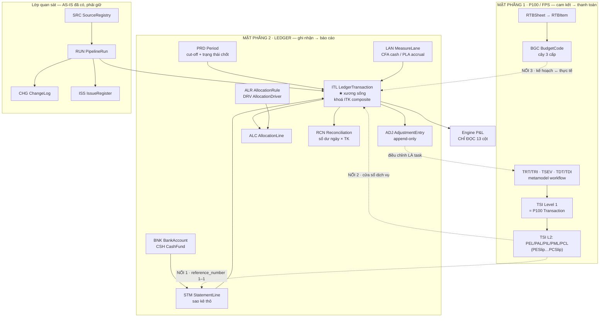

# ArchitecturePack-Ledger — làm giàu ERD P100 bằng know-how bộ file kế toán

**Version:** v0.3 (⭐ **§2 `STM`/`BNK`/`CSH` + §4.1–4.2 ĐÃ ĐƯỢC DUYỆT** — phần còn lại vẫn là đề xuất) *(⛔ header từng đứng ở v0.1 — sửa 27/08)* | **Ngày:** 2026-09-07

> ⭐⭐⭐ **PACK NÀY ĐỨNG Ở NHÃN *“chờ owner duyệt”* TỪ 19/08 — VÀ `QĐ-ITL-90` (2026-09-07) CHÍNH LÀ CÁI DUYỆT ẤY**, cho đúng ba thực thể của tầng nhập:
> `STM` StatementLine · `BNK` BankAccount *(`BankAccountList`, 3.003 dòng)* · `CSH` CashFund *(`Cash Ledger List`, 997 dòng)* — cộng các bước §4.1 *(khai báo `BNK`/`CSH`)* và §4.2 *(nạp sao kê → `STM`, có `sla`)*.
> ⇒ `CR#10` ⛔ **không phải thiết kế mới**; nó là **kích hoạt một tầng đã thiết kế ở đây rồi xếp lại 19 ngày**.
> ⛔ **Phần chưa được duyệt vẫn chưa được duyệt** — mọi entity/quan hệ ngoài ba cái trên giữ nguyên trạng thái *đề xuất*.
**Đầu vào:** ERD `DRAFT — Đổi tên theo ArchitecturePack-Workflow` (P100/FPS) + `_GUIDE_00..09` (444 sheet, 11 workbook kế toán thật)
**Vai trò trong bộ pack:** pack thứ **ba**, ngang hàng `ArchitecturePack-Workflow` (metamodel) và `ArchitecturePack-FPS` (thanh toán)

> Mọi entity mới đều kèm **bằng chứng** là sheet/ô thật trong bộ file kế toán. Không entity nào suy đoán.

---

## §1 · Chẩn đoán bộ ERD hiện có

### Nó đang là gì

Hai thứ lồng nhau, và đó là điểm mạnh:

1. **Một metamodel workflow tổng quát** — `TST TaskType` · `TSI TaskItem` (2 cấp, self-ref `myParentTask`) · `TNT TaskNextType` · `TSEV TaskEvent` · `TRT/TRI TaskRoleType/Item` · `TDT/TDI TaskDocType/Item`. Đây là bộ máy *quy trình có vai, có sự kiện, có chứng từ*.
2. **Một module Procure-to-Pay** đặt lên metamodel đó — chuỗi `PE → PA → PI → PM → PC`, mỗi khâu một cặp `Slip / Line`, cùng bộ chiều lọc (`KR`, `CDT`, `PT`, `LE`, `TMT/TLT/TUT/SZT`) và lớp kế hoạch (`RTBSheet → RTBItem → BGC`).

Hướng refactor ghi trong ghi chú đỏ — `TRS → TSI Level 1`, `PEL..PCL → TSI Level 2`, `ARL → TRT`, `AST → TST` — là **đúng**: thu chuỗi thanh toán về metamodel thay vì nhân bản entity. Bản làm giàu dưới đây tuân thủ đúng kỷ luật đó.

### Chỗ thiếu — một mặt phẳng, không phải vài entity

Theo thuật ngữ ERP: bộ ERD này phủ **Procure-to-Pay đến lệnh chi**, và **dừng ở đó**. Nó **không có Record-to-Report**:

| Có | Không có |
|---|---|
| Cam kết chi, đề nghị, hoá đơn, lệnh thanh toán | **Sổ giao dịch chuẩn tắc** (ledger) |
| Chiều ngân sách, chủ dự toán, pháp nhân | **Tài khoản kế toán** (COA) — ERD không có entity nào cho `Tài khoản` |
| Ngày PE/PA/PI/PM/PC | **Cửa sổ dịch vụ** (kỳ ghi nhận ≠ kỳ tiền) |
| `VEN Vendor` | **Sao kê ngân hàng / quỹ**, số dư, đối soát |
| `ALT AllocationType` (phẳng) | **Luật phân bổ có driver + version** |
| `Month` | **Kỳ có cut-off và trạng thái chốt** |

**Ba hệ quả đo được** từ bộ file kế toán:

| # | Hệ quả | Số thật |
|---|---|---|
| 1 | Vì không có ledger trong hệ, sổ ledger sống trên Google Sheets và phải gõ tay | **22.360 ô nhập tay** (`_GUIDE_00`) |
| 2 | Vì không có đối soát trong hệ, đối soát chạy bằng công thức và tự báo lệch | **6.711 dòng lệch** vùng AUDIT (`ITL Ledge` BJ–BL) |
| 3 | Vì không có sổ đăng ký nguồn trong hệ, chuỗi nạp dữ liệu gãy im lặng | **288 ô `#REF!`** ở `RAW ITLData Management`; **278/303 cạnh liên-file là động** (`_GUIDE_01`) |

> **Kết luận kiến trúc:** không phải thêm cột vào ERD hiện có. Phải **thêm mặt phẳng thứ hai** — và nối vào mặt phẳng cũ bằng đúng **ba điểm** (§4).

---

## §2 · Phát hiện then chốt: metamodel có sẵn chính là lời giải cho 22.360 ô gõ tay

Đây là giá trị lớn nhất của việc ghép hai bộ know-how, và nó **không cần entity mới nào**.

Bộ file kế toán cho thấy 7 khối gõ tay trong `ITL Ledge` chạy theo đúng một khuôn 4 cột: `Classifying → Manual input → MID → Final`, kèm nhãn người phụ trách `PIC: LAN + THƯƠNG`. Nói cách khác: **đó đã là một quy trình có vai và có trạng thái — chỉ là chưa được mô hình hoá.**

Ánh xạ vào metamodel hiện có, dùng đúng mẫu `TSI Level 1 / Level 2` của ghi chú đỏ:

| Khái niệm kế toán (bằng chứng) | Entity metamodel có sẵn |
|---|---|
| "Điều chỉnh dòng ITL" | `TST` Level 1 = `ADJUST_ITL` |
| 7 khối: HDCode · Loại GD · CDT1 · TĐ bắt đầu DV · TĐ kết thúc DV · Mã đối tác · File hoá đơn | **`TST` Level 2** — 7 task type con |
| Mỗi ô cần điền | **`TSI` Level 2** (một task item) |
| `Classifying = "Need to manual input"` | Điều kiện sinh `TSI` |
| Cột `Manual input` → `MID` → `Final` | **`TSEV`**: `Create → Submit → Approve → Execute` |
| `PIC: LAN + THƯƠNG` | **`TRI/TRT`** TaskRoleItem/Type |
| "Nhập trước 11h" (`A-CCR ▸ INDEX` R5) | SLA trên `TST` |
| "Kiểm kê ký xác nhận quỹ ngày cutoff" (ThuongCT) | `TST` + `TRT` = Approver |
| Nhật ký *"Đã xóa ngày 13/10/2025"* (`CANhật ký xử lý Giao dịch`, 1.015 dòng) | `TSEV` EventType `Delete` — **hiện đang thiếu** trong tập `Create/Submit/Approve/Execute` |

**Ba việc phải làm để khai thác điều này:**
1. Thêm `Delete` (và `Reverse`) vào tập `EventType` của `TEV/TSEV` — bằng chứng cho thấy xoá đang xảy ra và có ghi ngày, nhưng metamodel chưa có event tương ứng ⇒ hiện xoá **không đi qua quy trình nào**.
2. `TSI` cần thuộc tính **`assignee`** (người), **không** nhúng tên người vào tên cột như AS-IS đang làm (`PIC: LAN + THƯƠNG`, `Luận's File`). Đổi người phụ trách không được làm đổi schema.
3. `TST` cần thuộc tính **`sla`** và **`auto_rule_ref`** — trường nào máy suy được thì `TSI` sinh ra ở trạng thái `proposed_by_rule`, người chỉ duyệt (giảm 22.360 ô xuống phần *không suy được*).

---

## §3 · Mặt phẳng LEDGER — entity bổ sung

Giữ quy ước 3 chữ. **Nguyên tắc chống nổ entity:** một sổ chuẩn tắc duy nhất + typing, không một entity cho mỗi nguồn (đúng tinh thần `TSI Level 1/2`).

### 3.1 · Khối SỔ (core ledger)

| Mã | Tên | Vai trò | Bằng chứng |
|---|---|---|---|
| **`ITL`** | LedgerTransaction | **Sổ giao dịch chuẩn tắc** — điểm hội tụ mọi nguồn. Bất biến sau khi kết tinh | `ITL Ledge` (dữ liệu từ dòng 10); khuôn 36 cột `Transaction Mapping L1` |
| **`ITK`** | LedgerNaturalKey | Khoá tự nhiên composite của `ITL` — **đã tồn tại và đang chạy** | 2 sheet `Log` = **302.259 dòng**, cột `Composite Key` = `<YYYYMMDD>\|<Debit>\|<Credit>\|<Reference>` |
| **`LGT`** | LedgerType | Typing sổ con: `BANK` · `CASH` · `PAYROLL` · `PLATFORM` · `AP` · `AR` · `PARTNER` | 5 domain nguồn + AP/AR chưa dựng (`NGUỒN-ASIS` §01) |
| **`STM`** | StatementLine | Dòng sao kê **thô**, chưa chuẩn hoá — staging | `Bank Transactions` / `Cash Ledger Transactions` (hdr dòng 2): `Transaction date · Description · Currency · Debit · Credit · Reference number · Source · Num` |
| **`ADJ`** | AdjustmentEntry | **Bút toán điều chỉnh append-only** — thay 22.360 ô gõ tay. Không ghi đè `ITL` | 7 khối `Classifying/Manual input/MID/Final`; đếm `# Input here` R3 |
| **`ADT`** | AdjustmentTargetType | Trường nào được điều chỉnh (7 loại) | 7 khối × 4 cột trong `ITL Ledge` |

> ⚠ **`ITK` không phải bảng riêng nếu không cần** — có thể là unique constraint trên `ITL`. Tách ra ở đây để nêu rõ: khoá **phải** là 4 thành phần đang chạy + `source` (khoá AS-IS chưa mang nguồn ⇒ hai tài khoản cùng ngày/số tiền/ref sẽ trùng). Giữ 4 thành phần gốc để còn đối sánh 302.259 dòng log cũ.

### 3.2 · Khối TIỀN & ĐỐI SOÁT

| Mã | Tên | Vai trò | Bằng chứng |
|---|---|---|---|
| **`BNK`** | BankAccount | Tài khoản ngân hàng/ví: pháp nhân, ngân hàng, số TK, tiền tệ, sheet nguồn, **dải đọc Nợ/Có** | `BankAccountList` (3.003 dòng): `PT · Bank Name · Bank Account · Bank Sheet · Currency · Range_Condition · Range_Debit · Range_Credit` |
| **`CSH`** | CashFund | Quỹ tiền mặt + **số dư đầu kỳ** | `Cash Ledger List` (997 dòng): `Source · Bank Sheet · Entity · Currency · Range_* · Opening Balance` |
| **`RCN`** | Reconciliation | Đối soát **số dư theo ngày × tài khoản** — cổng chặn | `2. CCR` (hdr dòng 3): `Entity · Bank · Currency · Accounts · Account type · Link · ID · Pass · Sổ phụ` + một cột một ngày |
| **`FXR`** | FxRate | Tỷ giá **theo ngày**, theo cặp tiền | `2. CCR` dòng 6: `USD/VND` = `25066` (31/12) → `25390` (01/01…) · sheet `9.2.Exchange Rate` ở 4 workbook |
| **`CNT`** | CashCount | Biên bản kiểm kê quỹ có ký | `A-CCR ▸ INDEX` R9: *"Kiểm kê ký xác nhận quỹ ngày cutoff cuối mỗi tháng"* (ThuongCT) → `6. CCR I DEL I W I Pdf` |

### 3.3 · Khối KỲ & LÀN ĐO

| Mã | Tên | Vai trò | Bằng chứng |
|---|---|---|---|
| **`PRD`** | Period | Kỳ + **`cut_off_date`** + trạng thái `open → cutoff → flash → reconciled → signed → locked` | `RAW ITLData Management` (hdr dòng 3): `Start Date · Cut-off Date · Data Lag relative to Today`; engine lấy `max(Cut-off Date)` làm `pm_settled_through` |
| **`LAN`** | MeasureLane | **`CFA` (dòng tiền, theo ngày tiền)** vs **`PLA` (P&L, theo kỳ ghi nhận)** + bậc độ mịn 1/2/3 | `CFA1/CFA2 MID1/2/3`, `PLA1–4` (`NGUỒN-ASIS` §01) |
| **`SVC`** | ServiceWindow | Cửa sổ dịch vụ (bắt đầu/kết thúc) để **rải accrual** | `ITL Ledge` cột AH/AL (`Final` khối 4–5); `Transaction Mapping L1` W/X (PE) và AB/AC (PI) |

> **Điểm ERP quan trọng:** `LAN` giải thích vì sao **cùng một giao dịch xuất hiện hai lần ở hai thời điểm** — và đó **không phải lỗi**. ERD hiện tại chỉ có một trục thời gian (ngày PE/PA/PI/PM/PC), nên không diễn đạt được điều này. Đây là gốc của mọi tranh luận "số kế toán vs số engine lệch".

### 3.4 · Khối CHIỀU & MASTER DATA (mở rộng cái đã có)

| Mã | Tên | Vai trò | Bằng chứng |
|---|---|---|---|
| **`COA`** | ChartOfAccount | **Tài khoản kế toán** — ERD hiện **không có**. Cần cho `Tài khoản` của mọi dòng sổ, và `COA1/COA2` để suy HD | `Transaction Original` cột G `Tài khoản`; `Mapping Master` I/J = `COA1` `COA2` |
| **`BGC`** ⤴ | BudgetCode (**mở rộng**) | Thêm **self-ref `parent`** + `level` — HD/KRF là **cây 3 cấp** | `H1000 ▸ DataValid`: `GI \| Gross Inflow` → `GI.GMA \| Gross Inflow Game App` → `GI.GMA.IOA \| … IOS` |
| **`CDT`** ⤴ | BudgetOwner (**mở rộng**) | Thêm **self-ref `parent`** + `level` — chủ dự toán có tầng (Group › Company › Center › Dept) | `CDT` 4 tầng đã ghi trong bộ ITL; giá trị thật `SHQ2 \| Headquarters2` |
| **`LE`** ⤴ | LegalEntity (**mở rộng**) | Thêm **`is_entity`** — có nhãn **không phải pháp nhân** lẫn trong dữ liệu | `Enity by bank` (45 dòng) map `R \| 542666_TCB USD_VISIONLAB → VVOV`; nhãn `USD`, `HotBonus` là **không phải pháp nhân** |
| **`MAP`** | MappingMaster | **Reference data có version + sign-off** cho mọi ánh xạ chuẩn hoá | `Mapping Master` (hdr dòng 3): `Bank Sheet→LE` · `HD via COA` · `No via LE` |
| **`ALR`** | AllocationRule | Luật phân bổ **có version**: cần rải hay không, phương pháp, mã HR | `Mapping Master` K/L/M: `Need to Allocate to CFA2` · `Method to Allocate to CFA2` · `Code HR Allocate` |
| **`DRV`** | AllocationDriver | Driver theo kỳ: **đầu người**, theo LE, theo GI | `H1000 ▸ Allocation Driver` (hdr dòng 2): `Month PL · CDT · Number of Employee · Section_Convert · Dịch vụ · Number of Employee (excl Dịch vụ)` |
| **`ALC`** | AllocationLine | Dòng phân bổ sinh ra — `CDT1 CFA1 → CDT1 CFA2`, **bảo toàn tổng** | `ITL Ledge` AU/AV/AW: `Chủ dự toán (CDT1) CFA1` · `CFA2` · `Method` (giá trị thật `No need`) |

> `ALT AllocationType` trong ERD hiện tại là **enum phẳng**. Bằng chứng cho thấy phân bổ cần **3 entity**: luật (`ALR`, có version) + driver theo kỳ (`DRV`) + dòng kết quả (`ALC`). Đây là chỗ ERD hiện tại thiếu nhất về mặt kế toán quản trị.

### 3.5 · Khối NGUỒN & VẬN HÀNH (observability — AS-IS đã có, chỉ chưa vào ERD)

| Mã | Tên | Vai trò | Bằng chứng |
|---|---|---|---|
| **`SRC`** | SourceRegistry | Sổ đăng ký nguồn: file/sheet/ô, ngày bắt đầu, **cut-off**, độ trễ, số giao dịch | `RAW ITLData Management` — ⚠ hiện **288 ô `#REF!`**, tức sổ này **đang hỏng** |
| **`RUN`** | PipelineRun | Lần chạy: timestamp, số dòng × cột từng sheet, trạng thái, đã refresh chưa | `ITL RAW ▸ Export Log` (9.784 dòng): `Timestamp · Sheet Name · Rows · Cols · IMPORTRANGE refreshed · Status · Note` |
| **`CHG`** | ChangeLog | Nhật ký thay đổi theo **khoá composite** | 2 sheet `Log` = 302.259 dòng: `Action` · `Composite Key` |
| **`ISS`** | IssueRegister | Sổ sự cố: vấn đề → giải pháp → thời gian | `Check list mapping`: 7 vấn đề, **4/7 cùng giải pháp "nhập bổ sung lên P100"** |

> Bốn entity này là **lớp quan sát mà AS-IS đã tự dựng bằng tay** và làm khá tốt. TO-BE không được đánh mất chúng khi code hoá — đây là phần dễ bị bỏ nhất vì "không phải nghiệp vụ".

### 3.6 · Khối QUYẾT TOÁN ĐỐI TÁC (theo `QĐ-ITL-06`: chỉ LUẬT + KẾT QUẢ)

| Mã | Tên | Vai trò | Bằng chứng |
|---|---|---|---|
| **`PSR`** | PartnerShareRule | Tỷ lệ chia **khác nhau theo loại doanh thu**, theo khối đối tác, có hiệu lực theo kỳ | `Index_Publishing` C: **`30% ad, 50% sub`** · `0.35` · `0.4`; `Index_ Tổng hợp T12 2023` E/F: `% Lợi nhuận chia sẻ ads` / `chia sẻ Sub` |
| **`PSS`** | PartnerSettlement | Kết quả kỳ: lợi nhuận thực, **lỗ lũy kế chuyển sang**, tổng lũy kế, phải trả, trạng thái | `Index_ Tổng hợp T12 2023`: `Lợi nhuận thực · Chuyển lỗ lũy kế các tháng · Tổng lợi nhuận lũy kế · Lợi nhuận chia sẻ` |
| **`PST`** | PartnerSettleStatus | `confirmed` · `đối trừ tháng sau` · `cộng dồn tháng sau` · `dừng hợp tác > k thanh toán gì thêm` | `Index_Inhouse` F/G · `Index_SG` H (nguyên văn) |

> **Không** đưa chuỗi tính 30 tháng của `AperoGroup_Payment` vào hệ (`QĐ-ITL-06`). ERD chỉ giữ **`PSR` (luật)** và **`PSS` (kết quả)**; `PSS.amount_payable` chảy vào `ITL` như một dòng sổ.

---

## §4 · Ba điểm nối giữa hai mặt phẳng — chỉ ba, không hơn

Đây là phần quan trọng nhất về mặt kiến trúc: **ranh giới giữa P100 và Ledger phải hẹp và tường minh.**

### Nối 1 · `Reference number` — cầu giữa lệnh chi và tiền thật

```
STM.reference_number  ←→  TSI(Level 2, PMLine).reference_number     [1 – 1]
```

**Bằng chứng nguyên văn** (`P100 Bank ▸ Note`, hdr + R5):
> *"Cần 1 key = 1 mã Reference number"* · *"Các giao dịch có quan hệ ID PMLine - Reference number = 1 - …"*

⚠ **ERD hiện tại không có thuộc tính này ở đâu cả** — dù nó là **cầu duy nhất** nối lệnh thanh toán với giao dịch ngân hàng. Không có nó thì không đối soát được tiền với cam kết. Đây là bổ sung **bắt buộc, ưu tiên 1**.

Ràng buộc: quan hệ **1–1**; vi phạm (một ref nhiều PMLine hoặc ngược lại) là lỗi phải chặn ở cổng, không phải cảnh báo mềm.

### Nối 2 · Khoá composite — cầu giữa sao kê và sổ

```
STM (ngày, Nợ, Có, reference, source)  ──hash──►  ITK  ──►  ITL.itl_id
```

Giữ nguyên 4 thành phần đang chạy (302.259 dòng log chứng minh nó hoạt động), **thêm `source`**. Nghiệm thu: chạy 2 lần → id không đổi; chèn một dòng giữa nguồn → id các dòng cũ không đổi.

### Nối 3 · `BGC` / HD — cầu giữa ngân sách và ghi nhận

```
BGC (cây 3 cấp)  ←  ITL.hd  ←  ADJ(khối 1)  |  BGC  ←  RTBItem  ←  RTBSheet
```

Cùng một `BGC` vừa là mã ngân sách kế hoạch (`RTBItem`) vừa là mã ghi nhận thực tế (`ITL.hd`). **Đây là chỗ so kế hoạch vs thực tế** — và cũng là chỗ AS-IS phải gõ tay 297 ô vì không suy được.

> **Cảnh báo bất đối xứng:** engine P&L **không** đọc `Tài khoản` (`ITL Ledge` cột G) mà chỉ đọc `hd`. Nên `COA` đóng vai *suy ra `hd`* rồi thôi — không phải trục báo cáo. Nếu sau này muốn báo cáo theo tài khoản kế toán thì phải mở rộng hợp đồng engine (CR loại 3).

---

## §4b · Hai chiều pháp nhân — và một trường đang bị rơi ⚠

Owner xác nhận (2026-08-19): **`VEN` = đối tác NGOÀI · `LE` = pháp nhân của các công ty Venture Apero (TRONG)**.

### 4b.1 · `VEN → LE (1-n)` phải bỏ, không phải đảo chiều

Vendor ngoài và pháp nhân trong **không có quan hệ trực thuộc theo chiều nào cả**. Quan hệ giữa chúng **hiện thực hoá trên giao dịch**, vì dữ liệu thật mang cả hai trên cùng một dòng:

| Trường trên `Transaction Mapping L1` | Cột | Là gì |
|---|:--:|---|
| `Mã đối tác (ID Payee)` | **Y** | ai là **đối tác ngoài** |
| `Pháp nhân thanh toán` | **L** | pháp nhân **trong** nào đứng ra trả |
| `LE` | **AG** | pháp nhân **trong** được `Mapping Master` gán theo tài khoản |

⇒ Thay `VEN → LE (1-n)` bằng:

```
*ITL → VEN (n-1)          # đối tác ngoài của giao dịch
*ITL → LE  (n-1)  ×2      # le_owner  và  le_payer  (xem 4b.3)
*VLE (VEN × LE)           # associative: đối tác này giao dịch với pháp nhân nào
```

`VLE VendorLegalEntity` là **entity liên kết**, mang thông tin hợp đồng riêng của từng cặp:
thông tin ngân hàng nhận tiền, tiền tệ thanh toán, điều khoản.
**Bằng chứng:** `Thông tin TT_Publishing` (`Bank info` · `Email Payoneer` từng đối tác) ·
`Thông tin tài khoản VTD` · `Index_ Tổng hợp T12 2023` cột `Loại tiền tệ` = `VNĐ` khác nhau theo đối tác.

### 4b.2 · `VEN` cần một chiều phân loại chưa có trong ERD

Dữ liệu thật chia đối tác thành **khối**, và tỷ lệ chia lợi nhuận khác nhau theo khối:

| Mã mới | Tên | Giá trị thật |
|---|---|---|
| **`VBK`** | VendorBlock | `Đối tác inhouse` · `Đối tác publishing` · `SG` |

**Bằng chứng:** `Index_ Tổng hợp T12 2023` cột `Khối đối tác` = `Đối tác inhouse`;
ba sheet theo dõi riêng `Index_Inhouse` / `Index_Publishing` / `Index_SG`;
`AperoGroup ▸ Index` có cột `Chốt Audit_Đối tác publishing` và `Chốt Audit_đối tác inhouse` **tách riêng**.

```
*VBK → VEN (1-n)          *VBK, VEN → PSR (n-1)
```

### 4b.3 · ⚠ Lỗ hổng nặng: `Pháp nhân thanh toán` bị rơi ⇒ mất dấu intercompany

Kiểm trực tiếp trên file thật:

| Sheet | Có `Pháp nhân thanh toán`? |
|---|---|
| `Transaction Mapping L1` | ✅ **có** — cột `L` |
| `ITL Ledge` | ❌ **KHÔNG CÓ** — hàng ánh xạ dòng 5 chỉ kéo `AG` (`LE`) vào cột `P`; cột `L` của L1 **không nằm trong tập nguồn** (`S,T,AB,AC,Y,AD,AE,AG,AL`) |

**Nghĩa là:** giao dịch có **hai** sự thật pháp nhân ở tầng L1 — *ai trả tiền* (`Pháp nhân thanh toán`) và *pháp nhân nào được gán theo tài khoản* (`LE`) — nhưng **chỉ một cái đi tiếp**. Từ `ITL Ledge` trở xuống, thông tin *ai trả* **không còn tồn tại**.

**Hệ quả kế toán:** khi hai giá trị đó **khác nhau**, đó chính là **giao dịch nội bộ giữa các pháp nhân (intercompany)** — pháp nhân A trả hộ cho pháp nhân B. Vì trường bị rơi, **hệ hiện tại không phát hiện được intercompany ở tầng sổ**, nên:
- Hợp nhất (consolidation) không loại trừ được giao dịch nội bộ ⇒ nguy cơ **phồng doanh thu/chi phí** khi cộng các pháp nhân.
- Không dựng được đối chiếu công nợ nội bộ (A phải thu B).

Điều này **trực tiếp mâu thuẫn** với quyết định chương trình `QĐ-VOI-06`: *"đa tiền tệ + tag intercompany là thuộc tính bậc nhất từ schema đầu tiên"*. Schema hiện tại **có** trường ở L1 nhưng **đánh rơi** nó một tầng sau.

**Đề xuất — `ITL` mang hai cột pháp nhân, không một:**

| Trường | Nghĩa | Nguồn |
|---|---|---|
| `ITL.le_owner` | pháp nhân **chịu** khoản này (trục hợp nhất) | `Mapping Master` theo tài khoản (`AG` hiện tại) |
| `ITL.le_payer` | pháp nhân **thực trả** | `Pháp nhân thanh toán` (`L1` cột `L`) — **phải thêm vào hợp đồng** |
| `ITL.is_intercompany` | `le_owner ≠ le_payer` | dẫn xuất, không nhập tay |

```
*LE → ITL (1-n)  as le_owner        *LE → ITL (1-n)  as le_payer
*ICO IntercompanyPair (le_owner × le_payer × PRD)   # đối chiếu công nợ nội bộ
```

> ⚠ Thêm cột vào `ITL Ledge` là **CR loại 3** (chạm hợp đồng engine) và reader đọc **theo vị trí cột** ⇒ phải chèn **sau `BL`** hoặc bump hợp đồng kèm test khoá vị trí. Xem `BA-05` §`DD-I04b` và `ORC-07` §3.

### 4b.4 · `LE` và `CDT` là hai trục ĐỘC LẬP — cả hai bắt buộc trên mọi dòng sổ

Đây là điểm ERP dễ nhầm nhất, và dữ liệu thật cho thấy chúng là **hai hệ mã khác nhau**:

| Trục | Mã thật quan sát được | Dùng để | Chuẩn mực |
|---|---|---|---|
| **`LE`** pháp nhân | `VVOT` · `VVOV` · `SGO1` · `SGO2` · `CN` · `VGOH` | **Hợp nhất, báo cáo pháp định**, thuế, đối chiếu ngân hàng | Legal / statutory |
| **`CDT`** chủ dự toán | `SHQ2 \| Headquarters2` | **P&L quản trị theo venture/đơn vị**, ngân sách, phân bổ | Management |

Chúng **có thể trùng nhau về mặt tổ chức** nhưng **không được gộp thành một cột** — vì phân bổ chi phí chạy trên trục `CDT` (`CDT1 CFA1 → CFA2`), còn hợp nhất chạy trên trục `LE`. Gộp một cột là mất một chiều báo cáo.

**Bằng chứng chúng độc lập:** `LE` được gán từ **tài khoản ngân hàng** (`Enity by bank`: `R | 542666_TCB USD_VISIONLAB → VVOV`), còn `CDT1` được **người gõ tay 1.210 ô** ở khối ADJUSTMENT 3 — hai nguồn khác nhau, hai cách xác định khác nhau.

```
*LE  → ITL (1-n)   [trục hợp nhất]
*CDT → ITL (1-n)   [trục quản trị]  →  ALC (phân bổ chỉ chạy trên trục này)
```


---

## §5 · Danh sách quan hệ mới (theo ký hiệu của ERD gốc)

```
# Tiền & sổ
*BNK → STM (1-n)                 *CSH → STM (1-n)
*STM → ITL (n-1)                 *LGT → ITL (1-n)
*ITL → ITK (1-1)                 *ITL → ADJ (1-n)
*ADT → ADJ (1-n)                 *ITL → ALC (1-n)
*ITL → CHG (1-n)

# Đối soát
*BNK, CSH → RCN (1-n)            *PRD → RCN (1-n)
*RCN → CNT (1-n)                 *FXR → RCN, ITL (1-n)

# Kỳ & làn
*PRD → ITL (1-n)                 *LAN → ITL, ALC (1-n)
*ITL → SVC (1-1)

# Chiều
*COA → ITL (1-n)                 *COA1, COA2 → BGC (n-1)   [qua MAP]
*BGC → BGC (parent, 1-n)         *CDT → CDT (parent, 1-n)
*LE → BNK, CSH (1-n)             *MAP → LE, BGC, CDT (1-n)
*ALR → ALC (1-n)                 *DRV → ALC (1-n)
*ALR → BGC, CDT (n-1)

# Nguồn & vận hành
*SRC → RUN (1-n)                 *RUN → ITL, ADJ, ALC (1-n)
*RUN → ISS (1-n)

# Quyết toán đối tác
*VEN → PSR (1-n)                 *PSR → PSS (1-n)
*PRD → PSS (1-n)                 *PST → PSS (n-1)
*PSS → ITL (1-n)                 [số phải trả vào sổ]

# Đối tác & pháp nhân (§4b)
*VBK → VEN (1-n)                 *VLE (VEN × LE) associative
*ITL → VEN (n-1)                 *LE → ITL (1-n) as le_owner
*LE → ITL (1-n) as le_payer      *ICO (le_owner × le_payer × PRD)
*CDT → ITL (1-n)                 [trục quản trị, độc lập với LE]

# NỐI SANG MẶT PHẲNG P100 — chỉ 3 cạnh
*TSI(L2, PMLine) → STM (1-1)     [qua reference_number]
*TSI(L2, PEL/PIL) → SVC (1-n)    [cửa sổ dịch vụ lấy từ PE/PI]
*BGC → RTBItem, ITL (1-n)        [kế hoạch ↔ thực tế]

# Metamodel — điều chỉnh là task, không phải ô
*TST(L1=ADJUST_ITL) → TST(L2, 7 loại) (1-n)
*TST(L2) → TSI(L2) (1-n)         *TSI(L2) → ADJ (1-1)
*TSI → TSEV (1-n)                *TRT → TRI (1-n) → TSI (n-1)
```

**Quan hệ trong ERD gốc cần xem lại:**

| Quan hệ gốc | Vấn đề | Đề xuất |
|---|---|---|
| `RTBItem → Month (n-1)` | `Month` quá thô — bằng chứng cho thấy cần **kỳ có cut-off và trạng thái chốt** | Thay `Month` bằng **`PRD`** |
| `ALT-TRS (1-n)` · `ALT-ARL (1-n)` | `ALT` là enum phẳng, không tải được luật/driver/kết quả | Thay bằng `ALR` + `DRV` + `ALC` |
| `VEN → LE (1-n)` | ✅ **Owner xác nhận 2026-08-19:** `VEN` = đối tác ngoài, `LE` = pháp nhân Venture Apero ⇒ **không có quan hệ trực thuộc** theo chiều nào | **BỎ** quan hệ này. Thay bằng `ITL → VEN (n-1)` + `VLE (VEN × LE)` associative + `VBK → VEN (1-n)`. Xem **§4b** |
| `CTY → LE (1-n)` | Hợp lý (quốc gia → pháp nhân) | giữ |
| `EMP → APV → ARL` | Theo ghi chú đỏ `ARL → TRT`, nên chuỗi này thành `EMP → TRI → TRT` | giữ hướng refactor |

---

## §6 · Sơ đồ hai mặt phẳng, một xương sống



1. **Mặt phẳng 1** làm việc *sẽ chi bao nhiêu, ai duyệt* — đã có trong ERD.
2. **Mặt phẳng 2** làm việc *đã chi thật bao nhiêu, ghi vào kỳ nào, thuộc đơn vị nào* — đang thiếu.
3. Hai mặt phẳng nối bằng **đúng ba cạnh**, không hơn. Rộng hơn ba là hai mặt phẳng dính chặt, sửa một bên vỡ bên kia.
4. **Lớp quan sát** là thứ AS-IS đã tự dựng và làm tốt — dễ bị bỏ nhất khi code hoá.
5. Engine P&L chỉ **đọc** 13 cột của `ITL` (`BA-05` §DD-I04b) — không ghi.

---

## §7 · UserFlow mở rộng (tiếp số của ERD gốc)

Bốn flow đầu giữ nguyên (`1. Config` → `3.5 Process PC`). Bổ sung:

```
4. Nạp tiền thật
   4.1 Khai báo BNK/CSH (số TK, tiền tệ, dải đọc Nợ/Có, số dư đầu kỳ)
   4.2 Nạp sao kê → STM      [SLA: trước 11h — TST có sla]
   4.3 Khớp STM ↔ TSI(PMLine) qua reference_number   [1–1, vi phạm = chặn]
   4.4 Sinh ITL + ITK composite; ghi CHG

5. Đối soát
   5.1 RCN theo ngày × tài khoản; lệch ⇒ RUN.status = dq_failed, DỪNG
   5.2 Cuối kỳ: CNT kiểm kê quỹ + ký (TRT = Approver)
   5.3 PRD: open → cutoff → flash → reconciled → signed → locked

6. Điều chỉnh & phân bổ
   6.1 Trường thiếu ⇒ sinh TSI(L2) theo 7 ADT
       - suy được  ⇒ proposed_by_rule → người DUYỆT
       - không suy ⇒ proposed_by_human → người thứ hai duyệt (SoD)
   6.2 ADJ ghi append-only, không ghi đè ITL
   6.3 ALR + DRV → ALC; kiểm bảo toàn tổng
   6.4 Sinh LAN: cùng ITL vào CFA (ngày tiền) và PLA (kỳ dịch vụ) — KHÔNG phải lỗi

7. Quyết toán đối tác
   7.1 PSR theo kỳ (tỷ lệ ads ≠ tỷ lệ sub)
   7.2 PSS: lợi nhuận thực → trừ lỗ lũy kế → phải trả
   7.3 PST: confirmed / đối trừ tháng sau / cộng dồn tháng sau / dừng hợp tác
   7.4 PSS.amount_payable → ITL (một dòng sổ)
```

---

## §8 · Bốn phép kiểm bắt buộc — dẫn xuất từ sổ sự cố của chính kế toán

`Check list mapping` có 7 vấn đề, **4 cùng một giải pháp "nhập bổ sung lên P100"** ⇒ gốc rễ là **thiếu dữ liệu vào P100**, không phải lỗi tính ở sổ. Bốn loại này phải thành ràng buộc trong ERD:

| # | Loại hay thiếu | Ràng buộc gợi ý |
|--:|---|---|
| 1 | Lãi & phí ngân hàng hằng tháng | Mỗi `BNK` × mỗi `PRD` phải có ≥1 `ITL` loại phí/lãi, hoặc giải trình |
| 2 | Điều chuyển nội bộ / mua bán ngoại tệ | `ITL` nội bộ phải khớp **2 vế**; một vế lẻ ⇒ cảnh báo |
| 3 | Chi phí năm cũ trả năm sau | `SVC.end` cách `ITL.doc_date` ≥ 12 tháng ⇒ đánh dấu kiểm |
| 4 | Quẹt thẻ chưa vào PM100 | `ITL` có dấu hiệu quẹt thẻ mà `reference_number` không khớp `TSI(PMLine)` ⇒ hàng chờ |

---

## §9 · Việc cần owner quyết

| # | Câu hỏi | Vì sao chặn |
|--:|---|---|
| 1 | ~~`VEN → LE` có đúng ý?~~ **ĐÃ CHỐT 2026-08-19** — bỏ quan hệ, dùng `VLE` associative (§4b.1) | — |
| 1b | ⚠ **Thêm `le_payer` vào `ITL`** để phát hiện intercompany? Trường có ở `Transaction Mapping L1` cột `L` nhưng **bị rơi** khi sang `ITL Ledge` ⇒ hợp nhất hiện không loại được giao dịch nội bộ | Mâu thuẫn `QĐ-VOI-06` ("tag intercompany là thuộc tính bậc nhất"). Là **CR loại 3** — chạm hợp đồng engine |
| 1c | Xác nhận `LE` và `CDT` là **hai trục độc lập**, không gộp (§4b.4)? | Gộp là mất một chiều báo cáo: hợp nhất chạy trên `LE`, phân bổ chạy trên `CDT` |
| 2 | Thay `Month` bằng `PRD` (kỳ có cut-off + trạng thái chốt) — đồng ý? | Không có `PRD` thì không mô hình hoá được chốt sổ |
| 3 | `ALT` tách thành `ALR` + `DRV` + `ALC` — đồng ý? | `ALT` phẳng không tải được luật phân bổ có version |
| 4 | Thêm `Delete` / `Reverse` vào `EventType` của `TEV` | Xoá **đang xảy ra** (1.015 dòng nhật ký) mà không đi qua quy trình nào |
| 5 | `COA` chỉ để *suy `hd`*, hay là trục báo cáo thứ hai? | Nếu là trục báo cáo ⇒ phải mở rộng hợp đồng engine (CR loại 3) |
| 6 | Có mô hình hoá thao tác kế toán thành `TST/TSI` không (§2)? | Đây là cách duy nhất biến 22.360 ô gõ tay thành việc có vai, có duyệt, đo được |

## §10 · Điều KHÔNG làm

- **Không** một entity cho mỗi nguồn — dùng `LGT LedgerType` để typing (đúng tinh thần `TSI Level 1/2`).
- **Không** nhúng tên người vào schema (`PIC: LAN + THƯƠNG`, `Luận's File`) — người là `TSI.assignee`.
- **Không** đưa chuỗi tính 30 tháng của `AperoGroup_Payment` vào hệ (`QĐ-ITL-06`).
- **Không** cho engine P&L ghi vào `ITL` — chỉ đọc.
- **Không** mở rộng ranh giới hai mặt phẳng quá 3 cạnh ở §4.

## Changelog
- **v0.3** *(2026-09-07, `QĐ-ITL-90`)*: ⭐⭐⭐ **Pack này đứng ở nhãn *“chờ owner duyệt”* từ 19/08 — và `QĐ-ITL-90` chính là cái duyệt ấy**, cho đúng ba thực thể tầng nhập: `STM` · `BNK` *(3.003 dòng)* · `CSH` *(997 dòng)*, cộng bước §4.1–4.2. ⇒ `CR#10` ⛔ **không phải thiết kế mới** mà là **kích hoạt một tầng đã thiết kế ở đây rồi xếp lại 19 ngày**. ⛔ Phần ngoài ba thực thể ấy **vẫn là đề xuất**.
- v0.2 (2026-08-19): Thêm **§4b** sau khi owner xác nhận `VEN`=đối tác ngoài / `LE`=pháp nhân Venture Apero. Bỏ `VEN → LE`, thêm `VLE` associative + `VBK VendorBlock`. **Phát hiện: `Pháp nhân thanh toán` (L1 cột L) bị rơi khi sang `ITL Ledge` ⇒ mất dấu intercompany**, mâu thuẫn `QĐ-VOI-06`; đề xuất `ITL.le_owner` + `ITL.le_payer` + `ICO`. Chốt `LE` và `CDT` là hai trục độc lập. Tổng entity 22 → **25**.
- v0.1 (2026-08-19): Khởi tạo — chẩn đoán ERD gốc (P2P không có R2R), ánh xạ 7 khối gõ tay vào metamodel `TST/TSI/TSEV` có sẵn, bổ sung **25 entity** mặt phẳng Ledger, 3 điểm nối, danh sách quan hệ, 4 phép kiểm từ sổ sự cố, 6 câu hỏi cho owner.
