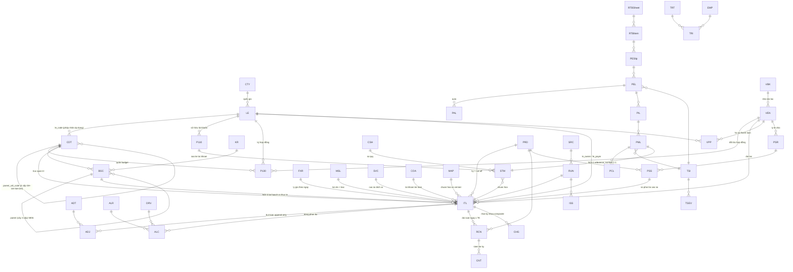

# ERD hợp nhất — P100/FPS (cam kết→thanh toán) × LEDGER (ghi nhận→báo cáo)

**Version:** v0.3 | **Ngày:** 2026-08-19 | **Chủ sở hữu:** COO-CFO
**Trạng thái:** ✅ 6/7 GAP đã chốt (`QĐ-ITL-07..12`) — còn `GAP-ERD-03` (đặc tả PA)
**Đầu vào canonical:** `P100-R/AP-FPS-v3.3.md` (7.608 dòng — §0 Entity Groups · §1.22–1.34 Entity Definitions · §1.35 ASCII ERD · §1.36–1.38 Process)
**Đầu vào know-how:** `_GUIDE_00..09` — 11 workbook · 444 sheet · 1.782.276 dòng kế toán thật
**Quan hệ với `ArchitecturePack-Ledger.md`:** file đó là *luận cứ kiến trúc*; file này là *ERD thi hành được*.

> **Ký hiệu:** `▣` entity **đã có** trong AP-FPS-v3.3 (giữ nguyên) · `▨` entity đã có **cần mở rộng cột** · `▢` entity **MỚI** từ know-how kế toán.

---

## §0 · Bốn hiệu chỉnh so với bản đề xuất trước (sau khi đọc v3.3)

Đọc pack canonical làm lộ 4 chỗ bản `ArchitecturePack-Ledger` v0.2 của tôi nói chưa đúng. Sửa ở đây:

| # | Bản v0.2 nói | Sự thật trong v3.3 | Xử lý |
|---|---|---|---|
| 1 | "Thêm entity mới `BNK BankAccount`" | **`FPS_BankAccount` (P110) ĐÃ CÓ** — `account_id · le_code · bank_name · account_number · currency · account_type · is_active · approver` | **Không tạo mới.** Mở rộng P110 thêm 5 cột từ `BankAccountList` (§3.2) |
| 2 | "Thêm `VLE VendorLegalEntity` associative" | **`FPS_Contract` (P130) ĐÃ mang bộ ba** `le_code × vendor_code × cdt_code` + amount/currency/dates/status/pe_id | Ràng buộc pháp lý đã có ở P130. Chỉ còn thiếu **hồ sơ thanh toán** theo cặp (VEN,LE) ⇒ giữ `VPP` (đổi tên từ `VLE`), phạm vi hẹp hơn |
| 3 | "`LE` và `CDT` là hai trục **độc lập**" | **`FPS_CDT.le_code`** là FK→LegalEntity ("Pháp nhân áp dụng") ⇒ mỗi CDT **đã gắn** một LE | Sửa: hai trục **liên kết nhưng không đồng nhất**. Xem §5 — điều này lại làm việc phát hiện intercompany **dễ hơn** |
| 4 | "`ITL` không có entity nào cho `Tài khoản`" | Đúng — nhưng v3.3 **có `TSI_MAP`** (Option C) làm report mapping | `COA` vẫn cần; cân nhắc `TSI_MAP` là chỗ nối báo cáo |

---

## §1 · Hai xung đột phải chốt trước khi vẽ tiếp ⚠

### 1.1 · Trùng tên `CFA1/CFA2/CFA3` — hai nghĩa hoàn toàn khác nhau

| Hệ | Token | Nghĩa | Bằng chứng |
|---|---|---|---|
| **P100/FPS** | `CFA1` | **Giao dịch có dòng tiền** (full flow PE→PI→PM→PC) | `AP-FPS-v3.3` §1.34 `CFAType` |
| | `CFA2` / `CFA3` | **Dịch vụ nội bộ** (PE only → S → A) | idem |
| **Kế toán** | `CFA1` | **Ledger nền tảng thô** (`CFA1 \| GI Platform Data Ledger`) | 4 workbook nền tảng, sheet `CFA1 \| …` |
| | `CFA2 MID1/2/3` | **Bậc đã phân bổ venture** (`CFA2 \| MID1 \| GI Allocated Ledger`) | idem |
| | `CFA` (làn) | **Cash-Flow Actual** — làn đo theo *ngày tiền*, đối lập `PLA` = P&L Actual theo *kỳ ghi nhận* | `NGUỒN-ASIS` §01 |

**Cùng một chuỗi ký tự, ba hệ nghĩa.** Nếu ghép ERD mà không xử, `cfa_type='CFA2'` sẽ vừa có thể nghĩa "dịch vụ nội bộ" vừa nghĩa "đã phân bổ venture" — lỗi không thể debug.

### ✅ `QĐ-ITL-07` — **chuẩn P100 thắng** (owner chốt 2026-08-19)

`CFAType` của P100 là **nghĩa duy nhất hợp lệ** của token `CFA1/CFA2/CFA3` trong toàn hệ. Phía kế toán **phải đổi tên**:

| Khái niệm kế toán | Tên cũ (cấm dùng từ đây) | **Tên chuẩn** |
|---|---|---|
| Làn đo | ~~`CFA`~~ / ~~`PLA`~~ | **`MSL.lane`** = `CASH` / `ACCRUAL` |
| Bậc độ mịn | ~~`CFA1`~~ · ~~`CFA2 MID1..3`~~ | **`MSL.grain`** = `RAW` / `ALLOCATED_1` / `_2` / `_3` |

**Bảng chuyển đổi bắt buộc khi đọc file kế toán AS-IS:**

| Gặp trong sheet | Đọc thành |
|---|---|
| `CFA1 \| GI Platform Data Ledger` | `MSL(lane=CASH, grain=RAW)` — ledger nền tảng GI |
| `CFA2 \| MID1 \| GI Allocated Ledger` | `MSL(lane=CASH, grain=ALLOCATED_1)` |
| `CFA2 \| MID 2` · `MID 3` | `grain=ALLOCATED_2` · `ALLOCATED_3` |
| làn `PLA1..PLA4` | `MSL(lane=ACCRUAL, grain=RAW..ALLOCATED_3)` |
| `cfa_type` trong P100 | **giữ nguyên** — `CFA1` = có dòng tiền · `CFA2/3` = dịch vụ nội bộ |

⚠ **Việc phải làm:** rà lại `BA-02`, `BA-05`, `BA-10`, `_GUIDE_06` — mọi chỗ đang dùng `CFA1/CFA2` theo nghĩa kế toán phải đổi sang `MSL`, kèm ghi chú "tên gốc trong sheet là …" để còn tra được về file thật (R-A2).

### 1.2 · Bản DRAFT (ảnh) và pack v3.3 **nói trái nhau** về `PEL..PCL`

| Nguồn | Nói gì |
|---|---|
| **Ảnh DRAFT**, ghi chú đỏ #2 | *"PEL, PAL, PIL, PML, PCL thay bằng TSI Level 2 (thuộc TST level 2 …, thuộc TST level 1 'Payment')"* |
| **AP-FPS-v3.3** §0 Group Task Engine Alignment | *"FPS-specific entities (PESlip, PEL, PASlip, …) **giữ nguyên — không đổi sang TSI L2/L3** vì mỗi entity có schema riêng"* |

### ✅ `QĐ-ITL-08` — **`AP-FPS-v3.3` là MASTER** (owner chốt 2026-08-19)

Hệ quả cụ thể, áp ngay:

| Điểm | Chốt |
|---|---|
| `PESlip · PEL · PASlip · PAL · PISlip · PIL · PMSlip · PML · PCSlip · PCL` | **GIỮ NGUYÊN 10 entity riêng.** Không thu về `TSI L2/L3` — mỗi entity có schema riêng |
| `TST` | = **TaskType L3 = bước phê duyệt** (nghĩa của v3.3). Không dùng theo nghĩa "task type nói chung" của ảnh DRAFT |
| `TSI` | = **TaskItem L1 = giao dịch thanh toán** |
| Ghi chú đỏ trên ảnh DRAFT (`TRS→TSI L1`, `PEL..PCL→TSI L2`, `ARL→TRT`, `AST→TST`) | **SUPERSEDED** ở phần trái v3.3. Phần đã có trong v3.3 (`TRT`=TaskRoleType, `TRI`=TaskRoleItem, `TDT/TDI`, `TSEV`) thì giữ |
| Khi ảnh DRAFT và v3.3 lệch trong tương lai | **v3.3 thắng**; muốn đổi thì sửa v3.3 qua CR, không sửa bằng ghi chú trên ảnh |

**Ghi chú còn mở:** workflow v3.3 ghi `PE → PA → PI → PM → PC`, Entity Groups có `PASlip`/`PAL`, nhưng **§1.28–1.31 không có mục entity canonical nào cho PA**. ⇒ `GAP-ERD-03` **vẫn mở** — owner chưa quyết.

---

## §2 · ERD tổng — ba mặt phẳng



Đọc sơ đồ theo ba tầng:
1. **Trên** — master data & kế hoạch: quốc gia → pháp nhân → CDT (4 cấp) → ngân sách; hợp đồng nối pháp nhân với đối tác.
2. **Giữa** — chuỗi thanh toán P100: `PESlip/PEL → PAL/PIL → PML → PCL`, mọi thứ neo vào `TSI` và sinh `TSEV`.
3. **Dưới** — mặt phẳng ledger: sao kê → sổ chuẩn tắc → bút toán điều chỉnh → phân bổ → đối soát → kỳ chốt, cộng lớp quan sát (`SRC/RUN/CHG/ISS`) và khối quyết toán đối tác.

---

## §3 · Entity — đầy đủ, có PK/FK

### 3.1 · Master & Dimension

| | Mã | Entity | PK | FK / cột chính |
|---|---|---|---|---|
| ▣ | `CTY` | Country | `country_code` | — |
| ▣ | `LE` | FPS_LegalEntity | `le_code` | `country`, `representative`. **9 LE**: SGO1 SGO2 VGO1 VGOM VGOH VVOT/VVOO/VGO2 VVOS VVOV VVOH |
| ▨ | `LE` | *(mở rộng)* | | **+`is_entity` BOOL** — dữ liệu thật có nhãn **không phải pháp nhân** lẫn vào: `USD` (nhãn tệ), `HotBonus` (quỹ). Bằng chứng: `A-CCR ▸ Enity by bank` 45 dòng |
| ▣ | `CDT` | FPS_CDT | `cdt_code` | `parent_cdt_code`→CDT · **`le_code`→LE** · `cdt_level` GH/OH/NH/DH · `team_head` |
| ▣ | `VEN` | FPS_Vendor | `vendor_code` | ~886 vendor VD0–VD886. `bank_account`, `bank`, `country`, `tax_number` |
| ▢ | `VBK` | VendorBlock | `block_code` | `inhouse` · `publishing` · `SG`. **Bằng chứng:** `Index_ Tổng hợp T12 2023` cột `Khối đối tác`; 3 sheet theo dõi riêng; `AperoGroup ▸ Index` tách cột Chốt Audit publishing/inhouse |
| ▨ | `VEN` | *(mở rộng — `QĐ-ITL-12`)* | | **+`block_code`**→VBK · **+`settlement_currency`** · **+`payment_channel`** (`bank` \| `payoneer` \| `pingpong`) · **+`payoneer_email`** · **+`profitshare_active`** BOOL. **Bằng chứng:** `Thông tin TT_Publishing` (`Bank info`, `Email Payoneer`) · `Thông tin tài khoản VTD` (`First Century Bank`) · `Index_ Tổng hợp` cột `Loại tiền tệ` |
| ▨ | `BGC` | BudgetCode | `budget_code` | **+`parent_budget_code`, +`level`** — HD/KRF là **cây 3 cấp**. Bằng chứng: `H1000 ▸ DataValid`: `GI \| Gross Inflow` → `GI.GMA \| … Game App` → `GI.GMA.IOA \| … IOS` |
| ▢ | `COA` | ChartOfAccount | `account_code` | `coa1`, `coa2`, `account_name`. **v3.3 không có entity nào cho `Tài khoản`.** Bằng chứng: `Transaction Original` cột G `Tài khoản`; `Mapping Master` I/J = `COA1`/`COA2` |
| ▢ | `MAP` | MappingMaster | `map_id` | `map_type` (bank_sheet→LE \| COA→HD \| LE→No) · `version` · `effective_from` · `signed_by`. **Bằng chứng:** `Mapping Master` 3 khối, hdr dòng 3 |
| ▣ | `KR` | KeyResult | `kr_code` | — |
| ▣ | `PT` | ProductType | `pt_code` | — |
| ▣ | `TMT/TLT/TUT/SZT` | Trans*Type | `*_code` | 4 chiều phân loại giao dịch |
| ▣ | `EGR` | EmpGrade | `grade_code` | PM0/PM1/TM0/TM1/SM0/SM1/CM/GM |
| ▣ | `EMP` | Employee | `emp_code` | — |

### 3.2 · Tiền & Đối soát

| | Mã | Entity | PK | FK / cột chính |
|---|---|---|---|---|
| ▨ | `P110` | FPS_BankAccount | `account_id` | `le_code`→LE · `bank_name` · `account_number` · `currency` · `account_type` · `approver` |
| | | **+5 cột mới** | | **`bank_sheet`** (khoá nhận diện nguồn, vd `R \| 542666_TCB USD_VISIONLAB`) · **`range_condition`** · **`range_debit`** · **`range_credit`** · **`opening_balance`**. Bằng chứng: `BankAccountList` 3.003 dòng |
| ▢ | `CSH` | CashFund | `fund_id` | `le_code`→LE · `source` · `currency` · `bank_sheet` · `range_*` · **`opening_balance`**. Bằng chứng: `Cash Ledger List` 997 dòng |
| ▢ | `STM` | StatementLine | `stm_id` | `account_id`→P110 **hoặc** `fund_id`→CSH · `txn_date` · `description` · `currency` · `debit` · `credit` · **`reference_number`** · `source` · `num`. Bằng chứng: `Bank Transactions` / `Cash Ledger Transactions` hdr dòng 2 |
| ▢ | `RCN` | Reconciliation | `(account_id, rcn_date)` | `book_balance` · `statement_balance` · `diff` · `pass` BOOL. Bằng chứng: `2. CCR` hdr dòng 3 + một cột một ngày |
| ▢ | `FXR` | FxRate | `(pair, rate_date)` | `rate`. Bằng chứng: `2. CCR` dòng 6 `USD/VND` 25.066→25.390; sheet `9.2.Exchange Rate` ở 4 workbook |
| ▢ | `CNT` | CashCount | `cnt_id` | `fund_id` · `prd_id` · `counted_amount` · `signed_by` · `doc_ref`. Bằng chứng: `A-CCR ▸ INDEX` R9 *"Kiểm kê ký xác nhận quỹ ngày cutoff cuối mỗi tháng"* (ThuongCT) → `6. CCR I DEL I W I Pdf` |

### 3.3 · Sổ chuẩn tắc & Điều chỉnh

| | Mã | Entity | PK | FK / cột chính |
|---|---|---|---|---|
| ▢ | `ITL` | LedgerTransaction | `itl_id` | **13 cột hợp đồng engine** + `stm_id`→STM · `ledger_type` · `prd_id`→PRD · `coa_code`→COA · `budget_code`→BGC · `cdt_code`→CDT · **`le_owner`**→LE · **`le_payer`**→LE · `vendor_code`→VEN · `msl_id`→MSL · `run_id`→RUN |
| | | *khoá tự nhiên* | | **`natural_key`** = `<YYYYMMDD>\|<debit>\|<credit>\|<reference>\|<source>` — 4 thành phần đầu **đang chạy thật**: 2 sheet `Log` = **302.259 dòng** cột `Composite Key`; `+source` là bổ sung TO-BE (khoá AS-IS chưa mang nguồn ⇒ 2 tài khoản cùng ngày/tiền/ref sẽ trùng) |
| ▢ | `LGT` | LedgerType | `ledger_type` | `BANK` `CASH` `PAYROLL` `PLATFORM` `AP` `AR` `PARTNER` — **typing thay vì 1 entity/nguồn** |
| ▢ | `ADJ` | AdjustmentEntry | `adj_id` | `itl_id`→ITL · `adt_code`→ADT · `old_value` · `new_value` · `maker` · `checker` · `reason` · `posted_at` · `reversed_by`. **Append-only, không ghi đè ITL** |
| ▢ | `ADT` | AdjustmentTargetType | `adt_code` | 7 loại = 7 khối: `HDCODE`(297) `PAYTYPE`(179) `CDT1`(1.210) `SVC_START`(22) `SVC_END`(22) `PAYEE`(1.624) `INVOICE_DOC`(3.489) |
| ▢ | `SVC` | ServiceWindow | `itl_id` | `svc_start` · `svc_end` (dạng `yyyymm`). Bằng chứng: `ITL Ledge` AH/AL |

### 3.4 · Kỳ, Làn đo, Phân bổ

| | Mã | Entity | PK | FK / cột chính |
|---|---|---|---|---|
| ▢ | `PRD` | Period | `prd_id` | `start_date` · **`cut_off_date`** · `state` ∈ `open→cutoff→flash→reconciled→signed→locked` · `signed_by`. Bằng chứng: `RAW ITLData Management` hdr dòng 3; engine lấy `max(Cut-off Date)` làm `pm_settled_through` |
| ▢ | `MSL` | MeasureLane | `msl_id` | **`lane`** ∈ `CASH`/`ACCRUAL` · **`grain`** ∈ `RAW`/`ALLOCATED_1..3`. ⚠ Đổi tên để tránh trùng `CFAType` — xem §1.1 |
| ▢ | `ALR` | AllocationRule | `alr_id` | `need_allocate` BOOL · `method` · `hr_code` · `version` · `effective_from` · `budget_code`→BGC · `cdt_code`→CDT. Bằng chứng: `Mapping Master` K/L/M |
| ▢ | `DRV` | AllocationDriver | `(prd_id, cdt_code, driver_type)` | `value`. Bằng chứng: `H1000 ▸ Allocation Driver` hdr dòng 2 — `Month PL · CDT · Number of Employee · Section_Convert · Dịch vụ · Number of Employee (excl Dịch vụ)` |
| ▢ | `ALC` | AllocationLine | `alc_id` | `itl_id`→ITL · `alr_id`→ALR · `cdt_from` (CFA1) · `cdt_to` (CFA2) · `ratio` · `amount`. **Bảo toàn tổng.** Bằng chứng: `ITL Ledge` AU/AV/AW (`Method` = `No need`) |

> `ALT AllocationType` của v3.3 là **enum phẳng** — không tải được luật có version, driver theo kỳ, và dòng kết quả. Thay bằng bộ ba `ALR` + `DRV` + `ALC`.

### 3.5 · Nguồn & Vận hành (AS-IS đã tự dựng — phải giữ)

| | Mã | Entity | PK | FK / cột chính |
|---|---|---|---|---|
| ▢ | `SRC` | SourceRegistry | `src_id` | `type` · `file` · `sheet` · `cell` · `start_date` · **`cut_off_date`** · `data_lag` · `n_transactions`. ⚠ AS-IS **đang hỏng**: **288 ô `#REF!`** |
| ▢ | `RUN` | PipelineRun | `run_id` | `src_id` · `ts` · `sheet_name` · `rows` · `cols` · `importrange_refreshed` · `status` · **`contract_version`** ×3. Bằng chứng: `Export Log` 9.784 dòng |
| ▢ | `CHG` | ChangeLog | `chg_id` | `action` (`UPDATE`…) · `natural_key`. Bằng chứng: 2 sheet `Log` = 302.259 dòng |
| ▢ | `ISS` | IssueRegister | `iss_id` | `problem` · `solution` · `at`. Bằng chứng: `Check list mapping` — 7 vấn đề, **4/7 cùng giải pháp "nhập bổ sung lên P100"** |

### 3.6 · Quyết toán đối tác (`QĐ-ITL-06`: chỉ LUẬT + KẾT QUẢ)

| | Mã | Entity | PK | FK / cột chính |
|---|---|---|---|---|
| ▢ | `PSR` | PartnerShareRule | `psr_id` | `vendor_code`→VEN · `block_code`→VBK · **`pct_ads`** · **`pct_sub`** · `currency` · `effective_from` · `version`. Bằng chứng: `Index_Publishing` C = **`30% ad, 50% sub`** · `0.35` · `0.4` |
| ▢ | `PSS` | PartnerSettlement | `(vendor_code, prd_id)` | `profit_actual` · **`loss_carried_in`** · `profit_cumulative` · `share_amount` · `amount_payable` · `status`→PST. Bằng chứng: `Index_ Tổng hợp T12 2023` — `Lợi nhuận thực · Chuyển lỗ lũy kế các tháng · Tổng lợi nhuận lũy kế · Lợi nhuận chia sẻ` |
| ▢ | `PST` | PartnerSettleStatus | `status_code` | `confirmed` · `offset_next_month` · `accrue_next_month` · `terminated`. Nguyên văn: `confirmed` · `đối trừ tháng sau` · `cộng dồn tháng sau` · `dừng hợp tác > k thanh toán gì thêm` |

**Tổng sau khi chốt 6 quyết định: 22 entity MỚI** (bỏ `VPP`, thêm `ICO`) · **4 entity mở rộng cột** (`LE`, `BGC`, `P110`, **`VEN`**) · 1 enum thay bằng 3 entity (`ALT`→`ALR/DRV/ALC`) · **2 cột thêm vào entity P100** (`PML.reference_number`, `ITL.le_payer`) · **1 view mới** (`RPT_CommittedVsActual`).

---

## §4 · Ba cạnh nối — và cạnh số 1 vẫn thiếu trong v3.3

### Nối 1 · `reference_number`: `PML` ↔ `STM` (1–1) — **có sẵn, chưa canonical**

Tra ba chỗ trong v3.3:

| Vị trí | Nội dung |
|---|---|
| §1.30 `FPS_PaymentMovement` (bảng entity canonical) | `pm_id · pe_id · pi_id · transaction_type · payment_amount · currency · bank_account_id · vendor_bank_info · submitted_by · submitted_at · status` — **không có** `reference_number` |
| §3.3 C5 additions (dòng 2100) | *"**Reference number**: PM Ledger có thêm field `reference_number` từ CSV source (**mã tham chiếu bank order**)"* — **CÓ** |
| §7 UI Matrix #84–#87 (dòng 5900) | *"PM-X Confirm Executed, **reference number input**"* — **CÓ**, người nhập ở bước xác nhận đã chi |
| §0.5.3 R9 Full Field Mapping (dòng 157) | `reference_number` nằm trong danh sách field bắt buộc map khi import T5 — **CÓ** |

⇒ **Kết luận đúng:** trường **đã tồn tại** ở PM Ledger, ở UI, và ở luật import — **nhưng chưa vào bảng entity canonical §1.30**. Đây là **nợ tài liệu**, không phải lỗ hổng kiến trúc. Nhẹ hơn nhiều so với nhận định đầu của tôi.

### ✅ `QĐ-ITL-09` — **bổ sung** (owner chốt 2026-08-19)

**Đặc tả bổ sung, sẵn để đưa vào v3.3 §1.30:**

| Cột | Type | Stored | Mô tả | Ví dụ |
|---|---|---|---|---|
| `reference_number` | STRING | STORED (NULLABLE khi chưa chi) | **Mã tham chiếu lệnh chi ngân hàng.** Người nhập ở bước `PM-X Confirm Executed` | `"FT24295070629325"` · `"PC00003VGOH"` |

**Ràng buộc — khai báo mới:**

```
UNIQUE (reference_number) WHERE reference_number IS NOT NULL     -- trên PML
PML.reference_number  ⟷  STM.reference_number     [1–1]
```

| Tình huống | Xử lý |
|---|---|
| 1 `reference_number` ↔ 1 `STM` | Bình thường — khớp lệnh chi với tiền thật |
| 1 `reference_number` ↔ **nhiều** `STM` | **CHẶN** — vi phạm luật *"1 key = 1 mã Reference number"* |
| **Nhiều** `PML` cùng 1 `reference_number` | **CHẶN** — vi phạm `UNIQUE` |
| `STM` có ref **không khớp** `PML` nào | Vào **hàng chờ** — đây là 1 trong 4 phép kiểm §6 (quẹt thẻ chưa vào PM100) |
| `PML` đã `Completed` mà ref rỗng | **Cảnh báo** — đã chi mà không có mã tham chiếu ⇒ không đối soát được |

**Nguyên văn nghiệp vụ** (`P100 Bank ▸ Note`): *"Cần 1 key = 1 mã Reference number"* · *"Các giao dịch có quan hệ ID PMLine - Reference number = 1 - …"*

Đây là **cầu duy nhất** nối lệnh chi với tiền thật ở ngân hàng — giờ đã có cả móng và bản vẽ.

### Nối 2 · Khoá tự nhiên: `STM` → `ITL`

```
hash(txn_date, debit, credit, reference_number, source) → ITL.natural_key
```
Nghiệm thu: chạy 2 lần → id không đổi; chèn một dòng giữa nguồn → id dòng cũ không đổi.

### Nối 3 · `BGC`: kế hoạch ↔ thực tế

```
BGC ──► RTBItem  (kế hoạch)        BGC ──► ITL.budget_code  (thực tế)
```
Cùng một mã, hai đầu — đây là chỗ so dự toán với thực chi. Cũng là chỗ AS-IS phải gõ tay 297 ô.

---

## §5 · Intercompany: v3.3 làm việc phát hiện **dễ hơn** tôi tưởng

Bản v0.2 nói `LE` và `CDT` là hai trục độc lập. **Sai** — `FPS_CDT.le_code` là FK→LegalEntity ("Pháp nhân áp dụng"). Nhưng điều đó lại **tốt**: nó cho **ba** nguồn pháp nhân trên cùng một giao dịch, nên lệch là phát hiện được.

| Nguồn pháp nhân | Lấy từ đâu | Cột |
|---|---|---|
| `le_payer` — ai **thực trả** | `Pháp nhân thanh toán` | `Transaction Mapping L1` cột **L** |
| `le_owner` — pháp nhân gán theo **tài khoản** | `Mapping Master` / `Enity by bank` | `L1` cột **AG** → `ITL Ledge` cột **P** |
| `le_of_cdt` — pháp nhân của **CDT** | `FPS_CDT.le_code` | v3.3 §1.24 |

**Lỗ hổng đã xác minh:** `ITL Ledge` **không có** cột `Pháp nhân thanh toán` — hàng ánh xạ dòng 5 chỉ kéo `AG`; cột `L` của L1 không nằm trong tập nguồn (`S,T,AB,AC,Y,AD,AE,AG,AL`). ⇒ Từ `ITL Ledge` trở xuống, *ai trả* **không còn tồn tại**.

**Luật phát hiện đề xuất:**

| Điều kiện | Kết luận |
|---|---|
| `le_payer = le_owner = le_of_cdt` | Bình thường |
| `le_payer ≠ le_owner` | **Intercompany** — pháp nhân A trả hộ B ⇒ phải loại trừ khi hợp nhất + sinh công nợ nội bộ |
| `le_owner ≠ le_of_cdt` | CDT đang chi trên pháp nhân khác pháp nhân của mình ⇒ cần giải trình |

### ✅ `QĐ-ITL-10` — **bổ sung** (owner chốt 2026-08-19)

**Ba cột thêm vào `ITL`:**

| Cột | Type | Nguồn | Ghi chú |
|---|---|---|---|
| `le_owner` | STRING FK→LE | `Mapping Master` theo tài khoản — hiện là `ITL Ledge` cột `P` | **Trục hợp nhất.** Đổi tên từ `le` để nói rõ vai |
| `le_payer` | STRING FK→LE | `Transaction Mapping L1` cột **`L`** (`Pháp nhân thanh toán`) — **hiện bị rơi, phải kéo tiếp** | Ai **thực trả** |
| `is_intercompany` | BOOL | **Dẫn xuất** `le_owner ≠ le_payer` | Cấm nhập tay |

**Entity mới:**
```
▢ ICO IntercompanyPair   PK (le_owner, le_payer, prd_id)
   amount_gross · offset_status · reconciled_at · signed_by
```

**⚠ Thi hành — hai ràng buộc kỹ thuật không được bỏ qua:**

1. **Reader engine đọc theo VỊ TRÍ cột**, không theo tên (`BA-05` §`DD-I04b`: 13 cột `A–F, R, V, Z, AD, AH, AL, BL`). Chèn `le_payer` ở vị trí ≤ `BL` (64) làm engine **đọc lệch toàn bộ, âm thầm**. ⇒ **phải chèn SAU `BL`**, hoặc bump `ITL-CONTRACT` kèm test khoá vị trí.
2. Đây là **CR loại 3** (`ORC-07` §3) — cần đủ `C1` test tương thích engine + `C2` đối soát oracle lại + `C3` bump version.

Giải quyết mâu thuẫn với `QĐ-VOI-06` (*"tag intercompany là thuộc tính bậc nhất từ schema đầu tiên"*): schema **có** trường ở L1 nhưng đánh rơi một tầng sau — nay kéo tiếp. `GAP-ITL-21` **CLOSED**.

---

## §6 · Bốn phép kiểm bắt buộc — từ sổ sự cố của chính kế toán

`Check list mapping` có 7 vấn đề, **4 cùng một giải pháp "nhập bổ sung lên P100"** ⇒ gốc rễ là **thiếu dữ liệu vào P100**, không phải lỗi tính ở sổ:

| # | Loại hay thiếu | Ràng buộc ERD |
|--:|---|---|
| 1 | Lãi & phí ngân hàng hằng tháng | Mỗi `P110` × mỗi `PRD` phải có ≥1 `ITL` loại phí/lãi, hoặc giải trình |
| 2 | Điều chuyển nội bộ / mua bán ngoại tệ | `ITL` nội bộ phải khớp **2 vế**; một vế lẻ ⇒ cảnh báo (liên hệ `ICO`) |
| 3 | Chi phí năm cũ trả năm sau | `SVC.svc_end` cách `ITL.doc_date` ≥ 12 tháng ⇒ đánh dấu kiểm |
| 4 | Quẹt thẻ chưa vào PM100 | `ITL.reference_number` không khớp `PML` nào ⇒ hàng chờ |

---

## §7 · GAP cần owner quyết

| ID | Câu hỏi | Kết quả |
|---|---|---|
| ~~`GAP-ERD-01`~~ | Trùng tên `CFA1/2/3` | ✅ **`QĐ-ITL-07`** — chuẩn P100 thắng; kế toán đổi sang `MSL.lane`/`MSL.grain` (§1.1) |
| ~~`GAP-ERD-02`~~ | Ảnh DRAFT vs v3.3 | ✅ **`QĐ-ITL-08`** — `AP-FPS-v3.3` là MASTER; 10 entity `PESlip..PCL` giữ nguyên; `TST`=TaskType L3 (§1.2) |
| ~~`GAP-ERD-06`~~ | `reference_number` chưa canonical | ✅ **`QĐ-ITL-09`** — bổ sung vào §1.30 + ràng buộc 1–1 + 5 tình huống xử lý (§4 Nối 1) |
| ~~`GAP-ITL-21`~~ | Thêm `le_payer`? | ✅ **`QĐ-ITL-10`** — bổ sung `le_owner`/`le_payer`/`is_intercompany` + `ICO`; chèn **sau `BL`**, CR loại 3 (§5) |
| ~~`GAP-ERD-04`~~ | `ITL` nối báo cáo qua `TSI_MAP` hay trực tiếp? | ✅ **`QĐ-ITL-11`** — **trực tiếp**, không qua `TSI_MAP`. Lý do ở §7b (owner giao tôi tự quyết) |
| ~~`GAP-ERD-05`~~ | Dựng `VPP` hay mở rộng `VEN`? | ✅ **`QĐ-ITL-12`** — **mở rộng `VEN`**, bỏ `VPP`. Tôi đã đề xuất quá mức (§7c) |
| `GAP-ERD-03` | `PA` (PaymentAdvance) có trong workflow + Entity Groups nhưng **không có mục entity canonical** ở §1.28–1.31 | **MỞ** — chờ owner |
| `GAP-ERD-07` | `VTD` xuất hiện vừa là **đối tác** vừa là **kênh chuyển tiền** (cột `VTD transfer` ở cả 3 sheet `Index_*`; `Thông tin tài khoản VTD` = "VTD Company (USD)", First Century Bank). VTD là trung gian thanh toán hộ? | **MỞ** — mới phát sinh |

---

## §7b · `QĐ-ITL-11` — `ITL` nối **trực tiếp** vào báo cáo, KHÔNG qua `TSI_MAP`

Owner giao tôi tự quyết. Quyết định và lý do:

**`TSI_MAP` và `ITL` là hai bề mặt báo cáo ở hai độ mịn khác nhau, phục vụ hai câu hỏi khác nhau.** Gộp là sai.

| | `TSI_MAP` | `ITL` |
|---|---|---|
| Độ mịn | `TSI_MAP`: **1 dòng = 1 node phân cấp** (L1 Transaction / L2 Slip / L3 Line), 13 cột. *Còn view Ledger report mới là 1 dòng = 1 chuỗi, ~71 field* | **1 dòng = 1 giao dịch sổ** |
| Khoá | slip/line id (`PM000001-2-1-3-1`) | khoá composite tự nhiên |
| Trả lời | *"Cam kết này đang ở bước nào, ai còn phải duyệt, có quá SLA chưa"* | *"Kỳ này pháp nhân/đơn vị/hạng mục nào phát sinh bao nhiêu"* |
| Tầng | **L5** presentation của mặt phẳng P100 | **L2** canonical spine |

**Lý do quyết định (mang tính kiến trúc, không phải sở thích):**

1. **Không đảo tầng.** `ITL` ở L2, `TSI_MAP` ở L5. Cho L2 phụ thuộc L5 là đảo chiều tầng — vi phạm luật *"L5 chỉ trình bày, không tạo số mới"* (`BA-02` §4). Một entity nền không bao giờ được đọc từ một view trình bày.
2. ⚠ **HIỆU CHỈNH (2026-08-19):** bộ lọc `WHERE <slip>.status != 'Rejected'` thuộc **5 view `<X> Ledger report`** (§3.3b, ~71 field), **không** thuộc `TSI_MAP` — tôi gán sai đối tượng. Sự thật còn mạnh hơn: `TSI_MAP` chỉ có **13 cột** (`tsi_map_id · tsi_level · tsi_type · source_id · parent_source_id · tst_type · status · amount · over_budget · assigned_to · created_by · created_at · updated_at`), **không chứa dữ liệu kế toán nào** — không kỳ, không tài khoản, không pháp nhân, không phân bổ ⇒ **không thể** làm đường cho `ITL`. Còn cảnh báo về bộ lọc vẫn đúng và vẫn quan trọng: `ITL` **cũng không** được dựng từ 5 view Ledger report, vì tiền đã ra khỏi tài khoản thì phải có trong sổ dù phiếu bị từ chối sau. Chi tiết: `ERD-Full-Detail.md` §0.1.
3. **`ITL` có nguồn mà `TSI_MAP` không biết.** Lương (H1000), nền tảng (GI/OMC/SC/PS), lãi/phí ngân hàng, quyết toán đối tác — **không có** slip P100 nào. Đi qua `TSI_MAP` là mất hẳn các nguồn này.
4. **Engine P&L đã đọc `ITL` trực tiếp** và đúng — 13 cột (`BA-05` §`DD-I04b`). Chèn thêm một tầng là tự tạo rủi ro #1 (lệch hợp đồng) mà không được gì.

**Nhưng hai bề mặt phải nối được — bằng drill-through, không bằng phụ thuộc:**

```
TSI_MAP  ──(reference_number)──►  STM  ──►  ITL        [tra ngược, không tổng hợp]
```

**Và nên có bề mặt thứ ba** — cái CFO thực sự cần, mà hiện **không tồn tại ở đâu**:

```
▢ VIEW  RPT_CommittedVsActual
   khoá: (prd_id, cdt_code, budget_code)
   cam_kết   ← TSI_MAP  (PE approved amount)
   thực_chi  ← ITL      (lane=CASH)
   ghi_nhận  ← ITL      (lane=ACCRUAL, rải theo SVC)
   lệch_cam_kết_vs_chi · lệch_chi_vs_ghi_nhận
```
Đây là **view**, không phải entity — không lưu số, chỉ đọc từ hai bên. Nó là chỗ trả lời *"đã duyệt bao nhiêu, đã chi bao nhiêu, đã ghi nhận bao nhiêu"* — ba con số hiện nằm ở ba nơi không ai ghép.

---

## §7c · `QĐ-ITL-12` — mở rộng `VEN`, bỏ `VPP`

Owner chốt mở rộng `VEN`. **Tôi kiểm lại bằng chứng và owner đúng — đề xuất `VPP` của tôi là quá mức.**

Tra lại 4 sheet tôi từng dẫn làm căn cứ cho `VPP`:

| Sheet | Độ mịn thật |
|---|---|
| `Thông tin TT_Publishing` | `Đối tác \| Bank info \| Thông tin tạo request cho \| Email Payoneer` — **theo đối tác**, không theo cặp (đối tác, pháp nhân) |
| `Thông tin TT_Inhouse` | `Uthus \| Payoneer admin@uthus.vn` — **theo đối tác** |
| `Thông tin tài khoản VTD` | 4 dòng, một công ty — **theo đối tác** |
| `Index_ Tổng hợp` cột `Loại tiền tệ` | `VNĐ` / `USD` — **theo đối tác** |

⇒ **Không có bằng chứng nào** cho độ mịn `(vendor, LE)`. Tôi đã suy ra một chiều mà dữ liệu không có. `VPP` bị **bỏ khỏi ERD**; 5 cột chuyển vào `VEN` (§3.1).

Ràng buộc pháp lý theo cặp (LE, VEN) vẫn có ở **`P130 Contract`** — đủ cho nhu cầu hiện tại.

**Phát sinh:** `VTD` xuất hiện vừa như một đối tác vừa như một **kênh chuyển tiền** (cột `VTD transfer` ở cả 3 sheet `Index_*`). Nếu VTD thật là trung gian thanh toán hộ thì cần thêm chiều `payment_intermediary`, và **lúc đó** mới cần độ mịn theo cặp. ⇒ `GAP-ERD-07`, chưa chặn gì.

## §8 · Điều KHÔNG làm

- **Không** tạo `BNK` mới — mở rộng `P110` (đã có).
- **Không** một entity cho mỗi nguồn — dùng `LGT LedgerType`.
- **Không** nhúng tên người vào schema (`PIC: LAN + THƯƠNG`, `Luận's File`) — người là thuộc tính.
- **Không** đưa chuỗi tính 30 tháng của `AperoGroup_Payment` vào hệ (`QĐ-ITL-06`).
- **Không** cho engine P&L ghi vào `ITL` — chỉ đọc 13 cột.
- **Không** dùng `CFA1/CFA2` theo nghĩa kế toán nữa — đổi hết sang `MSL` (`QĐ-ITL-07`).
- **Không** thu `PESlip..PCL` về `TSI L2/L3` (`QĐ-ITL-08`).
- **Không** cho `ITL` phụ thuộc `TSI_MAP` — đảo tầng + bộ lọc `!= Rejected` làm rơi dòng có tiền thật (`QĐ-ITL-11`).
- **Không** chèn `le_payer` ở vị trí ≤ `BL` — reader đọc theo vị trí (`QĐ-ITL-10`).

## Changelog
- v0.3 (2026-08-19): ⚠ **Hiệu chỉnh lý lẽ #2 của `QĐ-ITL-11`** — bộ lọc `!= 'Rejected'` thuộc 5 view Ledger report, không thuộc `TSI_MAP`; `TSI_MAP` chỉ 13 cột, không chứa dữ liệu kế toán. Quyết định không đổi, lý do mạnh hơn. Bổ sung `ERD-Full-Detail.md` (ERD mức cột).
- v0.2 (2026-08-19): **Owner chốt 6 GAP → `QĐ-ITL-07..12`.** `QĐ-ITL-07` chuẩn P100 cho `CFA*`, kế toán đổi sang `MSL.lane/grain` + bảng chuyển đổi · `QĐ-ITL-08` `AP-FPS-v3.3` là MASTER, giữ 10 entity, ghi chú đỏ ảnh DRAFT superseded · `QĐ-ITL-09` đặc tả `PML.reference_number` + ràng buộc 1–1 + 5 tình huống · `QĐ-ITL-10` `le_owner`/`le_payer`/`is_intercompany` + `ICO`, chèn sau `BL`, CR loại 3 · `QĐ-ITL-11` (tôi tự quyết) `ITL` nối báo cáo **trực tiếp**, 4 lý do kiến trúc, thêm view `RPT_CommittedVsActual` · `QĐ-ITL-12` mở rộng `VEN`, **bỏ `VPP`** — tự thừa nhận đề xuất quá mức, không có bằng chứng cho độ mịn (vendor, LE). Mở `GAP-ERD-07` (VTD là đối tác hay kênh chuyển tiền).
- v0.1 (2026-08-19): Khởi tạo từ `AP-FPS-v3.3.md` canonical. 22 entity mới + 3 mở rộng + `ALT`→`ALR/DRV/ALC`. **4 hiệu chỉnh** so với `ArchitecturePack-Ledger` v0.2 (P110 đã có · P130 đã mang bộ ba LE×VEN×CDT · `CDT.le_code` tồn tại · `TSI_MAP` tồn tại). **2 xung đột phát hiện:** trùng tên `CFA1/2/3` giữa hai hệ · ảnh DRAFT trái v3.3 về `PEL→TSI L2`. **Hiệu chỉnh trong chính phiên này:** ban đầu tôi kết luận `PML` thiếu `reference_number`; tra tiếp thì trường **đã có** ở PM Ledger (§3.3 C5), ở UI (Matrix #84–87) và ở luật import (R9) — chỉ **chưa vào bảng entity canonical §1.30** và **chưa khai báo ràng buộc 1–1**. Là nợ tài liệu, không phải lỗ hổng kiến trúc ⇒ `GAP-ERD-06`.
