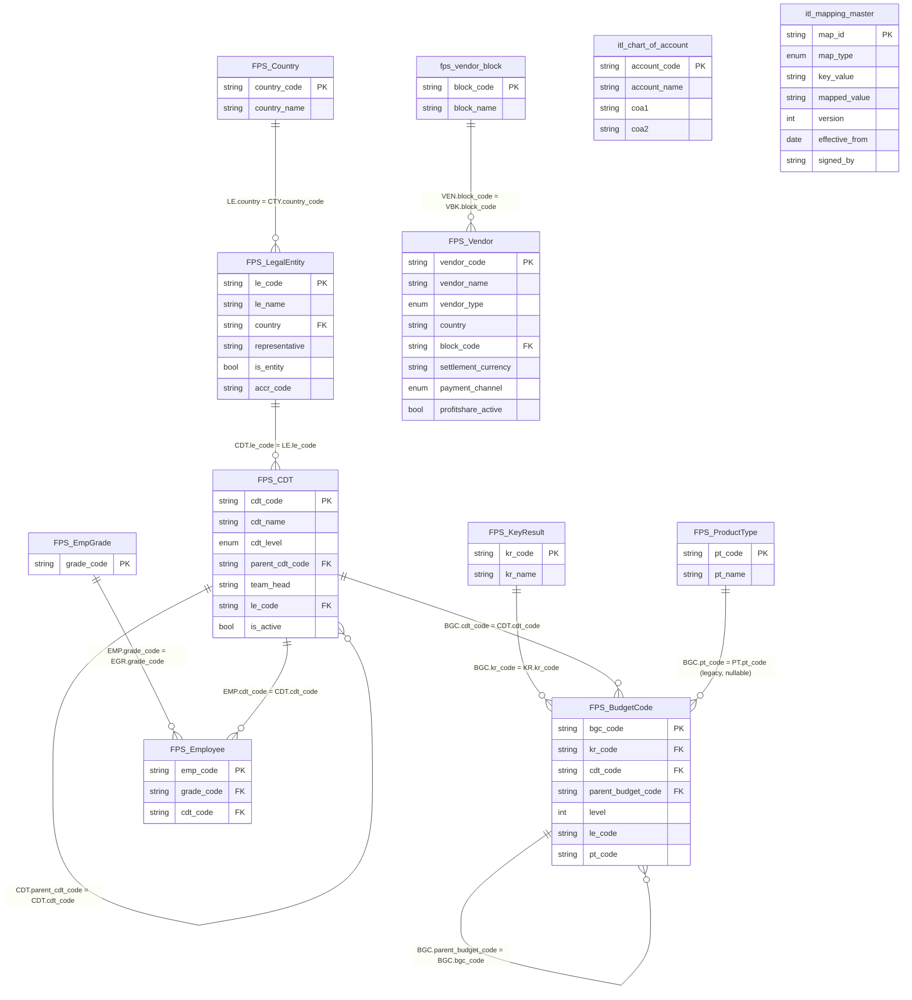

# FLS · ERD CHI TIẾT TOÀN HỆ — Financial Ledger System (P100/FPS × LEDGER)

**Version:** v0.4 | **Ngày:** 2026-08-22 | **Chủ sở hữu:** COO-CFO
**Nguồn canonical:** `P100-R/AP-FPS-v3.3.md` (7.608 dòng) · **Know-how:** `_GUIDE_00..09` (11 workbook · 444 sheet · 1.782.276 dòng)
**Quyết định đã áp:** `QĐ-ITL-01..18`
**Quan hệ:** `ArchitecturePack-Ledger.md` = luận cứ · `ERD-P100-Ledger.md` = quyết định & xung đột · **file này = ERD thi hành, mức cột**

**Tên hệ thống (chốt 2026-08-22):** **FLS — Financial Ledger System.** `FLS V0` = bộ Google Sheets đang chạy (đối tượng khảo sát) · `FLS v1` = hệ xây mới theo ERD này. `ITL` = sổ cái lõi bên trong FLS (như `P100` là module bên trong FPS). Định vị: **FPS** (trước khi chi — lệnh & phê duyệt) → **FLS** (sau khi chi — giải nghĩa dòng tiền, sổ cái chuẩn) → **FPA** (báo cáo).

## Cách đọc

| Ký hiệu | Nghĩa |
|:--:|---|
| `▣` | Entity **đã có** trong v3.3, giữ nguyên |
| `▨` | Entity đã có, **mở rộng cột** |
| `▢` | Entity **MỚI** từ know-how kế toán |
| `⊙` | **View**, không lưu số |

**Nguồn từng cột** — bắt buộc ghi để không lẫn thật/suy:

| Nhãn | Nghĩa |
|:--:|---|
| `[E]` | Từ **bảng entity canonical** v3.3 §1.23–1.34 — chắc chắn |
| `[R]` | Suy từ **danh sách field của Ledger report** v3.3 §3.3b — field thật đang chạy, **nhưng chưa vào bảng entity canonical** |
| `[A]` | Từ **file kế toán thật** (`_GUIDE_*`), có sheet/ô làm bằng chứng |
| `[D]` | **Dẫn xuất** (computed), không nhập tay |
| `???` | Chưa biết — không suy đoán (R-A1) |
| `[C]` | Đã **đối chiếu code FPS** (`fps/db/schema.py` — DDL đang chạy). Mạnh hơn `[E]`: spec có drift, code là SSOT (§0.4) |

---

## §0 · Ba hiệu chỉnh phát hiện khi đọc sâu v3.3

Đọc thêm §1.1–1.2, §3.3b, §5.2, §10.2, §12 làm lộ 3 chỗ các bản trước của tôi nói chưa đúng.

### 0.1 ⚠ `TSI_MAP` **không phải** view 71 field — tôi gán sai đối tượng

Trong `QĐ-ITL-11` tôi viện lý do *"`TSI_MAP` có `WHERE pc_slip.status != 'Rejected'` nên đi qua nó là rơi dòng có tiền thật"*. **Sai đối tượng.**

| Đối tượng | Sự thật |
|---|---|
| **`TSI_MAP`** (§10.2) | Bảng mapping **mỏng, 13 cột**: `tsi_map_id · tsi_level (1/2/3) · tsi_type · source_id · parent_source_id · tst_type · status · amount · over_budget · assigned_to · created_by · created_at · updated_at`. Read-only, populate event-driven |
| **PE/PA/PI/PM/PC Ledger report** (§3.3b) | Đây mới là view **~71 field** dẹt cả chuỗi, và đây mới là chỗ có `WHERE <slip>.status != 'Rejected'` — **cả 5 view đều có** |

**Quyết định `QĐ-ITL-11` không đổi — nhưng lý do mạnh hơn, không yếu hơn:**
1. `TSI_MAP` **không thể** làm đường cho `ITL` vì nó **không chứa dữ liệu kế toán nào** — không kỳ, không tài khoản, không pháp nhân, không phân bổ. Không phải "không nên" mà là "không được".
2. Cảnh báo về bộ lọc `!= 'Rejected'` **vẫn đúng và vẫn quan trọng** — chỉ là nó áp cho **5 view Ledger report**: `ITL` cũng **không** được dựng từ các view đó, vì tiền đã ra khỏi tài khoản thì phải có trong sổ dù phiếu bị từ chối sau.

### 0.2 `BGC` chỉ dùng **2 chiều**, không phải 4

Ảnh DRAFT ghi `KR, LE, PT, CDT → BudgetCode`. v3.3 §12.2 nói rõ:

> `BGC (BudgetCode) = KR + CDT` — *"`le_code`, `pt_code` tồn tại nhưng **KHÔNG** dùng cho budget filter"* (legacy data)

⇒ ERD dưới đây vẽ `BGC` ← `KR` + `CDT`, và ghi `le_code`/`pt_code` là legacy.

### 0.3 ⭐ Kế hoạch **đã** có trục làn đo — nên đổi giá trị `MSL.lane`

`RTBItem.budget_type` = **`CF`** hoặc **`PL`** (v3.3 §12.1, Option B: 1 BGC + 1 tháng ⇒ **2** RTBItem, một CF một PL).

Nghĩa là **phía kế hoạch đã tách hai làn từ trước**, bằng đúng hai chữ `CF`/`PL`. Trong `QĐ-ITL-07` tôi đặt `MSL.lane = CASH/ACCRUAL` — chữ mới, không cần thiết.

**Đề xuất tinh chỉnh:** `MSL.lane` dùng luôn **`CF` / `PL`**. Lợi ích cụ thể: so kế hoạch với thực tế trên **cùng một trục, cùng một enum** — không cần bảng dịch. Đây là điều kiện để view `RPT_CommittedVsActual` (§7) chạy được mà không mapping.

⇒ `GAP-ERD-08` (chờ owner xác nhận đổi enum này).

---

## §0.4 ⭐⭐ `[C]` Đối chiếu code FPS (v0.4) — spec KHÔNG phải SSOT, code mới là

File này gắn nhãn `[E]` theo **spec** `AP-FPS-v3.3.md`. Nhưng phía FPS, spec đã có drift so với code chạy thật; **SSOT schema = `fps/db/schema.py` (BQ DDL) + `fps/db/schema_pg.py` (PG DDL)**. Đối chiếu lần đầu 2026-08-22 bắt được **11 hiệu chỉnh**. Nguyên tắc từ nay: **mọi nhãn `[E]` phải re-verify với code trước khi thi hành `DEV-04`**; ô đã verify mang thêm nhãn `[C]`.

| # | ERD/spec nói | Code FPS thật | Hệ quả |
|--:|---|---|---|
| 1 | `GAP-ERD-03`: PA "chưa có bảng entity canonical" | `fps_pa_slip` + `fps_pa_line` **đã tồn tại** (schema.py:467/485) | Gap chỉ ở mức spec — nạp cột PA từ code |
| 2 | `QĐ-ITL-09`: `reference_number` "phải đưa vào canonical", đặt ở **PM Line** | **Đã có sẵn**, ở **`fps_pm_slip`** (mức **SLIP**, schema.py:579) | Luật `OP-03` 1–1 line-level phải chốt lại; muốn line-level = CR schema sang FPS; BQ không enforce UNIQUE |
| 3 | `C14` chờ chốt: `bank_account_id` slip hay line | `fps_pm_slip.bank_account_id` — **SLIP** | ✅ C14 đóng |
| 4 | `PEL.service_start_date/end_date` `[R]` — "cửa sổ dịch vụ ở PE **Line**" | Ở **`fps_pe_slip`** (SLIP); `fps_pe_line` **không có** 2 cột này. PI/PM cũng giữ service dates ở slip | Nguồn `SVC` = PE **Slip**; `GAP-ERD-11/14` xét ở mức slip |
| 5 | `CTY` toàn `???` — "v3.3 không có entity Country" | **`fps_cty(cty_code, cty_name)` đã tồn tại** + đã chạy chuẩn hoá ISO (`Vietnam→VN`, `USA→US`, rỗng→NULL) | ✅ `CTY` nạp theo code; `GAP-ERD-13` đóng phần lớn |
| 6 | `FXR` là bảng mới của FLS | **`fps_exchange_rate(currency_from, currency_to, rate, effective_date)` đã tồn tại** | FLS align/tái dùng thay vì tạo bảng trùng |
| 7 | W9: "PA chỉ dùng cho AdvancePayment" (spec §12.3) | PA **auto-create cho MỌI transaction type** (spec dòng 970 đã xác nhận SAI từ Step 10 — rule đã lock) | Sửa W9; ITL phải lường PA tồn tại ở mọi chain |
| 8 | §1.31: "PC chỉ cho Tạm ứng (BT & Gấp)" | PC **auto-create cả cho TT/THU** khi PM M1 Approved (status `Approved`, chain-audit-only, bỏ workflow); manual PC11→PC13 chỉ TUBT/TUG | Bảng PC có dòng cho MỌI type — FLS đọc PC phải phân biệt auto/manual |
| 9 | Cảnh báo `WHERE != 'Rejected'` ở 5 view Ledger report | Filter **có thật** (`ledger_service.py`, cascade `pe.status != 'Rejected'`); thêm: FPS reject semantics = **zero-line → Draft** (amount=0, row GIỮ) | `QĐ-ITL-11` vẫn đúng; lưu ý dòng rejected trong FPS thường đã về 0 tiền |
| 10 | `THR` FPS_ApprovalThreshold `[E]` §1.33 — bảng canonical | Code **KHÔNG có** bảng threshold riêng — **threshold SSOT = `fps_szt`** (lock Step 5.D 2026-05-24); `fps_trt` giữ mapping bước, min/max không còn canonical ở đó; logic tier ở `approval_plan.py` | ⚠ `THR` là bảng spec đã bị code thay thế ⇒ **`GAP-ERD-23`** |
| 11 | `TSI_MAP` `[E]` §10.2 — bảng 13 cột | **Không có trong DDL** `schema.py` — cần xác nhận là view/computed trong service, không phải bảng vật lý | ⚠ Xác minh trước khi thiết kế drill-through ⇒ **`GAP-ERD-24`** |

**Bảng FPS có trong code mà ERD chưa dùng** (đáng cân nhắc cho FLS): `fps_p140_org` (SSOT hierarchy tổ chức, SCD2 temporal routing — nguồn đúng cho trục CDT/người duyệt theo thời điểm) · `fps_approval_history` (audit trail phê duyệt — bổ sung cho `TSEV`) · `fps_raw_upload` (staging import — tương đồng vai `STM`) · `fps_id_counter` (sinh ID atomic — know-how chống trùng cho `itl_id`) · `fps_tev` (tên thật của `TSEV` trong code). Ngược lại, code **không có bảng `Month`** — thuận lợi cho `GAP-ERD-22` (khai tử `Month`).

> Bảng đối chiếu đầy đủ mức bảng-và-cột + checklist audit: `FLS-vs-FPS-Compare-Audit.md`.

---

## §1 · MASTER & DIMENSION

### `▢ CTY` Country ⚠ **sửa sau review**
| Cột | Nguồn | Type | Ghi chú |
|---|:--:|---|---|
| `country_code` | `???` | STRING PK | ⚠ **tên cột là SUY ĐOÁN của tôi.** v3.3 §1.23–1.34 **không có** bảng entity nào cho Country; `CTY` chỉ xuất hiện trong sơ đồ ASCII §1.35 và một bảng field khác hẳn (`company_code · company_name · address`). Nhãn `[E]` ở v0.1 là **gán sai** — vi phạm chính luật `R-A1` của file này |
| `country_name` | `???` | STRING | idem |

> ⚠ **`GAP-ERD-13`:** `LE.country` giá trị thật là **TÊN** (`"Vietnam"`, `"Singapore"` — v3.3 §1.25), không phải mã ⇒ FK `LE.country → CTY.country_code` **không resolve được**. Phải chọn: khoá `CTY` là tên, hay thêm bước chuẩn hoá tên→mã.
>
> ✅ **`[C]` v0.4 — ĐÓNG PHẦN LỚN:** code FPS **đã có** `fps_cty(cty_code, cty_name)` và đã chạy chuẩn hoá ISO (`Vietnam→VN`, `USA→US`, rỗng→NULL). `CTY` hết `???` — nạp theo code; việc còn lại chỉ là verify dữ liệu `fps_le.country` các dòng cũ.

### `▨ LE` LegalEntity — pháp nhân Venture Apero (**bên trong**)
| Cột | Nguồn | Type | Ghi chú |
|---|:--:|---|---|
| `le_code` | `[E]` | STRING PK | 9 LE: `SGO1 SGO2 VGO1 VGOM VGOH VVOT/VVOO/VGO2 VVOS VVOV VVOH` |
| `le_name` | `[E]` | STRING | `APERO HQ`, `TeraSoft`, … |
| `country` | `[E]` | STRING FK→CTY | `Vietnam`, `Singapore` |
| `representative` | `[E]` | STRING | `LuanDQ`, `TuanPM`… |
| **`is_entity`** | `[A]` | BOOL **MỚI** | Dữ liệu thật có nhãn **không phải pháp nhân** lẫn vào: `USD` (nhãn tệ), `HotBonus` (quỹ) — `A-CCR ▸ Enity by bank` 45 dòng. `false` ⇒ **loại khỏi hợp nhất** (`INV-I10`) |
| **`accr_code`** | `[A]` | STRING **MỚI** | Mã dùng trong đối soát nếu khác `le_code` — `Enity by bank` có `VVOO`≈`VVOT`, `CNC`≈`CN01` |

### `▣ CDT` BudgetOwner — chủ dự toán (trục **quản trị**)
| Cột | Nguồn | Type | Ghi chú |
|---|:--:|---|---|
| `cdt_code` | `[E]` | STRING PK | `GAG`, `SHQ1`, `SHQ2`, `TTE`… |
| `cdt_name` | `[E]` | STRING | `Apero Group`, `Headquarters2`, `Tech` |
| `cdt_level` | `[E]` | ENUM | `GH` / `OH` / `NH` / `DH` — 4 cấp |
| `parent_cdt_code` | `[E]` | STRING FK→CDT | self-ref, NULLABLE |
| `team_head` | `[E]` | STRING | `TaiNT`, `LuanDQ`… |
| `le_code` | `[E]` | STRING FK→LE | **"Pháp nhân áp dụng"** — dùng cho luật intercompany §6 |
| `is_active` | `[E]` | BOOL | |

> Giá trị thật trong sổ kế toán ghi dạng ghép: `SHQ2 \| Headquarters2` ⇒ adapter phải tách `code \| name`.

### `▨ VEN` Vendor — đối tác **bên ngoài** (`QĐ-ITL-12`)
| Cột | Nguồn | Type | Ghi chú |
|---|:--:|---|---|
| `vendor_code` | `[E]` | STRING PK | ~886 vendor `VD0`–`VD886` |
| `vendor_name` · `vendor_short_name` | `[E]` | STRING | |
| `vendor_type` | `[E]` | ENUM | `Company` / `Individual` |
| `tax_number` · `mst_tax_number` | `[E]` | STRING NULL | |
| `address` · `phone` · `email` · `city` · `country` · `brand` · `note` | `[E]` | STRING NULL | |
| `bank_account` · `bank` | `[E]` | STRING NULL | TK nhận tiền |
| **`block_code`** | `[A]` | STRING FK→VBK **MỚI** | `Khối đối tác`: inhouse / publishing / SG |
| **`settlement_currency`** | `[A]` | STRING **MỚI** | `Loại tiền tệ` — `VNĐ`/`USD` khác nhau theo đối tác |
| **`payment_channel`** | `[A]` | ENUM **MỚI** | `bank` / `payoneer` / `pingpong` — `Thông tin TT_*` |
| **`payoneer_email`** | `[A]` | STRING **MỚI** | `Uthus \| Payoneer admin@uthus.vn` |
| **`profitshare_active`** | `[A]` | BOOL **MỚI** | `false` khi `dừng hợp tác > k thanh toán gì thêm` |

### `▢ VBK` VendorBlock — khối đối tác
| Cột | Nguồn | Type |
|---|:--:|---|
| `block_code` | `[A]` | STRING PK — `INHOUSE` / `PUBLISHING` / `SG` |
| `block_name` | `[A]` | STRING |

> Bằng chứng: `Index_ Tổng hợp T12 2023` cột `Khối đối tác` = `Đối tác inhouse`; 3 sheet theo dõi riêng `Index_Inhouse`/`Index_Publishing`/`Index_SG`; `AperoGroup ▸ Index` tách cột `Chốt Audit_Đối tác publishing` và `_đối tác inhouse`.

### `▣ KR` KeyResult · `▣ PT` ProductType
| Entity | Cột | Nguồn |
|---|---|:--:|
| `KR` | `kr_code` PK · `kr_name` | `[E]` `[R]` |
| `PT` | `pt_code` PK · `pt_name` | `[E]` |

> ⚠ **`PT` sau review:** v3.3 dòng 3054 vẫn ghi `pt_code = bgc.pt_code  # BGC → PT (n-1)` ⇒ quan hệ **còn tồn tại**, chỉ là **không dùng cho budget filter** (§12.2 của v3.3). Hai thứ khác nhau. ⇒ khai `BGC.pt_code FK→PT` **nullable, có nhãn legacy** — không để `PT` thành bảng không cạnh. Nếu owner muốn khai tử `PT` thì đánh dấu như `Month`.

> `CONFLICT 8` (v3.3): **`KR` thay thế `HD`** ở phía P100. Phía kế toán vẫn gọi là `HD`/`HDCode` — xem `BGC` và §2 `ITL.budget_code`.

### `▨ BGC` BudgetCode — đơn vị kiểm soát ngân sách nhỏ nhất
| Cột | Nguồn | Type | Ghi chú |
|---|:--:|---|---|
| `bgc_code` | `[E]` | STRING PK | |
| `kr_code` | `[E]` | STRING FK→KR | **1 trong 2 chiều lọc** |
| `cdt_code` | `[E]` | STRING FK→CDT | **chiều lọc thứ 2** |
| `le_code` · `pt_code` | `[E]` | STRING | ⚠ **legacy — KHÔNG dùng cho budget filter** (§12.2) |
| **`parent_budget_code`** | `[A]` | STRING FK→BGC **MỚI** | self-ref — HD/KRF là **cây 3 cấp**: `GI \| Gross Inflow` → `GI.GMA \| … Game App` → `GI.GMA.IOA \| … IOS` (`H1000 ▸ DataValid`) |
| **`level`** | `[A]` | INT **MỚI** | 1 / 2 / 3 |

### `▢ COA` ChartOfAccount — **v3.3 không có entity nào cho `Tài khoản`**
| Cột | Nguồn | Type | Ghi chú |
|---|:--:|---|---|
| `account_code` | `[A]` | STRING PK | `Transaction Original` cột G `Tài khoản` |
| `account_name` | `[A]` | STRING | |
| `coa1` · `coa2` | `[A]` | STRING | `Mapping Master` cột I/J — dùng để **suy `budget_code`** (`DT-I02`) |

> Vai của `COA` là *suy ra HD rồi thôi* — **không** phải trục báo cáo, vì engine P&L không đọc `Tài khoản` (`BA-05` §DD-I04b). Muốn báo cáo theo tài khoản kế toán ⇒ CR loại 3.

### `▢ MAP` MappingMaster — reference data **có version + ký duyệt**
| Cột | Nguồn | Type | Ghi chú |
|---|:--:|---|---|
| `map_id` | `[A]` | STRING PK | |
| `map_type` | `[A]` | ENUM | `BANK_SHEET_TO_LE` / `COA_TO_HD` / `LE_TO_NO` — 3 khối của `Mapping Master` |
| `key_value` → `mapped_value` | `[A]` | STRING | vd `R \| 542666_TCB USD_VISIONLAB` → `VVOV` |
| `version` · `effective_from` · `signed_by` | `[A]` | — | `P-05`: rule là **dữ liệu có version**, không phải code |

> ⚠ **Thiếu lineage version (phát hiện review):** `ITL.le_owner` và `ITL.budget_code` **đều là kết quả của `MAP`**, nhưng không dòng `ITL` nào ghi đã áp version nào. Hệ quả: khi `MAP` lên version mới, không trả lời được *"dòng này map bằng luật nào"* ⇒ `SoD-2` kiểm được ở bảng `MAP` nhưng **không kiểm được ảnh hưởng**, và `INV-I05` (lineage đầy đủ) **không đạt**. Đề xuất `ITL.map_version_applied`. ⇒ `GAP-ERD-19`.

### `▣` Chiều phân loại giao dịch + nhân sự
| Entity | Cột | Nguồn | Ghi chú |
|---|---|:--:|---|
| `TMT` TransMarketingType | `tmt_code` PK · `tmt_name` | `[E]` | |
| `TLT` TransLegalType | `tlt_code` PK · `tlt_name` | `[E]` | |
| `TUT` TransUrgencyType | `tut_code` PK · `tut_name` | `[E]` | |
| `SZT` TransSizeType | `szt_code` PK · `szt_name` | `[E]` | |
| `EGR` EmpGrade | `grade_code` PK · `grade_name` | `[E]` | `PM0 PM1 TM0 TM1 SM0 SM1 CM GM` |
| `EMP` Employee | `emp_code` PK · `emp_name` · `grade_code` FK→EGR · `cdt_code` FK→CDT | `[E]` `???` | Cột đầy đủ chưa có bảng canonical |

---

## §2 · APPROVAL & WORKFLOW (metamodel)

### `▣ TSI` TaskItem **Level 1** = giao dịch thanh toán
| Cột | Nguồn | Type | Ghi chú |
|---|:--:|---|---|
| `tsi_id` | `[E]` | STRING PK | `TSI000001` |
| `kr_code` · `cdt_code` | `[E]` | FK | 2 chiều lọc |
| `tmt_code` · `tlt_code` · `tut_code` · `szt_code` | `[E]` | FK | 4 chiều loại giao dịch |
| `bgc_code` | `[E]` | FK→BGC | |
| `status` | `[E]` | ENUM | |

### `▣ TSEV` TaskEvent — sự kiện trên giao dịch
| Cột | Nguồn | Type | Ghi chú |
|---|:--:|---|---|
| `tsev_id` | `[E]` | STRING PK | |
| `tsi_id` | `[E]` | FK→TSI | §5.2: `trs_id` |
| `trt_id` | `[E]` | FK→TRT NULL | vai phê duyệt liên quan |
| `event_type` | `[E]` | ENUM | `Create` · `Submit` · `Approve` · `Execute` (§5.2, CONFLICT 1 đã chốt) |
| `user_id` | `[E]` | STRING | |
| `timestamp` | `[E]` | TIMESTAMP | |
| **`Delete`** · **`Reverse`** | — | ⚠ **ĐỀ XUẤT THÊM** | Xoá **đang xảy ra thật** — `A-CCR ▸ CANhật ký xử lý Giao dịch` 1.015 dòng `"Đã xóa ngày 13/10//2025"` — nhưng metamodel **không có** event tương ứng ⇒ hiện xoá không đi qua quy trình nào. ⇒ `GAP-ERD-09` |

### `▣ TRT` TaskRoleType · `▣ TRI` TaskRoleItem · `▣ TST` TaskType L3
| Entity | Cột | Nguồn | Ghi chú |
|---|---|:--:|---|
| `TRT` | `trt_id` PK · `kr_code` · `cdt_code` · `tmt/tlt/tut/szt_code` · `grade_code` FK→EGR · **`step_id`** FK→TST *(v0.1 ghi `tst_id` — sai, canonical §1.32 dùng `step_id`)* | `[E]` | Vai phê duyệt = tổ hợp chiều + cấp + bước. **5 vai** (§9.1) |
| `TRI` | `tri_id` PK · `emp_code` FK→EMP · `trt_id` FK→TRT | `[E]` | Người ↔ vai |
| `TST` | `step_id` PK · `document_type` ENUM · `step_name` · `approval_type` | `[E]` | = **bước phê duyệt** (`QĐ-ITL-08`). Vd `PE11`, `PM21` |
| | **`sla`** | — | ⚠ **ĐỀ XUẤT THÊM** — `"Nhập trước 11h"` (`A-CCR ▸ INDEX` R5) là SLA thật, chưa mô hình hoá |
| | **`auto_rule_ref`** | — | ⚠ **ĐỀ XUẤT THÊM** — trường máy suy được ⇒ `TSI` sinh ở trạng thái `proposed_by_rule` |

### `▣ TDT` TaskDocType · `▣ TDI` TaskDocItem
| Entity | Cột | Nguồn |
|---|---|:--:|
| `TDT` | `tdt_id` PK · `kr_code` FK→KR · `doc_type` ENUM (`P120E/P120EX/P120I/P120M/P120C/P130/RBT`) | `[E]` |
| `TDI` | `tdi_id` PK · `tdt_id` FK→TDT · `tsi_id` FK→TSI · `file_ref` · `uploaded_by` | `[E]` `???` |

---

## §3 · PLAN (kế hoạch RTB)

### `▣ RTBSheet` · `▣ RTBItem` · `▣ Month`
| Entity | Cột | Nguồn | Ghi chú |
|---|---|:--:|---|
| `RTBSheet` | `sheet_id` PK · `name` · `year` · `status` | `[E]` `???` | |
| `RTBItem` | `item_id` PK | `[E]` | §12.1 |
| | `sheet_id` FK→RTBSheet | `[E]` | |
| | `month_code` FK→Month (`M01`–`M12`) | `[E]` | |
| | `bgc_code` FK→BGC | `[E]` | |
| | `amount` FLOAT | `[E]` | |
| | **`budget_type`** ENUM `CF` \| `PL` | `[E]` | ⭐ **Trục làn đo đã có ở phía kế hoạch** — xem §0.3 |
| | `status` ENUM `Draft`/`Approved` | `[E]` | |
| `Month` | `month_code` PK · `month_name` | `[E]` | ⚠ Đề xuất **thay bằng `PRD`** (§5) — `Month` không có cut-off, không có trạng thái chốt |

> **Option B:** 1 `BGC` + 1 tháng ⇒ **2 `RTBItem`** (một `CF`, một `PL`). Đội Plan nhập hai lần, có thể ở hai thời điểm.

---

## §4 · P100 PAYMENT — chuỗi PE → PA → PI → PM → PC

`QĐ-ITL-08`: **giữ nguyên 10 entity Slip/Line**, không thu về `TSI L2/L3`.
Phân cấp `TSI_MAP` (§10.2): **L1** = Transaction · **L2** = Slip · **L3** = Line.

### `▨ P110` BankAccount
| Cột | Nguồn | Type | Ghi chú |
|---|:--:|---|---|
| `account_id` | `[E]` | STRING PK | `P110-001` |
| `le_code` | `[E]` | FK→LE | pháp nhân sở hữu |
| `bank_name` · `account_number` · `currency` · `account_type` | `[E]` | STRING | |
| `is_active` | `[E]` | BOOL | |
| `approver` | `[E]` | STRING | người duyệt P110 |
| **`bank_sheet`** | `[A]` | STRING **MỚI** | Khoá nhận diện nguồn: `R \| 542666_TCB USD_VISIONLAB` — nối sang `MAP` |
| **`range_condition`** · **`range_debit`** · **`range_credit`** | `[A]` | STRING **MỚI** | Dải đọc Nợ/Có từng tài khoản — `BankAccountList` 3.003 dòng |
| **`opening_balance`** | `[A]` | NUMERIC **MỚI** | |

### `▣ P130` Contract
| Cột | Nguồn | Type | Ghi chú |
|---|:--:|---|---|
| `contract_id` | `[E]` | STRING PK | `P130-2026-001` |
| `contract_type` | `[E]` | ENUM | `Contract`/`Addendum`/`Agreement` |
| `le_code` · `vendor_code` · `cdt_code` | `[E]` | FK | **bộ ba** — đây là ràng buộc pháp lý LE×VEN (`QĐ-ITL-12`) |
| `amount` · `currency` · `start_date` · `end_date` | `[E]` | — | |
| `has_template` | `[E]` | BOOL | ảnh hưởng KS-T/KS-N |
| `status` | `[E]` | ENUM | `Draft`/`PendingApproval`/`Approved`/`Expired` |
| `pe_id` | `[E]` | FK→PESlip | **PE phải duyệt trước khi ký HĐ** |

> ⚠ **`P130` chỉ-gốc (phát hiện review):** không `PEL`/`PIL`/`PML`/`ITL` nào mang `contract_id`; `PESlip` chỉ có `has_contract` BOOL. ⇒ **không đối soát được `P130.amount` với tổng đã thanh toán** ⇒ không phát hiện chi vượt hợp đồng. Và view `RPT_CommittedVsActual` định nghĩa "cam kết" chỉ từ `TSI_MAP`/PE, **bỏ qua cam kết pháp lý mạnh nhất là hợp đồng**. Đề xuất `PEL.contract_id` nullable FK. ⇒ `GAP-ERD-18`.

### `▣ PESlip` / `▣ PEL`
| Cột | Nguồn | Ghi chú |
|---|:--:|---|
| `pe_id` PK · `transaction_type` · `cfa_type` · `cdt_code` · `vendor_code` · `le_code` · `amount` · `currency` · `budget_code` · `over_budget` · `has_contract` · `rbt_attached` · `description` · `submitted_by` · `submitted_at` · `status` | `[E]` | §1.28 |
| `tsi_id` · `has_document_debt` · `payment_due_date` · `debt_return_date` | `[R]` | Có trong Ledger report, **chưa** trong bảng entity |
| **`PEL`**: `pe_line_id` PK (`PE000001-2`) · `pe_id` FK · `amount` · `currency` · `pe_date` · `bgc_code` · `kr_code` · **`service_start_date`** · **`service_end_date`** | `[R]` | ⭐ **Cửa sổ dịch vụ nằm ở PE** — nguồn của `SVC` (§5) |

> ⚠ **`[C]` v0.4 — SỬA:** code thật: `service_start_date/end_date` nằm ở **`fps_pe_slip` (mức SLIP)**; `fps_pe_line` **không có** 2 cột này (chỉ `bgc_code · kr_code · amount · pe_date · note`). PI/PM cũng giữ service dates ở slip. ⇒ nguồn của `SVC` là **PE Slip**, và `GAP-ERD-11/14` phải xét ở mức slip.

### `▣ PASlip` / `▣ PAL` — Payment Advance
| Cột | Nguồn | Ghi chú |
|---|:--:|---|
| `pa_id` PK · `pa_amount` · `pa_line_id` · `pe_line_id` (ref back) · `status` | `[R]` | ⚠ **Không có bảng entity canonical cho PA** ở §1.28–1.31 ⇒ `GAP-ERD-03` |
| | | W9: **PA chỉ dùng cho AdvancePayment** (§12.3) — ⚠ **`[C]` SAI theo code, xem note dưới** |

> ✅ **`[C]` v0.4:** `fps_pa_slip` + `fps_pa_line` **đã tồn tại trong code** (schema.py:467/485) — `GAP-ERD-03` là gap mức SPEC, nạp cột từ code. ⚠ Dòng W9 **sai theo code chạy thật**: PA **auto-create cho MỌI transaction type** (spec §12.3/dòng 970 đã được xác nhận sai từ Step 10, rule đã lock).

### `▣ PISlip` / `▣ PIL`
| Cột | Nguồn | Ghi chú |
|---|:--:|---|
| `pi_id` PK · `pe_id` FK · `transaction_type` · `invoice_amount` · `currency` · `invoice_docs[]` · `submitted_by` · `submitted_at` · `status` | `[E]` | §1.29. Luật: hoá đơn > PE ⇒ **làm lại PE** |
| `pi_line_id` · `pi_date` · `pi_vendor_code` · **`pi_le_code`** · `pi_has_document_debt` · `pa_line_id` (ref back) | `[R]` | ⭐ **LE riêng ở bước PI** |

### `▣ PMSlip` / `▣ PML` — mắt xích nối sang sổ
| Cột | Nguồn | Ghi chú |
|---|:--:|---|
| `pm_id` PK · `pe_id` · `pi_id` · `transaction_type` · `payment_amount` · `currency` · `bank_account_id` FK→P110 · `vendor_bank_info` · `submitted_by` · `submitted_at` · `status` | `[E]` | §1.30 |
| `pm_line_id` · `pm_date` · **`phase`** (`M1`/`M2`) · `payment_method` · **`pm_le_code`** · `pm_description` | `[R]` | ⭐ `pm_le_code` = **pháp nhân thực trả** — xem §6 |
| `payee_name` · `payee_account_number` · `payee_bank` | `[R]` | bên nhận |
| `payer_account_number` · `payer_bank` | `[R]` | bên trả |
| **`but_toan`** | `[R]` `[D]` | computed: `{description bỏ dấu} {pm_line_id}` — **P100 đã sinh chuỗi bút toán** |
| **`reference_number`** | `[R]` `[C]` | ⭐ **`QĐ-ITL-09` — SỬA v0.4:** cột **ĐÃ CÓ trong code**, tại **`fps_pm_slip` (mức SLIP, schema.py:579)** — không phải PML. Hệ quả: (a) luật 1–1 `PMLine ↔ reference_number` (`OP-03`) phải chốt lại slip-vs-line; (b) muốn line-level = CR schema sang FPS (twin `schema.py`+`schema_pg.py`+parity test, batch sau Step 12.5); (c) BQ không enforce `UNIQUE` — cần app-layer/PG constraint |
| `pi_line_id` (ref back) | `[R]` | |

### `▣ PCSlip` / `▣ PCL`
| Cột | Nguồn | Ghi chú |
|---|:--:|---|
| `pc_id` PK · `pe_id` · `pm_id` · `transaction_type` · `settlement_amount` · `submitted_by` · `submitted_at` · `status` | `[E]` | §1.31 — chỉ cho Tạm ứng (BT & Gấp) |
| `pc_line_id` · `pc_currency` · `settlement_by_document` · `settlement_by_cash` · **`pc_le_code`** · `pm_line_id` (ref back) | `[R]` | |

> ⚠ **`[C]` v0.4 — SỬA:** rule canonical L1 phía FPS: PC **auto-create cả cho TT/THU** khi PM M1 Approved (status `Approved`, chain-audit-only, bỏ workflow); luồng manual PC11→PC12→PC13 **chỉ** TUBT/TUG. "Chỉ cho Tạm ứng" đúng với **luồng manual**, sai nếu hiểu là "bảng PC chỉ có dòng Tạm ứng" — FLS đọc PC phải phân biệt dòng auto/manual.

### `▣ TST`-liên quan: ApprovalStep / ApprovalThreshold
| Entity | Cột | Nguồn |
|---|---|:--:|
| `FPS_ApprovalStep` | `step_id` PK · `document_type` · … | `[E]` §1.32 |

### `▣ THR` FPS_ApprovalThreshold — **nạp đầy đủ sau review** (v0.1 để `???`)
| Cột | Nguồn | Type | Ghi chú |
|---|:--:|---|---|
| `threshold_id` | `[E]` | STRING **PK** | `"GAG-NM-50"` |
| `cdt_code` | `[E]` | STRING **FK→FPS_CDT** | CDT áp dụng — **cạnh này bị rơi ở v0.1** |
| `approval_type` | `[E]` | ENUM | `NM` / `MK` / `Gấp` |
| `amount_min` | `[E]` | NUMERIC | hạn mức dưới (inclusive) |
| `amount_max` | `[E]` | NUMERIC NULL | hạn mức trên; **NULL = không giới hạn** |
| `approver_cm` | `[E]` | STRING | người duyệt **chuyên môn** |
| `approver_tc` | `[E]` | STRING | người duyệt **tài chính** |
| `approver_ks` | `[E]` | STRING NULL | người duyệt **kiểm soát** (KS-N) |

> Đây là trục kiểm soát tiền quan trọng nhất (§13 `ApprovalType`). v0.1 ghi PK = `???` là **đọc thiếu canonical §1.33**, không phải "chưa biết".
>
> ⚠ **`[C]` v0.4:** code FPS **không có** bảng threshold riêng — **threshold SSOT = `fps_szt`** (lock Step 5.D 2026-05-24), logic tier ở `approval_plan.py` (SSOT display↔gate). `THR` ở đây là bảng SPEC đã bị code thay thế — model lại theo code trước khi thi hành. ⇒ `GAP-ERD-23` (§0.4 dòng 10).

---

## §5 · LEDGER CORE — sổ chuẩn tắc

### `▢ ITL` LedgerTransaction ★ xương sống

> ⛔ **SỬA 2026-08-24 — hợp đồng là 14 TRƯỜNG, khai báo theo TÊN.** Bản cũ ghi *"13 cột, đọc theo VỊ TRÍ"* và lấy `le` từ `BL(63)` — **cả hai đều SAI so với reader thật** (`itl_ledge_reader.py::_COLS`). Xem `05_DATA_DICTIONARY_ERD` v0.5 §DD-I04b + `Ra-soat-doc-lap-Schema-vs-Wireframe.md`.

**14 trường hợp đồng engine** (`_COLS` — khai báo **theo TÊN**; cột Excel chỉ để đối chiếu):

| # | Cột engine | Vị trí | Nguồn | Ghi chú |
|--:|---|:--:|:--:|---|
| 1 | `doc_date` | A (0) | `[C]` | `Ngày chứng từ`. ⛔ `AUD-12`: mã `FT` **KHÔNG** mang nghĩa thời gian |
| 2 | `doc_no` | B (1) | `[C]` | `Số chứng từ` |
| 3 | `memo` | C (2) | `[C]` | `Diễn giải` |
| 4 | `curr` | D (3) | `[C]` | `Đơn vị tiền tệ` |
| 5 | `ps_no` | E (4) | `[C]` | `PS Nợ` |
| 6 | `ps_co` | F (5) | `[C]` | `PS Có` |
| 7 | `acct` | **G (6)** | `[C]` | ⭐ `Tài khoản` — engine CÓ đọc (owner 2026-08-20). Thiếu trong bản cũ |
| 8 | `le` | **P (15)** | `[C]` | ⭐ `LE` — pháp nhân **SSOT** (người nhập, điền 100%). ⛔ **KHÔNG** dùng `BL(63)` — `BL` trống dần tới 0% tháng 8/2026 |
| 9 | `itl_id` | R (17) | `[C]` | AS-IS `ITL#n` số chạy ⇒ đổi: `INV-I04a` số thứ tự đóng băng |
| 10 | `hd` | V (21) | `[C]` | `Final` khối 1 — Budget Code. **Final = kế toán nhập/sửa** (owner) |
| 11 | `pay_type` | Z (25) | `[C]` | `Final` khối 2 |
| 12 | `cdt1` | AD (29) | `[C]` | `Final` khối 3 |
| 13 | `svc_start` | AH (33) | `[C]` | `Final` khối 4 |
| 14 | `svc_end` | AL (37) | `[C]` | `Final` khối 5 |

⚠ **`ITL Ledge` thật = 64 cột, 4 vùng** — hợp đồng 14 trường chỉ là tập con engine đọc. Kế toán còn thấy/sửa: vùng **BASE+IMPORT** (`A–Q`), **ADJUSTMENT** (7 khối × 4 tầng `Classifying→Manual→MID→Final`, bỏ `MID` ở TO-BE), **ALLOCATE** (`AU–AW` = `CFA1`/`CFA2`/`Method`, **dẫn xuất từ `Mapping Master` theo `HDCode`**), **AUDIT** (`AX–BL` + `PIC`/`Trạng thái`). Bản đồ đầy đủ: `03_Dev/04_DB_IMPLEMENTATION` §0.

**Cột bổ sung TO-BE:**

| Cột | Nguồn | Type | Ghi chú |
|---|:--:|---|---|
| `natural_key` | `[A]` `[D]` | STRING UNIQUE | `<YYYYMMDD>\|<debit>\|<credit>\|<reference>\|<source>` — 4 thành phần đầu **đang chạy thật** (302.259 dòng `Log`) |
| `ledger_type` | `[A]` | FK→LGT | |
| `stm_id` | `[A]` | FK→STM NULL | dòng sao kê gốc |
| `prd_id` | `[A]` | FK→PRD | |
| `coa_code` | `[A]` | FK→COA | `Tài khoản` — **engine không đọc**, dùng để suy `hd` |
| `budget_code` | `[A]` | FK→BGC | = `hd` sau chuẩn hoá |
| `cdt_code` | `[A]` | FK→CDT | = `cdt1` sau tách `code \| name` |
| **`le_payer`** | `[A]` | FK→LE **MỚI** | `QĐ-ITL-10` — nguồn: `Pháp nhân thanh toán` (L1 cột **L**) hoặc `pm_le_code` `[R]`. **CHÈN SAU `BL`** |
| **`is_intercompany`** | `[D]` | BOOL **MỚI** | `le_owner ≠ le_payer` — cấm nhập tay |
| `vendor_code` | `[A]` | FK→VEN NULL | `Mã đối tác (ID Payee)` |
| `msl_id` | `[A]` | FK→MSL | làn đo + bậc |
| `run_id` | `[A]` | FK→RUN | |
| `pm_line_id` | `[R]` | FK→PML NULL | qua `reference_number` |
| `is_flash` | `[A]` | BOOL | `INV-I14` |
| `row_state` | `[A]` | ENUM | **9 giá trị** (v0.1 chỉ ghi 7 — thiếu 2 trạng thái mà `INV-I06` cần): `staged` → `mapped` → `raw_frozen` → `adjusted` → `allocated` → `audited` → `locked`, cộng **`unmapped`** và **`rejected`** (nhánh rẽ). Thiếu 2 cái này thì cổng chống rơi dòng `INV-I06` (`#nguồn = #staged + #rejected + #unmapped`) **không chạy được** |

### `▢ LGT` LedgerType
`ledger_type` PK ∈ `BANK` · `CASH` · `PAYROLL` · `PLATFORM` · `AP` · `AR` · `PARTNER` — **typing thay vì 1 entity/nguồn**.

### `▢ STM` StatementLine — sao kê thô (staging)
| Cột | Nguồn | Ghi chú |
|---|:--:|---|
| `stm_id` PK | `[A]` | |
| `account_id` FK→P110 **hoặc** `fund_id` FK→CSH | `[A]` | |
| `txn_date` · `description` · `currency` · `debit` · `credit` | `[A]` | `Bank Transactions` hdr dòng 2 |
| **`reference_number`** | `[A]` | ⭐ cầu sang `PML` — **1–1** |
| `source` · `num` | `[A]` | `source` = `R \| 24138888_TCB VND_TERASOFTS` |
| `raw_row_ref` | `[A]` | lineage: sheet + dòng gốc |

> ⚠ **Biến thể nguồn:** `R \| HoangACB` dùng `Ngày hiệu lực` / `Ngày giao dịch` thay vì `Transaction date` (`P100 Cash ▸ Issue List`) ⇒ adapter **map theo tên, không theo vị trí**.

### `▢ ADJ` AdjustmentEntry — append-only (`QĐ-ITL-16`)
| Cột | Nguồn | Ghi chú |
|---|:--:|---|
| `adj_id` PK · `itl_id` FK→ITL · `adt_code` FK→ADT | `[A]` | |
| `value_before` → `value_after` | `[A]` | **`AUD-1`** bắt buộc |
| `value_source` | `[A]` | ENUM `rule` / `human` / `rework` |
| `confidence` | `[D]` | khi `value_source=rule` |
| `maker` · `made_at` | `[A]` | |
| `reason` | `[A]` | **NOT NULL khi `value_source=rework`** |
| `prd_id` FK→PRD | `[A]` | kỳ `locked` ⇒ chặn (`INV-I13`) |
| `reversed_by` FK→ADJ | `[A]` | không sửa/xoá, chỉ đảo |

> `QĐ-ITL-16` **bỏ** `checker`/`approved_at` — người nhập là người chốt. Kiểm soát = nhật ký + vai `RP-I11` hậu kiểm.

### `▢ ADT` AdjustmentTargetType — 7 khối
| `adt_code` | Trường | Cột `ITL Ledge` | Ô nhập tay | Tới engine? |
|---|---|:--:|--:|:--:|
| `HDCODE` | Budget Code (HDCode) | S–V | 297 | ✅ |
| `PAYTYPE` | Loại giao dịch | W–Z | 179 | ✅ |
| `CDT1` | Chủ dự toán | AA–AD | 1.210 | ✅ |
| `SVC_START` | TĐ bắt đầu DV | AE–AH | 22 | ✅ |
| `SVC_END` | TĐ kết thúc DV | AI–AL | 22 | ✅ |
| `PAYEE` | Mã đối tác | AM–AP | 1.624 | ❌ |
| `INVOICE_DOC` | File đính kèm: Hóa đơn | AQ–AT | 3.489 | ❌ |

### `▢ SVC` ServiceWindow
`itl_id` PK FK→ITL · `svc_start` · `svc_end` (dạng `yyyymm`) · `source_branch` ENUM `PE`/`PI`.

> ⚠ **Trùng lặp chưa có luật (phát hiện review):** `svc_start`/`svc_end` tồn tại **hai chỗ** — cột #13/#14 của **hợp đồng 14 trường** trên `ITL` (vị trí AH/AL, khoá bởi `POS-13`) **và** ở `SVC`. Không có phát biểu nào nói bản nào là SSOT ⇒ đúng loại lỗi từng gây sai kỳ ghi nhận.
> **Đề xuất:** `ITL.svc_*` là **hợp đồng đọc** (không sửa được vì engine đọc theo vị trí); `SVC` là **bảng nguồn có lineage** (`source_branch` PE/PI), và `ITL.svc_*` = giá trị dẫn xuất từ `SVC`. ⇒ `GAP-ERD-14`.
> **Cardinality:** `1 ↔ 0..1`, **không** phải `1-1` — phần lớn dòng sổ (phí bank, điều chuyển nội bộ) không có cửa sổ dịch vụ; mẫu dòng 10 của `ITL Ledge` có `K=#N/A`, `L=#N/A`.

> Nguồn thật: `Transaction Mapping L1` có **hai** nhánh — `W/X` (từ PE) và `AB/AC` (từ PI). `ITL Ledge` lấy **AB/AC = nhánh PI**. Nhưng field gốc nằm ở `PEL.service_start_date` `[R]` ⇒ hai đường phải khớp, lệch là sai kỳ ghi nhận.

---

## §6 · PHÁP NHÂN & INTERCOMPANY

**Ba nguồn pháp nhân trên cùng một giao dịch** ⇒ lệch là phát hiện được:

| Nguồn | Lấy từ | Nhãn |
|---|---|:--:|
| `le_payer` — ai **thực trả** | `Pháp nhân thanh toán` (L1 cột L) · hoặc `pm_le_code` (PM Ledger) | `[A]` `[R]` |
| `le_owner` — pháp nhân theo **tài khoản** | `Mapping Master` / `Enity by bank` → `ITL Ledge` cột `BL` | `[A]` |
| `le_of_cdt` — pháp nhân của **CDT** | `FPS_CDT.le_code` | `[E]` |

### `▢ ICO` IntercompanyPair
`(le_owner, le_payer, prd_id)` PK · `amount_gross` · `offset_status` · `reconciled_at` · `signed_by`.

> ⚠ **Chỉ-gốc (phát hiện review):** `ICO` chỉ có cạnh **đi ra** (`LE`, `PRD`), **không dòng `ITL` nào trỏ tới**. `amount_gross` phải khớp tổng các `ITL` intercompany nhưng không có khoá để đối soát ⇒ số loại trừ hợp nhất thành **số nhập tay không kiểm chứng được**, và `offset_status`/`signed_by` ký trên một con số không drill được. Rủi ro trực tiếp lên báo cáo hợp nhất.
> **Hai lựa chọn:** (a) `ICO` là **view tổng hợp** ⊙ đọc từ `ITL` — không lưu số; (b) thêm `ITL.ico_le_owner/ico_le_payer/ico_prd_id` làm FK. ⇒ `GAP-ERD-16`.

**Luật phát hiện:**

| Điều kiện | Kết luận |
|---|---|
| `le_payer = le_owner = le_of_cdt` | Bình thường |
| `le_payer ≠ le_owner` | **Intercompany** — A trả hộ B ⇒ loại trừ khi hợp nhất + sinh công nợ nội bộ |
| `le_owner ≠ le_of_cdt` | CDT chi trên pháp nhân khác pháp nhân của mình ⇒ cần giải trình |

> ⚠ Lỗ hổng đã xác minh: `ITL Ledge` **không có** cột `Pháp nhân thanh toán` — hàng ánh xạ dòng 5 chỉ kéo `AG`; cột `L` không nằm trong tập nguồn (`S,T,AB,AC,Y,AD,AE,AG,AL`). Từ `ITL Ledge` trở xuống, *ai trả* không còn tồn tại.

---

## §7 · KỲ · LÀN ĐO · PHÂN BỔ

### `▢ PRD` Period — **thay `Month`**
`prd_id` PK · `start_date` · **`cut_off_date`** · `state` ENUM `open→cutoff→flash→reconciled→signed→locked` · `signed_by` · `reopen_reason`.
> `RAW ITLData Management` hdr dòng 3 có sẵn `Start Date · Cut-off Date · Data Lag relative to Today`; engine lấy `max(Cut-off Date)` làm `pm_settled_through`, fallback hằng `M2605`.

### `▢ MSL` MeasureLane
`msl_id` PK · **`lane`** ENUM · **`grain`** ENUM `RAW`/`ALLOCATED_1`/`_2`/`_3`.

| `lane` — hai lựa chọn | Ghi chú |
|---|---|
| `CASH` / `ACCRUAL` | Đề xuất gốc `QĐ-ITL-07` |
| **`CF` / `PL`** ⭐ | **Đề xuất tinh chỉnh (§0.3)** — trùng `RTBItem.budget_type` ⇒ so kế hoạch↔thực tế cùng enum, không cần bảng dịch. `GAP-ERD-08` |

### `▢ ALR` AllocationRule · `▢ DRV` AllocationDriver · `▢ ALC` AllocationLine
| Entity | Cột | Nguồn |
|---|---|:--:|
| `ALR` | `alr_id` PK · `need_allocate` BOOL · `method` · `hr_code` · `budget_code` FK→BGC · `cdt_code` FK→CDT · `version` · `effective_from` | `[A]` `Mapping Master` K/L/M |
| `DRV` | `(prd_id, cdt_code, driver_type)` PK · `value` | `[A]` `Allocation Driver`: `Month PL · CDT · Number of Employee · Section_Convert · Dịch vụ · Number of Employee (excl Dịch vụ)` |
| `ALC` | `alc_id` PK · `itl_id` FK→ITL · `alr_id` FK→ALR · **`drv_prd_id` + `drv_cdt_code` + `drv_driver_type` FK→DRV (3 cột)** · `cdt_from` FK→CDT · `cdt_to` FK→CDT · `ratio` · `amount` · `msl_id` FK→MSL | `[A]` `ITL Ledge` AU/AV/AW (`Method` = `No need`) |

> ⚠ **Sửa sau review:** v0.1 khai một cột `drv_ref` **không có mũi FK**, trong khi `DRV` có **PK phức hợp 3 cột** ⇒ một cột đơn không tham chiếu được. Hệ quả nếu để nguyên: `ALC.ratio` không truy được về driver đã dùng (số nhân viên kỳ nào, có/không trừ `Dịch vụ`) — khi kế toán hỏi *"vì sao Hội sở gánh 55,5%"* thì ERD không có đường trả lời. Hai cách: mang đủ 3 cột như trên, **hoặc** thêm surrogate `DRV.drv_id`. ⇒ `GAP-ERD-15`.

> `ALT AllocationType` của ảnh DRAFT là **enum phẳng** — không tải được luật có version, driver theo kỳ, dòng kết quả. Thay bằng bộ ba này.

---

## §8 · TIỀN & ĐỐI SOÁT

| Entity | Cột | Nguồn | Ghi chú |
|---|---|:--:|---|
| `▢ CSH` CashFund | `fund_id` PK · `le_code` FK→LE · `source` · `currency` · `bank_sheet` · `range_*` · **`opening_balance`** | `[A]` | `Cash Ledger List` 997 dòng |
| `▢ RCN` Reconciliation | `(account_id, rcn_date)` PK · **`currency`** · `book_balance` · `statement_balance` · `diff` · `pass` BOOL · `fx_rate` `[D]` | `[A]` | `2. CCR` hdr dòng 3 + một cột một ngày. ⚠ **A-CCR SỞ HỮU** (`QĐ-ITL-18`) — ITL **đọc kết quả**, không tự tính |

> ⚠ **Hai sửa sau review:**
> 1. **Thêm cột `currency`** — v0.1 khai FK `(currency, rcn_date) → FXR` nhưng `RCN` **không có cột `currency`** (chỉ có `fx_rate`). `fx_rate` là **giá trị đã tra**, không phải khoá.
> 2. **`RCN` không phủ quỹ tiền mặt** — PK là `account_id` FK→`P110` (bank). `CSH` (997 dòng `Cash Ledger List`) không có đường vào `RCN`, chỉ có `CNT` kiểm kê tay cuối kỳ ⇒ `INV-I02` (*"số dư khớp ngày × TK"*) **chỉ đúng cho tài khoản bank**. Hoặc mở PK thành `(fund_or_account_id, rcn_date)` + XOR, hoặc khai rõ phạm vi `RCN` = chỉ bank. ⇒ `GAP-ERD-20`.
| `▢ FXR` FxRate | `(pair, rate_date)` PK · `rate` | `[A]` | `2. CCR` dòng 6: `USD/VND` 25.066 (31/12) → 25.390 (01/01); sheet `9.2.Exchange Rate` ở 4 workbook |

> ⚠ **`FXR` gần như không nối được (phát hiện review).** `ITL` có cột `curr` (D/3, trong hợp đồng 14 trường) nhưng **không có cột nào** nói dòng ngoại tệ được quy đổi bằng tỷ giá **nào, của ngày nào**. Cạnh duy nhất tới `FXR` ở v0.1 là qua `RCN` — và cạnh đó **dựng sai** (xem §12.5 B5).
> Đây đúng là biến đã gây lệch ở hệ đang chạy (Δ giữa hai lằn **100% do tỷ giá**). **Đề xuất:** `ITL.fx_pair` + `ITL.fx_rate_date` FK→`FXR`, và `ITL.fx_rate_applied` `[D]`. ⇒ `GAP-ERD-17`.
| `▢ CNT` CashCount | `cnt_id` PK · `fund_id` · `prd_id` · `counted_amount` · `signed_by` · `doc_ref` | `[A]` | `A-CCR ▸ INDEX` R9 `"Kiểm kê ký xác nhận quỹ ngày cutoff cuối mỗi tháng"` (ThuongCT) → `6. CCR I DEL I W I Pdf` |

---

## §9 · QUAN SÁT (AS-IS đã tự dựng — phải giữ)

| Entity | Cột | Bằng chứng |
|---|---|---|
| `▢ SRC` SourceRegistry | `src_id` PK · `type` · `file` · `sheet` · `cell` · `start_date` · `cut_off_date` · `data_lag` · `n_transactions` · flags (`ID PC/PM/PE/PI`, `HD/KRF Code`, `ID Vendor` ∈ `Yes`/`No`/`Need to manual input`) | `RAW ITLData Management` — ⚠ **288 ô `#REF!`**: sổ đăng ký nguồn AS-IS **đang hỏng** |
| `▢ RUN` PipelineRun | `run_id` PK · `src_id` · `ts` · `sheet_name` · `rows` · `cols` · `importrange_refreshed` · `status` · `note` · `contract_version` ×3 | `Export Log` 9.784 dòng |
| `▢ CHG` ChangeLog | `chg_id` PK · `action` · `natural_key` · `changed_at` | 2 sheet `Log` = **302.259 dòng** |
| `▢ ISS` IssueRegister | `iss_id` PK · `problem` · `solution` · `at` · `assignee` | `Check list mapping` — 7 vấn đề, **4/7 cùng giải pháp "nhập bổ sung lên P100"** |

---

## §10 · QUYẾT TOÁN ĐỐI TÁC (`QĐ-ITL-06`: chỉ LUẬT + KẾT QUẢ)

| Entity | Cột | Bằng chứng |
|---|---|---|
| `▢ PSR` PartnerShareRule | `psr_id` PK · `vendor_code` FK→VEN · `block_code` FK→VBK · **`pct_ads`** · **`pct_sub`** · `currency` · `effective_from` · `version` | `Index_Publishing` C = **`30% ad, 50% sub`** · `0.35` · `0.4` — **tỷ lệ khác nhau theo loại doanh thu** |
| `▢ PSS` PartnerSettlement | `(vendor_code, prd_id)` PK · `profit_actual` · **`loss_carried_in`** · `profit_cumulative` · `share_amount` · `amount_payable` · `status` FK→PST | `Index_ Tổng hợp T12 2023`: `Lợi nhuận thực · Chuyển lỗ lũy kế các tháng · Tổng lợi nhuận lũy kế · Lợi nhuận chia sẻ` |
| `▢ PST` PartnerSettleStatus | `status_code` PK ∈ `CONFIRMED` · `OFFSET_NEXT_MONTH` · `ACCRUE_NEXT_MONTH` · `TERMINATED` | Nguyên văn: `confirmed` · `đối trừ tháng sau` · `cộng dồn tháng sau` · `dừng hợp tác > k thanh toán gì thêm` |

`PSS.amount_payable` → **một dòng `ITL`** (`ledger_type = PARTNER`). Chuỗi tính 30 tháng trong `AperoGroup_Payment` **ở ngoài hệ**.

> ⚠ **Cạnh này CHƯA CÓ KHOÁ (phát hiện review).** v0.1 vẽ `PSS ||--o{ ITL : "ITL.ledger_type=PARTNER, so phai tra"` — nhãn đó là **điều kiện lọc, không phải khoá**; `ITL` không có cột nào trỏ về `PSS` và §12.4 không có dòng tương ứng. Hệ quả: **không đối soát được "phải trả đối tác"** (có `loss_carried_in` lũy kế 30 tháng) **với dòng tiền đã trả** ⇒ trả trùng hoặc trả thiếu không phát hiện được. Đề xuất `ITL.pss_vendor_code + pss_prd_id` nullable FK, hoặc `PSS.itl_id`. ⇒ `GAP-ERD-21`.

---

## §11 · BÁO CÁO

| | Entity/View | Cột | Ghi chú |
|:--:|---|---|---|
| `▣` | `TSI_MAP` | `tsi_map_id` PK · `tsi_level` (1/2/3) · `tsi_type` · `source_id` · `parent_source_id` · `tst_type` · `status` · `amount` · `over_budget` · `assigned_to` · `created_by` · `created_at` · `updated_at` | `[E]` §10.2 — **13 cột, read-only, event-driven**. Chỉ mapping phân cấp, **không chứa dữ liệu kế toán** |
| `▣` | 5 view `<X> Ledger report` | ~71 field dẹt cả chuỗi PE→PA→PI→PM→PC | `[E]` §3.3b. ⚠ **có `WHERE <slip>.status != 'Rejected'`** ⇒ **không** được dùng làm nguồn cho `ITL` |
| `⊙` | **`RPT_CommittedVsActual`** | `(prd_id, cdt_code, budget_code)` · `cam_kết` ← `TSI_MAP`/PE · `thực_chi` ← `ITL` lane `CF` · `ghi_nhận` ← `ITL` lane `PL` · `lệch_*` | **MỚI** — ba con số hiện nằm ở ba nơi, không ai ghép (`QĐ-ITL-11`) |

> ⚠ **`[C]` v0.4:** `TSI_MAP` **không có trong DDL** `schema.py` — xác minh là bảng vật lý hay view/computed trong service trước khi thiết kế drill-through. ⇒ `GAP-ERD-24` (§0.4 dòng 11).

**`QĐ-ITL-11`:** `ITL` nối engine báo cáo **trực tiếp** (14 trường). Nối với `TSI_MAP` chỉ để **drill-through** qua `reference_number`, không để tổng hợp.

---

## §12 · SƠ ĐỒ — tên bảng + khoá nối

### 12.0 · Bảng tên: mã ↔ tên bảng vật lý

| Mã | Tên bảng vật lý | Nguồn tên | PK |
|---|---|:--:|---|
| `CTY` | `FPS_Country` | *đề xuất* | `country_code` |
| `LE` | **`FPS_LegalEntity`** | `[E]` | `le_code` |
| `CDT` | **`FPS_CDT`** | `[E]` | `cdt_code` |
| `VEN` | **`FPS_Vendor`** | `[E]` | `vendor_code` |
| `VBK` | `FPS_VendorBlock` | *đề xuất* | `block_code` |
| `KR` | `FPS_KeyResult` | *đề xuất* | `kr_code` |
| `PT` | `FPS_ProductType` | *đề xuất* | `pt_code` |
| `BGC` | `FPS_BudgetCode` | *đề xuất* | `bgc_code` |
| `TMT/TLT/TUT/SZT` | `FPS_Trans*Type` | *đề xuất* | `*_code` |
| `EGR` | `FPS_EmpGrade` | *đề xuất* | `grade_code` |
| `EMP` | `FPS_Employee` | *đề xuất* | `emp_code` |
| `TSI` | `FPS_TaskItem` | *đề xuất* | `tsi_id` |
| `TSEV` | `FPS_TaskEvent` | *đề xuất* | `tsev_id` |
| `TRT` | `FPS_TaskRoleType` | *đề xuất* | `trt_id` |
| `TRI` | `FPS_TaskRoleItem` | *đề xuất* | `tri_id` |
| `TST` | **`FPS_ApprovalStep`** | `[E]` | `step_id` |
| `THR` | **`FPS_ApprovalThreshold`** | `[E]` | **`threshold_id`** *(v0.1 ghi `???` — đọc thiếu §1.33)* |
| `TDT` | `FPS_TaskDocType` | *đề xuất* | `tdt_id` |
| `TDI` | `FPS_TaskDocItem` | *đề xuất* | `tdi_id` |
| `RTBSheet` | `FPS_RTBSheet` | *đề xuất* | `sheet_id` |
| `RTBItem` | `FPS_RTBItem` | `[E]` schema | `item_id` |
| `Month` | `FPS_Month` | `[E]` §1.35 | `month_code` — ⚠ **đề xuất KHAI TỬ**, thay bằng `PRD` (`GAP-ERD-22`). v0.1 thiếu dòng này ⇒ `Month` mồ côi kiểu "đã bị thay nhưng chưa khai tử" |
| `P110` | **`FPS_BankAccount`** | `[E]` | `account_id` |
| `P130` | **`FPS_Contract`** | `[E]` | `contract_id` |
| `PESlip` | **`FPS_PaymentEstimate`** | `[E]` | `pe_id` |
| `PEL` | `FPS_PaymentEstimateLine` | *đề xuất* | `pe_line_id` |
| `PASlip` | `FPS_PaymentAdvance` | *đề xuất* ⚠ **chưa có bảng canonical** | `pa_id` |
| `PAL` | `FPS_PaymentAdvanceLine` | *đề xuất* | `pa_line_id` |
| `PISlip` | **`FPS_PaymentInvoice`** | `[E]` | `pi_id` |
| `PIL` | `FPS_PaymentInvoiceLine` | *đề xuất* | `pi_line_id` |
| `PMSlip` | **`FPS_PaymentMovement`** | `[E]` | `pm_id` |
| `PML` | `FPS_PaymentMovementLine` | *đề xuất* | `pm_line_id` |
| `PCSlip` | **`FPS_PaymentCompletion`** | `[E]` | `pc_id` |
| `PCL` | `FPS_PaymentCompletionLine` | *đề xuất* | `pc_line_id` |
| `TSI_MAP` | **`TSI_MAP`** | `[E]` | `tsi_map_id` |
| `ITL` | `itl_transaction` | *đề xuất* | `itl_id` |
| `LGT` | `itl_ledger_type` | *đề xuất* | `ledger_type` |
| `STM` | `itl_statement_line` | *đề xuất* | `stm_id` |
| `ADJ` | `itl_adjustment_entry` | *đề xuất* | `adj_id` |
| `ADT` | `itl_adjustment_target_type` | *đề xuất* | `adt_code` |
| `SVC` | `itl_service_window` | *đề xuất* | `itl_id` |
| `PRD` | `itl_period` | *đề xuất* | `prd_id` |
| `MSL` | `itl_measure_lane` | *đề xuất* | `msl_id` |
| `COA` | `itl_chart_of_account` | *đề xuất* | `account_code` |
| `MAP` | `itl_mapping_master` | *đề xuất* | `map_id` |
| `ALR` | `itl_allocation_rule` | *đề xuất* | `alr_id` |
| `DRV` | `itl_allocation_driver` | *đề xuất* | `(prd_id,cdt_code,driver_type)` |
| `ALC` | `itl_allocation_line` | *đề xuất* | `alc_id` |
| `CSH` | `itl_cash_fund` | *đề xuất* | `fund_id` |
| `RCN` | `itl_reconciliation` | *đề xuất* | `(account_id,rcn_date)` |
| `FXR` | `itl_fx_rate` | *đề xuất* | `(pair,rate_date)` |
| `CNT` | `itl_cash_count` | *đề xuất* | `cnt_id` |
| `ICO` | `itl_intercompany_pair` | *đề xuất* | `(le_owner,le_payer,prd_id)` |
| `SRC` | `itl_source_registry` | *đề xuất* | `src_id` |
| `RUN` | `itl_pipeline_run` | *đề xuất* | `run_id` |
| `CHG` | `itl_change_log` | *đề xuất* | `chg_id` |
| `ISS` | `itl_issue_register` | *đề xuất* | `iss_id` |
| `PSR` | `itl_partner_share_rule` | *đề xuất* | `psr_id` |
| `PSS` | `itl_partner_settlement` | *đề xuất* | `(vendor_code,prd_id)` |
| `PST` | `itl_partner_settle_status` | *đề xuất* | `status_code` |
| `RPT_CVA` ⊙ | `v_committed_vs_actual` | *đề xuất* | view |

> **Tên in đậm + `[E]`** = tên thật đã có trong v3.3. Còn lại là **đề xuất** của tôi, chưa có tên canonical ⇒ owner/Tech Lead chốt khi làm `DEV-04`.

---

### 12.1 · Master & Dimension — khoá nối

> ⚠ **Hai cạnh PHI-FK, cố ý không vẽ bằng ký hiệu FK** (sửa sau review — v0.1 vẽ `COA → BGC` bằng ký hiệu FK cứng là **nói dối về ràng buộc**, vì `BGC` không có cột `coa*`):
> - `COA (coa1, coa2)` → `BGC.bgc_code`: **tra qua `MAP.map_type = COA_TO_HD`**, không phải FK.
> - `LE.country` → `CTY`: **chưa dựng được** vì domain lệch (tên vs mã) — `GAP-ERD-13`.
> - `VEN.country`: v0.1 khai `FK` trong khối nhưng **không có dòng nào ở §12.4** ⇒ đã bỏ dấu `FK`, để STRING thường cho tới khi `GAP-ERD-13` chốt.

**Khoá nối phi-FK (qua bảng ánh xạ):** `itl_mapping_master` không có FK cứng tới `LE`/`BGC` — nó lưu cặp `key_value → mapped_value` theo `map_type`. Ba dạng:

| `map_type` | `key_value` | `mapped_value` | Dùng ở |
|---|---|---|---|
| `BANK_SHEET_TO_LE` | `P110.bank_sheet` / `CSH.bank_sheet` | `LE.le_code` | `ITL.le_owner` |
| `COA_TO_HD` | `COA.coa1` + `COA.coa2` | `BGC.bgc_code` | `ITL.budget_code` (`DT-I02`) |
| `LE_TO_NO` | `LE.le_code` | số thứ tự hiển thị | nhãn, **không phải khoá** |

---

### 12.2 · Approval · Plan · Chuỗi thanh toán P100 — khoá nối

```mermaid
erDiagram
  FPS_TaskItem {
    string tsi_id PK
    string kr_code FK
    string cdt_code FK
    string bgc_code FK
    string tmt_code FK
    string tlt_code FK
    string tut_code FK
    string szt_code FK
    enum   status
  }
  FPS_TaskEvent {
    string tsev_id PK
    string tsi_id FK
    string trt_id FK
    enum   event_type
    string user_id
    ts     timestamp
  }
  FPS_TaskRoleType {
    string trt_id PK
    string kr_code FK
    string cdt_code FK
    string grade_code FK
    string step_id FK
  }
  FPS_TaskRoleItem {
    string tri_id PK
    string emp_code FK
    string trt_id FK
  }
  FPS_ApprovalStep {
    string step_id PK
    enum   document_type
    enum   approval_type
    string sla
    string auto_rule_ref
  }
  FPS_TaskDocType {
    string tdt_id PK
    string kr_code FK
    enum   doc_type
  }
  FPS_TaskDocItem {
    string tdi_id PK
    string tdt_id FK
    string tsi_id FK
    string file_ref
  }
  FPS_RTBSheet {
    string sheet_id PK
    int    year
    enum   status
  }
  FPS_RTBItem {
    string item_id PK
    string sheet_id FK
    string month_code FK
    string bgc_code FK
    float  amount
    enum   budget_type
    enum   status
  }
  itl_period {
    string prd_id PK
    date   start_date
    date   cut_off_date
    enum   state
    string signed_by
  }
  FPS_BankAccount {
    string account_id PK
    string le_code FK
    string bank_name
    string account_number
    string currency
    string bank_sheet
    num    opening_balance
  }
  FPS_Contract {
    string contract_id PK
    string le_code FK
    string vendor_code FK
    string cdt_code FK
    string pe_id FK
    enum   status
  }
  FPS_PaymentEstimate {
    string pe_id PK
    string tsi_id FK
    string cdt_code FK
    string vendor_code FK
    string le_code FK
    string budget_code FK
    enum   cfa_type
    enum   transaction_type
    num    amount
    enum   status
  }
  FPS_PaymentEstimateLine {
    string pe_line_id PK
    string pe_id FK
    string bgc_code FK
    string kr_code FK
    num    amount
    date   pe_date
    date   service_start_date
    date   service_end_date
  }
  FPS_PaymentAdvanceLine {
    string pa_line_id PK
    string pa_id FK
    string pe_line_id FK
    num    pa_amount
  }
  FPS_PaymentInvoiceLine {
    string pi_line_id PK
    string pi_id FK
    string pa_line_id FK
    string pi_le_code FK
    num    pi_amount
  }
  FPS_PaymentMovementLine {
    string pm_line_id PK
    string pm_id FK
    string pi_line_id FK
    string pm_le_code FK
    string reference_number UK
    string bank_account_id FK
    enum   phase
    string but_toan
    num    pm_amount
  }
  FPS_PaymentCompletionLine {
    string pc_line_id PK
    string pc_id FK
    string pm_line_id FK
    string pc_le_code FK
    num   settlement_amount
  }
  FPS_PaymentAdvance {
    string pa_id PK
    string pe_id FK
    enum   status
  }
  FPS_PaymentInvoice {
    string pi_id PK
    string pe_id FK
    num    invoice_amount
    enum   status
  }
  FPS_PaymentMovement {
    string pm_id PK
    string pe_id FK
    string pi_id FK
    num    payment_amount
    enum   status
  }
  FPS_PaymentCompletion {
    string pc_id PK
    string pe_id FK
    string pm_id FK
    num    settlement_amount
    enum   status
  }
  FPS_ApprovalThreshold {
    string threshold_id PK
    string cdt_code FK
    enum   approval_type
    num    amount_min
    num    amount_max
  }
  TSI_MAP {
    string tsi_map_id PK
    int    tsi_level
    string tsi_type
    string source_id
    string parent_source_id
    string tst_type
    enum   status
    float  amount
  }

  FPS_ApprovalStep ||--o{ FPS_TaskRoleType : "TRT.step_id = TST.step_id"
  FPS_TaskRoleType ||--o{ FPS_TaskRoleItem : "TRI.trt_id = TRT.trt_id"
  FPS_Employee     ||--o{ FPS_TaskRoleItem : "TRI.emp_code = EMP.emp_code"
  FPS_TaskRoleType ||--o{ FPS_TaskEvent    : "TSEV.trt_id = TRT.trt_id"
  FPS_TaskItem     ||--o{ FPS_TaskEvent    : "TSEV.tsi_id = TSI.tsi_id"
  FPS_BudgetCode   ||--o{ FPS_TaskItem     : "TSI.bgc_code = BGC.bgc_code"
  FPS_KeyResult    ||--o{ FPS_TaskDocType  : "TDT.kr_code = KR.kr_code"
  FPS_TaskDocType  ||--o{ FPS_TaskDocItem  : "TDI.tdt_id = TDT.tdt_id"
  FPS_TaskItem     ||--o{ FPS_TaskDocItem  : "TDI.tsi_id = TSI.tsi_id"
  FPS_RTBSheet     ||--o{ FPS_RTBItem      : "RTBItem.sheet_id = RTBSheet.sheet_id"
  itl_period       ||--o{ FPS_RTBItem      : "RTBItem.month_code = PRD.prd_id (thay Month)"
  FPS_BudgetCode   ||--o{ FPS_RTBItem      : "RTBItem.bgc_code = BGC.bgc_code"
  FPS_RTBItem      ||--o{ FPS_PaymentEstimate : "PESlip.rtb_item_id = RTBItem.item_id"
  FPS_TaskItem     ||--o{ FPS_PaymentEstimate : "PESlip.tsi_id = TSI.tsi_id"
  FPS_LegalEntity  ||--o{ FPS_BankAccount  : "P110.le_code = LE.le_code"
  FPS_LegalEntity  ||--o{ FPS_Contract     : "P130.le_code = LE.le_code"
  FPS_Vendor       ||--o{ FPS_Contract     : "P130.vendor_code = VEN.vendor_code"
  FPS_CDT          ||--o{ FPS_Contract     : "P130.cdt_code = CDT.cdt_code"
  FPS_PaymentEstimate ||--o{ FPS_Contract  : "P130.pe_id = PESlip.pe_id"
  FPS_PaymentEstimate ||--o{ FPS_PaymentEstimateLine : "PEL.pe_id = PESlip.pe_id"
  FPS_PaymentEstimateLine ||--o{ FPS_PaymentAdvanceLine : "PAL.pe_line_id = PEL.pe_line_id"
  FPS_PaymentAdvanceLine  ||--o{ FPS_PaymentInvoiceLine : "PIL.pa_line_id = PAL.pa_line_id"
  FPS_PaymentInvoiceLine  ||--o{ FPS_PaymentMovementLine : "PML.pi_line_id = PIL.pi_line_id"
  FPS_PaymentMovementLine ||--o{ FPS_PaymentCompletionLine : "PCL.pm_line_id = PML.pm_line_id"
  FPS_BankAccount ||--o{ FPS_PaymentMovementLine : "PML.bank_account_id = P110.account_id"
  FPS_LegalEntity ||--o{ FPS_PaymentMovementLine : "PML.pm_le_code = LE.le_code"
  TSI_MAP }o--|| FPS_PaymentEstimate : "TSI_MAP.source_id = PESlip.pe_id (L2)"
  FPS_PaymentAdvance    ||--o{ FPS_PaymentAdvanceLine    : "PAL.pa_id = PASlip.pa_id"
  FPS_PaymentInvoice    ||--o{ FPS_PaymentInvoiceLine    : "PIL.pi_id = PISlip.pi_id"
  FPS_PaymentMovement   ||--o{ FPS_PaymentMovementLine   : "PML.pm_id = PMSlip.pm_id"
  FPS_PaymentCompletion ||--o{ FPS_PaymentCompletionLine : "PCL.pc_id = PCSlip.pc_id"
  FPS_PaymentEstimate ||--o{ FPS_PaymentAdvance    : "PASlip.pe_id = PESlip.pe_id"
  FPS_PaymentEstimate ||--o{ FPS_PaymentInvoice    : "PISlip.pe_id = PESlip.pe_id"
  FPS_PaymentEstimate ||--o{ FPS_PaymentMovement   : "PMSlip.pe_id = PESlip.pe_id"
  FPS_PaymentInvoice  ||--o{ FPS_PaymentMovement   : "PMSlip.pi_id = PISlip.pi_id"
  FPS_PaymentEstimate ||--o{ FPS_PaymentCompletion : "PCSlip.pe_id = PESlip.pe_id"
  FPS_PaymentMovement ||--o{ FPS_PaymentCompletion : "PCSlip.pm_id = PMSlip.pm_id"
  FPS_TaskItem ||--o{ FPS_PaymentEstimateLine   : "PEL.tsi_id = TSI.tsi_id"
  FPS_TaskItem ||--o{ FPS_PaymentAdvanceLine    : "PAL.tsi_id = TSI.tsi_id"
  FPS_TaskItem ||--o{ FPS_PaymentInvoiceLine    : "PIL.tsi_id = TSI.tsi_id"
  FPS_TaskItem ||--o{ FPS_PaymentMovementLine   : "PML.tsi_id = TSI.tsi_id"
  FPS_TaskItem ||--o{ FPS_PaymentCompletionLine : "PCL.tsi_id = TSI.tsi_id"
  FPS_PaymentEstimateLine ||--o{ FPS_PaymentInvoiceLine : "PIL.pe_line_id = PEL.pe_line_id (khi KHONG tam ung)"
  FPS_CDT ||--o{ FPS_ApprovalThreshold : "THR.cdt_code = CDT.cdt_code"
  FPS_CDT ||--o{ FPS_PaymentEstimate : "PESlip.cdt_code = CDT.cdt_code"
  FPS_Vendor ||--o{ FPS_PaymentEstimate : "PESlip.vendor_code = VEN.vendor_code"
  FPS_LegalEntity ||--o{ FPS_PaymentEstimate : "PESlip.le_code = LE.le_code"
  FPS_BudgetCode ||--o{ FPS_PaymentEstimate : "PESlip.budget_code = BGC.bgc_code"
  FPS_BudgetCode ||--o{ FPS_PaymentEstimateLine : "PEL.bgc_code = BGC.bgc_code"
  FPS_LegalEntity ||--o{ FPS_PaymentInvoiceLine : "PIL.pi_le_code = LE.le_code"
  FPS_LegalEntity ||--o{ FPS_PaymentCompletionLine : "PCL.pc_le_code = LE.le_code"
```

> ✅ **Sửa sau review — 21 cạnh bổ sung.** v0.1 rơi: **4 cạnh Slip→Line** của PA/PI/PM/PC (chỉ giữ `PESlip→PEL`), **5 cạnh Line→TSI** (`AP-FPS-v3.3` §1.35 dòng 1038: `PEL, PAL, PIL, PML, PCL → TSI (n-1)`), **6 cạnh Slip→Slip**, cạnh `THR→CDT`, cạnh `PIL.pe_line_id→PEL` (nhánh không-tạm-ứng, `XOR-PIL`), và 5 cạnh chiều của `PESlip`/`PEL`.
> Hệ quả nếu để nguyên: 4 bảng đầu phiếu **không FK nào** ⇒ `status` phê duyệt, `invoice_amount`, `payment_amount`, `settlement_amount` (đều là cột **cấp phiếu**) không nối được về dòng tiền; và drill-through từ sổ về giao dịch **đứt ở mức Line** — đúng chỗ `ITL.pm_line_id` đang trỏ tới.

> ⚠ **`PEL → PIL` trực tiếp:** v3.3 §1.2 ghi cả `PEL → PIL (1-n)` và `PEL → PAL → PIL`. Sơ đồ trên vẽ chuỗi qua `PAL` vì W9 nói *"PA chỉ dùng cho AdvancePayment"* ⇒ với giao dịch **không** tạm ứng, `PIL.pe_line_id` phải nối **trực tiếp** về `PEL`. ⇒ `GAP-ERD-12`: `PIL` có **hai** khoá cha tuỳ loại giao dịch, cần khai báo rõ cái nào NULL khi nào.

---

### 12.3 · Mặt phẳng LEDGER — khoá nối

```mermaid
erDiagram
  itl_statement_line {
    string stm_id PK
    string account_id FK
    string fund_id FK
    date   txn_date
    string description
    string currency
    num    debit
    num    credit
    string reference_number UK
    string source
    string raw_row_ref
  }
  itl_transaction {
    string itl_id PK
    string natural_key UK
    string memo
    string curr
    string fx_pair FK
    date   fx_rate_date FK
    num    fx_rate_applied
    string map_version_applied
    string stm_id FK
    string ledger_type FK
    string prd_id FK
    string msl_id FK
    string run_id FK
    string coa_code FK
    string budget_code FK
    string cdt_code FK
    string le_owner FK
    string le_payer FK
    string vendor_code FK
    string pm_line_id FK
    date   doc_date
    string doc_no
    num    ps_no
    num    ps_co
    bool   is_intercompany
    bool   is_flash
    enum   row_state
  }
  itl_ledger_type {
    string ledger_type PK
  }
  itl_service_window {
    string itl_id PK
    string svc_start
    string svc_end
    enum   source_branch
  }
  itl_adjustment_entry {
    string adj_id PK
    string itl_id FK
    string adt_code FK
    string prd_id FK
    string value_before
    string value_after
    enum   value_source
    float  confidence
    string maker
    ts     made_at
    string reason
    string reversed_by FK
  }
  itl_adjustment_target_type {
    string adt_code PK
    string field_name
    bool   reaches_engine
  }
  itl_allocation_rule {
    string alr_id PK
    string budget_code FK
    string cdt_code FK
    bool   need_allocate
    string method
    string hr_code
    int    version
  }
  itl_allocation_driver {
    string prd_id PK
    string cdt_code PK
    string driver_type PK
    num    value
  }
  itl_allocation_line {
    string alc_id PK
    string itl_id FK
    string alr_id FK
    string msl_id FK
    string drv_prd_id FK
    string drv_cdt_code FK
    string drv_driver_type FK
    string cdt_from FK
    string cdt_to FK
    float  ratio
    num    amount
  }
  itl_measure_lane {
    string msl_id PK
    enum   lane
    enum   grain
  }
  itl_cash_fund {
    string fund_id PK
    string le_code FK
    string bank_sheet
    num    opening_balance
  }
  itl_reconciliation {
    string account_id PK
    date   rcn_date PK
    string prd_id FK
    string currency
    num    book_balance
    num    statement_balance
    num    diff
    num    fx_rate
    bool   pass
  }
  itl_fx_rate {
    string pair PK
    date   rate_date PK
    num    rate
  }
  itl_cash_count {
    string cnt_id PK
    string fund_id FK
    string prd_id FK
    num    counted_amount
    string signed_by
  }
  itl_intercompany_pair {
    string le_owner PK
    string le_payer PK
    string prd_id PK
    num    amount_gross
    enum   offset_status
  }
  itl_source_registry {
    string src_id PK
    string file
    string sheet
    string cell
    date   cut_off_date
  }
  itl_pipeline_run {
    string run_id PK
    string src_id FK
    ts     ts
    int    rows
    enum   status
    string contract_version
  }
  itl_change_log {
    string chg_id PK
    string natural_key FK
    enum   action
    ts     changed_at
  }
  itl_issue_register {
    string iss_id PK
    string run_id FK
    string problem
    string solution
  }
  itl_partner_share_rule {
    string psr_id PK
    string vendor_code FK
    string block_code FK
    float  pct_ads
    float  pct_sub
    date   effective_from
  }
  itl_partner_settlement {
    string vendor_code PK
    string prd_id PK
    string psr_id FK
    string status_code FK
    num    profit_actual
    num    loss_carried_in
    num    amount_payable
  }
  itl_partner_settle_status {
    string status_code PK
  }

  FPS_BankAccount ||--o{ itl_statement_line : "STM.account_id = P110.account_id"
  itl_cash_fund   ||--o{ itl_statement_line : "STM.fund_id = CSH.fund_id"
  FPS_PaymentMovementLine |o--o| itl_statement_line : "STM.reference_number = PML.reference_number (0..1 - 0..1)"
  itl_statement_line ||--o{ itl_transaction : "ITL.stm_id = STM.stm_id"
  itl_ledger_type ||--o{ itl_transaction : "ITL.ledger_type = LGT.ledger_type"
  itl_period      ||--o{ itl_transaction : "ITL.prd_id = PRD.prd_id"
  itl_measure_lane ||--o{ itl_transaction : "ITL.msl_id = MSL.msl_id"
  itl_pipeline_run ||--o{ itl_transaction : "ITL.run_id = RUN.run_id"
  itl_chart_of_account ||--o{ itl_transaction : "ITL.coa_code = COA.account_code"
  FPS_BudgetCode  ||--o{ itl_transaction : "ITL.budget_code = BGC.bgc_code"
  FPS_CDT         ||--o{ itl_transaction : "ITL.cdt_code = CDT.cdt_code"
  FPS_LegalEntity ||--o{ itl_transaction : "ITL.le_owner = LE.le_code"
  FPS_LegalEntity ||--o{ itl_transaction : "ITL.le_payer = LE.le_code"
  FPS_Vendor      ||--o{ itl_transaction : "ITL.vendor_code = VEN.vendor_code"
  FPS_PaymentMovementLine ||--o{ itl_transaction : "ITL.pm_line_id = PML.pm_line_id"
  itl_transaction ||--o| itl_service_window : "SVC.itl_id = ITL.itl_id (0..1)"
  itl_transaction ||--o{ itl_adjustment_entry : "ADJ.itl_id = ITL.itl_id"
  itl_adjustment_target_type ||--o{ itl_adjustment_entry : "ADJ.adt_code = ADT.adt_code"
  itl_period ||--o{ itl_adjustment_entry : "ADJ.prd_id = PRD.prd_id"
  itl_adjustment_entry ||--o{ itl_adjustment_entry : "ADJ.reversed_by = ADJ.adj_id"
  itl_transaction ||--o{ itl_allocation_line : "ALC.itl_id = ITL.itl_id"
  itl_allocation_rule ||--o{ itl_allocation_line : "ALC.alr_id = ALR.alr_id"
  itl_measure_lane ||--o{ itl_allocation_line : "ALC.msl_id = MSL.msl_id"
  FPS_CDT ||--o{ itl_allocation_line : "ALC.cdt_from / cdt_to = CDT.cdt_code"
  FPS_BudgetCode ||--o{ itl_allocation_rule : "ALR.budget_code = BGC.bgc_code"
  FPS_CDT ||--o{ itl_allocation_rule : "ALR.cdt_code = CDT.cdt_code"
  itl_period ||--o{ itl_allocation_driver : "DRV.prd_id = PRD.prd_id"
  FPS_CDT ||--o{ itl_allocation_driver : "DRV.cdt_code = CDT.cdt_code"
  FPS_LegalEntity ||--o{ itl_cash_fund : "CSH.le_code = LE.le_code"
  FPS_BankAccount ||--o{ itl_reconciliation : "RCN.account_id = P110.account_id"
  itl_period ||--o{ itl_reconciliation : "RCN.prd_id = PRD.prd_id"
  itl_cash_fund ||--o{ itl_cash_count : "CNT.fund_id = CSH.fund_id"
  itl_period ||--o{ itl_cash_count : "CNT.prd_id = PRD.prd_id"
  FPS_LegalEntity ||--o{ itl_intercompany_pair : "ICO.le_owner / le_payer = LE.le_code"
  itl_period ||--o{ itl_intercompany_pair : "ICO.prd_id = PRD.prd_id"
  itl_source_registry ||--o{ itl_pipeline_run : "RUN.src_id = SRC.src_id"
  itl_pipeline_run ||--o{ itl_issue_register : "ISS.run_id = RUN.run_id"
  itl_transaction ||--o{ itl_change_log : "CHG.natural_key = ITL.natural_key"
  FPS_Vendor ||--o{ itl_partner_share_rule : "PSR.vendor_code = VEN.vendor_code"
  fps_vendor_block ||--o{ itl_partner_share_rule : "PSR.block_code = VBK.block_code"
  itl_partner_share_rule ||--o{ itl_partner_settlement : "PSS.psr_id = PSR.psr_id"
  itl_period ||--o{ itl_partner_settlement : "PSS.prd_id = PRD.prd_id"
  itl_partner_settle_status ||--o{ itl_partner_settlement : "PSS.status_code = PST.status_code"
  itl_partner_settlement ||--o{ itl_transaction : "ITL.(pss_vendor_code, pss_prd_id) = PSS.(vendor_code, prd_id)"
  itl_fx_rate ||--o{ itl_reconciliation : "RCN.(currency, rcn_date) = FXR.(pair, rate_date)"
  itl_fx_rate ||--o{ itl_transaction : "ITL.(fx_pair, fx_rate_date) = FXR.(pair, rate_date)"
  itl_allocation_driver ||--o{ itl_allocation_line : "ALC.(drv_prd_id, drv_cdt_code, drv_driver_type) = DRV PK"
  FPS_LegalEntity ||--o{ itl_intercompany_pair : "ICO tong hop tu ITL.is_intercompany"
```

> ✅ **Sửa sau review — 5 điểm:**
> 1. `STM }o--|| ITL` → **`STM ||--o{ ITL`** — v0.1 vẽ **ngược chiều**: `ITL.stm_id` là FK nên `STM` là cha. Một dòng sao kê có thể sinh **nhiều** dòng sổ (sau tách/phân bổ). Đây là cạnh xương sống của cả mặt phẳng LEDGER, và là **cạnh duy nhất trong 84 cạnh** dùng sai chiều mũi.
> 2. `PML ||--|| STM` → **`|o--o|`** — `||--||` bắt **mọi** dòng sao kê phải có đúng một `PML`. Sổ thật có dòng thu, phí bank, lãi, điều chuyển nội bộ, doanh thu nền tảng **không đi qua P100** ⇒ nếu enforce đúng như vẽ, import sao kê sẽ **chặn** các dòng đó, vi phạm chính `INV-I06`.
> 3. `ITL ||--|| SVC` → **`||--o|`** — phần lớn dòng sổ không có cửa sổ dịch vụ.
> 4. **XOÁ** cạnh `RCN ||--o{ CNT` — **không có cơ sở FK**: `RCN` PK là `(account_id, rcn_date)`, `CNT` không có cột nào trỏ tới `RCN`. Cạnh này trùng lặp với `CNT→CSH` và `CNT→PRD` vốn đã có.
> 5. `PSS → ITL` đổi nhãn từ **điều kiện lọc** (`ledger_type=PARTNER`) sang **khoá thật**; thêm 3 cạnh mới: `FXR→ITL`, `DRV→ALC`, và ghi rõ `ICO` là tổng hợp.

---

### 12.4 · Bảng khoá nối đầy đủ (FK inventory)

⚠ **Sửa khẳng định của v0.1.** v0.1 viết *"mọi cạnh, một dòng một cạnh"* — **không đúng**: 10 dòng (11, 16, 24, 28, 37, 62, 63, 64, 71, 78) **gộp từ 2 đến 11 cạnh**, và 8 trong số đó để cột "Bảng cha" là `—` hoặc dùng **mã** thay tên bảng vật lý. Không tạo được `FOREIGN KEY` từ một dòng như thế ⇒ dùng làm checklist `DEV-04` sẽ **thiếu FK im lặng**.

Số ràng buộc FK **thực tế** ≈ **102** (81 − 10 dòng gộp + 31 cạnh con) **+ 24 cạnh bổ sung sau review** (§12.5) ≈ **126**.

Dùng làm checklist `DEV-04` — nhưng phải **bung 10 dòng gộp** ra trước.

| # | Bảng con (FK) | Cột FK | → Bảng cha | Cột PK | Card. | Null? | Nguồn |
|--:|---|---|---|---|:--:|:--:|:--:|
| 1 | `FPS_LegalEntity` | `country` | `FPS_Country` | `country_code` | n-1 | N | `[E]` |
| 2 | `FPS_CDT` | `le_code` | `FPS_LegalEntity` | `le_code` | n-1 | N | `[E]` |
| 3 | `FPS_CDT` | `parent_cdt_code` | `FPS_CDT` | `cdt_code` | n-1 | **Y** | `[E]` |
| 4 | `FPS_Vendor` | `block_code` | `fps_vendor_block` | `block_code` | n-1 | Y | `[A]` |
| 5 | `FPS_BudgetCode` | `kr_code` | `FPS_KeyResult` | `kr_code` | n-1 | N | `[E]` |
| 6 | `FPS_BudgetCode` | `cdt_code` | `FPS_CDT` | `cdt_code` | n-1 | N | `[E]` |
| 7 | `FPS_BudgetCode` | `parent_budget_code` | `FPS_BudgetCode` | `bgc_code` | n-1 | **Y** | `[A]` |
| 8 | `FPS_Employee` | `grade_code` | `FPS_EmpGrade` | `grade_code` | n-1 | N | `[E]` |
| 9 | `FPS_Employee` | `cdt_code` | `FPS_CDT` | `cdt_code` | n-1 | Y | `???` |
| 10 | `FPS_TaskRoleType` | `step_id` | `FPS_ApprovalStep` | `step_id` | n-1 | N | `[E]` |
| 11 | `FPS_TaskRoleType` | `kr_code`/`cdt_code`/`grade_code`/`tmt`/`tlt`/`tut`/`szt` | các bảng chiều | — | n-1 | Y | `[E]` |
| 12 | `FPS_TaskRoleItem` | `emp_code` | `FPS_Employee` | `emp_code` | n-1 | N | `[E]` |
| 13 | `FPS_TaskRoleItem` | `trt_id` | `FPS_TaskRoleType` | `trt_id` | n-1 | N | `[E]` |
| 14 | `FPS_TaskEvent` | `tsi_id` | `FPS_TaskItem` | `tsi_id` | n-1 | N | `[E]` |
| 15 | `FPS_TaskEvent` | `trt_id` | `FPS_TaskRoleType` | `trt_id` | n-1 | **Y** | `[E]` |
| 16 | `FPS_TaskItem` | `bgc_code` · `kr_code` · `cdt_code` · 4 chiều | các bảng chiều | — | n-1 | Y | `[E]` |
| 17 | `FPS_TaskDocType` | `kr_code` | `FPS_KeyResult` | `kr_code` | n-1 | N | `[E]` |
| 18 | `FPS_TaskDocItem` | `tdt_id` | `FPS_TaskDocType` | `tdt_id` | n-1 | N | `[E]` |
| 19 | `FPS_TaskDocItem` | `tsi_id` | `FPS_TaskItem` | `tsi_id` | n-1 | N | `[E]` |
| 20 | `FPS_RTBItem` | `sheet_id` | `FPS_RTBSheet` | `sheet_id` | n-1 | N | `[E]` |
| 21 | `FPS_RTBItem` | ~~`month_code`~~ → **`prd_id`** | `itl_period` | `prd_id` | n-1 | N | ⚠ **SỬA** — v0.1 map `month_code` (`M01`–`M12`, **không có năm**) vào `PRD.prd_id` (**có năm**) ⇒ FK không resolve, 12 giá trị không map vào N kỳ. Phải **đổi tên cột** + migrate bằng `RTBSheet.year + month_code`. `GAP-ERD-22` |
| 22 | `FPS_RTBItem` | `bgc_code` | `FPS_BudgetCode` | `bgc_code` | n-1 | N | `[E]` |
| 23 | `FPS_BankAccount` | `le_code` | `FPS_LegalEntity` | `le_code` | n-1 | N | `[E]` |
| 24 | `FPS_Contract` | `le_code`·`vendor_code`·`cdt_code` | 3 bảng | — | n-1 | N | `[E]` |
| 25 | `FPS_Contract` | `pe_id` | `FPS_PaymentEstimate` | `pe_id` | n-1 | Y | `[E]` |
| 26 | `FPS_PaymentEstimate` | `tsi_id` | `FPS_TaskItem` | `tsi_id` | n-1 | N | `[R]` |
| 27 | `FPS_PaymentEstimate` | `rtb_item_id` | `FPS_RTBItem` | `item_id` | n-1 | Y | `[E]` §1.2 |
| 28 | `FPS_PaymentEstimate` | `cdt_code`·`vendor_code`·`le_code`·`budget_code` | 4 bảng | — | n-1 | Y | `[E]` |
| 29 | `FPS_PaymentEstimateLine` | `pe_id` | `FPS_PaymentEstimate` | `pe_id` | n-1 | N | `[R]` |
| 30 | `FPS_PaymentAdvanceLine` | `pe_line_id` | `FPS_PaymentEstimateLine` | `pe_line_id` | n-1 | N | `[R]` |
| 31 | `FPS_PaymentInvoiceLine` | `pa_line_id` | `FPS_PaymentAdvanceLine` | `pa_line_id` | n-1 | **Y** | `[R]` ⚠ `GAP-ERD-12` |
| 32 | `FPS_PaymentInvoiceLine` | `pe_line_id` | `FPS_PaymentEstimateLine` | `pe_line_id` | n-1 | **Y** | `[E]` §1.2 ⚠ `GAP-ERD-12` |
| 33 | `FPS_PaymentMovementLine` | `pi_line_id` | `FPS_PaymentInvoiceLine` | `pi_line_id` | n-1 | N | `[R]` |
| 34 | `FPS_PaymentMovementLine` | `bank_account_id` | `FPS_BankAccount` | `account_id` | n-1 | Y | `[E]` |
| 35 | `FPS_PaymentMovementLine` | `pm_le_code` | `FPS_LegalEntity` | `le_code` | n-1 | Y | `[R]` |
| 36 | `FPS_PaymentCompletionLine` | `pm_line_id` | `FPS_PaymentMovementLine` | `pm_line_id` | n-1 | N | `[R]` |
| 37 | `TSI_MAP` | `source_id` | 11 bảng theo `tsi_type` | — | n-1 | N | `[E]` — **FK đa hình** |
| 38 | `TSI_MAP` | `parent_source_id` | `TSI_MAP` | ~~`source_id`~~ → **`tsi_map_id`** | n-1 | Y | ⚠ **SỬA** — `source_id` là **FK đa hình tới 11 bảng** (dòng 37) nên **không UNIQUE**. FK không trỏ vào cột không unique. Nếu để nguyên: join `parent_source_id = source_id` **nhân dòng** ⇒ `amount` bị đếm nhiều lần khi roll-up |
| 39 | `itl_statement_line` | `account_id` | `FPS_BankAccount` | `account_id` | n-1 | **Y** | `[A]` — **XOR với `fund_id`** |
| 40 | `itl_statement_line` | `fund_id` | `itl_cash_fund` | `fund_id` | n-1 | **Y** | `[A]` — **XOR với `account_id`** |
| 41 | `itl_statement_line` | `reference_number` | `FPS_PaymentMovementLine` | `reference_number` | **0..1 ↔ 0..1** | Y | ⚠ **SỬA** — v0.1 ghi `1-1` mà `Null? = Y` là **tự mâu thuẫn**. Ràng buộc đúng: `UNIQUE` hai phía + tham gia **không bắt buộc** — sổ có dòng thu/phí bank/lãi/nội bộ/nền tảng không đi qua P100 |
| 42 | `itl_transaction` | `stm_id` | `itl_statement_line` | `stm_id` | n-1 | **Y** | `[A]` — NULL khi nguồn không phải sao kê (lương/nền tảng/đối tác) |
| 43 | `itl_transaction` | `ledger_type` | `itl_ledger_type` | `ledger_type` | n-1 | N | `[A]` |
| 44 | `itl_transaction` | `prd_id` | `itl_period` | `prd_id` | n-1 | N | `[A]` |
| 45 | `itl_transaction` | `msl_id` | `itl_measure_lane` | `msl_id` | n-1 | N | `[A]` |
| 46 | `itl_transaction` | `run_id` | `itl_pipeline_run` | `run_id` | n-1 | N | `[A]` |
| 47 | `itl_transaction` | `coa_code` | `itl_chart_of_account` | `account_code` | n-1 | Y | `[A]` |
| 48 | `itl_transaction` | `budget_code` | `FPS_BudgetCode` | `bgc_code` | n-1 | Y | `[A]` |
| 49 | `itl_transaction` | `cdt_code` | `FPS_CDT` | `cdt_code` | n-1 | Y | `[A]` |
| 50 | `itl_transaction` | `le_owner` | `FPS_LegalEntity` | `le_code` | n-1 | N | `[A]` |
| 51 | `itl_transaction` | `le_payer` | `FPS_LegalEntity` | `le_code` | n-1 | **Y** | `QĐ-ITL-10` |
| 52 | `itl_transaction` | `vendor_code` | `FPS_Vendor` | `vendor_code` | n-1 | Y | `[A]` |
| 53 | `itl_transaction` | `pm_line_id` | `FPS_PaymentMovementLine` | `pm_line_id` | n-1 | Y | `[D]` qua `reference_number` |
| 54 | `itl_service_window` | `itl_id` | `itl_transaction` | `itl_id` | **1 ↔ 0..1** | N | ⚠ **SỬA** — v0.1 ghi `1-1` bắt buộc ⇒ buộc sinh dòng `SVC` rỗng cho **mọi** dòng sổ, hoặc chặn insert |
| 55 | `itl_adjustment_entry` | `itl_id` | `itl_transaction` | `itl_id` | n-1 | N | `[A]` |
| 56 | `itl_adjustment_entry` | `adt_code` | `itl_adjustment_target_type` | `adt_code` | n-1 | N | `[A]` |
| 57 | `itl_adjustment_entry` | `prd_id` | `itl_period` | `prd_id` | n-1 | N | `[A]` |
| 58 | `itl_adjustment_entry` | `reversed_by` | `itl_adjustment_entry` | `adj_id` | n-1 | Y | `[A]` |
| 59 | `itl_allocation_line` | `itl_id` | `itl_transaction` | `itl_id` | n-1 | N | `[A]` |
| 60 | `itl_allocation_line` | `alr_id` | `itl_allocation_rule` | `alr_id` | n-1 | N | `[A]` |
| 61 | `itl_allocation_line` | `msl_id` | `itl_measure_lane` | `msl_id` | n-1 | N | `[A]` |
| 62 | `itl_allocation_line` | `cdt_from` · `cdt_to` | `FPS_CDT` | `cdt_code` | n-1 | N | `[A]` |
| 63 | `itl_allocation_rule` | `budget_code` · `cdt_code` | `BGC` · `CDT` | — | n-1 | Y | `[A]` |
| 64 | `itl_allocation_driver` | `prd_id` · `cdt_code` | `PRD` · `CDT` | — | PK phần | N | `[A]` |
| 65 | `itl_cash_fund` | `le_code` | `FPS_LegalEntity` | `le_code` | n-1 | N | `[A]` |
| 66 | `itl_reconciliation` | `account_id` | `FPS_BankAccount` | `account_id` | PK phần | N | `[A]` |
| 67 | `itl_reconciliation` | `prd_id` | `itl_period` | `prd_id` | n-1 | N | `[A]` |
| 68 | `itl_reconciliation` | `(currency, rcn_date)` | `itl_fx_rate` | `(pair, rate_date)` | n-1 | Y | ⚠ **SỬA** — v0.1 trỏ vào cột `currency` **không tồn tại** trên `RCN`; đã **thêm cột `currency`** ở §8. Lưu ý domain: `FXR.pair` là **cặp** (`USD/VND`), `currency` là **một** mã ⇒ cần quy ước ghép |
| 69 | `itl_cash_count` | `fund_id` | `itl_cash_fund` | `fund_id` | n-1 | N | `[A]` |
| 70 | `itl_cash_count` | `prd_id` | `itl_period` | `prd_id` | n-1 | N | `[A]` |
| 71 | `itl_intercompany_pair` | `le_owner` · `le_payer` | `FPS_LegalEntity` | `le_code` | PK phần | N | `QĐ-ITL-10` |
| 72 | `itl_intercompany_pair` | `prd_id` | `itl_period` | `prd_id` | PK phần | N | `[A]` |
| 73 | `itl_pipeline_run` | `src_id` | `itl_source_registry` | `src_id` | n-1 | N | `[A]` |
| 74 | `itl_issue_register` | `run_id` | `itl_pipeline_run` | `run_id` | n-1 | **Y** | `[A]` — sự cố có thể ghi tay, không gắn run |
| 75 | `itl_change_log` | `natural_key` | `itl_transaction` | `natural_key` | n-1 | N | `[A]` |
| 76 | `itl_partner_share_rule` | `vendor_code` | `FPS_Vendor` | `vendor_code` | n-1 | N | `[A]` |
| 77 | `itl_partner_share_rule` | `block_code` | `fps_vendor_block` | `block_code` | n-1 | Y | `[A]` |
| 78 | `itl_partner_settlement` | `vendor_code` · `prd_id` | `VEN` · `PRD` | — | PK phần | N | `[A]` |
| 79 | `itl_partner_settlement` | `psr_id` | `itl_partner_share_rule` | `psr_id` | n-1 | N | `[A]` |
| 80 | `itl_partner_settlement` | `status_code` | `itl_partner_settle_status` | `status_code` | n-1 | N | `[A]` |
| 81 | `itl_mapping_master` | *(không FK cứng)* | — | — | — | — | tra theo `map_type`, xem §12.1 |

### 12.5 · 24 cạnh BỔ SUNG sau review kiến trúc

| # | Bảng con (FK) | Cột FK | → Bảng cha | Cột PK | Card. | Null? | Vì sao v0.1 rơi |
|--:|---|---|---|---|:--:|:--:|---|
| 82 | `FPS_PaymentAdvanceLine` | `pa_id` | `FPS_PaymentAdvance` | `pa_id` | n-1 | N | **Slip mồ côi** — v3.3 §1.35 có `PASlip → PAL (1-n)` |
| 83 | `FPS_PaymentInvoiceLine` | `pi_id` | `FPS_PaymentInvoice` | `pi_id` | n-1 | N | idem |
| 84 | `FPS_PaymentMovementLine` | `pm_id` | `FPS_PaymentMovement` | `pm_id` | n-1 | N | idem |
| 85 | `FPS_PaymentCompletionLine` | `pc_id` | `FPS_PaymentCompletion` | `pc_id` | n-1 | N | idem |
| 86 | `FPS_PaymentAdvance` | `pe_id` | `FPS_PaymentEstimate` | `pe_id` | n-1 | N | Slip→Slip |
| 87 | `FPS_PaymentInvoice` | `pe_id` | `FPS_PaymentEstimate` | `pe_id` | n-1 | N | `[E]` §1.29 |
| 88 | `FPS_PaymentMovement` | `pe_id` | `FPS_PaymentEstimate` | `pe_id` | n-1 | N | `[E]` §1.30 |
| 89 | `FPS_PaymentMovement` | `pi_id` | `FPS_PaymentInvoice` | `pi_id` | n-1 | **Y** | `[E]` §1.30 — NULL khi tạm ứng |
| 90 | `FPS_PaymentCompletion` | `pe_id` | `FPS_PaymentEstimate` | `pe_id` | n-1 | N | `[E]` §1.31 |
| 91 | `FPS_PaymentCompletion` | `pm_id` | `FPS_PaymentMovement` | `pm_id` | n-1 | N | `[E]` §1.31 |
| 92 | `FPS_PaymentEstimateLine` | `tsi_id` | `FPS_TaskItem` | `tsi_id` | n-1 | N | **Line→TSI** — v3.3 §1.35 dòng 1038 |
| 93 | `FPS_PaymentAdvanceLine` | `tsi_id` | `FPS_TaskItem` | `tsi_id` | n-1 | N | idem |
| 94 | `FPS_PaymentInvoiceLine` | `tsi_id` | `FPS_TaskItem` | `tsi_id` | n-1 | N | idem |
| 95 | `FPS_PaymentMovementLine` | `tsi_id` | `FPS_TaskItem` | `tsi_id` | n-1 | N | idem |
| 96 | `FPS_PaymentCompletionLine` | `tsi_id` | `FPS_TaskItem` | `tsi_id` | n-1 | N | idem — thiếu thì **drill-through từ sổ về giao dịch đứt ở mức Line** |
| 97 | `FPS_ApprovalThreshold` | `cdt_code` | `FPS_CDT` | `cdt_code` | n-1 | N | `THR` mồ côi; `[E]` §1.33 |
| 98 | `FPS_BudgetCode` | `pt_code` | `FPS_ProductType` | `pt_code` | n-1 | **Y** | `PT` mồ côi; legacy nhưng quan hệ **còn tồn tại** (v3.3 dòng 3054) |
| 99 | `FPS_PaymentEstimateLine` | `bgc_code` | `FPS_BudgetCode` | `bgc_code` | n-1 | N | khối mermaid khai `FK` mà không có dòng |
| 100 | `FPS_PaymentInvoiceLine` | `pi_le_code` | `FPS_LegalEntity` | `le_code` | n-1 | Y | **mất dấu pháp nhân ở bước PI** |
| 101 | `FPS_PaymentCompletionLine` | `pc_le_code` | `FPS_LegalEntity` | `le_code` | n-1 | Y | **mất dấu pháp nhân ở bước PC** |
| 102 | `itl_allocation_line` | `(drv_prd_id, drv_cdt_code, drv_driver_type)` | `itl_allocation_driver` | PK 3 cột | n-1 | Y | `DRV` chỉ-gốc; v0.1 khai `drv_ref` **không có FK** |
| 103 | `itl_transaction` | `(fx_pair, fx_rate_date)` | `itl_fx_rate` | `(pair, rate_date)` | n-1 | Y | `FXR` không nối được vào `ITL` |
| 104 | `itl_transaction` | `(pss_vendor_code, pss_prd_id)` | `itl_partner_settlement` | `(vendor_code, prd_id)` | n-1 | Y | `PSS→ITL` vẽ mà **không có khoá** |
| 105 | `itl_transaction` | `map_version_applied` | `itl_mapping_master` | `version` | n-1 | Y | `MAP` cô lập; `INV-I05` không đạt |

**Cạnh phi-FK, cố ý không vẽ bằng ký hiệu FK:** `COA (coa1,coa2) → BGC` (tra qua `MAP`) · `LE.country → CTY` (domain lệch, `GAP-ERD-13`) · `ICO ← ITL` (tổng hợp, `GAP-ERD-16`).

**Cạnh v0.1 vẽ SAI, đã XOÁ:** `RCN ||--o{ CNT` — không có cơ sở FK (`RCN` PK là `(account_id, rcn_date)`, `CNT` không có cột trỏ tới `RCN`); trùng lặp với `CNT→CSH` (69) và `CNT→PRD` (70).

**Ràng buộc đặc biệt trên bảng khoá:**

| Ràng buộc | Nội dung |
|---|---|
| **XOR-STM** | `itl_statement_line`: đúng **một** trong `account_id` / `fund_id` NOT NULL (dòng 39–40) |
| **UQ-REF** | `UNIQUE(FPS_PaymentMovementLine.reference_number)` WHERE NOT NULL; và 1–1 với `STM` (dòng 41) |
| **XOR-PIL** | `FPS_PaymentInvoiceLine`: đúng **một** trong `pa_line_id` / `pe_line_id` NOT NULL — tuỳ có tạm ứng hay không (dòng 31–32, `GAP-ERD-12`) |
| **POLY-TSIMAP** | `TSI_MAP.source_id` là **FK đa hình** theo `tsi_type` — không enforce được bằng FK đơn; cần check constraint theo cặp (`tsi_level`, `tsi_type`) |
| **CHK-ICO** | `itl_intercompany_pair` chỉ tồn tại khi có ≥1 `ITL` với `is_intercompany = true` cùng `(le_owner, le_payer, prd_id)` |
| **UQ-REVERSE** | `UNIQUE(ADJ.reversed_by) WHERE NOT NULL` — v0.1 khai `n-1` cho phép **nhiều bút đảo** trỏ về cùng một bút gốc ⇒ đảo hai lần, **tiền trừ đôi**, mà `ADJ` append-only nên không sửa được |
| **UQ-ALC** | `UNIQUE(ALC: itl_id, alr_id, cdt_to, msl_id)` — v0.1 PK chỉ `alc_id` ⇒ chạy lại phân bổ 2 lần sinh 2 bộ dòng, **tổng gấp đôi**, đụng `INV-I09` |
| **CHK-LE-VALID** | `INV-I10` **không enforce được bằng FK đơn**: `is_entity = false` (`USD`, `HotBonus`) vẫn nằm **trong** `LE` nên FK vẫn pass ⇒ cần CHECK/trigger hoặc view `LE_valid` |
| **SOFT-CHG** | `CHG.natural_key` phải **nullable / soft-reference**: `CHG` là log của **nguồn** (302.259 dòng) gồm cả dòng bị xoá/`rejected`/`unmapped` — **không tồn tại** trong `ITL`. FK NOT NULL sẽ chặn ghi log |

---

## §13 · ENUM đầy đủ

| Enum | Giá trị | Nguồn |
|---|---|:--:|
| `TransactionType` | `THU` Thu tiền · `TT` Thanh toán · `TUBT` Tạm ứng BT · `TUG` Tạm ứng Gấp · `TTTH` Trả tiền thu hộ | `[E]` |
| `CFAType` | `CFA1` có dòng tiền · `CFA2`/`CFA3` dịch vụ nội bộ | `[E]` **`QĐ-ITL-07`: nghĩa duy nhất hợp lệ** |
| `CDTLevel` | `GH` · `OH` · `NH` · `DH` | `[E]` |
| `ApprovalType` | `NM` (0/≤50tr/>50-200tr/>200tr) · `MK` (0/≤1tỷ/>1-5tỷ/≥5tỷ) · `Gấp` (GM ký mọi hạn mức) | `[E]` |
| `DocumentType` | `P120E` `P120EX` `P120I` `P120M` `P120C` `P130` `RBT` | `[E]` |
| `EventType` (`TSEV`) | `Create` `Submit` `Approve` `Execute` **+ đề xuất `Delete` `Reverse`** | `[E]` + `GAP-ERD-09` |
| `budget_type` (`RTBItem`) | `CF` · `PL` | `[E]` |
| `MSL.lane` | `CF` · `PL` *(hoặc `CASH`/`ACCRUAL` — `GAP-ERD-08`)* | `[A]` |
| `MSL.grain` | `RAW` · `ALLOCATED_1` · `_2` · `_3` | `[A]` |
| `LGT` | `BANK` `CASH` `PAYROLL` `PLATFORM` `AP` `AR` `PARTNER` | `[A]` |
| `ADT` | `HDCODE` `PAYTYPE` `CDT1` `SVC_START` `SVC_END` `PAYEE` `INVOICE_DOC` | `[A]` |
| `PRD.state` | `open` `cutoff` `flash` `reconciled` `signed` `locked` *(+`reopened`)* | `[A]` |
| `ITL.row_state` | `staged` `mapped` `unmapped` `rejected` `raw_frozen` `adjusted` `allocated` `audited` `locked` | `[A]` |
| `RUN.status` | `queued` `running` `dq_passed` `dq_failed` `reconciling` `reconciled` `discrepancy_open` `published` `superseded` | `[A]` |
| `ADJ.value_source` | `rule` · `human` · `rework` | `[A]` |
| `PST` | `CONFIRMED` `OFFSET_NEXT_MONTH` `ACCRUE_NEXT_MONTH` `TERMINATED` | `[A]` |
| `VBK` | `INHOUSE` `PUBLISHING` `SG` | `[A]` |

---

## §14 · RÀNG BUỘC TẦNG DB (14 bất biến — `BA-11`)

| ID | Ràng buộc | Enforce |
|---|---|---|
| `INV-I01` | Bảo toàn tiền — net theo output-sheet, **KHÔNG** cộng dồn bảng | DQ gate S2 |
| `INV-I02` | Số dư khớp ngày × TK — **A-CCR sở hữu**, ITL đọc kết quả | Adapter C |
| `INV-I03` | `ITL RAW` bất biến | DB: chỉ `INSERT`; trigger chặn `UPDATE`/`DELETE` |
| `INV-I04` | `itl_id` duy nhất & **ổn định** | DB: `UNIQUE(natural_key)` |
| `INV-I05` | Lineage đầy đủ | DB: `NOT NULL` cột lineage |
| `INV-I06` | Không rơi dòng im lặng | DQ gate S1: `#nguồn = #staged + #rejected + #unmapped` |
| `INV-I07` | Hợp đồng tương thích ngược | Test tương thích engine **mọi milestone** |
| `INV-I08` | Điều chỉnh append-only | DB: journal insert-only |
| `INV-I09` | Không đếm hai lần | DQ gate S1+S2 |
| `INV-I10` | `LE` hợp lệ | DB: FK→LE + `is_entity` |
| `INV-I11` | Ngày phải là ngày | DQ gate S1 + kiểu `DATE` |
| `INV-I12` | Run ghim 3 version hợp đồng | DB: `NOT NULL` ×3 |
| `INV-I13` | Kỳ `locked` bất động | DB: check theo `PRD.state` |
| `INV-I14` | Cờ số nhanh | Cột `is_flash` trong hợp đồng |
| **`AUD-1`** | Mọi thay đổi `ADJ` vào nhật ký (7 trường) | DB: `NOT NULL` ×7 (`QĐ-ITL-16`) |
| **`SoD-2`** | Người sửa `MAP` ≠ người ký version | DB check |
| **`SoD-3`** | Chỉ `RP-I09` mở lại kỳ `signed`, `reopen_reason NOT NULL` | DB |
| **UQ-REF** | `UNIQUE(PML.reference_number)` WHERE NOT NULL; 1–1 với `STM` | DB (`QĐ-ITL-09`) |
| **POS-13** | **Không đổi vị trí 14 trường hợp đồng khi nguồn còn là Sheet**; nguồn thành bảng ⇒ đọc theo TÊN, `POS-13` nghỉ (`QĐ-ITL-42`) | Test khoá vị trí (`QĐ-ITL-10`) |

---

## §15 · Tổng kết & GAP mới

**Entity — đếm lại sau review** (v0.1 đếm sai, con số `22` đã lạc hậu qua 3 file liên tiếp):

| Nhóm | v0.1 tự nhận | **Đếm đúng** |
|---|--:|--:|
| `▣` giữ nguyên | 30 | **33** |
| `▨` mở rộng cột (`LE` `VEN` `BGC` `P110`) | 4 | **4** |
| `▢` mới | 22 | **26** |
| `⊙` view | 1 | **1** |
| **Tổng bảng vật lý** | 56 | **63** (+1 view) |

`▣` 33 = `CTY CDT KR PT TMT TLT TUT SZT EGR EMP` (10) · `TSI TSEV TRT TRI TST TDT TDI` (7) · `RTBSheet RTBItem Month` (3) · `P130 PESlip PEL PASlip PAL PISlip PIL PMSlip PML PCSlip PCL THR` (12) · `TSI_MAP` (1).
`▢` 26 = `VBK COA MAP` · `ITL LGT STM ADJ ADT SVC` · `ICO` · `PRD MSL ALR DRV ALC` · `CSH RCN FXR CNT` · `SRC RUN CHG ISS` · `PSR PSS PST`.

*(Ghi chú: `CDT` mang dấu `▣` chứ không phải `▨` — v0.1 liệt 5 tên trong ngoặc cho con số 4.)*

**GAP mới phát sinh từ file này** *(defer theo yêu cầu owner — chỉ ghi nhận)*:

| ID | Câu hỏi |
|---|---|
| `GAP-ERD-08` | `MSL.lane` dùng **`CF`/`PL`** (trùng `RTBItem.budget_type`, so kế hoạch↔thực tế cùng enum) hay giữ `CASH`/`ACCRUAL`? |
| `GAP-ERD-09` | Thêm `Delete` + `Reverse` vào `EventType` của `TSEV`? Xoá **đang xảy ra thật** (1.015 dòng nhật ký) mà không có event tương ứng |
| `GAP-ERD-10` ◐ | `le_payer` lấy từ đâu? ⭐ **HẸP 2026-08-25 (`CR#1` §4):** `fps_pm_slip` có sẵn **`payer_id`** *(schema.py:642)* ⇒ nghiêng **`le_payer ← fps_pm_slip.payer_id`** *(nguồn code)*; cột L (Mapping L1) chỉ để đối chiếu. Còn lại: đo hai nguồn có khớp không |
| `GAP-ERD-11` | `PEL.service_start_date` `[R]` vs `ITL.svc_start` lấy nhánh PI (`AB/AC`) — hai đường có khớp? Lệch = sai kỳ ghi nhận |
| `GAP-ERD-13` | `LE.country` là **tên** (`"Vietnam"`) còn `CTY` PK là mã ⇒ FK fail toàn bộ 9 LE. Khoá `CTY` là tên, hay thêm bước chuẩn hoá? |
| `GAP-ERD-14` | `svc_start/end` có ở **cả** `ITL` (hợp đồng 14 trường) và `SVC` — bản nào là SSOT? |
| `GAP-ERD-15` | `ALC → DRV`: mang 3 cột PK, hay thêm surrogate `DRV.drv_id`? |
| `GAP-ERD-16` | `ICO` là **view tổng hợp** ⊙ từ `ITL`, hay bảng lưu số + FK từ `ITL`? |
| `GAP-ERD-17` | `ITL` áp tỷ giá bằng cột nào — `fx_pair`+`fx_rate_date` FK→`FXR`, hay chỉ lưu `fx_rate_applied`? |
| `GAP-ERD-18` | Thêm `contract_id` vào `PEL`/`ITL` để đối soát chi vượt hợp đồng? |
| `GAP-ERD-19` | `ITL.map_version_applied` — lưu 1 version chung, hay 1 version cho mỗi loại map? |
| `GAP-ERD-20` | `RCN` mở rộng phủ quỹ tiền mặt (`(fund_or_account_id, rcn_date)` + XOR), hay khai rõ chỉ bank? |
| `GAP-ERD-21` | `PSS → ITL` bằng `ITL.(pss_vendor_code, pss_prd_id)` hay `PSS.itl_id`? |
| `GAP-ERD-22` | **Khai tử `Month`**, đổi `RTBItem.month_code` → `prd_id`? Migrate bằng `RTBSheet.year + month_code` |
| `GAP-ERD-12` | `PIL` có **hai** khoá cha: `pa_line_id` (qua tạm ứng) và `pe_line_id` (trực tiếp, khi không tạm ứng — v3.3 §1.2 ghi cả `PEL → PIL`). Cần khai báo rõ cái nào NULL khi nào ⇒ ràng buộc **XOR-PIL** |
| `GAP-ERD-23` `[C]` | `THR` không tồn tại trong code FPS — threshold SSOT = `fps_szt` + `approval_plan.py`. Model lại theo code, hay giữ `THR` như bảng TO-BE mới? |
| `GAP-ERD-24` `[C]` | `TSI_MAP` không có trong DDL `schema.py` — bảng vật lý hay view/computed? Ảnh hưởng thiết kế drill-through `QĐ-ITL-11` |

---

## §16 · KẾT QUẢ REVIEW KIẾN TRÚC (2026-08-19)

Một agent đóng vai **chuyên gia kiến trúc hệ thống / data modeler ERP** đã review v0.2 với đề bài: *đảm bảo mọi entity đều kết nối, không có orphan*. Phạm vi đã phủ: 63 bảng + 1 view · 3 sơ đồ (53 khối, 84 cạnh) · 81 dòng FK inventory · truy nguồn canonical cho mọi phát hiện nhãn `[E]`.

**Kết quả: 8 BLOCKER · 16 NGHIÊM TRỌNG · 16 CẦN LÀM RÕ.** Phần lớn là lỗi thật. Dưới đây là trạng thái từng phát hiện.

### 16.1 · BLOCKER — đã sửa hết

| # | Phát hiện | Trạng thái |
|---|---|---|
| B1 | **4 entity Slip mồ côi hoàn toàn** (`PASlip` `PISlip` `PMSlip` `PCSlip`) — không cạnh vào, không cạnh ra. Khối con khai `pa_id FK`/`pi_id FK`… nhưng **bảng cha không tồn tại trong sơ đồ và không có dòng inventory**. v3.3 §1.35 dòng 1032–1034 có đủ 5 cạnh, ERD chỉ giữ 1/5 | ✅ **SỬA** — thêm 4 khối entity + 4 cạnh Slip→Line + 6 cạnh Slip→Slip (§12.2, dòng 82–91) |
| B2 | **Toàn bộ 5 cạnh Line→`TSI` bị rơi** ⇒ L3 không về được L1; drill-through từ sổ về giao dịch **đứt ở mức Line** — đúng chỗ `ITL.pm_line_id` trỏ tới | ✅ **SỬA** — dòng 92–96 |
| B3 | **`THR` mồ côi + PK ghi `???`** trong khi canonical §1.33 khai đủ 8 cột (`threshold_id` PK, `cdt_code` FK→CDT, `approval_type`, `amount_min/max`, `approver_cm/tc/ks`). Đây là **đọc thiếu canonical**, không phải "chưa biết" | ✅ **SỬA** — nạp đủ 8 cột vào §4 + cạnh `THR→CDT` (dòng 97) |
| B4 | **`PT` mồ côi** — v3.3 dòng 3054 vẫn có `BGC → PT (n-1)`; "legacy, không dùng cho budget filter" là lý do **không lọc**, không phải lý do **bỏ cạnh** | ✅ **SỬA** — thêm khối `FPS_ProductType` + cạnh nullable (dòng 98) |
| B5 | Dòng 68 FK trỏ vào cột **`RCN.currency` không tồn tại** ⇒ cạnh duy nhất tới `FXR` không dựng được | ✅ **SỬA** — thêm cột `currency` vào `RCN` (§8) |
| B6 | Dòng 38 `TSI_MAP.parent_source_id → source_id` — `source_id` là **FK đa hình, không UNIQUE** ⇒ join sẽ **nhân dòng**, `amount` đếm nhiều lần khi roll-up | ✅ **SỬA** — trỏ `tsi_map_id` |
| B7 | Dòng 21 `month_code` (`M01`–`M12`, **không năm**) → `PRD.prd_id` (**có năm**) ⇒ FK không resolve ⇒ kế hoạch nối sai năm | ✅ **SỬA** — đổi tên cột thành `prd_id`, migrate bằng `RTBSheet.year + month_code` |
| B8 | Mermaid `itl_statement_line }o--\|\| itl_transaction` **ngược chiều** — cạnh xương sống của mặt phẳng LEDGER, và là cạnh **duy nhất trong 84** sai chiều mũi | ✅ **SỬA** — `STM \|\|--o{ ITL` |

### 16.2 · NGHIÊM TRỌNG

| # | Phát hiện | Trạng thái |
|---|---|---|
| N1 | `STM ↔ PML` khai `1-1` **bắt buộc** trong khi `Null? = Y` — tự mâu thuẫn; nếu enforce sẽ **chặn** mọi dòng sao kê không có bank order (thu, phí bank, lãi, nội bộ, nền tảng), vi phạm chính `INV-I06` | ✅ **SỬA** → `0..1 ↔ 0..1` |
| N2 | `SVC` khai `1-1` bắt buộc ⇒ sinh 302k dòng rỗng hoặc chặn insert | ✅ **SỬA** → `1 ↔ 0..1` |
| N3 | `svc_start/end` tồn tại **hai chỗ** (hợp đồng 13 cột của `ITL` **và** `SVC`), không có luật ai là SSOT | ⚠ `GAP-ERD-14` — đã ghi đề xuất, chờ chốt |
| N4 | `DRV` **chỉ-gốc**; `ALC.drv_ref` khai **không có FK**, mà `DRV` PK là **3 cột** ⇒ `ratio` không truy được về driver | ✅ **SỬA** — `ALC` mang 3 cột (dòng 102) · `GAP-ERD-15` chọn cách |
| N5 | `ICO` **chỉ-gốc** — `amount_gross` không có khoá đối soát với `ITL` ⇒ số loại trừ hợp nhất thành **số nhập tay không kiểm chứng được** | ⚠ `GAP-ERD-16` — view hay FK |
| N6 | `FXR` gần như không nối được; khối `ITL` thậm chí **thiếu cột `curr`** và `memo`. Đây là biến đã gây lệch thật (Δ hai lằn **100% do tỷ giá**) | ✅ **SỬA** — thêm `curr`/`memo`/`fx_*` + cạnh (dòng 103) |
| N7 | `PSS → ITL` vẽ bằng **điều kiện lọc**, không phải khoá ⇒ không đối soát được phải-trả-đối-tác với tiền đã trả | ✅ **SỬA** — dòng 104 |
| N8 | 3 cạnh có trong sơ đồ mà **thiếu** ở inventory; trong đó `RCN → CNT` **không có cơ sở FK** | ✅ **SỬA** — xoá cạnh sai, 2 cạnh còn lại chuyển thành ghi chú phi-FK |
| N9 | 10 nhóm cạnh có ở inventory/catalog mà **không vẽ**; nhiều cột khai `FK` trong khối mermaid mà **không có dòng inventory** (`VEN.country`, `PEL.bgc_code`, `PIL.pi_le_code`, `PCL.pc_le_code`) | ✅ **SỬA** — dòng 99–101 + bỏ dấu `FK` ở `VEN.country` |
| N10 | Khẳng định *"81 dòng = mọi cạnh, một dòng một cạnh"* **không đúng** — 10 dòng gộp 2–11 cạnh, 8 dòng để bảng cha là `—` ⇒ checklist `DEV-04` sẽ thiếu FK im lặng | ✅ **SỬA** — ghi rõ, tổng thực ≈126 |
| N11 | `TMT/TLT/TUT/SZT` gần-mồ-côi — không khối, không cạnh mang tên, chỉ nằm trong 2 dòng gộp | ⚠ **CHƯA SỬA** — cần bung dòng 11 và 16 thành 8 cạnh rõ tên |
| N12 | `MAP` **node cô lập**; `ITL.le_owner`/`budget_code` là kết quả của `MAP` mà không dòng nào ghi **đã áp version nào** ⇒ `INV-I05` không đạt, `SoD-2` không kiểm được ảnh hưởng | ✅ **SỬA** — `ITL.map_version_applied` (dòng 105) · `GAP-ERD-19` |
| N13 | `P130` **chỉ-gốc** — không ai mang `contract_id` ⇒ **không phát hiện chi vượt hợp đồng**; `RPT_CommittedVsActual` bỏ qua cam kết pháp lý mạnh nhất | ⚠ `GAP-ERD-18` |
| N14 | `ITL.row_state` khai **7 giá trị** ở §5 nhưng **9** ở §13; `INV-I06` cần `unmapped`+`rejected` ⇒ cổng chống rơi dòng **không chạy được** | ✅ **SỬA** — §5 ghi đủ 9 |
| N15 | `RCN` **không phủ quỹ tiền mặt** (`CSH` 997 dòng) ⇒ `INV-I02` chỉ đúng cho tài khoản bank | ⚠ `GAP-ERD-20` |
| N16 | Mâu thuẫn với `ERD-P100-Ledger.md`: `BGC` PK (`budget_code` vs `bgc_code`) · `ADJ` còn cột `checker` đã bị `QĐ-ITL-16` bỏ · số entity | ⚠ **CHƯA SỬA** — cần đánh dấu file cũ superseded ở 2 dòng |

### 16.3 · CẦN LÀM RÕ — chờ owner / Tech Lead

| # | Điểm | Ghi chú |
|---|---|---|
| C1 | `CTY` gán nhãn `[E]` nhưng v3.3 **không có** bảng entity Country; tên cột `country_code` là **suy đoán** | ✅ đã hạ nhãn về `???` |
| C2 | `LE.country` giá trị thật là **tên** (`"Vietnam"`), FK tới `country_code` **fail toàn bộ 9 LE** | `GAP-ERD-13` |
| C3 | `PESlip.rtb_item_id` **không được khai ở đâu** — quan hệ đúng nhưng nhãn `[E]` gán cho **cột** là quá mạnh | chờ |
| C4 | `TST` khoá lệch tên: §2 `tst_id` vs §12 `step_id` (canonical: `step_id`) | ✅ đã sửa |
| C5 | `PESlip.tsi_id` khai NOT NULL trên cột nhãn `[R]` (chưa canonical) — nếu `TSI` sinh **sau** PE thì insert fail | chờ |
| C6 | `ADJ.reversed_by` thiếu UNIQUE ⇒ đảo hai lần, **tiền trừ đôi** | ✅ ràng buộc `UQ-REVERSE` |
| C7 | `ALC` thiếu UNIQUE ⇒ chạy lại phân bổ 2 lần, **tổng gấp đôi**, đụng `INV-I09` | ✅ ràng buộc `UQ-ALC` |
| C8 | `DRV.driver_type` là thành phần PK nhưng **không có enum** ⇒ `Dịch vụ` vs `Dich vu` thành 2 driver | chờ — thêm vào §13 hoặc tạo bảng `DRT` |
| C9 | `INV-I05` (lineage NOT NULL) trái dòng 42 (`ITL.stm_id` nullable): với nguồn lương/nền tảng/đối tác, `ITL` **không còn cột lineage nào** ngoài `run_id` | chờ — cần `ITL.src_id` |
| C10 | `INV-I12` nói "NOT NULL ×3" nhưng khối mermaid khai **1 cột** `contract_version` | chờ |
| C11 | `INV-I04` nói ba điều khác nhau về khoá `ITL`: "phải đổi sang composite" (§5) · PK = `itl_id` đơn (§12.0) · enforce `UNIQUE(natural_key)` (§14) — không nói `itl_id` là surrogate hay composite | chờ — **quan trọng**, ảnh hưởng `GAP-ITL-14` |
| C12 | `INV-I10` **không enforce được bằng FK đơn** (`is_entity=false` vẫn trong `LE`) | ✅ ràng buộc `CHK-LE-VALID` |
| C13 | `CHG.natural_key` NOT NULL sẽ **chặn ghi log** cho dòng bị xoá/`rejected`/`unmapped` | ✅ ràng buộc `SOFT-CHG` |
| C14 | `PMSlip.bank_account_id` đặt ở **slip** (§4, `[E]` §1.30) nhưng §12 đặt ở **line** — một trong hai sai, ảnh hưởng suy `le_owner` | ✅ **`[C]` ĐÓNG v0.4** — code: `fps_pm_slip.bank_account_id` ⇒ **SLIP** đúng |
| C15 | `PRD.state`: 6 giá trị (§7) hay 7 (`+reopened`, §13)? | chờ |
| C16 | Tên bảng lệch hoa/thường (`fps_vendor_block` giữa `FPS_*`) — lỗi thật trên DB phân biệt hoa thường | ✅ đã đổi `FPS_VendorBlock` |

### 16.4 · Agent xác nhận ĐÚNG (không phải lỗi)

- **Cú pháp mermaid 3 block hợp lệ, render được** — 53 khối thuộc tính đúng dạng, mọi nhãn trong ngoặc kép, 83/84 cạnh đúng chiều. Cạnh trùng cặp bảng (`LE → ITL` hai lần cho `le_owner`/`le_payer`) là **cách vẽ đúng** cho 2 FK cùng đích.
- **13 bảng "chỉ-lá" là bình thường** (`CTY VBK KR EGR TST LGT ADT MSL PST PRD SRC COA RTBSheet`) — tập giá trị hữu hạn do admin nạp, không sinh từ nghiệp vụ.
- **11 bảng "chỉ-gốc" là bình thường** (`TSEV TRI TDI PCL SVC ALC CHG ISS CNT TSI_MAP RCN`) — bảng sự kiện/log/kết quả cuối chuỗi.
- **Không FK nào trỏ tới bảng không tồn tại** — 44 tên bảng cha đều có trong §12.0.
- **XOR/polymorphic khai đúng** (`XOR-STM`, `XOR-PIL`, `POLY-TSIMAP`); PK phức hợp khai đủ thành phần ở 5/6 bảng.
- **3 hiệu chỉnh ở §0 đã kiểm chéo canonical và đúng.**
- **Bỏ cạnh `VEN → LE` là có chủ ý** (`QĐ-ITL-12`), không phải rơi.
- **Nullable đúng** ở 7 chỗ dễ sai.

### 16.5 · Còn phải làm

| Việc | Vì sao chưa làm |
|---|---|
| Bung 10 dòng gộp ở §12.4 thành cạnh rõ tên (đặc biệt dòng 11, 16 cho 4 chiều `TMT/TLT/TUT/SZT`) | Cần chốt tên cột chiều ở `TSI`/`TRT` |
| Đánh dấu `ERD-P100-Ledger.md` **superseded** ở 2 dòng (`BGC` PK, `ADJ.checker`) | Chờ owner xác nhận `bgc_code` vs `budget_code` |
| 10 điểm `C3 C5 C8 C9 C10 C11 C14 C15` + `GAP-ERD-13..22` | Cần quyết định của owner / Tech Lead |

## Changelog
- **v0.4** (2026-08-22): **Chốt tên hệ = FLS (Financial Ledger System)**; thêm nhãn nguồn `[C]` (đối chiếu code FPS `schema.py` — DDL đang chạy) + **§0.4 với 11 hiệu chỉnh**: PA đã có bảng trong code (đóng `GAP-ERD-03` mức spec) · `reference_number` đã có ở `fps_pm_slip` mức SLIP (sửa `QĐ-ITL-09`, xét lại `OP-03`) · C14 đóng (`bank_account_id` = slip) · service dates ở PE/PI/PM **slip** không phải line (sửa nguồn `SVC`) · `fps_cty` + chuẩn hoá ISO đã có (đóng phần lớn `GAP-ERD-13`) · `fps_exchange_rate` đã có (`FXR` align) · PA auto cho MỌI type (sửa W9) · PC auto cả TT/THU (sửa ghi chú §1.31) · reject = zero-line→Draft (tinh chỉnh cảnh báo `!= 'Rejected'`) · `THR` không có trong code (`GAP-ERD-23`) · `TSI_MAP` không có trong DDL (`GAP-ERD-24`). Nguyên tắc mới: mọi nhãn `[E]` re-verify với `schema.py`/`schema_pg.py` trước `DEV-04`. Kèm file mới `FLS-vs-FPS-Compare-Audit.md`.
- v0.3 (2026-08-19): **Áp kết quả review kiến trúc** (agent chuyên gia data modeler ERP). 8 BLOCKER + 16 NGHIÊM TRỌNG + 16 CẦN LÀM RÕ. **Đã sửa 24 điểm**, thêm **24 cạnh** (§12.5) — nặng nhất: 4 entity Slip mồ côi hoàn toàn, 5 cạnh Line→TSI bị rơi, `THR`/`PT` mồ côi, 1 cạnh vẽ ngược chiều, 2 FK trỏ vào cột không tồn tại, 3 cardinality `1-1` bắt buộc sai. Thêm §16 kết quả review đầy đủ. Mở `GAP-ERD-13..22`.
- v0.2 (2026-08-19): **Viết lại §12** — thêm §12.0 bảng tên mã ↔ **tên bảng vật lý** (phân biệt tên thật `[E]` vs *đề xuất*), 3 sơ đồ mermaid nay có **khối thuộc tính PK/FK** và **mọi cạnh ghi rõ khoá nối** dạng `con.cột = cha.cột`, thêm **§12.4 FK inventory 81 dòng** + 5 ràng buộc đặc biệt (XOR-STM · UQ-REF · XOR-PIL · POLY-TSIMAP · CHK-ICO). Mở `GAP-ERD-12` (`PIL` có 2 khoá cha).
- v0.1 (2026-08-19): Khởi tạo ERD chi tiết mức cột cho toàn hệ. 3 hiệu chỉnh khi đọc sâu v3.3: **`TSI_MAP` chỉ 13 cột** (không phải view 71 field — tôi từng gán sai đối tượng trong `QĐ-ITL-11`) · **`BGC` chỉ 2 chiều** KR+CDT (`le_code`/`pt_code` legacy) · **`RTBItem.budget_type` đã có `CF`/`PL`** ⇒ đề xuất `MSL.lane` dùng cùng enum. Phát hiện mới: `pm_le_code`/`pi_le_code`/`pc_le_code` — P100 **đã** theo dõi LE theo từng bước; `but_toan` computed đã tồn tại ở PM. Mở `GAP-ERD-08..11`.
