# FLS · Process map — từ `PM` đến `ITL Ledge` (file 2/2)

**Version:** v1.4 · **Ngày:** 2026-08-22 · **Tầng:** L1→L2 · **Loại:** doc-only (Class A)
**Trạng thái:** bản **hợp nhất** — mọi thứ tìm được từ bản chụp offline **và** từ Google Sheets live đều nằm trong file này. Đây là SSOT của luồng `PM → ITL`.

**Ba nguồn bằng chứng, ghi rõ ở từng chỗ:**

| Nhãn | Nghĩa |
|:--:|---|
| `[E]` | đọc từ **bản chụp offline** — `inventory.json` + 5 file `RAW_guide/_GUIDE_0*` |
| `[L]` | đọc từ **Google Sheets live** 2026-08-20 qua Sheets API `valueRenderOption=FORMULA` — công thức nguyên văn |
| `[O]` | **xác nhận của chủ nghiệp vụ** (owner) — không suy từ file |
| `???` | chưa đọc được. Có `[G7]` = còn chặn ở quyền file, xem §10 |
| `[C]` | đã **đối chiếu code FPS** (`fps/db/schema.py` — DDL đang chạy) — bổ sung v1.4 |

**Luật:** mỗi ô trỏ về bằng chứng cụ thể (luật P4). AI không tự điền `???` (luật `R-A1`).

**Tên hệ thống (chốt 2026-08-22):** **FLS — Financial Ledger System.** `FLS V0` = bộ Gsheet mô tả trong file này · `FLS v1` = hệ xây mới. Định vị: FPS (trước khi chi) → FLS (sau khi chi) → FPA (báo cáo).

## §0 · `[C]` Đối chiếu code FPS — 4 dữ kiện ảnh hưởng trực tiếp luồng PM→ITL (v1.4)

| # | Dữ kiện code (`fps/db/schema.py`) | Ảnh hưởng chặng nào |
|--:|---|---|
| 1 | **`reference_number` ĐÃ CÓ trong FPS — ở `fps_pm_slip` (mức SLIP), không phải PM Line** (schema.py:579). BQ không enforce UNIQUE | **Chặng 2** — thao tác gõ tay `OP-02` vào Gsheet, trong FLS v1 thay bằng nhập tại bước `PM-X Confirm Executed` của FPS. Nhưng luật `OP-03` "1 **PMLine** ↔ 1 ref" phải chốt lại: khoá code đang ở mức **slip**; 1 PM Slip nhiều Line + 1 ref ⇒ ghép 1–1 line-level KHÔNG dựng được nếu không CR thêm cột line (batch sau Step 12.5) |
| 2 | PE/PI/PM đều giữ `service_start_date`/`end_date` ở mức **SLIP** — `fps_pe_line` không có | Chặng 7 — hai nhánh kỳ dịch vụ (`W/X` từ PE, `AB/AC` từ PI) trong FLS v1 đọc từ **slip**; phép kiểm PE-vs-PI (`GAP-ERD-11`) giữ nguyên nhưng ở mức slip |
| 3 | FPS reject semantics = **zero-line → Draft** (amount=0, row GIỮ) + view Ledger có filter `pe.status != 'Rejected'` cascade (`ledger_service.py`) | Toàn luồng — củng cố `QĐ-ITL-11`: tiền đọc từ sao kê, phiếu chỉ để giải nghĩa; dòng rejected phía FPS thường đã về 0 tiền |
| 4 | `PM_Unpivot` (Google Form 28 cột) = bản V0 của `fps_pm_slip`+`fps_pm_line`; tương tự PE/PI_Unpivot | Chặng 2·5 — FLS v1 bỏ hẳn nhánh Form→Unpivot→Importrange: đọc thẳng bảng FPS. Map cột chi tiết: `FLS-vs-FPS-Compare-Audit.md` |

**Ba file thật — xác nhận live** (`GAP-GUIDE-03` đóng một phần):

| File | Spreadsheet ID | Chủ | Sửa lần cuối |
|---|---|---|---|
| `A \| PAY100 \| PM11 Entry Data` | `1U8tDdaBVrgCFZLuxBUkgttyFvhHLpF1cXYg7N_sgn0M` | finance@apero.vn | 2026-08-20 |
| `ITL … 1/2 (RAW)` | `1xaD1RRAeqYsbDyzUhS0EuM4gGAmED9zajUT421PvtZU` | lanptn@apero.vn | 2026-08-19 |
| `ITL … 2/2 (ADJUSTED)` | `1r4WemIbazqYQLtin6FbUn3VghIi3WiskjhAtMGk1yXA` | lanptn@apero.vn | 2026-08-19 |

**Bản copy để đọc** (owner tạo 2026-08-20 để mở quyền): `Copy of ITL I Input Transaction Ledger File 1/2 (RAW)` — `1lzwttMYMIHA-eaX1grjZyoOq5PlHO5bNyzjp9D6hp4A`. **Công thức đúng nguyên bản**; giá trị của các `IMPORTRANGE` trỏ ra ngoài thì `#REF!` (bản sao mất quyền), **trừ** `PM_Unpivot` vẫn chạy ⇒ đo được tỷ lệ ghép thật.

⚠ Tồn tại **bản sao ngoài kiểm soát**: `Bản sao của ITL … 2/2 (ADJUSTED)` — `1Pqg_G81xQKKP-tyR8IFFcnaimT2oZ22e-Tq_mewxbN0`, chủ **dungtt1@apero.vn**, sửa lần cuối 2026-06-29. → `KILL-2`.

**Phụ lục bằng chứng:** [Ket-qua-G7-Live-ITL-Ledge.md](Ket-qua-G7-Live-ITL-Ledge.md) giữ **công thức nguyên văn** đọc được; nội dung diễn giải đã hợp nhất về đây. Cách đọc + phần còn chặn: [Checklist-G7-Doc-Live-Gsheet.md](Checklist-G7-Doc-Live-Gsheet.md).

---

## §1 · Trả lời gọn

| Câu hỏi | Trả lời |
|---|---|
| Quy trình gồm mấy giai đoạn? | `[O]` **5 giai đoạn**: `P100` → **`ĐỐI SOÁT`** → `PM reference & Transaction Mapping` → `ITL Raw (1/2)` → `ITL Adjust (2/2)`. Chi tiết thành **10 chặng** |
| Đối soát nằm ở đâu trong luồng? | **TRƯỚC khi ghép PM** — phải chốt đủ tiền rồi mới giải nghĩa tiền. Cổng là `DIF = 0` ở `2. CCR`/`2. CCR Cash`, xem §3 chặng 3.5 |
| Cổng đối soát tiền đang xanh hay đỏ? | **ĐỎ** — lệch từ 19/08/2026, từ 20/08 lệch **≈ −9,53 tỷ VND** `[L]` |
| Khoá nối `PM` với tiền là gì? | **`Reference number`**; quan hệ `ID PMLine ↔ Reference number` phải **1–1** (`OP-03`) `[E]` |
| `PM` vào ITL bằng đường nào? | **Không đi trực tiếp.** `PM` là **lằn làm giàu**, ghép lên dòng tiền ở `Transaction Mapping L1` |
| Số PM có tới được `ITL Ledge` không? | **KHÔNG.** 12 cột — gồm `ID PMSlip`, `ID PMLine`, 4 mã PE/PI, `Pháp nhân thanh toán`, `Status_Final` — **bị bỏ** ở chặng 8. **Xác nhận live** `[L]`, xem §5 |
| `6.843 ô` là gì? | **KHÔNG** phải "còn 6.843 ô chưa làm". Là **6.843 lần đã dùng giá trị mặc định** `[L]`, xem §6 |
| Ghép PM đã đủ chưa? | **KHÔNG.** Đo thật: **33,8% ghép được · 66,2% không** (6.466/9.767 dòng). Riêng **tiền RA không có lệnh: 4.940 dòng**. Xem §7.6 `[L]` |
| Khoá ghép nằm ở cột nào của PM? | **`PM_Unpivot!Z` = `Reference number`** `[L]` |
| `itl_id` có bền không? | **KHÔNG.** Nó là **số thứ tự dòng** trên một bảng đã `SORT` theo ngày ⇒ nhập lùi ngày là **đánh số lại toàn bộ phía sau**. Xem §3 chặng 7 `[L]` |
| Cột nào của `ITL Ledge` là "số thật" vào P&L? | 7 cột `Final` + `R` + `BL`. Và **`Final` có thể bỏ qua giá trị người gõ tay** `[L]`, xem §6.3 |

---

## §2 · Quy trình — năm giai đoạn, theo mô tả của kế toán

`[O]` **Lời của kế toán:**

```
P100 · Bank Trans · Cash Trans  →  ĐỐI SOÁT  →  PM reference & Transaction Mapping  →  ITL Raw (1/2)  →  ITL Adjust (2/2)
```

⚠ **Điểm quan trọng nhất của bản v1.3:** **`ĐỐI SOÁT` là một giai đoạn RIÊNG, đứng TRƯỚC khi ghép PM.** Bản v1.0–v1.2 xếp *"gõ `Reference number` vào PM"* ngay sau khi nạp sao kê, và coi A-CCR chỉ là bước "tổng hợp tiền". **Sai thứ tự và sai vai.** Đúng là: **phải chốt đủ tiền trước, rồi mới đi giải nghĩa tiền.**

### 2.1 · Hai phép đối soát, xếp nối tiếp nhau

Toàn bộ luồng có **hai** phép đối soát, trả lời **hai câu khác nhau**:

| | Câu hỏi | Ở đâu | Cổng | Sức khoẻ thật |
|---|---|---|---|---|
| **Đối soát 1 · TIỀN** | *"Đã đủ tiền chưa? Có lọt đồng nào không?"* | `A-CCR` ▸ `2. CCR` · `2. CCR Cash` | **`DIF = Treasury − Accounting = 0`** + `EBTS = TRUE` | **Rất chặt** — có cổng tự động từng ngày, có người theo |
| **Đối soát 2 · Ý NGHĨA** | *"Đồng này chi theo lệnh nào, thuộc dự toán nào, chủ nào?"* | `ITL RAW` ▸ `Transaction Mapping L1` | *(không có cổng)* | **Gần như không có** — chỉ **33,8%** nối được về lệnh; bảng đo thì hỏng |

> ★ Đây là **chẩn đoán trung tâm của cả dự án ITL**: hệ **đối soát tiền rất kỹ** nhưng **đối soát ý nghĩa của tiền thì gần như không có cổng nào**. Sổ đúng số dư tới từng đồng, mà **2/3 dòng không biết chi theo lệnh nào**.

### 2.2 · Sơ đồ

```mermaid
flowchart TD
    subgraph G1["① P100 · Bank Trans · Cash Trans"]
        BNK["P100 &#124; Bank Transactions<br/>60+ sheet 'R &#124; tài khoản'<br/>→ Bank Transactions"]
        CSH["P100 &#124; Cash Ledger<br/>→ Cash Ledger Transactions"]
    end

    subgraph G2["② ĐỐI SOÁT — chốt ĐỦ TIỀN"]
        L112["A-CCR ▸ 1.2 Ledger 112<br/>sổ ngân hàng"]
        L111["A-CCR ▸ 1.1 Ledger 111<br/>sổ tiền mặt, CN"]
        CCR["<b>A-CCR ▸ 2. CCR</b><br/>69 TK ngân hàng × 644 ngày<br/>Treasury (nhập tay) vs Accounting (từ sổ)"]
        CCRC["<b>A-CCR ▸ 2. CCR Cash</b><br/>9 quỹ/ví × 644 ngày"]
        GATE{{"<b>CỔNG</b><br/>DIF = 0 ?<br/>EBTS = TRUE ?"}}
    end

    subgraph G3["③ PM reference & Transaction Mapping"]
        PM["<b>A &#124; PAY100 &#124; PM11 Entry Data</b><br/>Google Form · PM_Unpivot<br/>cột Z = Reference number"]
        PE["PE11 Entry Data<br/>PE_Unpivot"]
        PI["PI11 Entry Data<br/>PI_Unpivot"]
        TO["Transaction Original<br/>QUERY 112 + 111"]
        L1["<b>Transaction Mapping L1</b><br/>VLOOKUP theo Reference number<br/>15 cột từ PM + PE + PI"]
    end

    subgraph G4["④ ITL RAW (1/2) — đầu ra CFA1"]
        IDX["Index · sổ đăng ký nguồn<br/>C=AL · D=file · E=sheet · F=dải"]
        MM["Mapping Master<br/>A→B (LE) · H→K,L"]
        NO["AL = No = số thứ tự dòng<br/>→ itl_id = 'ITL#' &amp; No"]
    end

    subgraph G5["⑤ ITL ADJUSTED (2/2)"]
        LEDGE["<b>ITL Ledge</b> · 64 cột<br/>A–Q nhập &#124; R–AT ADJUSTMENT<br/>AU–AW ALLOCATE &#124; AX–BI AUDIT"]
        DRP["Daily RP test<br/>R6:S = Tài khoản → Pháp nhân"]
    end

    ENG["Engine FPA-T4<br/>13 cột theo VỊ TRÍ"]

    BNK --> L112
    CSH --> L111
    L112 --> CCR
    L111 --> CCRC
    CCR --> GATE
    CCRC --> GATE
    BNK -.->|"gõ Reference number · OP-02"| PM
    GATE -->|"tiền đã đủ"| TO
    L112 --> TO
    L111 --> TO
    PM --> L1
    PE --> L1
    PI --> L1
    TO --> L1
    MM --> L1
    IDX -.-> L1
    L1 --> NO
    NO --> LEDGE
    L1 -->|"8 dải · lọc ngày &gt; B3<br/>12 cột PM/PE/PI RƠI Ở ĐÂY"| LEDGE
    MM -->|"H → K,L"| LEDGE
    DRP -->|"BL = VLOOKUP tài khoản"| LEDGE
    LEDGE --> ENG

    style GATE fill:#d0ffd0
    style PM fill:#ffe0e0
    style L1 fill:#fff4d0
    style LEDGE fill:#d0e8ff
    style CCR fill:#e0e8ff
```



### 2.3 · Năm giai đoạn ↔ chín chặng

| Giai đoạn `[O]` | Gồm chặng nào (§3) | Ra cái gì |
|---|---|---|
| ① `P100 · Bank Trans · Cash Trans` | **chặng 1** | giao dịch tiền thô, từng tài khoản |
| ② **`ĐỐI SOÁT`** | **chặng 3** + **§3.5 mới** | `DIF = 0` ⇒ **tiền đã đủ và đúng** |
| ③ `PM reference & Transaction Mapping` | **chặng 2** · **5** · **6** · **7** | dòng tiền đã mang HDCode · CDT1 · đối tác · kỳ dịch vụ |
| ④ `ITL Raw (1/2)` | **chặng 4** + phần sinh `No` ở chặng 7 | sổ `CFA1` + `itl_id` |
| ⑤ `ITL Adjust (2/2)` | **chặng 8** · **9** | 7 cột `Final` + `BL` → engine đọc |

---

## §3 · Mười chặng — file nào, sheet nào, làm gì, cần thêm gì

*(chín chặng của v1.0 + **chặng 3.5** là cổng đối soát mà v1.0 bỏ sót)*

### Chặng 1 · Nạp sao kê ngân hàng / quỹ — *(giai đoạn ① `P100`)*

| Mục | Nội dung |
|---|---|
| **File** | `P100 _ Bank Transactions.xlsx` · `P100 _ Cash Ledger.xlsx` |
| **Sheet** | 60 sheet `R \| <số TK>_<bank> <tiền>_<PT>` · các sheet quỹ `R \| CNC`, `R \| PO`, `R \| Pingpong`… |
| **Thao tác** | `OP-01` gõ sao kê từng tài khoản một sheet · `OP-04` nhập thu chi từng sheet |
| **Ai / khi nào** | **ThomHT, AnhMC** — **trước 11:00 hằng ngày** (`OP-05`) `[E]` |
| **Input cần thêm** | Sao kê gốc từng ngân hàng — **định dạng khác nhau mỗi bank** |
| **Bằng chứng** | `P100 Bank ▸ Note` R4 *"Step 1 — Điền sao kê từ bank theo tài khoản x sheet tương ứng"* |
| **Bẫy** | `R \| HoangACB` có **2 cột ngày** (`Ngày hiệu lực` / `Ngày giao dịch`) — chọn sai là **sai kỳ**. `R \| BGO1` đang `#REF!` |
| **Nguồn chết** `[L]` | `R \| 03501371992992_MSB USD_VGO1` — trễ **407 ngày**, 1 giao dịch · `R \| 501810899401_OCBC USD_SGO2` — trễ **264 ngày**, 11 giao dịch. Các nguồn khác trễ 2–15 ngày ⇒ hai nguồn này vào `KILL-3` |

### Chặng 2 · Gõ `Reference number` vào PM — **mắt xích quyết định** *(giai đoạn ③)*

| Mục | Nội dung |
|---|---|
| **File** | `A \| PAY100 \| PM11 Entry Data` — `1U8tDda…`, chủ **finance@apero.vn** (hộp chung, không phải người) |
| **Sheet** | `PM_Unpivot`, dải `!A1:AB` (**28 cột**) |
| **Thao tác** | `OP-02` gõ mã `Reference number` của giao dịch bank vào đúng dòng PM |
| **Luật** | `OP-03` — **1 khoá = 1 mã**; `ID PMLine ↔ Reference number` phải **1–1** |
| **Bằng chứng** | `P100 Bank ▸ Note` R2 *"Cần 1 key = 1 mã Reference number để compare dữ liệu giữa Bank Statement vs P100 \| PM"* · R20 |
| **Còn treo** | `P100 Cash ▸ Issue List` R13: *"Ref No nào có ở Ledger `<A \| PAY100 \| PM11 Entry Data>`?"* — **chưa có đáp án trong file** |
| **★ Là GOOGLE FORM** `[L]` | Cột `A` = `Timestamp`, `B` = `Email Address` ⇒ **người nhập được ghi lại từng dòng**. Không còn là `???` — muốn biết ai gõ thì đọc cột `B` |
| **★ Khoá nằm ở cột `Z`** `[L]` | `PM_Unpivot!Z` = **`Reference number`**. 28 cột, **header ở dòng 2** (dòng 1 là ô đếm + ghi chú) |
| **Số đo thật** `[L]` | **3.674 dòng lệnh** (cột `Q` = `ID PMLine`, toàn bộ duy nhất) · **509 dòng (13,9%) CHƯA có `Reference number`** ⇒ không thể ghép · **75 mã bị dùng lại**, tạo **289 dòng dư** mà `VLOOKUP` **bỏ qua im lặng** (chỉ lấy dòng đầu) ⇒ vi phạm chính luật `OP-03` |

> ★ **Chỗ mỏng nhất của toàn luồng.** Không gõ mã này thì dòng tiền ở `Transaction Mapping L1` **không tìm được** PM, và mọi trường HDCode / CDT1 / đối tác / kỳ dịch vụ **rơi vào mặc định** ở `ITL Ledge` (§6).
>
> ⚠ **Chưa đo được mức độ hụt.** Bảng đo hiện có báo 100% đã ghép, nhưng **bảng đo hỏng** (§7.5). Phải đếm trực tiếp `COUNTIF('Transaction Mapping L1'!N:N,"PM*")` — cần quyền file RAW. `GAP-ITL-25`.

### Chặng 3 · Tổng hợp tiền thành 2 sổ 111 / 112 — *(giai đoạn ② `ĐỐI SOÁT`)*

| Mục | Nội dung |
|---|---|
| **File** | `A-CCR_V2_Working.xlsx` |
| **Sheet** | `Bank Transactions` (7.484 dòng) · `Cash Ledger Transactions` (1.847 dòng) → `1.2 Ledger 112` (7.626) · `1.1 Ledger 111` (5.067) |
| **Thao tác** | `OP-09` bấm `Run` · `OP-21`/`OP-22` duy trì `BankAccountList` (3.003 dòng) và `Cash Ledger List` (997 dòng) kèm số dư đầu kỳ |
| **Công thức** `[E]` | `112!A3` = `FILTER(SORT({'Bank Transactions'!A3:A7626, F3:F7626, B3:E7626, G3:G7626},1,TRUE),…)` → **đảo cột**: `Reference number` (F) lên **cột B = `Số chứng từ`** |
| **Công thức** `[E]` | `112!H3` = `ARRAYFORMULA(IF(G3:G7626="","",REGEXEXTRACT(G3:G7626,"\\\|\s*([A-Z0-9]+)_")))` → tách **`Tài khoản`** từ tên `Source` |
| **Bố cục ra** | 8 cột: `Ngày chứng từ · Số chứng từ · Diễn giải · Đơn vị tiền tệ · PS Nợ · PS Có · Source · Tài khoản` |
| **Bẫy** | `A-CCR ▸ INDEX` R6: *"Chưa thấy lấy P100 Cash sang"* — người xử **Hoài**, việc *"sửa update script"*, **chưa xong** ⇒ nửa lằn quỹ có thể đang hụt |
| **Đi tiếp** | Hai sổ này **chưa phải kết thúc giai đoạn ②**. Chúng là **một nửa** của phép đối soát — nửa còn lại là số dư thật từ sao kê, xem **§3.5** |

### Chặng 3.5 · ★ CỔNG ĐỐI SOÁT TIỀN — `2. CCR` và `2. CCR Cash`

`[O]` **Đây là giai đoạn ② mà bản v1.0–v1.2 bỏ sót hoàn toàn.** Chi tiết đầy đủ: [`_LOGIC_2CCR-So-du-Tien-theo-ngay.md`](../../../../AS-IS%20system/Accounting_Files/_LOGIC_2CCR-So-du-Tien-theo-ngay.md).

| Mục | Nội dung |
|---|---|
| **File / Sheet** | `A-CCR_V2_Working` ▸ **`2. CCR`** (gid `1692764578`) · **`2. CCR Cash`** (gid `928924995`) |
| **Khuôn** | **một dòng một tài khoản × một cột một ngày**. `L5 = 01/01/2025` → `YE5 = 06/10/2026`, **644 cột ngày**. `K5 = 31/12/2024` = số dư đầu kỳ |
| **Phủ** | `2. CCR` = **69 tài khoản ngân hàng/ví lớn**, 21 pháp nhân · `2. CCR Cash` = **9 quỹ và ví nhỏ** |
| **Thao tác** | `[O]` **kế toán nhập tay số dư từng tài khoản theo ngày**, lấy từ sao kê. Đây là "sự thật bên ngoài" |
| **Ai** | `???` — chưa xác định người cho khối nhập tay này |

**Ba khối và một dòng kết luận** `[L]`:

| Khối | Dòng (`2. CCR`) | Là gì |
|---|:--:|---|
| **TREASURY** | `32–123` | số dư **THẬT**, nhập tay từ sao kê. `2. CCR Cash` thì hút bằng **một ô `IMPORTRANGE`** từ **spreadsheet thứ 13** `1QSYSzCC0_ZjDmLgEOb2Nre8lp0CXfsAYqmw_Mgs8e9Y` |
| ↳ gộp | `23–28` → `19` | theo loại tiền, rồi quy VND bằng **tỷ giá THÁNG** từ `9.2.Exchange Rate` |
| ↳ cổng phụ | `30` `EBTS` | `=sum(K23:K28)=sum(K32:K123)` — tổng dọc phải bằng tổng ngang |
| **ACCOUNTING** | `125–225` | số dư **TÍNH TỪ SỔ**, chia **12 nhóm pháp nhân**, mỗi nhóm `EBA` + `Adjust` + `Diff After Adjuts` |
| **`DIF`** | **`226`** | **`DIF = Treasury − Accounting`** — `0` ⇒ **KHỚP** |

**Công thức phía ACCOUNTING** `[L]` — đây là chỗ nối thẳng vào sổ:

```
YD131 = if($B131<>"-",
           YC131 + sumifs('1.2 Ledger 112'!$E, H=$E131, A=YD$126)   ← PS Nợ
                 - sumifs('1.2 Ledger 112'!$F, H=$E131, A=YD$126),  ← PS Có
           YC131 + sumifs('1.1 Ledger 111'!$E, G=$E131, A=YD$126)
                 - sumifs('1.1 Ledger 111'!$F, G=$E131, A=YD$126))
```

⇒ **số dư hôm qua + phát sinh Nợ hôm nay − phát sinh Có hôm nay**, khớp theo **số tài khoản** (`E`) và **ngày**. Nhánh `if`: có ngân hàng ⇒ **sổ 112**; ghi `-` ⇒ **sổ 111**.
`2. CCR Cash` cùng nguyên tắc, đọc `Cash Ledger Transactions`, khớp theo `Source` + ngày + loại tiền.

**Trạng thái thật đọc ngày 21/08/2026** `[L]`:

| Ngày | Treasury (VND) | Accounting (VND) | `EBTS` | **`DIF`** |
|---|--:|--:|:--:|--:|
| 10/08 – 18/08 | 133,3 tỷ → 93,5 tỷ | khớp từng ngày | `TRUE` | **0** |
| **19/08/2026** | 93.685.075.713 | 93.382.888.057 | `TRUE` | **+302.187.656** |
| **20/08/2026** | 83.855.824.210 | 93.382.888.057 | `TRUE` | **−9.527.063.847** |
| 21/08/2026 | *(kéo ngang)* | *(chưa phát sinh)* | `TRUE` | −9.527.063.847 |

`2. CCR Cash`: `DIF = 0` liên tục 12 ngày ⇒ **lằn quỹ/ví đang khớp**.

> ★ **Cổng đang ĐỎ.** Lằn ngân hàng lệch từ **19/08/2026**, từ **20/08** lệch **≈ −9,53 tỷ VND**. Dấu âm ⇒ **Treasury nhỏ hơn Accounting**: sổ đã ghi tiền mà sao kê chưa thấy, hoặc số dư 20/08 nhập chưa đủ.
>
> Theo đúng quy trình `[O]`, **giai đoạn ③ chỉ nên chạy khi `DIF = 0`**. Hiện tại `DIF ≠ 0` mà các giai đoạn sau **vẫn chạy** — không có gì chặn. → `GAP-ITL-30`.

**Ba lỗi công thức của chính cổng này** `[L]` — quét cả 644 cột:

| # | Lỗi | Phạm vi |
|--:|---|---|
| 1 | **Hai phía `DIF` cộng khác loại tiền.** Accounting cộng đủ `VND+USD+SGD+COP+HKD` ở **mọi cột**; Treasury chỉ `VND+USD+SGD` ở **475 cột** (01/01/2025 → 20/04/2026), thêm `HKD` từ 21/04/2026; **không cột nào cộng `COP`** | 644/644 cột |
| 2 | **`EUR` và `Non USD` không được cộng ở phía nào** — `2. CCR` có 1 tài khoản mỗi loại (số dư hiện 0) ⇒ **nằm ngoài vòng đối soát** | rủi ro ngủ |
| 3 | **29 cột tổng Accounting SAI** — dòng `127` từ `M` đến `AO` (**02/01 → 30/01/2025**) **đếm nhóm `208` hai lần và bỏ nhóm `214`** | `DIF` tháng 1/2025 không tin được |

⚠ **Luật audit rút ra:** **công thức KHÔNG nhất quán theo cột.** Cột đầu, cột giữa, cột cuối khác nhau ⇒ **không được suy công thức cả hàng từ một cột**. → `AUD-3`.

### Chặng 4 · Khai báo nguồn ở sổ đăng ký `Index` — *(giai đoạn ④ `ITL Raw`)*

| Mục | Nội dung |
|---|---|
| **File / Sheet** | `ITL … 1/2 (RAW)` ▸ `Index` (header dòng 4) |
| **Header thật** `[L]` | `Folder \| File \| Sheet \| AL \| Source \| Sheet \| Cell \| Flow` |
| **Cấu trúc** `[L]` | **`C` = `AL` (Accounting Layer)** — `CFA1`/`CFA2`/`CFA3`/`PLA1`/`PLA2`/`PLA3` · **`D` = file nguồn** · **`E` = sheet** · **`F` = dải** · **`G…O` = ma trận `Flow`**, ô ghi `I` (input) / `O` (output). Ở file ADJUSTED mọi cột **dịch phải 1** |
| **18 dòng đăng ký** `[L]` | R4 `1.1 Ledger 111`←`A-CCR_V2_Working!A1:H` · R5 `1.2 Ledger 112` · R6 `PE_Unpivot!A1:W` · R7 `PI_Unpivot!A1:X` · **R8 `PM_Unpivot!A1:AB`** · R9 `PC11_Entry Data!A1:T` · R10 `Transaction Original` · R11 `Transaction Mapping L1` · R12–13 `…L2 (CFA2)`, `…L3 (CFA3)` · R14–17 `AP Transaction Original/Audited/L2/L3 (PLA1–PLA3)` · R18 `ITL Ledger` |
| **Bẫy nặng** | Tham số `IMPORTRANGE` là **ô, không phải chuỗi** ⇒ **278 cạnh động**. Sửa một ô trên `Index` là **đổi nguồn của cả sheet mà không ai thấy** |
| **Phát hiện** `[L]` | 9 dòng `CFA2`/`CFA3`/`PLA1-3` **chỉ có tên + `AL`**, **không có `Source`, không có `Flow`** ⇒ **khai mà chưa xây**, không phải đã bỏ. Câu hỏi cho lanptn: *đang định làm, hay đã từ bỏ?* |

### Chặng 5 · Bake 4 nguồn P100 vào ITL RAW — *(giai đoạn ③)*

> ★ `[L]` **Cả ba nguồn PE / PI / PM đều là GOOGLE FORM** — đều có cột `A Timestamp` và `B Email Address`, header ở **dòng 2**. Nghĩa là: **người nhập được ghi lại từng dòng**, và nghiệp vụ đã quen nhập bằng form. Đây là dữ kiện quan trọng cho `Lo-trinh-Chuyen-doi-Gsheet-to-UI` — màn hình mới thay form, không thay bảng tính.
>
> Cột khoá của từng nguồn: `PE_Unpivot!R` = `ID PESlip`, **`S` = `ID PELine`** · `PI_Unpivot!Q/R` = `ID PESlip`/`ID PELine`, `S`/**`T`** = `ID PISlip`/**`ID PILine`** · `PM_Unpivot!P/Q` = `ID PMSlip`/`ID PMLine`, **`Z` = `Reference number`**.

| Mục | Nội dung |
|---|---|
| **Sheet** | `ImportrangePM_Unpivot` (3.667 dòng) · `…PE_Unpivot` (2.655) · `…PI_Unpivot` (3.330) · `ImportrangePC11_Entry Data` (1.000) |
| **Công thức** | 1 ô neo: `IMPORTRANGE(Index!D8, Index!E8 & Index!F8)` — **PM là dòng 8** |
| **Thao tác** | `OP-20` script refresh, ghi `Export Log` (9.784 dòng): `Timestamp \| Sheet Name \| Rows \| Cols \| IMPORTRANGE refreshed \| Status \| Note` |
| **Số đo được** | Run **2025-10-24 10:02** — `PM_Unpivot` **2.554 × 28** · `PI_Unpivot` 1.718 × 24 · `PE_Unpivot` 1.401 × 23 · `1.2 Ledger 112` 5.067 × 8 · `Mapping Master` 85 × 16 |
| **Ghi chú** | 28 tên cột PM đọc được **ngay từ bản bake này** (`ImportrangePM_Unpivot!A1:AB3`), **không cần mở file PM** — `[G7]` |
| **★ `[O]` 2026-08-20** | `PM_Unpivot` (file PM) và `ImportrangePM_Unpivot` (trong RAW) đều là **dữ liệu PM thô, KHÔNG chứa logic ghép**. Toàn bộ hoạt động mapping PM ↔ giao dịch **tập trung ở `Transaction Mapping L1`** (chặng 7). ⇒ Không cần đầu tư vào 2 sheet này ngoài việc lấy **tên cột** |

### Chặng 6 · Gộp tiền thành `Transaction Original` — *(giai đoạn ③)*

| Mục | Nội dung |
|---|---|
| **Sheet** | `Transaction Original` — 9.421 dòng × 7 cột, header dòng 2 |
| **Công thức** `[E]` | `QUERY({'Importrange1.2 Ledger 112'!A3:H9437; 'Importrange1.1 Ledger 111'!A3:H9437}, "SELECT * WHERE Col1 IS NOT NULL", 0)` |
| **Nghĩa** | Xếp **112 trước, 111 sau**, bỏ dòng không có ngày ⇒ **danh sách gốc mọi giao dịch tiền** |
| **Thao tác người** | Không — hoàn toàn công thức |

### Chặng 7 · Ghép PM lên tiền — `Transaction Mapping L1` *(giai đoạn ③ → ④)*

| Mục | Nội dung |
|---|---|
| **Sheet** | **`Transaction Mapping L1`** — 9.585 dòng × 38 cột, header dòng 3, dữ liệu từ dòng 5. **Nằm TRONG file ITL RAW** `1xaD1RRA…` |
| **★ `[O]` 2026-08-20** | **Đây là nơi hoạt động mapping PM ↔ giao dịch được thực hiện — chủ yếu và gần như toàn bộ.** Các sheet `Importrange*` chỉ chở dữ liệu thô vào. ⇒ Muốn hiểu luồng thì đọc sheet này, không phải đọc file PM |
| **Vào** | `Transaction Original` (7 cột tiền) + 4 sheet bake PM/PE/PI/PC + `Mapping Master` |
| **Ra 38 cột** | A–G tiền · **H** Loại giao dịch · **I** ID PELine (Advance) · **J** ID PELine (Urgent) · **K** ID PILine · **L** Pháp nhân thanh toán · **M** ID PMSlip · **N** ID PMLine · **O** ID PESlip · **P** ID PELine · **Q** ID PISlip · **R** ID PILine · **S** Budget Code (HDCode) · **T** CDT1 · **U** Chủ dự toán* · **V** Status_Final · **W/X** kỳ dịch vụ · **Y** Mã đối tác · **AB/AC** kỳ dịch vụ (bản 2) · **AD** file hoá đơn · **AE** file khác · **AF** ghi chú · **AG** LE · **AH–AK** MID DoubleCheck LE · **AL** No |
| **Công thức đọc được** `[E]` | `AH5` = `ArrayFormula(SPLIT(L5:L9585," - "))` → **tách `Pháp nhân thanh toán` thành 4 mảnh** để đối chiếu LE |
| **Khoá ghép** | **`Reference number`** = cột `Số chứng từ` (B), theo `OP-03` |
| **✅ Công thức ghép** `[L]` | **ĐÃ ĐỌC ĐƯỢC** — xem bảng đầy đủ ngay dưới. Toàn bộ là `VLOOKUP` một-tầng, không có script |
| **3 sheet lát theo LE** `[L]` | `[SGO1]Transaction Mapping L1!A5` = `FILTER('Transaction Mapping L1'!A5:AL, 'Transaction Mapping L1'!AG5:AG = A1)` với `A1` = `SGO1` — cắt theo cột `AG = LE` |

**★ Toàn bộ công thức ghép — dòng 5, đọc live** `[L]`:

| Cột đích | Công thức | Khoá | Lấy từ |
|:--:|---|---|---|
| `A:G` | `=SORT('Transaction Original'!A3:G, 1, 1)` | — | **7 cột tiền, xếp theo NGÀY tăng** |
| `H` … `V` (15 cột) | `=ArrayFormula(VLOOKUP($B5:$B, {'[Importrange]PM_Unpivot'!$Z:$Z, '…'!<cột>}, 2, FALSE))` | **`B` Số chứng từ ↔ `PM_Unpivot!Z` (`Reference number`)** | **PM** |
| `W`, `X` | `VLOOKUP($P5:$P, {'…PI_Unpivot'!$R:$R, …!H\|I}, 2, FALSE)` | `P` = `ID PELine` → `PI_Unpivot!R` | PI — ⚠ **cột chết**, `ITL Ledge` không lấy |
| `Y` | `VLOOKUP($P5:$P, {'…PE_Unpivot'!$S:$S, …!E}, 2, FALSE)` | `P` = `ID PELine` → `PE_Unpivot!S` | **PE** — `Mã đối tác (ID Payee)` |
| `AB`, `AC` | `VLOOKUP($R5:$R, {'…PI_Unpivot'!$T:$T, …!H\|I}, 2, FALSE)` | `R` = `ID PILine` → `PI_Unpivot!T` | **PI** — kỳ dịch vụ (bản `ITL Ledge` DÙNG) |
| `AD`, `AE`, `AF` | `VLOOKUP($R5:$R, {'…PI_Unpivot'!$T:$T, …!J\|K\|L}, 2, FALSE)` | idem | **PI** — hoá đơn · khác · ghi chú |
| `AG` | `=ArrayFormula(VLOOKUP($G5:$G, 'Mapping Master'!$A$4:$B, 2, FALSE))` | **`G` Tài khoản ↔ `Mapping Master!A` (`Bank Sheet`)** | **`LE`** — xác nhận khoá #9 §4 |
| `AH:AJ` | `=ArrayFormula(SPLIT(L5:L, " - "))` | — | tách `Pháp nhân thanh toán` |
| `AK` | `=ArrayFormula(AG5:AG = AH5:AH)` | — | **phép kiểm: `LE`(theo tài khoản) = pháp nhân trả tiền (theo PM)** |
| `AL` | `=ARRAYFORMULA(IF(AG5:AG="", "", ROW(AG5:AG) - ROW(AG5) + 1))` | — | **`No` = SỐ THỨ TỰ DÒNG**, rỗng nếu `AG` rỗng |

**Mười lăm cột đến từ PM** — tất cả qua **một khoá duy nhất**:

| Mapping L1 | ← `PM_Unpivot` | Mapping L1 | ← `PM_Unpivot` |
|:--:|---|:--:|---|
| `H` Loại giao dịch | `C` | `Q` ID PISlip | `T` |
| `I` ID PELine (Advance) | `D` | `R` ID PILine | `U` |
| `J` ID PELine (Urgent) | `E` | **`S` Budget Code (HDCode)** | **`V`** |
| `K` ID PILine | `F` | **`T` Chủ dự toán (CDT1)** | **`W`** |
| `L` Pháp nhân thanh toán | `G` | `U` Chủ dự toán * | `X` |
| `M` ID PMSlip | `P` | `V` Status_Final | `Y` |
| `N` ID PMLine | `Q` | | |
| `O` ID PESlip | `R` | | |
| `P` ID PELine | `S` | | |

> ★ **Hệ quả nặng: `Budget Code (HDCode)` và `Chủ dự toán (CDT1)` — hai trường quyết định P&L — đến từ PM**, không phải từ `Mapping Master`. Không ghép được PM ⇒ **cả hai đều `#N/A`** ⇒ `Classifying` báo `Need to manual input` ⇒ rơi vào tay người / vào mặc định (§6).

> ★★ **`itl_id` KHÔNG BỀN.** `AL` = `ROW() - ROW(AG5) + 1` = **số thứ tự dòng**, mà `A5` là `SORT(…, 1, 1)` **theo ngày tăng**. ⇒ Nhập thêm một giao dịch **lùi ngày** là **đánh số lại toàn bộ dòng phía sau**, nên `ITL#1234` hôm nay **không phải** `ITL#1234` hôm qua.
>
> Đây là **lời giải cho 1.356 dòng `FALSE`** ở cặp `ITL ID` của vùng AUDIT (§7.2) — không phải lỗi dữ liệu, mà là **khoá tự đổi**.
>
> Và nó đụng thẳng `GAP-ITL-14` / `INV-I04`: **`itl_id` hiện tại không dùng làm khoá bền được**. Khoá composite `<ngày>|<Nợ>|<Có>|<Reference>` (302.259 dòng log, `OP-01`) mới là khoá đối sánh. → `GAP-ITL-27`.
>
> ⚠ Thêm: `AL` **rỗng khi `AG` rỗng** — tức khi `Mapping Master` thiếu tài khoản đó. Khi ấy `ITL Ledge!R = "ITL#" & ""` = **`ITL#`** ⇒ dòng đó **mất khoá hoàn toàn**.

**`Mapping Master` có HAI bảng cạnh nhau** `[L]`:

| Bảng | Cột | Khoá | Trả |
|---|---|---|---|
| 1 | `A:B` | `A` = `Bank Sheet` | `B` = `LE` — dùng ở `Mapping L1!AG` |
| 2 | `H:M` | `H` = `HD Code` | `I` `COA1` · `J` `COA2` · `K` `Need to Allocate to CFA2` · `L` `Method to Allocate to CFA2` · `M` `Code HR Allocate` — dùng ở `ITL Ledge!AV/AW` |

`D:G` là nhãn cấp mã HD (`Level` / `L1`–`L4` / `HDO` = `HD Original`). `I:J` được `IMPORTRANGE` từ `1fOT66C3CC7H…`.

### Chặng 8 · Đổ sang `ITL Ledge` — **chỗ mất dấu PM** *(giai đoạn ⑤)*

| Mục | Nội dung |
|---|---|
| **Sheet** | `ITL … 2/2 (ADJUSTED)` ▸ **`ITL Ledge`** — 64 cột (A→BL), header dòng 7, **dữ liệu từ dòng 10** `[L]` (khớp `min_row=10` của engine) |
| **Tham số** `[L]` | `$B$1` = file nguồn (`ITL I Input Transaction Ledger File 1/2`) · **`$B$2` = `Transaction Mapping L1`** · `$B$3` = mốc ngày lọc |
| **Bộ lọc** `[L]` | `filter(IMPORTRANGE($B$1,$B$2&"!<dải>"), IMPORTRANGE($B$1,$B$2&"!A4:A") > $B$3)` |
| **Dòng 5 = hàng bản đồ cột** `[L]` | `A→A … H→H` · `I→S` · `J→T` · `K→AB` · `L→AC` · `M→Y` · `N→AD` · `O→AE` · `P→AG` · `Q→AL` |
| **Dòng 6 = hàng tự-kiểm** `[L]` | `=IMPORTRANGE($B$1,$B$2&"!"&A$5&$Q$6&":"&A$5&$Q$6)=A10` — đọc lại **một ô** từ nguồn rồi so, ra `TRUE`/`FALSE`. `Q6 = Q10+4` |
| **Sinh ITL ID** `[L]` | `R10 = ArrayFormula("ITL#"&Q10:Q)` ⇒ **`itl_id = "ITL#" & No`**, mà `No` là cột `AL` của Mapping L1 |
| **`$B$3` còn `???`** | Ở chế độ `FORMULA` ô này **rỗng**. **Nếu thật sự rỗng thì bộ lọc `>$B$3` cho qua mọi dòng.** Cần xác nhận — `[G7]` |

**8 dải được kéo sang — và chỉ 8 dải này** `[L]`:

| Dải nguồn (Mapping L1) | → Cột đích | Nội dung | Công thức nguyên văn |
|---|:--:|---|---|
| `A4:F` | `A:F` | Ngày CT · Số CT · Diễn giải · ĐVT · PS Nợ · PS Có | `filter(IMPORTRANGE($B$1,$B$2&"!A4:F"), …>$B$3)` |
| `G4:H` | `G:H` | Tài khoản · Loại giao dịch | `…"!G4:H"…` |
| `S4:T` | `I:J` | Budget Code (HDCode) · CDT1 | `…"!S4:T"…` |
| `AB4:AC` | `K:L` | Kỳ dịch vụ bắt đầu / kết thúc | `…"!AB4:AC"…` |
| `Y4:Y` | `M` | Mã đối tác (ID Payee) | `…"!Y4:Y"…` |
| `AD4:AE` | `N:O` | File hoá đơn · File khác | `…"!AD4:AE"…` |
| `AG4:AG` | `P` | LE | `…"!AG4:AG"…` |
| `AL4:AL` | `Q` | No | `…"!AL4:AL"…` |

### Chặng 9 · Bốn vùng của `ITL Ledge` + engine đọc — *(giai đoạn ⑤)*

| Vùng | Cột | Ai | Làm gì |
|---|:--:|---|---|
| **Nhập** | `A–Q` | script | 8 dải trên |
| **ADJUSTMENT ZONE** (`R1`) | `R–AT` | **LAN + THƯƠNG** | `R` = ITL ID + 7 khối × 4 cột `Classifying → Manual input → MID → Final` |
| **ALLOCATE ZONE** (`AU1`) | `AU–AW` | `???` | `AU` CDT1 cho CFA1 · `AV` CDT1 cho CFA2 · `AW` Method |
| **AUDIT ZONE** (`AX1`) | `AX–BI` | `BJ` PIC + `BK` Trạng thái | 6 cặp so với `Report I General Ledger` |
| *(ngoài vùng)* | `BL` | `???` | `ENITY` — **cột pháp nhân mà engine đọc**, xem §7.4 |

> ⚠ **Sửa lại v0.1**: v0.1 ghi vùng AUDIT là `AX–BL`. Đúng là **`AX–BI`**; `BJ`/`BK` là cột người, và **`BL` không thuộc vùng AUDIT** — nó là cột riêng, nguồn khác hẳn (§7.4).

**Engine FPA-T4 đọc gì** — `itl_ledge_reader.py` đọc **13 cột theo VỊ TRÍ** (`ITL-CONTRACT`):

| Trường engine | Vị trí | Cột | Là gì |
|---|--:|:--:|---|
| `doc_date` | 0 | A | Ngày chứng từ |
| `doc_no` | 1 | B | Số chứng từ (= `Reference number`) |
| `memo` | 2 | C | Diễn giải |
| `curr` | 3 | D | Đơn vị tiền tệ |
| `ps_no` | 4 | E | PS Nợ |
| `ps_co` | 5 | F | PS Có |
| `itl_id` | 17 | R | ITL ID = `"ITL#" & No` |
| `hd` | 21 | **V** | HDCode — `Final` khối 1 |
| `pay_type` | 25 | **Z** | Payment Type — `Final` khối 2 |
| `cdt1` | 29 | **AD** | CDT1 — `Final` khối 3 |
| `svc_start` | 33 | **AH** | Kỳ bắt đầu — `Final` khối 4 |
| `svc_end` | 37 | **AL** | Kỳ kết thúc — `Final` khối 5 |
| `le` | 63 | **BL** | `ENITY` — **không phải cột `P`**, xem §7.4 |

Cut-off lấy từ `[RAW ITL]Data Management` cột **G** (`_CUTOFF_COL = 6`).

---

## §4 · Bảng khoá nối

| # | Nối từ | Cột | → Nối tới | Cột | Kiểu | Ai tạo | Nguồn |
|--:|---|---|---|---|:--:|---|:--:|
| 1 | sao kê `R \| …` | *(dòng giao dịch)* | `Bank Transactions` | `F Reference number` | 1–1 | ngân hàng cấp | `[E]` |
| 2 | `Bank Transactions` | `F Reference number` | **`PM_Unpivot`** | **`Z Reference number`** | **1–1 bắt buộc** *(thực tế: 75 mã bị lặp)* | **người gõ — `OP-02`**, ghi lại ở `PM_Unpivot!B Email Address` | `[L]` |
| 3 | `Bank Transactions` | `G Source` | `BankAccountList` | `D Bank Sheet` | n–1 | công thức | `[E]` |
| 4 | `Bank Transactions` | `A+D+E+F` | `Log` | `B Composite Key` | 1–1 | script (302.259 dòng) | `[E]` |
| 5 | `1.2 Ledger 112` | `B Số chứng từ` | *(= `Reference number`)* | — | 1–1 | `FILTER(SORT(...))` | `[E]` |
| 6 | `1.2 Ledger 112` | `G Source` → regex | `H Tài khoản` | — | 1–1 | `REGEXEXTRACT` | `[E]` |
| 7 | `Transaction Original` | `B Số chứng từ` | `Transaction Mapping L1` | `B` | 1–1 | `QUERY` | `[E]` |
| 8 | `Transaction Mapping L1` | `B Số chứng từ` | `PM_Unpivot` | **`Z`** | **n–1** | `VLOOKUP` × **15 cột** `H…V` | `[L]` |
| 9 | `Transaction Mapping L1` | `G Tài khoản` | `Mapping Master` | `A Bank Sheet` → trả `B LE` | n–1 | `VLOOKUP` ở `AG` | `[L]` |
| 9b | `Transaction Mapping L1` | `P ID PELine` | `PE_Unpivot` | `S ID PELine` → trả `E Mã đối tác` | n–1 | `VLOOKUP` ở `Y` | `[L]` |
| 9c | `Transaction Mapping L1` | `R ID PILine` | `PI_Unpivot` | `T ID PILine` → trả `H I J K L` | n–1 | `VLOOKUP` ở `AB AC AD AE AF` | `[L]` |
| 9d | `Transaction Mapping L1` | `P ID PELine` | `PI_Unpivot` | `R ID PELine` → trả `H I` | n–1 | `VLOOKUP` ở `W X` — ⚠ **cột chết** | `[L]` |
| 10 | **`ITL Ledge`** | **`V Final HDCode`** | **`[Importrange]Mapping Master`** | **`H HD Code`** | n–1 | `VLOOKUP` ở `AV`/`AW` | `[L]` |
| 11 | `Transaction Mapping L1` | `AG LE` | `SGO1/SGO2…L1` | `A1` | n–1 | `FILTER` | `[E]` |
| 12 | `Transaction Mapping L1` | `A4:A > $B$3` | `ITL Ledge` | `A:Q` | lọc theo ngày | `filter(IMPORTRANGE(...))` | `[L]` |
| 13 | `ITL Ledge` | `G Tài khoản` | `[RAW ITL]Data Management` | `C Sheet` | n–1 | `COUNTIFS` | `[L]` |
| 14 | `ITL Ledge` | `R` `S` `W` `AE` `AI` `AM` | `Report I General Ledger` | `R` `S` `W` `AE` `AI` `AM` | 1–1 | `IMPORTRANGE` vùng AUDIT | `[L]` |
| 15 | **`ITL Ledge`** | **`G Tài khoản`** | **`Daily RP test`** | **`R6:S` → Pháp nhân** | n–1 | `VLOOKUP` ở `BL` | `[L]` |
| 16 | `ITL Ledge` | `A7:G` + `V` `P` `AD` `AH` `AL` | `Daily RP test` | `A3` | 1–1 | `QUERY` (view báo cáo) | `[L]` |
| 17 | `[RAW ITL]Data Management` | `B File` + `C Sheet` + `"!V2:V2"` | sheet ngân hàng nguồn | `V2` | 1–1 | `IMPORTRANGE` = **mẫu số** | `[L]` |
| 18 | `A-CCR ▸ ITL Ledge` | `O` | — | — | — | số hiển thị `ITL#1`, `ITL#2`… | `[E]` |
| 19 | **`2. CCR`** khối Accounting | **`E Accounts`** + **ngày** | **`1.2 Ledger 112`** | `H Tài khoản` + `A Ngày chứng từ` | n–1 | `SUMIFS` roll-forward | `[L]` |
| 20 | **`2. CCR`** khối Accounting *(nhánh `B = "-"`)* | **`E Accounts`** + ngày | **`1.1 Ledger 111`** | `G Source` + `A Ngày` | n–1 | `SUMIFS` roll-forward | `[L]` |
| 21 | **`2. CCR Cash`** khối Accounting | `B Source` + ngày + `C Currency` | **`Cash Ledger Transactions`** | `G Source` + `A Ngày` + `C Currency` | n–1 | `SUMIFS` roll-forward | `[L]` |
| 22 | `2. CCR` / `2. CCR Cash` | `C Currency` + ngày | `9.2.Exchange Rate` | `(mã tiền, ngày 1 của tháng)` | n–1 | `INDEX/MATCH` — **tỷ giá THÁNG** | `[L]` |
| 23 | `2. CCR Cash` khối Treasury | *(cả khối `K32:AAA99`)* | **spreadsheet thứ 13** `1QSYSzCC0…` | `2. CCR Cash!K32:AAA99` | 1–1 | **một ô `IMPORTRANGE`** | `[L]` |

> ⚠ **Sửa lại v0.1 khoá #10.** v0.1 ghi khoá là `Mapping Master!A (Bank Sheet)`. Bản live cho thấy vùng ALLOCATE tra bằng **`Final HDCode` → cột `H` (`HD Code`)**, lấy cột `K` (`Need to Allocate to CFA2`) và `L` (`Method`). Khoá theo `Bank Sheet` (#9) vẫn có thể tồn tại ở `Transaction Mapping L1` nhưng **chưa xác nhận**.

---

## §5 · ⚠ Mười hai cột PM/PE/PI **bị rơi** ở chặng 8 — **xác nhận live**

`Transaction Mapping L1` có 38 cột. `ITL Ledge` chỉ kéo **8 dải**. Hàng bản đồ (dòng 5) **không hề nhắc** `I..R`:

| Cột L1 | Tên | Hệ quả khi mất |
|:--:|---|---|
| **I** | ID PELine — Nội dung PE (Advance) | không truy được dòng tiền về dự toán tạm ứng |
| **J** | ID PELine — Nội dung PE (Urgent) | idem, nhánh chi gấp |
| **K** | ID PILine — Nội dung PI | không truy về hoá đơn |
| **L** | **Pháp nhân thanh toán** | **mù giao dịch nội bộ** — không phân biệt pháp nhân *trả tiền* với pháp nhân *chịu chi phí* → `QĐ-ITL-10` |
| **M** | **ID PMSlip** | mất đầu phiếu chuyển tiền |
| **N** | **ID PMLine** | **mất chính khoá đã gõ tay ở chặng 2** |
| **O** | ID PESlip | mất đầu phiếu dự toán |
| **P** | ID PELine | mất dòng dự toán |
| **Q** | ID PISlip | mất đầu hoá đơn |
| **R** | ID PILine | mất dòng hoá đơn |
| **V** | Status_Final | mất trạng thái duyệt |
| **AF** | Ghi chú | mất lý do |

**Trong 12 cột bị rơi, 11 cột đến trực tiếp từ PM** (`I`–`V` map sang `PM_Unpivot!D…Y`) và 1 cột (`AF`) từ PI. Nghĩa là: **`ITL Ledge` giữ lại đúng phần PM đã được diễn giải (HDCode, CDT1, Status) nhưng bỏ hết phần định danh phiếu.**

**Nghĩa nghiệp vụ:** công gõ `Reference number` ở chặng 2 được dùng **một lần** để lấp HDCode/CDT1/đối tác, rồi **khoá bị bỏ đi**. Từ `ITL Ledge` trở đi — kể cả engine FPA-T4 — **không còn đường nào lần về PM**. Muốn biết một dòng tiền thuộc phiếu chuyển tiền nào phải quay lại `Transaction Mapping L1` và ghép lại bằng tay.

> ✅ **Xác nhận live 2026-08-20.** Không phải suy từ bản `.xlsx` nữa. Kết luận đứng vững.
>
> Đây là gốc của `GAP-ITL-21` (bổ sung `reference_number` vào bản canonical) và `GAP-ERD-06`. **Với TO-BE: `ITL` phải mang `pm_line_id` và `le_payer`** — không thì mọi báo cáo nội bộ và mọi drill-through về phiếu đều dựng lại từ đầu.

---

## §6 · ★ `Input here` **không phải nhãn việc cần làm** — nó gán giá trị mặc định

### 6.1 · Bảy giá trị mặc định `[L]`

Cột `MID` của mỗi khối có dạng `if(Manual = "Input here", <MẶC ĐỊNH>, Manual)`:

| Khối | Cột MID | Gõ `Input here` → giá trị **thật được ghi** |
|---|:--:|---|
| Budget Code (HDCode) | `U` | **`OGA \| GAC - Other`** |
| Loại giao dịch | `Y` | **`Thanh toán (Regular)`** |
| Chủ dự toán (CDT1) | `AC` | **`SHQ2 \| Headquarters2`** |
| Kỳ dịch vụ — bắt đầu | `AG` | `year(A)&month(A)` — **suy từ ngày chứng từ** |
| Kỳ dịch vụ — kết thúc | `AK` | idem |
| Mã đối tác (ID Payee) | `AO` | **`VD0`** |
| File hoá đơn | `AS` | **`Nợ hoá đơn`** |

### 6.2 · Bảy khối — và cách đọc lại con số 6.843

| # | Trường | Class. | Manual | MID | Final | **Số lần đã dùng mặc định** | PIC |
|--:|---|:--:|:--:|:--:|:--:|--:|---|
| 1 | Budget Code (HDCode) | S | **T** | U | **V** | **297** → `GAC - Other` | LAN + THƯƠNG |
| 2 | Loại giao dịch | W | **X** | Y | **Z** | **179** → `Thanh toán (Regular)` | THƯƠNG |
| 3 | Chủ dự toán (CDT1) | AA | **AB** | AC | **AD** | **1.210** → `Headquarters2` | THƯƠNG |
| 4 | Kỳ dịch vụ — bắt đầu | AE | **AF** | AG | **AH** | **22** → suy từ ngày CT | THƯƠNG |
| 5 | Kỳ dịch vụ — kết thúc | AI | **AJ** | AK | **AL** | **22** → suy từ ngày CT | THƯƠNG |
| 6 | Mã đối tác | AM | **AN** | AO | **AP** | **1.624** → `VD0` | THƯƠNG |
| 7 | File hoá đơn | AQ | **AR** | AS | **AT** | **3.489** → `Nợ hoá đơn` | THƯƠNG |
|  |  |  |  |  |  | **Σ 6.843** |  |

> ⚠ **Sửa lại v0.1.** v0.1 gọi cột này là *"Số ô phải gõ"* và mô tả `Need to manual input` là *"tín hiệu gọi người"*. **Không đúng.** Đây là **số lần đã dùng giá trị mặc định** — việc đã "xong" theo nghĩa hệ thống, nhưng **giá trị là giả**.
>
> - **1.210 dòng** chi phí gán cho **`SHQ2 | Headquarters2`** — không phải vì thuộc Hội sở, mà vì **không biết thuộc ai**.
> - **297 dòng** gán **`OGA | GAC - Other`** — đúng cái thùng rác `gac-oth-catchall-nonopex` đã ghi nhận. **Nay biết cơ chế: đây là mặc định khi không tra được HDCode.**
> - **1.624 dòng** gán nhà cung cấp **`VD0`**. ⚠ **Sửa lại**: `VD0` **không phải mã giả** — nó là mã `Mã đối tác (ID Payee)` **thật**, có mặt trong dữ liệu `PE_Unpivot` (dùng cho giao dịch không có đối tác ngoài). Vấn đề là nó bị dùng làm **mặc định**, nên không phân biệt được *'thật sự không có đối tác'* với *'không biết đối tác nào'*.
>
> ⇒ Một phần hiện tượng "Hội sở gánh nhiều" trong P&L (`mgm-cbl-hqkeep-ebt-leak`, `apr-comp-venture-allocation-dropped`) là **mặc định kỹ thuật, không phải phân bổ thật**.

### 6.3 · Công thức 4 cột chuẩn — và điều rất dễ hiểu sai `[L]`

```
S (Classifying)   = ArrayFormula(iferror(I10:I, "Need to manual input"))
T (Manual input)  = người gõ
U (MID)           = ArrayFormula(if(and(T10:T="", S10:S<>"Need to manual input"), S10:S,
                                    if(T10:T="Input here", "OGA | GAC - Other", T10:T)))
V (Final)         = if(or(S10="Need to manual input", len(S10)=0), U10, S10)
```

Hai điều đọc ra được:

1. **`Classifying` bắn khi nguồn LỖI**, không chỉ khi rỗng — `iferror(nguồn, "Need to manual input")`.
2. ⚠ **`Final` ưu tiên `Classifying`.** Nguồn từ `Transaction Mapping L1` có giá trị (không lỗi, không rỗng) ⇒ **giá trị người gõ tay bị bỏ qua hoàn toàn**. Người gõ **chỉ có tác dụng khi nguồn lỗi hoặc rỗng**.
   ⇒ Sửa tay để chữa một dòng mà nguồn vẫn có giá trị sai thì **sửa không ăn**. → `INV-I16`, và là câu **phải hỏi LAN + THƯƠNG**: họ có biết điều này chưa?

---

## §7 · Công thức thật của 4 vùng `ITL Ledge`

### 7.1 · ALLOCATE ZONE — khoá là **HD Code** `[L]`

```
AU10 = ArrayFormula(AD10:AD)                                     <- CFA1 = Final CDT1
AV10 = if(VLOOKUP(V10:V, {'[Importrange]Mapping Master'!H:H, …!K:K}, 2, FALSE)
          = "Need to Allocate to CFA2", "Need to Allocate to CFA2", AU10:AU)
AW10 = if(VLOOKUP(V10:V, {…!H:H, …!L:L}, 2, FALSE) <> "", <đó>, "No need")
```

Khoá: **`Final HDCode` (`V`) → `Mapping Master!H` (`HD Code`)**, lấy `K` (`Need to Allocate to CFA2`) và `L` (`Method to Allocate to CFA2`), mặc định `No need`.

### 7.2 · AUDIT ZONE — **nó không kiểm cái ta tưởng** `[L]`

```
AX10 = IMPORTRANGE($AX$2, $AX$3 & AX4)        AX2 = AX3 = "Report I General Ledger"
AY10 = ArrayFormula(AX10:AX = R10:R)
AY8  = "FALSE = " & COUNTIF(AY10:AY, "FALSE")
```

Sáu dải nguồn ở dòng 4: `AX4=!R10:R` · `AZ4=!S10:S` · `BB4=!W10:W` · `BD4=!AE10:AE` · `BF4=!AI10:AI` · `BH4=!AM10:AM`

| Cặp | So với cột nào của `ITL Ledge` | Cột đó là gì | Số `FALSE` |
|:--:|:--:|---|--:|
| `AY` | `R` | ITL ID | **1.356** |
| `BA` | `S` | **`Classifying`** HDCode | **552** |
| `BC` | `W` | **`Classifying`** Loại giao dịch | **146** |
| `BE` | `AE` | **`Classifying`** kỳ bắt đầu | **2.310** |
| `BG` | `AI` | **`Classifying`** kỳ kết thúc | **2.308** |
| `BI` | `AM` | **`Classifying`** mã đối tác | **39** |
|  |  | **Σ** | **6.711** |

> ⚠ **AUDIT so cột `Classifying`** — giá trị **thô từ nguồn**. Nó **không** so cột `Final` (`V`/`Z`/`AD`/`AH`/`AL`/`AP`) là cái engine đọc, và **không** so phần người gõ tay.
>
> ⇒ **6.711 dòng `FALSE` nghĩa là hai file thượng nguồn không khớp nhau** — **không** nói gì về việc số cuối vào P&L đúng hay sai.
>
> ⇒ Ngược lại: **phần gõ tay và giá trị `Final` hiện KHÔNG có cổng kiểm nào cả.** Đây là câu trả lời sắc hơn cho `GAP-ITL-11` và **lỗ hổng kiểm soát lớn nhất tìm được đến nay**. → `AUD-2`.

### 7.3 · Bộ đếm dòng 3 dùng dải **lệch nhau** `[L]`

```
T3  = "# Input here = " & COUNTIF(T10:T6747, "Input here")      <- 6747
X3, AB3, AF3, AJ3, AN3, AR3  = … COUNTIF(…10:…5777, …)          <- 5777
AY8..BI8                     = … COUNTIF(AY10:AY, …)            <- mở đuôi
```

Chênh **970 dòng**. Nếu dữ liệu vượt 5777 thì **6 trong 7 bộ đếm báo thiếu**. Ba kiểu dải trong cùng một sheet ⇒ `GAP-ITL-26`.

### 7.4 · ★ Cột pháp nhân mà engine đọc nằm trong sheet tên `Daily RP test` `[L]`

```
ITL Ledge!BL10 = VLOOKUP(G10, 'Daily RP test'!$R$6:$S, 2, 0)
```

`BL` = `ENITY` = **cột vị trí 63 mà `itl_ledge_reader.py` đọc làm `le`**. Bảng tra `Tài khoản → Pháp nhân` chỉ **2 cột**, đặt trong sheet tên **`Daily RP test`**, không chủ, không ai soát. → `KILL-1`.

**`ITL Ledge` có HAI cột pháp nhân, có thể trái nhau:**

| Cột | Nguồn | Ai dùng |
|:--:|---|---|
| `P` (`LE`) | `Transaction Mapping L1!AG` — tức **từ P100** | **không ai** — engine bỏ qua |
| `BL` (`ENITY`) | `VLOOKUP` tài khoản → `Daily RP test!R6:S` | **engine FPA-T4** |

⇒ Cần phép kiểm `P = BL`; lệch là dấu hiệu **sai pháp nhân trong P&L**. → `INV-I15`.

**`Daily RP test` không phải sheet test.** `A3` là **view báo cáo thật**:

```
A3 = QUERY({'ITL Ledge'!A7:G, 'ITL Ledge'!V7:V, 'ITL Ledge'!P7:P,
            'ITL Ledge'!AD7:AD, 'ITL Ledge'!AH7:AH, 'ITL Ledge'!AL7:AL}, …)
N4 = VLOOKUP(G4, $R$6:$S, 2, 0)     <- cot "Phap nhan"
```
→ 7 cột tiền + `Final HDCode` + `LE` + `Final CDT1` + `Final` kỳ đầu/cuối.

### 7.5 · ★ Bảng đo `[RAW ITL]Data Management` **đếm sai đối tượng** `[L]`

```
I8 = IMPORTRANGE(B8, C8&"!V2:V2")                                 <- MẪU SỐ: ô V2 của sheet BANK
T8 = COUNTIFS('ITL Ledge'!T:T,"Input here",'ITL Ledge'!$G:$G,$C8)/$I8
S8 = 1-T8                                                         <- cot "Yes"
```

**Ba lỗi cùng lúc:**

| # | Lỗi | Hệ quả |
|--:|---|---|
| 1 | **Tử và mẫu khác tổng thể** — tử đếm dòng trong `ITL Ledge`, mẫu lấy từ ô `V2` của **sheet ngân hàng nguồn** | tỷ lệ **không có nghĩa**; mẫu lớn ⇒ luôn ~0% ⇒ cột `Yes` ~100% |
| 2 | **Chỉ đếm ô có chữ `Input here`** | ô **để trống hoàn toàn** cũng tính là `Yes` ⇒ bảng đo **mù với dòng chưa ai xử** |
| 3 | Đo `Input here` = **đo số lần dùng mặc định**, không phải đo độ phủ | tên cột `Yes`/`No` gợi sai hoàn toàn |

**Chín trường đo — tên thật** `[L]` (bản offline để trống hết tiêu đề):

| Nhóm | Trường | Tính ở file | Đếm cột nào của `ITL Ledge` |
|---|---|---|:--:|
| `P100 Data (Data filtering)` | `ID PC` · **`ID PM`** · `ID PE` · `ID PI` | **RAW** — từ `Transaction Mapping L1` | — |
| `Data Reporting` | `HD/KRF Code` | ADJUSTED | `T` |
| | `ID Vendor` | ADJUSTED | `AN` |
| | `Service Execution Time (PL Date)` | ADJUSTED | `AF` |
| | `Type of Transaction (Regular or Advance)` | ADJUSTED | `X` |
| | `PI Attached` | ADJUSTED | `AR` |

**Hai file soi gương nhau** `[L]`: RAW tự tính `J6:R` rồi nhập `S6:AB` từ ADJUSTED; ADJUSTED tự tính `S6:AB` rồi nhập `J6:R` từ RAW (`IMPORTRANGE("…1xaD1RRA…")`). Tổng: `I4 = I7+I54`, `I5 = sum(I8:I45)`, các cột tỷ lệ dùng `AVERAGE`.

**Số live đọc được:** `All` = **9.627** giao dịch · `Statement` = **7.717** · `ID PC/PM/PE/PI` = **100% Yes / 0% No ở mọi nguồn** · `Cut-off Date` thật (ví dụ `17-Aug-2026`) · `Data Lag` 2–15 ngày trừ 2 nguồn chết.

> ⚠ **Sửa lại v0.1.** v0.1 viết *"cột `M` cao = tài khoản đang hụt `Reference number` ở PM ⇒ đúng chỗ phải đi gõ"*. **Không dùng được** — bảng đo hỏng theo 3 lỗi trên, nên con số 100% **không chứng minh** ghép PM đã đủ, và cũng **không** chứng minh ngược lại.
>
> Muốn biết thật: đếm trực tiếp `COUNTIF('Transaction Mapping L1'!N:N,"PM*")` chia cho số dòng của `Transaction Mapping L1` — **cùng một tổng thể**. `GAP-ITL-25`.
>
> Bản offline `.xlsx` cho `#REF!` toàn bảng này là **lỗi xuất file**, không phải luồng gãy (luật `gsheet-offline-export-artifacts`).

### 7.6 · ★ ĐO THẬT tỷ lệ ghép PM — `GAP-ITL-25` **ĐÓNG** `[L]`

Đọc trực tiếp `Transaction Mapping L1` cột `B` (Số chứng từ), `N` (ID PMLine), `E`/`F` (Nợ/Có) trên bản copy — **9.767 dòng tiền**:

| Trạng thái | Chiều tiền | Dòng | % | Tổng tiền *(cộng thô nguyên tệ)* |
|---|---|--:|--:|--:|
| **KHÔNG ghép** | **Có — tiền RA** | **4.940** | **50,6%** | **237,0 tỷ** |
| Ghép được | Có — tiền RA | 3.090 | 31,6% | 367,7 tỷ |
| KHÔNG ghép | Nợ — tiền VÀO | 1.493 | 15,3% | 560,2 tỷ |
| Ghép được | Nợ — tiền VÀO | 210 | 2,2% | 38,5 tỷ |
| — | không số | 34 | 0,3% | — |
| | **Tổng** | **9.767** | | |

**Kết luận:**

| Chỉ số | Giá trị |
|---|---|
| Ghép được PM | **3.301 / 9.767 = 33,8%** |
| **Không ghép** | **6.466 / 9.767 = 66,2%** |
| Trong số không ghép: tiền VÀO | 1.493 (23,1%) — **phần lớn hợp lệ**, thu không đi qua lệnh chuyển tiền |
| Trong số không ghép: **tiền RA** | **4.940 (76,4%) — đây mới là vấn đề** |
| Tỷ lệ tiền RA có lệnh | **3.090 / 8.030 = 38,5% theo dòng** · **60,8% theo tiền** |

> ★ **Con số phải nhớ: 4.940 dòng chi tiền, khoảng 237 tỷ, KHÔNG truy được về một lệnh chuyển tiền nào.** Những dòng này **không có `Budget Code`, không có `Chủ dự toán` từ nguồn** — vì cả hai trường đó chỉ đến từ PM (§3 chặng 7).
>
> ⚠ **Cảnh báo về số tiền:** tổng ở trên là **cộng thô nguyên tệ** (VND và USD lẫn nhau) nên **không phải số tiền thật**; chỉ dùng để so độ lớn tương đối. Số dòng thì chính xác.
>
> ⇒ **Sửa lại v1.0/v1.1.** Bảng đo báo `100% Yes` **sai lệch gấp ~3 lần** so với thực tế 33,8%. Và cách tôi khung vấn đề ở v1.0 cũng chưa đủ đúng: đây **không chỉ** là "kế toán chưa gõ mã". Có ba nguyên nhân chồng nhau:
>
> 1. **PM thiếu mã**: 509 dòng lệnh (13,9%) chưa có `Reference number`.
> 2. **PM không phủ**: thu tiền, phí bank, lãi, điều chuyển nội bộ, doanh thu nền tảng **về bản chất không đi qua lệnh chuyển tiền** — đúng 5 loại mà kế toán tự ghi ở `Check list mapping`.
> 3. **Mã trùng bị bỏ im lặng**: 75 mã dùng lại ⇒ 289 dòng PM bị `VLOOKUP` loại.
>
> Nhưng **4.940 dòng tiền RA không có lệnh** thì không giải thích được bằng (2). Đây là phần phải trả lời. → `GAP-ITL-29`.

---

## §8 · Cần thêm những input gì

| # | Input | Ai cấp | Chặng | Không có thì sao |
|--:|---|---|:--:|---|
| 1 | Sao kê từng ngân hàng, từng ngày | bank → ThomHT/AnhMC | 1 | không có dòng tiền |
| 2 | Sổ quỹ thu chi từng nguồn | kế toán quỹ | 1 | hụt lằn 111 |
| 3 | **`Reference number` gõ vào PM** | **`???` — chưa xác định người** | **2** | 7 khối rơi vào **mặc định**, không phải "để trống" |
| 4 | `BankAccountList` — 8 trường/tài khoản kèm dải Nợ/Có | `???` | 3 | script không đọc được sheet |
| 5 | `Cash Ledger List` + **số dư đầu kỳ** | `???` | 3 | sai số dư |
| 6 | Ô D/E/F trên `Index` (file · sheet · dải) | `???` | 4 | `IMPORTRANGE` trỏ sai, im lặng |
| 7 | `Mapping Master` — `HD Code (H) → K, L` và `Bank Sheet (A) → B, D, I, J, M` (85 dòng) | `???` | 7 · 9 | không phân loại, không rải được CFA2 |
| 8 | Mốc ngày `$B$3` trên `ITL Ledge` | `???` | 8 | **nếu rỗng thì lấy toàn bộ dòng** |
| 9 | Người xử **thật** 6.843 dòng đang dùng mặc định | **LAN + THƯƠNG** | 9 | 1.210 dòng đứng tên Hội sở sai, 297 dòng trong thùng rác |
| 10 | Bảng `Tài khoản → Pháp nhân` (`Daily RP test!R6:S`) | `???` | 9 | **engine sai pháp nhân** |
| 11 | `Report I General Ledger` để đối chiếu | kế toán | 9 | không có cổng kiểm thượng nguồn |
| 12 | Người soát `BJ PIC` / `BK Trạng thái` cho 6.711 dòng lệch | `???` | 9 | lệch tồn đọng |
| 13 | **Cổng kiểm cho cột `Final` và cho phần gõ tay** | `???` | 9 | **hiện không có gì kiểm** — `AUD-2` |
| 14 | **Số dư từng tài khoản từng ngày, nhập tay từ sao kê** (69 + 9 tài khoản × 644 ngày) | `???` — **chưa xác định người** | **3.5** | `DIF` không tính được ⇒ **mất cả cổng đối soát tiền** |
| 15 | Bút `Adjust` cho 12 nhóm pháp nhân ở khối Accounting | `???` | 3.5 | không giải thích được phần lệch hợp lệ |

**Năm loại giao dịch kế toán tự ghi là hay bị bỏ sót** (`ITL RAW ▸ Check list mapping`) — 4/7 vấn đề cùng một giải pháp *"nhập bổ sung lên P100"*:

1. Lãi ngân hàng hằng tháng + phí ngân hàng
2. Điều chuyển nội bộ / mua bán ngoại tệ
3. Chi phí năm 2024 thanh toán năm 2025
4. Giao dịch **quẹt thẻ** chưa nhập PM100
5. Doanh thu và OMC, server chưa nhập đủ lên P100

⇒ Gốc rễ ở **dữ liệu vào P100 không đủ**, không phải lỗi tính ở ITL. Năm loại này phải thành **phép kiểm bắt buộc** ở adapter B (`BA-10`).

---

## §9 · Chỗ gãy đã biết

| # | Chỗ gãy | Bằng chứng | Mức |
|--:|---|---|:--:|
| 1 | `A-CCR ▸ INDEX` R6 *"Chưa thấy lấy P100 Cash sang"* — **Hoài** *"sửa update script"* | `A-CCR ▸ INDEX` R6 | **Cao** |
| 2 | `P100 Cash ▸ Issue List` R7 nguồn `R \| BGO1` = `#REF!` | ô C | Trung |
| 3 | `R \| HoangACB` có 2 cột ngày | `Issue List` | **Cao** — sai kỳ |
| 4 | 278 cạnh `IMPORTRANGE` **động** (đích nằm trong ô) | `_GUIDE_01` §3 | **Cao** — đổi im lặng |
| 5 | Sổ đăng ký khai 13 chặng, workbook chỉ có 2 | `Index` R10–R20 `[L]` | Trung |
| 6 | Vùng AUDIT **chỉ so `Classifying`** ⇒ `Final` và phần gõ tay **không ai kiểm** | §7.2 `[L]` | **Rất cao** |
| 7 | **`Input here` gán mặc định im lặng** — 6.843 dòng | §6 `[L]` | **Rất cao** |
| 8 | **`Final` bỏ qua giá trị gõ tay** khi nguồn có giá trị | §6.3 `[L]` | **Rất cao** |
| 9 | **Bảng đo hỏng** ⇒ không ai biết độ phủ thật | §7.5 `[L]` | **Cao** |
| 10 | **Hai cột pháp nhân** `P` vs `BL` có thể trái nhau | §7.4 `[L]` | **Cao** |
| 11 | SSOT pháp nhân trong sheet tên `Daily RP test` | §7.4 `[L]` | **Cao** |
| 12 | Bộ đếm lệch dải `6747` vs `5777` vs mở đuôi | §7.3 `[L]` | Trung |
| 12a | ★ **`itl_id` = số thứ tự dòng trên bảng đã `SORT` theo ngày** ⇒ nhập lùi ngày là **đánh số lại** | §3 chặng 7 `[L]` | **Rất cao** |
| 12b | ★ **4.940 dòng tiền RA (~237 tỷ) không truy được về lệnh chuyển tiền** ⇒ không có HDCode/CDT1 từ nguồn | §7.6 `[L]` | **Rất cao** |
| 12c | **509 dòng PM (13,9%) chưa có `Reference number`** | §3 chặng 2 `[L]` | **Cao** |
| 12d | **75 mã `Reference number` bị dùng lại** ⇒ 289 dòng PM bị `VLOOKUP` bỏ im lặng | §3 chặng 2 `[L]` | **Cao** |
| 12e | `AL` (`No`) rỗng khi `Mapping Master` thiếu tài khoản ⇒ `itl_id` chỉ còn `ITL#` — **mất khoá** | §3 chặng 7 `[L]` | **Cao** |
| 12f | Hai cột `W`/`X` (kỳ dịch vụ theo `ID PELine`) **tính mà không ai dùng** | §3 chặng 7 `[L]` | Thấp |
| 16 | ★ **Cổng đối soát tiền đang ĐỎ** — `DIF` lệch **≈ −9,53 tỷ** từ 20/08/2026, mà **không có gì chặn** giai đoạn ③–⑤ chạy tiếp | §3 chặng 3.5 `[L]` | **Rất cao** |
| 17 | **Hai phía `DIF` cộng khác loại tiền** — 475/644 cột thiếu `HKD` phía Treasury, không cột nào có `COP` | §3 chặng 3.5 `[L]` | **Cao** |
| 18 | **`EUR` và `Non USD` nằm ngoài vòng đối soát** — không phía nào cộng | §3 chặng 3.5 `[L]` | **Cao** |
| 19 | **29 cột (02/01–30/01/2025)** tổng Accounting **đếm trùng 1 pháp nhân, bỏ 1 pháp nhân** | §3 chặng 3.5 `[L]` | **Cao** |
| 20 | **Công thức không nhất quán theo cột** trong `2. CCR` ⇒ không được suy cả hàng từ một cột | §3 chặng 3.5 `[L]` | **Cao** — bẫy audit |
| 21 | `2. CCR Cash` khối Treasury phụ thuộc **spreadsheet thứ 13** chưa có trong danh mục | §3 chặng 3.5 `[L]` | Trung |
| 22 | ⚠ **`ID`/`Pass` cổng ví nằm trong `2. CCR Cash`** cột `H`, `I` | `[L]` | **Rất cao** — bảo mật |
| 13 | **Bản sao sổ ADJUSTED** ngoài kiểm soát (dungtt1) | Drive `[L]` | Trung |
| 14 | Ngày trong bản `.xlsx` bị phá (chỉ **2,7%** ô nguyên vẹn) | `itl-xlsx-export-destroys-dates` | **Cao** |
| 15 | Ngày chứng từ ITL **hoán ngày↔tháng** ~93% dòng | `itl-date-daymonth-swap` | **Cao** |

**Tên sheet live khác bản `.xlsx` — 8 sheet bị đổi tên khi xuất** `[L]`:

| Tên thật (live) | Trong bản `.xlsx` |
|---|---|
| `[RAW ITL]Data Management` | `RAW ITLData Management` |
| `[Importrange]Mapping Master` | `ImportrangeMapping Master` |
| `H1000 Ledge NIS/INT/COM (HR Allocate HD) Y2025` | `H1000 Ledge NISINTCOM (HR Alloc` |
| `H1000 Ledge NIS/INT/COM (HR Allocate HD) Y2026` | **`Sheet15`** |
| `H1000 Ledge NIS/INT/COM (HR Allocate HD) Y2024` | **`Sheet16`** |
| `H1000 Ledge PIT (HR Allocate HD) Y2025` | `H1000 Ledge PIT (HR Allocate HD` |
| `H1000 Ledge PIT (HR Allocate HD) Y2024` | **`Sheet17`** hoặc **`Sheet18`** |
| `H1000 Ledge PIT (HR Allocate HD) Y2026` | idem |

⇒ **Bốn "Sheet15/16/17/18" bí ẩn trong `_GUIDE_00_Inventory` chính là 4 sổ H1000 năm 2024 và 2026.** Bản xuất cắt dấu `/` `[` `]` và tên dài. **Mọi tham chiếu sheet trong code TO-BE phải dùng tên live.**

---

## §10 · Còn `???` — và cách mở

### 10.1 · Đã đóng ✅

`$B$2` = `Transaction Mapping L1` · 8 dải import · bản đồ cột dòng 5 · 12 cột bị rơi · `itl_id = "ITL#"&No` · công thức 7 khối + 7 mặc định · ALLOCATE + khoá `HD Code` · AUDIT 6 cặp + nguồn · bảng đo + mẫu số · `BL` ← `Daily RP test` · tên 9 trường đo · cột `AL` = Accounting Layer · 3 file ID · tên sheet live · `Data Lag`.

### 10.2 · Còn chặn ⛔

| # | Cần lấy | Ở đâu | Mở khoá |
|--:|---|---|---|
| ~~1~~ | ~~Công thức ghép `Transaction Mapping L1`~~ | — | ✅ **ĐÓNG** — §3 chặng 7 |
| ~~2~~ | ~~28 tên cột `PM_Unpivot`~~ | — | ✅ **ĐÓNG** — §3 chặng 2 |
| ~~3~~ | ~~Cột nào giữ `Reference number`~~ | — | ✅ **ĐÓNG** — `PM_Unpivot!Z` |
| ~~5~~ | ~~Đếm thật tỷ lệ ghép PM~~ | — | ✅ **ĐÓNG** — §7.6, `GAP-ITL-25` |
| 4 | Giá trị `$B$3` (mốc ngày) | file ADJUSTED | **nếu rỗng ⇒ không lọc kỳ** |
| 6 | Nội dung `Daily RP test!R6:S` (bảng pháp nhân) | file ADJUSTED — **đọc giá trị đang treo** | `INV-I15` |
| 7 | 41 dòng `Note` của `P100 Bank` | file P100 Bank | bổ sung `OP-xx` |
| 8 | **Đếm ô RỖNG** ở `ITL Ledge` cột `T`/`AB` và `V`/`AD` — bao nhiêu trong 6.466 dòng không-ghép bị để trống hẳn | file ADJUSTED *(cần bản copy như file RAW)* | **số dòng vào P&L không có HDCode/CDT1** |
| 9 | Vì sao **4.940 dòng tiền RA** không có lệnh chuyển tiền | **phỏng vấn** kế toán | `GAP-ITL-29` |
| 10 | `Bản sao ADJUSTED` của dungtt1 dùng làm gì; 9 chặng khai-chưa-xây còn định làm không | **phỏng vấn** | `KILL-2` |

**★ Ưu tiên: chỉ cần MỘT file.** Theo `[O]`, mọi logic ghép nằm ở `Transaction Mapping L1`, mà sheet đó **ở trong file ITL RAW**. Chia sẻ **một** file `1xaD1RRAeqYsbDyzUhS0EuM4gGAmED9zajUT421PvtZU` là mở được **mục 1, 2, 5** — tức toàn bộ phần có logic. File PM chỉ còn cần cho mục 3, và **mục 3 cũng đo được từ `Transaction Mapping L1!N:N`** (đếm dòng có/không có `PM*`) ⇒ **file PM thành tuỳ chọn**.

**Hai chặn kỹ thuật:**

1. ✅ **Quyền file — đã giải.** Owner tạo **bản copy** file RAW (`1lzwttMYMIHA…`) mà SA đọc được. Cách này **tốt hơn** chia sẻ file gốc: bản copy giữ **công thức nguyên bản**, không có quyền ghi, không ảnh hưởng luồng đang chạy.
   ⚠ Bù lại: bản copy **mất quyền `IMPORTRANGE`** ra ngoài ⇒ giá trị các cột đó là `#REF!`. Riêng `PM_Unpivot` vẫn chạy nên đo được §7.6. **Muốn đo phần `ITL Ledge` thì cần một bản copy của file ADJUSTED** theo cùng cách.
2. **Đọc giá trị (`FORMATTED_VALUE`) timeout hoàn toàn** — thử cả dải 3 ô và cả sheet nhẹ, cùng treo ⇒ **cả workbook phải tính lại** (chỉ riêng `ITL Ledge` có 31 `IMPORTRANGE`). **Chỉ lấy được công thức.** Muốn lấy giá trị: xuất bản `.xlsx` mới, hoặc dùng `Daily RP test` làm cửa đọc nhẹ, hoặc đọc qua Drive connector.

⛔ **Không đi đường ADC của `thanhnc@apero.vn`**: gcloud báo Google **sắp chặn** scope `spreadsheets.readonly` / `drive.readonly` với client ID mặc định của gcloud. Đường SA bền hơn.

---

## §11 · Việc mở ra từ bản này

| ID | Việc | Vì sao |
|---|---|---|
| `GAP-ITL-25` | Đếm trực tiếp tỷ lệ ghép PM/PE/PI trên **cùng một tổng thể** | bảng đo hiện tại hỏng (§7.5) |
| `GAP-ITL-26` | Dải bộ đếm lệch nhau `6747` / `5777` / mở đuôi | 6/7 bộ đếm có thể báo thiếu |
| `INV-I15` | `ITL Ledge!P` phải bằng `ITL Ledge!BL` | hai cột pháp nhân, engine chỉ đọc một (§7.4) |
| `INV-I16` | `Final` **không được** bỏ qua giá trị người gõ khi `Classifying` có giá trị | §6.3 — sửa tay không ăn |
| `AUD-2` | Cổng kiểm cho cột **`Final`** và cho phần **gõ tay** | AUDIT hiện chỉ so `Classifying` (§7.2) |
| `KILL-1` | `Daily RP test` phải đổi tên + có chủ, hoặc tách bảng `Tài khoản → Pháp nhân` ra sheet danh mục riêng | engine phụ thuộc nó (§7.4) |
| `KILL-2` | Xử `Bản sao của ITL … 2/2 (ADJUSTED)` của dungtt1 | bản sao sổ xương sống ngoài kiểm soát |
| `KILL-3` | Hai nguồn chết trễ 407 và 264 ngày | vẫn nằm trong danh mục đang đo |
| `QĐ-ITL-19` *(đề xuất)* | **Bỏ cơ chế `Input here` → mặc định im lặng**; thay bằng trạng thái **`UNMAPPED` tường minh** + báo cáo tồn | §6 — mặc định đang giấu 6.843 dòng không biết chủ |
| `QĐ-ITL-20` *(đề xuất)* | `ITL` canonical **phải mang** `pm_line_id` và `le_payer` | §5 — không thì mất hẳn đường về phiếu |
| ~~`GAP-ITL-25`~~ | ~~Đếm trực tiếp tỷ lệ ghép PM~~ | ✅ **ĐÓNG** — 33,8% ghép, xem §7.6 |
| `GAP-ITL-27` | **`itl_id` phải bền** — không được là số thứ tự dòng. Dùng khoá composite ngày/Nợ/Có/Reference đã chạy thật (302.259 dòng log) | §3 chặng 7 — hiện đánh số lại mỗi khi nhập lùi ngày; là nguyên nhân 1.356 `FALSE` ở AUDIT |
| `GAP-ITL-28` | **75 mã `Reference number` bị dùng lại** + 509 dòng PM chưa có mã | `VLOOKUP` bỏ 289 dòng im lặng; vi phạm `OP-03` |
| `GAP-ITL-29` | **Vì sao 4.940 dòng tiền RA (~237 tỷ) không có lệnh chuyển tiền** | §7.6 — con số kiểm soát nặng nhất của cả luồng |
| `INV-I17` | `Mapping L1!AK` (`LE` = mảnh đầu `Pháp nhân thanh toán`) phải TRUE | phép kiểm **đã có sẵn trong sheet** nhưng chưa ai theo dõi |
| `KILL-4` | Hai cột `W`/`X` tính mà không dùng | dọn nhiễu |
| `GAP-ITL-30` | **`DIF ≠ 0` mà giai đoạn ③–⑤ vẫn chạy** — cần biến `DIF = 0` thành **điều kiện chặn**, không chỉ là con số để xem | §3 chặng 3.5 |
| `GAP-ITL-31` | Vì sao `DIF` lệch **−9,53 tỷ** từ 20/08/2026 | hỏi kế toán, ưu tiên cao nhất |
| `GAP-ITL-32` | Sửa 3 lỗi công thức của cổng đối soát (loại tiền · `EUR`/`Non USD` · 29 cột tháng 1/2025) | §3 chặng 3.5 |
| `AUD-3` | **Luật audit: không suy công thức cả hàng từ một cột** — phải quét toàn bộ dải | §3 chặng 3.5 |
| `KILL-5` | Tách `ID`/`Pass` khỏi `2. CCR Cash` | bảo mật |
| `QĐ-ITL-21` *(đề xuất)* | **Giữ nguyên nguyên lý đối soát hai nguồn + một dòng hiệu số** cho TO-BE; chỉ thay chỗ thực thi. Bỏ 644 cột công thức tay | §3 chặng 3.5 — nguyên lý đúng, cách làm sai |

---

## Changelog

- **v1.4** (2026-08-22): Chốt tên hệ **FLS (Financial Ledger System)**; thêm nhãn `[C]` + §0 đối chiếu code FPS: `reference_number` đã có ở `fps_pm_slip` (mức SLIP — luật `OP-03` line-level phải chốt lại, có thể cần CR cột line sau Step 12.5) · service dates ở slip · reject = zero-line→Draft · PM/PE/PI_Unpivot = bản V0 của bảng `fps_*`. **Không đổi nội dung khảo sát V0** — mọi số đo `[L]` giữ nguyên. Kèm file mới `FLS-vs-FPS-Compare-Audit.md`.
- **v1.3** (2026-08-21): **Sửa cấu trúc quy trình theo mô tả của kế toán** `[O]`: `P100 · Bank Trans · Cash Trans → ĐỐI SOÁT → PM reference & Transaction Mapping → ITL Raw (1/2) → ITL Adjust (2/2)`.
  **★ Sửa lỗi cấu trúc của v1.0–v1.2:** `ĐỐI SOÁT` là **một giai đoạn RIÊNG đứng TRƯỚC khi ghép PM** — trước đây tôi xếp "gõ `Reference number`" ngay sau nạp sao kê và coi A-CCR chỉ là bước tổng hợp. **Sai thứ tự và sai vai.**
  **Thêm §2** năm giai đoạn + bảng ánh xạ 5 giai đoạn ↔ 10 chặng + sơ đồ có **cổng `DIF`**.
  **Thêm §2.1 — chẩn đoán trung tâm:** toàn luồng có **hai phép đối soát nối tiếp** — đối soát **TIỀN** (`DIF = 0`, rất chặt) rồi đối soát **Ý NGHĨA** (chi theo lệnh nào, **gần như không có cổng**, chỉ 33,8%).
  **Thêm chặng 3.5** — cổng đối soát `2. CCR` / `2. CCR Cash`: khuôn tài khoản × 644 ngày, 3 khối `TREASURY` (nhập tay) / `ACCOUNTING` (`SUMIFS` roll-forward vào sổ 112/111/`Cash Ledger Transactions`) / **`DIF`**, cùng `EBTS`.
  **Trạng thái thật:** `DIF` **lệch ≈ −9,53 tỷ từ 20/08/2026**; `2. CCR Cash` khớp 0. Thêm 3 lỗi công thức của chính cổng đó.
  Khoá nối 22 → **28**. Chỗ gãy 21 → **28**. Mở `GAP-ITL-30/31/32`, `AUD-3`, `KILL-5`, `QĐ-ITL-21`.
- **v1.2** (2026-08-20): Đọc **bản copy file RAW** (`1lzwttMYMIHA…`, owner tạo) bằng Sheets API `FORMULA` → **đóng 4 mục `[G7]` quan trọng nhất**.
  **★ Có toàn bộ công thức ghép PM ↔ tiền**: 15 cột `H…V` đều là `VLOOKUP` một-tầng theo **`Số chứng từ` ↔ `PM_Unpivot!Z` (`Reference number`)**; `Y` từ PE; `AB…AF` từ PI; `AG` (`LE`) từ `Mapping Master!A→B`; `AK` là phép kiểm LE có sẵn.
  **★★ `itl_id` = số thứ tự dòng** trên bảng đã `SORT` theo ngày ⇒ **không bền**, và đó là lời giải cho 1.356 `FALSE` ở AUDIT.
  **★ Đo thật tỷ lệ ghép (`GAP-ITL-25` ĐÓNG): 33,8% ghép · 66,2% không · 4.940 dòng tiền RA (~237 tỷ) không có lệnh.** Bảng đo cũ báo 100% — **sai khoảng 3 lần**.
  **Thêm:** cả 3 nguồn PE/PI/PM là **Google Form** (có `Timestamp`+`Email Address` ⇒ biết ai nhập) · `PM_Unpivot` 3.674 dòng, **509 chưa có mã**, **75 mã trùng** · `Mapping Master` có **2 bảng cạnh nhau** (`A:B` và `H:M`) · `HDCode` và `CDT1` **đến từ PM** chứ không từ `Mapping Master`.
  **Sửa:** `VD0` **không phải mã giả** — là mã đối tác thật, chỉ bị dùng làm mặc định. Khung vấn đề chặng 2 chỉnh lại: **3 nguyên nhân chồng nhau**, không chỉ "chưa gõ".
  Khoá nối 18 → **22**. Chỗ gãy 15 → **21**. Mở `GAP-ITL-27/28/29`, `INV-I17`, `KILL-4`.
- **v1.1** (2026-08-20): Thêm nhãn nguồn **`[O]`** (xác nhận của chủ nghiệp vụ). Ghi nhận `[O]`: `PM_Unpivot` và `ImportrangePM_Unpivot` là **dữ liệu PM thô, không chứa logic**; **hoạt động mapping PM ↔ giao dịch tập trung ở `Transaction Mapping L1`**. Ưu tiên lại §10.2: **chỉ cần chia sẻ file ITL RAW** là mở được toàn bộ phần có logic; **file PM thành tuỳ chọn** vì mức hụt ghép đo được từ `Mapping L1!N:N`.
- **v1.0** (2026-08-20): **Hợp nhất toàn bộ** — mọi phát hiện offline và live nay nằm trong một file, mỗi mục gắn nhãn nguồn `[E]` / `[L]` / `???`. Gộp về đây nội dung diễn giải của `Ket-qua-G7-Live-ITL-Ledge.md` (file đó giữ lại làm **phụ lục công thức nguyên văn**) và §0 của checklist `G7`.
  **Bốn chỗ sửa lại khẳng định cũ:** (1) "6.843 ô phải gõ" → **6.843 lần đã dùng giá trị mặc định**; (2) "cột `M` chỉ chỗ hụt PM" → **bảng đo hỏng, không kết luận được**; (3) khoá ALLOCATE là **`HD Code` (cột H)** không phải `Bank Sheet`; (4) vùng AUDIT là **`AX–BI`** không phải `AX–BL`, và `BL` có nguồn riêng.
  **Thêm mới:** §6 `Input here` = 7 giá trị mặc định · §6.3 `Final` bỏ qua giá trị gõ tay · §7.1 ALLOCATE · §7.2 AUDIT chỉ so `Classifying` · §7.3 bộ đếm lệch dải · §7.4 `BL` ← `Daily RP test` + hai cột pháp nhân · §7.5 bảng đo sai tổng thể · §9 bảng tên sheet live (giải mã `Sheet15..18`) · §11 danh sách việc mở. Khoá nối 15 → **18**. Chỗ gãy 8 → **15**.
- **v0.3** (2026-08-20): Xác nhận live §5 bằng Sheets API `FORMULA`; thêm §6.5 trỏ sang file kết quả.
- **v0.2** (2026-08-20): Đối chiếu live Google Drive — 3 spreadsheet ID, bản sao ngoài kiểm soát, cột `AL`, tên 9 trường đo, `Data Lag`; sửa khẳng định về tỷ lệ 100%.
- **v0.1** (2026-08-20): Khởi tạo từ `inventory.json` + `_GUIDE_01/02/03/04/09`. 9 chặng, 15 khoá nối, 12 input, 8 chỗ gãy, 8 mục `[G7]`.
