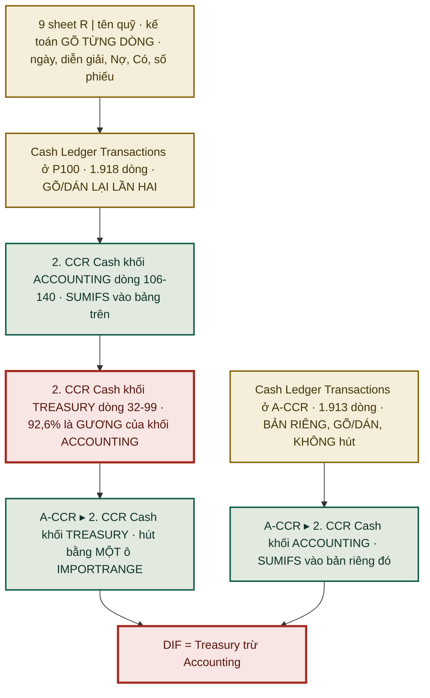

# Kết quả đo `P100 | Cash Ledger` — bảng tính thứ 13 đã mở

**Ngày:** 2026-08-24 · **Loại:** doc-only (Class A) · **Đóng:** `GAP-GUIDE-03` *(danh tính bảng tính thứ 13)*
**Nguồn:** owner chia sẻ bản copy `1RmmkOSCTYVp1DSmNIQLvE9VlWIqhQegqN7lVazWkF7U` ngày 2026-08-24. Bản **GỐC** `1QSYSzCC0…` vẫn `403`.
**Chỉ đọc.** Đọc **công thức** (`valueRenderOption=FORMULA`) — nên `AUD-5` không chặn: công thức sống nguyên trong bản copy.

---

## §1 · Danh tính — không phải sổ ví nhỏ

| Mục | Nội dung |
|---|---|
| **Tên file** | **`P100 \| Cash Ledger`** |
| **Số sheet** | **25** |
| Locale · múi giờ | `en_US` · `Asia/Bangkok` |
| Thuộc hệ | **`P100`** *(hệ thanh toán)*, **không** phải file kế toán |
| Vai trò | **nơi kế toán gõ tay toàn bộ sổ quỹ tiền mặt và ví** — nguồn thật của lằn quỹ/ví |

> ★ `Index` của file tự mô tả quy trình: **Thủ quỹ `ThuongCT`** · ba nhánh **Thu** *(`BN` phiếu biên nhận, `T1–T3`)* · **Chi** *(`XQ` phiếu xuất, `C1–C3`)* · **Tồn quỹ** *(`KK` biên bản kiểm kê, `Q1–Q3`)*. Vai: `Kế toán` nhập và lập phiếu, `Thủ quỹ` kiểm tiền và ký.

**Các sheet nặng nhất:**

| Sheet | Dòng lưới | Ghi chú |
|---|--:|---|
| `Log` | **130.901** | |
| `R \| VND_HotBonus` | **43.857** | sổ quỹ lớn nhất |
| ⚠ `Copy of R \| VND_HotBonus` | **43.868** | **bản sao gần hệt** — `KILL-9` |
| `Employee_Info` | 3.357 | dữ liệu nhân sự |
| `Tiền bay_HN` | 2.480 | |
| `Cash Ledger Transactions` | 1.918 | bảng giao dịch gộp |
| `2. CCR Cash` | 232 × 719 | **nguồn của cổng đối soát ví** |
| `9.2.Exchange Rate` | 1.029 | tỷ giá tháng |

⚠ Sheet chết/trùng: `Copy of R \| VND_HotBonus` · `Copy of Phiếu-CNC` · `Phiếu-CNC1`. Cùng họ với 6 nhóm đã tìm thấy ở A-CCR.

---

## §2 · ⭐ Bảng danh mục pháp nhân THẬT — có mã số thuế

`Index!L1:P10` là một **danh mục pháp nhân có chủ**, không phải bảng tra tự sinh:

| Mã | Tên công ty | Mã số thuế |
|---|---|---|
| `VGOH` | CÔNG TY CỔ PHẦN APERO HQ | `0110872412` |
| `VVOH` | CÔNG TY CỔ PHẦN ASTRONEX | `0110881505` |
| `VVOT` | CÔNG TY CỔ PHẦN TERASOFTS | `0110859690` |
| `VVOV` | CÔNG TY CỔ PHẦN VISIONLAB | `0110872395` |
| `VVOS` | CÔNG TY CỔ PHẦN SUPERMINDS | `0110872437` |
| `BGO1` · `BGO2` · `CNTT` · `CNCT` | *(chỉ có mã, không có tên/MST)* | — |

★★ **Xác nhận độc lập cho 25 ô gõ tay ở bảng pháp nhân của file ADJUSTED.** Ngày 22/08 tôi đo được 19 ô gõ tay ánh xạ `TERASOFTS→VVOT` · `VISIONLAB→VVOV` · `ASTRONEX→VVOH` · `SUPERMINDS→VVOS`, và kết luận *"người đang dịch đúng chỗ máy không dịch được"*. **Danh mục này chứng minh điều đó** — bốn ánh xạ khớp đúng, và chúng đến từ một danh mục có mã số thuế.

⚠ **Hai điều danh mục này KHÔNG giải:**

| Vấn đề | Trạng thái |
|---|---|
| Bốn mã `VOOA` · `VOOL` · `VOON` · `VGC1` *(`GAP-ITL-47`)* | ⛔ **KHÔNG có trong danh mục này** — vẫn chưa xác nhận là pháp nhân thật |
| Từ vựng lệch nhau | danh mục này có **`CNTT`** và **`CNCT`**; bảng pháp nhân của ADJUSTED gõ tay **`CNC`** cho 4 tài khoản. **Hai từ vựng khác nhau** — nêu ra, không tự chọn bên (`R-A4`) |

---

## §3 · ★★★ Phát hiện nặng nhất: cổng đối soát lằn quỹ/ví **so sổ với gương của sổ**

### 3.1 · Chuỗi dữ liệu thật, đo được

### 3.2 · Số đo — quét đủ **644 cột ngày**, không lấy mẫu

Khối `TREASURY` *(dòng 32–99)* của `2. CCR Cash` trong `P100`, **5.806 ô có nội dung**:

| Loại ô | Số | Tỷ lệ |
|---|--:|--:|
| **Tham chiếu MỘT ô sang khối `ACCOUNTING`** *(`=L130`, `=L117`…)* | **4.744** | **81,7%** |
| **`sum()` trên khối `ACCOUNTING`** | **635** | **10,9%** |
| **Hằng số — người gõ thật** | **427** | **7,4%** |

⇒ **92,6% khối "số dư THẬT" là gương của khối "số dư tính từ sổ".**

### 3.3 · Ô người gõ nằm ở đâu — và bao phủ bao nhiêu

Ô gõ tay xuất hiện **từ 01/10/2025** cho 7 tài khoản, nhưng **rời rạc**. Đo trên **60 ngày thật gần nhất** *(26/06 → 24/08/2026)*:

| Tài khoản | Ô gõ | Gõ lần cuối | Bao phủ 60 ngày |
|---|--:|---|--:|
| `Hotbonus · Cash · VND` | 93 | 18/08/2026 | **41/60** |
| `CNC · Cash · VND` | 108 | 21/08/2026 | **39/60** |
| `CN02 · PO · USD` | 70 | 23/08/2026 | 20/60 |
| `BGO1 · PO · USD` | 82 | 12/08/2026 | 19/60 |
| `CN03 · ACB · USD` | 48 | 31/07/2026 | 13/60 |
| `PO · HKD` | 15 | 17/08/2026 | **2/60** |
| `Pingpong · USD` | 1 | **01/10/2025** | **0/60** |
| `Pingpong · HKD` | 1 | **01/10/2025** | **0/60** |
| | | **Tổng** | **134 / 480 = 28%** |

⚠ Năm dòng khác *(47–51, 53–57)* **chưa bao giờ được gõ** — dòng khuôn trống.

### 3.4 · Nói chính xác phép kiểm này đang kiểm cái gì

Bảng `Cash Ledger Transactions` **tồn tại HAI bản gõ tay độc lập**: một ở `P100` *(1.918 dòng lưới)*, một ở `A-CCR` *(1.913 dòng lưới, `canh_importrange = []`, 8 cột hằng, 0 cột tính — tức **không hút từ đâu**)*.

⇒ Với **72% ô ngày gần đây**, `DIF = Treasury − Accounting` **không** so *tiền thật* với *sổ*. Nó so **hai bản gõ tay của cùng một bảng giao dịch** với nhau.

| `DIF = 0` chứng minh được | `DIF = 0` KHÔNG chứng minh |
|---|---|
| Hai bản `Cash Ledger Transactions` khớp nhau | ✋ Số dư ví thật khớp với sổ |
| — | ✋ Không lọt giao dịch nào ngoài sổ |

> ★ **Điều này giải thích một quan sát cũ.** Tài liệu ghi: `2. CCR Cash` có `DIF = 0` liên tục 12 ngày ⇒ *"lằn quỹ/ví đang khớp"*, còn lằn ngân hàng lệch **−9,53 tỷ**. Nay biết vì sao khác nhau: **lằn ngân hàng có số dư người gõ THẬT từ sao kê** *(`2. CCR!K32 = 1390708396` hằng số)* nên cổng đó kiểm được thật. **Lằn quỹ/ví thì 72% ô đang tự so với chính mình** — nó khó mà không bằng 0.
>
> ⚠ **Không kết luận là tautology hoàn toàn:** vì hai bản `Cash Ledger Transactions` là hai bản riêng, `DIF ≠ 0` vẫn nổ được khi hai bản lệch. Nhưng đó là **phép kiểm đồng bộ bản sao**, không phải phép **đối soát quỹ**. Nhãn đang gọi nó là cái thứ hai.

---

## §4 · Bốn bẫy thiết kế trong file này — đều cùng họ với bẫy đã biết

| # | Bẫy | Ở đâu | Cùng họ với |
|--:|---|---|---|
| 1 | **`INDIRECT` dựng từ chuỗi** — `=IFERROR(SUMIFS(INDIRECT($B4&$F4), INDIRECT($B4&$E4), …))`. Đích nằm trong ô, **không phân tích tĩnh được** | `Cash Ledger List` | nặng hơn `IMPORTRANGE` động — `D2` |
| 2 | **Khoá tự sinh bằng `UNIQUE`** — `C8 = =UNIQUE('R \| VND_HotBonus'!H3:H)` | `Cash Ledger List` | đúng bẫy của bảng pháp nhân `Daily RP test` — `QĐ-ITL-30` |
| 3 | **Số dư luỹ kế nối theo VỊ TRÍ DÒNG** — `R4 = =R3+D4-E4`, từng dòng một. Chèn một dòng giữa sổ là **đứt chuỗi** | mọi sheet `R \| …` | `itl_id` = số thứ tự dòng |
| 4 | ⚠ **Ngày dựng lại từ chuỗi** — `=ArrayFormula(SPLIT(A3:A,"/"))` → `Month`, `Day`, `Year` → `=ArrayFormula(DATE(Y3:Y,W3:W,X3:X))`. File đặt locale **`en_US`** *(M/D/Y)* trong khi dữ liệu là Việt *(D/M/Y)* | `R \| VND_CNC` và các sheet `R \| …` | **cùng họ với nợ hoán ngày↔tháng 93% dòng** |

⚠ Bẫy số 4 là **một cơ chế có thật sinh ra hoán ngày↔tháng**, đo được. Nhưng **chưa chứng minh** đây là nguyên nhân của nợ ngày trong `ITL` — đó là hai sổ khác nhau. Ghi nhận là **giả thuyết đáng đo**, không phải kết luận.

---

## §5 · Hai việc gõ tay HAI LẦN — chỗ code hoá mua được nhiều nhất

| Việc gõ đôi | Bằng chứng |
|---|---|
| **Giao dịch quỹ nhập hai chỗ**: từng sheet `R \| …` **và** bảng gộp `Cash Ledger Transactions` | `Cash Ledger List` cột `N` có phép kiểm `=I3=L3` — *"tổng từ sheet quỹ phải bằng tổng từ bảng gộp"*. **Phép kiểm này tồn tại VÌ dữ liệu được nhập hai lần** |
| **Bảng gộp lại có hai bản** ở `P100` và `A-CCR`, cả hai đều gõ/dán, không bản nào hút bản nào | `canh_importrange = []` ở bản `A-CCR` |

★ Đây đúng là **loại 2 · máy chở** trong phép phân loại 4 loại ô: **việc di chuyển dữ liệu do người làm bằng tay.** Code hoá nó thì kế toán **gõ ít đi**, không phải gõ thêm — ngược với hướng thường lo. Và nó **không cần một màn hình nào**.

---

## §6 · ⚠ Hai vấn đề quyền riêng tư và bảo mật

| # | Vấn đề | Chi tiết |
|--:|---|---|
| 1 | **Dữ liệu định danh cá nhân trong sổ quỹ** | Các sheet `R \| …` có cột `Họ và tên (*)` · **`Số CMND/CCCD/Passport (*)`** · `Chức danh`, kéo bằng `VLOOKUP` vào `Employee_Info` *(3.357 dòng)*. ⛔ **Tôi không đọc giá trị các cột này.** File đang được chia sẻ dạng bản copy |
| 2 | **Cột `ID` và `Pass`** trong `2. CCR Cash` *(cột `H`, `I`, hàng tiêu đề dòng 31)* | Xác nhận `KILL-5` — thông tin đăng nhập cổng ví nằm trong bảng tính. ⛔ **Tôi không đọc giá trị.** |

---

## §7 · Việc mở ra

| ID | Việc | Ai |
|---|---|---|
| `GAP-ITL-49` ⭐⭐ | **Cổng đối soát lằn quỹ/ví đang so sổ với gương của sổ** ở 72% ô ngày gần đây. Hỏi kế toán: **số dư ví thật lấy từ đâu** — có sao kê cổng ví không, ai đọc, nhịp nào? Nếu có thì khối `TREASURY` phải là **số gõ tay**, không phải `=L130` | **kế toán + owner** |
| `GAP-ITL-50` ⭐ | **`Cash Ledger Transactions` có HAI bản gõ tay độc lập** *(`P100` và `A-CCR`)*. Đo xem hai bản lệch bao nhiêu dòng — nếu lệch thì `DIF` của lằn ví đang báo sai | tôi *(đo được ngay)* |
| `GAP-ITL-51` | **Dữ liệu định danh cá nhân** *(CMND/CCCD/Passport)* và **`ID`/`Pass` cổng ví** nằm trong bảng tính đang chia sẻ. Ai được xem? | owner |
| `GAP-ITL-52` | **Từ vựng pháp nhân lệch nhau**: danh mục `P100` có `CNTT`/`CNCT`, bảng ADJUSTED gõ `CNC`. Bản nào đúng? | kế toán trưởng |
| `KILL-9` | `Copy of R \| VND_HotBonus` — **43.868 dòng**, bản sao gần hệt sheet 43.857 dòng. Cùng `Copy of Phiếu-CNC`, `Phiếu-CNC1` | ⏸ chờ uỷ quyền `QĐ-ITL-34` |
| — | **Việc thứ 6 gửi A-CCR**: nhãn `Treasury` của lằn quỹ/ví không phải số dư thật ở 92,6% ô | Tech Lead A-CCR |

---

## §8 · Nghĩa gì và bước tiếp

**Nghĩa gì:**

1. **Bảng tính thứ 13 không phải một phụ lục** — nó là `P100 | Cash Ledger`, 25 sheet, và là **nơi kế toán gõ toàn bộ sổ quỹ**. Phải đưa vào danh mục nguồn.
2. **Cổng đối soát của lằn quỹ/ví yếu hơn tài liệu ghi.** `DIF = 0` mười hai ngày liền **không** chứng minh tiền ví khớp sổ — 72% ô đang tự so với chính mình. Lằn ngân hàng thì cổng thật, và nó đang đỏ −9,53 tỷ.
3. **Có hai lớp gõ đôi.** Giao dịch quỹ nhập hai chỗ trong `P100`, rồi bảng gộp lại có hai bản ở hai file. Code hoá chỗ này làm kế toán **gõ ít đi**.
4. **Bốn bẫy thiết kế ở đây trùng họ với bẫy đã biết** — `INDIRECT` từ chuỗi · khoá `UNIQUE` tự sinh · số dư nối theo vị trí dòng · ngày dựng lại từ chuỗi. Không được bê sang hệ mới (`D2`).

**Bước tiếp:**

| # | Việc | Ai |
|--:|---|---|
| 1 | **Hỏi kế toán `GAP-ITL-49`** — số dư ví thật lấy từ đâu | owner |
| 2 | **Đo hai bản `Cash Ledger Transactions` lệch nhau bao nhiêu** *(`GAP-ITL-50`)* — chỉ đọc, làm được ngay | tôi |
| 3 | Đưa `P100 \| Cash Ledger` vào danh mục nguồn: **12 + 1 = 13 bảng tính** | tôi |

---

# Bổ sung 2026-08-24 (chiều) — owner trả lời hai câu, và đo xong `GAP-ITL-50`

## §9 · ✅ `GAP-ITL-49` — owner trả lời: **kế toán kiểm bằng MẮT, bên ngoài**

> `[O]` **"Số dư ví thật lấy từ đâu? — Kế toán check các tài khoản bằng mắt bên ngoài."**

Câu trả lời này **không đóng vấn đề, nó định nghĩa lại vấn đề** — và theo hướng tốt hơn:

| Trước khi biết | Sau khi biết |
|---|---|
| Nghi *"không có ai kiểm số dư ví"* | ❌ Sai — **CÓ kiểm**, kế toán mở cổng ví ra xem |
| — | ⚠ Nhưng **phép kiểm đó không để lại dấu vết nào** trong hệ |

**Vấn đề thật, phát biểu lại cho đúng:**

> ★ Kế toán nhìn thấy số dư thật, nhưng **ô để ghi lại điều họ thấy đang bị một công thức chiếm** — `=L130` trỏ sang khối `ACCOUNTING`. Nên 92,6% số lần kiểm bằng mắt **bay hơi**: không ai biết ngày nào đã kiểm, ngày nào chưa, và kiểm ra khớp hay không khớp.

**Ba hệ quả:**

| # | Hệ quả |
|--:|---|
| 1 | **Công thức gương chính là "máy tự sáng tác"** — nó điền vào chỗ đáng ra phải trống. Trống mới là sự thật: *"ngày này chưa có ai ghi lại số dư"*. Đây đúng loại lỗi mà đích `6.843 → 0` nhắm tới |
| 2 | **`DIF = 0` không phân biệt được** *"đã kiểm và khớp"* với *"chưa ghi lại gì"*. Hai trạng thái rất khác nhau, hiện ra cùng một con số |
| 3 | **Máy KHÔNG thay được việc này.** Không có kết nối tự động tới cổng ví; và `ID`/`Pass` nằm trong bảng tính **không phải đường tôi sẽ dùng**. ⇒ **Số người gõ là sự thật bên ngoài DUY NHẤT có thể có** ⇒ thuộc nhóm **ở lại Google Sheets vĩnh viễn**, đúng luật `T4` |

**Cách chữa — không thêm bước duyệt, không đòi gõ thêm hàng loạt** *(`QĐ-ITL-27` · `QĐ-ITL-32`)*:

| # | Việc | Ai gõ thêm |
|--:|---|---|
| 1 | **Máy công bố độ phủ**: mỗi ví × mỗi ngày, *đã có số người ghi* hay *chưa*. Đổ ra tab "Cổng hôm nay" của sheet gương | **0 ô** |
| 2 | **Xếp theo TIỀN**: chỉ nêu những ví mà số ngày trống đang gánh nhiều tiền, để 2–3 kế toán gõ **đúng chỗ đáng gõ** | vài ô/ngày |
| 3 | **Bỏ công thức gương**, để trống là trống *(`KILL-10`)* — ⏸ chờ uỷ quyền, vì là sửa file kế toán | 0 |

⚠ Hôm nay kế toán **đã gõ 28%** số ô của 60 ngày gần nhất. Nên đây không phải yêu cầu một việc mới — là **hoàn thiện một việc họ đang làm dở**, và cho máy biết chỗ nào còn dở.

---

## §10 · ✅ `GAP-ITL-51` — owner trả lời: **kế toán và owner** được xem

> `[O]` **"Ai được xem CMND/CCCD/Passport và ID/Pass? — Kế toán và tôi."**

⇒ **Đóng.** Quyền là cố ý và có giới hạn.

Hai điều ghi lại cho đúng, không bàn thêm:

| # | Ghi nhận |
|--:|---|
| 1 | **Tài khoản đọc của máy hiện cũng nằm trong danh sách chia sẻ** của bản copy này. Tôi đặt luật cho mình: **không đọc giá trị** các cột `Họ và tên` · `Số CMND/CCCD/Passport` · `Chức danh` · `ID` · `Pass`. Đã giữ luật này trong toàn bộ phép đo *(chỉ đọc hàng tiêu đề và công thức)*. Nếu owner muốn siết, cách gọn nhất là **thu hồi quyền bản copy sau khi đo xong** |
| 2 | `ID`/`Pass` là **khác loại** với dữ liệu cá nhân: ai mở được file thì đăng nhập được cổng ví. `KILL-5` giữ nguyên là việc nên làm, nhưng **owner đã quyết phạm vi truy cập** ⇒ tôi không nêu lại |

---

## §11 · ✅ `GAP-ITL-50` ĐÃ ĐO — hai bản sổ giao dịch **KHỚP NHAU**, chỉ TRỄ 2–4 ngày

**Cách đo:** đọc giá trị `Cash Ledger Transactions!A2:H1920` trên **cả hai** bản copy, so bằng khoá *(ngày · số phiếu · nguồn · Nợ · Có)*. Hai sheet này **không có `IMPORTRANGE`** *(`canh_importrange = []`)* nên đọc giá trị trên bản copy là **hợp lệ** — `AUD-5` không chặn.

| | P100 | A-CCR |
|---|--:|--:|
| Dòng có dữ liệu | **1.915** | **1.911** |
| Ngày đầu | 29/12/2024 | 29/12/2024 |
| **Ngày cuối** | **23/08/2026** | **19/08/2026** |

**Bốn dòng lệch — tất cả đều chỉ có ở P100, tất cả đều sau ngày cuối của bản A-CCR:**

| Ngày | Nguồn | Nợ | Có | Số phiếu |
|---|---|--:|--:|---|
| 21/08/2026 | `R \| VND_CNC` | 250.000.000 | | `PT00054CNCT` |
| 21/08/2026 | `R \| VND_CNC` | 250.000.000 | | `PT00055CNCT` |
| 21/08/2026 | `R \| VND_CNC` | | 50.000.000 | `PC00146CNCT` |
| 23/08/2026 | `R \| PO` | | 10.000 | `1027403402` |

Tổng lệch: **Nợ 500.000.001,24** · **Có 50.010.000**.

> ★ **Kết luận: trong khoảng thời gian hai bản cùng phủ (tới 19/08/2026), lệch = 0 dòng.** Hai bản gõ tay **khớp nhau tuyệt đối** trên 1.911 dòng. Phép kiểm đồng bộ bản sao **đang đạt**.
>
> Bốn dòng lệch **không phải sai lệch nội dung mà là ĐỘ TRỄ 2–4 ngày**.

⚠ **Giới hạn của phép đo, nói thẳng:** hai bản copy tạo ở **hai thời điểm khác nhau** *(bản A-CCR đọc được từ 22/08; bản P100 owner tạo 24/08)*. Nên không phân biệt được độ trễ này là **của file A-CCR đang sống** hay chỉ là **thời điểm chụp bản copy**. Muốn biết chắc phải đọc **file A-CCR gốc** — hiện không có quyền.

### 11.1 · ⭐ Một dự đoán kiểm được — cổng ví lẽ ra **đang đỏ**

Nếu độ trễ này là thật trên file đang sống thì cơ chế sau bắt buộc xảy ra:

| Vế | Nguồn | Cập nhật tới |
|---|---|---|
| `Treasury` của A-CCR | `IMPORTRANGE` **sống** từ P100 ⇒ gương của `ACCOUNTING` ở P100 ⇒ tính từ sổ P100 | **23/08** |
| `Accounting` của A-CCR | `SUMIFS` vào **bản riêng** của A-CCR | **19/08** |

⇒ Với các ngày **20–23/08**, một vế có 4 dòng kia còn vế kia không ⇒ **`DIF` của lằn quỹ/ví phải KHÁC 0**, cỡ **500 triệu** phía Nợ.

⛔ **Tôi không kiểm được dự đoán này từ bên ngoài:** `2. CCR Cash` của A-CCR có 1 cạnh `IMPORTRANGE`, nên trên **bản copy** vế `Treasury` là `#REF!` — đúng bẫy `AUD-5`. Và file A-CCR **gốc** không có quyền đọc.

⇒ **Chuyển thành việc `6d` cho đội A-CCR**: mở `2. CCR Cash` bản sống, xem `DIF` các ngày 20–23/08. Nếu nó vẫn `0` thì có thứ đang che, và cái đó nặng hơn cả độ trễ.

### 11.2 · Hai lỗi của chính tôi trong lần đo đầu — ghi lại làm luật

| # | Lỗi | Sửa | Luật rút ra |
|--:|---|---|---|
| 1 | So bằng **chuỗi hiển thị** ⇒ `312,690` và `312,689.69` bị tính là hai dòng khác nhau. Ra "8 lệch / 4 lệch", **sai gấp đôi** | So bằng **số**, làm tròn về đồng ⇒ **4 lệch / 0 lệch** | ★ `AUD-9` — **`FORMATTED_VALUE` là chuỗi để NGƯỜI đọc, không phải số để MÁY so.** Muốn so số thì phải đổi về số, hoặc đọc `UNFORMATTED_VALUE` |
| 2 | Đọc ngày bằng `%d/%m/%Y` trước ⇒ `08/12/2026` thành **8 tháng 12**, làm mốc so sánh sai | Đọc chặt **`M/D/Y`** | ★ Cột ngày ở file này **hiển thị kiểu `M/D/Y`** — khớp locale `en_US` của file. Đây là **bằng chứng trực tiếp** cho bẫy số 4 ở §4 |

⇒ Bổ sung `KILL-10` *(bỏ công thức gương ở khối `TREASURY`)* và `AUD-9`.
