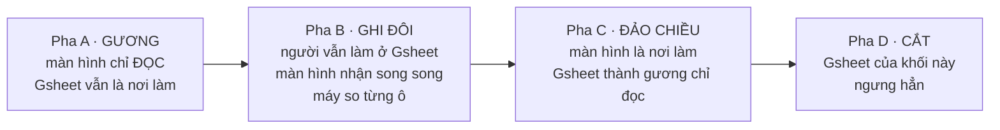

# Lộ trình chuyển đổi Google Sheets → màn hình mới (dần dần, không big-bang)

**Version:** v0.7 | **Ngày:** 2026-09-07 | **Chủ sở hữu:** COO-CFO
**Căn cứ:** `QĐ-ITL-15` (owner chốt 2026-08-19: Google Sheets **thay bằng màn hình mới**, chuyển đổi dần) — đóng `GAP-ITL-02`
**Nguyên tắc nền:** `P-ITL-02` strangler-fig · `P-ITL-03` oracle-first · `P-02` người vận hành nghiệm thu

> ⚠ **Đính chính framing (2026-08-24)** — con số **"6.843 dòng máy tự điền / 6.843 quyết định"** dưới đây là số ô cột `Final` *(AS-IS)*, không phải 6.843 lần người gõ; ô còn cờ `Input here` thật ≈ **5.018**. TO-BE (`QĐ-owner-0820`): `Final` = **kế toán nhập/sửa trực tiếp**, bỏ tầng `MID`, vùng người gõ thu về **5 trường trong hợp đồng**. Chi tiết: [`_BA_UPDATE_ROADMAP §3c`](../_BA_UPDATE_ROADMAP.md).

---

## §00 · ⚠ ĐỌC TRƯỚC — `QĐ-ITL-33` đặt một chặng **TRƯỚC** Đợt 1

Owner chốt 2026-08-22: **phần MÁY trước, màn hình sau** *(đường C)*. Lộ trình này — vốn xếp Đợt 1 = dựng `S1` + `S2` — **lùi lại một chặng**.

| | Trước Đợt 1: **CHẶNG MÁNG** *(mới, `QĐ-ITL-33`)* | Rồi mới tới **Đợt 1–4** *(§4 dưới, giữ nguyên)* |
|---|---|---|
| Cắt gì | **cạnh chở** (`IMPORTRANGE`/`QUERY`/`FILTER`) + **cột tính** (`VLOOKUP`/`SUMIFS`/`ArrayFormula`) | **ô gõ tay** — 22.360 ô, 9 khối |
| Thứ tự | **giá thành tính lại** cao trước: `2. CCR` → `Transaction Mapping L1` → `ITL Ledge` | **rủi ro P&L** thấp trước: khối 7+6 → 3+1+2 → 8+9 |
| Kế toán thấy | **không gì mới** — chỉ thêm một bookmark tới sheet gương do máy sở hữu | 4 màn hình |
| Nghiệm thu | **khớp 100% từng ô. CẤM có ngưỡng** | tỷ lệ **máy suy đúng** ≥ ngưỡng (`GAP-ITL-22`) |
| Mua được | **tốc độ** | chất lượng số · trải nghiệm |

**Vì sao phải đứng trước:** màn hình phải đọc số **từ đâu đó**. Dựng `S1` trước khi cắt máng thì nó đọc qua đúng chuỗi `IMPORTRANGE` hiện tại ⇒ **kế toán vẫn chờ ~33 giây, chỉ là chờ trong một giao diện đẹp hơn**; và sau này cắt máng lại phải đổi nguồn của màn hình = **làm hai lần**.

⛔ **`QĐ-ITL-34` (owner, 2026-08-24) — KHÔNG đụng vào sheet hiện có, KHÔNG động vào file của kế toán.** Áp vào lộ trình này ở hai chỗ:

| Chỗ | Đổi thành |
|---|---|
| **Chặng máng** *(§00)* | vẫn làm đủ, nhưng **không được làm nhẹ sổ cũ** ⇒ **sổ hiện tại sẽ không nhanh hơn**. Tốc độ chỉ hiện ra trên **sheet gương do máy sở hữu** *(file mới — không chạm file kế toán)*. Ba việc rẻ nhất *(dọn sheet chết · dừng bảng đo hỏng · bỏ 305 cạnh tự-kiểm)* ⇒ ⏸ **chờ uỷ quyền riêng** |
| **Pha D · CẮT** *(§2)* | ⏸ **cần một lần uỷ quyền riêng của owner cho từng khối** — "cắt" nghĩa là **sửa file của kế toán**. Pha A/B/C **không vướng** *(chỉ đọc + ghi vào hệ mới)* |

**Không đổi gì khác:** 4 màn hình vẫn dựng · thứ tự **trong** Lằn Ô vẫn khối 7+6 trước · 4 pha mỗi khối vẫn nguyên · 4 nhóm ở lại Google Sheets vẫn vĩnh viễn. Chi tiết phương pháp: `Phuong-phap-luan-Codehoa-va-Thiet-ke-TOBE.md` v0.3.

---

## §0 · ⚠ RÀNG BUỘC NỀN — vận hành thật chỉ có **2–3 người**

`[O]` **Owner xác nhận 2026-08-22:** luồng `PM → ITL` trên thực tế do **2–3 kế toán** thực hiện. **Kế toán trưởng và CFO-COO hầu như không tham gia.**

Ràng buộc này **lật ba giả định** của bản v0.1:

| v0.1 giả định | Thực tế | Hệ quả |
|---|---|---|
| Có người thứ hai để hậu kiểm (`RP-I11`) | **không có ai** | kiểm soát **phải đến từ máy**, không từ người |
| Có cấp trên để leo thang khi quá hạn | **không có** | thay bằng *"việc không tự biến mất"* + **tuổi việc hiện rõ** |
| Pha B *"người nhập cả hai chỗ"* khả thi | **không trả nổi** — 22.360 ô gõ lại | **bỏ gõ đôi** (xem §2) |

> ★ **Rủi ro lớn nhất không phải gian lận — là một người rời đi.** Hai người đang giữ **6.843 quyết định** trong đầu. Việc đáng nhất là **rút luật ra thành luật máy** (`proposed_by_rule`), không phải thêm người kiểm.

---

## §0b · Ranh giới **Google Sheets ↔ Hệ thống**

Ba luật phân định:

| # | Luật | Vì sao |
|--:|---|---|
| **T4** | Nơi **dữ liệu thô từ ngoài đi vào** ⇒ **giữ Google Sheets lâu nhất** | 60+ ngân hàng, mỗi bank một định dạng, chưa có API. Chuyển chỗ này mua ít nhất, rủi ro cao nhất |
| **T5** | Nơi **máy tính và kiểm** ⇒ **hệ thống, ngay từ chặng 1** | không cần giao diện, không đòi ai đổi thao tác |
| **T6** | Nơi **người quyết định trên từng dòng** ⇒ **hệ thống, chặng 2** | đây mới là chỗ màn hình đáng tiền |

### Chặng 1 — **không có giao diện mới nào**

| Giai đoạn | Trên Google Sheets *(giữ nguyên)* | Máy làm ngầm — không giao diện |
|---|---|---|
| ① Nạp tiền | ✋ nạp sao kê từng tài khoản | đếm nguồn trễ hạn |
| ② Đối soát | ✋ nhập số dư thật từng ngày | so tiền thật ↔ sổ · **đếm tài khoản không kiểm được** |
| ③ Ghép lệnh | ✋ gõ mã vào lệnh chi *(Google Form)* | phân loại **3 trạng thái** · **đọc mã lệnh trong diễn giải** · bắt mã trùng |
| ④ Vào sổ | ⚙ công thức sổ | đếm khoá trùng · dòng mất khoá |
| ⑤ Chốt sổ | ✋ gõ 7 trường vùng ADJUSTMENT | ⛔ **chưa với tới** — bản copy **không giải được**, cần quyền xem **file GỐC** (`GAP-ITL-39`) |
| **Đầu ra** | 📋 **Bảng việc = một Google Sheet RIÊNG do máy sở hữu** | máy ghi, người chỉ gõ **một cột: lý do** |

⛔ **Cấm ghi vào file đang sống** (`A-CCR`, `ITL RAW/ADJUSTED`) — luật `live-sheet-absolute-range-hazard`, đã có sự cố 2026-08-13.

⇒ Chặng 1 kế toán **không thấy màn hình mới nào**; chỉ thêm một bookmark.

### Chặng 2 — **4 màn hình, không phải 7**

Ba quyết định 2026-08-22 (`QĐ-ITL-26` không chặn · `QĐ-ITL-27` không có người thứ hai · `QĐ-ITL-32` bỏ gõ đôi) làm **3 trong 7 màn thành màn giả**:

| Màn (§3) | Quyết | Vì sao |
|---|:--:|---|
| `S1` Hàng chờ điền trường | ✅ **giữ** | chính là **bảng việc lên đời** — chỗ 2–3 người sống |
| `S2` Nhật ký thay đổi | ✅ **giữ** | không chặn + không hậu kiểm người ⇒ **kiểm soát duy nhất còn lại** |
| `S3` Bảng đối soát & chất lượng | ✅ **giữ** | chứa cổng tiền + đúng "một trang cho CFO" |
| `S5` Truy vết ngược | ✅ **giữ** | cần để xử ~50 dòng: từ dòng tiền đi ngược về lệnh chi |
| `S4` Nạp sao kê | ⭐ **SỐNG LẠI** *(2026-09-07)* | ~~luật `T4` — sao kê ở lại Google Sheets~~ ⇒ **`QĐ-ITL-90`** đưa nó về FLS thành **`F04`**. ⭐ **Sửa 07/09 sau khi rà AS-IS:** phạm vi ⛔ **không** hẹp như bản đầu ghi. Tầng kế toán **gõ vào** là **67 sheet `R \| <tài khoản>`** *(**16.625 dòng**)*; `Bank Transactions` **7.715 dòng** là **đầu ra của `OP-09` bấm Run**. ⭐ Nhưng *“60+ định dạng”* là 60+ **tài khoản**, ⛔ không phải 60+ **lược đồ** ⇒ **một khuôn + bảng buộc `BNK`**, ⛔ không phải 60 bộ phân tích *(`GAP-SCOPE-01` đã viết lại)* |
| ~~`S6` Quản lý bảng ánh xạ~~ | ⛔ **HOÃN** | thay đổi vài lần/năm; giữ Sheet + bắt nhật ký là đủ |
| ~~`S7` Chốt kỳ & ký quỹ~~ | ⛔ **BỎ** | cổng **không chặn** và kế toán trưởng **không tham gia** ⇒ chữ ký giả |

### Ở lại Google Sheets — có thể là mãi

> ⭐⭐⭐ **BẢNG NÀY ĐÃ BỊ LẬT MỘT NỬA — `QĐ-ITL-90` (owner, 2026-09-07).**
> Hai dòng đầu **⛔ không còn đúng**: FLS nay cầm luôn **giao diện nhập**
> `Bank Transaction` *(`F04`)* + `Cash Ledger` *(`F05`)*. Hai dòng dưới **vẫn đúng**.
> ⛔ Giữ nguyên bảng cũ làm **biên bản**, ⛔ không xoá — xem `CR#10`.

| Ở lại | Vì sao | Đóng `GAP-ITL-23` | ⭐ Trạng thái 2026-09-07 |
|---|---|:--:|---|
| ~~Nạp sao kê ngân hàng & quỹ~~ | ~~60+ định dạng, không API~~ | ~~✅~~ | ⛔⛔ **LẬT** — về FLS thành **`F04`**. ⭐ **Sửa 07/09:** tầng gõ vào là **67 sheet `R \| <tài khoản>`** *(**16.625 dòng**, `OP-01`, trước 11:00)*; `Bank Transactions` **7.715 dòng** là **đầu ra máy**. ⛔ Chặn thật: **`_GUIDE_08` không tồn tại** ⇒ `GAP-ASIS-01` |
| ~~Nhập số dư thật từng ngày~~ | ~~người đọc sao kê rồi gõ~~ | ~~✅~~ | ⛔⛔ **LẬT** — về FLS thành **`F05`** *(`Cash Ledger Transactions`)* |
| Lệnh chi (Google Form) | nghiệp vụ đã quen form; máy giờ đọc mã trong diễn giải nên bớt phụ thuộc | ✅ | ✅ **VẪN Ở LẠI** — `QĐ-ITL-90` ⛔ không đụng tới |
| Bảng danh mục (tài khoản · ánh xạ) | thay đổi vài lần một năm | ✅ | ✅ **VẪN Ở LẠI** — `QĐ-ITL-90` ⛔ không đụng tới |

⇒ ~~**`GAP-ITL-23` ĐÓNG**: Google Sheets **giữ vai nhập liệu thô vĩnh viễn** cho 4 nhóm trên.~~

⇒ ⭐⭐ **SỬA 2026-09-07 (`QĐ-ITL-90`):** Google Sheets giữ vai nhập liệu thô cho **2 nhóm** — *lệnh chi (Google Form)* và *bảng danh mục*. Hai nhóm còn lại **về FLS**. ⛔ Từ *"vĩnh viễn"* trong câu cũ đã sống được **16 ngày** — ghi lại để lần sau đừng dán nhãn *vĩnh viễn* cho một ranh giới chưa ai thử đẩy.

---

## §1 · Nguyên tắc: chuyển theo **KHỐI VIỆC**, không theo màn hình

Nếu chia theo màn hình ("làm xong màn A rồi sang màn B") thì mỗi màn hình chạm cả 5 workbook và không cắt được gì. Nếu chia theo **khối việc gõ tay**, mỗi đợt cắt hẳn một khối khỏi Google Sheets và đo được.

Có **9 khối việc** (7 khối `ITL Ledge` + 2 khối 4 ledger nền tảng), tổng **22.360 ô** — số đã đếm ở `_GUIDE_00`.

### Thứ tự chuyển = theo **RỦI RO**, không theo khối lượng

Đây là quyết định thiết kế quan trọng nhất của lộ trình. Xếp theo *"gõ sai thì hỏng cái gì"*:

| Khối | Trường | Ô | Có tới engine P&L? | Gõ sai thì |
|---|---|--:|:--:|---|
| 7 | `File đính kèm: Hóa đơn` | **3.489** | ❌ | Mất truy vết chứng từ |
| 6 | `Mã đối tác (ID Payee)` | **1.624** | ❌ | Mất truy vết đối tác |
| 3 | `Chủ dự toán (CDT1)` | 1.210 | ✅ | **Sai đơn vị chịu chi phí ⇒ sai P&L** |
| 1 | `Budget Code (HDCode)` | 297 | ✅ | **Sai dòng khoản mục ⇒ sai P&L** |
| 2 | `Loại giao dịch (Payment Type)` | 179 | ✅ | **Sai phân loại ⇒ sai P&L** |
| 4–5 | Ngày bắt đầu/kết thúc DV | 22 + 22 | ✅ | **Sai kỳ ghi nhận** |
| 8 | ADJUSTMENT 4 ledger nền tảng `CFA1` | 2.268 | ✅ | Sai chi phí/doanh thu nền tảng |
| 9 | ADJUSTMENT 4 ledger nền tảng `CFA2 MID1` | **13.249** | ✅ | Sai phân bổ venture |

**Bắt đầu ở khối 7 và 6** (`5.113 ô = 23%` khối lượng, **0 rủi ro P&L`) — chỗ dạy đội cách dùng màn hình mới mà nếu sai thì báo cáo không lệch một đồng. Chỉ sau khi khuôn màn hình đã chứng minh, mới chạm khối 3/1/2 có ảnh hưởng P&L, và lúc đó mới cần đối soát oracle từng ô.

Khối 9 (13.249 ô) để **cuối** dù lớn nhất — vì nó là logic phân bổ venture, chạm tầng L4, và còn chờ `GAP-ITL-18` (ranh giới với engine ACA v2).

---

## §2 · Bốn pha cho mỗi khối — strangler-fig ở mức khối

> ⚠ **`QĐ-ITL-32` (2026-08-22) — BỎ pha "ghi đôi".** v0.1 tự mâu thuẫn: bảng pha B ghi *"người nhập cả hai chỗ"*, còn phần nghiệm thu đợt 1 lại ghi *"tỷ lệ **máy suy đúng** so với giá trị **người đã nhập trong Gsheet**"*. **Câu thứ hai đúng và rẻ hơn** — không ai phải gõ lần hai.
>
> Với 2–3 người, gõ đôi **đảm bảo họ dùng mặc định nhiều hơn** ⇒ lộ trình tự làm hỏng chính dữ liệu nó đang đo. Và máy-suy-đối-chiếu đo **đúng thứ cần đo**: không phải *"cái máng có nhận đúng không"* mà *"luật của máy có đoán đúng không"*.

Mỗi khối đi qua đúng 4 pha. **Không khối nào được nhảy pha.**

| Pha | Ai làm ở đâu | Điều kiện sang pha sau | Đo bằng |
|---|---|---|---|
| **A · Gương** | Google Sheets | Màn hình hiện **đúng 100%** giá trị Gsheet đang có, cho toàn bộ ô của khối | Diff 0 ô lệch, 2 kỳ liên tiếp |
| **B · MÁY SUY ĐỐI CHIẾU** *(v0.2 — thay "ghi đôi")* | Google Sheets (chính). **Người gõ MỘT lần như cũ**; máy đoán song song rồi **tự so với cái người đã gõ** | Tỷ lệ **máy suy đúng** ≥ ngưỡng (`GAP-ITL-07`) trong **1 kỳ**. Kèm **một mẫu nhỏ có chọn** (vài chục ô) để kiểm màn hình ghi đúng | % máy suy đúng · danh sách lệch có lý do |
| **C · Đảo chiều** | **Màn hình** (chính); Gsheet chuyển read-only | Chạy **1 kỳ** không sự cố; người vận hành xác nhận không chậm hơn cách cũ | Thời gian hoàn thành khối ≤ cách cũ · 0 sự cố chặn |
| **D · Cắt** | Chỉ màn hình | PIC ký nghiệm thu; ghi vào Excel kill-list | Biên bản ký + số ô Gsheet còn lại = 0 |

**Luật cứng:** ở pha B và C, **Gsheet và màn hình phải cùng đọc một nguồn** (`ITL` trong hệ), không phải hai nguồn song song. Nếu để hai nguồn thì hai bên trôi và không so được — đây là bẫy phổ biến nhất của kiểu chuyển đổi này.

---

## §3 · Bảy màn hình *(v0.2: còn **4** — xem §0b)*

Màn hình **không phải** bản sao của sheet. Mỗi màn hình là **hàng chờ việc** dựng trên metamodel `TST/TSI/TSEV` đã có (xem `ArchitecturePack-Ledger` §2) — nên đổi người phụ trách hay thêm bước duyệt **không** phải đổi schema.

| # | Màn hình | Phục vụ khối / thao tác | Cần từ đợt |
|---|---|---|---|
| **S1** | **Hàng chờ điền trường** — danh sách `TSI` đang `needs_input`, lọc theo khối/kỳ/người; điền hàng loạt; hiện gợi ý máy suy kèm **độ tin** | Khối 1–7 · `OP-07` | Đợt 1 |
| **S2** | **Nhật ký thay đổi** — mọi sửa đổi bút toán điều chỉnh: ai, khi nào, từ gì sang gì, lý do (`QĐ-ITL-16`) | Toàn bộ khối · `OP-13` | **Đợt 1** (bắt buộc, xem §5) |
| **S3** | **Bảng đối soát & chất lượng** — số dư ngày × tài khoản, đếm dòng vào/ra, `#N/A`, tỷ lệ khớp `reference_number` | `OP-10`, `OP-12`, `OP-23` | Đợt 2 |
| **S4** | **Nạp sao kê** — kéo/thả file từng tài khoản, hiện ngay số dòng nhận/loại + lý do loại; đồng hồ **SLA 11h** | `OP-01`, `OP-05` | Đợt 2 |
| **S5** | **Truy vết ngược** — từ một dòng sổ đi ngược về sao kê, lệnh chi, chứng từ | `OP-12` · phục vụ khối 6–7 | Đợt 2 |
| **S6** | **Quản lý bảng ánh xạ** (`MAPPING-MASTER`) — sửa có version + ký duyệt | `OP-21`, `OP-22` | Đợt 3 |
| **S7** | **Chốt kỳ & ký quỹ** — trạng thái kỳ `open→…→locked`, biên bản kiểm kê có ký | `OP-10`, `OP-11` | Đợt 3 |

---

## §4 · Bốn đợt

> ⚠ **`QĐ-ITL-33`: cả bốn đợt dưới đây đứng SAU chặng máng** — xem §00. Đợt 1 không còn là việc đầu tiên của dự án.

### Đợt 1 · Dạy nghề bằng khối không rủi ro — khối **7 + 6**

**Ô chuyển:** 5.113 (23%) · **Rủi ro P&L:** 0

| Việc | Chi tiết |
|---|---|
| Dựng | `S1` hàng chờ điền trường · `S2` nhật ký thay đổi |
| Luật máy suy | Khối 7 (hoá đơn): kéo link từ `PI`/`PE` theo `ID PILine`/`ID PELine` — **link đã tồn tại ở nguồn**. Khối 6 (mã đối tác): tra `Vendor & Channel Mapping` + đối tác từ `PE/PI` |
| Pha | A → B → C → D cho cả hai khối |
| Nghiệm thu | Tỷ lệ máy suy đúng (so với giá trị người đã nhập trong Gsheet) — **công bố số, không làm tròn lên** |
| Cắt được gì | 2 khối `AM–AP` và `AQ–AT` của `ITL Ledge` |

> Vì hai khối này **không tới engine**, sai một ô không làm lệch báo cáo một đồng. Đây là lý do chúng đi trước: đội học màn hình mới trong điều kiện an toàn nhất, và ta đo được luật máy suy có đáng tin không **trước khi** đem nó vào chỗ chạm P&L.

### Đợt 2 · Khối chạm P&L — khối **3 + 1 + 2 + 4 + 5**

**Ô chuyển:** 1.730 (8%) · **Rủi ro P&L:** cao

| Việc | Chi tiết |
|---|---|
| Dựng thêm | `S3` bảng đối soát · `S4` nạp sao kê (kèm SLA 11h) · `S5` truy vết ngược |
| Bắt buộc thêm | **Đối soát oracle từng ô** ở pha B — không chỉ tỷ lệ tổng. Mỗi ô lệch phải có lý do ghi lại |
| Thứ tự trong đợt | `3 CDT1` (1.210) → `1 HDCode` (297) → `2 Loại GD` (179) → `4–5 ngày DV` (44) |
| Cổng chặn | Không sang pha C nếu còn ô lệch chưa giải trình |
| Cắt được gì | 5 khối `S–V`, `W–Z`, `AA–AD`, `AE–AH`, `AI–AL` |

> Hai khối ngày dịch vụ chỉ 22 ô mỗi cái — nhỏ nhưng **chạm kỳ ghi nhận**, nên vẫn phải qua đủ 4 pha, không được "làm nhanh cho xong".

### Đợt 3 · Vận hành quanh sổ

**Ô chuyển:** 0 — đợt này chuyển **thao tác**, không chuyển ô

| Việc | Chi tiết |
|---|---|
| Dựng | `S6` quản lý bảng ánh xạ có version + ký · `S7` chốt kỳ & ký quỹ |
| Thao tác chuyển | `OP-05` nạp sổ trước 11h · `OP-10` kiểm kê ký quỹ cuối tháng · `OP-21/22` danh mục tài khoản & quỹ · `OP-23` sổ sự cố |
| Cắt được gì | Các sheet `Index`, `BankAccountList`, `Cash Ledger List`, `Check list mapping`, `INDEX`, `6. CCR I DEL…` |

### Đợt 4 · Bốn ledger nền tảng — khối **8 + 9**

**Ô chuyển:** 15.517 (69%) · **Chặn:** `GAP-ITL-18` (ranh giới với engine ACA v2)

| Việc | Chi tiết |
|---|---|
| Điều kiện vào | `GAP-ITL-18` đã chốt — nếu phân bổ venture thuộc engine ACA v2 thì khối 9 **không** chuyển vào màn hình ITL |
| Thứ tự | Khối 8 (`CFA1`, 2.268 ô) trước — nhỏ hơn, gần sổ hơn. Khối 9 (`CFA2 MID1`, 13.249 ô) sau |
| Lưu ý | 4 ledger dùng **cùng một khuôn** nhưng khác nhau ở vài cột (`PS Nợ (PE Amount)`, `No Transactions Per Vendor`) ⇒ một màn hình, cấu hình theo ledger |

---

## §5 · `S2` Nhật ký thay đổi phải có **từ đợt 1** — vì sao

`QĐ-ITL-16` chốt: giữ như Google Sheets (người nhập là người chốt, **không** thêm bước duyệt riêng), **nhưng phải ghi lại mọi thay đổi**.

Nghĩa là **nhật ký thay đổi là kiểm soát duy nhất còn lại**. Không có nó thì màn hình mới **kém an toàn hơn** Gsheet hiện tại — vì Gsheet ít nhất còn version history của Google.

`S2` phải ghi, cho mỗi lần sửa một bút toán điều chỉnh:

| Trường | Ví dụ |
|---|---|
| `itl_id` + trường bị sửa | `ITL#1270` · `Chủ dự toán (CDT1)` |
| Giá trị trước → sau | `(trống)` → `SHQ2 \| Headquarters2` |
| Người sửa · thời điểm | `THƯƠNG` · `2026-08-19 10:42` |
| Nguồn giá trị | `máy suy (độ tin 0.92)` \| `người nhập` \| `sửa lại lần 2` |
| Lý do | bắt buộc khi **sửa lại** giá trị đã có |
| Kỳ | `PRD` — sửa sau khi kỳ `locked` thì **chặn** |

**Rủi ro còn lại, đã biết và owner chấp nhận:** một người vẫn có thể tự nhập và tự chốt số của chính mình. Kiểm soát chuyển từ **tiền kiểm** (duyệt trước) sang **hậu kiểm** (soi nhật ký sau). Đánh đổi này là để không làm chậm vận hành — nhưng nó có nghĩa: **chất lượng nhật ký quyết định toàn bộ độ tin của kiểm soát**. Nếu nhật ký thiếu trường "lý do" hay thiếu "giá trị trước", hậu kiểm thành vô nghĩa.

---

## §6 · Ba luật xuyên suốt

| # | Luật | Vì sao |
|---|---|---|
| **T1** | **Một nguồn, hai mặt.** Ở pha B/C, Gsheet và màn hình cùng đọc `ITL` trong hệ. Cấm hai nguồn song song | Hai nguồn thì trôi, và không còn gì để so |
| **T2** | **Không cắt khối nào trước khi đủ 4 pha.** Kể cả khối 22 ô | `P-ITL-02`; và khối nhỏ thường là khối khó nhất về nghiệp vụ |
| **T3** | **Mỗi đợt phải xoá được một mắt xích người** (`ORC-05` §2), và ghi vào Excel kill-list | `P-02`: milestone là sự kiện vận hành thật, không phải "ship xong màn hình" |

---

## §7 · Đo tiến độ

| Chỉ số | Bắt đầu | Đích |
|---|--:|---|
| Ô gõ tay trong Google Sheets | **22.360** | 0 (phần suy được thành luật) + phần còn lại chuyển sang màn hình có nhật ký |
| Sheet Gsheet còn nằm trên đường dữ liệu sống | ~99 (Tầng A) | chỉ còn sheet nhập liệu thô nếu `GAP-ITL-02` cho phép |
| Mắt xích bàn giao giữa người | **5** (`ORC-05` §2) | 0 — thay bằng interface |
| Thao tác thủ công trong luồng | **62%** (72/116 bước) | `???` — `GAP-ITL-10` chưa chốt đích |
| **Dòng máy tự điền mặc định, im lặng** | **6.843** | **0** — thay bằng trạng thái `chưa biết` tường minh |
| **Dòng người phải xem mỗi kỳ** | *không ai biết là bao nhiêu* | **~50** (xếp theo tiền, gánh 89,3% giá trị) |
| **Ô gõ thêm cho 2–3 người** | — | **0** (`QĐ-ITL-32`) |
| Màn hình phải dựng | 7 | ~~**4**~~ → ⭐ **6** (`QĐ-ITL-90` — thêm `F04` nhập `Bank Transaction` + `F05` nhập `Cash Ledger`) |

---

## §8 · GAP của lộ trình này

| ID | Câu hỏi | Ai | Chặn |
|---|---|---|---|
| `GAP-ITL-22` | Ngưỡng tỷ lệ khớp ở **pha B** là bao nhiêu thì được sang pha C? (khác `GAP-ITL-07` — cái kia là ngưỡng dừng pipeline) | Kế toán trưởng | Đợt 1 pha B |
| `GAP-ITL-23` ⛔ **MỞ LẠI MỘT NỬA** | Google Sheets còn giữ vai nhập liệu thô? | ~~**CLOSED** 2026-08-22 — **có, vĩnh viễn** cho 4 nhóm ở §0b~~ ⇒ ⛔⛔ **`QĐ-ITL-90` (2026-09-07) lật 2/4 nhóm**: *nạp sao kê* + *nhập số dư* về FLS *(`F04`/`F05`)*; *lệnh chi* + *danh mục* ở lại. ⛔ **Còn mở:** tầng sao kê **thô 60+ định dạng** ⛔ chưa ai quyết ⇒ `GAP-SCOPE-01` | `CR#10` |
| ~~`GAP-SCOPE-02`~~ ✅ | ⭐ **ĐÓNG 2026-09-07 *(`QĐ-ITL-100`)*** — owner chốt **FLS thay CÚ ĐẨY `P100` → `A-CCR`**, ⛔ không thay `P100`. ⇒ ⛔ **không ghi đôi**: kế toán vẫn dán sao kê vào `P100`, FLS chỉ thế chỗ khâu chép tay **đang trễ 19 ngày / 377 dòng** | ✅ COO-CFO + Kế toán | ⛔ **chặn việc code `F04`/`F05`** |
| **`GAP-SCR-10`** ◐ | ⭐ **NỬA ĐÓNG 2026-09-07 (`CR#11`)** — `SCR-F04` **đã có đặc tả** *(`BA-06` §7, 5 trạng thái + biên bản soát 8 luật)*, và nó ⛔ **không bịa**: hình dạng lấy từ **bản khai dòng 1** kế toán đã tự duy trì *(**68/68** sheet)* + **3 quyết định owner** *(`QĐ-ITL-105`)*. ⛔ **Còn `F05` (sổ quỹ) chưa có.** ⚠ ⛔ Không đóng hẳn GAP này chỉ vì một nửa đã xong — đó là **nói quá** | BA | ⛔ chỉ chặn `F05` |
| ~~`GAP-ITL-24`~~ | ~~Ai xem nhật ký thay đổi?~~ | **ĐÓNG THEO CÁCH KHÁC** 2026-08-22 — **không có ai**, và sẽ không có. Nhật ký giữ lại **không để ai soi** mà để (1) chính người làm tra lại sau, (2) **việc sống sót khi người rời đi**. Kiểm soát chuyển sang **máy** (`QĐ-ITL-27`) | — |
| `GAP-ITL-35` ⭐ | **Không chặn + không chuông ⇒ việc đọc bảng việc dựa hoàn toàn vào thói quen.** Phải **đo chính việc đó**: 4 tuần không ai gõ cột lý do = cổng đã chết | COO-CFO | chặng 1 |
| ~~`GAP-ITL-36`~~ | ~~Bản copy file `ITL ADJUSTED`~~ | ⛔ **ĐÓNG 2026-08-22 — bản copy KHÔNG giải được** (cột `Final` là `#REF!`; cột `P` lẫn `#REF!` với giá-trị-cũ = bẫy đo) | — |
| `GAP-ITL-39` | **Quyền chỉ-xem file GỐC `ITL … 2/2 (ADJUSTED)`** — đường duy nhất đo được giai đoạn ⑤ | owner | chặng 1 |
| `GAP-ITL-18` | Ranh giới ITL ↔ engine ACA v2 ở tầng phân bổ | COO-CFO + Tech Lead | **Đợt 4** |

## Changelog
- **v0.7** *(2026-09-07, đồng bộ tiến độ)*: ⭐ **`GAP-SCOPE-02` ĐÓNG** *(`QĐ-ITL-100`)* — cùng lớp lệch đã ghi ở `BA-01` v0.7: **hai file trục nói ngược nhau về một quyết định owner đã ra**, và ⛔ **⛔ không cổng nào bắt được** *(cổng số sống so **số**, đây là **trạng thái**)*. ⇒ Mở `GAP-DOC-08`: **trạng thái GAP phải có một chỗ SSOT** thay vì chép ở 4 file.
- **v0.6** *(2026-09-07, rà AS-IS)*: ⛔ **Sửa hai chỗ của v0.5 vừa viết cùng ngày** — dòng `S4` §3 và dòng *Nạp sao kê* §0b đều ghi phạm vi `F04` là *“chỉ tầng đã gộp”*. **Ngược.** Tầng gõ vào là **67 sheet `R |`** *(16.625 dòng)*; `Bank Transactions` **7.715 dòng** là **đầu ra `OP-09`**. ⭐ *“60+ định dạng”* = 60+ **tài khoản**, ⛔ không phải 60+ **lược đồ**. ⛔ Chặn thật đổi từ `GAP-SCOPE-01` sang **`GAP-ASIS-01`**: `_GUIDE_08` ⛔ **không tồn tại**.
- **v0.5** *(2026-09-07, `QĐ-ITL-90` / `CR#10`)*: ⭐⭐⭐ **Owner đưa hai màn NHẬP vào FLS** — `F04` `Bank Transaction` + `F05` `Cash Ledger`, *"như trên ggsheet"*. ⛔⛔ **Nó lật một nửa bảng *Ở lại Google Sheets* của §0b** *(2/4 nhóm)*, **hẹp luật `T4`**, và **hồi sinh màn `S4`** đã bị BỎI 22/08 — ⛔ bảng cũ **giữ nguyên làm biên bản**, ⛔ không xoá. §7 **4 màn → 6 màn**. ⚠ **Từ *"vĩnh viễn"* trong câu chốt `GAP-ITL-23` sống được **16 ngày*** — ghi lại để lần sau đừng dán nhãn *vĩnh viễn* cho một ranh giới ⛔ chưa ai thử đẩy. ⛔ **Ba GAP mở, chưa ai trả lời:** `GAP-SCOPE-01` · `GAP-SCOPE-02` · `GAP-SCR-10`
- **v0.4** (2026-08-24): **`QĐ-ITL-34` — owner đặt giới hạn: KHÔNG đụng vào sheet hiện có, KHÔNG động vào file của kế toán.** Hai hệ quả ghi vào §00: ⑴ **chặng máng không làm sổ cũ nhanh hơn** — tốc độ chỉ hiện trên **sheet gương do máy sở hữu**; ba việc rẻ nhất ⇒ ⏸ chờ uỷ quyền · ⑵ **pha D (CẮT) cần uỷ quyền riêng từng khối**, vì cắt = sửa file kế toán; pha A/B/C không vướng.
- **v0.3** (2026-08-22): **`QĐ-ITL-33` — owner chốt phần MÁY trước, màn hình sau** *(đường C: cộng một sheet gương do máy sở hữu, 3 tab)*. Thêm **§00**: một **chặng máng** đứng **trước** Đợt 1 — cắt cạnh chở + cột tính, xếp theo **giá thành tính lại**, nghiệm thu **khớp 100% từng ô, cấm có ngưỡng**. Căn cứ: phép đo *(40.000 ô = 1,5 giây · 3 ô trên sổ nguội = 33,2 giây)* ⇒ **ô gõ tay không phải nguồn của sự chậm**, nên thứ tự cũ không giao được nửa mục tiêu "tăng performance"; và dựng màn hình trước thì phải **đổi nguồn màn hình sau đó = làm hai lần**. Đóng `GAP-ITL-40`. **Không đổi:** 4 màn hình · thứ tự trong Lằn Ô (khối 7+6 trước) · 4 pha mỗi khối · 4 nhóm ở lại Google Sheets vĩnh viễn.
- **v0.2** (2026-08-22): **Ràng buộc nền mới `[O]`: vận hành thật chỉ 2–3 kế toán; kế toán trưởng và CFO-COO không tham gia.** Thêm **§0** (lật 3 giả định của v0.1) và **§0b** (ranh giới Google Sheets ↔ Hệ thống — 3 luật `T4/T5/T6`, bảng chặng 1 "không có giao diện mới nào", bảng chặng 2 **7 màn → 4 màn**, và 4 nhóm **ở lại Google Sheets vĩnh viễn**).
  **`QĐ-ITL-32` — BỎ pha "ghi đôi"**, thay bằng **máy suy đối chiếu**: người gõ một lần như cũ, máy đoán song song rồi tự so. Tiết kiệm 22.360 ô gõ lại; và đo đúng thứ cần đo. Sửa mâu thuẫn nội bộ của v0.1 giữa bảng pha B và phần nghiệm thu đợt 1.
  **Bỏ 3 màn**: `S4` nạp sao kê (luật `T4`) · `S7` chốt kỳ (cổng không chặn + kế toán trưởng không tham gia ⇒ chữ ký giả) · hoãn `S6`.
  **Đóng `GAP-ITL-23`** (Google Sheets giữ vai nhập liệu thô vĩnh viễn) và **`GAP-ITL-24`** (không có người soi nhật ký — và sẽ không có; kiểm soát chuyển sang máy). Mở `GAP-ITL-35` (đo xem có ai đọc bảng việc không) · `GAP-ITL-36` (cần bản copy file ADJUSTED).
  Thêm 4 chỉ số tiến độ ở §7.
- v0.1 (2026-08-19): Khởi tạo theo `QĐ-ITL-15`. Chuyển theo **khối việc** không theo màn hình; thứ tự theo **rủi ro** không theo khối lượng (khối 7+6 đi trước vì 0 rủi ro P&L); 4 pha strangler-fig mỗi khối; 7 màn hình dựng trên metamodel `TST/TSI/TSEV`; 4 đợt; `S2` nhật ký thay đổi bắt buộc từ đợt 1 vì là kiểm soát duy nhất còn lại sau `QĐ-ITL-16`. Mở `GAP-ITL-22/23/24`.
