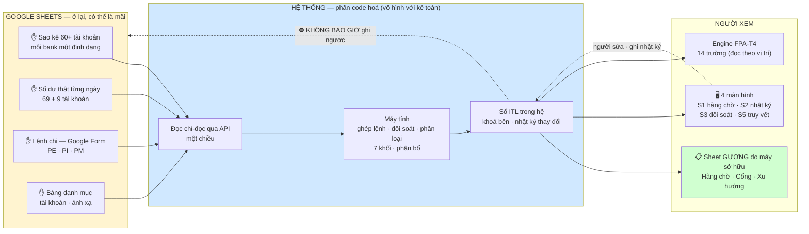

# Phương pháp luận — xác định và thiết kế hệ thống TO-BE cho luồng `PM → ITL`

**Version:** v0.3 · **Ngày:** 2026-08-24 · **Loại:** doc-only (Class A) · **Chủ sở hữu:** COO-CFO
**Căn cứ mục tiêu** `[O]`: owner nêu 2026-08-22 — *"toàn bộ luồng PM và các file input khác vào ITL đang nằm hoàn toàn trên Google Sheets và performance rất chậm. Muốn code hoá một phần luồng này, chỉ giữ một phần các giao diện trên Google Sheets, để tăng trải nghiệm người dùng (kế toán) và performance hệ thống."*

**Quan hệ với tài liệu đã có:** file này **không thay** `Lo-trinh-Chuyen-doi-Gsheet-to-UI.md` v0.2. Lộ trình đó trả lời *"cắt ô gõ tay nào trước"*. File này thêm một trục mà lộ trình **chưa có**: **tốc độ**. Hai thứ nằm trên hai trục khác nhau, và §2 dưới đây chỉ ra chúng cho hai thứ tự **khác nhau**.

**Trạng thái:** ✅ **§8 ĐÃ CHỐT 2026-08-22 — `QĐ-ITL-33`, owner chọn đường C** *(phần máy trước + sheet gương do máy sở hữu)*. Đóng `GAP-ITL-40`. Lộ trình chuyển đổi cập nhật theo → v0.3.

> ⚠ **Đính chính framing (2026-08-24)** — hợp đồng ra engine = **14 trường theo TÊN** *(`le`=`P`)*, không phải "13 cột theo vị trí" *(engine hiện đọc theo vị trí; TO-BE khai theo tên)*. `Final` = **kế toán nhập/sửa trực tiếp**, bỏ tầng `MID`. Chi tiết: [`_BA_UPDATE_ROADMAP §3c`](../_BA_UPDATE_ROADMAP.md).

---

## §0a · ⛔ GIỚI HẠN CỨNG — `QĐ-ITL-34` (owner, 2026-08-24)

> **KHÔNG đụng vào các sheet hiện có. KHÔNG động vào file của kế toán.**

Đọc phần nào của file này cũng phải áp giới hạn trên. Nó **không đổi phương pháp**, nhưng **cắt mất một nhóm việc** mà §5 và §8 gọi là rẻ nhất:

| Việc bị dừng | Quy mô đã đo | Ở đâu trong file này |
|---|---|---|
| Dọn sheet chết *(2 bản `Test`)* | ~536.000 ô công thức | §5 · `GAP-ITL-46` |
| Dừng bảng đo hỏng `[RAW ITL]Data Management` | 194/311 cạnh vượt file | §5 · `KILL-8` |
| Bỏ 305 cạnh tự-kiểm từng cột | 305 cạnh động | §5 · `KILL-7` |

⚠ **Hệ quả cho §1:** con số **33,2 giây** ở §1 **sẽ không giảm** trong chặng 1. Ba việc trên là toàn bộ đường làm nhẹ **sổ cũ**; bỏ chúng ra thì tốc độ **chỉ đến trên ĐƯỜNG MỚI** — máy đọc thô một lần, tính trong code, ghi ra **sheet gương do máy sở hữu**. Kế toán hưởng tốc độ **khi chuyển sang đọc đường mới**.

✅ **Luật `D1` được củng cố, không bị lật.** `D1` vốn nói *máy đọc, không bao giờ ghi vào file sống*. Nay nó **không còn là lựa chọn kỹ thuật mà là giới hạn owner đặt** ⇒ toàn bộ §6.1 *(hình dáng đích)* vẫn đúng nguyên vẹn, kể cả mũi tên `⛔ KHÔNG BAO GIỜ ghi ngược`.

⚠ **Một chỗ khó hơn — `GAP-ITL-48`:** §7 đòi nghiệm thu **khớp 100% từng ô**, nhưng đọc **giá trị** trên file GỐC chỉ thành công **1/5 lần** (`AUD-7`), mà nay **không được làm nhẹ sổ**. ⇒ Oracle phải chọn **theo từng cột**, ba tầng: cột **không** phụ thuộc `IMPORTRANGE` ⇒ đối chiếu trên **bản copy** · cột **có** phụ thuộc ⇒ đối chiếu với **`ITL_altered` trên BigQuery** *(oracle bậc 2, đang phục vụ báo cáo thật)* · phần còn lại ⇒ **đọc dải nhỏ, lặp, tích luỹ**. Việc đầu tiên: **phân 1.755 cột thành có/không phụ thuộc `IMPORTRANGE`** — làm được từ `.json` đã có, **không cần chạm sổ**.

---

## §0 · Phương pháp này trả lời đúng ba câu

| # | Câu | Trả ở |
|--:|---|---|
| 1 | **Cái gì rời Google Sheets, cái gì ở lại?** | §4 — phân loại từng ô về 4 loại |
| 2 | **Cắt theo thứ tự nào?** | §3 ba lằn · §5 xếp hạng theo giá thành tính lại · §8 thứ tự cuối |
| 3 | **Biết là đã tốt hơn bằng cách nào?** | §7 nghiệm thu · §9 hai thước đo + mốc nền |

---

## §1 · Phát hiện nền: sổ chậm **KHÔNG** vì nhiều dữ liệu

Đây là phép đo phải làm trước mọi thứ khác, vì nó lật cách chọn việc.

**Phép đo** (`_tools/measure_recalc_cost.py`, chỉ đọc, trên bản copy file ITL RAW `1lzwttMYMIHA…`, 2026-08-22):

| Phép đọc | Lần 1 (sổ nguội) | Lần 2 (sổ đã thức, vài phút sau, **thứ tự ngược**) |
|---|--:|--:|
| Sheet nhẹ (`Index`), **3 ô** | **33,2 giây** | 1,2 giây |
| `Transaction Mapping L1`, **3 ô** | 8,5 giây | 1,2 giây |
| `Transaction Mapping L1`, **~10.000 ô** | 2,1 giây | 1,8 giây |
| `Transaction Mapping L1`, **~40.000 ô** | **1,5 giây** | 1,9 giây |

**Đọc 40.000 ô rẻ hơn đọc 3 ô — 1,5 giây so với 33,2 giây.** Nghe vô lý, nhưng đúng, và nó nói hết:

> ★ **Giá phải trả là "đánh thức và tính lại cả workbook", trả MỘT LẦN mỗi lần chạm sổ. Sau khi sổ đã thức thì dữ liệu gần như miễn phí.**

Lượt chạy ngược là **phép kiểm chứng**: nó loại khả năng *"lần gọi đầu luôn chậm vì thiết lập kết nối"*. Ở lượt ngược, phép đọc 40.000 ô đứng **đầu tiên** mà chỉ mất 1,9 giây — cùng chi phí kết nối, không có 33 giây. Nên 33 giây kia là **sổ tính lại**, không phải mạng.

**Ba hệ quả, mỗi cái lật một cách làm quen thuộc:**

| # | Hệ quả | Lật cái gì |
|--:|---|---|
| 1 | Chi phí tính theo **số công thức phải tính lại**, không theo số dòng | Bỏ ý định *"chia nhỏ sổ theo kỳ cho nhẹ"* — `$B$3` rỗng nên sổ đang chở toàn bộ lịch sử, mà đó **không** phải nguồn của sự chậm |
| 2 | Giảm **ô gõ tay** không làm sổ nhanh hơn **một giây nào** — ô gõ tay là ô hằng, chúng không tính gì | Lật thứ tự của lộ trình v0.2 (xem §2) |
| 3 | Kế toán trả 33 giây này **mỗi lần mở file nguội**, và trả lại mỗi lần một `IMPORTRANGE` thượng nguồn đổi | Đây chính là *"trải nghiệm chậm"* mà owner nói — nó **đo được**, không phải cảm giác |

⚠ **Giới hạn của phép đo:** con số 33,2 giây là **một lượt** (`n=1`), trên **bản copy** đã mất quyền `IMPORTRANGE` ra ngoài — nên file gốc, còn 31 `IMPORTRANGE` sống trong riêng `ITL Ledge`, **chậm hơn**, không nhanh hơn. Phải lặp phép đo theo `§9`. Nhưng **thứ tự** (40.000 ô rẻ hơn 3 ô) thì vững ở cả hai lượt.

---

## §2 · Vì sao lộ trình hiện tại, dù đúng, **không mua được tốc độ**

`Lo-trinh-Chuyen-doi-Gsheet-to-UI.md` v0.2 §1 xếp thứ tự theo **rủi ro P&L**, và bắt đầu ở **khối 7 + 6** — `5.113 ô`, rủi ro P&L bằng 0. **Cho chất lượng số thì đó là thứ tự đúng**, vì nó dạy nghề ở chỗ sai cũng không lệch báo cáo một đồng.

Nhưng `5.113 ô` đó là **ô người gõ**. Chúng là hằng số. Cắt hết đi thì sổ **không nhanh hơn**.

Cái làm sổ chậm nằm ở hai chỗ khác, và **không chỗ nào có tên trong lộ trình v0.2**:

| Chỗ | Là gì | Quy mô |
|---|---|---|
| **Cạnh chở** | `IMPORTRANGE` kéo dữ liệu giữa các file | **25** cạnh liên-file tường minh + **271** cạnh động *(đích nằm trong ô)* + **180** cạnh nội-file — `_GUIDE_01`. Riêng `ITL Ledge`: **31** `IMPORTRANGE` |
| **Cột tính** | `ArrayFormula` / `VLOOKUP` / `SUMIFS` quét cả cột | xem §5 |

> ⇒ **Không phải lộ trình sai.** Là owner vừa thêm một mục tiêu (**tốc độ**) nằm trên trục khác, mà luật xếp thứ tự cũ không phục vụ. Cách xử đúng là **thêm một lằn**, không phải sửa luật của lằn cũ — hệt như `QĐ-ITL-24` đã làm khi tách Lằn Ô khỏi Lằn Cổng.

---

## §3 · Ba lằn — ba luật xếp thứ tự khác nhau, **cả ba đều đúng trong lằn của nó**

Mở rộng `QĐ-ITL-24` (vốn có 2 lằn) thành 3:

| Lằn | Cắt cái gì | Xếp theo | Mua được gì | Trạng thái |
|---|---|---|---|---|
| **Lằn Ô** | 22.360 ô gõ tay | rủi ro **THẤP** trước | chất lượng số · trải nghiệm | đã có — lộ trình v0.2 |
| **Lằn Cổng** | phép kiểm, phép đối soát | rủi ro **CAO** trước | kiểm soát | đã có — đã chạy thật |
| **★ Lằn Máng** *(mới)* | **cạnh chở + cột tính** | **giá thành tính lại CAO trước** | **tốc độ** | **file này mở** |

Vì sao phải là ba lằn riêng, không gộp một danh sách: gộp thì lằn nào có việc *trông nhỏ* sẽ chết. Lằn Máng đặc biệt dễ chết khi gộp, vì **việc của nó vô hình** — cắt xong không ai thấy màn hình mới nào, chỉ thấy sổ bớt chậm.

---

## §4 · Bước **XÁC ĐỊNH** — phân loại từng ô về đúng một trong bốn loại

Đây là phần trả lời *"cắt gì, giữ gì"*. Luật: **mọi ô trong 444 sheet thuộc đúng một loại**. Phân loại xong thì chỗ cắt tự hiện ra — không cần tranh luận theo module hay theo màn hình.

| Loại | Định nghĩa | Ví dụ thật trong sổ | Đi đâu | Cần giao diện mới? | Mua được |
|:--:|---|---|---|:--:|---|
| **1 · Người gõ vào** | giá trị sinh ra từ người | sao kê từng tài khoản · số dư thật 69+9 tài khoản × 644 ngày · `Reference number` vào PM · 7 khối vùng ADJUSTMENT | **thô từ ngoài ⇒ Ở LẠI Sheets** (`T4`) **quyết định từng dòng ⇒ màn hình** (`T6`) | có, cho phần `T6` | trải nghiệm |
| **2 · Máy chở** | ô chỉ để **di chuyển** dữ liệu, không tính gì | 4 sheet `Importrange*` · 8 dải `filter(IMPORTRANGE(...))` sang `ITL Ledge` · `Transaction Original` = `QUERY` gộp 112+111 · 3 sheet lát theo `LE` | **CODE, 100%** | **không** | **tốc độ** |
| **3 · Máy tính** | ô suy ra giá trị từ ô khác theo luật | 24 cột `ArrayFormula` của `Mapping L1` · 65.000 ô `SUMIFS` của `2. CCR` · 4 cột `Classifying→Manual→MID→Final` × 7 khối · vùng ALLOCATE · vùng AUDIT · `BL` | **CODE, 100%** | **không** | **tốc độ** + đúng đắn |
| **4 · Người xem** | ô chỉ để đọc | `Daily RP test!A3` · bảng đo `[RAW ITL]Data Management` · các ô đếm dòng 3 | màn hình đọc, hoặc **sheet gương do máy ghi** | có | trải nghiệm |

**Điểm quan trọng nhất của bảng này:**

> ★ **Loại 2 và loại 3 là việc VÔ HÌNH.** Code hoá chúng thì: không ai phải đổi một thao tác · không phải thiết kế một màn hình nào · không phải huấn luyện ai · không cần ai đồng ý đổi cách làm.
>
> ⇒ Đây vừa là phần **rẻ nhất để làm**, vừa là phần **duy nhất mua được tốc độ**. Với ràng buộc nền *2–3 kế toán* (`QĐ-ITL-27`), "không đòi ai đổi thao tác" là một lợi thế rất lớn, không phải chi tiết phụ.

**Cách phân loại trên thực tế** — có sẵn công cụ, không phải làm tay:

1. Đọc `valueRenderOption=FORMULA` toàn bộ dải của sheet (`_tools/read_cells_sa.py`).
2. Ô không bắt đầu bằng `=` ⇒ **loại 1**.
3. Ô có `IMPORTRANGE` / `QUERY` / `FILTER` mà **không** có phép tính ⇒ **loại 2**.
4. Ô có `VLOOKUP` / `SUMIFS` / `IF` / `ARRAYFORMULA` / số học ⇒ **loại 3**.
5. Sheet không ai tham chiếu tới (lá trong bản đồ phụ thuộc `_GUIDE_01`) ⇒ **loại 4**.

⚠ **Luật `AUD-3` áp ở đây:** công thức **không nhất quán theo cột** — `2. CCR` có cột đầu, cột giữa, cột cuối khác nhau. Nên phải **quét toàn dải**, cấm suy cả hàng từ một cột. Bỏ luật này thì code hoá xong sẽ ra số khác sổ ở đúng những cột không ai kiểm.

---

## §5 · Bước **ĐO** — xếp hạng cạnh và cột theo giá thành tính lại

Phân loại xong thì loại 2 + loại 3 đều "phải code". Nhưng **không code cùng lúc**. Xếp theo giá thành, đắt nhất trước.

> ⚠ **ĐÃ ĐO THẬT 2026-08-22 — bảng ước lượng dưới đây SAI THỨ TỰ.** Kết quả đo: `Ket-qua-Phan-loai-4-loai-o.md`. Ba chỗ tôi đoán không phải ba chỗ đắt nhất:
>
> | Đoán ở đây | Đo thật |
> |---|---|
> | không nhắc `[RAW ITL]Data Management` | **đứng đầu ở CẢ HAI file ITL** (643.297 và 605.232 ô công thức), và gánh **194/311 cạnh vượt file** — để nuôi một **bảng đo đã biết là hỏng** (`§7.5`) |
> | không nhắc 4 sổ `H1000` | **ba trong bốn sổ vượt `ITL Ledge`** về số ô công thức |
> | xếp `2. CCR` #1 | **#10** về số ô — nhưng **#1 về độ quét** (`2. CCR Cash` có 6.910 ô mang `SUMIFS`/`VLOOKUP` chỉ trong ba băng dòng mẫu) |
>
> ⇒ **`AUD-6` — một thước không đủ.** Xếp giá thành phải theo **số ô × độ sâu quét**, không phải một trong hai.
>
> ★★ Và phát hiện nặng nhất, không có trong bảng dưới: **toàn bộ 305 cạnh động không dùng để chở số mà để TỰ KIỂM** — mỗi cạnh gọi sang file khác để kiểm **đúng một ô** (`ITL Ledge` hàng 6: 38 cạnh cho 38 ô). Đó chính là cỗ máy sinh ra 33 giây chờ ở §1, và là chỗ cắt rẻ nhất: code kiểm cả 10.000 dòng bằng một lần đọc.

**Ba chỗ đắt nhất — ước lượng ban đầu, giữ lại để thấy phép đo đã sửa cái gì:**

| # | Chỗ | Hình dạng | Giá thô mỗi lần tính lại |
|--:|---|---|---|
| 1 | **`2. CCR` + `2. CCR Cash`** | khối `ACCOUNTING` ~101 dòng × **644 cột ngày** ≈ **65.000 ô**, phần lớn là **hai `SUMIFS`** quét sổ `1.2 Ledger 112` (7.626 dòng) | bậc **10⁸–10⁹** phép so |
| 2 | **`Transaction Mapping L1`** | **~24 cột `ArrayFormula`** × 9.913 dòng ≈ **238.000 công thức mảng**; riêng 15 cột từ PM là `VLOOKUP` vào `PM_Unpivot` 3.703 dòng | ≈ **148.700 phép tra** chỉ cho nhóm PM |
| 3 | **`ITL Ledge`** | **64 cột × ~10.000 dòng ≈ 640.000 ô**, trong đó **31 `IMPORTRANGE`** + 7 khối × 4 cột công thức + vùng AUDIT `IMPORTRANGE` ra file khác | mỗi lần chạm = **kéo lại 31 nguồn** |

⚠ **Đây là ước lượng theo hình dạng công thức, không phải wall-clock từng sheet.** Đủ để xếp thứ tự, **không** đủ để hứa "nhanh hơn N lần". Muốn con số hứa được thì phải đo theo `§9`.

**Luật xếp hạng:** giá thành ≈ *(số ô công thức)* × *(số dòng mỗi ô phải quét)* × *(có vượt file hay không)*. Cạnh vượt file đắt hơn hẳn cạnh nội file, vì nó buộc **file kia** cũng phải thức.

---

## §6 · Bước **THIẾT KẾ** — hình dáng đích và bốn luật

### 6.1 · Hình dáng

**Đọc sơ đồ bằng lời thường:** Google Sheets thu hẹp lại thành **chỗ người gõ dữ liệu thô** — bốn nhóm bên trái, và bốn nhóm này ở lại vĩnh viễn (`GAP-ITL-23` đã đóng). Máy đọc chúng theo **một chiều**, tính toàn bộ phần giữa trong code, rồi đổ kết quả vào **sổ của hệ**. Từ sổ đó ra ba đường xem: một sheet gương do máy sở hữu, bốn màn hình, và engine P&L. **Mũi tên ngược vào Google Sheets không tồn tại.**

### 6.2 · Bốn luật thiết kế

| # | Luật | Vì sao — đã trả giá rồi |
|:--:|---|---|
| **D1** | **Một chiều.** Máy đọc Google Sheets, **không bao giờ ghi** vào file đang sống. Kết quả đổ vào file do **máy sở hữu** | `QĐ-ITL-31`; sự cố 13/08 — chủ file sửa đồng thời làm dịch địa chỉ ô |
| **D2** | **Không bê bẫy sang hệ mới.** Ba bẫy cụ thể: ⑴ đích `IMPORTRANGE` phải **tường minh**, không nằm trong ô *(nay 271 cạnh động)* · ⑵ khoá phải **bền**, cấp một lần rồi đóng băng, không phải số thứ tự dòng *(`QĐ-ITL-30`)* · ⑶ **không** code hoá bộ lọc kỳ mà sổ thật **không có** — `$B$3` rỗng, sổ đang chở toàn bộ lịch sử | code hoá nguyên xi = bê nguyên lỗi, rồi lỗi trở thành *"lỗi của hệ mới"* |
| **D3** | **Đóng băng đường ra TRƯỚC khi code.** Engine đọc **14 trường theo vị trí** *(TO-BE khai theo TÊN)* — đó là hợp đồng, không phải gợi ý. Đóng băng `ITL-CONTRACT` v1.0 (cổng `G-DOC-2`) là **điều kiện vào**, không phải việc làm sau | engine đang xuất P&L thật; đổi hình dạng đầu ra là làm sập báo cáo đang chạy |
| **D4** | **Sổ hiện tại là oracle.** Không cắt cạnh nào trước khi code chạy **song song** và khớp. Sổ chỉ bị cắt sau khi đã có thứ thay | `P-ITL-03` oracle-first |

---

## §7 · Bước **NGHIỆM THU** — và chỗ Lằn Máng khác Lằn Ô

Đây là điểm làm Lằn Máng **an toàn hơn** Lằn Ô, ngược với trực giác.

| | **Lằn Ô** | **Lằn Máng** |
|---|---|---|
| Máy làm gì | **ĐOÁN** giá trị mà người từng gõ | **TÍNH LẠI** đúng cái sổ đang tính |
| Nên kỳ vọng | một tỷ lệ đúng < 100% | **khớp 100%, từng ô** |
| Cần ngưỡng? | **CÓ** — `GAP-ITL-22` còn treo | **KHÔNG. Cấm có ngưỡng** |
| Lệch một ô nghĩa là | máy đoán chưa giỏi — bình thường | **hoặc code sai, hoặc sổ có một luật chưa ai viết ra** — cả hai đều phải giải trình |

> ★ Vì loại 2 và loại 3 là **phép tính tất định**, code hoá chúng có một cổng nghiệm thu **tuyệt đối**: chạy song song, so từng ô, phải bằng nhau hết. Không có chỗ cho ý kiến. Đó là lý do nên làm phần này trước phần cần ngưỡng và cần người phán.

**Và mỗi ô lệch là một món quà**, không phải một sự cố: nó chỉ đúng chỗ có luật ngầm. Ví dụ có sẵn để thử ngay: 29 cột tổng sai của tháng 1/2025 · Treasury không cộng `COP` ở cột nào · `EUR`/`Non USD` nằm ngoài vòng đối soát. Code tính đúng sẽ **lệch** với sổ ở đúng những chỗ đó — và đó là bằng chứng code đúng, sổ sai.

---

## §8 · Thứ tự cuối — ✅ ĐÃ CHỐT: `QĐ-ITL-33`, đường C

**Owner chốt 2026-08-22: phần MÁY trước, màn hình sau — cộng một sheet gương do máy sở hữu** *(3 tab: Hàng chờ · Cổng hôm nay · Xu hướng nhãn)*. Kế toán chặng 1 **không đổi một thao tác nào**, chỉ thêm một bookmark.

*(Phần dưới giữ nguyên phân tích đã dẫn tới quyết định — để phiên sau biết vì sao chốt như vậy, không phải chốt theo cảm tính.)*

| Chặng | Làm gì | Vì sao ở vị trí này |
|:--:|---|---|
| **1** | **Cắt Lằn Máng** — loại 2 + loại 3, xếp theo §5 *(`2. CCR` → `Mapping L1` → `ITL Ledge`)* | vô hình · nghiệm thu 100% không cần ngưỡng · là thứ **duy nhất** mua được tốc độ · không đòi 2–3 kế toán đổi thao tác nào |
| **2** | **Dựng 4 màn hình** — Lằn Ô theo lộ trình v0.2 §4 | màn hình **đứng trên** máng |
| **3** | Bốn ledger nền tảng (khối 8 + 9) | chờ `GAP-ITL-18` |

**Lý do của thứ tự này, nói thẳng:**

> ★ **Dựng màn hình trước khi cắt máng thì màn hình vẫn chậm.** Màn hình `S1` (hàng chờ) phải đọc số từ đâu đó. Nếu máng chưa cắt thì nó đọc qua đúng chuỗi `IMPORTRANGE` hiện tại, và kế toán vẫn chờ 33 giây — chỉ là chờ trong một giao diện đẹp hơn. Lúc đó dự án đã tiêu tiền dựng màn hình mà **không đạt được nửa mục tiêu owner nêu**.

✅ **Đã giải.** Lộ trình v0.2 §4 xếp Đợt 1 = dựng `S1` + `S2`; hai thứ tự trái nhau. Owner chốt **đường C** 2026-08-22 (`QĐ-ITL-33`) ⇒ lộ trình cập nhật thành v0.3, Đợt 1 lùi lại sau chặng máng.

| Chọn | Được | Mất |
|---|---|---|
| **Máng trước** *(đề xuất)* | tốc độ sớm · nghiệm thu chắc · không đòi ai đổi thao tác | 2–3 kế toán **chưa thấy gì mới** trong suốt chặng 1 |
| **Màn hình trước** *(lộ trình v0.2)* | đội thấy kết quả sớm, tinh thần tốt hơn | màn hình chậm ngay khi ra mắt · nghiệm thu cần ngưỡng mà ngưỡng còn treo (`GAP-ITL-22`) |

*(Có một đường thứ ba: chặng 1 làm máng, **cộng** một sheet gương do máy sở hữu để đội thấy kết quả ngay — đúng cái §0b đã mô tả là "bảng việc". Đường này lấy được phần lớn cái lợi của cả hai.)*

---

## §9 · Hai thước đo — phải lấy **mốc nền** trước khi viết dòng code đầu tiên

`§7` của lộ trình v0.2 có 9 chỉ số, **không chỉ số nào về tốc độ**. Đó là lỗ hổng phải bịt trước, vì không có mốc nền thì sau này **không chứng minh được** đã tốt hơn.

### 9.1 · Tốc độ

| Phép đo | Cách lấy | Mốc nền |
|---|---|--:|
| Mở file nguội tới lúc dùng được | `measure_recalc_cost.py`, lặp **10 lượt, khác giờ trong ngày** | **~33 giây** *(n=1, phải lặp)* ⚠ `QĐ-ITL-34`: con số này **không phải đích của chặng 1 nữa** — sổ cũ không được làm nhẹ. Đích chuyển sang **thời gian của đường mới** |
| Từ lúc gõ một ô tới lúc số cuối đổi | bấm giờ tay, 5 lần, trên file **gốc** | `???` |
| Số `IMPORTRANGE` trên đường dữ liệu sống | đếm từ `_GUIDE_01` | **476 cạnh** (25 + 271 + 180) |
| Ô công thức phải tính lại mỗi lần chạm | đếm khi phân loại §4 | `???` — §5 ước ~943.000 ô cho 3 chỗ đắt nhất |

### 9.2 · Trải nghiệm kế toán

| Phép đo | Vì sao đo cái này | Mốc nền |
|---|---|--:|
| Số phút chờ máy mỗi ngày, mỗi người | đây mới là "trải nghiệm chậm" dưới dạng con số | `???` — **hỏi LAN + THƯƠNG** |
| Số file phải mở để trả lời **một** câu | luồng đang trải trên 12 workbook | `???` |
| Số dòng phải xem mỗi kỳ | mục tiêu đã có: **~50**, không phải 6.843 | 6.843 → **50** |
| Số ô phải gõ **thêm** so với hôm nay | `QĐ-ITL-32` — phải bằng 0 | **0** |
| Số lần gõ mà không ăn *(nguồn ghi đè im lặng)* | `§6.3` — `Final` bỏ qua giá trị gõ tay | `???` — **hỏi LAN + THƯƠNG** |

⚠ Bốn ô `???` là **phỏng vấn 2–3 người**, không phải đo bằng máy. Việc rẻ, chưa ai làm.

---

## §10 · Bảy bẫy — đã trả giá, đừng trả lần hai

| # | Bẫy | Luật |
|--:|---|---|
| 1 | Đo cột phụ thuộc `IMPORTRANGE` trên **bản copy** — trả `#REF!` lẫn giá-trị-cũ trong cùng một cột ⇒ số trông chắc mà vô nghĩa | `AUD-5` |
| 2 | Suy công thức cả hàng từ **một cột** — `2. CCR` không nhất quán theo cột | `AUD-3` |
| 3 | Đánh giá Google Sheets bằng bản `.xlsx` — chỉ **2,7%** ô ngày còn nguyên kiểu | `itl-xlsx-export-destroys-dates` |
| 4 | Ghi vào file đang sống — chủ file sửa đồng thời làm dịch địa chỉ ô | sự cố 13/08 · `QĐ-ITL-31` |
| 5 | Code hoá **nguyên xi** một bộ lọc mà sổ thật không có (`$B$3` rỗng) | `D2` |
| 6 | Giữ khoá là **số thứ tự dòng** — nhập lùi ngày là đánh số lại 93% sổ | `QĐ-ITL-30` |
| 7 | Thêm bước duyệt / leo thang / người thứ hai hậu kiểm — **leo vào chỗ trống** | `QĐ-ITL-27` |

---

## §11 · Việc phương pháp này mở ra

| ID | Việc | Ai | Chặn |
|---|---|---|---|
| ~~`GAP-ITL-40`~~ | ~~Owner chốt thứ tự~~ | ✅ **CLOSED 2026-08-22 — `QĐ-ITL-33`, đường C** | — |
| `GAP-ITL-41` | **Lấy mốc nền tốc độ** — lặp `measure_recalc_cost.py` 10 lượt, khác giờ, **trên file gốc** | Tech Lead | trước khi code |
| `GAP-ITL-42` | **Phỏng vấn LAN + THƯƠNG lấy 4 mốc nền trải nghiệm** (§9.2) | BA | trước khi thiết kế màn hình |
| `GAP-ITL-43` | **Phân loại 4 loại cho 444 sheet** — chạy §4, ra danh sách "phải code" xếp hạng | BA + Tech Lead | chặng 1 |
| `GAP-ITL-22` | Ngưỡng pha B của Lằn Ô — **nay biết là chỉ Lằn Ô cần**, Lằn Máng không | Kế toán trưởng | Lằn Ô |
| `GAP-ITL-48` ⭐ | **Oracle cho chặng 1 khi không được làm nhẹ sổ** — chọn oracle **theo từng cột**, 3 tầng *(bản copy · `ITL_altered` BigQuery · đọc dải nhỏ tích luỹ)*. Việc đầu: phân 1.755 cột thành có/không phụ thuộc `IMPORTRANGE` | Tech Lead | **chặng 1** |
| ⏸ `GAP-ITL-46` · `KILL-7` · `KILL-8` | **ĐÃ ĐO — CHỜ UỶ QUYỀN** (`QĐ-ITL-34`): dọn sheet chết · dừng bảng đo hỏng · bỏ 305 cạnh tự-kiểm. Số đo giữ nguyên, chỉ dừng phần **ghi vào file kế toán** | owner | — |
| `GAP-ITL-39` | Quyền chỉ-xem **file GỐC** ADJUSTED — không có thì không đo được giai đoạn ⑤, cũng không lấy được mốc nền thật | **owner** | cả hai lằn |

---

## §12 · Nghĩa gì và bước tiếp

**Nghĩa gì với owner:**

1. **Nửa mục tiêu "tăng performance" hiện chưa có ai làm, và lộ trình đang có sẽ không đạt được nó** — vì nó cắt ô gõ tay, mà ô gõ tay không phải nguồn của sự chậm.
2. **Phần code hoá đáng làm nhất lại là phần không ai nhìn thấy** (máy chở + máy tính). Nó không cần một màn hình nào, không đòi 2–3 kế toán đổi một thao tác nào, và có cổng nghiệm thu tuyệt đối: so từng ô, phải khớp hết.
3. **Google Sheets không bị xoá.** Nó thu về đúng bốn nhóm nhập liệu thô, và ở lại đó vĩnh viễn. Cái bị xoá là **vai trò máy tính** của nó.

4. ⚠ **Và một điều `QĐ-ITL-34` đổi:** **sổ cũ sẽ không nhanh hơn.** Tốc độ chỉ đến khi kế toán **đọc từ đường mới**. Nên phần *sheet gương do máy sở hữu* không còn là "quà tặng thêm" — nó là **chỗ duy nhất tốc độ hiện ra được** trong chặng 1.

**Bước tiếp:**

| # | Việc | Ai | Trạng thái |
|--:|---|---|---|
| 1 | ~~Chốt §8~~ | owner | ✅ **XONG** 2026-08-22 — `QĐ-ITL-33`, đường C |
| 2 | ~~Chạy §4 trên các sheet đọc được~~ | tôi | ✅ **XONG** 2026-08-22 — `Ket-qua-Phan-loai-4-loai-o.md`, đóng `GAP-ITL-43` |
| 3 | ~~Chia quyền chỉ-xem file GỐC ADJUSTED~~ | owner | ✅ quyền **đã có** từ 22/08; owner **bỏ qua** việc xác nhận (`QĐ-ITL-34`) |
| 4 | **Phân 1.755 cột thành có/không phụ thuộc `IMPORTRANGE`** ⇒ chọn oracle từng cột | tôi | ⏳ `GAP-ITL-48`, làm từ `.json` đã có, **không chạm sổ** |

> ★ **Một tin tốt cho bước 2:** phân loại 4 loại chỉ cần đọc **công thức**, không cần đọc **giá trị**. Mà bản copy **giữ công thức nguyên bản** — `AUD-5` chỉ chặn việc đọc *giá trị* của cột phụ thuộc `IMPORTRANGE`. ⇒ **Bước 2 làm được ngay trên bản copy, không chờ `GAP-ITL-39`.**

---

## Changelog

- **v0.3** (2026-08-24): **`QĐ-ITL-34` — owner đặt giới hạn cứng: KHÔNG đụng vào sheet hiện có, KHÔNG động vào file của kế toán.** Thêm **§0a**. ⚠ **Ba việc §5 gọi là rẻ nhất mua tốc độ đều dừng** *(dọn sheet chết · dừng bảng đo hỏng · bỏ 305 cạnh tự-kiểm)* ⇒ **§1's 33,2 giây không phải đích của chặng 1 nữa**; tốc độ chỉ đến trên **đường mới**. ✅ `D1` được củng cố *(từ lựa chọn kỹ thuật thành giới hạn owner đặt)*, §6.1 đúng nguyên vẹn. ⚠ Mở **`GAP-ITL-48`**: nghiệm thu §7 đòi khớp 100% từng ô mà đọc giá trị file GỐC chỉ được 1/5 lần và nay không được làm nhẹ sổ ⇒ **oracle 3 tầng theo cột**.
- **v0.2** (2026-08-22): **`QĐ-ITL-33` — owner chốt §8: đường C, phần MÁY trước, màn hình sau, cộng một sheet gương do máy sở hữu.** Đóng `GAP-ITL-40`. Giữ nguyên toàn bộ phân tích dẫn tới quyết định (để phiên sau biết *vì sao* chốt như vậy). Ghi rõ một điểm mở đường cho bước tiếp: **phân loại 4 loại chỉ cần đọc CÔNG THỨC, không cần đọc GIÁ TRỊ** ⇒ `AUD-5` **không chặn** — làm được ngay trên bản copy, không chờ `GAP-ITL-39`.
- **v0.1** (2026-08-22): Khởi tạo theo mục tiêu owner nêu 2026-08-22 (code hoá một phần luồng · giữ một phần giao diện Google Sheets · tăng trải nghiệm + tốc độ).
  **★ Phép đo nền mới:** đọc **40.000 ô mất 1,5 giây** còn đọc **3 ô trên sổ nguội mất 33,2 giây** ⇒ **sổ chậm vì tính lại, không vì nhiều dữ liệu**; có lượt chạy ngược làm phép kiểm chứng, loại khả năng "lần gọi đầu luôn chậm vì kết nối". Công cụ mới `_tools/measure_recalc_cost.py`.
  **★ Mở Lằn Máng** — lằn thứ ba, mở rộng `QĐ-ITL-24`: cắt **cạnh chở + cột tính**, xếp theo **giá thành tính lại**, mua **tốc độ**.
  **★ Phương pháp xác định:** phân loại mọi ô về **4 loại** (người gõ · máy chở · máy tính · người xem) — loại 2+3 là việc **vô hình**, code hoá không cần giao diện và không đòi ai đổi thao tác.
  **★ Nghiệm thu:** Lằn Máng **cấm có ngưỡng** (máy tính lại phép tất định ⇒ phải khớp 100%), khác hẳn Lằn Ô (máy đoán ⇒ cần ngưỡng).
  ⚠ Nêu **mâu thuẫn thứ tự** với `Lo-trinh-Chuyen-doi-Gsheet-to-UI.md` v0.2 §4, **không tự chọn bên** (`R-A4`) — mở `GAP-ITL-40`. Mở thêm `GAP-ITL-41/42/43`.
