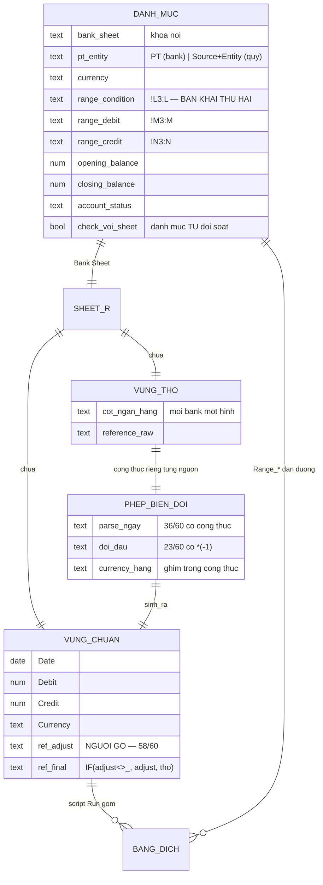

# Rà soát cấu trúc sheet `R |` — ERD và logic viết lại

**Version:** v1.1 · **Ngày:** 2026-09-08 · **Chủ sở hữu:** BA + Tech Lead
**Khởi từ:** owner mô tả 2026-09-08 — *"các sheet này có vùng công thức và cột để chuẩn hoá về chung 1 định dạng `Date · Debit · Credit · Currency · Reference number_adjust · Reference number`"*
**Phép đo:** đọc SỐNG cả **68 sheet `R |`** của hai sổ, 3 dòng đầu + công thức dòng 3, ngày **2026-09-08**. ⛔ Không đọc một giá trị dữ liệu nào. Phạm vi `QĐ-ITL-85` / `QĐ-ITL-92`.

> ⛔⛔ **Owner đúng, và mô tả ấy lật một tiền đề nằm ở LÕI của `F04`.** Cả mã lẫn tài liệu đang coi `R |` là **một vùng phẳng** mà kế toán dán vào, với **một** bản khai ở dòng 1. Đo thật: nó là **ba vùng**, có **phép biến đổi riêng cho từng nguồn**, và hệ có **HAI bản khai độc lập** cho cùng một việc — trong đó bản khai mà **script `Run` thật sự dùng** thì FLS ⛔ **chưa từng đọc**.

---

## §1 · Năm câu bị lật, gói lại

| # | Mã và tài liệu đang nói | Đo được 08/09 |
|--:|---|---|
| 1 | `R \|` là **một vùng** kế toán dán vào | **Ba vùng**: THÔ → công thức chuẩn hoá → CHUẨN (+ vùng phụ) |
| 2 | Kế toán *"đã tự chuẩn hoá"* bằng **bản khai dòng 1** | Chuẩn hoá bằng **CÔNG THỨC**. Dòng 1 chỉ **chỉ chỗ**, ⛔ không chuẩn hoá gì |
| 3 | Hệ có **một** hợp đồng đọc-được-bằng-máy | **Hai**: dòng 1 (FLS đọc) và `Range_Condition/Debit/Credit` ở danh mục (**script `Run` đọc**). ⛔ Không cổng nào so hai cái |
| 4 | Bản khai có **6 trường** | Bank: 6. **Quỹ: tới 15** — `R \| VND_HotBonus` khai `1`…`15`. FLS đọc `1`…`6`, **bỏ im lặng 9 trường** |
| 5 | Bank và quỹ *"cùng 6 trường, cùng cơ chế"* *(tôi viết 08/09 sáng)* | **Sai.** Năm khác biệt đo được ở §4 — trong đó có **dữ liệu cá nhân** và **khuôn ra khác số cột** |

---

## §2 · Cấu trúc thật của một sheet `R |`

```
┌─ VÙNG THÔ ──────────────────┬─ VÙNG CHUẨN ─────────────────┬─ VÙNG PHỤ ──────┐
│ cột của chính ngân hàng      │ 6 cột, CÙNG TÊN ở mọi sheet  │ Check trùng     │
│ mỗi bank một hình            │ sinh bằng CÔNG THỨC          │ Month/Day/Year  │
│ ⇦ kế toán DÁN vào đây        │ ⇦ FLS ĐỌC ở đây              │ "KHÔNG XOÁ NHÉ" │
└──────────────────────────────┴───────────────────────────────┴─────────────────┘
```

**Ví dụ `R | 854666_TCB USD_VGOH`** *(26 cột)*:

| Vùng | Cột | Nội dung |
|---|---|---|
| THÔ | `A`–`K` | Ngày KH thực hiện · Ngày giao dịch · Reference number_raw · Tài khoản đích · Tên TK đối ứng · Diễn giải · Nợ · Có · Phí · Thuế · Số dư |
| **CHUẨN** | `L`–`Q` | **Date · Debit · Credit · Currency · Reference number_adjust · Reference number** |
| PHỤ | `V`–`Z` | `KHÔNG XOÁ NHÉ` — Month · Day · Year |

### 2.1 · Công thức chuẩn hoá — đo trên 60 sheet bank

| Trường | Công thức thật | Số sheet |
|---|---|--:|
| `Date` | `ARRAYFORMULA` bóc ngày từ cột thô. **Mỗi bank một cách**: `SEARCH("-")+DATE()` · `SPLIT+QUERY` · `MID/LEFT/RIGHT` | **36/60** sinh bằng công thức |
| `Debit` / `Credit` | `ARRAYFORMULA(IF(<thô>="","",<thô>))` — và ở nhiều nguồn là **hoán cột + đổi dấu** | **23/60 có `*(-1)`** |
| `Currency` | `ARRAYFORMULA(IF(<thô>="","","USD"))` — **hằng, ghim trong công thức** | mọi sheet có cột |
| `Reference number_adjust` | ⛔ **rỗng — NGƯỜI GÕ TAY** | **58/60**, cả 58 là ô gõ |
| `Reference number` | `ARRAYFORMULA(IF(<_adjust><>"", <_adjust>, <thô>))` | **`_adjust` THẮNG** |

⭐⭐⭐ **Vì sao có 19 bố cục cột — nay giải thích được.** Khối chuẩn hoá luôn cùng bộ tên; chỉ **vị trí** của nó dịch, vì **vùng thô mỗi bank một bề rộng**. `R | 854666_TCB` khối chuẩn ở `L`–`Q`; `R | 358468128_VPB` ở `J`–`O`. ⇒ Con số `19` ⛔ không phải *"kế toán tuỳ tiện"* — nó là **hệ quả cơ học** của việc mỗi ngân hàng xuất một hình khác nhau.

### 2.2 · ⛔⛔ Hai hệ quả nặng

**⑴ `Reference number_adjust` là chỗ NGƯỜI ĐÈ LÊN MÁY, và FLS mù hoàn toàn.**
`58/60` nguồn bank + `7/8` nguồn quỹ có cột này, **100% là ô người gõ**. Công thức nói rõ: có `_adjust` thì `_adjust` thắng. FLS đọc cột `Reference number` **cuối cùng** nên **giá trị đọc được là ĐÚNG** — nhưng FLS ⛔ **không biết dòng nào đã bị người sửa mã**. Mà mã chứng từ là **khoá ghép PM** *(`OP-03`: 1 khoá = 1 mã)*. ⇒ Mất một dữ kiện kiểm soát: *"ai đã đổi khoá của dòng này, và vì sao"*.

**⑵ `23/60` nguồn ĐỔI DẤU khi chuẩn hoá.**
`R | 358468128_VPB`: `Credit = ARRAYFORMULA(IF(F3:F="","",F3:F*(-1)))` — cột chuẩn `Credit` là cột thô **`F` (Số tiền ghi nợ) nhân âm**, còn `Debit` chuẩn lấy từ **`G` (Số tiền ghi có)**. Tức **hoán vế + đổi dấu**.

⇒ ⛔⛔ **Đây là ranh giới cứng phải ghi vào tài liệu: FLS ⛔ KHÔNG BAO GIỜ được đọc vùng THÔ** mà không chở theo **60 phép biến đổi riêng**. Hôm nay FLS đọc **vùng CHUẨN** nên an toàn — nhưng bản vẽ `F04` ngày 08/09 sáng vẽ kế toán **dán sao kê thô vào FLS**, tức là ngầm đòi FLS **sở hữu 60 công thức ấy**. Đó là một việc **lớn hơn hẳn** *"khai cột"*, và ⛔ chưa ai ước lượng.

---

## §3 · ⛔⛔ HAI bản khai cho cùng một việc — và ⛔ không cổng nào so

`BankAccountList` *(dòng 2 là tiêu đề)*:

```
PT · Bank Name · Bank Account · Bank Sheet · Currency ·
Range_Condition · Range_Debit · Range_Credit ·
Opening Balance · Debit · Credit · Closing Balance · Debit · Credit ·
Bank Account_Check trùng · Bank Account_Check với <R|> · Account Status · Ghi chú
```

Dòng 3 thật: `VGOH · TCB · 854666 · R | 854666_TCB USD_VGOH · USD · !L3:L · !M3:M · !N3:N · …`

⭐ **`!L3:L` `!M3:M` `!N3:N` chính là `Date` `Debit` `Credit` của sheet ấy.** Đây là **bản khai thứ hai**, và **script `Run` dùng CÁI NÀY**, ⛔ không dùng dòng 1.

| | Bản khai dòng 1 | `Range_*` ở danh mục |
|---|---|---|
| Ai đọc | **FLS** *(`fls_khai_cot`, 408 dòng)* | **script `Run` của trang tính** |
| Phủ | 6 trường *(quỹ tới 15)* | **3 trường** — Date · Debit · Credit |
| Sống ở đâu | dòng 1 mỗi sheet | `BankAccountList` / `Cash Ledger List` |
| Có trong mã FLS | ✅ | ⛔ **0 lần** — quét `fls/` `tools/` `tests/`: ⛔ không một tham chiếu `Range_` nào |

⇒ **Hai nguồn sự thật cho cùng một phép ánh xạ.** Hôm nay chúng khớp — chặng 1 đo `8.338/8.338`. Nhưng ⛔ **không có gì cưỡng chế chúng khớp tiếp**: sửa dòng 1 mà quên `Range_`, hoặc ngược lại, thì FLS và trang tính **đọc hai cột khác nhau** và cả hai đều *"chạy bình thường"*.

⚠ Sổ đã **biết** điều này từ 07/09 — `So-Doi-Chieu-ASIS-FLS.md` v0.9 gọi đúng tên: *"hợp đồng đọc-được-bằng-máy THỨ HAI"*. Nhưng nó được ghi như một **phát hiện thú vị**, ⛔ không thành một **cổng**. Đây đúng lớp lỗi bộ tài liệu này vẫn tự bắt: biết mà không đo thì tương đương không biết.

### 3.1 · Danh mục còn giữ hai thứ nữa mà FLS chưa đọc

| Cột | Là gì | FLS |
|---|---|---|
| `Opening Balance` → `Closing Balance` | **số dư cuộn chiếu theo nguồn** | ⛔ chưa đọc |
| `Account Status` | `Active` / khác | ⛔ chưa đọc |
| `Bank Account_Check trùng` · `Check với <R\|>` | **danh mục TỰ ĐỐI SOÁT với sheet** | ⛔ chưa đọc |

⭐ ⇒ Bước *"số dư đầu kỳ"* tôi đề xuất cho màn quỹ ngày 08/09 **⛔ không phải phát minh** — nó **đã tồn tại**, cho **cả hai lằn**, ở `Opening/Closing Balance`. Phải đọc lấy, ⛔ không dựng lại.

---

## §4 · Bank ≠ Quỹ — năm khác biệt đo được

| # | | Bank *(60)* | Quỹ *(8)* |
|--:|---|---|---|
| 1 | Vùng thô riêng | 41/60 | 8/8 |
| 2 | `Date` sinh bằng công thức | **36/60** | **0/8** — gõ tay hết |
| 3 | Đổi dấu khi chuẩn hoá | **23/60** | 0/8 |
| 4 | ⛔ **Cột dữ liệu cá nhân** | **0/60** | ⛔ **3/8** |
| 5 | Số trường kế toán khai | 6 | **tới 15** |

### 4.1 · ⛔⛔ Dữ liệu cá nhân ở lằn quỹ

`R | VND_HotBonus` khai `1`…`15`, trỏ vào:

```
 1 Transaction date   2 Description        3 Currency        4 Debit    5 Credit
 6 Reference number   7 Note               8 Legal Entity    9 ID Employee ID Number
10 ID Employee ID Name          11 Họ và tên (*)       12 Số CMND/CCCD/Passport (*)
13 Chức danh          14 EmpTrack 2 I Ngạch 2          15 CDT
```

⛔⛔ **Trường `11` và `12` là dữ liệu cá nhân.** `QĐ-ITL-92` hiện chỉ cấm đọc **`Description`** — nó ⛔ **không phủ** hai trường này, vì lúc viết nó ⛔ chưa ai đo lằn quỹ. **Bất kỳ ai mở rộng bản khai từ 6 lên 15 trường một cách máy móc sẽ kéo `CMND/CCCD/Passport` vào kho.**

⚠ Và một chỗ nữa, khai ra ngay dù ⛔ không đọc: sheet `2. CCR Cash` *(trong chính sổ quỹ)* có hai cột tên **`ID`** và **`Pass`** ở dòng 3. ⛔ Tôi ⛔ **không đọc giá trị**, chỉ đọc tên cột. Nếu đó là mật khẩu cổng ngân hàng thì nó là một **rủi ro an ninh đang sống**, ⛔ không phải việc của `F04` — nhưng phải có người biết.

### 4.2 · ⭐ Lằn quỹ ĐÃ CÓ SẴN phân loại mà lằn bank phải chờ ghép PM

Trường `8` = `Legal Entity`, `15` = `CDT` *(chủ dự toán)*. Ở lằn **bank**, hai thứ này chỉ có được **sau khi ghép PM** *(chặng 7)*, và tỷ lệ ghép **gần kịch trần 33,8%**. Ở lằn **quỹ**, kế toán **gõ thẳng tại nguồn**.

⇒ FLS đang **vứt đi** một phân loại đã có sẵn, rồi đẩy dòng quỹ vào hàng chờ `UNMAPPED` như dòng bank. Đây là một **lỗ giá trị đo được**, ⛔ không phải một ý kiến.

### 4.3 · Khuôn RA cũng khác số cột

| | Cột |
|---|---|
| `Bank Transactions` | **10** — `Transaction date · Description · Currency · Debit · Credit · Reference number · Source · Num · Check trùng · ,` |
| `Cash Ledger Transactions` | **11** — 8 cột đầu giống, rồi `Check trùng · Check trùng_Reference number · Month` |

⛔ `fls/adapters/sao_ke.py::KHUON_RA` khai **đúng 10 cột của bank**. Bản vẽ 08/09 gộp `F05` vào `F04` với lý do *"cùng khuôn"* — **khuôn VÀO thì gần giống, khuôn RA thì ⛔ không**.

### 4.4 · Bảng danh mục hai lằn cũng khác đầu cột

| `BankAccountList` | `Cash Ledger List` |
|---|---|
| `PT · Bank Name · Bank Account · Bank Sheet` | `Source · Bank Sheet · Entity` |

⇒ Khoá nối tới sheet là **`Bank Sheet`** ở cả hai, nhưng **danh tính chủ** thì một bên là *tài khoản ngân hàng*, một bên là *nguồn quỹ*. Đây là chỗ `QĐ-ITL-105` đã chạm: *"nguồn = một DÒNG CHẢY, ⛔ không phải một tài khoản"*.

---

## §5 · ERD viết lại

### 5.1 · Mô hình AS-IS đúng



### 5.2 · Kho FLS phải đổi gì

| Bảng | Hôm nay | Phải thành |
|---|---|---|
| `fls_khai_cot` | `(source_id, version, truong, cot)` — **6 trường phẳng** | thêm **`vung`** *(`THO`/`CHUAN`/`PHU`)* và **`doc_duoc`** *(bool)*. Từ vựng trường mở tới **15**, nhưng `11`/`12` phải khai **`doc_duoc = false`** ở tầng kho, ⛔ không dựa vào lời hứa trong mã |
| **`fls_nguon_dai`** ⭐ mới | ⛔ không có | `(source_id, range_condition, range_debit, range_credit, doc_luc)` — chở **bản khai thứ hai** vào kho để **so được** |
| **`fls_nguon_so_du`** ⭐ mới | ⛔ không có | `(source_id, ky, opening, closing, doc_luc)` — đọc lấy từ danh mục, ⛔ không dựng lại |
| `fls_source` | `source_key`, `src_type` | thêm `pt_entity`, `account_status`. ⛔ Nguồn `Inactive` ⛔ không được im lặng biến mất |

### 5.3 · ⭐⭐ Cổng mới bắt buộc — `S10`

> **`S10` · hai bản khai phải trỏ CÙNG một cột.**
> So `fls_khai_cot` *(Date/Debit/Credit)* với `fls_nguon_dai` *(`Range_Condition`/`Range_Debit`/`Range_Credit`)* cho **từng nguồn**. Lệch một cột ⇒ **hạng `CHẶN`**.
>
> ⛔ Đây là cổng **duy nhất** phát hiện được ca: *"ai đó sửa dòng 1 mà quên danh mục"*. Ca ấy ⛔ **không** làm hỏng chặng 1 ngay — nó làm FLS và trang tính **âm thầm đọc hai cột khác nhau**, và cả hai vẫn ra một con số trông hợp lý.

---

## §6 · Rà mã — sáu chỗ

| # | Chỗ | Việc |
|--:|---|---|
| 1 | `adapters/sao_ke.py` docstring | Ghi *"kế toán đã tự chuẩn hoá: **dòng 1 là bản khai**"*. **Nửa đúng.** Chuẩn hoá bằng **công thức**; dòng 1 chỉ chỉ chỗ. Phải viết lại, và **ghi ranh giới**: FLS đọc **vùng CHUẨN**, ⛔ **cấm** đọc vùng THÔ |
| 2 | `SO_TRUONG` `= {"1".."6"}` | Bên quỹ khai tới **`15`**. Số `7`…`15` bị **bỏ im lặng** — trong đó có `Legal Entity` và `CDT` **đã có sẵn**. ⇒ Hoặc đọc lấy, hoặc **khai rõ là cố ý bỏ**; ⛔ im lặng là lựa chọn tệ nhất |
| 3 | `TRUONG_DOC_DUOC` | Chỉ loại `Description`. ⛔ **Không phủ** `Họ và tên` / `CMND/CCCD/Passport` của lằn quỹ |
| 4 | `KHUON_RA` **10 cột** | Là khuôn của **bank**. `Cash Ledger Transactions` có **11**. Gộp `F05` vào `F04` mà giữ một khuôn ra là **sai ở lằn quỹ** |
| 5 | ⛔ **0 tham chiếu `Range_`** trong `fls/` `tools/` `tests/` | Bản khai **script `Run` thật sự dùng** ⛔ chưa từng vào kho ⇒ ⛔ không so được ⇒ ⛔ không có `S10` |
| 6 | `ghi_khai()` ⛔ không kiểm giá trị lạ | Đo được **2 ô rác** ở dòng 1 bank *(`R \| 854666_TCB` ô `A` = `3011`; `R \| 854888_TCB` ô `K` = `69223688`)* — số liệu bị gõ nhầm vào hàng khai. Máy bỏ qua vì ⛔ không thuộc `1`…`6`, ⛔ không ai được báo |

---

## §7 · Rà tài liệu BA — năm chỗ

| # | Tệp | Câu đang sai | Phải thành |
|--:|---|---|---|
| 1 | `BA-06 §7 ⓷` | *"dòng 1 của mỗi sheet `R \|` **đã là** một bản khai ánh xạ… Màn này chỉ **dời chỗ ở** của nó"* | Nó dời chỗ ở của **một trong hai** bản khai, và ⛔ **không** dời phép **chuẩn hoá** — thứ đang sống trong **công thức** |
| 2 | `BA-06 §7 ⓹` | *"cần **4/8** hành vi Sheets"*, loại **#2 dán vùng** | Đã sửa xuống bản vẽ thành **5/8**. Đặc tả vẫn **chưa** sửa |
| 3 | `BA-05` §ERD | ⛔ Không có `VUNG_THO` / `PHEP_BIEN_DOI` / `_adjust` / `Range_*` / số dư danh mục | Thêm theo §5. **Cổng `G-ERD-2` sẽ đỏ** cho tới khi thêm — đúng như thiết kế |
| 4 | `BA-01 §4` | `F04` = *"`Bank Transactions` 7.715 dòng × 10 cột"* | `QĐ-ITL-105` đã dời mức nhận xuống **sao kê thô**. Câu ở BRD vẫn tả **tầng đã gộp** |
| 5 | `So-Doi-Chieu-ASIS-FLS` v0.9 | Gọi đúng tên *"hợp đồng thứ hai"* nhưng để nó thành **ghi chú** | Biến thành **cổng `S10`**. Biết mà ⛔ không đo thì bằng ⛔ không biết |

---

## §7b · ⭐⭐ `S10` ĐÃ CHẠY THẬT — và owner đã chốt cả ba câu

### 7b.1 · Kết quả `S10` *(chạy tay 2026-09-08, ⛔ chưa dựng bảng)*

⭐ **`S10` ĐẠT — 192 phép so, `0` lệch.** Hai bản khai trỏ **cùng một cột** ở mọi chỗ đo được. Câu *"chúng có đang khớp thật ⛔ không"* nay có câu trả lời **bằng số**.

⚠ **Nhưng chính phép đo tìm thêm bốn thứ:**

| # | Đo được | Nghĩa |
|--:|---|---|
| 1 | `R \| CNC` và `R \| Pingpong`: **dòng danh mục ĐẦU TIÊN** có `Range_*` **rỗng**, các dòng sau mới có `!A3:A`/`!D3:D`/`!E3:E` | Bản khai thứ hai **⛔ không đồng nhất** giữa các dòng cùng trỏ một sheet |
| 2 | **BA lỗi gõ, ⛔ không phải hai** — nay ghim được **cả hai phía**: sheet `R \| 132000050920_MauBank USD_MGO1` ↔ danh mục `…1132000050920…` *(thừa `1`, giống **99%**)* · sheet `R \| PO_Payoneer USD_CGO1` ↔ danh mục `R \| PO7_Payoneer…` *(thừa `7`, giống **98%**)* | Xác nhận độc lập `GAP-KT-01`/`02`, và lần đầu **nêu đủ tên hai phía** |
| 3 | `R \| PO BGO1` **Active** ⛔ không có sheet, **nhưng** kho **CÓ** `R \| PO BGO1 _HKD` và `_USD` | ⛔ **⛔ KHÔNG phải lỗi gõ** — là **dòng danh mục CŨ CÒN SÓT** từ trước khi tách theo tiền tệ. ⇒ Cách sửa **khác hẳn** `GAP-KT-01/02`; manh mối nêu 08/09 sáng **phải sửa lại** |
| 4 | **9 dòng `InActive`/`Closed`** ⛔ không có sheet | Hợp lệ. Nhưng FLS ⛔ **không đọc `Account Status`** nên ⛔ không phân biệt được *"đóng hợp lệ"* với *"thiếu sheet"* |

### 7b.2 · Ba quyết định của owner

| Quyết định | Nội dung | Hệ quả cho §5–§7 |
|---|---|---|
| **`QĐ-ITL-109`** | `F04` **đọc vùng CHUẨN**, ⛔ không thay phép chuẩn hoá | ⛔⛔ **`F04` ⛔ KHÔNG PHẢI màn DÁN.** Cử chỉ `Ctrl+V` **ở lại Google Sheets**; FLS thay **nút `Run` + cú chép tay sang `A-CCR`**. Hai bản vẽ 08/09 **vẽ sai mô hình** ⇒ `GAP-SCR-12`. ⭐ Ranh giới §2.2 ⓶ *(FLS ⛔ không đọc vùng THÔ)* nay là **luật đã ký**, ⛔ không còn là khuyến nghị |
| **`QĐ-ITL-107`** | Cấm đọc **cả khối nhân sự `9`…`14`** | Rộng hơn 3 cột §4.1 đo được — và **rộng hơn là đúng**: hai trường đáng lấy nằm **ngoài** khối *(liền mạch `I`…`N`)*. Mã đã siết: `RE_TRUONG_CAM` phủ **6** tên |
| **`QĐ-ITL-108`** | **Lấy** `Legal Entity` *(`8`)* + `CDT` *(`15`)*, **tuỳ chọn** | ⚠ Quy mô thật **nhỏ hơn** §4.2 gợi ý: **3/8** sheet quỹ **có** hai cột, nhưng **chỉ 1/8** khai số ở dòng 1 ⇒ chỉ `R \| VND_HotBonus` lên **v3, 8 trường**; hai sheet kia chờ kế toán thêm **2 ô** *(`GAP-KT-06`)* |

### 7b.3 · ⛔⛔ Một lỗi tự tạo rồi tự bắt — cùng lớp với §6 #6

Áp `QĐ-ITL-108` làm lộ **hai** chỗ trong mã đang **ĐẾM ĐỘ DÀI thay vì HỎI ĐÚNG CÂU**:

| Chỗ | Viết | Hỏng thế nào |
|---|---|---|
| `tools/nap_nguon_va_khai.py` | `len(khai) != len(SAU_TRUONG)` | Bản khai **8 trường ĐỦ CẢ 6** bị gạt ra, và in `thiếu []` — **⛔ không thiếu gì mà vẫn bị loại** |
| `fls/repo/khai_cot.py::ghi_khai` | `INSERT … for t in SAU_TRUONG` | Hai trường thêm **rơi mất khi ghi**, trong khi hàm **vẫn trả về đủ 8** |

⛔⛔ **Cái thứ hai tệ hơn vẻ ngoài.** Người gọi so `doc_khai()` *(6)* với bản khai vừa trích *(8)*, thấy **khác**, ghi `version` mới *(vẫn 6)*, lần sau **lại thấy khác** ⇒ **mỗi lần chạy một `version` rác, MÃI MÃI** — và ⛔ **không cổng nào báo**, vì **từng dòng riêng lẻ đều hợp lệ**.

⭐ Chữa bằng **gọi đúng hàm kiểm** *(`kiem_ban_khai`)* và **ghi theo khoá thật** của bản khai. ⭐⭐ Chứng minh bằng **chạy thật**, ⛔ không chỉ bằng test: chạy lại lần nữa ⇒ **`0` version mới · `68` giữ nguyên**.

⭐ Và `v2` hỏng **ở lại làm biên bản**: luật **chỉ-thêm** *(`INV-I08`)* ⛔ không cho xoá, nên sổ ghi lại **cả cái sai của tôi** — `R \| VND_HotBonus` nay có `v1` *(6)* · `v2` *(6, hỏng)* · `v3` *(8, đúng)*.

---

## §8 · Việc mở

| ID | Việc | Ai |
|---|---|---|
| ⛔⛔ **`GAP-PII-01`** ⭐ MỚI | `QĐ-ITL-92` ⛔ **không phủ** `Họ và tên` + `CMND/CCCD/Passport` ở **3/8** sheet quỹ. Phải mở rộng luật đọc **trước khi** ai mở bản khai quá 6 trường | COO-CFO |
| ⛔ **`GAP-PII-02`** ⭐ MỚI | Sheet `2. CCR Cash` có cột tên **`ID`** và **`Pass`**. ⛔ Chưa đọc giá trị. Cần người xác nhận đó là gì | COO-CFO |
| ⛔ **`GAP-KHAI-01`** ⭐ MỚI | Hai bản khai ⛔ không có cổng so ⇒ dựng `fls_nguon_dai` + luật **`S10`** | Dev |
| ⛔ **`GAP-KHAI-02`** ⭐ MỚI | `Reference number_adjust` — **58/60** nguồn có người đè mã. FLS ⛔ không biết dòng nào bị đè, mà mã là **khoá ghép PM** | Dev + Kế toán |
| ⛔ **`GAP-SCR-11`** ⭐ MỚI | Bản vẽ `F04` 08/09 vẽ kế toán **dán sao kê thô vào FLS** ⇒ ngầm đòi FLS sở hữu **60 phép biến đổi** *(36 parse ngày, **23 đổi dấu**)*. ⛔ Chưa ai ước lượng. **Phải chọn**: FLS đọc vùng CHUẨN *(như hôm nay)*, hay FLS **thay cả công thức** | COO-CFO |
| ⛔ **`GAP-KT-05`** ⭐ MỚI | **2 ô rác ở dòng 1** bank + **2 nguồn thiếu `_adjust`** *(`R \| 501810899401_OCBC USD_SGO2`, `R \| PO1_UOB USD_TPCI`)* + **1 nguồn quỹ thiếu** *(`R \| VND_CNC`)* | Kế toán |
| ~~`GAP-SCR-11`~~ ✅ | **ĐÓNG** — `QĐ-ITL-109`: đọc vùng CHUẨN | owner ✅ |
| ~~`GAP-PII-01`~~ ✅ | **ĐÓNG** — `QĐ-ITL-107`: cấm cả khối `9`…`14`, mã đã siết | owner ✅ |
| ⛔⛔ **`GAP-SCR-12`** ⭐ MỚI | **Dựng lại bản vẽ `F04`** theo `QĐ-ITL-109` — màn thật là **chọn nguồn → FLS đọc → biên bản → Nhận**, ⛔ không có lưới dán | Dev |
| ⚠ **`GAP-CANON-01`** ⭐ MỚI | `LE`/`CDT` vào được kho nhưng ⛔ chưa nối `ITL-CANON`. Nối là **quyết định thiết kế**: `INV-I16` chỉ cho suy `cdt1` khi **cả N dòng lệnh PM đồng ý**, còn đây là `cdt1` **do nguồn cung cấp** — hai xuất xứ khác nhau | BA + Dev |
| ⚠ **`GAP-KT-06`** ⭐ MỚI | `R \| CNC` và `R \| VND_CNC` **có** cột `LE`/`CDT` nhưng ⛔ **không khai số** `8`/`15` ⇒ kế toán gõ **2 ô** mỗi sheet. ⛔ Máy ⛔ không đoán theo tên tiêu đề | Kế toán |
| ⚠ `GAP-SCR-10` | Nửa `F05` **⛔ không đóng được bằng cách gộp vào `F04`** như bản vẽ sáng nay — §4 chứng minh hai lằn khác nhau ở **5 điểm** | BA |

---

## §9 · Điều phải nói thẳng về bản vẽ hôm nay

Bản vẽ `FLS-Wireframe-Sau-Man.html` và demo `FLS-Demo-Nap-Bank-va-Quy.html` *(cùng ngày 08/09)* dựng trên **tiền đề số 1 và 2 của §1**, và cả hai vừa bị lật. Cụ thể:

- Lưới dán vẽ **6 cột chuẩn** như thể kế toán dán thẳng vào đó. Thật ra kế toán dán vào **vùng thô**, và 6 cột ấy là **kết quả công thức**.
- Việc gộp `F05` vào `F04` dựa trên câu *"cùng 6 trường, cùng cơ chế"*. §4 cho thấy **năm khác biệt**, trong đó **dữ liệu cá nhân** và **khuôn ra 11 cột** là hai thứ ⛔ không gộp được bằng một bộ lọc.

⛔ Tôi ⛔ **không sửa hai tệp ấy trong bản này** — chúng phải sửa **sau khi** owner chọn xong `GAP-SCR-11`, vì câu trả lời quyết định màn trông thế nào. Sửa trước là vẽ lại hai lần.

---

## Changelog

- **v1.1** *(2026-09-08)*: ⭐ Thêm **§7b** — `S10` **chạy thật: 192 phép so, `0` lệch**, kèm **4 thứ phép đo tìm thêm** *(bản khai thứ hai ⛔ không đồng nhất · **ba** lỗi gõ ghim đủ hai phía · `R \| PO BGO1` ⛔ **không phải** lỗi gõ mà là **dòng danh mục cũ còn sót** — manh mối sáng nay **sai** · 9 dòng `InActive`/`Closed`)*. ⭐ Ghi **ba quyết định owner** `QĐ-ITL-107`/`108`/`109` và hệ quả: **`F04` ⛔ KHÔNG PHẢI màn dán** ⇒ `GAP-SCR-12`. ⛔⛔ Ghi **một lỗi tự tạo rồi tự bắt**: `ghi_khai` `INSERT` theo `SAU_TRUONG` cứng ⇒ **vòng lặp đẻ `version` vô hạn** mà ⛔ không cổng nào báo; cùng lớp *"đếm độ dài thay vì hỏi đúng câu"* với §6 #6. `GAP-SCR-11` + `GAP-PII-01` **ĐÓNG**; mở `GAP-SCR-12` · `GAP-CANON-01` · `GAP-KT-06`.
- **v1.0** *(2026-09-08)*: Bản đầu. Khởi từ mô tả của owner về vùng công thức trong sheet `R |`. Đo sống **68/68 sheet** *(3 dòng đầu + công thức dòng 3)* + 2 bảng danh mục + 2 bảng đích. ⛔ **Năm tiền đề bị lật**, trong đó nặng nhất: hệ có **HAI bản khai** cho cùng một phép ánh xạ và ⛔ không cổng nào so *(`GAP-KHAI-01`)*; **23/60** nguồn **đổi dấu** khi chuẩn hoá ⇒ ranh giới cứng *"FLS ⛔ không đọc vùng THÔ"*; **3/8** sheet quỹ mang **dữ liệu cá nhân** ngoài phạm vi `QĐ-ITL-92` *(`GAP-PII-01`)*. Mở **6 GAP mới**.
