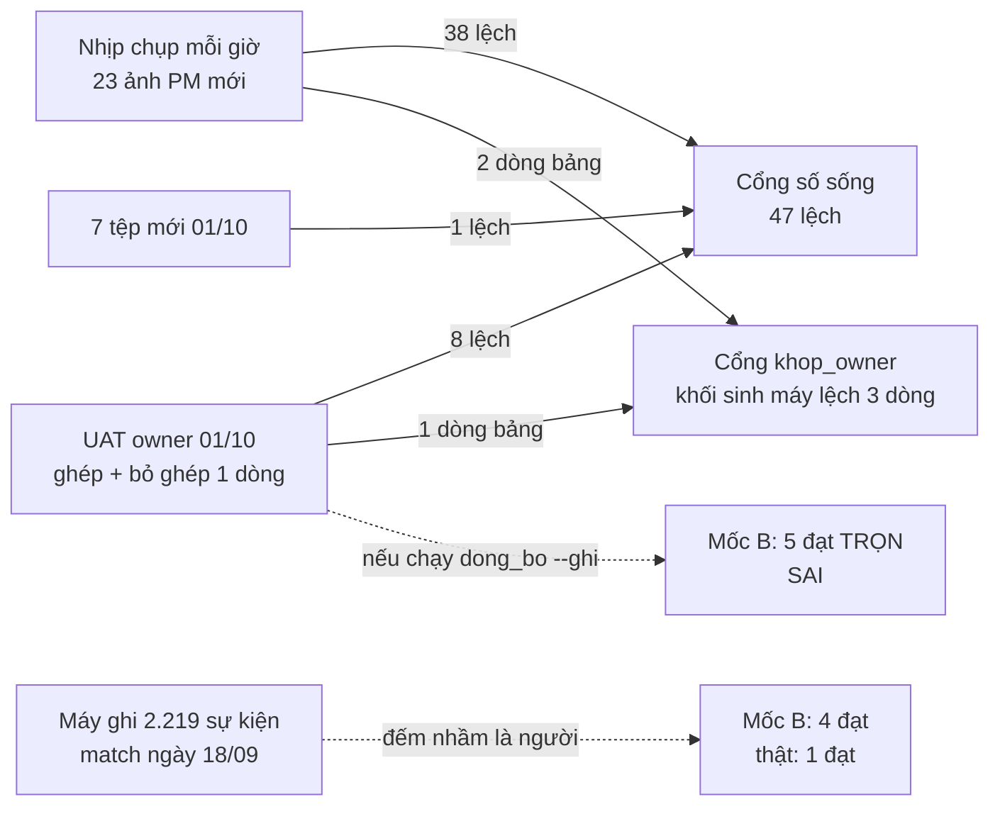

# Rà soát bộ tài liệu ITL — tài liệu có còn nói ĐÚNG hiện trạng tại 01/10?

**Version:** v1.1 · **Ngày:** 2026-10-01 · **Chủ sở hữu:** `fls-ba` *(BA · PO)* · **Căn cứ:** owner 01/10 — *"BA review lại tài liệu"*
**Phiếu đi kèm:** [`WO-001`](../../01_Orchestrator/handoff/WO-001-dong-bo-tai-lieu-sau-01-10.md) *(phần việc của Dev + câu chờ owner)*

> **Kết luận trước *(cho owner, ⛔ không kỹ thuật)*:**
>
> 1. **Phần lớn chỗ "đỏ" là số tự trôi, ⛔ không phải tài liệu sai.** Cổng số sống báo **47** chỗ lệch: **38** là con số lớn lên theo nhịp chụp mỗi giờ *(từ 23/09 tới 01/10 kho có thêm **23** ảnh lệnh chi)*, **8** do cú thử UAT của owner sáng 01/10, **1** do thêm tệp mới 01/10.
> 2. ⛔⛔ **Nhưng có MỘT chỗ tài liệu đang nói SAI, và nó sai từ 18/09:** con số *"mốc B — 4 cổng đạt"*. Thật ra **⛔ chưa một kế toán nào** bấm cửa ghép trên sổ thật. Cổng đếm nhầm **2.219** dòng nhật ký **máy** tự ghi ngày 18/09 thành *"người bấm"*. Ngay dưới con số ấy, bảng chi tiết vẫn ghi *"1 đạt · 1 một nửa · 3 chưa"* — **một trang nói hai điều**.
> 3. ⛔ **Nếu hôm nay chạy công cụ đồng bộ số tự động**, nó sẽ ghi **"mốc B đạt TRỌN 5/5"** — vì cú UAT của owner *(ghép rồi bỏ ghép một dòng)* làm nốt cổng cuối thành "đạt". ⇒ **Xin owner đừng cho chạy** cho tới khi sửa cách đếm *(phiếu `WO-001`)*.
> 4. Cổng thứ hai *("15/19")* **⛔ không hỏng như ta tưởng**: bốn chỗ "lệch" là lệch **CÓ CHỦ Ý** *(đã khai trước)*. Nó đỏ chỉ vì bảng sinh máy trong lộ trình audit cũ đi **3 dòng**.
> 5. Hai tệp mới *(hợp đồng ba agent `10` · bối cảnh `11`)* dùng được, nhưng có **8** chỗ cần vá — nặng nhất: **⛔ không ai được giao giữ** những tệp mang nhiều số sống nhất, và một câu trong `11` chép từ trí nhớ đã cũ *(một GAP đóng từ 28/08 vẫn ghi là đang mở)*.

---

## 1. Hai cổng đỏ — từng chỗ lệch thuộc loại nào

Loại: **(a)** số trôi tự nhiên theo dữ liệu · **(b)** do UAT 01/10 · **(c)** do thêm tệp 01/10 · **(d)** tài liệu SAI thật / câu cạnh số đã sai.
Lệnh đo *(01/10, `PYTHONUTF8=1`, kho THẬT chỉ đọc)*: `tools/kiem_so_song.py` · `docs/ITL/_tools/khop_owner.py --kiem` · bản sinh-lại-trong-bộ-nhớ của `khop_owner` so với khối `SINH-KHOP` *(kịch bản chỉ đọc, ⛔ không ghi lộ trình)*.

### 1.1 · `kiem_so_song` — **47** nhóm lệch trên **25** phép so

| # nhóm | Phép so *(tệp)* | Tài liệu ghi → MÁY đo | Loại | Vì sao |
|---|---|---|:-:|---|
| 1–2 | kho · ảnh chụp dòng lệnh *(dashboard)* | `158.424` → `245.468` dòng · `1.500` → `1.521` phiếu | a | `fls_pm_line` là ảnh chụp chỉ-thêm; **65** `run_id` PM *(23/09: 42)* |
| 3–4 | kho · dấu thời điểm sổ + ảnh *(dashboard)* | `23/09 14:08` → `01/10 16:21` | a ⚠ | dấu = `fls_run` mới nhất = lượt PM `NAP-2026-10-01-PM379BB910`. ⚠ nhãn sai — xem `R-3` |
| 5–6 | master · dấu thời điểm ×2 | như trên | a | |
| 7 | bản vẽ · dấu thời điểm | như trên | a | |
| 8–9 | roadmap · dấu thời điểm ×2 | như trên | a | |
| 10 | roadmap · ảnh chụp | `158.424` → `245.468` | a | |
| 11 | dashboard §1 · cửa ghép LÔ nhận ngay | `47` → `64` dòng | a | phụ thuộc ảnh PM mới nhất |
| 12 | dashboard §1 · có mã mà ⛔ không PM nào mang | `5.801` → `5.783` dòng | a | như trên |
| 13 | master · kho *(ảnh chụp)* | `158.424` → `245.468` | a | |
| 14 | master §8 · số tệp `.md` | `81` → `88` | **c** | +`10` +`11` +`handoff/README` +4 mẫu `_mau/` = **+7** |
| 15 | mốc · bút toán sửa THẬT *(`09` §3)* | `4.424` → `4.428` | **b** | +4 dòng `fls_journal` actor `khanhcq@apero.vn`, `value_source='sua_tay'`, reason `UAT 01/10…` |
| 16 | mốc · sự kiện hàng chờ THẬT *(`09` §3)* | `110.347` → `110.349` | **b** | +1 `match` +1 `unmatch` trên `itl_id 27728` |
| 17–18 | bản vẽ · ảnh chụp lệnh chi | `42` → `65` ảnh · `158.424` → `245.468` | a | |
| 19–20 | dashboard · ảnh nhịp / tổng ảnh | `80/92` → `128/140` | a | `fls_chup` +48 ảnh từ 23/09 *(6 ảnh/lằn ngày 01/10)* |
| 21–22 | dashboard · cổng mốc B | `4·1·0` → `5·0·0` | **b** *(trên nền d)* | UAT tạo `fls_pm_unlink` đầu tiên *(`unlink_id 163568`)* ⇒ `B4` một nửa → đạt. ⛔ Nền `4` đã sai từ 18/09 — `R-1` |
| 23–24 | `09` · cổng mốc B | như trên | **b** *(trên nền d)* | |
| 25–26 | bản vẽ 13 · cổng mốc B | như trên | **b** *(trên nền d)* | |
| 27–28 | bản vẽ 13 · ảnh nhịp / tổng ảnh | `80/92` → `128/140` | a | |
| 29 | bản vẽ 13 · ảnh lệnh chi khác nhau | `42` → `65` | a | |
| 30 | bản vẽ 13 · trần độ phủ | `52,7%` → `53,4%` | a | ảnh PM mới nhất `3.772` → `3.820` dòng |
| 31–34 | bản vẽ 13 · bảng trần cứng | `3.772`→`3.820` · `1.553`→`1.601` · `3.719`→`3.767` · `52,7`→`53,4` | a | +48 dòng lệnh rảnh trong ảnh mới; dòng đã dùng ⛔ đổi |
| 35 | bản vẽ 13 · cổng A3 số dòng lệnh | `3.772` → `3.820` | a | |
| 36 | bản vẽ 13 · phía PM tỷ lệ | `58,8%` → `58,1%` | a | mẫu số lớn lên, tử số đứng yên |
| 37–40 | bản vẽ 13 · thẻ phía PM | `3.772`·`1.500`·`1.553`·`802` → `3.820`·`1.521`·`1.601`·`826` | a | |
| 41–47 | bản vẽ 13 · bảng việc còn lại | `58,8`·`1.553`·`802`·`1.500`·`171`·`187`·`273` → `58,1`·`1.601`·`826`·`1.521`·`174`·`205`·`299` | a | |

**Tổng: (a) `38` · (b) `8` · (c) `1` · (d) `0` trực tiếp** — nhưng **6** trong 8 nhóm (b) nằm trên một nền (d) *(mốc B, `R-1`)*.
⭐ UAT **⛔ không** đổi số mapping: `fls_moi_noi` vẫn **`2.262`** mối nối · **`2.222`** dòng sổ · **`2.219`** dòng lệnh *(ghép rồi bỏ ⇒ hiệu lực ròng 0)*.
⚠ **Đo lại cuối lượt *(cùng ngày, sau khi phiếu này và các bài của `fls-test` ra đời)*: `55` nhóm.** Thêm **8**: số tệp `.md` **88 → 90** và hiện vật **44 → 45** *(chính hai tệp của phiếu này — loại c)* · tổng phép thử **1.903 → 1.910** ở **6** chỗ ghim *(`fls-test` đang viết `tests/nghiem_thu/test_kq002_*` song song — loại **c**, ⛔ lỗi)*. ⇒ Con số đỏ **trôi theo giờ trong cùng một ngày** — `BG`/`KQ` phải dán số **kèm giờ đo**.
⭐ `fls-test` **độc lập** bắt đúng `R-1` *(`KQ-002 · F-2`, bài `test_kq002_moc_b_khong_dem_may_la_nguoi.py`)* — hai lăng kính cho cùng một kết luận.

⭐ 38 nhóm (a) đúng là lớp `GAP-CONG-01` *(`04_Test/03:40`, dashboard `:120`)*: phép so **giá trị ghim** trên con số **tự lớn lên mỗi giờ** ⇒ cổng đỏ mà ⛔ không ai làm sai.

### 1.2 · `khop_owner --kiem` — **15/19** là trạng thái **MONG ĐỢI**, ⛔ không phải cái làm cổng đỏ

| Mục | Đo được | Loại | Ghi chú |
|---|---|:-:|---|
| `A2` · `B5` · `B6` · `C5` "lệch" | cả bốn khai `mong=False` *(`khop_owner.py:415`, `:420`, `:429`, `:444`)* | — | lệch **có chủ ý**: cổng chỉ đỏ khi **khác `mong`**. Hôm nay 0 phép đổi trạng thái |
| Khối `SINH-KHOP` dòng `B3` | `105.616` → `192.660` dòng có cha PE/PI | a | ảnh PM mới |
| Khối `SINH-KHOP` dòng `B4` | `0 / 105.616` → `0 / 192.660` | a | |
| Khối `SINH-KHOP` dòng `C6` | `fls_adjustment 4424 · fls_journal 4424` → `4428 · 4428` | **b** | UAT |
| Dòng `CONG NO` duy nhất | *"khối trong lộ trình LỆCH với bản sinh lại"* | a+b | ⇒ chạy lại ⛔ không `--kiem` là xanh — nhưng nó **ghi** `_AUDIT_ALIGNMENT_ROADMAP.md` *(chủ tệp chưa rõ — `R-20`)* |

⛔ Câu *"15/19 (lệch A2, B5, B6, C5)"* trong `11:87` đọc như **bốn lỗi** — sai hàm ý. Xem `R-4`.

---

## 2. Bảng phát hiện

Mức ưu tiên ghi ở cột *Đề xuất*. `banve` = `02_BA/Artifacts/Ban-ve-Kien-truc-TOBE.html`; `dash` = `01_Orchestrator/06_ORCHESTRATOR_DASHBOARD.md`; `09` = `01_Orchestrator/09_MILESTONES_HAI_TAC_VU.md`.

| Mã | Tệp:dòng | Nói gì | Thật là gì *(đo 01/10, nhãn)* | Loại | Đề xuất |
|---|---|---|---|:-:|---|
| `R-1` | `09:147` · `dash:121` · `banve:1367` ⟷ `09:155`–`:161` · `09:322` · `kiem_so_song.py:239`–`242`, `:408`–`410` | Mốc B **`4` đạt · `1` một nửa · `0` chưa** | Bảng chi tiết ngay dưới *(`09:155`–`159`)* và `09:322` vẫn ghi **`1·1·3`**. Số `4` vào tài liệu ở commit `20e2910` *(18/09 16:22, `QĐ-ITL-143`)*: cổng đếm `evt_type <> 'reason'` là "người", mà máy ghi **`2.219`** sự kiện `match` actor `may@fls` lúc 18/09 09:07 ⇒ `B2`·`B3`·`B5` lật xanh với **0** cú bấm của kế toán. Sự kiện ngoài `reason` hôm nay: `may@fls` **2.219** · `khanhcq@apero.vn` **2** *(UAT)* · actor khác **0** | **d** | ⛔ **CHẶN.** `WO-001` `T1`: siết `_cong_moc_b` loại actor máy. Sau đó sửa câu ở `09`/`dash` cho khớp |
| `R-2` | cổng `B4`/`B5` · `09:144`–`145` | `B4` đòi bỏ ghép trên sổ THẬT; `B5` đòi sự kiện của người thật | UAT 01/10: `fls_pm_unlink` **0 → 1** · sự kiện người **0 → 2** ⇒ máy đếm **`5·0·0`** — mốc B "đạt trọn" | **b** | ⛔ Đừng chạy `dong_bo_so_song --ghi` trước `T1`. Có tính UAT không ⇒ **owner** *(Q1)* |
| `R-3` | `dash:118` · `kiem_so_song.py:310`–`312`, `:598` | *"**8.387 dòng sổ** (bản sao nạp 23/09 14:08)"* · *"run `NAP-2026-08-27-RAW`"* | Dấu lấy `max(started_at)` của **mọi** `fls_run` ⇒ luôn là lượt **ảnh PM** *(01/10 16:21)*. Sổ nạp lần cuối **10/09**: `NAP-2026-09-10-RTANG24037` **6.617** + `NAP-2026-09-10-BU1` **1.770** = 8.387. Run `NAP-2026-08-27-RAW` còn **0** dòng | **d** | `WO-001` `T2`: dấu cạnh số dòng sổ = lượt nạp **SỔ** gần nhất *(luật `Đ4`)* |
| `R-4` | `11:87` | *"⛔ `khop_owner` **15/19** (A2, B5, B6, C5)"* | 4 mục ấy `mong=False` ⇒ 15/19 là **đúng mong**. Cổng đỏ vì khối sinh máy lệch **3** dòng *(§1.2)* | **d** | Sửa câu `11` *(chủ: owner)* |
| `R-5` | `khop_owner.py:307`–`311` · lộ trình `:360` | `B5` "tệp BA màn ghép đặc tả cơ chế đề xuất" — đếm trong `12_BA_MAN_GHEP_PM.md` | `12` là **BIA** từ 18/09 *(`12:7`, `CR#12`)*. Cơ chế đề xuất sống ở `BA-06` v4.7 *("đề xuất" **15** lần · "ứng viên" **38** · bảng 4 bậc `:767`)* và `BA-13` v1.5 *(`:98`)*. Phép đo hỏi **một tệp đã chết** ⇒ lệch mãi | **d** | `WO-001` `T4` *(chờ Q4 — chủ `_tools/`)*: neo lại về `BA-06`, đổi `mong` |
| `R-6` | `khop_owner.py:375`–`381`, `:444` · `_AUDIT_ALIGNMENT_ROADMAP.md:162` | *"`Diễn giải` ⛔ KHÔNG có trong kho. Mọi cơ chế đề xuất ⛔ không đo được"* | Từ 18/09 *(`QĐ-ITL-145`, migration `0026`)* khung xem `fls_dien_giai` có **8.366** dòng / sổ **8.387**. `fls_itl.memo` vẫn **0/8.387** — câu đúng cho **cột**, sai cho **kho** | **d** | `WO-001` `T4`: tách phép `C5` thành "cột sổ" và "khung xem". Lộ trình ở v0.10 *(17/09)* — chưa ai cập nhật |
| `R-7` | `09` §1–§3 ⟷ `khop_owner.py:406`–`460` · `11:86`–`87` | Mã cổng `A1`/`A2`, `B1`…`B5`, `C1`…`C5` | Hai hệ cổng **trùng mã, khác nghĩa**: mốc `B5` = *"người thật bấm hàng chờ"*; `khop_owner` `B5` = *"tệp BA đặc tả cơ chế đề xuất"*. `C5` cũng vậy. Ngay lời giao việc 01/10 đặt hai `B5` cạnh nhau | **d** | Đặt tiền tố: `M-B5` *(mốc)* · `K-B5` *(khop_owner)*. Chủ đổi: owner |
| `R-8` | `dash:113`, `:149`, `:151` | `Σ trọng số` **100 → 111**; *"tiến độ = 87,00 / 111 = 82%"*; *"trọng số cộng lại phải bằng 100"* | `tools/tien_do.py --json`: `tong_trong_so` **106**, `tien_do_pct` **82,1**. Bảng `dash:145` cũng ghi **106**. 87/111 = **78,4%** | **d** | Sửa ba câu thành `106` *(chủ §1: chưa rõ — `R-20`)* |
| `R-9` | `09:125`, `:128`, `:129` · `dash:130` | PS Có **8.246** · mối nối **2.745** · **3.703** dòng lệnh *"già 13 ngày"* · *"mẫu số thật là 8.246, ⛔ không phải 10.030"* | PS Có **7.056** *(`ps_co <> 0`)* · mối nối hiệu lực **2.262** · ảnh PM mới nhất **3.820** dòng, **65** ảnh, đọc 01/10 16:21. Cả ba là số **trước** lần dựng lại sổ 10/09. `dash:130` đã ghim `7.056` mà câu cạnh nó vẫn nói `8.246` | **d** | Sửa câu; ghim `09:125`/`:128` vào cổng *(Dev)* |
| `R-10` | `09:212`–`219` | *"con số của tác vụ ② là một số KHÔNG"* · *"⛔ CHƯA MỘT LẦN được dùng trên sổ thật"* — cạnh **4.424** | `fls_journal` **4.428**: **4.424** `may_goi_y` *(18/09)* + **4** `sua_tay` UAT. ⭐ UAT còn tạo **cặp sửa→đảo đầu tiên** trên sổ thật *(`adj 163563`→`163569`, `163565`→`163571`)* — đúng vế của cổng `C2` | **d** *(+b)* | Viết lại thành "**0** bút toán do **người thật** làm việc thật"; quyết UAT có đóng `C2` ⇒ Q1 |
| `R-11` | `09:70` ⟷ `09:321` | `:70` *"việc đăng ký tác vụ thì ⛔ chưa xảy ra"*; `:321` *"nhịp đã đăng ký"* | Tác vụ Windows `FLS nhip chup` **có**, trạng thái `Ready`, `WakeToRun=False`, `DisallowStartIfOnBatteries=True` ⇒ `:321` đúng, `:70` già *(nhịp chạy 23, 25, 28/09 và 01/10 — chỉ khi máy bật)* | **d** | Thêm đính chính dưới `:70` |
| `R-12` | `09:339`, `:347` ⟷ `11:86` | `09`: buổi `C1`+`B5` do *"kế toán **(hoặc owner)**"* ngồi sửa thật | `11`: *"⚠ đừng tính cú UAT của owner là `B5` ĐẠT"*. Hai tệp **trái nhau** về chính cú bấm đã xảy ra | **d** | ⇒ **owner** *(Q1)* |
| `R-13` | `11:51` | *"⚠ `GAP-CR1-04`: dung sai `1.000 VND` tuyệt đối quá rộng … ngưỡng tỷ lệ là quyết định kế toán"* | **ĐÓNG 28/08** bởi `QĐ-ITL-63` *(`00_MASTER_INDEX:224`, `dash:452`)*: ghép tay đòi **≤ 1.000 đ VÀ ≤ 0,5%**. Mã: `pm_join.py:376` `TY_LE_GHEP_TAY = Decimal("0.005")` | **d** | Sửa `11` *(chủ: owner)* |
| `R-14` | `11:88` · `dash:493` | Chờ owner: *"`QĐ-ITL-116` giữ đích `A-CCR` hay chĩa sang ITL adjust"* | Owner đã trả 09/09: `QĐ-ITL-120` *(đích BigQuery)* + `QĐ-ITL-123` *(hoãn BQ)*; `09:254` ghi rõ *"cả hai cách đọc đều sai"* | **d** | ✅ `dash` §6 **đã sửa** *(tôi sở hữu)*; `11` chờ owner |
| `R-15` | `dash:495`, `:499` | Đọc trước: `UC-US` **v0.3** · `Lo-trinh` **v0.4** · `DEV-03` **v1.0** *(roadmap 7 pha)* | Header thật: `UC-US` **v0.4** · `Lo-trinh` **v0.7** · `DEV-03` **v4.7** *(8 pha)* | **d** | ✅ **đã sửa** *(đính chính tại chỗ)* |
| `R-16` | `00_MASTER_INDEX:314`–`321`, `:341` | §8: `12` v0.2 · `13` v1.0 · `14` v0.1 · lộ trình audit v0.7, *"C1 16 phép, 7 khớp · 9 lệch"* · `01_Orchestrator/` **9** tệp. §10: `lint-imports` **8 kept**; *"Việc kế tiếp là `P6`"* | Thật: `12` **v0.3** · `13` **v1.5** · `14` **v0.6** · lộ trình **v0.10**, **19** phép, **15/19** · `01_Orchestrator/` **11** tệp + `handoff/` **5** · `lint-imports` **9 kept** *(dash:117, cổng xanh)*. Header master v0.29 *(18/09)* | **d** | Sửa §8/§10 *(chủ: chưa rõ — master chỉ giao BA phần sổ `QĐ`/`CR`)*; ghim version `12`/`13`/`14` vào cổng |
| `R-17` | master §8 · `11:87` | `81` tệp `.md` · *"`kiem_tai_lieu` ĐẠT (87 tệp)"* | Máy đếm **88** *(`kiem_tai_lieu` 01/10: 88 tệp · 1.118 bảng)*. ⚠ Phiếu này thêm **2** tệp ⇒ **90**, và hiện vật `Artifacts/` **44 → 45** | **c** | Chờ Q2 *(dong_bo)* |
| `R-18` | `ghi_tay.py:686`–`697` · `khop_owner.py:391`–`403` | `C8` *"NGƯỜI đã chốt ô nào chưa"* = `fls_sua_tay > 0` | Cửa ghép TAY ghi `hd`/`cdt1` **máy suy từ dòng lệnh** với `value_source = 'sua_tay'` *(`NGUON_TAY`)*. UAT chứng minh: **4** dòng `fls_adjustment.nguon='sua_tay'` đều là giá trị suy. `fls_sua_tay` = **0** hôm nay **chỉ vì** đã đảo ⇒ cú ghép thật đầu tiên sẽ làm `C8` báo *"người đã chốt"* dù người ⛔ gõ ô nào | **b** | ⇒ **owner** *(Q3)*: giá trị suy từ cú ghép tay là "người chốt" hay "máy gợi ý"? Và báo trước kế toán *(như `11:50`)* |
| `R-19` | `10:122`–`126` ⟷ `dash:461` | Khuôn nhật ký là **một dòng gạch đầu** `- [YYYY-MM-DD] [agent] …` | `dash` §5 là **bảng 5 cột** *(Ngày · Phiên · Task · Output · GAP)* — chèn nguyên văn khuôn vào giữa bảng là **vỡ bảng** | **d** | Tôi đặt khuôn vào ô `Output` của một hàng bảng. Đề xuất `10` v1.1 khai khuôn **hàng bảng** |
| `R-20` | `10:13`–`21` | Ba vai sở hữu `02_BA`, `fls/tools/tests/03_Dev`, `04_Test` + §5/§6 dashboard | **⛔ Không ai** được giao: dashboard **§1–§4** · `09_MILESTONES` · `00_MASTER_INDEX` §8/§10 · `_AUDIT_ALIGNMENT_ROADMAP.md` · `docs/ITL/_tools/**`. `grep` trong `10`: `_tools` **0** · `_AUDIT` **0** lần. Đó lại là những tệp mang phần lớn số bị cổng ghim *(47/47 nhóm lệch hôm nay nằm ở dashboard, master, roadmap, `09`, bản vẽ)* | **d** | ⇒ **owner** *(Q4)*. Đề xuất: số **máy sinh** ⇒ Dev; **câu** ⇒ BA |
| `R-21` | `CLAUDE.md:68` · `fls-dev.md:43` ⟷ `10:16` | Dev phải chạy **mọi** cổng *(kể cả `dong_bo_so_song --ghi` "lệch thì soạn lại")*; Dev ⛔ sửa `02_BA/**` | `dong_bo_so_song --ghi` **ghi vào** `02_BA/Artifacts/Ban-ve-Kien-truc-TOBE.html` *(BA sở hữu)* + dashboard + `09`. `grep` `dong_bo_so_song` trong `10`: **0** lần ⇒ hoặc Dev phạm `10 §1`, hoặc mọi `BG` mang cổng đỏ mãi | **d** | ⇒ **owner** *(Q2, Q4)*: ai chạy `--ghi`, khi nào |
| `R-22` | `10:15` ⟷ `10:54` · `fls-ba.md:36` | `fls-ba` sở hữu *"phiếu `WO-*`, `TL-*`"* | `10 §3` đặt tên tệp cho **bốn** loại *(WO, HOI, BG, KQ)*; `fls-ba.md` bảo trả `TL` **trong cùng tệp** `HOI` ⇒ `TL` là tệp hay mục: mơ hồ | **d** | `10` v1.1: `TL` là **mục** trong tệp `HOI` |
| `R-23` | `10:42` ⟷ `05:42` | Dev kiểm *"3 việc của `05` §5"* | `05:42`: *"§3 và §5 … được THAY bởi `10`"*, giữ làm biên bản ⇒ **vòng tham chiếu** | **d** | Chép 3 việc *(git thật · version hợp đồng · run id)* vào `10 §2` |
| `R-24` | `10:54` | `NNN` = số lớn nhất **+1** | Hai agent chạy **song song** *(01/10: `fls-ba` + `fls-test`)* ⇒ cùng đọc thấy 0 và cùng lấy 001. Hôm nay phải **cấp tay** 001/002 | **d** | Giữ chỗ: ghi dòng vào bảng *"Phiếu đang mở"* **trước** khi viết tệp |
| `R-25` | `10:134` ⟷ `kiem_so_song.py:408`–`410` | UAT ghi kho thật **chỉ khi** có `WO` + reason bắt đầu `UAT <ngày>` | Luật **⛔ không có máy cưỡng chế**: cổng mốc ⛔ lọc reason `UAT`. Và cú UAT 01/10 chạy **trước** khi có phiếu *(handoff/ có 0 phiếu trước `WO-001`)* | **d** | `WO-001` `T1b` *(chờ Q1)*; ghi biên bản hồi tố cú UAT trong `WO-001` |
| `R-26` | `10:3` · `11:3` | *"Chủ sở hữu: owner"* | ⛔ Không nói **ai được sửa** `10`/`11` và qua đường nào *(`QĐ`? `CR`?)* | **d** | `10` v1.1: đổi `10`/`11` chỉ qua `CR#` |
| `R-27` | `dash:4` · `dash:742` | Header *"Cập nhật lần cuối 2026-09-09"*; Changelog mới nhất **2026-09-08** | §5 đã có dòng **17/09** và **23/09** ⇒ Changelog dừng **23 ngày** | **d** | ✅ thêm dòng Changelog 01/10 *(phần tôi sửa)*; header thuộc chủ §1 |
| `R-28` | `banve:1366`–`1380` | Thẻ mốc 2: *"Cả **2.745** mối nối … sinh cùng ngày **27/08**"* · *"chưa một cú bỏ ghép nào từng xảy ra"* | **2.262** mối nối, tạo **10/09** *(`fls_pm_link.created_at`, hình A 2.145 · B 65 · C 52)*; bỏ ghép: **1** *(UAT 01/10)* | **d** *(+b)* | ✅ **đã thêm đính chính** trong thẻ *(giữ nguyên câu cũ làm biên bản)* |
| `R-29` | `04_Test/03:40` · `dash:120` | `GAP-CONG-01`: cổng ghim giá trị **tự lớn lên** | Hôm nay đúng **38/47** nhóm đỏ là lớp này | **a** | Đổi sang phép so **quan hệ** *(vd. `ảnh nhịp ≤ tổng ảnh`, `tổng ảnh ⛔ giảm`)* — `WO-001` NGOÀI phạm vi, đề xuất phiếu sau |

**Đếm theo loại:** (a) **1** · (b) **2** · (c) **1** · (d) **25** — tổng **29** phát hiện *(chưa kể 47 nhóm lệch của §1, trong đó 38a · 8b · 1c)*.

---

## 3. Câu trạng thái / "việc kế tiếp" — đối chiếu với kho thật

| Chỗ | Câu | Đo 01/10 | Còn đúng? |
|---|---|---|:-:|
| `dash` §6.-2 ① | Chip `Tất cả` *(`GAP-SCR-26`)* chờ owner | `GAP-SCR-26` mở *(`dash:315`)*; ⛔ commit mã nào từ `fc06ff6` *(23/09)* | ✅ |
| `dash` §6.-2 ② | `GAP-API-10` cổng đo khuôn cửa trả | mở *(`dash:317`)*; `grep` mã `fls/`+`tools/`+`tests/`: **0** tệp | ✅ |
| `dash` §6.-2 ③ | `GAP-NFR-01` đo tương phản | mở *(`dash:304`)*; mã **0** tệp | ✅ |
| `dash` §6.-2 ④ | `GAP-SCR-24` khung cao bằng màn | mở *(`dash:313`)* | ✅ |
| `dash` §6.-2 câu cuối | hai bản dựng `_9`/`v2` còn sống trong `02_BA/Artifacts/` | `fls-gan-lenh-chi_9.html` + `man-gan-lenh-chi-v2.html` **có** | ✅ |
| `dash` §6 đầu | *"Ba việc còn lại của `P8`: `114`+`115` ⇒ `A1`+`A2` · `116`"* | `114` *(nhịp)* đã có tác vụ Windows; `A1` **đạt** trên kho; `A2` một nửa *(chờ ảnh đủ 30 ngày — ảnh già nhất 08/09)* | ◐ — đã thêm đính chính |
| `dash` §6 đầu | *"`116` giữ đích A-CCR hay chĩa sang ITL adjust — chờ owner"* | đã trả 09/09 *(`R-14`)* | ⛔ — **đã sửa** |
| `dash` §1 mốc B | `R-1` | | ⛔ |
| `dash` §1 kho thật | `R-3` | | ⛔ |
| `09` bảng §7 | `A`: `4·1·1` *(khớp máy)* · `B`: `1·1·3` *(khớp sự thật về người, lệch số ghim §2)* · `C`: *"⛔ 0 bút toán thật"* *(đúng cho người thật — 4 dòng UAT)* · `D`: *"⛔ 0 bộ xuất"* | | ◐ |
| `11` §7 | sổ `8.387` · link `2.263` · unlink `1` · `0` thao tác kế toán thật | `fls_itl` **8.387** · `fls_pm_link` **2.263** · `fls_pm_unlink` **1** · sự kiện người thật ngoài UAT **0** | ✅ |
| `11` §7 | nhịp: lần cuối 01/10 15:20, Bank 8.923 / 64 nguồn | lần cuối **16:21**; ảnh Bank `163573` **8.923** dòng · **64** nguồn | ✅ *(trôi giờ, loại a)* |
| `11` §7 | nhánh `feat/p2-oracle-parity`, **168** commit chưa vào `main` | `origin/main..HEAD` = **168** *(⚠ `main` cục bộ già: `main..HEAD` = 235)* | ✅ |

---

## 4. Rà `10_HOP_DONG_AGENT.md` v1.0 và `11_BOI_CANH_TU_MEMORY.md` v1.0

**`10` — dùng được, thiếu 6 thứ:** `R-19` khuôn nhật ký ⛔ khớp bảng · `R-20` tệp **không chủ** · `R-21` `dong_bo --ghi` đâm vào ranh giới `02_BA` · `R-22` `TL` tệp hay mục · `R-23` vòng tham chiếu `05` · `R-24` đánh số khi chạy song song · `R-25` luật UAT không có máy · `R-26` ai sửa `10`. Ngoài ra khuôn `_mau/WO.md:32`–`33` đặt bảng **ngay sau** gạch đầu dòng, ⛔ có dòng trống ⇒ nhiều trình đọc ghép bảng vào gạch đầu *(nhẹ)*.

**`11` — giá trị cao, 4 chỗ phải sửa:** `R-13` GAP đã đóng ghi là đang mở · `R-14` câu chờ owner đã có trả lời · `R-4` mô tả sai cổng `khop_owner` · `R-12` trái `09` về UAT. Câu `11:50` *(UAT xác nhận Ghép tự điền 2 ô)* **đúng** và nên đẩy lên `BA-06`/`BA-13` thành hành vi khai *(đi cùng `R-18`)*.

---

## 5. Đã sửa trong lượt này *(chỉ tệp `fls-ba` sở hữu, loại d chắc chắn)*

| Tệp | Sửa | Version |
|---|---|---|
| `dash` §6 *(đầu mục)* | `R-14` · `R-15` + đính chính *"ba việc còn lại của P8"* · thêm `§6.-3` bản 01/10 | dashboard "sống" — dòng Changelog 01/10 |
| `dash` §5 | một hàng nhật ký theo khuôn `10 §5` | — |
| `banve` thẻ mốc 2 | đính chính `R-28` + cảnh báo `R-1`/`R-2` *(⛔ đụng con số ghim)* | tệp HTML ⛔ có header version — ghi ở đây và Changelog dashboard |
| `handoff/README.md` | dòng `WO-001` | — |
| tệp này + `WO-001` | mới | v1.0 |

⛔ **Chưa sửa** *(⛔ thuộc tôi, hoặc chờ owner)*: `09` · dashboard §1 · master §8/§10 · `11` · `10` · lộ trình audit · mọi tệp mã.

## Changelog
- v1.1 (2026-10-01 tối, `fls-ba`): owner trả Q1–Q4 *(`QĐ-ITL-149`, `QĐ-ITL-150`)*. Đã xử: `R-4` · `R-12` · `R-13` · `R-14` *(`11` v1.1)* · `R-18` *(Q3 ⇒ `BA-05` v0.32 `DD-I15 ⓓd`, mã ở `WO-003`)* · `R-19` · `R-20` · `R-21` *(`10` v1.1)* · `R-2`/`R-25` *(Q1 ⇒ `WO-001 T1b`)*. ⛔ Nội dung v1.0 bên trên **giữ nguyên** làm biên bản — các câu *"chờ owner"* trong đó nay đã có trả lời.
- v1.0 (2026-10-01): Khởi tạo — rà hai cổng đỏ *(47 nhóm: 38a · 8b · 1c; khop_owner: 15/19 đúng mong, khối sinh máy lệch 3 dòng)*, 29 phát hiện `R-1`…`R-29`, rà `10`/`11`, đối chiếu §6.-2 với kho thật. Phát `WO-001`.
