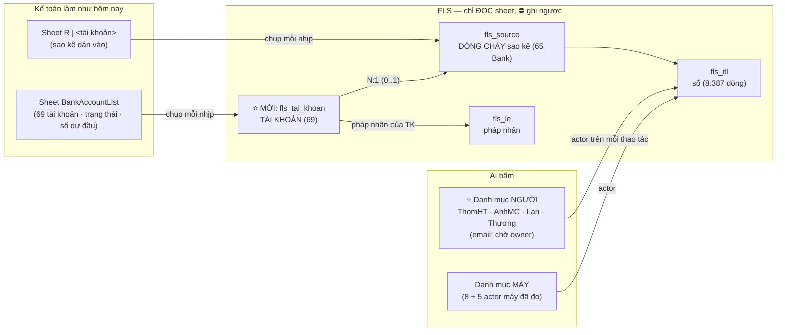
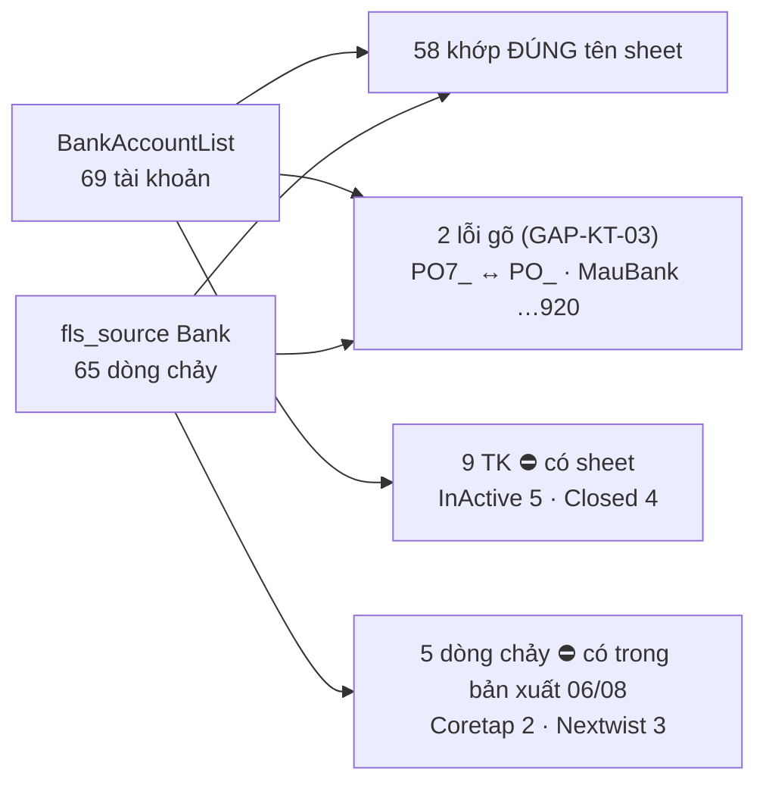
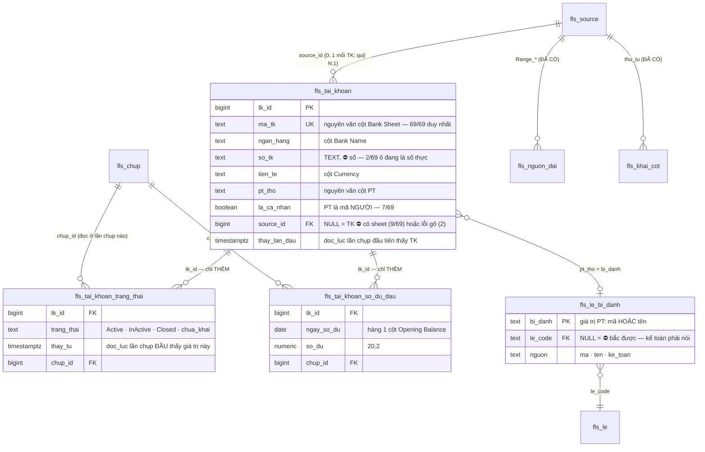
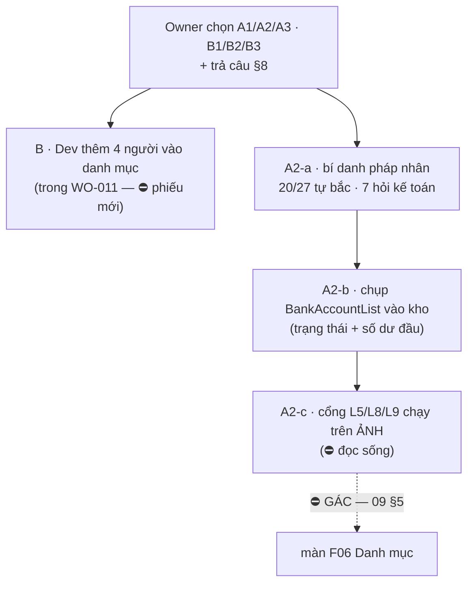

# Thiết kế hai danh mục: TÀI KHOẢN NGÂN HÀNG và NGƯỜI DÙNG

**Version:** v0.2 · **Ngày:** 2026-10-02 · **Chủ sở hữu:** owner *(COO-CFO)* · **Người soạn:** `fls-ba`
**Trạng thái:** ⏸⏸ **HOÃN — owner 02/10:** *"defer phần tài khoản, làm xong công cụ đã"*. Tệp **giữ nguyên** phần đã viết *(đo + phương án)*, ⛔ hoàn thiện thêm, ⛔ chờ owner chọn phương án cho tới khi owner mở lại. ⛔ Chưa phát `WO` nào; §6 chỉ là *WO dự kiến*.

> ⏸ **Đã đo được gì trước khi hoãn** *(02/10, chỉ đọc — chi tiết §2)*: `BankAccountList` **69** tài khoản *(bản xuất 06/08 — cũ hơn sheet sống, sống ≥ 73)* ↔ `fls_source` **65** dòng chảy `Bank`: **58** khớp đúng tên · **2** lỗi gõ đã biết *(`GAP-KT-03`)* · **9** TK `InActive`/`Closed` ⛔ có sheet · **5** dòng chảy mới hơn bản xuất *(Coretap 2 · Nextwist 3)*. **12/64** nguồn ra 0 dòng — trạng thái TK **⛔ giải thích** được cái nào. Cột *DAILY CHECK BOX* là ô tick tay **chết từ 05/11/2025**. Pháp nhân bắc được **59/69** TK.
> ⏸ **Danh sách người owner đã cho** *(02/10)*: **ThomHT · AnhMC · Lan · Thương** — ⛔ chưa có email đăng nhập. `WO-011` đã được sửa để **⛔ phụ thuộc** danh sách này *(người thật = actor ⛔ thuộc sổ máy ∧ ⛔ UAT)*.
**Căn cứ:** lời owner 02/10 *(§1, nguyên văn)* · `WO-011` `Q1` · `QĐ-ITL-27` · `QĐ-ITL-101` · `QĐ-ITL-106` · `QĐ-ITL-110` · `QĐ-ITL-113`/`117` · `BA-04` v0.4 §0, §4 · `BA-05` v0.33 `DD-I10` · `07_CHANGE_CONTROL` loại 1 · `09_MILESTONES` v1.13 §5

> ⛔ **Riêng tư:** mọi số tài khoản trong tệp này đã **che**, chỉ giữ **3 chữ số cuối** *(`…920`)*. Tệp gốc `P100 _ Bank Transactions.xlsx` nằm trong `FIN-ERP/AS-IS system/Accounting_Files/RAW/` — **gitignore** vì mang tên người + tiền thật; ⛔ chép nó vào repo này.

---

## 0. Kết luận trước *(cho owner)*

**Một câu:** sheet `BankAccountList` mà owner chỉ **là danh mục TÀI KHOẢN NGÂN HÀNG** *(69 tài khoản)* — ⛔ không phải danh sách người dùng. FLS **đã đọc nó từ 08/09** *(đọc trực tiếp, ⛔ lưu thành bảng)*. Còn danh sách **người dùng** thì owner vừa cho **4 tên**: ThomHT · AnhMC · Lan · Thương — thiếu **địa chỉ đăng nhập** của từng người.

| Câu hỏi | Đề xuất của BA | Owner cần làm gì |
|---|---|---|
| **(A)** Danh mục tài khoản ngân hàng lưu ở đâu? | ⭐ **Sheet `BankAccountList` vẫn là bản gốc** — kế toán sửa ở đó như hôm nay. FLS **chụp** nó vào **một bảng riêng** *(⛔ nhồi vào bảng nguồn)*, chỉ thêm ⛔ xoá, nhớ được *"tài khoản này đóng từ lúc nào"* | Chọn phương án **A2** *(hoặc A1/A3)* · trả 3 câu ở §8 |
| **(B)** Danh mục người dùng khai ở đâu? | ⭐ **Một tệp khai trong mã** *(đúng như `WO-011` đang làm)* — 4 kế toán + vai của từng người. Người mới = thêm một dòng | Cho **email đăng nhập** của 4 người · xác nhận *"Thương"* là ai · ai giữ danh mục *(vai `AC-C`)* |



⭐ **Cái được thật của (A), nói thẳng:** ít hơn tưởng. Đuôi tên sheet **đã chứa** pháp nhân *(khớp cột `PT` **69/69**)*, nên danh mục ⛔ cho thêm thông tin pháp nhân nào mới. Cái nó cho thêm là **trạng thái theo thời gian**, **số dư đầu kỳ** để đối soát, **9 tài khoản ⛔ có sheet** *(đã đóng / ngưng)* và chỗ để **bắc cầu tên ↔ mã pháp nhân** *(10/69 tài khoản hôm nay ⛔ bắc được)*. ⇒ BA đề xuất làm **lát mỏng**, ⛔ dựng màn danh mục *(`F06` vẫn **GÁC** theo `09` §5)*.

---

## 1. Lời owner *(nguyên văn)*

| Ngày | Câu hỏi | Lời owner |
|---|---|---|
| **2026-10-02** | `WO-011 Q1` — danh mục tài khoản người: những kế toán thật nào, khai ở đâu | *"danh sách Những tài khoản hiện đang để trong folder C:\Users\0_Apero Project\FIN-ERP\AS-IS system\Accounting_Files\RAW, spreadsheet P100 _ Bank Transaction sheet BankAccountList => BA đề xuất phương án thiết kế ERD và config hệ thống"* |
| **2026-10-02** *(lượt sau, qua phiên chính)* | danh sách NGƯỜI THẬT dùng FLS | *"dùng danh sách này ThomHT, AnhMC, Lan, Thương"* |

⇒ BA đọc hai câu như sau *(⛔ chốt thêm gì)*: câu 1 trỏ tới **danh mục tài khoản NGÂN HÀNG** và giao BA thiết kế ⇒ phần **(A)**. Câu 2 trả lời **"ai"** của `Q1` ⇒ phần **(B)**. Phần **"khai ở đâu"** và **email đăng nhập** owner **chưa** nói ⇒ §8.

---

## 2. Đo — `BankAccountList` ↔ kho FLS *(02/10, chỉ đọc)*

**Cách đo.** Tệp: `P100 _ Bank Transactions.xlsx` *(bản xuất offline, sửa lần cuối **06/08/2026**)* — `openpyxl` `read_only`, đọc **giá trị đã lưu** của ô công thức. ⚠ Luật bản xuất *(`CLAUDE.md`)*: đọc **HÌNH DẠNG**, ⛔ tin **giá trị ngày**. Kho: `fls-pg-1`, chỉ `SELECT`; ảnh chụp `Bank` mới nhất `chup_id 163578` *(02/10 09:09 giờ VN)*. Kịch bản đo nằm ở thư mục nháp của phiên, ⛔ đưa vào repo *(nó in được số tài khoản đầy đủ)*.

### 2.1 · Hình dạng sheet `BankAccountList`

| Đo | Kết quả *(nhãn)* |
|---|---|
| Hàng 1 | **"Nguyên tắc"** — quy trình **8 bước** thêm một tài khoản mới, chạm **≥ 6 nơi** *(Danh mục quản lý tổng File Vận hành kế toán · `BankAccountList` · `2.CCR` · `6. CCR I DEL I W I Pdf` · sheet `R \|` mới · `[RAW ITL]Data Management` · `Master Data` cho mapping LE)*; luật 3: *"Tuyệt đối KHÔNG sửa tên Sheet đã có Transaction"* |
| Hàng 2 | tiêu đề; **69** hàng dữ liệu *(hàng có chữ ở cột 0–4)* |
| Cột `0` `PT` | **27** giá trị: **20** pháp nhân *(mã như `VGO1` hoặc **tên** như `ASTRONEX`)* · `CN` *(4 TK)* · **7 mã NGƯỜI** *(mỗi người 1 TK `PO USD`)* |
| Cột `3` `Bank Sheet` | ⭐ **công thức** `="R \| "&C&"_"&B&" "&E&"_"&A` — tên sheet **ghép** từ số TK · ngân hàng · tiền tệ · `PT`. **69/69** đúng khuôn · **0** trùng |
| Cột `2` `Bank Account` | chuỗi **66** · ⚠ **số `2`** *(OCBC `…001`, `…201` — ô kiểu số: số dài **mất chữ số 0 đầu / mất chính xác** khi qua số thực)* · rỗng **1** *(`R \| _TCB USD_VGC1`)* |
| Cột `4` `Currency` | USD **38** · VND **24** · SGD **4** · EUR **1** · HKD **1** · `Non USD` **1** |
| Cột `5`–`7` `Range_*` | dải đọc sao kê *(`!G3:G` 21 · `!J3:J` 13 · `!L3:L` 10 …)*; **rỗng 9** — đúng **9** TK ⛔ có sheet *(§2.2)* |
| Cột `8` `Opening Balance` | ngày số dư ghi ở hàng 1 *(`2025-01-01`)*; **21/69** khác 0 |
| Cột `9`/`10` · `12`/`13` · `14`/`15` | `SUMIFS` phía **sao kê** · phía **sổ** · cờ `=J=M` `=K=N` — trọng tài số dư `QĐ-ITL-101`. Trong bản xuất: cờ **69/69** `True` |
| Cột `16` · `17` | *check trùng* · *check với `<A000 I 5. Treasury Account Management>`* = `Ok` **68/69** ⇒ ⚠ `BankAccountList` **bản thân là bản chép** của một danh mục gốc khác *(bước `s1` của "Nguyên tắc")* |
| Cột `18` `Account Status` | `Active` **52** · `Closed` **10** · `InActive` **5** · rỗng **2** |
| Cột `19` `Ghi chú` | có chữ **12/69** *(⛔ in nội dung)* |
| Cột `21`→ | **309** cột ngày `01/10/2025`→`05/08/2026`, nhãn hàng 1 *"DAILY CHECK BOX"* — §2.4 |
| Cột *người phụ trách* *(PIC/owner/email)* | ⛔ **0/22** tiêu đề — sheet **⛔ có** cột nào gắn tài khoản với người dùng |

### 2.2 · Đối chiếu 69 tài khoản ↔ 65 nguồn `Bank` trong `fls_source`



| Nhóm | Số | Chi tiết *(số TK đã che)* | Đọc thế nào |
|---|---|---|---|
| **Khớp đúng tên** | **58** | `Active` 50 *(42 có dòng · 8 ra 0 dòng)* · `Closed` 6 *(cả 6 **có** dòng — TK đóng vẫn có lịch sử)* · trạng thái rỗng 2 *(1 có dòng · 1 ra 0)* | ⭐ **8.387/8.387** dòng `fls_itl` đến từ 58 nguồn này |
| **Lỗi gõ — một cặp hai phía** | **2** | danh mục `R \| PO7_Payoneer USD_CGO1` ↔ sheet thật `R \| PO_Payoneer USD_CGO1` · danh mục `R \| …920_MauBank USD_MGO1` ↔ sheet thật cùng đuôi, **lệch một chữ số** | **Đã biết** *(`GAP-KT-03`, `QĐ-ITL-104`)*; cả hai `Active`. MauBank: **12** dòng trong ảnh, **0** vào sổ *(bị chừa — `QĐ-ITL-111`)* |
| **Danh mục có, ⛔ có sheet** | **9** | `InActive` 5 *(VPB USD × 5 pháp nhân)* · `Closed` 4 *(ACB VND `VGO1` × 4)* · `Range_*` **rỗng cả 9** | TK đã ngưng / đóng — ⛔ phải lỗi. ⭐ Đây là thứ **`fls_source` ⛔ chứa được** *(nó là bảng **dòng chảy**, `QĐ-ITL-106`)* |
| **Kho có, bản xuất ⛔ có** | **5** | `ACB VND/USD_Coretap` 2 · `ACB … _Nextwist` 3 *(một tên có **dấu cách thừa** — ⛔ có trong ảnh nào)* | ⚠ Bản xuất **cũ** *(06/08)*: kho đã đọc dải `Range_*` của Coretap 2 + Nextwist 2 **từ chính `BankAccountList` sống** ngày 08–10/09 *(`fls_nguon_dai`, 62 nguồn)* ⇒ danh mục sống **≥ 73** dòng. ⛔ Dùng bản xuất làm nguồn thiết kế số lượng |

⇒ **Khớp:** 58/69 tài khoản *(84%)* ↔ 58/65 dòng chảy *(89%)*. **Lệch thật:** **2** lỗi gõ *(đã biết)*. Còn lại là **9 TK ngưng không sheet** + **độ cũ của bản xuất**.

### 2.3 · Ba câu caller hỏi, đo lại

| Câu | Đo 02/10 | Danh mục giải thích được không |
|---|---|---|
| **"12 nguồn ra 0 dòng"** | ✅ **12/64** nguồn trong ảnh `163578` ra **0** dòng: 4 TK cá nhân `PO USD` *(`TRUNGNT` · `LUANDQ` · `QUYDX` · `LOCNX`)* · `Mercury Non USD_UGO2` · `ACB USD_VOON` · `PO4_PO EUR_BGO2` · `PO8_Payoneer USD_MGO1` · `_TCB USD_VGC1` · Coretap 2 · `PO_Payoneer USD_CGO1`. Thêm **1** nguồn ⛔ có trong ảnh *(Nextwist dấu cách)* | ⛔ **KHÔNG.** Trong 9 nguồn khớp danh mục: `Active` **8**, rỗng **1**, `Closed`/`InActive` **0** ⇒ trạng thái **⛔ giải thích** được cái nào trong 12. Danh mục **⛔ thay** câu xác nhận của kế toán ở `09` §8.5 `V3` |
| **"14 nguồn CHẶN"** | ⚠ BA ⛔ tái lập được trên ảnh hôm nay. `09` §8.5 ghi **14/64 ra 0 dòng** *(đo 10/09)*; hôm nay **12**. ⛔ Đây là *ra 0 dòng*, ⛔ phải *CHẶN* theo `QĐ-ITL-111` *(lô 08/09 chừa **2** nguồn)* | — |
| **"8 sheet đã xoá"** | Sổ dựng lại 10/09 **bỏ có chủ ý 1.919 dòng của 8 sheet đã xoá** *(`11` §3)*. ⛔ Tên 8 sheet ấy chỉ còn trong `sao_luu/` | ⚠ Chưa đối chiếu với 9 TK `InActive`/`Closed` ở trên — **9 ≠ 8**, và 9 TK kia **⛔ có cả `Range_*`** ⇒ có thể là hai tập khác. Việc đo trong WO dự kiến `A2-a` |

### 2.4 · Cột ngày *"DAILY CHECK BOX"* — bảng hay phép tính?

| Đo *(58 TK khớp, 309 ngày)* | Số ô |
|---|---|
| cờ `True` **và** FLS có giao dịch ngày đó | **153** |
| cờ `True`, FLS ⛔ có giao dịch | **1.287** |
| cờ `False`, FLS **có** giao dịch | **1.377** |
| cờ `False`, ⛔ giao dịch | **9.543** |

⭐ ⇒ Cờ **⛔ phải** *"ngày ấy có sao kê"*. Và **40/40** TK có cờ `True` thì `True` là **một khúc liền từ 01/10/2025**, ngày `True` cuối **cùng là 05/11/2025** ⇒ đó là **ô tick tay của người**, dùng **36 ngày rồi bỏ**. ⇒ ⛔ chép thành bảng *(chép một nghi thức đã chết)*. Thay bằng **phép tính**: *ngày có giao dịch cuối* + *số ngày im* theo TK *(§4.4)*.

### 2.5 · Pháp nhân *(LE)* — danh mục cho thêm gì

| Đo | Kết quả |
|---|---|
| `fls_itl.le` | **NULL 8.387/8.387** — sổ nạp từ tầng `R \|`, tầng ấy ⛔ có cột pháp nhân |
| `PT` ↔ đuôi tên sheet | khớp **69/69** ⇒ thông tin pháp nhân **đã nằm sẵn** trong `source_key` |
| `PT` bắc được sang `fls_le` | theo **mã** 16 · theo **tên** *(`le_name`)* 4 *(`ASTRONEX`→`VVOH` · `SUPERMINDS`→`VVOS` · `VISIONLAB`→`VVOV` · `TERASOFTS`→`VGO2`)* ⇒ **20/27** giá trị `PT` · **59/69** tài khoản |
| ⛔ bắc được | `UGO2` *(3 TK)* · `MGO1` *(2)* · `CGO1` *(1)* · 4 mã người ⛔ có trong `fls_le` *(`LUANDQ` · `QUYDX` · `TRUNGNT` · `LOCNX`)* ⇒ **10/69** TK |
| ⚠ `fls_le` chứa **mã người** | `HIEPNV` · `HOATT` · `SONNH` đang `is_entity = true` *(`GAP-LE-01`, 26/08: *"nguồn ⛔ nói nên ⛔ tự gán `false`"*)* |

### 2.6 · Actor trên kho *(cho phần B)*

| Bảng | Actor *(số dòng)* |
|---|---|
| `fls_queue_event` | `dung-lai-so@apero.vn` 108.128 · `may@fls` 2.219 · `khanhcq@apero.vn` 2 *(UAT)* |
| `fls_adjustment` · `fls_journal` | `may@fls` 4.424 · `khanhcq@apero.vn` 4 *(UAT)* — mỗi bảng |
| `fls_chup` | `nhip@fls` 133 · `nhip@fls(tay)` 10 · `tools/chup_sao_ke.py` 2 |
| `fls_khai_cot` | `máy · trích dòng 1 (QĐ-ITL-105)` 464 · `khai-thu-tu@apero.vn` 144 · `thu@apero.vn` 72 · `claude@fls(bo-thu_tu-tu-them)` 12 · `claude@fls(sua-khai-ACB-USD)` 12 |

⭐ ⇒ Ngoài **8** actor máy `WO-011` đã đếm *(5 bảng sự kiện)*, kho còn **5** chuỗi actor ⛔ phải người ở **hai bảng `WO-011` ⛔ quét** *(`fls_chup`, `fls_khai_cot`)*: `tools/chup_sao_ke.py` *(mã `tools/chup_sao_ke.py:85`)* · `máy · trích dòng 1 (QĐ-ITL-105)` *(`tools/nap_nguon_va_khai.py:67`)* · `khai-thu-tu@apero.vn` · `claude@fls(…)` ×2 *(⛔ có trong mã — `git grep` **0** tệp; chỉ còn trên kho)*. **Người thật: 0** dòng ở cả 7 bảng.

---

## 3. Đã có gì *(luật `Đ1` — grep `docs/` **và** `fls/`+`tools/`)*

| Thứ đã có | Ở đâu | Hệ quả cho thiết kế |
|---|---|---|
| FLS **đọc sống** `BankAccountList` | `tools/nap_nguon_dai.py:44` *(dải `Range_*` ⇒ `fls_nguon_dai`, **186** dòng / **62** nguồn, 08–10/09)* · `tools/kiem_nguon_song.py:111` *(trọng tài số dư `L5`/`L8`/`L9`)* · `tools/do_danh_muc_nguon.py:46` · `tools/soat_nap_sao_ke.py:33` · `fls/kiem/soat_nap.py:260` | ⭐ **Đường đọc đã có** ⇒ phương án mới ⛔ dựng bộ đọc thứ hai; **tái dùng** |
| *"Một nguồn ⛔ phải một tài khoản"* | `QĐ-ITL-106` · `BA-05` v0.33 `DD-I10` *(quỹ: 7 quỹ → 2 dòng chảy)* · `BA-05:566`: *"Bảng tài khoản ↔ dòng chảy là một thực thể KHÁC … ⛔ không nhét vào `fls_source`"* | ⭐ Loại phương án **A1** từ gốc — owner đã chốt |
| Đọc sheet đi qua **ảnh chụp** | `QĐ-ITL-110` *(`fls_chup` / `fls_chup_nguon` / `fls_chup_dong`)* | Danh mục cũng nên vào kho **bằng ảnh chụp**, ⛔ đọc sống trong cửa |
| Thứ tự ngày theo nguồn | `fls_khai_cot.thu_tu` *(`QĐ-ITL-113`/`117`)*: **29/58** nguồn khớp khai `mdy`, 29 nguồn để trống *(ô sê-ri)* | ⛔ chuyển sang bảng tài khoản: `thu_tu` là thuộc tính của **bố cục dòng chảy** |
| Trọng tài số dư sống | `QĐ-ITL-101`: cột 9/10 ↔ 12/13, cờ 14/15 | Số dư **phát sinh** là **phép tính**; chỉ **số dư đầu** là dữ liệu |
| Vai người | `BA-04` v0.4 §0: `AC-A` *ThomHT · AnhMC · ThuongCT* · `AC-B` *LAN · THƯƠNG* · `AC-C` *(kiêm nhiệm)* · `MÁY` | 4 tên owner cho **trùng** 4/5 tên đã ghi; `ThuongCT` *(thủ quỹ — `05_ROLES_HANDOFF:36`)* ⛔ có trong danh sách owner |
| ⛔ Gắn tên người vào cấu trúc | `BA-04` §4 *"người là thuộc tính của hàng chờ việc, ⛔ phải tên cột"* | ⛔ thêm cột *"PIC"* vào bảng tài khoản |
| `actor` lấy **từ thẻ** | `fls/api/the.py` *(JWT `sub`)* · `fls/api/cua.py:232` *(thân yêu cầu gửi `actor` ⇒ **NO**)* · thẻ cấp bởi `tools/chay_cua.py:134` *(`--actor`, mặc định `thu@apero.vn`)* | ⚠ **Ai chạy cửa là người đặt tên actor**. Trường `vai` của thẻ được **đọc** *(`the.py:139`)* nhưng **dùng ở 0 chỗ** *(grep `.vai` trong `fls/`+`tools/`: 0)* |
| Thay đổi danh mục | `07_CHANGE_CONTROL` loại 1: *reference data* ⇒ **⛔ sửa doc/code**, người nghiệp vụ thao tác, có hiệu lực từ kỳ | (A): sheet + ảnh chụp **thoả** luật này. (B) khai trong mã **⛔ thoả** ⇒ cái giá ở §5 |

---

## 4. (A) Danh mục TÀI KHOẢN NGÂN HÀNG

### 4.1 · Ba phương án

| | **A1 — mở rộng `fls_source`** | ⭐ **A2 — bảng `fls_tai_khoan` riêng, chụp từ sheet** *(ĐỀ XUẤT)* | **A3 — giữ nguyên: đọc sống mỗi lần cần** |
|---|---|---|---|
| Bản gốc *(SSOT)* | sheet | **sheet `BankAccountList`** *(kế toán, vai `AC-C`)* | sheet |
| FLS giữ gì | thêm ~8 cột vào `fls_source` | 1 bảng thực thể + 2 bảng chỉ-thêm *(trạng thái · số dư đầu)* + 1 bảng bí danh pháp nhân | ⛔ gì *(trừ `fls_nguon_dai` đã có)* |
| 9 TK ⛔ có sheet | ⛔ **chứa được** — phải bịa một *dòng chảy* rỗng | ✅ `source_id = NULL` — nói thật *"TK này ⛔ có sao kê"* | ⛔ có chỗ |
| Quỹ *(7 quỹ → 2 dòng chảy)* | ⛔ vỡ — 7 TK đè lên 2 dòng | ✅ N:1 | — |
| Lịch sử trạng thái | ⛔ *(cột ghi đè)* | ✅ hiệu lực từ–đến, ⛔ xoá | ⛔ chỉ biết **hôm nay** |
| Đúng `QĐ-ITL-106` / `BA-05:566` | ⛔ **trái** | ✅ | ✅ |
| Thêm TK mới *(07 loại 1)* | ✅ kế toán thêm dòng ở sheet | ✅ như cũ — nhịp chụp tự thấy | ✅ |
| Chạy khi Sheets/mạng hỏng | ✅ | ✅ *(đọc ảnh cuối, in **tuổi ảnh**)* | ⛔ cổng số dư ĐỎ / ⛔ đo được |
| Giá | 1 migration; **trái quyết định owner** | 1 migration *(4 bảng)* + mở rộng bộ chụp + 1 view + bài thử | **0** |

⭐ **Đề xuất A2**, vì hai lý do đo được: ⓐ **9/69** TK ⛔ có sheet và quỹ **7 → 2** ⇒ tài khoản và dòng chảy là **hai thực thể** *(đã là luật từ `QĐ-ITL-106`)*; ⓑ trạng thái `Active`/`Closed` **⛔ có ngày đổi** trong sheet ⇒ chỉ một **chuỗi ảnh chụp** mới trả lời được *"đóng từ khi nào"*.
⚠ **Cái giá phải nói:** A2 **⛔ phục vụ trực tiếp** tác vụ ① hay ② *(`09` §5: `F06` danh mục là **lan man — GÁC**)*. Nó phục vụ **mốc `D`** *(ITL adjust cần cột pháp nhân — `fls_itl.le` NULL **8.387/8.387**)* và **cổng số dư**. ⇒ làm **lát mỏng** `A2-a` trước *(bí danh pháp nhân)*, `A2-b` sau, **⛔ màn**.

### 4.2 · ERD phương án A2



### 4.3 · Từ điển dữ liệu *(khai — Dev sinh lại `ERD-CONTRACT.json` khi có `WO`)*

| Bảng · cột | Kiểu | Ràng buộc | Vì sao *(số đo)* |
|---|---|---|---|
| `fls_tai_khoan.ma_tk` | `text` | `NOT NULL UNIQUE` | Khoá tự nhiên = **tên sheet kế toán khai** *(duy nhất **69/69**; luật 3 "Nguyên tắc": ⛔ sửa tên sheet đã có giao dịch)*. ⛔ Dùng `(ngân hàng, số TK, tiền tệ)`: **1** TK rỗng số, **2** số TK là số thực |
| `fls_tai_khoan.source_id` | `bigint` | FK, **nullable** | Nối **bằng tên chính xác**. ⛔ ghép gần-giống tự động — 2 lỗi gõ phải **hiện ra** *(`GAP-KT-03`)*, ⛔ được máy lặng lẽ sửa *(`INV-I16`)* |
| `fls_tai_khoan.so_tk` | `text` | nullable | ⛔ `numeric`: số TK dài **16–17** chữ số vượt độ chính xác số thực |
| `fls_tai_khoan.la_ca_nhan` | `boolean` | `NOT NULL` | `PT` ∈ mã người. Máy **⛔ tự suy** từ chữ: lấy từ **bí danh** do kế toán khai *(§4.5)* |
| `fls_tai_khoan_trang_thai` | — | chỉ THÊM; ghi khi **khác** dòng cuối | Cùng kỷ luật `fls_nguon_dai` *(`fls/repo/nguon_dai.py`: "⛔ ghi nếu ⛔ đổi")*. `thay_tu` = **lúc FLS thấy**, ⛔ phải lúc ngân hàng đóng — ghi rõ trên màn/báo cáo |
| `trang_thai = 'chua_khai'` | — | — | **2/69** ô rỗng. ⛔ đoán thành `Active` |
| `fls_tai_khoan_so_du_dau` | — | chỉ THÊM | **21/69** khác 0. Debit/Credit/Closing = **phép tính** từ `fls_itl` *(⛔ lưu)* |
| `fls_le_bi_danh` | — | `bi_danh` PK | Bắc **20/27** giá trị `PT` ngay *(mã 16 + tên 4)*; **7** chờ kế toán. ⭐ Cùng bảng giải được `GAP-LE-01` nhánh VN *(`CNC` ↔ `CN`, 522 dòng)* |
| `Range_*` | — | ⛔ thêm cột | **Đã ở** `fls_nguon_dai` *(62 nguồn)* |
| `thu_tu` ngày | — | ⛔ thêm cột | **Đã ở** `fls_khai_cot` |
| *"DAILY CHECK BOX"* | — | ⛔ **bảng** | §2.4: ô tick tay, chết **05/11/2025** ⇒ view `v_tai_khoan_nhip` *(ngày giao dịch cuối · số ngày im — từ `fls_itl`/`fls_chup_dong`)* |

### 4.4 · Config mẫu *(⛔ số thật — đã che)*

Một dòng sheet ⇒ ba bảng. Ví dụ **giả**, che đúng luật tệp này:

```yaml
# Đọc từ BankAccountList, hàng 50 — chup_id 999001 (ví dụ)
fls_tai_khoan:
  ma_tk:      "R | …920_MauBank USD_MGO1"     # nguyên văn cột Bank Sheet
  ngan_hang:  "MauBank"
  so_tk:      "…920"                          # kho giữ đủ; tài liệu/màn chỉ hiện 3 số cuối
  tien_te:    "USD"
  pt_tho:     "MGO1"
  la_ca_nhan: false                           # từ fls_le_bi_danh, ⛔ từ chữ
  source_id:  null                            # ⛔ khớp tên sheet thật (lỗi gõ GAP-KT-03) ⇒ cổng L9 ĐỎ, gọi tên
fls_tai_khoan_trang_thai:
  - { trang_thai: "Active", thay_tu: "2026-10-02T09:09+07", chup_id: 999001 }
fls_tai_khoan_so_du_dau:
  - { ngay_so_du: "2025-01-01", so_du: 0.00, chup_id: 999001 }
fls_le_bi_danh:
  - { bi_danh: "MGO1",      le_code: null,   nguon: null }       # ⛔ có trong fls_le — chờ kế toán
  - { bi_danh: "ASTRONEX",  le_code: "VVOH", nguon: "ten" }      # bắc theo fls_le.le_name
  - { bi_danh: "HOATT",     le_code: "???",  nguon: "ke_toan" }  # TK cá nhân: tiền của PHÁP NHÂN nào? — câu owner §8 A-3
```

### 4.5 · Đồng bộ từ sheet — ai sở hữu, nạp thế nào, version

| Điều | Luật đề xuất |
|---|---|
| Chủ bản gốc | Kế toán vai **`AC-C` *(giữ danh mục)*** — ai cụ thể: **chờ owner** *(§8 B-3)* |
| Đường vào | Mở rộng **bộ chụp đã có** *(`tools/chup_sao_ke.py` / nhịp)* thêm lằn `DanhMuc`: đọc `'BankAccountList'!A2:T` *(tiêu đề + 20 cột đầu)*, tra cột **theo tên tiêu đề** như `tools/nap_nguon_dai.py:38` đã làm *(⛔ neo số cột)* |
| ⛔ Đọc | 309 cột ngày *(nghi thức chết)* · cột `Ghi chú` *(có thể mang tên người — đọc **đếm**, ⛔ lưu chữ, như `QĐ-ITL-92`)* |
| Version | `chup_id` của lần chụp = **phiên bản danh mục**. Hai lần chụp giống nhau ⇒ **0** dòng mới |
| Đổi tên sheet trong danh mục *(sửa lỗi gõ)* | = **TK mới** `ma_tk` mới + TK cũ nhận trạng thái `khong_con_trong_danh_muc`. ⛔ `UPDATE` khoá |
| TK biến mất khỏi sheet | ⛔ xoá: thêm trạng thái `khong_con_trong_danh_muc` |
| Luật `07` loại 1 | ✅ thêm/đóng TK = **kế toán sửa sheet**, ⛔ commit, ⛔ migration |
| Cổng *(luật `Đ5`, khai `mong`)* | `L9` *(danh mục ↔ sheet)* chạy trên **ảnh**: `mong` = 2 lỗi gõ đã biết *(`GAP-KT-03`)*; sửa một ⇒ **ĐỎ**, buộc khai lại |

### 4.6 · Riêng tư — tài khoản cá nhân

- **7/69** TK là TK **cá nhân** giữ tiền công ty *(`PO USD` dưới mã người)*; **3** có dòng trong sổ *(**26** dòng `fls_itl`)*, **4** ra 0 dòng.
- Số TK đầy đủ **đã ở trong kho** *(chính là `fls_source.source_key`)* ⇒ A2 ⛔ mở thêm lỗ trong kho. Màn hình và tài liệu: **chỉ 3–4 số cuối**.
- ⚠ **Rủi ro đã có từ trước, ⛔ do thiết kế này:** `git grep` ra **52** dòng chứa số TK đầy đủ trong **≥ 10** tệp đã commit *(vd. `Ket-qua-Phan-loai-4-loai-o.md:83`, `:91`, `:92` — cả **3 TK cá nhân**)*. ⇒ câu owner §8 A-4.
- Mã người *(`HOATT`…)* là **chủ TK**, ⛔ phải **người dùng FLS** — **0/7** trùng với 4 tên owner cho ở phần (B). ⛔ nối hai danh mục bằng tên.

---

## 5. (B) Danh mục NGƯỜI DÙNG / ACTOR

### 5.1 · Ai — owner đã trả lời *(02/10)*

| Tên owner cho | Vai *(theo `BA-04` §0 — BA suy, chờ owner xác nhận)* | Actor *(email đăng nhập)* | Trạng thái |
|---|---|---|---|
| **ThomHT** | `AC-A` Kế toán tiền | ⚠ **chờ owner** | ⛔ khai được cho tới khi có email |
| **AnhMC** | `AC-A` Kế toán tiền | ⚠ **chờ owner** | như trên |
| **Lan** | `AC-B` Kế toán phân loại *(ghép)* | ⚠ **chờ owner** | như trên |
| **Thương** | `AC-B` Kế toán phân loại *(ghép)* | ⚠ **chờ owner** | ⚠ `BA-04` có **hai** "Thương": `THƯƠNG` *(`AC-B`)* và `ThuongCT` *(`AC-A`, thủ quỹ)*. Owner cho **một** ⇒ hỏi |
| *(vai `AC-C` giữ danh mục)* | `AC-C` | — | ⚠ `BA-04`: *"kiêm nhiệm"* — ai? |
| `khanhcq@apero.vn` *(owner)* | — | ✅ đã có trên kho | `WO-011 T1` khởi đầu danh mục bằng tài khoản này. Owner **⛔ nêu** mình trong 4 tên ⇒ hỏi: owner tính là *người thật* hay *người ⛔ đếm* |

⛔ BA **⛔ đoán email** *(vd. ghép tên + `@apero.vn`)*: một email đoán sai là một kế toán thật bị cổng `T3` báo *"actor lạ"* — hoặc tệ hơn, một actor lạ **được tính là người**.

### 5.2 · Ba phương án *(NƠI khai)*

| | ⭐ **B1 — tệp khai trong mã** `fls/` *(ĐỀ XUẤT — đúng `WO-011` ⓐ)* | **B2 — bảng kho `fls_nguoi_dung`** | **B3 — tệp cấu hình ngoài git** |
|---|---|---|---|
| Nội dung | `actor` · `ten_hien_thi` · `vai` · `hieu_luc_tu` · `hieu_luc_den` | như B1, chỉ-THÊM, mỗi dòng có `them_boi` | như B1 |
| Thêm người | 1 dòng + 1 commit *(Dev)* | 1 lệnh *(owner/AC-C)*, ⛔ commit | sửa tệp trên **từng máy** |
| Vết *"ai thêm ai, khi nào"* | ✅ `git log` *(miễn phí)* | ✅ bảng | ⛔ |
| Người rời đi *(rủi ro số một, `QĐ-ITL-27`)* | `hieu_luc_den` — **⛔ xoá dòng**: sự kiện cũ vẫn là *người* | như B1 | như B1 nhưng ⛔ vết |
| Máy thứ hai / Test | ✅ cùng mã | ✅ nếu cùng kho | ⛔ **ĐỎ** ở máy thiếu tệp |
| Đúng `07` loại 1 *(⛔ sửa code cho reference data)* | ⛔ **trái** — nhưng tần suất đổi **rất thấp** *(4 người; `BA-04` ghi 2–3 kế toán)* | ✅ | ✅ |
| Email lên git | ⚠ có *(email công việc; **tên** đã ở git — `BA-04:16`)* | ⛔ | ⛔ |
| Giá | **0** thêm — `WO-011 T1` đang làm | migration + đường ghi kho mới + bài thử | dễ nhất, nhưng cổng đỏ giả |

⭐ **Đề xuất B1**, vì: ⓐ `WO-011` đã dựng quanh nó — đổi bây giờ là phát lại phiếu đang ở Dev; ⓑ 4 người, đổi **hiếm** ⇒ một commit mỗi lần là rẻ, và `git log` **là** nhật ký *"ai thêm ai"*; ⓒ cổng `T3` *(actor lạ ⇒ `⛔ KHÔNG ĐO ĐƯỢC`, gọi tên)* biến **quên khai** thành **tiếng kêu**, ⛔ im lặng.
**Điều kiện chuyển sang B2** *(khai sẵn, để ⛔ phải bàn lại)*: owner muốn **tự thêm người ⛔ qua Dev**, **hoặc** danh mục đổi **> 1 lần/tháng**, **hoặc** cần chặn ở **cửa cấp thẻ** theo bảng kho.

### 5.3 · Khuôn khai *(B1 — mẫu, email để trống có chủ ý)*

```python
# fls/repo/danh_muc_actor.py — tên tệp do Dev chọn trong WO-011 T1
DANH_MUC_NGUOI = (
    # actor (email đăng nhập)   tên hiển thị   vai      hiệu lực từ    đến
    ("???",                     "ThomHT",      "AC-A",  "2026-10-02",  None),  # ⚠ chờ owner xác nhận email
    ("???",                     "AnhMC",       "AC-A",  "2026-10-02",  None),  # ⚠ chờ owner xác nhận email
    ("???",                     "Lan",         "AC-B",  "2026-10-02",  None),  # ⚠ chờ owner xác nhận email
    ("???",                     "Thương",      "AC-B",  "2026-10-02",  None),  # ⚠ chờ owner: THƯƠNG hay ThuongCT?
)
# ⛔ Dòng có actor '???' ⛔ được vào mã: bài quét WO-011 T1 phải ĐỎ nếu thấy '???'.
# ⇒ Dev chỉ thêm một người KHI owner đã trả email; trước đó cổng T3 gọi tên họ là "actor lạ".
```

### 5.4 · Vai — 3 vai người + 1 vai máy *(`QĐ-ITL-27`)*

| Vai | Người *(owner 02/10)* | Hôm nay máy dùng vai ở đâu |
|---|---|---|
| `AC-A` Kế toán tiền | ThomHT · AnhMC | **0 chỗ** — thẻ có trường `vai` nhưng ⛔ cửa nào đọc |
| `AC-B` Kế toán phân loại | Lan · Thương | **0 chỗ** |
| `AC-C` Giữ danh mục | ⚠ chờ owner | **0 chỗ** — và chính vai này **sở hữu sheet `BankAccountList`** *(phần A)* |
| `MÁY` | 8 actor *(`WO-011`)* + **5** actor ở `fls_chup`/`fls_khai_cot` *(§2.6)* | `ACTOR_MAY` — `WO-011 T1` |

⚠ Thiết kế này **⛔ đề xuất** chặn quyền theo vai *(`QĐ-ITL-27`: ⛔ duyệt, ⛔ leo cấp)*. Vai dùng để **đếm** *(mốc `B` đếm `AC-B`)* và **hiện tên** — ⛔ để khoá cửa.

### 5.5 · Liên hệ người ↔ tài khoản ngân hàng

**⛔ Có.** Sheet ⛔ có cột người phụ trách *(**0/22** tiêu đề)*; `BA-04` §4 cấm gắn người vào cấu trúc dữ liệu. ⇒ Hai danh mục **độc lập**. Cái nối chúng là **sự kiện** *(ai bấm gì trên dòng của TK nào)*, ⛔ một cột *PIC*.

---

## 6. Kế hoạch chuyển đổi



| Bước | Việc | Phục vụ *(`09`)* | Điều kiện vào |
|---|---|---|---|
| ① | Owner trả §8 | — | — |
| ② | **B**: 4 người vào `DANH_MUC_NGUOI` — **trong `WO-011`** *(⛔ phiếu mới; `T3` đã sẵn chỗ)* | mốc `B` *(đếm người thật)* | có **email** từng người |
| ③ | `A2-a`: `fls_le_bi_danh` + điền `fls_itl.le` *(⚠ `fls_itl` chỉ-THÊM, `INV-I08` ⇒ cột `le` phải là **phép tính/khung xem** từ `source_id` → TK → bí danh, ⛔ `UPDATE` sổ)* | mốc `D` *(cột pháp nhân)* · tác vụ ① nhánh VN *(`GAP-LE-01`)* | owner chọn A2; kế toán trả 7 bí danh |
| ④ | `A2-b`: bảng `fls_tai_khoan` + 2 bảng chỉ-thêm, lằn chụp `DanhMuc` | cổng số dư `QĐ-ITL-101` | ③ xong |
| ⑤ | `A2-c`: `kiem_nguon_song` `L5`/`L8`/`L9` đọc **ảnh** thay vì Sheets sống | cổng #17 | ④ xong |

### WO dự kiến *(⛔ đã phát — chờ owner)*

| Mã dự kiến | Việc | AC đo được *(nháp)* |
|---|---|---|
| `A2-a` | `fls_le_bi_danh` + khung xem pháp nhân theo dòng sổ | ≥ **59/69** TK có `le_code`; **8.387** dòng sổ có pháp nhân **suy được hoặc gọi tên lý do** *(⛔ NULL im lặng)*; thêm một `PT` lạ ⇒ cổng **ĐỎ** gọi tên |
| `A2-b` | 3 bảng TK + lằn chụp `DanhMuc` | ảnh đầu: **69** dòng *(hoặc số của sheet sống — in ra)*; chụp lại ⛔ đổi ⇒ **0** dòng mới; đổi `Account Status` một TK trên kho TEST ⇒ **đúng 1** dòng trạng thái mới; `source_id` NULL đúng **9 + 2** TK |
| `A2-c` | `L5`/`L8`/`L9` đọc ảnh | tắt mạng ⇒ cổng vẫn chạy, in **tuổi ảnh**; ảnh > 24h ⇒ `⛔ KHÔNG ĐO ĐƯỢC` |

---

## 7. Rủi ro

1. **Bản xuất 06/08 cũ hơn danh mục sống** *(sống ≥ 73 dòng, xuất 69)* — mọi con số ở §2 là **chặn dưới**. `A2-b` phải in số của **sheet sống**, ⛔ chép 69.
2. **`ma_tk` là tên do người gõ** — sửa lỗi gõ sinh TK mới. Chấp nhận có chủ ý: máy ⛔ được tự quyết hai tên là một TK *(`INV-I16`)*; cổng `L9` gọi tên cặp.
3. **Email người dùng chưa có** ⇒ cú bấm thật đầu tiên của kế toán sẽ làm cổng mốc `B` in `⛔ KHÔNG ĐO ĐƯỢC` *(đúng thiết kế `WO-011` Rủi ro 1)* — ai đọc lướt sẽ tưởng hỏng.

---

## 8. Câu cần owner *(ngắn)*

| # | Câu | Mặc định BA đề xuất nếu owner đồng ý |
|---|---|---|
| **B-1** | Email đăng nhập FLS của **ThomHT · AnhMC · Lan · Thương** là gì? | — *(⛔ đoán)* |
| **B-2** | **"Thương"** là `THƯƠNG` *(phân loại, `AC-B`)* hay `ThuongCT` *(thủ quỹ)*? | `AC-B` |
| **B-3** | Ai giữ vai **`AC-C`** — người sửa sheet `BankAccountList`? | — |
| **B-4** | Thao tác của **owner** `khanhcq@apero.vn` *(⛔ UAT)* có tính là *người thật* cho mốc `B` không? | ⛔ tính — owner là người **thử**, 4 kế toán là người **làm** |
| **A-1** | Chọn **A2** *(bảng tài khoản riêng, sheet vẫn là bản gốc)*? | A2 |
| **A-2** | Bản gốc là **`BankAccountList`** hay **`A000 I 5. Treasury Account Management`** *(cột 17 so với nó, `Ok` 68/69)*? | `BankAccountList` *(owner đã chỉ)* |
| **A-3** | 7 TK **cá nhân** giữ tiền của **pháp nhân nào**? *(và `CN` là gì — `GAP-LE-01` `CNC`↔`CN`)* | — *(kế toán trả)* |
| **A-4** | Số TK đầy đủ đã nằm trong **≥ 10** tệp đã commit *(cả 3 TK cá nhân)* — có cần che lại không? | Che ở tài liệu `02_BA` *(BA làm được)*; tệp của vai khác qua `WO` |

---

## Changelog
- **v0.2** *(2026-10-02, `fls-ba`)*: ⏸ **HOÃN** theo owner *"defer phần tài khoản, làm xong công cụ đã"* — thêm khối trạng thái + tóm tắt số đo ở đầu tệp; ⛔ sửa thân tệp. `WO-011` tách khỏi danh mục người *(`09` v1.14 ⓑⓒ)*.
- **v0.1** *(2026-10-02, `fls-ba`)*: Khởi tạo theo lời owner 02/10 *(hai câu, §1)*. Đo `BankAccountList` *(bản xuất 06/08, hình dạng)* ↔ kho: **58/69** khớp tên · **2** lỗi gõ *(`GAP-KT-03`)* · **9** TK ngưng ⛔ sheet · **5** dòng chảy mới hơn bản xuất; **12/64** nguồn ra 0 dòng **⛔ giải thích được** bằng trạng thái; cột *DAILY CHECK BOX* = ô tick tay chết **05/11/2025**; pháp nhân bắc được **59/69** TK. Ba phương án mỗi danh mục; đề xuất **A2** + **B1**; 4 người owner cho *(email chờ)*; **5** actor máy ngoài 8 của `WO-011`. ⛔ Phát `WO`.
