# UC & US của đội kế toán — luồng `PM → ITL`

**Version:** v0.4 · **Ngày:** 2026-08-28 · **Tầng:** L1→L2 · **Loại:** doc-only (Class A)

**Phạm vi:** **chỉ đội kế toán**, **chỉ luồng `PM → ITL`** — 5 giai đoạn / 10 chặng. Không gồm P&L, phân bổ, báo cáo (đó là L3–L5, đã có engine).

**Bốn nguồn, không có nguồn thứ năm:**

| Nguồn | Dùng để |
|---|---|
| [`Process-PM-den-ITL.md`](Process-PM-den-ITL.md) v1.3 | SSOT của luồng — 5 giai đoạn, 10 chặng, 28 khoá nối, 28 chỗ gãy |
| [`_GUIDE_09_Thao-tac-Ke-toan.md`](../../../../AS-IS%20system/Accounting_Files/RAW_guide/_GUIDE_09_Thao-tac-Ke-toan.md) | 24 thao tác người `OP-01…24` + bằng chứng từng thao tác |
| [`_LOGIC_2CCR-So-du-Tien-theo-ngay.md`](../../../../AS-IS%20system/Accounting_Files/_LOGIC_2CCR-So-du-Tien-theo-ngay.md) v0.2 | cổng đối soát tiền |
| [`04_ROLE_PERMISSION_MATRIX.md`](../04_ROLE_PERMISSION_MATRIX.md) v0.2 | vai hệ thống `RP-I01…11`, `AUD-1`, SoD |

**Nhãn bằng chứng** giữ nguyên của SSOT: `[E]` bản chụp offline · `[L]` Google Sheets live · `[O]` chủ nghiệp vụ xác nhận · `???` chưa biết.

**Nhãn trạng thái UC** — thêm mới ở bản này:

| Nhãn | Nghĩa |
|:--:|---|
| ● | **đang chạy** và có cổng kiểm đàng hoàng |
| ◐ | **đang chạy nhưng cổng kiểm hỏng, đo sai đối tượng, hoặc không có ai soi** |
| ○ | **CHƯA TỒN TẠI** — việc phải có mà hiện không ai làm; phải mở mới |

**Luật:** không tự điền `???` (`R-A1`). Mỗi UC/US trỏ về một `OP-xx`, một chặng, hoặc một chỗ gãy có mã.

---

## §1 · Trả lời gọn

> ⚠ **v0.2 — ràng buộc nền đổi.** `[O]` Owner xác nhận 2026-08-22: luồng này thực tế do **2–3 kế toán** làm; **kế toán trưởng và CFO-COO hầu như không tham gia**. Bản v0.1 dựng **8 vai** — đó là hư cấu. **22 UC vẫn đúng** (việc là việc thật), nhưng **vai sụp từ 8 xuống 3**, và mọi cơ chế dựa trên "người thứ hai" phải thay bằng **máy**.

| Câu hỏi | Trả lời |
|---|---|
| Đội kế toán có bao nhiêu việc trong luồng này? | **22 UC** · **45 US** · **3 vai người + 1 vai máy** |
| Ai kiểm soát? | **MÁY.** Không có người thứ hai để hậu kiểm, không có cấp trên để leo thang. Đây là phát hiện quan trọng nhất của v0.2 |
| Cổng đối soát tiền có chặn không? | **KHÔNG** — `QĐ-ITL-26`: chỉ cảnh báo. Chặn việc của kế toán trái nguyên tắc *"FPA là lớp xem & quyết"* |
| Việc thật cần người xem là bao nhiêu dòng? | **~50** — không phải 6.843. 50 dòng lớn nhất gánh **89,3%** tiền |
| Máy tự vá được bao nhiêu? | **70 dòng** — mã lệnh nằm sẵn trong diễn giải mà phép ghép cũ không đọc |
| Bao nhiêu dòng "thiếu lệnh chi" thực ra **không cần** lệnh? | **3.480 / 4.919** — 92% số tiền. Đây là lý do phải có **trạng thái thứ ba** |
| Rủi ro lớn nhất? | **Không phải gian lận — là một người rời đi.** 2 người đang giữ 6.843 quyết định trong đầu |
| US nào phải làm trước? | `US-KT-036` (máy dán 3 trạng thái) · `US-KT-037` (đọc mã lệnh trong diễn giải) · `US-KT-039` (bảng việc xếp theo tiền) |

---

## §2 · Ba vai người + một vai máy

`[O]` **Vận hành thật:** 2–3 người. Bảng dưới là **vai đã sụp**, không phải vai mong muốn.

| ID | Vai | Người thật | Làm gì trong luồng |
|---|---|---|---|
| `AC-A` | **Kế toán tiền** | **ThomHT · AnhMC · ThuongCT** `[E]` | nạp sao kê trước 11:00 · nhập thu chi quỹ · **nhập số dư thật từng ngày** · kiểm kê quỹ cut-off |
| `AC-B` | **Kế toán phân loại** | **LAN · THƯƠNG** `[E]` | gõ mã lệnh chi vào PM · gõ 7 trường vùng ADJUSTMENT · xử bảng việc |
| `AC-C` | **Người giữ danh mục** | `???` — cần xác nhận | tài khoản · quỹ · `Mapping Master` · sổ đăng ký `Index`. **Thay đổi vài lần một năm** ⇒ vai kiêm nhiệm |
| **`MÁY`** ⭐ | **Chỗ kiểm soát DUY NHẤT** | hệ thống | so tiền · phân loại 3 trạng thái · đọc mã trong diễn giải · bắt mã trùng · cấp số hiệu · xếp hàng chờ theo tiền · ghi nhật ký |

**Hai vai chỉ ĐỌC, không thao tác:**

| ID | Vai | Nhận gì |
|---|---|---|
| `RD-1` | **CFO · COO** | **một trang mỗi tuần** — tiền khớp chưa · còn bao nhiêu dòng chưa biết · việc gì treo lâu. **Không đòi hành động** |
| `RD-2` | **Engine FPA-T4** | đọc sổ để dựng P&L. **Không có đường ghi** (`RP-I10`) |

**Ba vai của v0.1 đã KHAI TỬ** — không có người, và sẽ không có:

| Vai v0.1 | Vì sao chết | Thay bằng |
|---|---|---|
| `AC-06` Kế toán soát đối chiếu | không có người thứ hai | máy so, `AC-B` xử trong cùng hàng chờ |
| `AC-08` Kế toán trưởng ký chốt | **không tham gia** ⇒ chữ ký giả | máy tự dán nhãn `chưa đối soát`; người bấm *"đã đọc"* |
| `RP-I11` Nhật ký reviewer | `GAP-ITL-24` không bao giờ có người nhận | nhật ký giữ lại **không để ai soi**, mà để (1) chính người làm tra lại sau · (2) **việc sống sót khi người rời đi** |

**Vai ngoài đội:** `EX-01` vận hành script / chủ sổ — **Hoài** · **lanptn** `[L]`.

---

## §3 · Sơ đồ — máy đứng giữa, người ở hai đầu

```mermaid
flowchart TB
    subgraph IN["NGƯỜI NHẬP — giữ trên Google Sheets"]
        A1["<b>AC-A · Kế toán tiền</b><br/>sao kê · thu chi quỹ<br/>số dư thật từng ngày"]
        A2["<b>AC-B · Kế toán phân loại</b><br/>gõ mã lệnh chi vào PM"]
        A3["<b>AC-C · Giữ danh mục</b><br/>tài khoản · ánh xạ · Index"]
    end

    subgraph MC["MÁY — chỗ kiểm soát duy nhất"]
        M1["<b>Máy so tiền</b><br/>tiền thật vs sổ, từng ngày<br/>+ đếm TK không kiểm được"]
        M2["<b>Máy phân loại</b><br/>có lệnh &#124; KHÔNG CẦN lệnh &#124; chưa biết<br/>+ đọc mã lệnh trong diễn giải"]
        M3["<b>Máy cấp số hiệu</b><br/>cấp 1 lần rồi đóng băng"]
        M4["<b>Nhật ký</b><br/>mọi lần gõ &amp; sửa"]
    end

    Q["<b>BẢNG VIỆC</b><br/>chỉ phần CHƯA BIẾT<br/>xếp theo TIỀN · in rõ TUỔI VIỆC<br/>~50 dòng"]
    B2["<b>AC-B</b> xử bảng việc<br/>gõ MỘT cột: lý do"]
    LEDGE["<b>SỔ ITL</b><br/>chỉ thêm, không sửa"]
    RD["<b>CFO · COO</b><br/>một trang mỗi tuần<br/>CHỈ ĐỌC"]
    ENG["Engine FPA-T4<br/>dựng P&amp;L"]

    A1 --> M1
    A1 --> M2
    A2 --> M2
    A3 --> M2
    M1 --> Q
    M2 --> Q
    M2 --> M3
    M3 --> LEDGE
    Q --> B2
    B2 --> M4
    B2 --> LEDGE
    M4 --> LEDGE
    LEDGE --> ENG
    M1 --> RD
    Q --> RD

    style MC fill:#e8f4ff
    style Q fill:#fff3cd
    style RD fill:#f0f0f0
    style LEDGE fill:#d4edda
```

**Đọc bằng lời:** ba nhóm người nhập **y như hiện nay, trên Google Sheets**. Máy đứng giữa làm bốn việc mà **không cần ai bấm**. Chỉ phần máy **không biết** đi vào bảng việc — xếp theo tiền, in rõ tuổi việc. `AC-B` xử phần đó và gõ **một cột: lý do**. CFO/COO nhận **một trang, chỉ đọc**.

> ★ **Không có mũi tên nào đi từ người này sang người khác.** Đó là điểm khác căn bản với v0.1: hết bàn giao, hết duyệt, hết leo thang — vì không có người để bàn giao.

---

## §4 · Danh mục 22 UC

*(v0.2: cột **Vai** đã sụp về `AC-A` / `AC-B` / `AC-C` / `MÁY` theo §2. **Việc không đổi — chỉ người làm đổi.**)*

| UC | Tên | GĐ | Vai chính | Dấu vết | Cổng kiểm hiện có | TT |
|---|---|:--:|---|---|---|:--:|
| `UC-KT-01` | Nạp sao kê ngân hàng theo tài khoản, theo ngày | ① | `AC-A` | `OP-01` · `OP-05` | cam kết giờ (trước 11:00) — **không có phép kiểm tự động** | ● |
| `UC-KT-02` | Nhập thu chi quỹ và ví | ① | `AC-A` | `OP-04` | — | ● |
| `UC-KT-03` | Duy trì danh mục tài khoản & quỹ kèm dải đọc Nợ/Có và số dư đầu kỳ | ① | `AC-C` | `OP-21` · `OP-22` | — | ● |
| `UC-KT-04` | Bổ sung **5 loại giao dịch hay bị bỏ sót** lên P100 | ① | `AC-A` | `OP-23` · `Check list mapping` | kế toán **tự ghi tay** danh sách vấn đề — không có phép kiểm | ◐ |
| `UC-KT-05` | Chạy tổng hợp tiền thành sổ `111` / `112` | ② | `EX-01` | `OP-09` | — · và `INDEX` R6 ghi *"chưa lấy P100 Cash sang"* | ● |
| `UC-KT-06` | Nhập **số dư thật** từng tài khoản từng ngày từ sao kê | ② | `AC-A` | chặng 3.5 `[O]` | — | ● |
| `UC-KT-07` | ★ Đọc cổng **`DIF = 0`** / **`EBTS = TRUE`** và xử phần lệch | ② | `AC-A` `AC-A` | chặng 3.5 `[L]` | **CỔNG THẬT** — 644 ngày, 2 sheet | ● |
| `UC-KT-08` | Ghi bút `Adjust` giải trình phần lệch hợp lệ (12 nhóm pháp nhân) | ② | `AC-A` | chặng 3.5 `[L]` | — (ô số trần, không có lý do) | ● |
| `UC-KT-09` | Kiểm kê và **ký xác nhận quỹ** ngày cut-off + lập biên bản | ② | `AC-A` | `OP-10` · `OP-11` | biên bản lưu `6. CCR I DEL I W I Pdf` | ● |
| `UC-KT-10` | ★ **Gõ `Reference number`** của giao dịch bank vào đúng dòng PM | ③ | `AC-B` | `OP-02` | có bảng đo — **bảng đo HỎNG** (§7.5 SSOT) | ◐ |
| `UC-KT-11` | Giữ luật **1 khoá = 1 mã**; xử mã thiếu và mã trùng | ③ | `AC-B` | `OP-03` | **không có** — 75 mã trùng bị `VLOOKUP` bỏ im lặng | ○ |
| ~~`UC-KT-12`~~ | ★ ~~**Giải trình dòng tiền RA không có lệnh chuyển tiền**~~ ⛔⛔ **KHAI TỬ 2026-09-14 (`QĐ-ITL-131`)** | ③ | ~~`???`~~ ⇒ **⛔ không ai, có chủ ý** | `GAP-ITL-29` **đóng** | Owner chốt: `QĐ-ITL-122` *("⛔ không cần question các `Trans` ⛔ không được map")* **chính là câu trả lời** cho UC này, và nó nói **⛔ ĐỪNG HỎI**. Đo lại `14/09` trên sổ FLS: **`4.890/7.056` = `69,3%`** dòng RA ⛔ không lệnh — `244,1` tỷ `VND` + `85,2` triệu `USD` *(vế `USD`: **`95,1%`** số dòng)*. ⇒ Con số ấy **⛔ không còn là một lỗ hổng chờ ai đó lấp**; nó là **hệ quả đã biết** của việc đo từ phía `PM` | ⛔ |
| `UC-KT-13` | Duy trì `Mapping Master` — `Bank Sheet → LE` và `HD Code → COA / Allocate` | ③ | `AC-C` | chặng 7 `[L]` | phép kiểm `AK` **có sẵn mà chưa ai theo** | ● |
| `UC-KT-14` | Duy trì sổ đăng ký `Index` — file · sheet · dải | ④ | `AC-C` `EX-01` | chặng 4 `[L]` | — · 278 cạnh động, đổi im lặng | ● |
| `UC-KT-15` | Refresh ITL và soát `Export Log` | ④ | `EX-01` | `OP-20` | có log 9.784 dòng — **không ai soi** | ◐ |
| `UC-KT-16` | Điền `HD code` còn thiếu trước khi đẩy sang `ITL Ledge` | ⑤ | `AC-B` | `OP-06` | — | ● |
| `UC-KT-17` | ★ **Phân loại / gõ tay 7 trường** vùng ADJUSTMENT | ⑤ | `AC-B` | `OP-07` | **không có** — và `Input here` **gán mặc định im lặng** | ◐ |
| `UC-KT-18` | Đối chiếu ngược `ITL Ledge` ↔ `Report I General Ledger`, xử dòng lệch | ⑤ | `MÁY`+`AC-B` | `OP-12` | có vùng AUDIT — **so sai đối tượng** (so `Classifying`, không so `Final`) | ◐ |
| `UC-KT-19` | ★ **Hậu kiểm giá trị `Final` và phần gõ tay** ⛔⛔ **CÂU HỎI ĐÃ ĐỔI 2026-08-28** | ⑤ | ~~`???`~~ ⇒ **`MÁY`** | `AUD-2` · `AUD-1` | ~~**KHÔNG CÓ GÌ** — lỗ hổng kiểm soát lớn nhất~~ ⇒ **`fls_journal` 7 trường** *(insert-only)* + `US-KT-045` là **cái thước** | ◐ |
| `UC-KT-20` | Duy trì bảng `Tài khoản → Pháp nhân` (engine đọc cột `BL`) | ⑤ | `???` | `KILL-1` · §7.4 | — · bảng nằm trong sheet tên `Daily RP test` | ◐ |
| `UC-KT-21` | Xoá giao dịch khỏi sổ + ghi nhật ký xoá ⛔⛔ **TO-BE ⛔ KHÔNG CÓ THAO TÁC NÀY** *(2026-08-28)* | ⑤ | `AC-B` | `OP-13` | AS-IS có nhật ký 1.015 dòng — **không có người, không có lý do**. TO-BE: **⛔ không có `DELETE` nào** *(`INV-I08`)* ⇒ thay bằng **đảo một bút toán** *(`POST .../reverse`)*, và bản đảo mang **người + lý do** bắt buộc | ● |
| `UC-KT-22` | Chốt kỳ và ký | ⑤ | `AC-A` | `SM-I05` · cut-off cột `G` | có cut-off — **không có điều kiện chặn** | ● |

**Đếm lại:** ● **13** · ◐ **6** · ○ **3** · trong đó **6 UC gắn ★** là chỗ tiền và niềm tin đi qua.

⚠⚠ **Hai UC đã được đánh dấu lại 2026-08-28 — và cả hai đều vì TO-BE trả lời KHÁC câu hỏi của AS-IS**, ⛔ không phải vì AS-IS ghi sai:

| UC | AS-IS hỏi | TO-BE trả lời |
|---|---|---|
| `UC-KT-19` | *"**AI** hậu kiểm giá trị `Final`?"* — và cột Vai để `???` | ⛔ **Không ai** — `QĐ-ITL-27` **khai tử vai hậu kiểm** *(vận hành thật 2–3 người)*. Kiểm soát đến từ **MÁY**: `fls_journal` **7 trường, insert-only**, và `US-KT-045` đo *có ai đọc không*. ⇒ Trạng thái ○ → ◐ *(có cơ chế, ⛔ chưa đo đủ)* |
| `UC-KT-21` | *"Xoá giao dịch thì ghi nhật ký xoá thế nào?"* | ⛔ **Không có thao tác xoá** — sổ chỉ **thêm dòng** *(`INV-I08`)*. Câu hỏi đúng của TO-BE là *"**đảo** một bút toán thế nào"*, và bản đảo **bắt buộc** có người + lý do. ⇒ `US-KT-033` phải đọc lại theo nghĩa **đảo**, ⛔ không phải **xoá** |

★ **Ghi lại chứ ⛔ không sửa chữ trong bảng AS-IS:** bảng 22 UC là **biên bản của hệ ĐANG CHẠY**. Sửa nó cho khớp TO-BE là **xoá mất cái hố** mà cả dự án này sinh ra để lấp.

---

## §5 · 45 User Story

Dạng `Là <vai>, tôi muốn <việc>, để <lợi ích>`. `AC` = Given / When / Then — **AC chính là test case**.
Cột **`NEW`** = story **chưa có gì tương ứng** trong hệ hiện tại, phải xây mới.
⚠ **v0.2 viết lại 7 story** giả định một người không tồn tại — mỗi story đó ghi rõ *(v0.2)* và lý do.

### 5.1 · Giai đoạn ① `P100` — nạp tiền thô

| US | UC | Story | AC chính | NEW |
|---|:--:|---|---|:--:|
| `US-KT-001` | 01 | Là **kế toán ngân hàng**, tôi nạp sao kê từng tài khoản vào đúng sheet **trước 11:00**, để dòng tiền hôm trước có mặt đủ | G: có sao kê ngày `n−1` · W: nạp xong · T: **mọi tài khoản đang hoạt động** có dòng đến `n−1`; tài khoản trễ > 2 ngày **hiện trong danh sách chậm**. Nay 2 nguồn trễ **407** và **264 ngày** mà vẫn nằm trong danh mục đang đo (`KILL-3`) | |
| `US-KT-002` | 01 | Là kế toán ngân hàng, tôi chỉ được chọn **một** cột ngày cho mỗi tài khoản, để không ghi sai kỳ | G: `R \| HoangACB` có cả `Ngày hiệu lực` và `Ngày giao dịch` · W: nạp · T: hệ dùng đúng cột **đã khai trong danh mục**; nạp vào cột khác → **chặn** | ✔ |
| `US-KT-003` | 02 | Là **kế toán quỹ**, tôi nhập thu chi từng nguồn quỹ/ví, để lằn tiền mặt không hụt | G: có phiếu thu/chi · W: nhập + chạy tổng hợp · T: dòng vào `Cash Ledger Transactions`; **`INDEX` R6 phải hết ghi *"chưa thấy lấy P100 Cash sang"*** | |
| `US-KT-004` | 03 | Là **người giữ danh mục**, tôi khai tài khoản mới kèm dải đọc Nợ/Có và số dư đầu kỳ, để script đọc được ngay | G: mở tài khoản mới · W: thêm dòng `BankAccountList` / `Cash Ledger List` · T: 8 trường đủ; thiếu `Range_Debit`/`Range_Credit` → script **báo lỗi**, không im lặng bỏ tài khoản | |
| `US-KT-005` | 04 | Là kế toán, tôi được nhắc **5 loại giao dịch hay bị bỏ sót**, để chúng có mặt trên P100 chứ không xuất hiện muộn ở ITL | G: cuối kỳ · W: chạy phép kiểm · T: 5 loại — **lãi & phí bank · điều chuyển nội bộ / mua bán ngoại tệ · chi phí năm trước trả năm nay · quẹt thẻ · doanh thu-OMC-server** — đều có dòng trên P100, thiếu → cảnh báo. Nay kế toán **ghi tay** ở `Check list mapping`, không có phép kiểm (`BA-10`) | ✔ |

### 5.2 · Giai đoạn ② `ĐỐI SOÁT` — chốt đủ tiền

| US | UC | Story | AC chính | NEW |
|---|:--:|---|---|:--:|
| `US-KT-006` | 05 | Là vận hành, tôi chạy tổng hợp để 2 sổ `111`/`112` phản ánh **đủ** giao dịch tiền | G: P100 đã nạp · W: bấm `Run` · T: `112` xếp trước `111`, dòng không có ngày bị bỏ, **số dòng ra = số dòng vào − dòng không ngày**; lệch → báo | |
| `US-KT-007` | 06 | Là **thủ quỹ**, tôi nhập số dư thật từng tài khoản từng ngày, để có "sự thật bên ngoài" đối chiếu với sổ | G: có sao kê ngày `n` · W: nhập số dư · T: đủ **69 + 9 tài khoản**; **thiếu ô → hiện "chưa đủ số dư"**, KHÔNG được im lặng kéo ngang số hôm trước | ✔ |
| `US-KT-008` | 07 | Là thủ quỹ, tôi thấy ngay ngày nào **`DIF ≠ 0`** và lệch ở tài khoản nào, để đi tìm | G: đã nhập số dư + sổ đã chạy · W: xem dòng `DIF` · T: `DIF = 0` **và** `EBTS = TRUE` → ngày đó xanh; `DIF ≠ 0` → hiện **ngày · pháp nhân · tài khoản · số lệch** | ✔ |
| `US-KT-009` *(v0.2)* | 07 | Là **kế toán tiền**, tôi được **cảnh báo** khi `DIF ≠ 0`, để đi tìm ngay — **không phải để bị chặn việc** | G: một ngày có `DIF ≠ 0` · W: máy quét chạy · T: cảnh báo hiện **ngày · pháp nhân · tài khoản · số lệch**, vào bảng việc, **không chặn giai đoạn nào**. ⚠ **`QĐ-ITL-26` bỏ hẳn cơ chế chặn** — chặn việc kế toán trái nguyên tắc *FPA là lớp xem & quyết*. Nay lệch **≈ −9,53 tỷ từ 20/08/2026** | ✔ |
| `US-KT-010` | 07 | Là thủ quỹ, tôi muốn hai phía của `DIF` cộng **cùng một tập loại tiền**, để hiệu số có nghĩa | G: có tài khoản `HKD`/`COP`/`EUR`/`Non USD` · W: tính `DIF` · T: cả Treasury và Accounting cộng đủ **mọi loại tiền đang có**; thêm loại tiền mới → tự vào **cả hai phía**. Nay: Treasury thiếu `HKD` ở **475/644 cột**, **không cột nào** cộng `COP`, `EUR`+`Non USD` **ngoài vòng** (`GAP-ITL-32`) | ✔ |
| `US-KT-011` | 08 | Là thủ quỹ, khi ghi bút `Adjust` tôi phải nêu **lý do**, để người sau hiểu vì sao lệch là hợp lệ | G: `Adjust ≠ 0` · W: lưu · T: bắt buộc có **lý do + người + thời điểm**; thiếu → không lưu. Nay là **ô số trần**, không có gì kèm | ✔ |
| `US-KT-012` | 09 | Là kế toán quỹ, tôi kiểm kê và **ký xác nhận quỹ** ngày cut-off cuối tháng, để số dư quỹ có người chịu trách nhiệm | G: đến ngày cut-off · W: kiểm kê + lập biên bản · T: biên bản lưu vào `6. CCR I DEL I W I Pdf`, gắn với kỳ; thiếu biên bản → kỳ **không được ký chốt** | |

### 5.3 · Giai đoạn ③ `PM reference & Transaction Mapping` — dán ý nghĩa

| US | UC | Story | AC chính | NEW |
|---|:--:|---|---|:--:|
| `US-KT-013` | 10 | ★ Là **kế toán thanh toán**, tôi gõ `Reference number` của giao dịch bank vào đúng dòng PM, để đồng tiền đó biết mình chi theo lệnh nào | G: giao dịch đã có trên bank + có lệnh PM tương ứng · W: gõ mã vào `PM_Unpivot!Z` · T: dòng PM đã chi **đều có mã**. Nay **509 / 3.674 dòng (13,9%) chưa có mã** | |
| `US-KT-014` | 10 | Là kế toán thanh toán, tôi thấy **danh sách dòng còn thiếu mã**, theo tài khoản và theo ngày, để biết đi gõ ở đâu | G: cuối ngày · W: mở bảng đo · T: tử số và mẫu số **cùng một tổng thể**, đếm được cả **ô để trống hẳn**. Nay bảng đo `[RAW ITL]Data Management` báo **100% Yes** trong khi thực tế **33,8%** — sai ~3 lần (§7.5 SSOT) | ✔ |
| `US-KT-015` | 11 | Là kế toán thanh toán, tôi **bị chặn tại chỗ** khi gõ một mã đã dùng, để không có hai lệnh cùng một mã | G: mã `X` đã gắn cho dòng PM khác · W: gõ lại `X` · T: **chặn**, chỉ ra dòng đang giữ mã. Nay **75 mã bị dùng lại** ⇒ **289 dòng PM bị `VLOOKUP` bỏ im lặng** (`GAP-ITL-28`, vi phạm chính `OP-03`) | ✔ |
| `US-KT-016` | 11 | Là kế toán, tôi thấy **dòng tiền nào chưa ghép được lệnh**, để xử tồn theo ngày | G: `Transaction Mapping L1` đã chạy · W: mở báo cáo tồn · T: đếm trực tiếp trên **cùng một bảng**; nay **6.466 / 9.767 dòng (66,2%) chưa ghép** | ✔ |
| `US-KT-017` *(v0.2)* | 12 | ★ Là **kế toán phân loại**, tôi muốn máy tự tách dòng tiền RA thành ba nhóm, để tôi chỉ phải xem nhóm thật sự chưa biết | G: một dòng chi tiền không ghép được lệnh · W: máy phân loại · T: dòng nhận **một trong ba**: `có lệnh` · **`KHÔNG CẦN LỆNH` + tên loại** · `chưa biết`. Đo thật: **3.480/4.919 dòng (92% tiền) là KHÔNG CẦN LỆNH** ⇒ phần thật chỉ **1.478 dòng**. ⚠ v0.1 đòi *"ngoại lệ có người ký"* — **không có người ký**, `QĐ-ITL-28` thay bằng nhãn loại | ✔ |
| `US-KT-018` | 13 | Là **người giữ danh mục**, tôi khai tài khoản mới vào `Mapping Master` ngay khi mở, để dòng tiền không mất khoá | G: tài khoản mới có giao dịch · W: chưa có dòng `Bank Sheet → LE` · T: hệ **báo thiếu**. Nay: `AG` rỗng → `No` rỗng → `itl_id` chỉ còn `ITL#` ⇒ **dòng đó mất khoá hoàn toàn** (chỗ gãy 12e) | ✔ |
| `US-KT-019` | 13 | Là kế toán, tôi muốn phép kiểm **"pháp nhân theo tài khoản = pháp nhân trả tiền"** được theo dõi, để không sai pháp nhân | G: dòng đã ghép PM · W: `AK` cho `FALSE` · T: dòng vào **hàng chờ xử**, có người, có hạn. Phép kiểm **đã có sẵn trong sheet** mà **chưa ai theo dõi** (`INV-I17`) | ✔ |

### 5.4 · Giai đoạn ④ `ITL Raw (1/2)` — đóng sổ và sinh mã

| US | UC | Story | AC chính | NEW |
|---|:--:|---|---|:--:|
| `US-KT-020` | 14 | Là **người giữ danh mục**, khi tôi đổi nguồn của một sheet thì việc đó **để lại dấu**, để không ai đổi nguồn mà không ai biết | G: một dòng `Index` đang trỏ tới file/sheet/dải · W: sửa ô `D`/`E`/`F` · T: ghi nhật ký **ai · khi nào · trước → sau**. Nay **278 cạnh `IMPORTRANGE` động**, sửa một ô là **đổi nguồn cả sheet im lặng** (chỗ gãy 4) | ✔ |
| `US-KT-021` | 14 | Là kế toán, tôi biết dòng nào trong sổ đăng ký **đang dùng**, dòng nào **đang làm**, dòng nào **đã bỏ** | G: `Index` có 18 dòng · W: xem trạng thái · T: mỗi dòng có trạng thái rõ. Nay **9 dòng `CFA2`/`CFA3`/`PLA1-3` chỉ có tên, không có nguồn** — khai mà chưa xây, không ai biết còn định làm không | ✔ |
| `US-KT-022` | 15 | Là vận hành, tôi được cảnh báo khi một lần refresh **ra ít dòng hơn lần trước**, để không mất dữ liệu im lặng | G: có `Export Log` lần trước · W: chạy refresh · T: số dòng giảm → **cảnh báo**. Nay log có **9.784 dòng** mà **không ai soi** | ✔ |
| `US-KT-023` *(v0.2)* | 15 | ★ Là kế toán, tôi muốn **số hiệu dòng sổ không bao giờ đổi**, để mã còn dùng được để đối chiếu | G: sổ đã có `ITL#1234` · W: nhập một giao dịch **ngày cũ** · T: `ITL#1234` **vẫn là dòng đó**. `[O]` **`itl_id` = số thứ tự giao dịch trong sổ**, **cấp khi vào sổ rồi ĐÓNG BĂNG** — một dãy duy nhất cho cả sổ, **không cắt lại theo năm**. Nay là số thứ tự **tính từ vị trí dòng** trên bảng sắp theo ngày ⇒ đánh số lại (`QĐ-ITL-30`, đóng `GAP-ITL-27`) | ✔ |

### 5.5 · Giai đoạn ⑤ `ITL Adjust (2/2)` — vá phần thiếu rồi ký

| US | UC | Story | AC chính | NEW |
|---|:--:|---|---|:--:|
| `US-KT-024` | 16 | Là **kế toán phân loại**, tôi điền `HD code` còn thiếu trước khi dòng sang `ITL Ledge`, để dòng vào đúng đầu mục | G: dòng chưa có `HD code` · W: điền · T: dòng đi tiếp; chưa điền → **nằm lại hàng chờ**, không tự nhận mặc định | |
| `US-KT-025` *(v0.2)* | 17 | ★ Là kế toán phân loại, khi tôi gõ khác nguồn thì hệ **phải KÊU**, để công của tôi không bị bỏ lặng | G: nguồn có giá trị · W: tôi gõ giá trị khác · T: hệ hiện *"nguồn đang có giá trị X"* + hai nút **sửa ở PM** hoặc **ghi đè kèm lý do**. `QĐ-ITL-29`: **nguồn vẫn thắng** (để lỗi được sửa tận gốc, chỉ một lần) **nhưng không được im lặng**. Ghi đè vào nhật ký; **đếm số lần nguồn ≠ người gõ** = thước đo chất lượng PM | ✔ |
| `US-KT-026` | 17 | ★★ Là kế toán, tôi muốn dòng chưa biết chủ ở trạng thái **`UNMAPPED` tường minh**, chứ không bị gán mặc định im lặng | G: nguồn không có `HDCode`/`CDT1`/đối tác · W: đóng kỳ · T: dòng mang trạng thái `UNMAPPED`, **có trong báo cáo tồn**. Nay: **6.843 lần** đã gán mặc định — **1.210** → `Headquarters2` · **1.624** → `VD0` · **3.489** → `Nợ hoá đơn` · **297** → `GAC - Other` (`QĐ-ITL-19`) | ✔ |
| `US-KT-027` | 17 | Là kế toán, tôi muốn **bộ đếm tồn đúng số**, để biết còn bao nhiêu việc | G: dữ liệu vượt dòng 5777 · W: xem bộ đếm · T: mọi bộ đếm dùng **cùng một dải mở đuôi**. Nay 3 kiểu dải: `6747` · `5777` · mở đuôi — **lệch 970 dòng**, 6/7 bộ đếm có thể báo thiếu (`GAP-ITL-26`) | ✔ |
| `US-KT-028` *(v0.2)* | 18 | Là kế toán phân loại, tôi thấy dòng lệch trong **cùng một hàng chờ** với mọi việc khác, xếp theo tiền | G: có dòng lệch · W: mở bảng việc · T: dòng nằm chung hàng chờ, **xếp theo tiền**, **in rõ tuổi việc** (*"treo 47 ngày"*). ⚠ v0.1 đòi gán `PIC` cho 6.711 dòng — **với 2–3 người thì phân vai là thủ tục rỗng**; `QĐ-ITL-27` thay bằng **một hàng chờ chung** | ✔ |
| `US-KT-029` | 18 | ★ Là kế toán soát, tôi muốn phép đối chiếu so **cột `Final`** — cái engine thật sự đọc — thay vì so giá trị thô | G: một dòng có `Classifying` khớp nhưng `Final` lệch · W: chạy đối chiếu · T: **bắt được**. Nay vùng AUDIT chỉ so `Classifying` ⇒ **6.711 `FALSE` chỉ nói hai file thượng nguồn không khớp**, không nói gì về số vào P&L (`AUD-2`) | ✔ |
| `US-KT-030` *(v0.2)* | 19 | Là kế toán phân loại, mọi lần tôi gõ và sửa đều vào nhật ký — **để tôi tra lại được, và để việc sống sót khi tôi rời đi** | G: gõ/sửa một giá trị · W: lưu · T: nhật ký 7 trường (`AUD-1`). ⚠ **`GAP-ITL-24` đóng theo cách khác**: **không có người soi, và sẽ không có**. Nhật ký giữ lại vì **rủi ro thật là một người rời đi** — 2 người đang giữ 6.843 quyết định trong đầu | ✔ |
| `US-KT-031` | 20 | Là người giữ danh mục, tôi muốn bảng `Tài khoản → Pháp nhân` nằm ở **sheet danh mục có tên đúng nghĩa và có chủ** | G: engine đọc cột `BL` · W: tra nguồn · T: bảng ở sheet danh mục, có chủ, có soát. Nay bảng 2 cột nằm trong sheet tên **`Daily RP test`** — không chủ, không ai soát (`KILL-1`) | ✔ |
| `US-KT-032` | 20 | ★ Là kế toán, tôi muốn **hai cột pháp nhân khớp nhau**, để P&L không sai pháp nhân | G: dòng có `P` (từ P100) và `BL` (từ bảng tra) · W: so · T: `P = BL`; lệch → **chặn**. Engine **chỉ đọc `BL`** ⇒ lệch là **sai pháp nhân trong P&L mà không ai thấy** (`INV-I15`) | ✔ |
| `US-KT-033` | 21 | Là kế toán, khi xoá một giao dịch khỏi sổ tôi phải để lại **người và lý do**, để dấu vết đầy đủ | G: phát hiện giao dịch sai · W: xoá · T: nhật ký giữ **nguyên dòng + ngày + người + lý do**. Nay nhật ký có **1.015 dòng** nhưng chỉ ghi *"Đã xóa ngày …"* — **không có người, không có lý do** (`OP-13`) | ✔ |
| `US-KT-034` *(v0.2)* | 22 | Là **CFO · COO**, tôi thấy ngay số của kỳ này **đã đối soát hay chưa**, để biết tin được đến đâu | G: hết kỳ · W: xem báo cáo · T: máy **tự dán nhãn** `chưa đối soát` / `đã đối soát`; số chưa đối soát **nhìn khác** số đã đối soát. ⚠ v0.1 đòi kế toán trưởng ký 3 điều kiện — **không tham gia** ⇒ chữ ký giả. Người liên quan chỉ bấm *"đã đọc"* | ✔ |
| `US-KT-035` | 22 | Là kế toán, tôi biết **cut-off của kỳ đang mở** và tin rằng bộ lọc kỳ đang chạy | G: kỳ đang mở · W: xem cut-off · T: cut-off hiện rõ; mốc ngày `$B$3` của `ITL Ledge` **không được rỗng**. ⚠ **Đo 2026-08-22: `$B$3` ĐANG RỖNG** ⇒ **không có bộ lọc kỳ nào**, sổ chở toàn bộ lịch sử. Cắt kỳ chỉ nằm ở `[RAW ITL]Data Management` cột `G` | ✔ |

**Đếm:** **45 US** · trong đó **38 US phải xây mới** (`NEW ✔`) · **7 US** đã có hình thức nào đó đang chạy.

⚠ **Đếm cập nhật 2026-08-28: 45 → 47** *(xem §5.7)*.

### 5.6 · Story mới của v0.2 — máy làm, người không làm thêm

| US | UC | Story | AC chính | NEW |
|---|:--:|---|---|:--:|
| `US-KT-036` | 12 | ★★ Là kế toán, tôi muốn máy **dán nhãn "không cần lệnh chi"** cho các loại vốn không đi qua lệnh, để hàng chờ không đầy báo động giả | G: dòng chi tiền không có lệnh · W: máy đọc diễn giải · T: khớp một trong **6 loại** *(lãi & phí bank · điều chuyển nội bộ & đổi tệ · lương-thưởng · thuế · doanh thu nền tảng · quẹt thẻ)* ⇒ dán nhãn **kèm tên loại**, **không vào hàng chờ**. Đo thật: **3.480 dòng**. Không dán nhãn thì hàng chờ có **4.919 dòng, 70% là rác** ⇒ tuần thứ hai không ai mở | ✔ |
| `US-KT-037` | 12 | ★ Là kế toán, tôi muốn máy **đọc mã lệnh chi nằm trong diễn giải**, để không phải tra tay cái đã có sẵn | G: diễn giải chứa `PM…` · W: phép ghép theo mã giao dịch trượt · T: máy **lấy mã từ diễn giải** và ghép. Đo thật: **70 dòng vá được ngay**, gồm một dòng **1,89 tỷ** (`TERASOFTS … PM02279-1`) | ✔ |
| `US-KT-038` | 07 | Là kế toán tiền, tôi thấy **số tài khoản không kiểm được** mỗi ngày, để chỗ mù không tồn mãi | G: một tài khoản có số sổ mà **không có vế sao kê** · W: máy so · T: đếm và liệt kê. Đo thật: **6.450 cặp (ngày × tài khoản) = 15%** không có gì để khớp — và **khoản 4,09 tỷ nằm đúng trong khe này** | ✔ |
| `US-KT-039` | 17 | ★★ Là kế toán phân loại, tôi mở **một bảng việc duy nhất, xếp theo tiền**, để biết làm gì trước | G: máy quét chạy xong · W: mở bảng · T: chỉ chứa phần **chưa biết**, **xếp tiền giảm dần**, **in rõ tuổi việc**, có **một cột duy nhất để tôi gõ: lý do**; **không có nút xoá trắng**. Đo thật: **50 dòng đầu gánh 89,3% tiền** | ✔ |
| `US-KT-040` | 17 | Là kế toán, tôi muốn **hoãn có kỷ luật** — hoãn phải có hạn, và hoãn lần thứ ba thì tự đổi màu | G: một việc chưa xử được · W: bấm hoãn · T: bắt buộc có hạn (`F-AL-1` đã có); **lần hoãn thứ 3 tự đổi màu**. **Không leo cấp** — không có ai ở trên (`QĐ-ITL-27`) | ✔ |
| `US-KT-041` | 12 | Là kế toán, tôi muốn thấy **xu hướng từng nhãn "không cần lệnh"** theo tháng, để cái nhãn không thành cửa sau | G: nhãn được dùng · W: xem theo tháng · T: đếm theo loại; **loại nào phình bất thường thì báo** *(vd "điều chuyển nội bộ tháng này gấp 3 lần")* | ✔ |
| `US-KT-042` | 07 | Là **máy quét**, tôi đọc sổ sống **hằng ngày, chỉ đọc, không ghi vào file đang sống** | G: sổ sống đang chạy · W: quét · T: **không ghi một ô nào** vào `A-CCR` / `ITL RAW` / `ITL ADJUSTED` — luật `live-sheet-absolute-range-hazard`, đã có sự cố **2026-08-13**. Kết quả đổ về **một Google Sheet riêng do máy sở hữu** (`QĐ-ITL-31`) | ✔ |
| `US-KT-043` | 22 | Là **CFO · COO**, tôi nhận **một trang mỗi tuần**, để biết mà không phải làm gì | G: hết tuần · W: nhận trang · T: đúng **ba việc**: tiền khớp chưa · còn bao nhiêu dòng chưa biết · việc gì treo lâu. **Không đòi hành động nào** | ✔ |
| `US-KT-044` | 17 | Là kế toán phân loại, tôi **KHÔNG phải gõ lại lần thứ hai** khi hệ mới chạy song song | G: đang ở pha đối chiếu · W: tôi gõ như cũ **một lần** · T: máy **tự đoán song song rồi tự so** với cái tôi đã gõ. `QĐ-ITL-32` bỏ pha "ghi đôi" — nó bắt gõ lại **22.360 ô** | ✔ |
| `US-KT-045` | 19 | ★ Là **COO-CFO**, tôi muốn đo **có ai đọc bảng việc không**, vì cổng không chặn nên nó chỉ sống nhờ người đọc | G: bảng việc chạy 4 tuần · W: đếm số lần cột lý do được gõ · T: **4 tuần liền không ai gõ = cổng đã chết**, phải đổi cách. Đây là phép kiểm **của chính hệ kiểm soát** — `GAP-ITL-35` | ✔ |

---

### 5.7 · ⭐ Hai story THIẾU — phát hiện 2026-08-28 khi đối chiếu US ↔ màn hình

⛔⛔ **Vì sao hai story này thiếu, và vì sao đó là một lỗ chứ không phải một sơ
suất nhỏ.** Ngày 28/08 hai thao tác **đã được XÂY và đã chạy trên kho thật**
*(`QĐ-ITL-69` bỏ mối nối · `QĐ-ITL-71`/`72` xong·mở lại)* — nhưng khi owner hỏi
*"các US/UC tương ứng với màn hàng chờ và sổ ITL là gì"* thì đối chiếu ra:
**⛔ không có story nào cho cả hai**. `US-KT-039` nói *"mở một bảng việc"* mà
⛔ **không nói gì về việc RỜI bảng**.

★ Đây là **code đi trước đặc tả** — cùng lớp với `GAP-DOC-03`. Ghi ra để hai
  thao tác ấy có chỗ trong backlog, ⛔ không sống bằng mỗi biên bản quyết định.

| US | UC | Story | AC chính | NEW |
|---|:--:|---|---|:--:|
| `US-KT-046` ⭐⭐ *(2026-08-28)* | 10 | Là **kế toán phân loại**, khi tôi ghép sai thì tôi **gỡ được mối nối** để ghép lại, để một dòng ghép sai ⛔ không thành một dòng **chết cứng** | G: dòng đã ghép · W: bấm *Bỏ ghép* kèm lý do · T: ⓐ bỏ **CẢ CHÙM** *(bỏ lẻ làm `Σ ≠ tiền bank` ⇒ tạo ra đúng trạng thái sai mà cổng dựng ra để bắt)* · ⓑ sổ **giữ cả lịch sử** *(bỏ là **THÊM** một dòng, ⛔ không `DELETE`)* · ⓒ **ghép lại được** kể cả đúng dòng lệnh cũ *(`lần 2`)* · ⓓ máy **đảo** bút toán `hd`/`cdt1` do **chính phép ghép** suy ra, nhưng ⛔ **KHÔNG đảo** ô **người** đã gõ tay và **khai ra** thứ nó không đảo · ⓔ kỳ đã chốt ⇒ **chặn**, ⛔ kể cả `force` | ✔ |
| `US-KT-047` ⭐⭐ *(2026-08-28)* | 17 | Là **kế toán phân loại**, tôi **bấm \"xong\"** để một dòng rời hàng chờ, để hàng chờ là **việc còn lại của tôi** chứ ⛔ không phải một danh sách máy tự quản | G: một dòng trong hàng chờ · W: bấm *Xong* · T: ⓐ dòng **rời hàng chờ ngay**, và `fls_itl` ⛔ **không đổi một ô nào** *(\"xong chưa\" là một **phép tính**)* · ⓑ ⛔ **KHÔNG đòi lý do** *(`QĐ-ITL-72` — một ô lý do **bắt buộc** thì nó thành một ô **rác**)* · ⓒ bấm hai lần ⛔ không thành hai sự kiện, và máy trả **ai đã bấm · lúc nào** · ⓓ **kỳ đã chốt VẪN bấm được** — cố ý **khác** `INV-I13`, vì kỳ chốt thì kế toán ⛔ không sửa được gì, nếu cũng ⛔ không đánh dấu xong được thì hàng chờ **tự biến thành rác** · ⓔ **Mở lại** được, và mở lại **đòi lý do** *(lật kết luận của người khác)* · ⓕ xong **mà còn thiếu trường** ⇒ máy trả `thieu_truong[]` để màn hình **HIỆN**, và phép đếm `dem_xong_du_thieu()` **+1** — ⛔ không chặn, nhưng ⛔ **không im lặng** | ✔ |

⚠ **Owner chốt vai:** `US-KT-047` là **quyết định NGHIỆP VỤ**, ⛔ không phải lựa
chọn kỹ thuật — owner chọn *người bấm* thay vì *máy tự nhả khi thấy đủ 5
trường*, vì **máy tự nhả thì kế toán mất chỗ đánh dấu việc đang làm dở**.

⇒ **Đếm mới: 47 US** · **40 phải xây mới**.

---

## §6 · Chẩn đoán — và vì sao lời giải là MÁY, không phải người

| Giai đoạn | Số UC | Số US | Cổng chặn | Ghi chú |
|---|:--:|:--:|:--:|---|
| ① `P100` | 4 | 5 | 0 | cam kết giờ là thoả thuận người |
| ② `ĐỐI SOÁT` | 5 | 10 | **0** *(v0.2)* | `QĐ-ITL-26`: cổng **chỉ cảnh báo** |
| ③ `PM & Mapping` | 4 | 10 | 0 | +3 story máy: 3 trạng thái · đọc mã trong diễn giải · xu hướng nhãn |
| ④ `ITL Raw` | 2 | 4 | 0 | |
| ⑤ `ITL Adjust` | 7 | 16 | 0 | nơi công người dồn về |
| | **22** | **45** | **0** | |

> ★ **v0.2 sửa chẩn đoán của v0.1.** v0.1 viết *"cổng kiểm chỉ có ở giai đoạn ②"* và coi đó là lỗi cần vá bằng thêm cổng. Sau `QĐ-ITL-26` thì **toàn luồng không có cổng chặn nào — và đó là quyết định, không phải thiếu sót.**
>
> Chẩn đoán đúng là: **hệ này không thể được kiểm soát bằng người.** 2–3 người, không có cấp trên, không có người thứ hai. Mọi cơ chế kiểu *duyệt · leo thang · hậu kiểm chéo* đều **leo vào chỗ trống**.
>
> ⇒ Kiểm soát phải là **bốn thứ máy làm mà không cần ai bấm**:

| # | Máy làm | Thay cho |
|--:|---|---|
| 1 | **Không bao giờ tự bịa** — không biết thì nói không biết | ~~người thứ hai soát giá trị~~ |
| 2 | **Dán nhãn loại** cho phần vốn không cần lệnh chi | ~~người sàng báo động giả~~ |
| 3 | **Xếp việc theo tiền + in tuổi việc** | ~~cấp trên đốc việc~~ |
| 4 | **Ghi nhật ký mọi lần gõ và sửa** | ~~người soi nhật ký~~ — nay để *việc sống sót khi người rời đi* |

**Ba UC "không ai làm" của v0.1 — nay có lời giải, và lời giải là máy:**

| UC | v0.1 nói | v0.2 giải bằng |
|---|---|---|
| `UC-KT-11` chặn mã trùng | *"không ai làm"* | **máy chặn tại chỗ** — `US-KT-015` |
| `UC-KT-12` giải trình tiền RA không lệnh | *"không ai làm"* | **máy dán 3 trạng thái** ⇒ 4.919 → **~50 dòng người xem** — `US-KT-036/037` |
| `UC-KT-19` hậu kiểm giá trị cuối | *"không ai làm"* | **máy KÊU khi người gõ khác nguồn** + nhật ký — `US-KT-025/030` |

---

## §7 · Truy vết UC/US → việc đã mở

| US | Trỏ về | Ở đâu |
|---|---|---|
| `US-KT-005` | `BA-10` | 5 loại giao dịch thành phép kiểm bắt buộc ở adapter B |
| `US-KT-009` | **`GAP-ITL-30`** | `DIF = 0` phải là điều kiện chặn |
| `US-KT-009` | **`GAP-ITL-31`** | vì sao `DIF` lệch −9,53 tỷ từ 20/08/2026 |
| `US-KT-010` | **`GAP-ITL-32`** | 3 lỗi công thức của cổng đối soát |
| `US-KT-011` | `QĐ-ITL-21` | giữ nguyên lý đối soát, bỏ 644 cột công thức tay |
| `US-KT-014` | `GAP-ITL-25` *(đã đóng)* | bảng đo hỏng — số thật 33,8% |
| `US-KT-015` | **`GAP-ITL-28`** | 75 mã trùng + 509 dòng chưa có mã |
| `US-KT-017` | **`GAP-ITL-29`** | 4.940 dòng tiền RA không có lệnh |
| `US-KT-019` | `INV-I17` | phép kiểm `AK` có sẵn mà chưa ai theo |
| `US-KT-023` | **`GAP-ITL-27`** | `itl_id` phải bền |
| `US-KT-025` | `INV-I16` | `Final` không được bỏ qua giá trị người gõ |
| `US-KT-026` | **`QĐ-ITL-19`** | bỏ `Input here`, thay bằng `UNMAPPED` |
| `US-KT-027` | `GAP-ITL-26` | bộ đếm lệch dải |
| `US-KT-029` | **`AUD-2`** | cổng kiểm cho `Final` và phần gõ tay |
| `US-KT-030` | `AUD-1` · **`GAP-ITL-24`** | nhật ký 7 trường + **ai soi** |
| `US-KT-031` | `KILL-1` | `Daily RP test` phải có chủ và tên đúng |
| `US-KT-032` | `INV-I15` | `P` phải bằng `BL` |
| `US-KT-035` | `[G7]` mục 4 | giá trị `$B$3` |
| `US-KT-036` | **`QĐ-ITL-28`** | ba trạng thái + nhãn loại |
| `US-KT-037` | **`GAP-ITL-29`** *(đóng một phần)* | 70 dòng có mã lệnh trong diễn giải |
| `US-KT-038` | **`QĐ-ITL-25`** | điều kiện "tài khoản không kiểm được = 0" |
| `US-KT-039` | **`QĐ-ITL-27`** | một hàng chờ chung, xếp theo tiền |
| `US-KT-042` | **`QĐ-ITL-31`** | máy quét chỉ đọc · Sheet riêng |
| `US-KT-044` | **`QĐ-ITL-32`** | bỏ pha ghi đôi |
| `US-KT-045` | **`GAP-ITL-35`** | đo xem có ai đọc bảng việc không |
| *(ngoài US)* | `QĐ-ITL-20` | `ITL` canonical phải mang `pm_line_id` + `le_payer` — **không có UC kế toán nào**, đây là việc thiết kế |

---

## §8 · Còn `???` — từ năm vai xuống **hai**

Ba vai `???` của v0.1 đã **khai tử** (không có người, và sẽ không có — xem §2). Còn lại hai:

| Vai | Việc | Cách mở |
|---|---|---|
| `AC-A` *(phần nhập số dư)* | nhập số dư 78 tài khoản × 644 ngày — **nửa còn lại của phép đối soát tiền** | **phỏng vấn** — chưa rõ trong 3 người thì ai |
| `AC-C` | danh mục tài khoản · quỹ · `Mapping Master` · `Index` | **xác nhận** — `RP-I02` ghi `SHQ1/SHQ2`. Thay đổi vài lần/năm ⇒ có thể là vai kiêm |

**Năm câu phỏng vấn — ngắn nhất mà mở được nhiều nhất:**

| # | Câu hỏi | Vì sao |
|--:|---|---|
| 1 | `DIF` lệch **−9,53 tỷ từ 20/08/2026** — sao kê chưa nhập đủ, hay sổ ghi thừa? | ⚠ **xác nhận trên file GỐC trước** — số tôi đọc là bản copy |
| 2 | **LAN + THƯƠNG có biết** giá trị mình gõ tay đang bị bỏ khi nguồn có giá trị? | nếu họ biết mà vẫn gõ thì có lý do tôi chưa nắm — lý do đó quan trọng hơn thiết kế |
| 3 | Chuỗi **13 lần chuyển, tổng đúng 6 tỷ**, tới cùng một tài khoản, **không lần nào có lệnh chi** | ⚠ **không kết luận gì** — chia nhỏ có thể chỉ do hạn mức một lần chuyển. Nhưng quy trình phải giải thích được, và hiện **không** |
| 4 | Ai nhập số dư từng ngày ở bảng đối soát? | vai giữ nửa còn lại của phép đối soát |
| 5 | ★ **Nói cho người đang truy khoản 4,09 tỷ: DỪNG LẠI** | đó **không phải khoản chênh** — là số dư tiền của pháp nhân. Chứng minh 645/645 ngày (§9) |

---

## §9 · Việc mở ra từ bản này

| ID | Việc | Vì sao |
|---|---|---|
| `GAP-ITL-33` | **Ba UC không ai làm** (`UC-KT-11` · `UC-KT-12` · `UC-KT-19`) — cần chốt ai nhận trước khi build | §6 — cả ba nằm đúng chỗ tiền đi qua |
| `GAP-ITL-34` | **Năm vai `???`** — không có người thì US không có chủ, AC không ai nghiệm thu | §8 |
| `QĐ-ITL-22` *(đề xuất)* | **Cổng kiểm phải rải đều 5 giai đoạn**, không dồn hết vào ② | §6 — nay 1 cổng / 22 UC |
| `QĐ-ITL-23` *(đề xuất)* | **Mọi US `NEW ✔` là phạm vi build của ITL TO-BE** — 28 US. Đây là backlog gốc, không phải danh sách mong muốn | §5 |
| `AUD-4` | Rà lại: có UC nào của kế toán **không xuất hiện** trong 24 `OP-xx` — tức việc làm mà không để lại dấu vết nào trong file | §4 — `UC-KT-06/07/08` chỉ có dấu vết `[O]` và `[L]`, không có `OP-xx` |
| `GAP-ITL-35` ⭐ | **Đo xem có ai đọc bảng việc không.** Cổng không chặn, không có chuông ⇒ chỉ sống nhờ thói quen. 4 tuần không ai gõ cột lý do = cổng đã chết | `US-KT-045` |
| ~~`GAP-ITL-36`~~ | ~~Cần bản copy file `ITL ADJUSTED`~~ | ⛔ **ĐÓNG 2026-08-22 — bản copy KHÔNG giải được** (cột `Final` là `#REF!`). Muốn đo giai đoạn ⑤ phải đọc **file GỐC** → `GAP-ITL-39` · luật `AUD-5` |
| `GAP-ITL-39` | **Xin quyền chỉ-xem file GỐC `ITL … 2/2 (ADJUSTED)`** — ba câu còn lại: dòng vào P&L **không có chủ dự toán** · bảng `Tài khoản → Pháp nhân` · phép kiểm `P = BL` | `AUD-5` |
| `GAP-ITL-37` | **31 dòng mang mã rác `4.36619E+15`** — `Reference number` 16 chữ số bị biến thành số thực, **không phục hồi được**. Mã phải là CHỮ ở mọi chặng | đo 2026-08-22 |
| `GAP-ITL-38` | **Rủi ro người rời đi.** 2 người giữ 6.843 quyết định trong đầu. Việc đáng nhất: rút luật ra thành luật máy (`proposed_by_rule`) | §2 — rủi ro số một của v0.2 |
| ~~`GAP-ITL-33`~~ | ~~Ba UC không ai làm~~ | **CLOSED** — lời giải là máy, xem §6 |
| ~~`GAP-ITL-34`~~ | ~~Năm vai `???`~~ | **CLOSED một phần** — 3 vai khai tử, còn 2, xem §8 |
| ~~`QĐ-ITL-22`~~ | ~~Cổng kiểm phải rải đều 5 giai đoạn~~ | **BỎ** — `QĐ-ITL-26`: không có cổng chặn nào |

---

## Changelog

- **v0.4** (2026-08-28): ⭐⭐ **Thêm HAI story còn thiếu (§5.7) — 45 → 47 US.** Owner hỏi *"các US/UC tương ứng với màn hàng chờ và sổ ITL là gì"*, và đối chiếu ra: hai thao tác **đã XÂY và đã chạy trên kho thật** *(`QĐ-ITL-69` bỏ mối nối · `QĐ-ITL-71`/`72` xong·mở lại)* mà **⛔ không có story nào**. `US-KT-039` nói *"mở một bảng việc"* mà ⛔ không nói gì về việc **RỜI bảng**. ⇒ thêm `US-KT-046` *(bỏ mối nối)* + `US-KT-047` *(người bấm xong)*. Đây là **code đi trước đặc tả** — cùng lớp với `GAP-DOC-03`. ⚠⚠ **Và đánh dấu lại HAI UC — cả hai vì TO-BE trả lời KHÁC câu hỏi của AS-IS**, ⛔ không phải vì AS-IS ghi sai: `UC-KT-19` *(hậu kiểm `Final`)* vai ~~`???`~~ ⇒ **`MÁY`** *(`QĐ-ITL-27` khai tử vai hậu kiểm; kiểm soát là `fls_journal` 7 trường insert-only + `US-KT-045` làm thước)*, trạng thái ○ → ◐; `UC-KT-21` *(xoá giao dịch)* ⇒ **TO-BE ⛔ KHÔNG CÓ thao tác xoá** *(`INV-I08`)*, câu hỏi đúng của TO-BE là *"**đảo** một bút toán thế nào"* ⇒ `US-KT-033` phải đọc theo nghĩa **đảo**, ⛔ không phải **xoá**. ★ ⛔ **Không sửa chữ trong bảng 22 UC** — nó là **biên bản của hệ ĐANG CHẠY**; sửa cho khớp TO-BE là **xoá mất cái hố** mà cả dự án sinh ra để lấp.
- **v0.3** (2026-08-22): `$B$3` **RỖNG** ⇒ **không có bộ lọc kỳ** (`US-KT-035` cập nhật). `GAP-ITL-36` đóng theo hướng ngược — **bản copy file ADJUSTED không giải được giai đoạn ⑤**; thêm luật `AUD-5`, mở `GAP-ITL-39`.
- **v0.2** (2026-08-22): **Ràng buộc nền mới `[O]`: vận hành thật chỉ 2–3 kế toán; kế toán trưởng và CFO-COO hầu như không tham gia.**
  **★ 8 vai → 3 vai người + 1 vai MÁY.** Khai tử `AC-06` (soát đối chiếu) · `AC-08` (kế toán trưởng ký) · `RP-I11` (soi nhật ký) — không có người, và sẽ không có.
  **★ Chẩn đoán đổi:** v0.1 coi "thiếu cổng kiểm" là lỗi cần vá bằng thêm cổng. Đúng là **hệ này không thể kiểm soát bằng người** ⇒ kiểm soát là **4 việc máy làm mà không cần ai bấm** (không tự bịa · dán nhãn loại · xếp theo tiền + tuổi việc · ghi nhật ký).
  **Viết lại 7 US** giả định người không tồn tại: `009` (chặn → cảnh báo) · `017` (người ký → 3 trạng thái) · `023` (`itl_id` cấp một lần rồi đóng băng) · `025` (nguồn thắng nhưng phải KÊU) · `028` (PIC → một hàng chờ chung) · `030` (nhật ký không để ai soi, mà để việc sống sót) · `034` (chữ ký → nhãn tự dán).
  **Thêm 10 US** `036–045`: dán nhãn 6 loại không-cần-lệnh · đọc mã lệnh trong diễn giải · đếm tài khoản không kiểm được · bảng việc xếp theo tiền · hoãn có kỷ luật · xu hướng nhãn · máy quét chỉ đọc · một trang tuần cho CFO · **không gõ lại lần hai** · đo xem có ai đọc bảng việc không.
  **Đo thật 2026-08-22** trên 9.892 dòng tiền: `có lệnh` **3.344** · `KHÔNG CẦN LỆNH` **3.480** · `tiền vào` **1.590** · `chưa biết` **1.478** *(trong đó **70 máy vá được**)*. **50 dòng lớn nhất gánh 89,3% tiền** ⇒ việc thật là **~50 dòng**, không phải 6.843.
  9 quyết định `QĐ-ITL-24…32`. Đóng `GAP-ITL-33/34`, bỏ `QĐ-ITL-22`. Mở `GAP-ITL-35/36/37/38`.
- **v0.1** (2026-08-21): Khởi tạo. **22 UC · 35 US · 8 vai kế toán + 2 vai ngoài đội**, dẫn xuất từ `Process-PM-den-ITL.md` v1.3 (5 giai đoạn / 10 chặng) và 24 thao tác `OP-xx`.
  **Ba phát hiện của bản này:** (1) **cổng kiểm chỉ có ở giai đoạn ②** — 1 cổng cho 22 UC, còn **công người dồn về giai đoạn ⑤** (7 UC · 12 US · 2 người · 6.843 lần dùng mặc định); (2) **ba UC chưa tồn tại** và cả ba nằm đúng chỗ tiền đi qua — chặn mã trùng · giải trình 4.940 dòng tiền RA · hậu kiểm giá trị `Final`; (3) **28/35 US phải xây mới** ⇒ đây là backlog gốc của ITL TO-BE.
  Mở `GAP-ITL-33/34`, `QĐ-ITL-22/23`, `AUD-4`.
