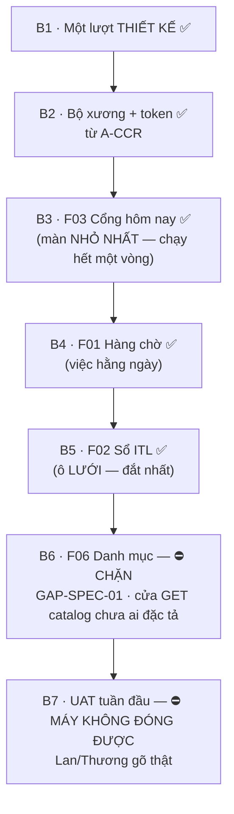

# 12 — P6 WEB PLAN: kế hoạch chi tiết bốn màn hình FLS

**Version:** v0.7 · **Ngày:** 2026-09-03 · **Chủ sở hữu:** Tech Lead

**Căn cứ:** `06_SCREEN_SPEC` **v2.2** *(§1 tám hành vi · §7 hệ thị giác · §8 binding)* · `07_API_CONTRACT` **v1.9** · `03_IMPLEMENTATION_PLAN` **v2.8** *(hàng `P6`)* · `FLS-Wireframe.html` + `Demo-MVP-So-may-ITL.html` · `A-CCR/02_BA/Artifacts/UIUX_HANDOFF.md` · `QĐ-ITL-63..73`

> ⭐⭐⭐ **CHẶNG NÀY ĐANG Ở ĐÂU *(2026-09-03)*: đã đi 5/7 bước.** ✅ `B1` thiết kế · ✅ `B2` bộ xương · ✅ `B3` `F03` Cổng hôm nay · ✅ `B4` `F01` Hàng chờ · ✅ `B5` `F02` Sổ ITL *(màn đắt nhất)*. ⛔⛔ **Và cả hai bước còn lại đều ⛔ KHÔNG tự đi được:** `B6` bị **`GAP-SPEC-01`** chặn *(cửa `GET /catalog` ⛔ chưa ai đặc tả — tôi ⛔ không tự bịa hình dạng một cửa rồi gọi đó là đặc tả)*, còn `B7` là **UAT tuần đầu** — cổng số **8** của §5, cái mà tài liệu này khai thẳng là **máy ⛔ không đóng được**. ⇒ ⛔ **Từ đây, tiến độ chặng 6 ⛔ không còn phụ thuộc vào việc gõ thêm code.**

> ⭐⭐ **Đọc một câu là hiểu chặng này:** phần **rẻ** của bốn màn *(bố cục · màu · luồng)* đã có sẵn — wireframe đã dựng, hệ thị giác lấy nguyên từ `A-CCR`. Phần **đắt** nằm ở **một ô lưới sửa được như Sheets**, và cơ chế của nó **đã có mũi thử chứng minh chạy được** *(`QĐ-ITL-66`)*. ⇒ Chặng này ⛔ **không còn ẩn số kỹ thuật lớn**; rủi ro còn lại là **rủi ro thi công**.

---

## §0 · Điều kiện vào — đã ĐỦ, và đây là bằng chứng

| Điều kiện | Trạng thái | Bằng chứng |
|---|:--:|---|
| `P5` cửa GHI xong | ✅ | `repo` **100%** · 680 phép thử |
| Đường **BỎ mối nối** | ✅ | `QĐ-ITL-69` · migration `0013` · 34 phép thử |
| **Xong / Mở lại** *(rời hàng chờ)* | ✅ | `QĐ-ITL-71`/`72` · migration `0014` · 17 phép thử |
| Chốt **cơ chế lưới** | ✅ | `QĐ-ITL-66` — bảng HTML trần, **8/8 hành vi** trên 38.896 ô |
| Kế toán xác nhận **đủ trường** | ✅ | `QĐ-ITL-68` — **2/2 người** |
| Dung sai cửa tay | ✅ | `QĐ-ITL-63` — `min(1.000 đồng, 0,5%)` |
| Danh mục phân bổ có dữ liệu | ✅ | `QĐ-ITL-70` — **73 mã `hd`** |
| Hệ thị giác | ✅ | `A-CCR` handoff — dùng lại, ⛔ không vẽ lại |

⛔ **Việc còn thiếu mà chặng này PHẢI tự làm** *(⛔ không phải điều kiện chặn, là nội dung)*: **hai cửa đọc** `GET /catalog` + `GET /mapping-master` *(`BA-06` §8)*, và **cơ chế lưu theo lô** *(`GAP-SCR-07`)*.

---

## §1 · Thứ tự bảy bước — và **vì sao đúng thứ tự này**

⭐ **Ba lý do của thứ tự này, ⛔ không phải sắp cho đẹp:**

1. **`F03` đi trước dù nó ⛔ không quan trọng nhất.** Nó là màn **nhỏ nhất** nhưng đi qua **trọn vòng** *(shell → cửa API → chip niềm tin → 4 trạng thái)*. Sai kiến trúc thì sai ở một màn 200 dòng, ⛔ không phải ở màn lưới 2.000 dòng.
2. **`F01` trước `F02`.** `F01` là **việc hằng ngày** của kế toán; nếu chỉ kịp làm hai màn thì hai màn ấy phải là `F03` + `F01`.
3. **`F02` gần cuối, ⛔ không phải đầu.** Nó đắt nhất, và nó **hưởng lợi** từ mọi thứ ba bước trước đã dựng *(shell · gọi cửa · lỗi · chip)*. Làm nó đầu tiên là vừa dựng hạ tầng vừa đánh vật với ô lưới.

⚠ **`B7` ⛔ không phải "nghiệm thu cuối"** — nó là **tuần đầu dùng thật**, và nó trả lời ba thứ ⛔ **không máy nào đo được** *(`GAP-SCR-03`)*: *cảm giác khi gõ · thời gian vẽ trên máy kế toán · 346px cột khoá có đủ*.

---

## §2 · Bước 1 — MỘT LƯỢT THIẾT KẾ *(⛔ chưa gõ một dòng code màn hình)*

⛔⛔ **Vì sao bước này tồn tại, và vì sao nó ⛔ KHÔNG được gộp vào bước dựng.** Mũi thử lưới `27–28/08` chứng minh **cơ chế** chạy được, nhưng nó ⛔ **không phải một bản thiết kế** — nó in 38 tiêu đề bằng **chữ cái**, để **chỉ-đọc**, và owner mở tệp **30 giây** là thấy **5/10 trường ⛔ không gõ được** *(mà **11 phép thử của máy ⛔ không thấy**)*. Lớp lỗi ấy là lớp lỗi của **thiếu một lượt thiết kế**, ⛔ không phải của thiếu một phép thử.

| Việc | Ra cái gì | Xong là gì |
|---|---|---|
| Lấy **token** từ `A-CCR` sang một tệp `tokens.css` | Màu · chữ · khoảng cách · bo · đổ bóng | ⛔ **Không một mã màu nào gõ tay** trong code màn hình |
| Vẽ **4 trạng thái** cho từng thành phần | mặc định · **rỗng** · đang tải · **lỗi** | ⛔ Trạng thái *rỗng* và *lỗi* ⛔ không được để dev tự ứng biến |
| Chốt **mật độ** *(chiều cao dòng · cỡ chữ lưới)* | một con số | Kế toán đọc **hàng trăm dòng**; mật độ của `A-CCR` *(màn đọc)* **quá thoáng** |
| Vẽ **ba nút mới** *(Xong · Mở lại · Bỏ ghép)* + hộp xác nhận | Câu chữ **nguyên văn** trong hộp | ⚠ Hộp *Bỏ ghép* PHẢI nói **\"bỏ cả chùm\"** + **\"sổ giữ lịch sử\"** |
| Vẽ **chip hoá đơn N tệp** + ca **22 dòng tên trơ** | 2 trạng thái chip | ⛔ Không vẽ **chip chết** cho tên trơ *(`GAP-SCR-08`)* |
| Vẽ vùng **PHÂN BỔ 🔒** | 3 ca: giá trị · `#N/A` · **`0`** | ⚠ Hiện **đúng `0`** *(bẫy `VLOOKUP`)* — ⛔ đừng chữa cho đẹp |

**Cổng ra của `B1`:** một tệp HTML tĩnh *(hi-fi)* cho **cả 4 màn**, xem được trên máy kế toán, ⛔ chưa nối cửa API. Owner xem và nói *"vẽ đúng cái tôi cần"* — hay ⛔ không.

✅ **`B1` XONG 2026-08-28** — `02_BA/Artifacts/FLS-Design-P6.html` *(tự chứa: ⛔ không thư viện, ⛔ không cần mạng; bấm đúp là xem được)*. Gồm **4 màn + 3 drawer/hộp thoại + khối 4 trạng thái**, và **token màu lấy nguyên** từ `A-CCR` Foundation Tokens *(⛔ không một mã màu nào tự bịa)*.

⭐ **Bốn chỗ bản vẽ chốt được mà chữ ⛔ không chốt nổi:**

| Chốt | Hình dạng |
|---|---|
| ⭐⭐ `dat = null` **⛔ không được trông như ĐẠT** | Ô **gạch chéo + viền nét đứt** — khác hẳn cả xanh lẫn đỏ. Đây là luật số một của dự án **đặt vào một pixel** |
| Ô **gõ được** vs ô **chỉ-đọc** | Ô gõ được có **viền trong xanh**; ô chỉ-đọc **nền xám**; ô chưa gán **nền vàng + chữ nghiêng**. ⇒ Đúng lớp lỗi owner bắt trong **30 giây** |
| **Mật độ** | Dòng **30px**, chữ lưới **12,5px** — dày hơn `A-CCR` *(màn ĐỌC cho CFO)* vì đây là **màn LÀM**, kế toán quét hàng trăm dòng |
| Ca **Σ lệch** ở drawer ghép | Nút **mờ** + câu giải thích **hiện sẵn**, ⛔ không nằm trong tooltip |

⚠ **Hook thiết kế `impeccable` soi bản vẽ và báo 4 điểm. Xử một, và khai ba là CỐ Ý:**

| Điểm | Xử |
|---|---|
| **Vạch màu dày một bên** khối ghi chú | ✅ **SỬA** — đây là lỗi thật: `A-CCR` ⛔ không có hình đó, và một vạch dày làm khối **ghi chú** trông nặng hơn **thẻ dữ liệu** bên cạnh. Đổi thành **viền mỏng đủ vòng + nền nhạt**, cùng khuôn thẻ của `A-CCR` |
| *"Chỉ một họ chữ"* | ⛔ **CỐ Ý** — có **hai** họ *(`IBM Plex Sans` + `IBM Plex Mono`)*, và đó **đúng** hai họ của `A-CCR` *(đo được trong Foundation Tokens)*. Thêm một họ chữ *"để có thứ bậc"* là **dựng hệ thị giác thứ hai** — đúng thứ `BA-06` §7 cấm |
| **Nhiều dấu gạch ngang** | ⛔ **CỐ Ý** — đây là **văn phong của cả bộ 61 tài liệu** *(mọi biên bản quyết định đều dùng)*. Sửa riêng một tệp là làm nó **lệch khỏi bộ**, và owner đọc văn phong này hằng ngày |
| **Nhãn mục có số** `①②③` | ⛔ **CỐ Ý** — chúng ⛔ không phải nhãn trang trí: `①②③` của drawer là **đúng ba nhóm đọc** của `BA-06` §3, và `ⒶⒷⒸ` là **đúng ba nhóm trường** *(5 vào P&L · 2 ngoài P&L · vùng phân bổ 🔒)*. Bỏ số đi thì mất chính cái ánh xạ sang đặc tả |

⛔ **Ba thứ bản vẽ này ⛔ KHÔNG trả lời được**, và đã ghi ngay chân tệp: **cảm giác khi gõ thật · thời gian vẽ trên máy kế toán · bề rộng cột khoá có đủ**. Chúng cần **UAT tuần đầu** *(`GAP-SCR-03`)*.

---

## §3 · Bước 2 — bộ xương

| Việc | Ghi chú |
|---|---|
| `fls/web/` — cây tệp + `index.html` + shell | ⚠ **Ranh giới `import-linter`**: `web` chỉ được gọi `api`, ⛔ **không** gọi `repo`/`db` trực tiếp. Thêm **luật thứ 8** vào `.importlinter` |
| Một chỗ **duy nhất** gọi cửa API *(`goi_cua.js`)* | ⛔ Không `fetch` rải rác: mã lỗi `409`/`422` phải dịch **một chỗ** thành câu tiếng Việt |
| Chip niềm tin · chip trạng thái · số kế toán | Component tái dùng — lấy hình từ `A-CCR` |
| **4 trạng thái** thành một khuôn dùng chung | Rỗng và lỗi ⛔ không được là *"chưa làm"* |

**Cổng ra:** shell chạy, gọi được **một** cửa thật *(`GET /gates`)*, và **bốn trạng thái đều xem được** bằng cách tắt máy chủ / trả lỗi giả.

✅ **`B2` XONG 2026-09-03** — `FLS/fls/web/` *(9 tệp · 190 dòng Python + 5 tệp màn hình)*, chạy bằng `python tools/chay_cua.py --cho-web --actor <ai>`. **Cổng ra đã đạt và đo được:** vỏ màn ra `200`, `GET /gates` trả **3 đạt · 0 không đạt · 5 ⛔ chưa đo được** qua HTTP trên **cùng một cổng**, và bốn trạng thái xem được bằng `?gia_lap=tai|rong|loi|mat_ket_noi` ⇒ ⛔ **không phải tắt máy chủ**.

⭐ **Năm thứ `B2` làm được mà bảng trên ⛔ chưa khai:**

| Việc | Vì sao nó vào `B2` chứ ⛔ không để sau |
|---|---|
| ⭐⭐ **Gom BA bản sao khối màu về MỘT** *(`tokens.css` — `QĐ-ITL-77`)* | Khối `:root` đang nằm ở `A-CCR` handoff · bản vẽ P6 · **và chép tay trong `tools/demo_dong.py`**. Để sau thì mỗi màn mới là **một bản sao nữa** |
| ⭐ **`BANG_TEP`** — khai từng tệp, đường đến là **khoá tra bảng** | ⛔ Không có phép ghép đường nào với chuỗi người gọi ⇒ lỗi vượt thư mục ⛔ **không có CHỖ để tồn tại**. Cùng khuôn `BANG_TUYEN` của `P4` |
| ⭐ **Cửa TỪ CHỐI phục vụ màn hình ngoài loopback** *(`QĐ-ITL-76`)* | Vỏ màn ra được **trước thẻ**, và `phien.js` **chở một cái thẻ**. Trên máy một người thì đúng; ra mạng thì là **phát thẻ cho người lạ** ⇒ `GAP-WEB-01` |
| **Cổng bắt câu**: mọi mã trong `bao.MA_LOI` phải có **một câu tiếng Việt** | `QĐ-ITL-27` khai tử vai hậu kiểm ⇒ **người đọc câu báo lỗi là người duy nhất còn lại trong vòng**. Thêm mã ở cửa mà quên màn hình ⇒ **cổng đỏ** |
| **Cổng `node`**: JS phải **chạy được**, ⛔ không chỉ *trông đúng* | Mọi cổng khác đọc mã màn hình như **văn bản**. Một dấu ngoặc thiếu lọt hết chúng — rồi kế toán mở màn và thấy **một trang trắng trơn**, ⛔ không một câu báo lỗi |

⚠ **Hai lần cổng mới báo ĐỎ GIẢ, và cả hai đều được chữa bằng cách BỎ chỗ mơ hồ, ⛔ không phải dạy cổng đoán giỏi hơn:** nó kêu ở **chính dòng ghi chú mô tả nó**, và ở **`#f03` — mã của một thẻ** *(ba chữ số hex ⇒ cũng là một mã màu hợp lệ)*. ⇒ Bỏ qua ghi chú; **đổi tên thẻ** thành `man-f03`. ★ Một cổng phải đoán là một cổng sẽ sai; một cổng kêu sai là một cổng người ta sẽ **gỡ ra**.

⚠ **Và một lỗi thật do chính bài kiểm bắt được:** `kiem_bang_tep(bang=BANG_TEP)` gán mặc định **một lần lúc nạp module** ⇒ cổng soi **bản chụp cũ** trong khi máy đã đổi sang bảng mới — tức **một cái cổng xanh trong khi thực tế đã hỏng**, đúng lớp lỗi cả dự án dựng ra để chặn. Sửa: `bang=None` rồi đọc **lúc gọi**.

---

## §4 · Bước 3–6 — bốn màn

### `B3 · F03` Cổng hôm nay *(nhỏ nhất, đi trọn vòng)*

- 4 cổng · độ phủ · nút *Xuất báo cáo tuần*.
- ⭐⭐ **`dat = null` ⛔ KHÔNG được vẽ như ĐẠT.** Nó là *"⛔ không đo được"* và phải trông **khác hẳn** cả xanh lẫn đỏ. Đây là **luật số 1** của dự án đặt vào một pixel: *cổng chưa từng thấy đỏ là cổng chưa biết có sống*.
- **Cổng ra:** ba màu phân biệt được **từ xa 2 mét**, và cột `ly_do` của cổng đỏ đọc được **không cần mở gì thêm**.

### `B4 · F01` Hàng chờ *(việc hằng ngày)*

- Lưới + **5 hành động** *(lý do · hoãn · ghép · bỏ ghép · xong)* + chân màn theo **từng tiền tệ**.
- ⛔ **Xếp trong TỪNG tiền tệ** — gộp lại thì một khoản **300.000 USD** xếp **sau** một khoản **400.000 đồng**; đo được hàng chờ có **USD 4.492 dòng (58%)** vs **VND 2.987**.
- Drawer **ghép lệnh**: 4 bậc ứng viên **có tên** · Σ ba con số · **TUỔI ảnh chụp** · lệch dung sai ⇒ **nút mờ + câu giải thích**, ⛔ không cho bấm.
- **Cổng ra:** ghép → bỏ ghép → ghép lại **cùng một dòng lệnh** *(`lần 2`)* chạy trọn trên trình duyệt; và bấm **Xong** thì dòng **rời hàng chờ ngay**, bấm **Mở lại** thì **quay về**.

✅ **`B4` XONG 2026-09-03** — `fls/web/tep/man_f01.js` + `hop_thoai.js`. **Cổng ra đã chạy THẬT qua HTTP**, ⛔ không phải "chạy được trên trình duyệt của tôi": `tests/web/test_vong_f01_pg.py` *(8 bài, máy chủ thật + kho test)* đi trọn `ghép → bỏ ghép → ghép lại đúng dòng lệnh vừa gỡ (lần 2)` và `Xong ⇒ rời hàng chờ · Mở lại ⇒ quay về`, cộng một bài chứng minh dòng đã xong **biến khỏi CẢ** `/queue/summary` **LẪN** `/queue/coverage` *(ba chỗ khai cùng một luật thì chúng phải cùng đổi)*.

⛔⛔ **Bộ test bắt HAI lỗi thật của màn vừa viết — và cả hai vì TIN §8 thay vì đo cửa** *(⇒ `GAP-SPEC-02`, `QĐ-ITL-80`)*:

| Lỗi | Hậu quả nếu không bắt |
|---|---|
| Màn đọc `xong_boi`/`xong_luc` *(§8 ghi thế)*, cửa trả **`boi`/`luc`** | Hộp *"đã xong bởi X lúc Y"* hiện **rỗng** — kế toán ⛔ không biết ai đã kết luận |
| Màn **quên gửi `reason`** khi ghép; cửa **ĐÒI** ở 5/6 thao tác, §8 ⛔ không nhắc | Nút **Ghép luôn trả `400`** — thao tác chính của màn ⛔ không dùng được |

⭐ **Ba trường máy trả mà màn PHẢI nói ra**, ⛔ không được nuốt: `thieu_truong` · `bo_qua` · `khong_suy_duoc`.
⛔⛔ **Một ô CỐ Ý để trống: “tuổi việc”.** §4 đòi thanh đổi đỏ quá 3 ngày, nhưng ⛔ không cửa nào biết *dòng vào hàng chờ lúc nào*; thứ gần nhất là **ngày chứng từ** — đã đo được là **hoán ngày↔tháng 93%**. Vẽ thanh đỏ trên nó là **bịa một con số trên một trục đã biết là sai** ⇒ màn **nói thẳng** thay vì vẽ.

### `B5 · F02` Sổ ITL *(ô đắt nhất)* — ✅ **XONG 2026-09-03**

- ~~**52 cột**~~ ⇒ ⛔⛔ **23 cột, và con số 52 là một con số CHƯA AI ĐO.** Cửa `GET /ledger` **cố ý** ⛔ không mang cột `canon` — chú thích trong `doc_bao_cao._COT_SO` nói thẳng lý do: *"36 cột jsonb × 500 dòng là một câu trả về vài MB mà màn hình không dùng"*. ⇒ Lưới quét **23 cột**, khuôn canon **38 vị trí** hiện ở **ngăn kéo** — đúng hai tầng mà `06_SCREEN_SPEC` §3 đã chốt *(“lưới để quét, bấm một dòng mở panel đối soát đủ trường”)*. Câu “52 cột” của bản kế hoạch này **mâu thuẫn với §3 của chính BA** ⇒ `GAP-SPEC-03`.
- ⭐⭐ **Tiêu đề: MỘT nguồn, ⛔ không gõ lại — và có cổng canh.** `fls/api/cot_so.py` khai bảng cột **một lần**, sinh ra **cả** tiêu đề *(`/cot.js`)* **cả** cổng đối chiếu. Tên đến từ `oracle/ledge_spec.COT_LUU` *(**14 cột** — đúng tên của **sổ ITL Ledge mà kế toán mở hằng ngày**)* và `canon/spec.CANON_COLS` *(1 cột)*; **8 cột còn lại là của riêng FLS** *(danh tính · lineage · trạng thái)* nên mỗi cột **PHẢI nói vì sao** nó có tên riêng.
  ⚠ **Bản vẽ P6 phác tiêu đề NGẮN hơn** *(`Mã hợp đồng` thay `Budget Code · Final`)*. Giữ tên của **sổ thật**: bản vẽ là nguồn của **hình dạng** *(owner chốt 03/09)*, ⛔ không phải nguồn của **từ vựng dữ liệu**. Đặt tên thứ hai cho cùng một cột là tạo ra hai từ vựng.
- ⭐⭐ **Cổng đối chiếu HAI CHIỀU với cửa thật**, và chiều thứ hai mới là chiều nguy: cửa trả một trường mà bảng ⛔ không khai ⇒ lưới **giấu** nó, ⛔ không một thông báo nào.
- ✅ **8 hành vi §1 chạy THẬT** — dưới `node`, trên một **DOM tối thiểu** *(`tests/web/dom_gia.js`)*: bấm phím, dán vùng, kéo xuống, hoàn tác. **15 bài.** ⛔ Ba thứ nó ⛔ **không** kiểm được *(đông cứng khi cuộn · **346px** có đủ · cảm giác khi gõ)* vẫn nằm ở **`B7 · UAT`** — khai ngay đầu tệp ấy.
- **Drawer đối soát**: ⑦ khối — chứng từ · **7 ô sửa** *(nguồn nói gì **vs** người gõ gì — `QĐ-ITL-35`)* · **PHÂN BỔ 🔒** · hoá đơn · mối nối · bút toán + **Đảo** · nhật ký.
- ✅ ⭐ **`GAP-SCR-07` ĐÓNG** — ba ca lỗi, mỗi ca một bài:
  | ca | màn làm gì |
  |---|---|
  | gõ tiếp khi lô đang bay | Lô **rút ra** khỏi hàng chờ trước khi bay ⇒ ô gõ thêm vào **lô sau**. Và nếu người gõ **đè lên** chính ô đang bay thì **phím mới nhất thắng** |
  | mạng đứt giữa chừng | **DỪNG NGAY** *(⛔ không bắn tiếp 18 ô nữa cho cùng một lỗi)*; màn gọi **TÊN từng ô** chưa vào sổ, ⛔ không một bảng “lỗi mạng” chung chung |
  | hai người sửa một ô | ⛔⛔ **Cửa ghi KHÔNG phát hiện được** *(`ghi_but_toan` chỉ so với **nguồn** và **gợi ý của máy**, ⛔ không so với bút toán của **người khác**)* ⇒ `GAP-SCR-09`. Màn **hỏi lại cửa ngay trước khi ghi** — và **khai thẳng** rằng đó là một phép **kiểm**, ⛔ không phải một **bảo đảm** |
- ⭐⭐ **`QĐ-ITL-81` — ô LÝ DO của cả đợt.** `INV-I16` đòi **mọi** phép ghi có lý do *(cửa NO nếu thiếu — đã đo)*; §1-8 đòi **⛔ không có nút Lưu**. Hỏi lý do mỗi lần bắn lô **là một cái nút Lưu đổi tên**. ⇒ Kế toán nói lý do **MỘT LẦN** cho cả đợt, và nó **nằm thấy được trên màn suốt đợt** để ⛔ không bao giờ thành một câu cũ kỹ mà không ai thấy. ⛔ Máy ⛔ **KHÔNG** tự đặt một lý do mặc định kiểu *"sửa trên lưới F02"* — một lý do không nói gì là một lý do giả.
- ✅ **Cổng ra ĐẠT:** *gõ 20 dòng liên tục ⛔ không mất một ô nào* · *rút mạng giữa lúc lưu thì màn nói rõ ô nào chưa lưu*. Cộng **14 bài chạy THẬT qua HTTP** trên kho thật *(`test_vong_f02_pg.py`)*.
- ⛔⛔ **Bộ test bắt một lỗi THẬT của màn tôi vừa viết:** ô bị **người khác** gõ lại hiện câu của mã `FLS-CONFLICT-SOURCE` — *"giá trị bạn gõ khác với giá trị **NGUỒN**"* — trong khi thật ra nó khác với **bút toán của một NGƯỜI**. Cùng chữ *“khác”*, hai câu chuyện khác hẳn *(“sổ gốc nói khác” vs “Thương vừa gõ ô này 10 phút trước”)*, và kế toán xử hai ca ấy khác nhau ⇒ **tách hai hộp**.
- ⛔ **Vùng PHÂN BỔ 🔒 ⛔ không vẽ được** — cả ba ô suy từ **Mapping Master cột K/L**, và ⛔ không cửa nào mang nó *(`GET /mapping-master` chưa có)*. Màn **nói thẳng** thay vì vẽ số đoán.

### `B6 · F06` Danh mục · Nguồn *(+ hai cửa còn thiếu)*

- ⛔ Phải **làm cửa trước**: `GET /catalog` · `GET /mapping-master` *(`BA-06` §8 đã khai — ⛔ không phải giả định)*.
- Hiện **73 mã `hd`** + cờ phân bổ + phương pháp; và ⭐ **52 mã có `Method` rỗng** phải nói rõ *"sổ hiện `0`"* — ⛔ không ẩn.
- **Cổng ra:** con số trên màn **khớp** `tools/nap_mapping_master.py`.

---

## §5 · Cổng của cả chặng — **DoD**, ⛔ không phải một buổi rà

| # | Cổng | Đo bằng gì |
|--:|---|---|
| 1 | **8 hành vi §1** chạy trên `F02` | Danh sách nghiệm thu **cứng** — thiếu một dòng là **kế toán về Sheets** |
| 2 | **4 trạng thái** mỗi màn xem được | Tắt máy chủ · trả lỗi giả · kho rỗng |
| 3 | ⛔ **Không mã màu gõ tay** trong code màn | Quét mã nguồn — cùng khuôn `test_chi_mot_cho_ghi_tay.py` |
| 4 | ⛔ **`web` ⛔ không gọi `repo`/`db`** | `import-linter` **luật thứ 8** |
| 5 | Mọi cửa màn hình gọi **có trong bảng tuyến** | Quét mã nguồn ↔ `bang_tuyen.BANG_TUYEN` |
| 6 | `dat = null` ⛔ **không** trông như ĐẠT | Ảnh chụp 3 màu, người xem từ 2 mét |
| 7 | ⭐ **Vòng ghép → bỏ ghép → ghép lại** chạy trên trình duyệt | `tools/verify_cua_ghi.py` mở rộng |
| 8 | ⭐ **UAT tuần đầu** trả lời 3 câu chưa ai đo | Lan/Thương gõ **thật**, ⛔ không phải tôi |

⛔⛔ **Và một cổng phải nói riêng:** cổng số **8** ⛔ **không** thể do máy đóng. Ba câu *cảm giác · thời gian vẽ · 346px* chỉ có **người dùng thật trên máy thật** trả lời được. Ghi ra đây để ⛔ không ai đọc *"680 phép thử xanh"* thành *"màn hình đã tốt"*.

---

## §6 · Việc mở của chặng

| ID | Việc |
|---|---|
| `GAP-SPEC-01` ⛔⛔ **CHẶN `B6`** | **`GET /catalog` ⛔ KHÔNG hề tồn tại trong `BA-07` §2**, dù `BA-06` §8 khẳng định nó nằm trong 6 đường đọc còn thiếu — **kiểm được, và sai**. `B6` phải **làm cửa trước**, nên hình dạng cửa ấy là **điều kiện vào** của bước cuối. ⛔ Tôi ⛔ **không tự định nghĩa**: một cửa do tôi bịa rồi ghi vào tài liệu là **đặc tả giả** — nó sẽ trông y hệt một đặc tả thật ở lần đọc sau. ⇒ **cần owner/BA chốt** |
| `GAP-SPEC-02` ⭐ **MỞ 03/09** | **`BA-06` §8 lệch cửa thật ở BA chỗ ĐO ĐƯỢC** *(bắt được khi dựng `B4`)*: §8 ghi `xong_boi`·`xong_luc` mà cửa trả `boi`·`luc`; §8 ghi `cursor` mà cửa trả **`next_cursor`** ⇒ màn phân trang **dừng ở trang đầu trong im lặng** *(lỗi thứ BA cùng một lớp)*. ⇒ BA sửa §8 theo cửa thật |
| `GAP-KHO-02` ⛔⛔ **MỞ 03/09** | **Kho test phình ⇒ 5 bài ĐỎ mà ⛔ không phải lỗi code.** `fls_test` có **33.492 dòng** `fls_itl` *(24.593 là rác test)* ⇒ `doc_cong` chạy **16,1s** trong khi client chờ **10s**; đối chứng `doc_so` **0,0s**. ⛔ **Đừng nới `timeout`** — đó là giấu một phép đo đang chậm dần. Chi tiết ở `01_Orchestrator/06` §4b |
| `GAP-SCR-07` ✅ **ĐÓNG 03/09** | ~~**Lưu theo lô** — 3 ca lỗi~~ ⇒ giải ở `B5`, mỗi ca một bài chạy thật |
| `GAP-SCR-09` ⭐ **MỞ 03/09** | ⛔⛔ **Cửa ghi ⛔ KHÔNG phát hiện được hai người sửa một ô.** `ghi_but_toan` chỉ so giá trị gõ với **nguồn** và **gợi ý của máy**, ⛔ **không** so với bút toán của người khác ⇒ người sau **ghi đè người trước trong im lặng**. Màn lách bằng một phép **hỏi lại cửa ngay trước khi ghi**, nhưng vẫn còn **một khe hẹp** giữa lúc hỏi và lúc ghi. Khép hẳn là việc của **cửa** *(một phép so `adj_id` lúc ghi)*, ⛔ không phải của màn hình |
| `GAP-SPEC-03` ⭐ **MỞ 03/09** | **“Lưới 52 cột”** của `DEV-12` mâu thuẫn với `06_SCREEN_SPEC` §3 *(hai tầng: lưới quét + panel đủ trường)*, và với cửa thật: `GET /ledger` **cố ý** ⛔ không mang `canon` *(vài MB/trang)*. ⇒ Đã theo §3. BA cần **xoá con số 52** khỏi mô tả lưới |
| `GAP-SCR-08` | **22 dòng hoá đơn tên trơ** — cần người bổ sung link; màn cần trạng thái riêng |
| `GAP-SCR-05` | Nút **[Sửa ở PM]** dẫn đi đâu — FLS ⛔ không sửa `fps_*` |
| `GAP-SCR-03` | Ba câu **chỉ UAT trả lời được** *(⛔ không còn chặn)* |
| `GAP-PLAN-04` | **Chốt kỳ** ⛔ chưa có đặc tả ⇒ `F03` ⛔ **chưa** có nút chốt kỳ, và điều đó phải **nói ra trên màn** |

---

## Changelog
- **v0.7** (2026-09-03): ⭐ **Đồng bộ TRẠNG THÁI chặng, ⛔ không thêm tính năng.** Thêm khối *“chặng này đang ở đâu”* ở đầu tệp *(5/7 bước xong)* và **đánh dấu thật** trên sơ đồ bảy bước: trước đó chỉ `B5` có ✅, nên ba bước đã xong trông **như chưa làm** và hai bước **⛔ không tự đi được** trông **như hai bước bình thường** — một sơ đồ nói lệch chính tài liệu của nó. ⛔⛔ **Khai thẳng vào §6 ba lỗ chưa có ở đây:** `GAP-SPEC-01` *(**chặn `B6`** — `GET /catalog` ⛔ không có trong `BA-07` §2; ⛔ tôi ⛔ không tự bịa hình dạng cửa)* · `GAP-SPEC-02` *(`BA-06` §8 lệch cửa thật 3 chỗ — trong đó `cursor` vs **`next_cursor`** làm phân trang **dừng ở trang đầu trong im lặng**)* · `GAP-KHO-02` *(kho test phình ⇒ **5 bài đỏ mà ⛔ không phải lỗi code**; ⛔ đừng nới `timeout`)*.
- **v0.6** (2026-09-03): ✅ **`B5` xong** — màn `F02` **Sổ ITL**, màn **đắt nhất** của cả chặng. ⭐⭐ **8 hành vi §1 chạy THẬT** dưới `node` trên một DOM tối thiểu *(15 bài)* — ⛔ không đọc mã bằng mắt. ⭐⭐ **Một nguồn tên cột**: `fls/api/cot_so.py` khai một lần, sinh ra cả tiêu đề cả **cổng đối chiếu hai chiều** với cửa thật ⇒ ⛔ không một tên cột tiếng Việt nào gõ tay. ⭐ **`GAP-SCR-07` ĐÓNG** *(lưu theo lô, ba ca lỗi, cổng ra “20 dòng liên tục ⛔ không mất ô nào” + “rút mạng thì nói rõ ô nào”)*. ⛔⛔ Test bắt **một lỗi thật**: ô bị **người khác** gõ hiện câu *“khác với **NGUỒN**”* — **sai người** ⇒ tách hai hộp. ⛔ **Ba gap mới/đóng**: `GAP-SCR-09` *(cửa ghi ⛔ không thấy hai người sửa một ô)* · `GAP-SPEC-03` *(“52 cột” mâu thuẫn §3 và cửa thật — thật ra **23**)* · `GAP-SCR-07` **đóng**. `QĐ-ITL-81` *(ô lý do của cả đợt — giải mâu thuẫn `INV-I16` ✕ §1-8)*. Số đo: **944 phép thử** *(+58)* · **8.381 dòng** `fls/` · tiến độ **82%** *(`web` 45→**70%**)*.
- **v0.5** (2026-09-03): ✅ **`B4` xong** — màn `F01` Hàng chờ nối đủ **5 hành động + Mở lại**, drawer ghép có Σ ba con số · dung sai · **tuổi ảnh chụp** · nút **mờ kèm câu giải thích hiện sẵn**. ⭐⭐ **Cổng ra chạy THẬT qua HTTP** *(8 bài)*, ⛔ không phải "chạy trên máy tôi". ⛔⛔ Bộ test bắt **hai lỗi thật** do tin §8 thay vì đo cửa ⇒ mở **`GAP-SPEC-02`**. ⛔ **Một ô cố ý để trống** *(tuổi việc)* vì trục ngày đã biết là sai 93%. `QĐ-ITL-80`. Số đo: **872 phép thử** *(+15)* · **7.933 dòng** `fls/` · tiến độ **77%** *(`web` 25→**45%**)*.
- **v0.4** (2026-09-03): ✅ **`B3` xong** — màn `F03` đầy đủ + cửa mới **`GET /queue/coverage`** *(một trong 6 đường đọc còn thiếu của `BA-07` §2 ⇒ nay còn **5**)*. ⛔⛔ **Cửa ấy ra đời vì cách cũ là một phép đếm BỊ CHẶN TRÊN mà ⛔ không ai biết**: kéo `?den_pct=90&limit=500` rồi đếm ở màn hình — chặn trên **500**, hôm nay USD cần **444**, còn **56 dòng** nữa là sai **im lặng**. ⭐⭐ Bộ test lật ra một **câu hỏi nghiệp vụ**: *"phủ 90%"* = **luỹ kế ≤ 90** hay **đủ chạm 90**? Lệch **đúng một dòng**, và cách cũ **NÓI QUÁ** ⇒ chọn *đủ chạm*, trả kèm **phần trăm THẬT**. ⭐ Σ tiền = 0 ⇒ `NULL` = **⛔ không đo được**, ⛔ không phải `0`. ⚠ Nút *Xuất báo cáo tuần* để **MỜ và nói thẳng** *(`GET /weekly` chưa có)*. ⚠ **Vá một sự cố THẬT**: máy mất đầu ra ⇒ cửa **vẫn mở mà ⛔ không trả lời** *(`BrokenPipeError` trong `log_message`)*. ⛔⛔⛔ **Một agent kiểm độc lập bắt được CỔNG XANH GIẢ** — bảng tuyến khai thiếu bảng so với SQL thật ⇒ `GAP-API-05` *(`QĐ-ITL-79`)*; kèm `GAP-SPEC-01` **chặn `B6`** *(`/catalog` ⛔ không hề có trong `BA-07` §2)*. `QĐ-ITL-78`/`79`. Số đo: **832 phép thử** *(+34)* · **7.914 dòng** `fls/` · tiến độ **73%** *(`web` 15→**25%**, `api` 90→**92%**)*.
- **v0.3** (2026-09-03): ✅ **`B2` xong** — bộ xương chạy thật *(`GET /gates` qua HTTP trên cùng cổng: **3 đạt · 0 không đạt · 5 ⛔ chưa đo được**)*. ⭐⭐ **Sửa CÁCH làm bước 2 sau khi owner chỉ ra `FLS-Demo-Dong.html`**: bản kế hoạch cũ coi `B2` là *"dựng vỏ mới"*, nhưng đo lại thì đã có **hai** hiện vật — bản vẽ P6 *(hình dạng)* và demo động *(**hành vi đã chạy trên dữ liệu thật**: lưới gõ được, drawer ghép + Σ dung sai, xong/mở lại)* — và khối màu đang có **BA bản sao**. ⇒ `B2` là chỗ **gộp hai hiện vật về một mối**, ⛔ không phải chỗ vẽ lại. Owner chốt ưu tiên: **hình dạng theo bản vẽ P6**, demo chỉ cho hành vi. `QĐ-ITL-76` *(màn hình cùng cổng + `GAP-WEB-01`)* · `QĐ-ITL-77` *(một bản sự thật về màu)*. Số đo: **798 phép thử** *(+118)* · **7.771 dòng** `fls/` · `lint-imports` **8 kept 0 broken** *(luật thứ 8)* · tiến độ **71%** *(`web` 0→**15%**)*.
- **v0.2** (2026-08-28): ✅ **`B1` xong** — `02_BA/Artifacts/FLS-Design-P6.html` *(4 màn + 3 drawer/hộp thoại + khối 4 trạng thái; tự chứa, ⛔ không thư viện, ⛔ không cần mạng)*. Token màu **lấy nguyên** từ `A-CCR` Foundation Tokens. ⭐ Bản vẽ chốt được **bốn thứ chữ ⛔ không chốt nổi**: hình của `dat=null` *(gạch chéo + nét đứt — luật số một đặt vào một pixel)* · phân biệt ô **gõ được** / **chỉ-đọc** / **chưa gán** · **mật độ** dòng 30px *(dày hơn `A-CCR` vì đây là màn LÀM, ⛔ không phải màn ĐỌC)* · ca **Σ lệch** *(nút mờ + câu giải thích hiện sẵn)*. ⚠ Hook thiết kế báo 4 điểm: **sửa 1** *(bỏ vạch màu dày một bên khối ghi chú — `A-CCR` ⛔ không có hình đó)*, **khai 3 là cố ý** *(hai họ chữ là đúng của `A-CCR`; văn phong gạch ngang là của cả bộ 61 tài liệu; nhãn `①②③`/`ⒶⒷⒸ` ánh xạ đúng các nhóm của `BA-06` §3)*.
- **v0.1** (2026-08-28): Bản đầu. Viết **sau khi** `P6` hết chặn *(`QĐ-ITL-69`/`71`)* và **trước khi** gõ một dòng code màn hình — đúng yêu cầu của owner *(\"bao giờ đến bước tạo FE UIUX thì dừng để BA và plan chi tiết\")*. ⭐ Thứ tự bảy bước có **lý do đo được**, ⛔ không sắp cho đẹp: `F03` đi trước vì nó **nhỏ nhất nhưng đi trọn vòng**; `F02` gần cuối vì nó **đắt nhất và hưởng lợi từ ba bước trước**. ⭐⭐ **Bước 1 là một lượt THIẾT KẾ ⛔ chưa code** — vì lớp lỗi owner bắt được trong **30 giây** *(5/10 trường ⛔ không gõ được, tiêu đề là chữ cái)* là lớp lỗi của **thiếu thiết kế**, ⛔ không phải của thiếu phép thử. ⛔ Cổng số **8** *(UAT)* khai thẳng là **máy ⛔ không đóng được**.
