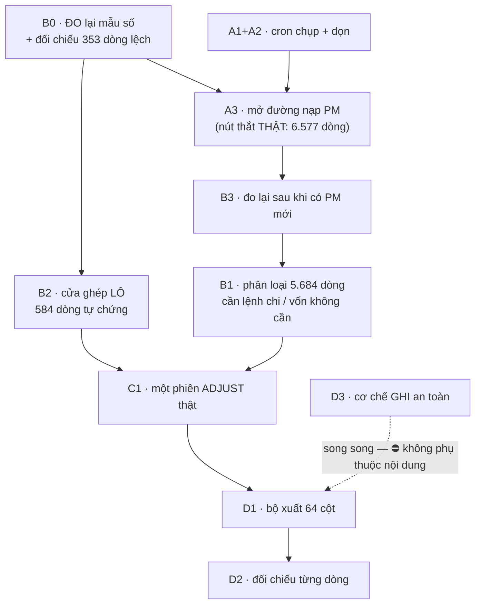

# 13 — LỘ TRÌNH THỰC HIỆN: bốn chặng theo **hai tác vụ**

**Version:** v3.2 · **Ngày:** 2026-09-10 · **Chủ sở hữu:** Tech Lead
**Căn cứ:** [`01_Orchestrator/09_MILESTONES_HAI_TAC_VU.md`](../01_Orchestrator/09_MILESTONES_HAI_TAC_VU.md) **v1.12** *(10/09)* · `03_IMPLEMENTATION_PLAN` v4.7 §2c *(pha `P8`)*

> ⛔⛔ **Tệp này ⛔ KHÔNG phải bản kể lại tệp mốc.** Nó là lộ trình, và trước khi xếp việc tôi **đo lại bốn thứ** — ba trong bốn **lật một tiền đề của chính tệp mốc v1.0**, kể cả một tiền đề tôi viết ra hôm qua.

---

## §0 · Bốn phép đo LẬT lại kế hoạch

### ⓵ ⛔⛔⛔ Cửa ghép LÔ chỉ dọn được **8,0%** — ⛔ không phải câu trả lời

Tệp mốc `v1.0 §2` viết: mapping là *"cùng hình bệnh với 27 cú bấm, lớn hơn **271 lần**"* ⇒ mở cửa ghép lô theo khuôn `QĐ-ITL-117`. Tôi **đo lại bằng cách gọi HÀM THẬT** *(`ung_vien_pm` trên **từng** dòng trong 7.329 dòng — ⛔ không dựng lại SQL, vì `canon_ref` chuẩn hoá **bên Python** và một bản SQL thứ hai sẽ lệch dần trong im lặng)*:

| Nhóm trong **7.329** dòng chưa ghép | Số dòng | |
|---|--:|--:|
| ⛔ không có ứng viên nào | **0** | 0,0% |
| ⭐ **TỰ CHỨNG** — đúng **một** ứng viên bậc `mã` chưa bị ghép | **584** | **8,0%** |
| nhiều ứng viên bậc `mã` ⇒ **người phải chọn** | 68 | 0,9% |
| một ứng viên khớp **TIỀN** *(⛔ không khớp mã)* | 469 | 6,4% |
| nhiều ứng viên khớp tiền | 1.072 | 14,6% |
| ⛔ **chỉ cùng tiền tệ / gần tiền** ⇒ ⛔ **không tự chứng** | ⛔ **5.136** | **70,1%** |

⇒ Cửa ghép lô **vẫn đáng làm** *(584 cú bấm → 1)*, nhưng nó **⛔ không phải** đòn chính. Câu *"lớn hơn 271 lần"* trong tệp mốc **SAI về hàm ý** — nó đúng về **số cú bấm**, ⛔ không đúng về **phần việc dọn được**. Đã sửa ở tệp mốc `v1.1`.

> ⛔⛔⛔ **BẢNG TRÊN CÒN SAI MỘT LẦN NỮA — và tôi để nguyên nó ở đây để đọc lại được.** Cửa ghép lô **đã dựng và chạy thật** *(`QĐ-ITL-118`, cùng ngày)*, và con số nó dọn được là **68**, ⛔ không phải **584** — nhỏ hơn **8,6 lần**.
>
> ⛔ Vì sao: bảng trên đo bằng luật của **danh sách ứng viên** *(`ung_vien_pm` — một cửa **ĐỌC** để **người CHỌN**)*, ⛔ không bằng luật của **cửa GHI**. `ghep_lenh` còn **bốn cổng** nữa, và trên đúng tập `652` dòng *"PM CÓ mang mã ấy"*:
>
> | Vì sao cửa GHI từ chối | Cổng | Số dòng |
> |---|:--:|--:|
> | ⭐ **TỰ CHỨNG** — cửa ghi **chắc chắn nhận** | — | ⭐ **68** |
> | số tiền một dòng PM lệch ngoài dung sai `QĐ-ITL-63` | `ⓕ` | ⛔ **301** |
> | ⛔ không dòng PM nào **cùng tiền tệ** | `ⓔ` | **202** |
> | ≥2 dòng cùng mã, **Σ cả chùm** vẫn lệch | `ⓕ` | 51 |
> | chùm có dòng `status` ⛔ không phải `Approve` | `ⓖ` | 30 |
> | dòng PM cùng mã **đã bị ghép** cho dòng khác | `ⓒ` | 0 |
>
> ⛔ Và `301` dòng ấy ⛔ **không** phải dung sai đặt quá chặt: đo hình cái lệch — chỉ **16/491** nằm trong khoảng phí bank *(`< 0,1%`)*, còn lại lệch **hàng chục lần** *(vd `68,53 USD` bank ↔ `54.000 USD` PM)* ⇒ cửa ghi **từ chối ĐÚNG**, và đó là việc của **người**.
>
> ⇒ ⭐⭐ Bài học, **lần thứ hai trong hai ngày**: *"đo QUAN HỆ thì gọi hàm thật"* ⛔ **không đủ** — phải gọi **đúng hàm của CÂU HỎI**. Câu hỏi là *"một cú bấm LÔ ghép được bao nhiêu dòng"*, nên luật phải là luật của **cửa GHI**. Tôi đã gọi một hàm thật, và nó là hàm **trả lời câu khác**.
>
> ⭐ Một sửa **ngược chiều** nữa: luật *"đúng MỘT dòng"* còn **chặt hơn** cửa ghi *(`ghep_lenh` nhận **N dòng**, chỉ đòi `Σ`)* ⇒ `tự chứng` nay lấy **CẢ CHÙM** cùng mã — và ⛔ **không bao giờ một tập con**.

> ⭐ **Tái lập được:** `python tools/do_do_phu_ghep.py` *(gọi `ung_vien_pm` **7.329** lần — ~40 giây)* và `python tools/do_vi_sao_khong_khop.py`.
>
> ⛔⛔ Hai con số **584** và **6.577** **cố ý ⛔ KHÔNG đưa vào `kiem_so_song`**: một cổng chạy **40 giây** là một cổng **sẽ bị tắt** — và một cổng bị tắt **tệ hơn** một con số ⛔ không ghim, vì nó còn làm người ta **tưởng có canh**. ⇒ Chúng là **ảnh chụp có lệnh tái lập**, và bước `B0` đọc đúng việc biến chúng thành một phép đo **chạy được mọi lúc**.

### ⓶ ⛔⛔⛔ **89,7%** dòng chưa ghép có mã mà **⛔ KHÔNG một dòng PM nào mang mã ấy**

| Vì sao ⛔ không khớp mã | Số dòng | |
|---|--:|--:|
| ⛔ không có số chứng từ | 100 | 1,4% |
| số chứng từ có mà `canon_ref` trả `None` | ⭐ **0** | 0,0% |
| ⛔ **mã chuẩn hoá được mà ⛔ KHÔNG PM nào mang** | ⛔ **6.577** | **89,7%** |
| PM **CÓ** mã ấy, **cùng** lần nạp ⇒ *lẽ ra ghép được* | **652** | 8,9% |

⭐⭐ **Hai điều tắt hẳn hai giả thuyết:** bộ chuẩn hoá `canon_ref` **⛔ không phải vấn đề** *(0 dòng trả `None`)*, và thiếu số chứng từ **cũng không** *(1,4%)*. ⇒ Nút thắt là **DỮ LIỆU PM**, ⛔ không phải mã, ⛔ không phải giao diện.

⭐ **Và hai phép đo độc lập khớp nhau:** `584` tự chứng `+ 68` nhiều-ứng-viên `= 652` — đúng con số nhóm cuối bảng trên. Hai kịch bản khác nhau, cùng một kết quả ⇒ ⛔ không phải trùng hợp.

### ⓷ ⭐⭐⭐ **Mẫu số đang SAI**: `10.030` — con số đúng là `8.246`

| Vế của sổ | Tổng | Đã ghép | Tỷ lệ |
|---|--:|--:|--:|
| `PS Có > 0` | **8.246** | **2.562** | ⭐ **31,1%** |
| `PS Nợ > 0` | 1.784 | 139 | ⛔ **7,8%** |

⛔⛔ **Đo, ⛔ không giả định:** dòng ghép được **dồn hẳn** về vế `PS Có` *(31,1% so với 7,8%)* ⇒ **đó là vế của lệnh chi**. Nên mẫu số thật của tác vụ ① là **8.246**, độ phủ là **31,1%** *(⛔ không phải 26,9%)*, và đích còn lại là **5.684** dòng *(⛔ không phải 7.329)*.

⚠ Còn **139** dòng ghép được ở vế kia là một **câu hỏi khác** — ⛔ đừng gộp nó vào đây.

### ⓸ ⚠ Một mâu thuẫn nội bộ, ⛔ không vá bừa

`work_status = 'UNMAPPED'`: **7.682** dòng. Nhưng dòng ⛔ không có mối nối: **7.329**. Lệch **353**. ⇒ Hai câu *"⛔ chưa ghép"* đang được trả lời bằng **hai nguồn khác nhau**, và ⛔ chưa ai đối chiếu chúng. Việc `B0` dưới đây làm đúng việc ấy.

> ⭐⭐⭐ **`B0` ĐÃ CHẠY, và câu trả lời KHÁC cái tôi đoán ở trên: `353` ⛔ KHÔNG phải một mâu thuẫn.**
>
> | Ô `work_status` × `có mối nối` | Số dòng |
> |---|--:|
> | ⛔ chưa phân loại · ⛔ chưa nối — **đích thật** | **6.904** |
> | đủ phân loại · đã nối — hoàn chỉnh | 1.923 |
> | ⭐ **đã nối** mà nhãn còn `UNMAPPED` | **778** |
> | ⭐ đủ phân loại mà **⛔ chưa nối** | **425** |
>
> `778 − 425 = 353`. ⇒ Con số `353` là một **HIỆU**, và nó **che đi 1.203 dòng** — nói **nhỏ hơn sự thật 3,4 lần**, và sẽ **về 0** nếu hai nhóm cùng tăng. ⛔ Một con số hiệu giữa hai phép đếm là một con số **⛔ không ai kiểm được**.
>
> ⛔⛔ Và nó ⛔ **không phải lỗi để vá**: hai cột trả lời **hai câu hỏi khác nhau**. `work_status` trả lời *"máy có suy đủ 5 trường phân loại không"* *(`fls/ledger/build.py`, `INV-I16`, **đóng băng lúc nạp** — mọi cửa ghi đều ⛔ không đụng `fls_itl`, `INV-I08`)*; `fls_moi_noi` trả lời *"đã nối lệnh chi chưa"*. Cả **425/425** dòng nhóm cuối đều có `hd`+`pay_type`+`cdt1`+`doc_no` ⇒ chúng **đúng là** *"đủ phân loại mà chưa nối"*. **Cái sai là phép TRỪ**, ⛔ không phải dữ liệu.
>
> ⭐ `fls_da_xong` = **0** toàn kho ⇒ chiều thứ ba *(người bấm xong)* ⛔ chưa ai đi qua. Đo, ⛔ không giả định.

---

## §1 · Lộ trình — bốn chặng, và thứ tự **đo được**

### Chặng ① — ✅ **ĐÃ CHẠY 2026-09-09** *(`QĐ-ITL-118`)*

| # | Cổng ra của nó | Đo được |
|--:|---|---|
| **`B0`** | 4 nhóm vế + 4 ô có TÊN + Σ 4 nhóm `vi_sao` = tập chưa nối | ✅ Cửa `GET /queue/mau-so` + `tools/do_mau_so.py`. Mẫu số **8.246** *(vế `PS Có`, **31,1%**)* · `Σ` chưa nối vế `PS Có` = **5.684** · *"lệch 353"* trả lời xong *(xem §0 ⓸)*. **12 bài** |
| **`B2`** | thân **chỉ** `itl_ids[]` · một dòng xấu ⇒ **422 CẢ LÔ** · `Σ mối nối = tiền bank` | ✅ `POST /queue/match-lo` + khối trên màn `F01`. ⛔ Và nó dọn được **68**, ⛔ không 584 — màn hình **nói ra** con số ấy cạnh **6.577** dòng nút thắt. **9 bài cửa + 7 bài màn** |
| **`D3`** | ⛔ không range tuyệt đối · ghi 2 lần ⇒ ⛔ không nhân đôi · biên bản nêu **ô đích thật** · cờ duyệt tắt ⇒ ⛔ không chạy | ✅ `fls/xuat/ghi_o.py` *(hàm thuần)* + `tools/ghi_o_that.py` *(hai khoá)*. **27 bài** — trong đó bài *"chèn một dòng ⇒ ô đích tự dịch theo"* là bài **chứng minh** neo-theo-khoá |

⛔ **Ba việc còn lại của chặng ① — ⛔ KHÔNG có:** cả ba cổng ra đều đã đo được trên kho thật. Việc kế tiếp là **chặng ②**.

### Chặng ① — bảng gốc *(giữ để đọc lại lý lẽ)*

| # | Việc | Vì sao ở đây | Cổng ra |
|--:|---|---|---|
| **`B0`** | ⭐⭐ **Đo lại mẫu số + đối chiếu `353` dòng lệch** *(`work_status` ↔ `fls_moi_noi`)* | ⛔ Mọi con số độ phủ đang đứng trên **mẫu số sai** *(10.030 thay vì 8.246)*. Và hai nguồn trả lời *"chưa ghép"* đang **lệch 353** ⇒ ⛔ chưa biết tin cái nào. **Rẻ nhất, và nó đổi mọi con số sau nó** | Một cửa/`tools` trả **bốn nhóm** kèm tổng, và `Σ 4 nhóm = 5.684` **đúng bằng** số dòng chưa ghép ở vế `PS Có` · `353` dòng lệch có **tên lý do**, ⛔ không nhóm *"khác"* |
| **`B2`** | Cửa **ghép LÔ**, **chỉ** dòng **TỰ CHỨNG** | **584** dòng dọn được ngay, ⛔ không chờ PM. ⛔ Và nó **⛔ không phải** đòn chính — nói thẳng con số **8,0%** trên màn | Thân **chỉ** `itl_ids[]`, ⛔ **KHÔNG** `pm_line_ids` *(máy đo lại phía máy chủ)* · dòng ⛔ không tự chứng ⇒ **422 CẢ LÔ, ⛔ 0 mối nối mới** · `Σ mối nối = tiền bank` từng dòng · độ phủ vế `PS Có` **31,1% → đo lại**, và biên bản nói **đúng** số dòng vừa nối |
| **`D3`** | ⭐ Cơ chế **GHI an toàn** vào Google Sheets + **biên bản chạy khô** | ⛔ **Không phụ thuộc nội dung** ⇒ đây là thứ **duy nhất** làm song song được. Nó là phần đắt của `QĐ-ITL-116`, và **dùng được cho cả hai đích** | ⛔ không range tuyệt đối · ghi hai lần ⇒ **⛔ không nhân đôi** · biên bản nêu **ô đích thật** · một bài chứng minh cú ghi **⛔ không chạy** khi cờ duyệt tắt |

### Chặng ② — ✅ **ĐÃ CHẠY 2026-09-09** *(`QĐ-ITL-119`)* — và nó **lật chính mình**

| # | Đo được | |
|--:|---|---|
| **`A1`** | `nhip_chup.py` — `8h`–`19h` **giờ VN khai tường minh** + chặn bắn hai lần trong cùng **giờ đồng hồ**; `actor = nhip@fls` | ✅ **12 bài** |
| **`A2`** | `don_chup.py` — giữ **vĩnh viễn** ảnh đã nạp, dọn ảnh ⛔ không ai dùng sau 30 ngày; cổng đòi **mọi** câu `DELETE` mang hàng rào | ✅ **8 bài** + cổng nguồn siết chặt hơn |
| **`A3`** | Ảnh lệnh chi thật: `chup_id 23793` · **3.772** dòng · **60** mã mới · ảnh trước **13 ngày** | ✅ **14 bài** |
| **`B3`** | ⛔ Nút thắt `6.577 → 6.527`. **Chỉ 50 dòng.** Tự chứng `68 → 111` | ⛔ **0,8%** |

> ⛔⛔⛔ **BA TIỀN ĐỀ NỮA BỊ LẬT, và cái thứ ba đổi cả thứ tự còn lại.**
>
> **ⓐ `A3` sẽ ⛔ KHÔNG dịch một dòng nào nếu ⛔ không sửa phép ghép trước.** `ung_vien_pm` lọc dòng lệnh bằng `l.run_id = <run_id CỦA DÒNG TIỀN>`. Đo trên kho test: nạp một dòng lệnh mang **đúng** mã vào một `run_id` **mới** ⇒ **0** ứng viên. ⇒ Lý lẽ cũ *("một dòng số phải được ghép với dòng lệnh **như nó đã là lúc đó**")* nghe **đúng** và đã sống **13 ngày**, nhưng nó có một hệ quả ⛔ không ai viết ra: **dữ liệu lệnh chi MỚI ⛔ không bao giờ giúp được dòng tiền CŨ**. Luật mới: **ảnh lệnh chi ĐỌC GẦN NHẤT**, và **ba nơi PHẢI nhìn cùng một ảnh** *(`fls/repo/anh_pm.py`)*.
>
> **ⓑ Giả thuyết *"`PM_Unpivot` chỉ giữ kỳ gần đây"* SAI.** Đo theo kỳ trên **23 kỳ**: tỷ lệ *PM có mã* dao động **2,4%–46,5%** và ⛔ **không** nghiêng về kỳ mới.
>
> **ⓒ ⭐⭐⭐ ĐỘ PHỦ MAPPING CÓ MỘT TRẦN CỨNG ~47%.** Ảnh lệnh chi có **3.772** dòng, **2.427** đã dùng ⇒ còn **1.345** dòng rảnh. Dù ghép hết 1:1 thì vế `PS Có` chỉ tới `2.562 + 1.345 = 3.907 / 8.246 =` **47,4%** — thực tế **thấp hơn**, vì một dòng tiền có thể ăn nhiều dòng lệnh.
>
> ⇒ ⛔⛔ **Trần ấy do SỐ LỆNH CHI TỒN TẠI đặt ra** — ⛔ không do giao diện, ⛔ không do mã, ⛔ không do độ tươi của dữ liệu. Nên câu *"đưa độ phủ lên 100%"* là một câu **⛔ không thể đúng**, và mọi con số độ phủ đo trên `8.246` sẽ **mãi mãi trông như thất bại**.

### Chặng ② — bảng gốc *(giữ để đọc lại lý lẽ)*

| # | Việc | Vì sao ở đây | Cổng ra |
|--:|---|---|---|
| **`A1`+`A2`** | Cron chụp mỗi giờ `8h–19h` + **phép dọn** *(`QĐ-ITL-114`+`115`)* | Owner đã chốt; ⛔ **không tách rời**. Và nó là **hạ tầng** mà `A3` dùng lại — làm `A3` trước rồi mới có nhịp là dựng **hai** đường chụp | `fls_chup` có ≥2 ảnh cách ~1 giờ, `actor` ⛔ **không phải** `tools/…` · ảnh cũ ⛔ không đổi một ô · ảnh **đã nạp** còn nguyên sau dọn · `fls_run.chup_id` ⛔ **không đứt** |
| **`A3`** | ⭐⭐⭐ **Đường nạp PM** — ảnh chụp + bản khai + soát + nạp lô, **dùng lại nguyên lằn `F04`** | ⛔ **Đây là nút thắt THẬT của tác vụ ①**: **6.577** dòng *(89,7%)* thiếu PM, ⛔ không thiếu mã. ⭐ Và nó **rẻ hơn nó trông**: lằn ảnh chụp + khai cột + 9 luật + nạp lô **đã có**, `A3` là **một `lan` mới** *(`lan='PM'`)* + một adapter, ⛔ không phải một hệ thứ hai | `fls_chup` có `lan='PM'` · `fls_pm_line` có **≥2** `run_id` khác nhau *(hôm nay: **1**)* · dòng PM mới xuất hiện **⛔ không qua dòng lệnh** · nạp lại **cùng** tệp ⇒ `trùng = N`, `vào_sổ = 0` |
| **`B3`** | **Đo lại** `6.577` dòng sau khi có PM mới | ⛔ Đây là chỗ dễ tự lừa nhất: nếu ⛔ không đo lại thì ⛔ không ai biết `A3` **có tác dụng gì**. Con số này là **cổng nghiệm thu thật** của `A3` | Bảng *trước/sau*: `6.577` giảm xuống một con số **đo trên kho thật**, và phần **⛔ không giảm** được **đặt tên** |

### Chặng ③ — **hai tác vụ chạy thật**

| # | Việc | Vì sao ở đây | Cổng ra |
|--:|---|---|---|
| **`B1`** | ⭐⭐ **Mẫu số định nghĩa bằng SỰ KIỆN** *(viết lại 09/09 — `QĐ-ITL-121`)* | ⛔⛔⛔ **Bản `v3.0` của dòng này ĐÒI MỘT THỨ BỊ CẤM.** Nó viết *"phân loại: cần lệnh chi ↔ vốn ⛔ không cần"*, cổng ra *"nhóm 'vốn ⛔ không cần' có **luật đặt tên được**"* — đúng là `US-KT-036` mà `QĐ-ITL-56` *(⛔ không có quy định nào)* + `QĐ-ITL-58` *(bỏ hẳn trạng thái giữa)* **khai tử 27/08**, vì máy dán nhãn ấy là **máy tự đặt ra quy định** *(`INV-I16`)*. ⚠ Và tôi viết nó **cùng ngày** với lúc đọc chính hai quyết định ấy. ⇒ Mục đích **thật**, cái **cách** thì sai | ⭐⭐ Hai phép đo, ⛔ không xét đoán — **đã chạy thật, đã vào cổng**: ⓵ **độ phủ TRÊN TRẦN** `2.562/3.907 = `**`65,6%`** *(thay `31,1%`, vốn chia cho mẫu số chứa cả dòng **⛔ không có nguyên liệu**)* · ⓶ **`799` dòng** *(`10,4%` hàng chờ)* phủ **90% tiền trong TỪNG tiền tệ** — ⛔ **không** nói dòng nào *"không cần lệnh chi"*, chỉ nói **xem cái này trước**. ⛔ Còn **một** câu chờ owner: có cho **người** gán nhãn ấy ⛔ không ⇒ **`GAP-KT-05`** |
| **`C1`** | ⭐⭐⭐ **Một phiên ADJUST THẬT** | `fls_journal` = ⛔ **0**. Lằn này ⛔ **chưa ai đi qua** ⇒ nó **CHƯA BIẾT CÓ CHẠY**. ⛔ Và nó phải đi **sau** `B2`: bảy ô `· Final` được sửa **trong bối cảnh lệnh chi** | ≥20 bút toán `fls_journal`, `actor` **người thật**, trải **cả 7 ô** · ≥1 cặp `adjust`→`reverse` lùi đúng, ⛔ **0 dòng bị xoá** · hai người sửa cùng ô ⇒ `409` kèm giá trị đang có · kỳ `locked` ⇒ `409` **kể cả `force`** · ⭐ danh sách *"đã phải mở Excel vì …"* **RỖNG** |

### Chặng ④ — **OUTPUT**

| # | Việc | Vì sao ở đây | Cổng ra |
|--:|---|---|---|
| **`D1`** | **Bộ xuất khuôn 64 cột** | ⛔ Hôm nay **⛔ không tồn tại**. ⭐ Nhưng **cả 7 cột `· Final`** đã lưu đủ ⇒ khoảng cách là **một bộ xuất chưa viết**, ⛔ không phải dữ liệu | 18 cột có giá trị · **22** cột giàn giáo *(`Classifying`/`Manual input`/`MID`)* **RỖNG CÓ CHỦ Ý** + một bài **ghim** điều đó · 24 cột còn lại **hoặc** lấy từ `canon` **hoặc** khai rõ ⛔ không xuất |
| **`D2`** | ⭐⭐⭐ **Đối chiếu với sheet `ITL Ledge` THẬT** | Đây là câu *"như trong Excel"* được **đo**, ⛔ không được **tin** | Chênh **liệt kê TỪNG DÒNG**, ⛔ **không phần trăm** · ĐẠT khi **mọi chênh đều có tên lý do** |
| **`D4`** | **CHẠY KHÔ** rồi **owner duyệt** | ⛔ Cổng ra ⛔ **không phải một phép thử** — nó là **cú duyệt của owner** | Bản chạy khô nêu **ô đích thật**; cú ghi **⛔ không chạy** khi cờ duyệt tắt |
| **`D5`** | Vòng **khép kín** | Không có nó thì `D1` chỉ là một bộ xuất, ⛔ không phải *output của tác vụ ②* | Sửa một ô ở `F02` → xuất → ô ấy **đổi đúng** trong bản xuất, và `fls_journal` truy được **ai sửa, lúc nào** |

---

## §2 · Ba điều lộ trình này ĐỔI so với tệp mốc `v1.0`

| | Tệp mốc `v1.0` | Sau khi đo |
|--:|---|---|
| ⓐ | Cửa ghép lô là **đòn chính** *("lớn hơn 271 lần")* | Nó dọn **584/7.329 = 8,0%**. ⛔ Vẫn làm *(rẻ, đi ngay)*, nhưng **⛔ không phải** đòn chính. Đòn chính là **`A3`** |
| ⓑ | Thứ tự `A → B → C → D` | ⭐ **`B0` và `B2` và `D3` đi NGAY**, ⛔ không chờ `A`. Chỉ `B3` mới thật sự chờ `A3` |
| ⓒ | Độ phủ mapping = **26,9%** trên **10.030** | **31,1%** trên **8.246** *(vế `PS Có`)*, và sau `B1` thì mẫu số còn hẹp hơn nữa. ⛔ Con số cũ đo trên một mẫu số **⛔ không ai định nghĩa** |

⚠ **`B1` bị dời xuống chặng ③, và đó là một lựa chọn có giá.** Lý lẽ để làm sớm: ⛔ không có nó thì mẫu số vẫn mơ hồ. Lý lẽ để làm muộn *(đã chọn)*: nó cần **PM mới** để phân loại đúng — phân loại trên tập PM **già 13 ngày** sẽ xếp nhiều dòng vào *"vốn ⛔ không cần lệnh chi"* **chỉ vì lệnh chi ấy chưa được nạp**, và đó là một nhãn **sai mà rất khó phát hiện lại**.

> ⛔⛔⛔ **LÝ LẼ TRÊN ĐÃ BỊ BÁC BỎ BẰNG PHÉP ĐO — 09/09, `QĐ-ITL-119`.**
>
> Tôi dời `B1` vì sợ *"phân loại trên tập PM già sẽ dán nhãn sai"*. Nhưng `A3` đã chạy: tập PM **mới** *(3.772 dòng, 60 mã mới)* chỉ dịch được **50** trong **6.577** dòng, và **trần cứng** của cả việc ghép là **~47%** — đặt bởi **số lệnh chi tồn tại**. ⇒ Tập PM mới **cũng chỉ đủ cho ~47%**, nên phép phân loại **⛔ không** phụ thuộc độ tươi của PM.
>
> ⇒ **`B1` lên chặng ③ ngay sau `B0`, và nó là việc DUY NHẤT làm con số độ phủ có nghĩa.** *(Khớp với máy quét 22/08: **3.480 dòng, 92% tiền, vốn ⛔ KHÔNG CẦN lệnh chi**.)*
>
> ⭐ Đây là lần **thứ ba trong hai ngày** một tiền đề của chính tệp này bị phép đo lật. Cả ba đều cùng một hình: **một lý lẽ nghe đúng, ⛔ chưa ai đo.**

---

## §3 · Bảng một dòng

| Chặng | Việc | Chờ gì | Con số nó làm đổi |
|:--:|---|---|---|
| ① ✅ | `B0` · `B2` · `D3` | ⛔ **không chờ gì** | ✅ `353` **được đặt tên** *(⛔ không phải "→ 0": nó là một HIỆU, ⛔ không phải lỗi)* · **68** dòng ghép được *(⛔ không 584)* · cơ chế ghi **có mặt + 27 bài**, mẫu số nay là **8.246** |
| ② ✅ | `A1`+`A2` → `A3` → `B3` | owner đã chốt `114`/`115` | ✅ `fls_pm_line`: **1** lần nạp → **2** · `6.577` → **6.527** *(chỉ **50** dòng)* · tự chứng `68` → **111** · ⛔ và một **trần cứng ~47%** lộ ra |
| ③ ⏭ | ~~`B1`~~ ✅ → **`C1`** | ⛔⛔ **`C1` CÓ chờ, và nó chờ MỘT NGƯỜI** *(⛔ không phải một dòng mã)*: cổng đòi ≥`20` bút toán của **người thật**, và ⛔ **tôi không bấm hộ được** — nếu tôi bấm thì `actor` là **tôi** và cổng **XANH mà ⛔ chưa đo gì** | `B1` ✅ **đã đạt** *(mẫu số phía PM — `QĐ-ITL-121`/`122`)* · `fls_journal`: **`0`** → ≥`20` *(`10/09` vẫn **`0`**)* |
| ④ | `D1` → `D2` → `D4` → `D5` | cần `C1` | bộ xuất: **0** → **1** · chênh: **liệt kê từng dòng** |

✅ **Quyết định ấy owner ĐÃ TRẢ LỜI `09/09`** *(`QĐ-ITL-120`)*, và ⛔ **cả hai** cách đọc cũ đều **sai**: đích ⛔ không phải `A-CCR`, cũng ⛔ không phải ITL adjust trên Google Sheets — nó là **kho BigQuery**. ⚠ Nhưng *"sau này"* là **khi nào** thì ⛔ **chưa có câu trả lời**, và nó quyết chặng ④ **nhỏ** *(chỉ xuất)* hay **lớn** *(chuyển kho vận hành ⇒ mở lại `INV-I08` và luật *bút toán đi cùng một nhịp với vết*, vì BQ có **đệm chèn-luồng**)*. Hôm nay FLS có ⛔ **`0`** dòng mã BQ *(`QĐ-ITL-123`: owner **hoãn**)*. ⭐ Lộ trình này ⛔ **không bị chặn** bởi nó — `D3` *(cơ chế ghi)* dùng được cho **cả hai đích**, nên nó đi ngay ở chặng ①; chỉ **đích** của `D4` mới cần câu trả lời.

---

## Changelog
- **v3.2** *(2026-09-10, cập nhật tiến độ)*: ⭐ **Ba câu đã già, và cả ba đều là câu ⛔ KHÔNG có con số nên cổng ⛔ không thấy** *(`GAP-DOC-08`)*: ⓐ chặng ③ ghi *"⛔ không chờ gì nữa"* — nay `B1` **đã đạt** còn **`C1` CÓ chờ, và nó chờ MỘT NGƯỜI**: cổng đòi ≥`20` bút toán của **người thật**, và ⛔ tôi không bấm hộ được *(bấm thì `actor` là **tôi** và cổng **xanh mà chưa đo gì**)*; ⓑ *"một quyết định chờ owner: `QĐ-ITL-116` giữ đích `A-CCR` hay chỉa sang ITL adjust"* — owner **đã trả lời `09/09`** và ⛔ **cả hai** cách đọc đều **sai** *(đích là **BigQuery** — `QĐ-ITL-120`)*, chỉ còn câu *"sau này là khi nào"*; ⓒ *"Căn cứ"* trỏ về tệp mốc **`v1.1`** trong khi nó đã sang **`v1.12`**. ⇒ Một tham chiếu chéo mang **số phiên bản** là một chỗ già trong im lặng — ⛔ không cổng nào canh nó.
- **v3.1** *(2026-09-09, sau khi owner chốt đích lưu trữ)*: ⛔⛔⛔ **Dòng `B1` của bản `v3.0` ĐÒI MỘT THỨ BỊ CẤM, và tôi viết nó CÙNG NGÀY với lúc đọc chính quyết định cấm nó.** Cổng cũ: *"nhóm 'vốn ⛔ không cần lệnh chi' có **luật đặt tên được**"* = `US-KT-036`, **khai tử 27/08** bởi `QĐ-ITL-56`+`58` vì máy dán nhãn đó là **máy tự đặt ra quy định** *(`INV-I16`)*. ⇒ Viết lại thành **hai phép đo** *(`QĐ-ITL-121`)*: **độ phủ trên trần `65,6%`** và **`799` dòng phủ 90% tiền**. Cả hai đã chạy thật và **vào cổng số sống**; `799` **tái lập đúng** con số ghi từ 27/08 *(trong khi `3.480` thì `GAP-DOC-02` ghi **⛔ chưa tái lập được** — hai con số ⛔ không cùng hạng chứng cứ)*. ⭐ **Bài học, và nó KHÁC ba bài trước:** ba lần trước là *một lý lẽ nghe đúng mà ⛔ chưa ai đo*; lần này là **một việc nghe đúng mà QUYẾT ĐỊNH ĐÃ CẤM** — tức phép đo ⛔ không đủ, còn phải **đối chiếu với sổ quyết định**. ⭐⭐ Và `QĐ-ITL-120`: đích lưu trữ là **BigQuery** ⇒ `D1` xuất sang BQ, `D3` giữ nguyên cơ chế và đổi lằn chở; ⛔ ba điều chưa trả lời được nêu ở tệp mốc `§4 ⓶`.
- **v3.0** *(2026-09-09, sau khi CHẠY THẬT chặng ②)*: ⭐⭐⭐ **`A1`+`A2`+`A3` xong, và ba tiền đề nữa bị lật — lần thứ ba trong hai ngày.** ⓐ Phép đo lật `A3` **trước khi** viết một dòng nào: phép ghép lọc dòng lệnh theo `run_id` của **dòng tiền**, nên nạp lệnh chi mới vào một `run_id` mới cho **0** ứng viên ⇒ `A3` sẽ *"chạy xong, báo thành công, ⛔ không dịch một dòng nào"*. Lý lẽ cũ *(giữ lineage)* **nghe đúng**, sống 13 ngày, và có một hệ quả ⛔ không ai viết ra. Luật mới: **ảnh lệnh chi đọc gần nhất**, ba nơi nhìn **một** ảnh, và `fls_pm_link.run_id` nay ghi **chính ảnh PM đã dùng**. ⓑ `A3` chạy thật *(3.772 dòng · 60 mã mới)* nhưng chỉ dịch **50** trong 6.577 ⇒ giả thuyết *"nút thắt là PM cũ"* đúng **0,8%**. ⓒ Giả thuyết *"PM chỉ giữ kỳ gần đây"* cũng **sai** *(2,4%–46,5% rải đều 23 kỳ)*. ⓓ ⭐⭐⭐ **Trần cứng ~47%**: 3.772 dòng lệnh, 2.427 đã dùng, còn **1.345** ⇒ vế `PS Có` tối đa **47,4%**. ⇒ **`B1` LÊN chặng ③ ngay**, và lý lẽ dời nó *(đã viết ở `§2`)* bị **bác bỏ bằng phép đo**. ⓔ Cổng `A2` **xanh giả** ở bản đầu — phá có chủ ý bắt được *(tiền tố tên bảng)*. ⓕ Hai hỏng thật trên sheet sống: **2 sheet ACB ⛔ chưa khai** và timeout `45s` **sai** *(đo: 78,7s)* ⇒ bộ nạp lệnh chi duy nhất **đã hỏng từ 27/08** mà ⛔ không ai biết vì ⛔ không ai chạy nó.
- **v2.0** *(2026-09-09, sau khi CHẠY THẬT chặng ①)*: ⭐⭐⭐ **Cả ba việc `B0`+`B2`+`D3` đã chạy — và `B0` LẬT thêm HAI tiền đề của chính tệp này, viết ra cùng ngày.** ⓐ **`584` → `68`**: bảng `§0 ⓵` đo bằng luật của **danh sách ứng viên** *(`ung_vien_pm`)*, ⛔ không bằng luật của **cửa GHI** *(`ghep_lenh` còn bốn cổng)*. Trên đúng tập `652` dòng có mã: **301** lệch tiền · **202** khác tiền tệ · **51** chùm Σ lệch · **30** chưa duyệt · **0** đã bị ghép. Và `301` ⛔ không phải dung sai quá chặt — chỉ **16/491** trong khoảng phí bank, còn lại lệch **hàng chục lần** ⇒ cửa ghi **từ chối đúng**. ⇒ Bài học **lần thứ hai trong hai ngày**: *"đo QUAN HỆ thì gọi hàm thật"* ⛔ **không đủ**, phải gọi **đúng hàm của CÂU HỎI**. ⓑ ***"Lệch 353"* ⛔ KHÔNG phải mâu thuẫn** *(`§0 ⓸` gọi sai)*: nó là **HIỆU** của **778** − **425**, che đi **1.203** dòng ngược chiều, và hai cột trả lời **hai câu hỏi khác nhau** ⇒ cái sai là **phép TRỪ**. ⓒ Hai con số **584**/**6.577** mà `§0 ⓵` **cố ý ⛔ không ghim** *(vì cổng 40 giây sẽ bị tắt)* nay **ghim được**: phép đo mới chạy **~1 giây** bằng **ba câu** — đúng việc `B0` được đặt ra để làm, và **nhờ nó chạy được mọi lúc mà `584` mới bị bắt**. ⓓ `D3` ⛔ **không** bị chặn bởi quyết định `A-CCR` ↔ ITL adjust — như `§3` đã nói, cơ chế ghi dùng được cho **cả hai đích**; chỉ **đích** của `D4` mới cần câu trả lời của owner.
- **v1.0** *(2026-09-09)*: viết mới sau tệp mốc `v1.0`. ⭐⭐⭐ **Bốn phép đo, ba trong bốn lật một tiền đề của chính tệp mốc — kể cả tiền đề tôi viết ra cùng ngày:** ⓐ gọi **hàm thật** `ung_vien_pm` trên **từng** dòng trong 7.329 dòng chưa ghép ⇒ chỉ **584 (8,0%)** là **tự chứng**, còn **5.136 (70,1%)** chỉ khớp tiền tệ/gần tiền ⇒ cửa ghép lô **⛔ không phải** đòn chính như `v1.0` hàm ý; ⓑ **6.577 (89,7%)** dòng có mã chuẩn hoá được mà **⛔ KHÔNG PM nào mang**, `canon_ref` trả `None` đúng **0** dòng, thiếu số chứng từ chỉ **1,4%** ⇒ nút thắt là **DỮ LIỆU PM**, ⛔ không phải mã/giao diện; ⓒ dòng ghép được **dồn hẳn** về vế `PS Có` *(**31,1%** vs **7,8%**)* ⇒ mẫu số thật là **8.246**, ⛔ không phải 10.030, và đích còn lại là **5.684**; ⓓ `work_status='UNMAPPED'` **7.682** vs *"⛔ không có mối nối"* **7.329** — **lệch 353**, hai nguồn trả lời cùng một câu mà ⛔ chưa ai đối chiếu. ⇒ Thứ tự đổi: **`B0`+`B2`+`D3` đi NGAY**, `A3` là **đòn chính**, `B1` **cố ý dời xuống** sau `B3` *(phân loại trên tập PM già sẽ dán nhãn sai rất khó phát hiện lại)*.
