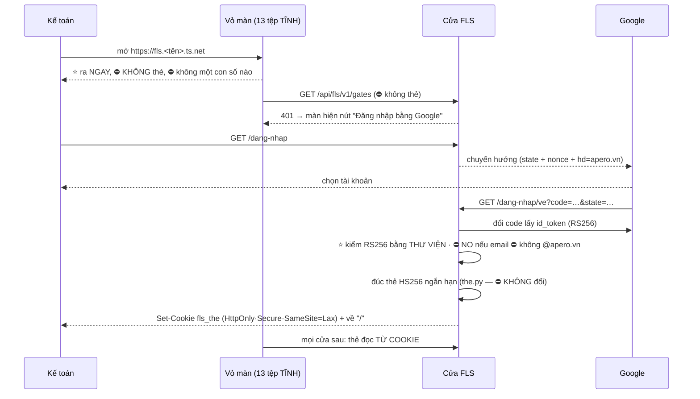

# 14 — CHỖ CHẠY & ĐĂNG NHẬP: đóng `GAP-WEB-01`

**Version:** v0.1 · **Ngày:** 2026-09-11 · **Chủ sở hữu:** Tech Lead
**Đóng:** `GAP-WEB-01` — và qua đó mở khoá **hai** chặn `UAT` trong `09_MILESTONES §7.1` *(ⓐ không chỗ cho kế toán mở · ⓑ không đường đăng nhập)*.

**Căn cứ:** `QĐ-ITL-76` *(cửa TỪ CHỐI chạy ngoài loopback khi bật màn)* · `09_MILESTONES_HAI_TAC_VU §7.1` · `02_BA/08_NFR` `NFR-I22` · `12_P6_WEB_PLAN` v0.8 §3 · mã sống: `fls/api/cua.py` `dung_may()` · `fls/api/the.py` · `fls/web/phuc_vu.py` · `tools/chay_cua.py`

> Tệp này trả lời đúng một câu: **kế toán ngồi ở máy của họ mở FLS bằng cách nào, và máy biết họ là ai bằng cách nào.**

---

## §0 · Đo trước khi kê đơn — `GAP-WEB-01` thật ra là **MỘT dòng**

⛔⛔ **Trước khi viết tệp này tôi đi tìm lý do cửa từ chối, và lý do ấy hẹp hơn tên gọi của nó rất nhiều.** `GAP-WEB-01` được khai ngày `03/09` như *"đăng nhập thật khi FLS chạy cho nhiều hơn một máy"* — nghe như một chặng lớn. Đọc mã thì nó là **một chuỗi nhân quả bốn mắt**, và mắt đầu tiên là chỗ duy nhất phải sửa:

| # | Sự thật trong mã | Ở đâu |
|:-:|---|---|
| ① | `tools/chay_cua.py` **đúc một cái thẻ** cho `--actor`, mặc định `thu@apero.vn` | `chay_cua.py:172` |
| ② | Thẻ ấy được **nhét vào `phien.js`**, tệp sinh trong bộ nhớ | `phuc_vu.py:_than_phien` |
| ③ | Trình duyệt tải `phien.js` **⛔ không cần chứng minh gì** *(vỏ màn phải ra được trước thẻ)* | `phuc_vu.py:100` |
| ④ | ⇒ Mở ra mạng = **phát thẻ cho bất kỳ ai chạm tới cổng** ⇒ `dung_may()` **NO** | `cua.py:385` |

⭐⭐ **Mắt ① là mắt duy nhất sai, và nó sai vì một tiền đề đã hết hạn.** Tiền đề: *"vỏ màn hình phải mang theo thẻ, vì trình duyệt ⛔ không gắn được `Authorization` ở lần tải trang đầu"*. Vế sau **đúng**. Vế trước **⛔ không theo sau vế sau** — nhưng ⛔ **không đúng cho cả vỏ màn**, và chỗ ⛔ không đúng ấy là chỗ đắt nhất của tệp này.

⚠⚠ **Bản nháp đầu của tệp này viết *"vỏ màn là 13 tệp tĩnh, ⛔ không tệp nào chứa một con số kế toán nào"*. Tôi đi đếm `BANG_TEP` và câu ấy SAI.** Có **16 tuyến**, và chúng ⛔ **không cùng một loại**:

| Nhóm | Tuyến | Chứa gì | Phục vụ khi CHƯA đăng nhập? |
|---|:--:|---|:--:|
| **trên đĩa** | **13** *(`index.html` · `tokens.css` · `hinh.css` · 10 tệp `.js`)* | bố cục · màu · mã màn hình. ⛔ **0** số liệu | ✅ **được** |
| **SINH** — `cot.js` | 1 | 23 tiêu đề lưới + 38 vị trí `canon`, sinh từ `cot_so.py` | ✅ được *(**hình dạng** của sổ, ⛔ không phải nội dung)* |
| ⛔ **SINH** — `danh_muc.js` | 1 | ⛔ **73 mã hợp đồng** sinh từ `fls_mapping_master` | ⛔ **KHÔNG** — đây là **dữ liệu công ty** |
| ⛔ **SINH** — `phien.js` | 1 | ⛔ **cái thẻ** | ⛔ **KHÔNG** |

⇒ Kết luận đúng **hẹp hơn** câu tôi định viết, và vì thế nó dùng được: **14/16 tuyến ⛔ không cần thẻ; đúng HAI tuyến phải nằm sau đăng nhập.** Bỏ thẻ khỏi `phien.js` **và** dời `danh_muc.js` ra sau phép kiểm thẻ thì **tiền đề của `QĐ-ITL-76` tan**, và cái `NO` ở mắt ④ ⛔ không còn gì để canh.

⭐ ⛔ Nếu tôi giữ câu *"13 tệp, ⛔ không có gì"* thì bản thi công sẽ mở **cả `danh_muc.js`** ra ẩn danh — **73 mã hợp đồng của công ty phát cho bất kỳ ai chạm tới cổng**, và ⛔ **không cổng nào trong `§4` bắt được**, vì tôi đã tự tay khai nó là *"tĩnh, vô hại"*. Một đặc tả sai ở **tiền đề** thì mọi cổng dựng theo nó đều canh **đúng thứ sai**.

⚠ **Và đây là chỗ tôi phải tự cảnh báo mình.** Lập luận trên nghe gọn quá, đúng kiểu lập luận làm người ta bỏ một hàng rào an ninh. Nên `QĐ` sắp tới ⛔ **không được gỡ** `dung_may()`'s `NO` — nó phải **đổi điều kiện**: từ *"có bật màn hình không"* thành ***"`phien.js` có chở thẻ không"***. Nếu ai đó về sau nhét lại một cái thẻ vào `phien.js`, cửa phải **NO lại ngay**, ⛔ không cần ai nhớ ra luật này. Xem `§4` cổng `W3`.

---

### ⛔⛔⛔ §0b · Cái `NO` ở mắt ④ canh **ĐỊA CHỈ NGHE**, và một proxy đi vòng qua nó **trong im lặng**

⚠⚠ **Tìm được `11/09`, khi viết bản hướng dẫn cho owner — và nó đổi THỨ TỰ thi công.**

`kiem_phuc_vu_tep(dia_chi)` *(`cua.py:347`)* chỉ hỏi **một** câu: `dia_chi not in LOOPBACK`. Nhưng `tailscale serve` *(và mọi reverse proxy: `nginx`, `caddy`, `cloudflared`)* **⛔ không đổi địa chỉ nghe của FLS** — nó nhận `TLS` từ mạng rồi **nối tới `127.0.0.1:8088`**. Từ chỗ FLS đứng nhìn, ⛔ **không có gì thay đổi**:

```
tailnet ──HTTPS──▶ tailscaled ──▶ 127.0.0.1:8088 ──▶ FLS
                                  └── dia_chi VẪN LÀ "127.0.0.1" ⇒ cổng ④ XANH
                                  └── và phien.js VẪN chở thẻ ra cả tailnet
```

⇒ **Cái `NO` đắt nhất của `QĐ-ITL-76` bị vô hiệu bằng một câu lệnh, ⛔ không một dòng báo nào.** Nó ⛔ không sai — nó canh **đúng thứ nó khai**; chỉ là *"địa chỉ nghe"* **⛔ chưa bao giờ** là câu hỏi thật. Câu hỏi thật luôn là ***"`phien.js` có chở thẻ không"***, và đó đúng là điều `§4` việc `2` đổi sang — **proxy ⛔ không đi vòng qua được**, vì nó ⛔ không hỏi về mạng nữa.

★ **Hệ quả vận hành, ⛔ không hoãn được:**

| | Việc | Khi nào |
|:--:|---|---|
| ✅ | Cài Tailscale · kết nạp máy · bật MagicDNS + HTTPS | **an toàn ngay** — ⛔ tự nó ⛔ không phơi gì |
| ⛔ | **`tailscale serve` trỏ vào cổng `8088`** | ⛔ **CHỜ** `§4` việc `1`+`1b` xong. Chạy trước = phát thẻ + **73 mã hợp đồng** cho cả tailnet |

⇒ Thêm **cổng `W6`**: `kiem_phuc_vu_tep` ⛔ **không được** là phép kiểm **duy nhất** trước khi phục vụ vỏ màn — phép kiểm *"`phien.js` có chở thẻ không"* phải chạy **độc lập với địa chỉ**, và có bài thu dựng đúng ca *"địa chỉ `127.0.0.1` + `phien` có khoá `the`"* ⇒ phải **NO**.

---

## §1 · Hai quyết định, và tôi quyết — ⛔ không hỏi

Owner đã giao: *"đóng vai chuyên gia ERP chuyên về hệ thống tài chính, tư vấn và quyết định cho tôi"*. Hai chỗ dưới đây là **quyết định**, kèm cái đã **bị loại** và **vì sao**.

### ⓐ Danh tính: **Đăng nhập Google, khoá cứng miền `apero.vn`**

| Đường | Quyết | Vì sao |
|---|:--:|---|
| ⭐ **Google Sign-In (OIDC)** | ✅ **CHỌN** | Cả công ty **đã** ở Google Workspace: mọi `actor` trong mã đã là `…@apero.vn`, nguồn sự thật là Google Sheets, `nhip_chup.py` đã dùng `gcloud` token. ⇒ ⛔ **Không có kho mật khẩu nào được sinh ra** — và một kho mật khẩu là thứ nặng nhất mà một đội **2–3 kế toán** phải gánh: đặt lại mật khẩu, khoá tài khoản khi nghỉ việc, chính sách độ dài. Nhân sự nghỉ ⇒ Workspace tắt ⇒ FLS tắt theo, **⛔ không ai phải nhớ** |
| Bảng người dùng + mật khẩu trong `fls_*` | ⛔ **LOẠI** | Sinh ra **một tài sản phải bảo vệ** *(băm mật khẩu)* trong chính kho đang giữ 615 tỷ. Và nó sẽ **trôi** khỏi danh sách nhân sự thật |
| Magic-link qua email | ⛔ **LOẠI** | Cần đường gửi thư + hộp thư là vòng khôi phục ⇒ **an toàn của FLS = an toàn của email**, mà email ấy **cũng là Google** ⇒ vòng quanh, thêm mắt xích ⛔ không thêm gì |

⛔⛔ **Một ràng buộc kỹ thuật phải nói ngay, vì nó quyết luôn `§1ⓑ`:** thẻ Google trả về là **`RS256`**, còn `fls/api/the.py` khai **bản trắng một phần tử `HS256`** và tự viết trong docstring: *"nếu về sau cần khoá công khai thì ⛔ đừng nới rộng file này, hãy lấy thư viện"*. ⇒ Làm **đúng câu ấy**:

```
Google ──id_token RS256──▶ [cua/dang_nhap.py]  ──kiểm bằng THƯ VIỆN──┐
                                                                      │
                          ⛔ the.py KHÔNG đổi một dòng ◀──đúc HS256 ngắn hạn──┘
```

`the.py` **giữ nguyên bản trắng `HS256`** và tiếp tục là nơi duy nhất cửa tin. Thẻ Google **⛔ không bao giờ đi vào vùng `/api/fls/v1`** — nó chỉ sống đúng một lần, ở phép đổi thẻ. ⇒ Vùng tấn công của `the.py` ⛔ không rộng thêm một milimét.

### ⓑ Chỗ chạy: **hai giai đoạn, ⛔ không nhảy thẳng lên cloud**

| Giai đoạn | Chỗ chạy | Khi nào | Vì sao |
|:--:|---|---|---|
| ⭐ **I — UAT** | **Chính máy này**, mở ra LAN qua **Tailscale** *(`tailscale serve` cấp HTTPS thật cho tên `*.ts.net`)* | **được ngay** sau `§4` | ⛔ **Không mở một cổng nào ra Internet**, ⛔ không cần DNS, ⛔ không cần chứng chỉ tự ký *(mà 3 máy phải cài tay)*. Dữ liệu **⛔ không rời văn phòng**. Và nó cho **hai lớp**: mạng *(Tailscale — chỉ thiết bị đã kết nạp)* + danh tính *(Google — chỉ người `@apero.vn`)* |
| **II — vận hành** | VM nhỏ ở **GCP `asia-southeast1`** + `Cloud SQL` | **sau** khi `UAT` trả lời *"kế toán có dùng không"* | Đội đã ở GCP *(BigQuery)*. ⛔ Nhưng dời kho **System of Record** là việc **không lùi được**, và ⛔ **chưa có lý do** nào đòi nó **trước** khi biết màn hình có dùng được |

⛔⛔ **Vì sao HTTPS là bắt buộc chứ ⛔ không phải "nên có":** Google OAuth **từ chối** `redirect_uri` dạng `http://` cho mọi địa chỉ ⛔ không phải `localhost`. ⇒ `http://192.168.1.x:8088` **⛔ không đăng nhập được**, ⛔ không phải vì FLS, mà vì Google. Đây là lý do **Tailscale được chọn thay vì chỉ mở LAN** — nó là đường **duy nhất** cho HTTPS thật mà ⛔ không cần tên miền và ⛔ không cần mở cổng.

| Đã loại | Vì sao |
|---|---|
| Chứng chỉ tự ký + mở LAN | 3 máy phải **cài CA bằng tay**, và trình duyệt sẽ dạy kế toán **bấm qua cảnh báo bảo mật** — một thói quen đắt hơn cái nó tiết kiệm |
| Cloudflare Tunnel | Cũng cho HTTPS + ⛔ không mở cổng, **nhưng** lưu lượng sổ kế toán đi **qua bên thứ ba**. Tailscale là **mạng riêng ngang hàng** ⇒ ⛔ không có chặng giữa đọc được |
| Mở thẳng cổng `8088` ra Internet | ⛔ Không bàn |

---

## §2 · Luồng đăng nhập — sáu bước, và **chỗ nào giữ gì**



⭐ **Ba chốt của luồng này:**

| Chốt | Vì sao ⛔ không làm cách khác |
|---|---|
| ⭐⭐ **Thẻ ở `HttpOnly` cookie, ⛔ không ở `localStorage`** | `localStorage` **JS đọc được** ⇒ một lỗi XSS ở bất kỳ đâu trong 9 tệp `.js` là **thẻ ra ngoài**. `HttpOnly` thì trình duyệt **⛔ không cho JS nhìn thấy** thẻ, kể cả JS của chính ta |
| **`SameSite=Lax`** + mọi cửa GHI là `POST` | Chặn `CSRF` mà ⛔ không cần thêm một token thứ hai. ⚠ Nếu về sau có cửa GHI dùng `GET` thì luật này **thủng** — ⇒ cổng `W4` |
| ⭐ **`hd=apero.vn` là GỢI Ý, ⛔ KHÔNG phải phép kiểm** | Google cho tham số `hd` để lọc **màn chọn tài khoản** — nó **⛔ không ràng buộc** thẻ trả về. Phép kiểm thật phải làm ở **phía ta**, trên `email` + `email_verified` **trong `id_token` đã kiểm chữ ký**. ⛔ Đây là một bẫy đã hạ nhiều hệ, và nó có **một bài thu riêng** |

---

## §3 · `actor` — thứ thật sự thay đổi

Đây là lý do sâu nhất của chặng này, sâu hơn *"cho kế toán mở được"*:

| Hôm nay | Sau chặng này |
|---|---|
| `actor` = cờ `--actor` lúc khởi động ⇒ *"**ai bật máy chủ**"* | `actor` = `email` trong `id_token` **Google đã ký** ⇒ *"**ai đang gõ**"* |

⛔⛔ **Và điều đó làm nhật ký trở thành nhật ký.** `QĐ-ITL-27` khai tử vai hậu kiểm ⇒ `fls_journal` + `fls_queue_event` là **chỗ kiểm soát duy nhất còn lại**. Một nhật ký ghi `thu@apero.vn` cho **mọi** hành động của **mọi** người ⛔ không kiểm soát được gì — nó chỉ **trông như** kiểm soát. Đo được hôm nay: `fls_journal` = **0** dòng, nên ⛔ **chưa có** dòng sai nào phải sửa; chặng này phải xong **trước** dòng đầu tiên.

⚠ **Cờ `--actor` ⛔ KHÔNG được giữ lại "cho tiện"** khi đăng nhập đã bật. Một đường vòng bỏ qua đăng nhập, để lại trong mã, là đường **sẽ** được dùng — và lúc ấy ⛔ không ai biết dòng nhật ký nào thật. ⇒ Cổng `W5`.

---

## §4 · Việc phải làm — và **sáu cổng** phải ĐỎ trước khi xanh

| # | Việc | Tệp |
|:-:|---|---|
| **1** | ⭐ Bỏ thẻ khỏi `phien.js` — nó chỉ còn chở `{"dang_nhap": false}` hoặc tên người đã đăng nhập | `fls/web/phuc_vu.py` · `fls/web/tep/phien.js` |
| **1b** | ⭐⭐ `danh_muc.js` + `phien.js` **⛔ không phục vụ khi chưa có thẻ hợp lệ** ⇒ `BANG_TEP` mọc thêm một cột **`doi_the`**, và nó là **khai tường minh** *(⛔ không suy từ `sinh=True`: `cot.js` cũng `sinh` mà ⛔ không cần thẻ)* | `fls/web/phuc_vu.py` |
| **2** | `dung_may()` đổi điều kiện `NO`: từ *"bật màn + ngoài loopback"* thành *"**`phien.js` chở thẻ** + ngoài loopback"*, **và** thêm `NO` mới: *"ngoài loopback mà **⛔ chưa khai đường đăng nhập**"* | `fls/api/cua.py` |
| **3** | Cấu phần mới `fls/api/dang_nhap.py` — 2 cửa `GET /dang-nhap` · `GET /dang-nhap/ve`; đổi `RS256`→`HS256` | mới |
| **4** | Đọc thẻ **từ cookie** *(giữ nguyên đường `Authorization` cho `tools/`)* | `fls/api/cua.py` |
| **5** | Thư viện kiểm `RS256` — gói phụ thuộc **thứ tư** của kho *(`PyJWT[crypto]`)* | `pyproject` · `.importlinter` |
| **6** | Màn: nút *"Đăng nhập bằng Google"* + trạng thái `401` + tên người ở góc | `fls/web/tep/*.js` |
| **7** | `tools/chay_cua.py` — cờ `--dang-nhap-google`, và cờ ấy **loại trừ** `--actor` | `tools/chay_cua.py` |

### Sáu cổng — mỗi cổng phải **chứng minh ĐỎ** trước

| # | Cổng canh gì | ⛔ Phá thế nào để thấy nó ĐỎ |
|:--:|---|---|
| `W1` | **Vỏ màn ⛔ không chở thẻ** — quét **cả 16 tuyến**, ⛔ không riêng `phien.js` | Nhét lại một chuỗi hình thẻ vào bất kỳ tệp nào |
| ⭐ `W1b` | ⭐⭐ **FAIL-CLOSED:** cột `doi_the` mặc định **`True`**, và chỗ khai ngược lại là một **bản TRẮNG** 14 tuyến. Cổng duyệt **chính `BANG_TEP`**: mọi tuyến `doi_the` phải trả `401` khi ⛔ chưa có thẻ | Đổi `doi_the=False` cho `danh_muc.js` ⇒ cổng phải ĐỎ. ⚠ **Và nói thẳng giới hạn:** cổng chứng minh được *"tuyến đã khai là đòi thẻ **thì** đòi thật"*, nó ⛔ **KHÔNG** biết một tuyến **nên** đòi hay không — chỗ ấy là **người**. Cái bảo vệ thật là **mặc định đóng**: quên khai ⇒ đòi thẻ, ⛔ không phải ngược lại |
| `W2` | Email **⛔ không** `@apero.vn` ⇒ **NO**, và phép kiểm đọc `email`+`email_verified` **sau khi kiểm chữ ký**, ⛔ không đọc `hd` | Đưa `id_token` giả có `hd=apero.vn` nhưng `email=…@gmail.com` |
| `W3` | ⭐⭐ `dung_may()` **NO lại** nếu ai đó nhét thẻ về `phien.js` | Trả `phien` có khoá `the` + `dia_chi` ngoài loopback ⇒ phải `NO` |
| `W4` | ⛔ **Không** một tuyến GHI nào là `GET` *(nếu có, `SameSite=Lax` thủng)* — duyệt **chính `BANG_TUYEN`**, ⛔ không gõ tay lại danh sách | Khai một tuyến `GET` có ghi |
| `W5` | Bật `--dang-nhap-google` **và** `--actor` cùng lúc ⇒ **NO** | Gõ cả hai cờ |
| ⭐⭐ `W6` | **Phép kiểm ⛔ không được phụ thuộc ĐỊA CHỈ** *(`§0b`)* — một reverse proxy làm `dia_chi` vẫn là `127.0.0.1` | Dựng ca *"`dia_chi='127.0.0.1'` **và** `phien` có khoá `the`"* ⇒ phải **NO**. ⛔ Trên mã hôm nay ca này **XANH**, và đó chính là lỗ |

⛔ Khuôn `W4` lấy nguyên từ `tools/soi_bang_tuyen.py` — cổng ấy đã đóng `GAP-API-05` bằng đúng cách *"duyệt bảng thật, ⛔ không chép danh sách"*.

---

## §5 · Việc của owner — **ba thứ máy ⛔ không làm được**

⛔⛔ **Thứ tự ⓑ → ⓐ, ⛔ không phải ⓐ → ⓑ.** `redirect_uri` của ⓐ **phải là một URL có thật**, và cái tên ấy chỉ tồn tại **sau** khi Tailscale cấp. Làm ⓐ trước thì phải quay lại sửa — và mỗi lần sửa `redirect_uri` là một lần Google mất tới **5 phút** mới nhận.

| # | Việc | Mất bao lâu | Vì sao ⛔ không phải việc của tôi |
|:-:|---|:--:|---|
| **ⓑ** *(trước)* | Kết nạp **3 thiết bị** vào Tailscale + bật **MagicDNS & HTTPS**. ⛔ **CHƯA** `tailscale serve` — xem `§0b` | ~15 phút | Đây là quyết định về **mạng của công ty** |
| **ⓐ** *(sau)* | Tạo **OAuth Client ID** trong Google Cloud Console của `apero.vn` *(loại `Web application`, `redirect_uri` = `https://<tên>.ts.net/dang-nhap/ve`)* | ~10 phút | Cần quyền quản trị Workspace. Nó sinh ra **một bí mật** — bí mật ấy ⛔ không được đi qua tay tôi, và ⛔ không được vào git |
| **ⓒ** | Nói **ai** được vào: danh sách email `@apero.vn` | 1 phút | ⛔ Không suy được từ mã. `04_ROLE_PERMISSION_MATRIX` khai **vai**, ⛔ không khai **người** |

⇒ Sau ⓑⓐⓒ, tôi làm hết `§4`. **Trước** ⓐ tôi vẫn làm được việc `1`·`1b`·`2`·`4`·`5`·`7` + **cả sáu cổng** *(chúng ⛔ không cần Google thật — chúng đúc `id_token` giả và tự ký)*; chỉ việc `3`·`6` cần `Client ID` thật để chạy một vòng.

⭐ **Bản hướng dẫn từng bước bấm ở đâu:** `15_HUONG_DAN_OWNER_CHO_CHAY.md`.

---

## §6 · Tệp này ⛔ KHÔNG đóng cái gì

⛔ Nói thẳng, vì một đặc tả im lặng về giới hạn của nó là một đặc tả sẽ bị đọc quá rộng:

| ⛔ Không đóng | Vẫn là gì |
|---|---|
| **ⓒ Kho phải bật bằng tay** | `Docker Desktop` + `WakeToRun` — **ba cài đặt điện** vẫn ở mặc định, vẫn là `§7.2` của `09_MILESTONES`, vẫn là **ba cú bấm của owner** |
| **ⓓ ⛔ Chưa ai đi một vòng** | `su_kien_cho_nguoi` = **0**. Đăng nhập cho kế toán **chỗ để bấm**, ⛔ không bấm thay họ |
| **Phân quyền theo vai** | Chặng này trả lời *"anh là ai"*. *"Anh được làm gì"* là `04_ROLE_PERMISSION_MATRIX`, và hôm nay **mọi người đăng nhập được đều làm được mọi thứ** — ⚠ với **3 kế toán** thì chấp nhận được, với người thứ tư thì ⛔ không |
| **Sao lưu tự động** | `11/09` đo được: sổ `8.387` dòng **⛔ chưa từng có bản sao** cho tới hôm ấy. Mở cho nhiều người gõ **làm việc này gấp hơn**, ⛔ không nhẹ đi |

---

## §7 · Changelog

- **v0.1** *(2026-09-11, owner duyệt *"làm đi"*)*: bản đầu. ⭐⭐ **Phát hiện chính: `GAP-WEB-01` hẹp hơn tên gọi rất nhiều** — vỏ màn hình chở thẻ *(`phuc_vu.py:_than_phien`)* là mắt xích sai, và **14/16 tuyến** ⛔ không cần thẻ. ⚠⚠ **Nhưng bản nháp đầu của chính tệp này viết sai tiền đề** — *"13 tệp tĩnh, ⛔ không có số liệu"* — rồi tôi đếm `BANG_TEP` và thấy **`danh_muc.js` chở 73 mã hợp đồng** sinh từ `fls_mapping_master`. Giữ câu ấy thì bản thi công **phát danh mục hợp đồng cho bất kỳ ai chạm tới cổng**, và ⛔ **không cổng nào bắt được** vì tôi đã tự khai nó *"tĩnh, vô hại"*. ⇒ **Một đặc tả sai ở TIỀN ĐỀ thì mọi cổng dựng theo nó đều canh đúng thứ sai** — ghi vào `§0` để lần sau ⛔ không phải học lại. Sinh ra `1b` + cổng `W1b` *(cột `doi_the` **mặc định `True`**, bản trắng 14 tuyến)*. ⭐ **Hai quyết định**: danh tính = **Google OIDC khoá miền `apero.vn`** *(⛔ không kho mật khẩu)*; chỗ chạy = **Tailscale trước, GCP sau** *(Google **từ chối** `redirect_uri` `http://` ngoài `localhost` ⇒ HTTPS là **ràng buộc của Google**, ⛔ không phải mong muốn của ta)*. ⭐ `the.py` **⛔ không đổi một dòng** — `RS256` kiểm bằng thư viện ở cấu phần mới rồi đúc `HS256`, đúng câu docstring của chính nó đã dặn. ⚠ **Tự cảnh báo ghi vào `§0`**: lập luận *"bỏ hàng rào vì tiền đề đã hết hạn"* là lập luận nguy hiểm ⇒ `QĐ` sắp tới **đổi điều kiện** của `NO`, ⛔ **không gỡ** nó, và cổng `W3` canh đúng chỗ ấy.
