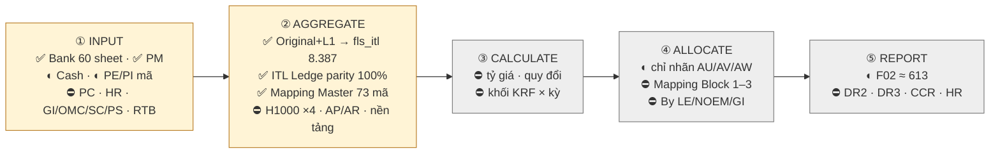

# PD Now — con voi toàn bộ luồng FLS và chia giai đoạn triển khai

**Version:** v0.1 · **Ngày:** 2026-11-03 · **Người đọc:** owner *(COO-CFO)* + ba agent dự án · **Người soạn:** phiên Claude theo yêu cầu owner 03/11: *"Vẽ lại 1 con voi toàn bộ theo PD now, rồi chia theo các giai đoạn triển khai. Mục tiêu giai đoạn đầu là đi hết luồng Input, ra được Aggregate về 1 bảng ITL duy nhất, mọi chi phí về đến mọi pháp nhân."*
**Đo lúc soạn:** bảng `A_FPA_PD_PLB_Guide_2025 - FS2 PD Now.csv` *(137 dòng · 118 cột · **116 bước có số**)* · mã nguồn @ `2d1b710` *(nhánh `feat/p2-oracle-parity`, ảnh chụp 07/10)* · **2.044** hàm `test_` · kho PostgreSQL ⛔ **không chạy được ở phiên này** *(không có Docker)* ⇒ mọi con số về kho là **trích từ tài liệu/chú thích mã**, có ghi chỗ trích.

> ⭐ Tệp này là **bản đồ**, ⛔ không phải kế hoạch chi tiết: nó nói *cái gì ở đâu* và *làm theo thứ tự nào*. Kế hoạch từng pha vẫn ở `03_Dev/03_IMPLEMENTATION_PLAN.md`; việc đang chạy ở `01_Orchestrator/06_ORCHESTRATOR_DASHBOARD.md` §6.

---

## §0 · Đọc bảng PD Now thế nào — và ba điều nó nói

Bảng là một **ma trận vào/ra**: mỗi **hàng** là một bước *(một sheet hoặc một file)*, mỗi **cột** từ `O`…`DH` cũng là một bước. Ô `O` = *"cột này là của chính tôi"*; ô `I` trên hàng `R` ở cột của bước `S` = *"`R` đổ vào `S`"*. Đọc máy: **96 cột** có chủ, **116** hàng có số bước.

| Điều bảng nói | Con số | Nghĩa với FLS |
|---|---|---|
| **5 khâu**, đúng thứ tự `INPUT → AGGREGATE/PREPARE → CALCULATE → ALLOCATE → REPORT` | bước `1xx` 17 · `2xx` 25 · `3xx` 19 · `4xx` 20 · `5xx` 14 · `6xx` 18 · `7xx` 3 | Khâu `INPUT` chiếm hai dải số *(`1xx` thu thô + `2xx`/`3xx` gom)*; `ALLOCATE` ⛔ không có bước nào ở tầng HR *(`500`: "đã allocate tại Raw")* |
| Trạng thái AS-IS | **Done 101** · Not yet 6 · Doing 2 · Cancel 2 · trống 5 | Hệ Sheets hôm nay **đã đi hết luồng** bằng tay. Hai bước `Cancel` là **hai chỗ Sheets ⛔ không gánh nổi**: `309` *(L2, "Balance luôn = 0")* và **`319` `ITL AGGREGATE` — "Agrregate về 1 bảng ITL duy nhất", bỏ vì Gsheet ⛔ không hỗ trợ bảng lớn**. ⭐ Đúng câu owner đặt cho giai đoạn đầu |
| **Cấp phân bổ `AL`** gắn trên từng bước | `CFA1`·`CFA2`·`CFA3` *(dòng tiền)* · `PLA1`…`PLA5` *(P&L)* · `All`/`tbu`/`n/a` | `CFA1` = sổ ITL theo pháp nhân · `CFA2` = **cờ** có-dòng-tiền-thật/nội-bộ *(`QĐ-ITL-140`, ⛔ không phải bậc)* · `CFA3`/`PLA3` = HR · `PLA1` = AP/AR · `PLA2` = SC · `PLA4` = nền tảng GI/OMC/PS · `PLA5` = bản ký |
| **7 nhóm khoá** *(cột `H`…`N`)* | `General Trustest` *(Ngày · Tiền · Tiền tệ · **LE**)* · `Statement Ref No` · `PE` *(Budget/KRF/HD · CDT · Vendor · Singular/Advance · Action Date)* · `PI` *(Invoice · PE ID)* · `PM` *(PI ID · PE ID)* · `PC` · `CDT` | Đây chính là **các chiều của báo cáo đầu ra**. Từ bước `308` trở đi, **mọi** bước mang đủ 7 nhóm ⇒ *"báo cáo đủ các chiều"* = đủ 7 nhóm khoá này |

---

## §1 · Con voi — vẽ bằng 5 khâu, mỗi khâu ≤ 5 nhóm, mỗi nhóm ≤ 5 bước

> Luật vẽ *(`apr-vevoi`)*: ⛔ không tầng nào quá 5 nhánh; **116 bước giữ nguyên văn**, chỉ thêm tên nhóm. Mũi tên chỉ đi giữa hai khâu **kề nhau**; cái gì nhảy khâu là bảng nói *(ví dụ `Payroll Sheet 101` đổ thẳng vào `611`)*, ghi ở chú thích chứ ⛔ không vẽ.

```mermaid
flowchart TB
  subgraph I["① INPUT · COLLECT RAW  (100–116)"]
    direction LR
    I1["I-A · Ngân sách & nhân sự<br/>100 RTB · 101 Payroll · 102 EDD"]
    I2["I-B · Dữ liệu nền tảng (Looker)<br/>103 GI · 104 OMC · 105 SC · 106 PS"]
    I3["I-C · P100 PAY Tool (Gform + duyệt)<br/>107/108 PE · 109/110 PI · 111/112 PM · 113/114 PC"]
    I4["I-D · Tiền (sao kê + quỹ)<br/>115 Statement · 116 Cash"]
  end
  subgraph A["② AGGREGATE / PREPARE  (200–224 · 301–319)"]
    direction LR
    A1["A-① Sổ tiền<br/>P100 Bank/Cash Ledger · A-CCR 111/112 · CCR"]
    A2["A-② Sổ bổ trợ<br/>Unpivot PE/PI/PM/PC · H1000 ×4 · GI/OMC/SC/PS · AP/AR"]
    A3["A-③ ITL hợp nhất<br/>RAW 1/2: Mapping Master · Original · Mapping L1<br/>ADJUSTED 2/2: ITL Ledge · H1000 Ledge ×4 · (319 AGGREGATE)"]
  end
  subgraph C["③ CALCULATE  (400–419)"]
    direction LR
    C1["C-① Nạp Templ 2 + tỷ giá<br/>400–405"]
    C2["C-② General Ledger · quy đổi tiền tệ<br/>406 · 407 · 408 · 412 · 413"]
    C3["C-③ Khối KRF × kỳ<br/>Daily 409·411·414·416·418 · YHQM 410·415·417·419"]
  end
  subgraph L["④ ALLOCATE  (500–513)"]
    direction LR
    L1["AL-① HR · 500<br/>(đã phân bổ tại Raw)"]
    L2["AL-② Non-HR · Map by ITL<br/>GI 501–507 · OMC 508 · SC 509 · PS 510"]
    L3["AL-③ Khoá đơn giản<br/>511 By LE · 512 By NOEM · 513 By GI"]
  end
  subgraph R["⑤ REPORT  (600–617)"]
    direction LR
    R1["R-① Số đã phân bổ về P&L file<br/>600–604"]
    R2["R-② Daily Report 3 · P&L<br/>605–609"]
    R3["R-③ Daily Report 2 · CF<br/>610"]
    R4["R-④ HR & quản trị dữ liệu<br/>611 · 612 · 613"]
    R5["R-⑤ CCR<br/>614 · 615 · 616 · 617"]
  end
  I --> A --> C --> L --> R
```

### 1.1 · Khâu ① INPUT · COLLECT RAW — 17 bước, 4 nhóm

| Nhóm | Bước | Nguồn gốc *(cột Original Source)* | AL | AS-IS | FLS hôm nay |
|---|---|---|---|---|---|
| **I-A · Ngân sách & nhân sự** | `100` RTB \| RealTime Budget | — | All | Not yet | ⛔ 0 tham chiếu trong `fls/` |
| | `101` H1000 \| Payroll Sheet *(mỗi sheet một workflow)* | H1000 Ledger (APERO-HR Allocate HD_FS1) | PLA3 | Done | ⛔ *(chỉ chuỗi `H1000 Ledger` trong `adapters/mapping_master.py:31`)* |
| | `102` H1310 EDD \| Quyết định nhân sự (Responses) | — | PLA3 | — | ⛔ |
| **I-B · Dữ liệu nền tảng (Looker)** | `103` GI · `104` OMC *(RAW của FS1, Revenue/OMC Monthly)* | Finance Report ED Dev 02-12-2023 Locker *(Data · AnhTQ)* | PLA4 | Done | ⛔ *(`Platform` chỉ là một giá trị enum của `fls_source.src_type`)* |
| | `105` SC *(Chi phí Service Apero · SHQ1)* · `106` PS *(AperoGroup_Payment · SHQ2)* | file RAW riêng | PLA2 / PLA4 | Done | ⛔ |
| **I-C · P100 PAY Tool** *(mỗi phiếu 2 bước: nhân dân nhập Gform → boss duyệt ở Gsheet)* | `107`/`108` PE | A \| P100 \| PE11 Entry Data | tbu | Done | ◐ chỉ **mã** `pe_slip/pe_line` trong `fls_pm_line` *(migration `0023`)* — trỏ vào ⛔ không có bảng PE |
| | `109`/`110` PI | A \| PAY100 \| PI11 Entry Data | tbu | Done | ◐ như PE |
| | `111`/`112` PM | A \| PAY100 \| PM11 Entry Data | tbu | Done | ✅ ảnh chụp `fls_pm_line` **3.772 dòng** *(lằn `PM`, `chup_id 23793`)* |
| | `113`/`114` PC | A \| PAY100 \| PC11 Entry Data | tbu | Done | ⛔ **0** tham chiếu `PC` trong `fls/`·`tools/`·`tests/` |
| **I-D · Tiền** *(khoá General Trustest)* | `115` Statement \| Bank/PO/PP *(nhập tay từ sao kê)* | A - Statement → P100 \| Bank Transactions | CFA3 | Done | ✅ **60 sheet `R \|`** · `adapters/sao_ke.py` · **8.338/8.338** dựng lại khớp |
| | `116` Cash Transactions *(kế toán nhập tay)* | P100 \| Cash Ledger | CFA3 | Done | ◐ **8 dòng chảy quỹ** đã khai *(`tools/nap_nguon_va_khai.py`)* nhưng lằn `Cash` ⛔ **chưa chụp, chưa nạp** *(`tools/chup_sao_ke.py:46` chỉ `LAN="Bank"`, `GAP-CANON-02`)* |

### 1.2 · Khâu ② AGGREGATE / PREPARE — 44 bước, 3 nhóm lớn × ≤5 nhóm nhỏ

**A-① Sổ tiền** *(9 bước)*

| Nhóm nhỏ | Bước | Việc *(cột Formula, rút gọn)* | AS-IS | FLS hôm nay |
|---|---|---|---|---|
| **P100 Bank** | `200` R \| Acc No_Bank Currency_LE *(mỗi bank/ví một kiểu)* | Kế toán nhập tay từ statement vào Templ 1 | Done | ✅ = tầng `R \|` FLS đọc *(bản khai dòng 1, `fls_khai_cot` 408 dòng = 68 × 6)* |
| | `201` Bank Transactions | Nút GScript gom từ nhiều sheet R | Done | ✅ `tools/dung_lai_bank_transactions.py` **8.338/8.338** |
| **P100 Cash** | `202` R \| abc_xyz_LE · `203` Cash Ledger Transactions | nhập tay → GScript gom | Done | ◐ khai xong, chưa nạp *(như `116`)* |
| | `204` 2. CCR Cash *(balance từng sheet R, để audit đủ giao dịch)* | nhập tay | Done | ⛔ |
| **A-CCR_V2_Working** | `205` Bank Transactions · `206` Cash Ledger Transactions | GScript gom từ P100 | Done | ◐ *(cú đẩy `P100 → A-CCR` là thứ `QĐ-ITL-100` chốt FLS thay; mã ghi `fls/xuat/ghi_o.py` có, **cờ duyệt tắt**)* |
| | `207` 1.2 Ledger 112 · `208` 1.1 Ledger 111 | Formula Filter & Sort theo thời gian | Done | ◐ `208` là nguồn của `302` → FLS đọc qua `Transaction Mapping L1` |
| | `209` 2. CCR *(balance từng statement, audit đủ Bank Transactions)* | nhập tay | Done | ◐ chỉ **đo** *(`tools/do_trong_tai.py` đọc `2. CCR` 229 × 655, ⛔ không ghi)* |

**A-② Sổ bổ trợ** *(15 bước)*

| Nhóm nhỏ | Bước | Việc | AS-IS | FLS hôm nay |
|---|---|---|---|---|
| **Nền tảng** *(Allocate Supporting Ledger)* | `210` GI · `211` OMC *(Looker → Gsheet, Importrange & filter)* | gom + sắp theo thời gian | Done | ⛔ |
| | `212` SC · `213` PS *(từ file RAW)* | gom + sắp | Done | ⛔ |
| **Unpivot PAY** *(Filter Data Supporting Ledger)* | `214` PE_Unpivot *(duỗi PELine thành từng giao dịch)* | GScript | Done | ⛔ FLS ⛔ không duỗi; **2.694 × 23** mang `ID Payee` **95%** *(`QĐ-ITL-140`)* |
| | `215` PI_Unpivot *(duỗi PILine + check Status)* | GScript | Done | ⛔ *(chỉ là tên bảng tra của 4 cột `W/X/AB/AC` trong `canon/spec.py`)* — **973 × 24** |
| | `216` PM11_Entry Data *(nhập ID PM/PE/PI, HD, CDT1, check Σ PM ≤ PI/PE; CA nhập Reference number hàng ngày)* · `217` PM_Unpivot | GScript | Done | ✅ đọc `[Importrange]PM_Unpivot` **3.703 dòng · 1.468 phiếu · 28 cột** — ghép theo **DÒNG** `adapters/pm_join.py`, nối **26,79%** *(AS-IS VLOOKUP 33,2% nhưng 968 dòng lệch tiền)* |
| | `218` PC_Unpivot *(cơ bản chỉ kế toán dùng)* | Gform → Data Entry | Done | ⛔ |
| **H1000** | `219` 1.3 Ledger NIS/INT/COM 2025 · `220` …2024 | *"tbu — Blackbox lớn, từ dữ liệu lương C&B sẽ fill"* | Done *(todo: check lại IO)* | ⛔ |
| | `221` 1.3 Ledger PIT 2025 · `222` …2024 | như trên | Done | ⛔ |
| **AP/AR** | `223` 1.3 AP Ledger · `224` 1.4 AR Ledger | *Cần dựng: Importrange filter PE; PE&PI chưa PM/PC; audit với GI & OMC* | **Not yet** | ⛔ *(`QĐ-ITL-03`: adapter F là gói riêng)* |

**A-③ ITL hợp nhất** *(19 bước; đây là **tim** của khâu)*

| Nhóm nhỏ | Bước | Việc | AS-IS | FLS hôm nay |
|---|---|---|---|---|
| **RAW 1/2 — nguồn** | `301` Mapping Master | bảng tra mã reference | Done | ✅ `fls_mapping_master` **73 mã `hd`** · 23 cần CFA2 · **52/73 cột `Method` rỗng** |
| | `302` [Importrange]1.1 Ledger 111 · `303` PE_Unpivot · `304` PI_Unpivot · `305` PM_Unpivot · `306` PC11 | Importrange | Done | ◐ `302`·`305` ✅ qua `L1`/`pm_join` · `303`·`304`·`306` ⛔ |
| **RAW 1/2 — ghép** | `307` Transaction Original *(gom Cash + Bank về **1 bảng**)* | Query | Done | ✅ = 7 cột `BASE` của canon *(A–G)* |
| | `308` Transaction Mapping L1 *(sort · lookup PM/PI/PE · lookup Master Mapping LE · đánh số)* | 4 công thức | Done | ✅ `adapters/bank.py` → **38 vị trí / 36 trường** → `fls_itl` **8.387 dòng**; **6.648 ô `#N/A`** giữ nguyên *(`QĐ-ITL-50`)* |
| | `309` Transaction Mapping L2 | — | **Cancel** | — |
| **RAW 1/2 — AP** | `310` AP Transaction Original · `311` AP Audited *(khử trùng với Original CFA1)* · `312` AP L2 | — | **Not yet** | ⛔ |
| **ADJUSTED 2/2** | `313` [Importrange]Mapping Master | Importrange | Done | ✅ *(cùng bảng `301`)* |
| | `314` **ITL Ledge** *(import A–Q · manual R–AT · lookup AW · audit mã)* — **Templ 2 ITL (Standard Input)** | 4 công thức | Done | ✅ thước chuẩn `fls/oracle/`: **64 cột** `ledge_spec.py`, parity **69.510/69.510 ô · 23 kỳ**; `Classifying` **68.915 ô 7/7 khối**; `Final` **4.088/4.088**; **18 cột lưu**, phần còn lại khai lý do ⛔ không lưu |
| | `315`–`318` H1000 Ledge NIS/INT/COM & PIT × Y2025/Y2024 *(import A–Q · lookup Master Mapping R–AT)* | 2 công thức | Done | ⛔ |
| | `319` **ITL AGGREGATE** — *"Agrregate về 1 bảng ITL duy nhất"* | — | **Cancel** *(Gsheet ⛔ không hỗ trợ bảng lớn)* | ◐ **`fls_itl` chính là bảng này** — nhưng hôm nay nó chỉ chứa **1 nguồn** *(Bank)*: `source_system` khai `Bank\|Cash\|HR\|Platform` mà mới có `Bank` chảy vào |

### 1.3 · Khâu ③ CALCULATE — 20 bước, 3 nhóm *(file `Report I General Ledger \| CF report` và `\| P&L Report`)*

| Nhóm | Bước | Việc | AL | AS-IS | FLS hôm nay |
|---|---|---|---|---|---|
| **C-① Nạp Templ 2 + tỷ giá** | `400` ITL Ledge → CF report *(GScript A–AW, kế toán bấm Run)* | chuyển ITL đã Adjusted sang | CFA1·PLA1 | Done | ⛔ |
| | `401`–`404` H1000 Ledge ×4 → CF report *(+ convert Data Date)* | GScript/Importrange | CFA3·PLA3 | Done | ⛔ |
| | `405` 9.2 Exchange Rate | — | — | Done | ⛔ **0** tham chiếu `tỷ giá`/`exchange rate` trong `fls/`; hình `E` *(khác tiền tệ)* đẩy cho người *(`pm_join.py:30`)* |
| **C-② General Ledger · quy đổi** | `406` Report I General Ledger *(Query + **chuyển amount về 1 tiền tệ** + audit cash balance)* | — | CFA1·PLA1 | Done | ⛔ |
| | `407` Report I H1000 Ledge Y2025 *(CFA3, gồm cả giao dịch phân bổ)* · `408` …For PL Report *(PLA3)* | Query & Sort + quy đổi | CFA3 / PLA3 | **Doing** *(todo: audit balance)* | ⛔ |
| | `412` GL → P&L file *(bê sang cho đỡ nặng; **[4] đánh dấu ITL chưa allocate được PLA2/PLA3**)* · `413` H1000 → P&L file | GScript + 3 công thức | CFA1·PLA1 / PLA3 | Done | ◐ `[4]` ≈ cột `AV` *"Need to Allocate to CFA2"* `ledger/allocate.py` *(chỉ **nhãn**)* |
| **C-③ Khối KRF × kỳ** *(Templ 3 = Day · Templ 4 = Y/H/Q/M, "một kiểu PD590")* | Daily: `409` CFA1 · `411` CFA3 *(KRF nhóm HDH > 0 vì hạch toán kép 334-6xx)* · `414` PLA1 PM only · `416` PLA3 HR only · `418` PLA3 PM+HR *("Hoàn thiện Calculate tại đây")* | Sumifs & Sum | — | Done | ⛔ **0** tham chiếu `KRF` trong `fls/`; phép gom duy nhất là tiền/đếm theo tiền tệ ở hàng chờ |
| | YHQM: `410` CFA1 · `415` PLA1 · `417` PLA3 HR · `419` PLA3 PM+HR | Sumifs & Sum | — | Done | ⛔ |

### 1.4 · Khâu ④ ALLOCATE — 14 bước, 3 nhóm

| Nhóm | Bước | Việc | AS-IS | FLS hôm nay |
|---|---|---|---|---|
| **AL-① HR** | `500` n/a — *"Không cần vì đã Allocate tại Raw (Payroll Sheet, HD/KRF Code separated)"* | — | Done | — *(đúng: HR vào ITL đã mang HD/KRF)* |
| **AL-② Non-HR · Map by ITL** *(GI làm mẫu; Templ 2.5/2.7)* | `501` [Import] GL *(Combine Code Vendor-Date-NoTrans để map Locker ↔ ITL; lấy Amount USD)* · `502` Source (Looker) · `503` Vendor & Network Mapping *(**Mapping Block 1**: ID Vendor ↔ [Network-Acc] ↔ CDT1/Product/FU)* | 3 bảng vào | Done | ⛔ |
| | `504` CFA1 \| GI Platform Data Ledger *(Block 1 × No of Month)* · `505` MID 1 *(**Block 2** = Block 1 × 7 CDT1 — allocate PE & PM by CDT1 từng trans)* · `506` MID 2 *(**Block 3**: % allocate by CDT1 by Vendor by Month)* · `507` MID 3 *(khử nhiễu, mini report)* | 4 bước formula | Done | ⛔ — `allocate.py` chỉ suy **3 cột nhãn `AU/AV/AW`** của ITL Ledge; **⛔ không chia một đồng nào** |
| | `508` OMC · `509` SC · `510` PS — *"Tương tự GI"* | — | Done | ⛔ |
| **AL-③ Khoá đơn giản** | `511` By LE *("easy")* · `512` By NOEM · `513` By GI | — | Done | ⛔ *(phương pháp đã nằm trong `fls_mapping_master.method_cfa2`: `By GI` 8 · `By NOEM` 5 · `H1000 Ledger` 4 · 4 ledger — **giá trị lưu, chưa thực thi**)* |

### 1.5 · Khâu ⑤ REPORT — 18 bước, 5 nhóm

| Nhóm | Bước | Việc | AS-IS | FLS hôm nay |
|---|---|---|---|---|
| **R-① Số phân bổ → P&L file** | `600` GI · `601` OMC *(version không dùng nữa, giữ check chéo)* · `602` SC · `603` PS *(GScript A–AD, Templ 2.7)* · `604` Allocation Table By NOEM & By GI | chuyển Allocate Amount by CDT1 | Done | ⛔ |
| **R-② Daily Report 3 · P&L** *(Templ 5)* | `605` [FS1][PLA5] DR3 Sign-off · `606` PLA3 YHQM PM+HR \| ATL *(bảng phân loại giao dịch cần allocate đang **tạm** ở Master Mapping)* · `607` [FS2] DR3 · `608` [FS1] DR3 · `609` DR3 *(PL cả FS1+FS2, Group & CDT1)* | — | Done | ⛔ |
| **R-③ Daily Report 2 · CF** | `610` *(= CFA1 Daily + YHQM, gồm CF Group & **LE**)* | — | Done | ⛔ |
| **R-④ HR & quản trị dữ liệu** | `611` H1000 Index · `612` [HR RPT] EDD CLEAN98% · `613` [RAW ITL] Data Management | — | Done | ◐ `613` ≈ màn `F02` sổ ITL *(23 cột)* + `fls_journal`; `611`/`612` ⛔ |
| **R-⑤ CCR** | `614` 9.2 Exchange Rate · `615` 5. Daily Report *(tempo, các cháu làm link)* · `616` CCR \| DEL \| W \| Pdf *(in ký bản cứng tháng 1 lần; todo backdate 7.25 + email)* · `617` [CA] Nhật ký xử lý giao dịch | — | Done | ⛔ *(chỉ đo `do_trong_tai.py`)* |

*(Bước `700`–`702` "OTHERS": `700` C12 · `701` DS theo dõi BHXH đổ vào H1000 ×4; `702` Nghiệm thu data cho kế toán dịch vụ — ⛔ không thuộc 5 khâu, giữ làm chú thích.)*

---

## §2 · FLS hôm nay đứng ở đâu trên con voi

**Đếm theo bước** *(113 bước thuộc 5 khâu + 3 bước `7xx` ngoài khâu = 116; đếm đúng theo cột "FLS hôm nay" của §1. ✅ = máy làm được và đã đo khớp · ◐ = có một phần / chỉ mã / chỉ đo · ⛔ = 0 mã · — = AS-IS Cancel hoặc "không cần")*:

| Khâu | Bước | ✅ | ◐ | ⛔ | — | Nói gọn |
|---|---:|---:|---:|---:|---:|---|
| ① INPUT | 17 | 3 *(111·112·115)* | 5 *(107–110·116)* | 9 | 0 | **Tiền ngân hàng + lệnh chi PM** đã vào; **4 họ nguồn chi phí khác** *(HR · nền tảng · PE/PI/PC · quỹ)* chưa |
| ② AGGREGATE | 44 | 11 | 8 | 24 | 1 *(309)* | Lõi **`Original → L1 → ITL Ledge`** xong và đo bằng parity; `319` *(một bảng duy nhất)* có **vỏ** `fls_itl` nhưng mới **1/4 họ nguồn** |
| ③ CALCULATE | 20 | 0 | 1 *(412 [4])* | 19 | 0 | **Chưa có một phép tính nào** — không tỷ giá, không quy đổi, không khối KRF |
| ④ ALLOCATE | 14 | 0 | 0 | 13 | 1 *(500)* | Luật *"cần phân bổ? bằng cách nào?"* đã **lưu** *(`fls_mapping_master`)* nhưng **chưa thực thi**; 3 cột nhãn `AU/AV/AW` đã đếm ở `412` |
| ⑤ REPORT | 18 | 0 | 1 *(613)* | 17 | 0 | Cơ chế **ghi an toàn về Sheets** có *(`ghi_o.py`, 27 bài)*; **bộ xuất 64 cột `D1` ⛔ chưa tồn tại**; 0 báo cáo |
| **Tổng 5 khâu** | **113** | **14** | **15** | **82** | **2** | Mã **~31.100 dòng Python** nằm gần **trọn ở ① + ②** và ở **hàng chờ/nhật ký** quanh `fls_itl` |

⭐ **Ba sự thật quyết định giai đoạn đầu** *(đều đã đo, trích chỗ đo)*:

1. **Chiều pháp nhân đang RỖNG trong kho:** `fls_itl.le` = **0/8.387** · `le_payer` = **0/8.387** ⇒ `is_intercompany` **`false` 100%** *(`05_DATA_DICTIONARY_ERD.md:1690`, `QĐ-ITL-140`)*. Nhưng **suy được 100%** từ `source_sheet` *(giá trị mang tiền tố `R \| `, tách 4 mảnh *số TK · ngân hàng · tiền tệ · pháp nhân* khớp **8.387/8.387 trên 49 nguồn** — `GAP-SPEC-04`, luật **chưa viết ra**)*. Và AS-IS đang có **14 tài khoản · 211 dòng (2,1%)** vào P&L với pháp nhân rỗng *(`GAP-ITL-47`, owner tạm bỏ qua 24/08)*.
2. **`CFA2` ⛔ không phải bậc phân bổ** — nó là **cờ** *có dòng tiền thật / nội bộ Apero*, luật nằm ở FPS *(form PE/PI/PM)*, ⛔ không ở FLS *(`QĐ-ITL-140`)*. ⇒ *"mọi chi phí về đến mọi pháp nhân"* ở giai đoạn đầu là **gắn `le` + `le_payer` cho mọi dòng**, ⛔ không phải chia tiền.
3. **`fls_pm_line.pe_line`/`pi_line` trỏ vào ⛔ không có gì** — FLS ⛔ không có bảng PE/PI *(lớp lỗi `pm_line_id` của `DD-I13`, lần thứ ba)*. `PE_Unpivot` mang `ID Payee` **95%**; `ID Payer` chỉ **4%** ⇒ vế *ai trả* phải lấy từ `PM_Unpivot.Pháp nhân thanh toán` *(17 giá trị, 5 mã có tên)*.

---

## §3 · Chia giai đoạn — 4 giai đoạn, giai đoạn 1 chia 5 chặng

> Nguyên tắc xếp: **mỗi giai đoạn ⛔ không đi quá một khâu của con voi**, và giai đoạn sau ⛔ không bắt đầu khi giai đoạn trước còn một cổng ĐỎ. Mỗi chặng có **cổng ra khai `mong`** *(luật `Đ5`)*. Cổng đo trên kho THẬT khi có Docker; ở phiên này chỉ khai, ⛔ chưa chạy.

| GĐ | Khâu | Câu chứng minh xong | Trọng tâm |
|:--:|---|---|---|
| **GĐ1** ⭐ | ① + ② | *"**Mọi** dòng chi phí của 4 họ nguồn nằm trong **một** bảng `fls_itl`, và **mọi** dòng có pháp nhân — hoặc nằm trong một danh sách rỗng-có-tên"* | Đóng khâu `319` mà Sheets bỏ |
| **GĐ2** | ③ | *"Một hàm `khoi(kỳ, AL)` sinh lại **11 sheet** `409`–`419` khớp từng ô, trên tiền đã quy đổi bằng bảng tỷ giá có nguồn"* | Thay 11 sheet Sumifs bằng 1 phép gom |
| **GĐ3** | ④ | *"23 mã `hd` cần CFA2 được chia theo đúng `method_cfa2`, Σ sau chia = Σ trước chia từng dòng"* | Thực thi `fls_mapping_master` thay vì chỉ lưu |
| **GĐ4** | ⑤ | *"DR2 · DR3 · CCR dựng lại từ kho khớp bản ký; và một **hợp đồng xuất** đủ 7 nhóm khoá cho hệ khác"* | Output cho hệ thống kế tiếp |

### 3.1 · GĐ1 — đi hết INPUT, về một bảng ITL, mọi chi phí có pháp nhân

| Chặng | Bước PD Now | Làm gì *(ít nhất)* | Cổng ra — `mong` |
|:--:|---|---|---|
| **1.1 · Tiền — đóng lằn Quỹ** | `116` · `202` · `203` · `204` | Mở lằn `Cash` ở `tools/chup_sao_ke.py` *(hôm nay `LAN="Bank"`)*; quyết `GAP-CANON-02` *(khuôn 11 cột quỹ)*; nạp 8 dòng chảy quỹ qua **cùng** đường `F04` *(⛔ không viết bộ đọc thứ hai)* | `fls_itl` có `source_system='Cash'`; số dòng = `Cash Ledger Transactions` **từng quỹ** *(mẫu số đo trước)*; nạp lại ⇒ `vào sổ = 0`; `2. CCR Cash` *(`204`)* so được balance theo ngày — lệch **liệt kê từng ngày**, ⛔ không % |
| **1.2 · PAY Tool đủ 4 phiếu** | `107`–`114` · `214` `215` `218` · `303` `304` `306` | Ba bảng ảnh chụp **`fls_pe_line` · `fls_pi_line` · `fls_pc_line`** *(cùng lằn ảnh chụp `fls_chup`, cùng bản khai cột)*; `pe_line`/`pi_line` trong `fls_pm_line` thành **FK thật**; cột canon `W/X` *(khoá PELine)*, `AB/AC` *(khoá PILine)*, `Y` *(ID Payee ← PE)* đổ từ **bảng của FLS** thay vì từ oracle | `fls_pe_line` = **2.694** · `fls_pi_line` = **973** *(đo lại lúc chụp)*; **0** `pe_line`/`pi_line` trỏ vào rỗng *(hôm nay = 100% trỏ rỗng)*; `id_payee` phủ **≥ 95%** dòng có PE; parity `W/X/AB/AC/Y` với `Transaction Mapping L1` = **100% từng ô** |
| **1.3 · HR — bốn sổ H1000** | `101` `102` · `219`–`222` · `315`–`318` | Adapter **D**: đọc 4 sheet `H1000 Ledge` *(đã qua import A–Q + lookup Master Mapping R–AT)* → canon → `fls_itl` với `source_system='HR'`; **giữ** HD/KRF đã tách ở Raw *(`500`: không phân bổ lại)*; `code_hr` của Mapping Master là khoá | 4 lần nạp = 4 `run_id`; Σ `ps_no`/`ps_co` **từng năm × từng sổ** = sheet; **mọi** dòng HR có `hd` *(mong **100%** — HR đã mang HD ở Raw; dòng thiếu là lỗi nguồn, vào hàng chờ có tên)*; KRF nhóm HDH > 0 *(`411`)* tái lập được |
| **1.4 · Nền tảng + AP/AR** *(⚠ chờ owner chốt phạm vi)* | `103`–`106` · `210`–`213` · `223` `224` · `310`–`312` | Adapter **E** *(GI/OMC/SC/PS, 4 ledger — **15.517 ô, 69%** phạm vi khối 8+9, chặn `GAP-ITL-18`)* và **F** *(AP/AR — `QĐ-ITL-03` gói riêng; AS-IS cũng **Not yet**)*. ⭐ Đề xuất: GĐ1 nạp **SC** *(chi phí thật, PLA2)* và **PS**; **GI/OMC** là **khoá phân bổ** *(doanh thu)* ⇒ nạp thành bảng riêng `fls_platform_*`, ⛔ không trộn vào `fls_itl`; **AP/AR** lùi GĐ1b | Mỗi ledger: số dòng = Looker/RAW; `source_system='Platform'` chỉ cho SC/PS; GI/OMC có bảng riêng với khoá `(vendor, month, network-acc)` sẵn cho GĐ3 |
| **1.5 · Hợp nhất + pháp nhân** ⭐⭐ | `319` · `301`/`313` · `308 [3]` · `511` *(By LE, "easy")* | ⓐ Viết **luật tách `source_sheet`** *(`GAP-SPEC-04`)* thành hàm thuần `fls/canon/` + đổ `le` cho Bank/Cash; ⓑ `le_payer` ← `PM_Unpivot.Pháp nhân thanh toán` qua `fls_pm_link`; ⓒ `fls_le` đủ **tên** *(hôm nay 24/29 thiếu tên, `GAP-LE-01`)* + 6 tài khoản thẻ `PO*` + 4 tài khoản không `_`; ⓓ **14 tài khoản · 211 dòng** rỗng pháp nhân *(`GAP-ITL-47`)* → owner quyết từng tài khoản, ⛔ không regex; ⓔ bộ xuất **64 cột `D1`** *(chặng ④ `13_LO_TRINH`)* | **`le` NULL = 0/N** *hoặc* danh sách rỗng **có tên tài khoản** và owner ký; Σ tiền **theo LE** = Σ tiền **theo nguồn** *(hai cách đếm, cùng một tổng)*; `is_intercompany` ⛔ không còn `false` 100% — in **số dòng `true`** và **so với luật FPS**; `D1` 64 cột **đối chiếu từng dòng** với `ITL Ledge` thật *(`D2`)*; **một** `SELECT` trả đủ 4 họ nguồn |

**Thứ tự chạy ⛔ không phải thứ tự số:** `1.5 ⓐ` *(luật tách `source_sheet`)* **làm trước** vì nó rẻ, đã đo 8.387/8.387, và đổi ngay con số pháp nhân của sổ đang có; rồi `1.1` → `1.2` → `1.3` → `1.4` → `1.5 ⓑ–ⓔ`.

### 3.2 · GĐ2 — CALCULATE *(3 chặng)*

| Chặng | Bước | Cổng ra — `mong` |
|:--:|---|---|
| 2.1 · Bảng tỷ giá có nguồn | `405` · `614` | `fls_ty_gia(kỳ, tiền tệ, tỷ giá, nguồn)`; mọi dòng `fls_itl` quy đổi được **hoặc** vào hàng chờ "thiếu tỷ giá kỳ X" — **0** dòng rơi im |
| 2.2 · General Ledger một tiền tệ | `406`–`408` · `412` `413` | Σ sau quy đổi = sheet `Report I General Ledger` từng kỳ; audit cash balance = `2. CCR` theo ngày |
| 2.3 · Khối KRF × kỳ | `409`–`419` | **một hàm** `khoi(kỳ ∈ {D,M,Q,H,Y}, AL ∈ {CFA1,CFA3,PLA1,PLA3})` sinh lại **11 sheet** khớp từng ô *(Templ 3/4)* |

### 3.3 · GĐ3 — ALLOCATE *(3 chặng)*

| Chặng | Bước | Cổng ra — `mong` |
|:--:|---|---|
| 3.1 · Mapping Block 1 | `503` | `fls_vendor_network(vendor_id, network_acc, cdt1, product, fu)` — số vendor = sheet; **0** vendor không map được **mà không có tên** |
| 3.2 · Block 2/3 — % by CDT1 | `504`–`507` + `508`–`510` | Với mỗi `hd` có `method_cfa2 ∈ {GI, OMC, SC, PS Ledger}`: Σ phần chia = **đúng** tiền gốc từng dòng *(`INV-I16`: lệch thì chặn)*; bảng % by CDT1 by Vendor by Month khớp `MID 2` |
| 3.3 · By LE / NOEM / GI | `511`–`513` · `604` | 23 mã cần CFA2 đều chia xong **hoặc** nằm trong **52/73** mã `Method` rỗng — danh sách ấy owner điền, ⛔ máy không đoán |

### 3.4 · GĐ4 — REPORT *(4 chặng)*

| Chặng | Bước | Cổng ra — `mong` |
|:--:|---|---|
| 4.1 · Daily Report 2 · CF | `610` | Dựng từ `khoi(D/YHQM, CFA1)` theo **CF Group × LE**; khớp bản đang dùng từng ô |
| 4.2 · Daily Report 3 · P&L | `600`–`609` | PL FS1 + FS2, **Group × CDT1**; `605` bản ký làm oracle |
| 4.3 · CCR + HR | `611`–`617` | CCR theo ngày khớp `2. CCR`; pdf ký tháng 1 lần *(`616`)*; HR report từ `fls_itl` HR |
| 4.4 · **Hợp đồng xuất cho hệ khác** ⭐ | *(mới)* | Một bảng/`GET` duy nhất, **7 nhóm khoá** của §0 làm chiều: `LE × le_payer × HD/KRF × CDT1 × kỳ (D/M/Q/H/Y) × tiền tệ (gốc + quy đổi) × AL × nguồn`; version hoá như `ITL-CONTRACT` |

---

## §4 · Câu cần owner quyết trước khi GĐ1 chạy

| # | Câu | Chặn gì |
|:-:|---|---|
| 1 | **GI/OMC vào `fls_itl` hay bảng riêng?** *(đề xuất §3.1 chặng 1.4: bảng riêng, vì chúng là khoá phân bổ, ⛔ không phải chi phí)* | 1.4 |
| 2 | **AP/AR** *(`223`/`224`, AS-IS cũng Not yet)* thuộc GĐ1 hay lùi GĐ1b? *(`QĐ-ITL-03` nói gói riêng)* | 1.4 |
| 3 | **211 dòng · 14 tài khoản rỗng pháp nhân** *(`GAP-ITL-47`, tạm bỏ qua 24/08)*: GĐ1 đòi **0** dòng rỗng — owner quyết từng tài khoản, hay chấp nhận danh sách rỗng-có-tên? | 1.5 ⓓ |
| 4 | `fls_le` thiếu tên **24/29** mã *(`GAP-LE-01`)* — ai cấp danh mục pháp nhân chuẩn? | 1.5 ⓒ |
| 5 | **`H1000` là "Blackbox lớn"** *(ghi ở `101`, `219`–`222`)*: GĐ1 chỉ đọc **đầu ra** 4 sổ `H1000 Ledge` *(`315`–`318`)*, ⛔ không mở hộp đen Payroll — đồng ý? | 1.3 |

---

## Changelog

- v0.1 (2026-11-03): Khởi tạo — đọc bảng PD Now *(116 bước)* thành con voi 5 khâu ≤5 nhánh/tầng; phủ hiện trạng mã `2d1b710` lên từng bước *(113 bước thuộc 5 khâu: 14 ✅ · 15 ◐ · 82 ⛔ · 2 —)*; chia 4 giai đoạn, GĐ1 = 5 chặng kèm cổng `mong`; 5 câu chờ owner.
